# GoodApps Cooperativas

## Procesos de negocio — Facturación y fiscal y Mora, corte y financiación (M06, M08)

**Entregable de Análisis y Diseño Detallado — Artefacto 2.1 (Procesos de negocio BPMN). Parte de [`04-procesos-bpmn.md`](04-procesos-bpmn.md).**

| Dato | Valor |
|---|---|
| Documento | Diagramas BPMN, pasos, situación actual en ProCoop y excepciones de los procesos PRC-FIS-05 a PRC-MOR-07, derivados de la sección 9 de M06, M08 |
| Carácter | Derivado de la especificación vigente; no la reemplaza. Ante diferencias prevalecen la maestra `00`, los anexos, T05, T11 y el registro de decisiones `01` |
| Generación | Script `_trabajo/generar_bpmn.py` con la ampliación `_trabajo/generar_prc.py` (derivación automática desde el texto de la sección 9 de cada anexo, `_trabajo/prc_auto.py`) |
| Versión | 1.1 (regenerada contra la especificación corregida) |
| Fecha | 05-11-2026 |

**Cómo leer cada proceso.** La notación es la de [`04-procesos-bpmn.md` §3](04-procesos-bpmn.md#3-notación-equivalencia-mermaid--bpmn) (carriles, eventos de inicio y fin, tareas de usuario y de servicio, compuertas XOR y AND, eventos de dominio como banderas, temporizadores y jobs como estadios). La tabla de pasos reproduce la actividad del anexo; en la columna RF/RN, los identificadores sin prefijo son los que el anexo cita en el paso y los marcados "asoc." son reglas o requisitos del mismo anexo que comparten parámetro, permiso, evento o tema con el paso (asociación generada por el script y revisada). Los eventos se nombran con su ID del catálogo de T11 §12.

**Derivación automática (v1.2).** Los procesos `PRC-<MOD>-nn` de esta parte se generaron con `_trabajo/generar_prc.py` y `_trabajo/prc_auto.py` a partir del texto de cada subsección §9.n del anexo, sin curaduría paso a paso (a diferencia de los 94 procesos `P-XXX-nn` de las partes 04b a 04i). Reglas: (1) los pasos son los numerados o viñetas del anexo; si la subsección es prosa, se parte por flechas o por oraciones; si es una tabla de pasos o de jobs, cada fila es un paso; (2) el carril de cada paso es el primer actor nombrado al comienzo del paso (rol de T02 §4, otro módulo, sistema externo, dispositivo o job); si no se nombra ninguno, el paso es del sistema del módulo dueño; (3) los pasos que empiezan con "Si …" se dibujan como compuerta XOR; (4) los eventos son los nombres del catálogo de T11 §12 citados en el paso (bandera entrante si el paso los consume, saliente si los publica); el temporizador aparece cuando el título nombra un job periódico; (5) las excepciones son las oraciones del anexo con condición o con palabras de falla, rechazo, vencimiento, duplicado o umbral, más la política de recuperación del anexo; (6) la nota ProCoop combina lo que dice el propio anexo, la fila `CTR-` del anexo que contrasta con ProCoop y la fila de `15-analisis-brechas-procoop.md` §3 de mayor afinidad; si ninguna alcanza el umbral, la nota lo dice y remite al contraste del dominio en esa sección. La revisión manual de una muestra está en `_trabajo/prc_revision.md`; ante diferencias, prevalece el texto del anexo citado en la ficha.

## Índice de procesos de esta parte

1. [PRC-FIS-05 CAEA y contingencia (JOB-FIS-06 `fis:solicitar-caea`, JOB-FIS-07 `fis:informar-caea`)](#1-prc-fis-05-caea-y-contingencia-job-fis-06-fissolicitar-caea-job-fis-07-fisinformar-caea)
2. [PRC-FIS-06 Cálculo de impuestos de un comprobante (servicio síncrono `fis.service.calculateTaxes`, antes `fis.taxEngine.calculate`)](#2-prc-fis-06-cálculo-de-impuestos-de-un-comprobante-servicio-síncrono-fisservicecalculatetaxes-antes-fistaxenginecalculate)
3. [PRC-FIS-07 Padrones de alícuotas IIBB (JOB-FIS-08 `fis:importar-padron`)](#3-prc-fis-07-padrones-de-alícuotas-iibb-job-fis-08-fisimportar-padron)
4. [PRC-FIS-08 Retenciones en órdenes de pago (servicio `fis.service.calculateWithholdings`, antes `fis.withholding.calculate`)](#4-prc-fis-08-retenciones-en-órdenes-de-pago-servicio-fisservicecalculatewithholdings-antes-fiswithholdingcalculate)
5. [PRC-FIS-09 Libro IVA y Libro IVA Digital (JOB-FIS-10 `fis:generar-libro-iva`, JOB-FIS-11 `fis:generar-lid`)](#5-prc-fis-09-libro-iva-y-libro-iva-digital-job-fis-10-fisgenerar-libro-iva-job-fis-11-fisgenerar-lid)
6. [PRC-FIS-10 Conciliación con Mis Comprobantes (JOB-FIS-12 `fis:conciliar-mis-comprobantes`)](#6-prc-fis-10-conciliación-con-mis-comprobantes-job-fis-12-fisconciliar-mis-comprobantes)
7. [PRC-FIS-11 Regímenes informativos (JOB-FIS-13 `fis:generar-regimen`)](#7-prc-fis-11-regímenes-informativos-job-fis-13-fisgenerar-regimen)
8. [PRC-FIS-12 Conceptos de terceros y rendición (JOB-FIS-15 `fis:rendicion-terceros`)](#8-prc-fis-12-conceptos-de-terceros-y-rendición-job-fis-15-fisrendicion-terceros)
9. [PRC-FIS-13 Informes regulatorios (JOB-FIS-16 `fis:generar-informe-regulatorio`)](#9-prc-fis-13-informes-regulatorios-job-fis-16-fisgenerar-informe-regulatorio)
10. [PRC-FIS-14 Sincronización de tablas ARCA (JOB-FIS-17 `fis:sincronizar-parametros-arca`, plataforma)](#10-prc-fis-14-sincronización-de-tablas-arca-job-fis-17-fissincronizar-parametros-arca-plataforma)
11. [PRC-FIS-15 Alertas de vencimientos (JOB-FIS-18 `fis:alertas-credenciales`, JOB-FIS-14)](#11-prc-fis-15-alertas-de-vencimientos-job-fis-18-fisalertas-credenciales-job-fis-14)
12. [PRC-FIS-16 Revalidación de padrón (JOB-FIS-19 `fis:revalidar-condicion`)](#12-prc-fis-16-revalidación-de-padrón-job-fis-19-fisrevalidar-condicion)
13. [PRC-FIS-17 Modo pasarela (JOB-FIS-20 `fis:pasarela-importar`)](#13-prc-fis-17-modo-pasarela-job-fis-20-fispasarela-importar)
14. [PRC-FIS-18 Recuperación (ESC-04)](#14-prc-fis-18-recuperación-esc-04)
15. [PRC-MOR-01 Cálculo de importes por vencimiento al emitir (O4)](#15-prc-mor-01-cálculo-de-importes-por-vencimiento-al-emitir-o4)
16. [PRC-MOR-02 Cotización y liquidación al cobrar (O5)](#16-prc-mor-02-cotización-y-liquidación-al-cobrar-o5)
17. [PRC-MOR-03 JOB-MOR-01 `mor:intereses-facturar` (O6)](#17-prc-mor-03-job-mor-01-morintereses-facturar-o6)
18. [PRC-MOR-04 JOB-MOR-02 `mor:evaluar-mora` (diario, O6)](#18-prc-mor-04-job-mor-02-morevaluar-mora-diario-o6)
19. [PRC-MOR-05 Generar candidatos (manual o JOB-MOR-03 `mor:generar-candidatos`)](#19-prc-mor-05-generar-candidatos-manual-o-job-mor-03-morgenerar-candidatos)
20. [PRC-MOR-06 Procesar instancia (manual o JOB-MOR-04 `mor:procesar-instancia`)](#20-prc-mor-06-procesar-instancia-manual-o-job-mor-04-morprocesar-instancia)
21. [PRC-MOR-07 Tratamiento de morosos e interrupción](#21-prc-mor-07-tratamiento-de-morosos-e-interrupción)

---

## 1. PRC-FIS-05 CAEA y contingencia (JOB-FIS-06 `fis:solicitar-caea`, JOB-FIS-07 `fis:informar-caea`)

| Campo | Contenido |
|---|---|
| Fuente | M06 §9.5, `M06-FIS-fiscal-impuestos.md` (línea 1682) |
| Macroproceso | MP-11 Facturación y fiscal |
| Disparador | CAEA y contingencia |
| Resultado | Rechazos del informe → bandeja |
| Carriles | M06 Fiscal (sistema); Contador / Contable (MT-006) (T-CON) |
| Roles de T02 | T-CON Contador / Contable (MT-006) |
| Módulos involucrados | M06 Fiscal |
| Eventos (T11 §12) | — |
| Jobs | JOB-FIS-06 `fis:solicitar-caea`; JOB-FIS-07 `fis:informar-caea` |
| Relación con 04-procesos-bpmn.md | P3 Facturación periódica y emisión fiscal ([§7](04-procesos-bpmn.md#7-p3--facturación-periódica-y-emisión-fiscal)) |

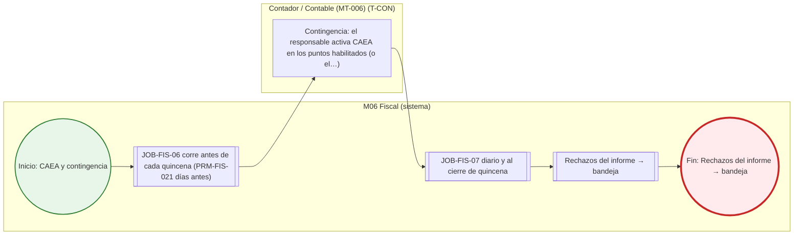

**Pasos del proceso** (actividad tomada del anexo; la columna RF/RN distingue lo citado en el paso de lo asociado por parámetro, permiso, evento o tema compartido).

| Paso | Carril | Actividad | RF/RN que aplican | EVT / JOB / PAN |
|---|---|---|---|---|
| 1 | M06 Fiscal | JOB-FIS-06 corre antes de cada quincena (`PRM-FIS-021` días antes): `FECAEAConsultar`; si no existe, `FECAEASolicitar`; registra `caeaPeriods`. | asoc.: RF-FIS-065 | JOB-FIS-06 |
| 2 | Contador / Contable | Contingencia: el responsable activa CAEA en los puntos habilitados (o el sistema propone tras `PRM-FIS-026` minutos de caída). M05 asigna el CAEA al numerar (RN-FIS-053). | RN-FIS-053; asoc.: RF-FIS-069 | — |
| 3 | M06 Fiscal | JOB-FIS-07 diario y al cierre de quincena: informa con `FECAEARegInformativo` en tandas los comprobantes CAEA no informados (con `CbteFchHsGen`), e informa `FECAEASinMovimientoInformar` para los puntos sin uso. | asoc.: RF-FIS-067, RF-FIS-068 | JOB-FIS-07 |
| 4 | M06 Fiscal | Rechazos del informe → bandeja; alerta si se acerca `reportDeadline` (RF-FIS-070). | RF-FIS-070 | — |

**Situación actual en ProCoop (nota de cambio).** Sin contraste específico para este proceso en el anexo (filas `CTR-` con ProCoop) ni en el análisis de brechas. El contraste del dominio está en `15-analisis-brechas-procoop.md` §3.9.

**Excepciones**

| Excepción | Tratamiento |
|---|---|
| Si no existe | `FECAEASolicitar`; registra `caeaPeriods` |
| Falla o error | Contingencia: el responsable activa CAEA en los puntos habilitados (o el sistema propone tras `PRM-FIS-026` minutos de caída) |
| Rechazo | Rechazos del informe → bandeja; alerta si se acerca `reportDeadline` (RF-FIS-070) |
| Falla técnica en un paso automático, un job o una integración | Reintento idempotente y reanudable; lo no reparable pasa a la bandeja técnica con responsable (política de recuperación de T11 P-WFL-01 y T01 §9.12; AGR-016). |

---

## 2. PRC-FIS-06 Cálculo de impuestos de un comprobante (servicio síncrono `fis.service.calculateTaxes`, antes `fis.taxEngine.calculate`)

| Campo | Contenido |
|---|---|
| Fuente | M06 §9.6, `M06-FIS-fiscal-impuestos.md` (línea 1689) |
| Macroproceso | MP-11 Facturación y fiscal |
| Disparador | Cálculo de impuestos de un comprobante |
| Resultado | Devuelve líneas impositivas con clasificación ARCA y… |
| Carriles | M04 Tarifas; M06 Fiscal (sistema) |
| Roles de T02 | Solo actores del sistema (sin rol humano) |
| Módulos involucrados | M04 Tarifas, M06 Fiscal |
| Eventos (T11 §12) | — |
| Jobs | — |
| Relación con 04-procesos-bpmn.md | P3 Facturación periódica y emisión fiscal ([§7](04-procesos-bpmn.md#7-p3--facturación-periódica-y-emisión-fiscal)) |

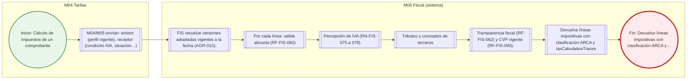

**Pasos del proceso** (actividad tomada del anexo; la columna RF/RN distingue lo citado en el paso de lo asociado por parámetro, permiso, evento o tema compartido).

| Paso | Carril | Actividad | RF/RN que aplican | EVT / JOB / PAN |
|---|---|---|---|---|
| 1 | M04 Tarifas | M04/M05 envían: emisor (perfil vigente), receptor (condición IVA, situación IIBB, CUIT, exclusiones), fecha, servicio, documento y líneas con neto, alícuota de IVA referenciada y componentes. | — | — |
| 2 | M06 Fiscal | FIS resuelve versiones adoptadas vigentes a la fecha (AGR-010). | asoc.: RF-FIS-002 | — |
| 3 | M06 Fiscal | Por cada línea: valida alícuota (RF-FIS-080); calcula IVA1/IVA2 (RN-FIS-074); acumula bases. | RF-FIS-080, RN-FIS-074 | — |
| 4 | M06 Fiscal | Percepción de IVA (RN-FIS-075 a 078); percepción IIBB por jurisdicción (padrón → alícuota determinada → alícuota de no incluidos → matriz), base mínima y mínimo imponible (RN-FIS-080). | RN-FIS-075, RN-FIS-080; asoc.: RF-FIS-087 | — |
| 5 | M06 Fiscal | Tributos y conceptos de terceros: solo los del catálogo con fundamento y servicio/documento permitido (RF-FIS-011, RF-FIS-134). | RF-FIS-011, RF-FIS-134 | — |
| 6 | M06 Fiscal | Transparencia fiscal (RF-FIS-062) y CVP vigente (RF-FIS-090). | RF-FIS-062, RF-FIS-090 | — |
| 7 | M06 Fiscal | Devuelve líneas impositivas con clasificación ARCA y `taxCalculationTraces`. Es determinista: misma entrada y versiones → mismo resultado. | — | — |

**Situación actual en ProCoop (nota de cambio).** Sin contraste específico para este proceso en el anexo (filas `CTR-` con ProCoop) ni en el análisis de brechas. El contraste del dominio está en `15-analisis-brechas-procoop.md` §3.9.

**Excepciones**

| Excepción | Tratamiento |
|---|---|
| Falla técnica en un paso automático, un job o una integración | Reintento idempotente y reanudable; lo no reparable pasa a la bandeja técnica con responsable (política de recuperación de T11 P-WFL-01 y T01 §9.12; AGR-016). |

---

## 3. PRC-FIS-07 Padrones de alícuotas IIBB (JOB-FIS-08 `fis:importar-padron`)

| Campo | Contenido |
|---|---|
| Fuente | M06 §9.7, `M06-FIS-fiscal-impuestos.md` (línea 1699) |
| Macroproceso | MP-11 Facturación y fiscal |
| Disparador | Padrones de alícuotas IIBB |
| Resultado | Antes de cada masiva, M05 consulta… |
| Carriles | Contador / Contable (MT-006) (T-CON); M06 Fiscal (sistema); Aprobador según política (T11 aprobaciones) |
| Roles de T02 | T-CON Contador / Contable (MT-006) |
| Módulos involucrados | M06 Fiscal, T11 Workflow, eventos y documentos |
| Eventos (T11 §12) | — |
| Jobs | — |
| Relación con 04-procesos-bpmn.md | P3 Facturación periódica y emisión fiscal ([§7](04-procesos-bpmn.md#7-p3--facturación-periódica-y-emisión-fiscal)) |

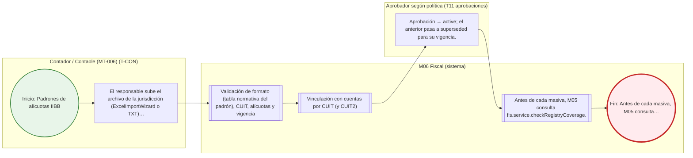

**Pasos del proceso** (actividad tomada del anexo; la columna RF/RN distingue lo citado en el paso de lo asociado por parámetro, permiso, evento o tema compartido).

| Paso | Carril | Actividad | RF/RN que aplican | EVT / JOB / PAN |
|---|---|---|---|---|
| 1 | Contador / Contable | El responsable sube el archivo de la jurisdicción (ExcelImportWizard o TXT) con su régimen y vigencia; o un job lo descarga si existe canal oficial automatizable. | — | — |
| 2 | M06 Fiscal | Validación de formato (tabla normativa del padrón), CUIT, alícuotas y vigencia; vista previa de errores. | — | — |
| 3 | M06 Fiscal | Vinculación con cuentas por CUIT (y CUIT2); informe de no vinculados. | — | — |
| 4 | Aprobador según política | Aprobación → `active`; el anterior pasa a `superseded` para su vigencia. | — | — |
| 5 | M06 Fiscal | Antes de cada masiva, M05 consulta `fis.service.checkRegistryCoverage` (antes `fis.registries.validateCoverage`; RF-FIS-088). | RF-FIS-088 | — |

**Situación actual en ProCoop (nota de cambio).** Sin contraste específico para este proceso en el anexo (filas `CTR-` con ProCoop) ni en el análisis de brechas. El contraste del dominio está en `15-analisis-brechas-procoop.md` §3.9.

**Excepciones**

| Excepción | Tratamiento |
|---|---|
| Falla o error | Validación de formato (tabla normativa del padrón), CUIT, alícuotas y vigencia; vista previa de errores |
| Falla técnica en un paso automático, un job o una integración | Reintento idempotente y reanudable; lo no reparable pasa a la bandeja técnica con responsable (política de recuperación de T11 P-WFL-01 y T01 §9.12; AGR-016). |

---

## 4. PRC-FIS-08 Retenciones en órdenes de pago (servicio `fis.service.calculateWithholdings`, antes `fis.withholding.calculate`)

| Campo | Contenido |
|---|---|
| Fuente | M06 §9.8, `M06-FIS-fiscal-impuestos.md` (línea 1707) |
| Macroproceso | MP-11 Facturación y fiscal |
| Disparador | Retenciones en órdenes de pago |
| Resultado | Al anular la OP: cancelled o rectified según estado… |
| Carriles | M12 Compras; M06 Fiscal (sistema) |
| Roles de T02 | Solo actores del sistema (sin rol humano) |
| Módulos involucrados | M06 Fiscal, M12 Compras |
| Eventos (T11 §12) | — |
| Jobs | — |
| Relación con 04-procesos-bpmn.md | P3 Facturación periódica y emisión fiscal ([§7](04-procesos-bpmn.md#7-p3--facturación-periódica-y-emisión-fiscal)) |

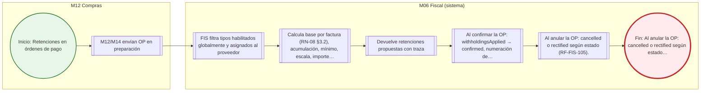

**Pasos del proceso** (actividad tomada del anexo; la columna RF/RN distingue lo citado en el paso de lo asociado por parámetro, permiso, evento o tema compartido).

| Paso | Carril | Actividad | RF/RN que aplican | EVT / JOB / PAN |
|---|---|---|---|---|
| 1 | M12 Compras | M12/M14 envían OP en preparación: proveedor, facturas a pagar (con importes por componente, discriminación, formalidad), anticipos, fecha. | — | — |
| 2 | M06 Fiscal | FIS filtra tipos habilitados globalmente y asignados al proveedor; excluye por certificados vigentes. | asoc.: RF-FIS-098 | — |
| 3 | M06 Fiscal | Calcula base por factura (RN-08 §3.2), acumulación, mínimo, escala, importe (RN-08 §3.3). | RN-08 | — |
| 4 | M06 Fiscal | Devuelve retenciones propuestas con traza; M12/M14 muestran el neto. | — | — |
| 5 | M06 Fiscal | Al confirmar la OP: `withholdingsApplied` → `confirmed`, numeración de certificados (por tipo, punto y año), PDF, actualización del borrador de declaración y de la obligación del período (RF-FIS-109, RF-FIS-108). | RF-FIS-108, RF-FIS-109 | — |
| 6 | M06 Fiscal | Al anular la OP: `cancelled` o `rectified` según estado (RF-FIS-105). | RF-FIS-105 | — |

**Situación actual en ProCoop (nota de cambio).** Sin contraste específico para este proceso en el anexo (filas `CTR-` con ProCoop) ni en el análisis de brechas. El contraste del dominio está en `15-analisis-brechas-procoop.md` §3.9.

**Excepciones**

| Excepción | Tratamiento |
|---|---|
| Cancelación, anulación o reversión | Al anular la OP: `cancelled` o `rectified` según estado (RF-FIS-105) |
| Falla técnica en un paso automático, un job o una integración | Reintento idempotente y reanudable; lo no reparable pasa a la bandeja técnica con responsable (política de recuperación de T11 P-WFL-01 y T01 §9.12; AGR-016). |

---

## 5. PRC-FIS-09 Libro IVA y Libro IVA Digital (JOB-FIS-10 `fis:generar-libro-iva`, JOB-FIS-11 `fis:generar-lid`)

| Campo | Contenido |
|---|---|
| Fuente | M06 §9.9, `M06-FIS-fiscal-impuestos.md` (línea 1716) |
| Macroproceso | MP-11 Facturación y fiscal |
| Disparador | Libro IVA y Libro IVA Digital |
| Resultado | El responsable presenta en ARCA y carga el acuse → submitted →… |
| Carriles | Contador / Contable (MT-006) (T-CON); M06 Fiscal (sistema) |
| Roles de T02 | T-CON Contador / Contable (MT-006) |
| Módulos involucrados | M06 Fiscal |
| Eventos (T11 §12) | — |
| Jobs | JOB-FIS-11 `fis:generar-lid` |
| Relación con 04-procesos-bpmn.md | P3 Facturación periódica y emisión fiscal ([§7](04-procesos-bpmn.md#7-p3--facturación-periódica-y-emisión-fiscal)) |

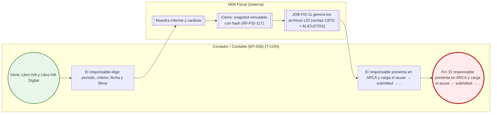

**Pasos del proceso** (actividad tomada del anexo; la columna RF/RN distingue lo citado en el paso de lo asociado por parámetro, permiso, evento o tema compartido).

| Paso | Carril | Actividad | RF/RN que aplican | EVT / JOB / PAN |
|---|---|---|---|---|
| 1 | Contador / Contable | El responsable elige período, criterio, fecha y filtros; el job arma `vatLedgerLines` desde comprobantes autorizados (M05/M07), cobros (M07) para el percibido, y compras (M12). | asoc.: RF-FIS-112 | — |
| 2 | M06 Fiscal | Muestra informe y carátula; permite comparar con Mis Comprobantes (9.10). | — | — |
| 3 | M06 Fiscal | Cierre: snapshot inmutable con hash (RF-FIS-117). | RF-FIS-117 | — |
| 4 | M06 Fiscal | JOB-FIS-11 genera los archivos LID (ventas CBTE + ALICUOTAS; compras CBTE + ALICUOTAS), valida por línea y correlatividad y crea la `regimeFilings` en `validated`. | — | JOB-FIS-11 |
| 5 | Contador / Contable | El responsable presenta en ARCA y carga el acuse → `submitted` → `accepted`/`rejected`. | — | — |

**Situación actual en ProCoop (nota de cambio).** Sin contraste específico para este proceso en el anexo (filas `CTR-` con ProCoop) ni en el análisis de brechas. El contraste del dominio está en `15-analisis-brechas-procoop.md` §3.9.

**Excepciones**

| Excepción | Tratamiento |
|---|---|
| Falla técnica en un paso automático, un job o una integración | Reintento idempotente y reanudable; lo no reparable pasa a la bandeja técnica con responsable (política de recuperación de T11 P-WFL-01 y T01 §9.12; AGR-016). |

---

## 6. PRC-FIS-10 Conciliación con Mis Comprobantes (JOB-FIS-12 `fis:conciliar-mis-comprobantes`)

| Campo | Contenido |
|---|---|
| Fuente | M06 §9.10, `M06-FIS-fiscal-impuestos.md` (línea 1724) |
| Macroproceso | MP-11 Facturación y fiscal |
| Disparador | Conciliación con Mis Comprobantes |
| Resultado | Revisión y cierre de la conciliación con comentarios. |
| Carriles | M06 Fiscal (sistema) |
| Roles de T02 | Solo actores del sistema (sin rol humano) |
| Módulos involucrados | M06 Fiscal |
| Eventos (T11 §12) | — |
| Jobs | — |
| Relación con 04-procesos-bpmn.md | P3 Facturación periódica y emisión fiscal ([§7](04-procesos-bpmn.md#7-p3--facturación-periódica-y-emisión-fiscal)) |

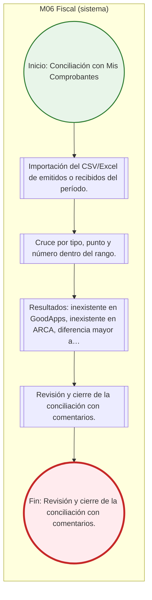

**Pasos del proceso** (actividad tomada del anexo; la columna RF/RN distingue lo citado en el paso de lo asociado por parámetro, permiso, evento o tema compartido).

| Paso | Carril | Actividad | RF/RN que aplican | EVT / JOB / PAN |
|---|---|---|---|---|
| 1 | M06 Fiscal | Importación del CSV/Excel de emitidos o recibidos del período. | — | — |
| 2 | M06 Fiscal | Cruce por tipo, punto y número dentro del rango. | — | — |
| 3 | M06 Fiscal | Resultados: inexistente en GoodApps, inexistente en ARCA, diferencia mayor a `PRM-FIS-053` por campo. | asoc.: RF-FIS-123, RN-FIS-102 | — |
| 4 | M06 Fiscal | Revisión y cierre de la conciliación con comentarios. | — | — |

**Situación actual en ProCoop (nota de cambio).** Sin contraste específico para este proceso en el anexo (filas `CTR-` con ProCoop) ni en el análisis de brechas. El contraste del dominio está en `15-analisis-brechas-procoop.md` §3.9.

**Excepciones**

| Excepción | Tratamiento |
|---|---|
| Falla técnica en un paso automático, un job o una integración | Reintento idempotente y reanudable; lo no reparable pasa a la bandeja técnica con responsable (política de recuperación de T11 P-WFL-01 y T01 §9.12; AGR-016). |

---

## 7. PRC-FIS-11 Regímenes informativos (JOB-FIS-13 `fis:generar-regimen`)

| Campo | Contenido |
|---|---|
| Fuente | M06 §9.11, `M06-FIS-fiscal-impuestos.md` (línea 1731) |
| Macroproceso | MP-11 Facturación y fiscal |
| Disparador | Regímenes informativos |
| Resultado | Aprobación (doble control si PRM-FIS-060), presentación humana… |
| Carriles | M06 Fiscal (sistema); Aprobador según política (T11 aprobaciones) |
| Roles de T02 | Solo actores del sistema (sin rol humano) |
| Módulos involucrados | M06 Fiscal, T11 Workflow, eventos y documentos |
| Eventos (T11 §12) | — |
| Jobs | JOB-FIS-14 `fis:calendario-fiscal`; JOB-FIS-13 `fis:generar-regimen` |
| Relación con 04-procesos-bpmn.md | P3 Facturación periódica y emisión fiscal ([§7](04-procesos-bpmn.md#7-p3--facturación-periódica-y-emisión-fiscal)) |

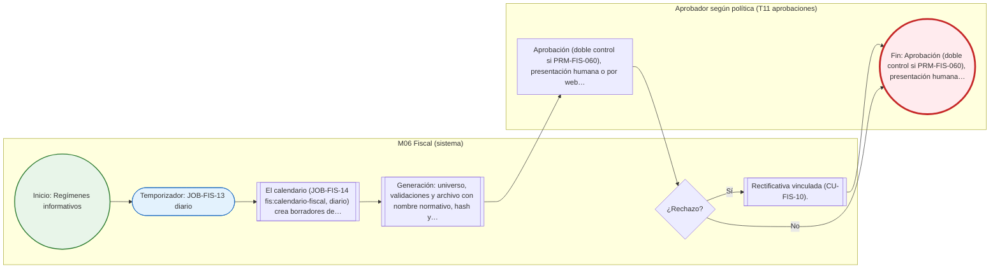

**Pasos del proceso** (actividad tomada del anexo; la columna RF/RN distingue lo citado en el paso de lo asociado por parámetro, permiso, evento o tema compartido).

| Paso | Carril | Actividad | RF/RN que aplican | EVT / JOB / PAN |
|---|---|---|---|---|
| 1 | M06 Fiscal | El calendario (JOB-FIS-14 `fis:calendario-fiscal`, diario) crea borradores de cada obligación del período. | — | JOB-FIS-14 |
| 2 | M06 Fiscal | Generación: universo, validaciones y archivo con nombre normativo, hash y totales. | asoc.: RF-FIS-126 | — |
| 3 | Aprobador según política | Aprobación (doble control si `PRM-FIS-060`), presentación humana o por web service si existe y está habilitado, acuse, resultado. | — | — |
| 4 | M06 Fiscal | Rechazo → rectificativa vinculada (CU-FIS-10). | — | — |

**Situación actual en ProCoop (nota de cambio).** CTR-FIS-15: en ProCoop, ProCoop y el DFA hablan de presentar automáticamente; BASE exige que generar un archivo no equivalga a presentado y no automatizar pantallas autenticadas. Cambio adoptado: El sistema genera, valida y registra; la presentación es humana o por web service oficial habilitado, con acuse adjunto.

**Excepciones**

| Excepción | Tratamiento |
|---|---|
| Rechazo | Rechazo → rectificativa vinculada (CU-FIS-10) |
| Falla técnica en un paso automático, un job o una integración | Reintento idempotente y reanudable; lo no reparable pasa a la bandeja técnica con responsable (política de recuperación de T11 P-WFL-01 y T01 §9.12; AGR-016). |

---

## 8. PRC-FIS-12 Conceptos de terceros y rendición (JOB-FIS-15 `fis:rendicion-terceros`)

| Campo | Contenido |
|---|---|
| Fuente | M06 §9.12, `M06-FIS-fiscal-impuestos.md` (línea 1738) |
| Macroproceso | MP-11 Facturación y fiscal |
| Disparador | Conceptos de terceros y rendición |
| Resultado | Al cierre del período del convenio, JOB-FIS-15 calcula cobrado… |
| Carriles | M06 Fiscal (sistema); M05 Facturación; M07 Cuenta corriente y cobranza |
| Roles de T02 | Solo actores del sistema (sin rol humano) |
| Módulos involucrados | M05 Facturación, M06 Fiscal, M07 Cuenta corriente y cobranza |
| Eventos (T11 §12) | — |
| Jobs | JOB-FIS-15 `fis:rendicion-terceros` |
| Relación con 04-procesos-bpmn.md | P3 Facturación periódica y emisión fiscal ([§7](04-procesos-bpmn.md#7-p3--facturación-periódica-y-emisión-fiscal)) |

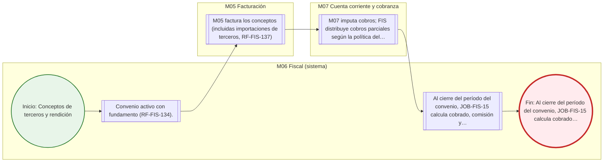

**Pasos del proceso** (actividad tomada del anexo; la columna RF/RN distingue lo citado en el paso de lo asociado por parámetro, permiso, evento o tema compartido).

| Paso | Carril | Actividad | RF/RN que aplican | EVT / JOB / PAN |
|---|---|---|---|---|
| 1 | M06 Fiscal | Convenio activo con fundamento (RF-FIS-134). | RF-FIS-134 | — |
| 2 | M05 Facturación | M05 factura los conceptos (incluidas importaciones de terceros, RF-FIS-137); FIS registra `thirdPartyCharges`. | RF-FIS-137 | — |
| 3 | M07 Cuenta corriente y cobranza | M07 imputa cobros; FIS distribuye cobros parciales según la política del convenio (RF-FIS-138) y emite eventos contables de pasivo. | RF-FIS-138 | — |
| 4 | M06 Fiscal | Al cierre del período del convenio, JOB-FIS-15 calcula cobrado, comisión y neto; genera reporte/archivo; aprobación; M14 emite la OP; al confirmarse el pago, conciliación. | asoc.: RF-FIS-139 | JOB-FIS-15 |

**Situación actual en ProCoop (nota de cambio).** Sin contraste específico para este proceso en el anexo (filas `CTR-` con ProCoop) ni en el análisis de brechas. El contraste del dominio está en `15-analisis-brechas-procoop.md` §3.9.

**Excepciones**

| Excepción | Tratamiento |
|---|---|
| Falla técnica en un paso automático, un job o una integración | Reintento idempotente y reanudable; lo no reparable pasa a la bandeja técnica con responsable (política de recuperación de T11 P-WFL-01 y T01 §9.12; AGR-016). |

---

## 9. PRC-FIS-13 Informes regulatorios (JOB-FIS-16 `fis:generar-informe-regulatorio`)

| Campo | Contenido |
|---|---|
| Fuente | M06 §9.13, `M06-FIS-fiscal-impuestos.md` (línea 1745) |
| Macroproceso | MP-11 Facturación y fiscal |
| Disparador | Informes regulatorios |
| Resultado | Valida, aprueba, presenta y registra acuse. |
| Carriles | M06 Fiscal (sistema) |
| Roles de T02 | Solo actores del sistema (sin rol humano) |
| Módulos involucrados | M06 Fiscal |
| Eventos (T11 §12) | — |
| Jobs | — |
| Relación con 04-procesos-bpmn.md | P3 Facturación periódica y emisión fiscal ([§7](04-procesos-bpmn.md#7-p3--facturación-periódica-y-emisión-fiscal)) |

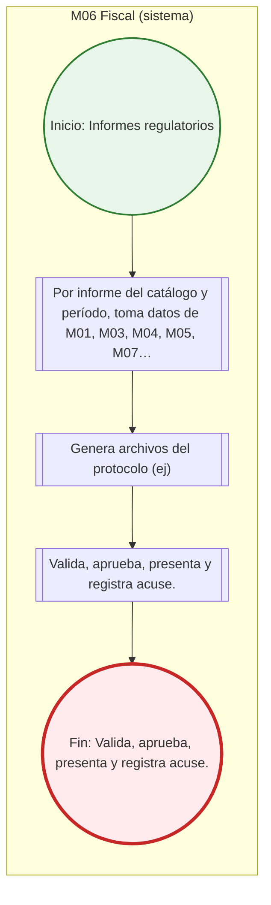

**Pasos del proceso** (actividad tomada del anexo; la columna RF/RN distingue lo citado en el paso de lo asociado por parámetro, permiso, evento o tema compartido).

| Paso | Carril | Actividad | RF/RN que aplican | EVT / JOB / PAN |
|---|---|---|---|---|
| 1 | M06 Fiscal | Por informe del catálogo y período, toma datos de M01, M03, M04, M05, M07, M08 y M10 según `regulatoryConceptMaps`. | — | — |
| 2 | M06 Fiscal | Genera archivos del protocolo (ej. FCU-DS: FaC, Sub, FaD, CoC, Usr, FaV, SICC) con nombres y separadores normados. | asoc.: RF-FIS-145 | — |
| 3 | M06 Fiscal | Valida, aprueba, presenta y registra acuse. | — | — |

**Situación actual en ProCoop (nota de cambio).** Sin contraste específico para este proceso en el anexo (filas `CTR-` con ProCoop) ni en el análisis de brechas. El contraste del dominio está en `15-analisis-brechas-procoop.md` §3.9.

**Excepciones**

| Excepción | Tratamiento |
|---|---|
| Falla técnica en un paso automático, un job o una integración | Reintento idempotente y reanudable; lo no reparable pasa a la bandeja técnica con responsable (política de recuperación de T11 P-WFL-01 y T01 §9.12; AGR-016). |

---

## 10. PRC-FIS-14 Sincronización de tablas ARCA (JOB-FIS-17 `fis:sincronizar-parametros-arca`, plataforma)

| Campo | Contenido |
|---|---|
| Fuente | M06 §9.14, `M06-FIS-fiscal-impuestos.md` (línea 1751) |
| Macroproceso | MP-11 Facturación y fiscal |
| Disparador | Sincronización de tablas ARCA |
| Resultado | Semanal y a demanda: llama a los FEParamGet* con un certificado… |
| Carriles | M06 Fiscal (sistema) |
| Roles de T02 | Solo actores del sistema (sin rol humano) |
| Módulos involucrados | M06 Fiscal |
| Eventos (T11 §12) | — |
| Jobs | JOB-FIS-17 `fis:sincronizar-parametros-arca` |
| Relación con 04-procesos-bpmn.md | P3 Facturación periódica y emisión fiscal ([§7](04-procesos-bpmn.md#7-p3--facturación-periódica-y-emisión-fiscal)) |

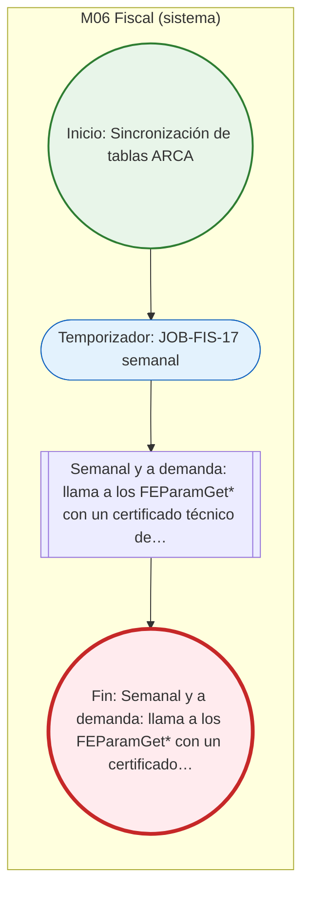

**Pasos del proceso** (actividad tomada del anexo; la columna RF/RN distingue lo citado en el paso de lo asociado por parámetro, permiso, evento o tema compartido).

| Paso | Carril | Actividad | RF/RN que aplican | EVT / JOB / PAN |
|---|---|---|---|---|
| 1 | M06 Fiscal | Semanal y a demanda: llama a los `FEParamGet*` con un certificado técnico de plataforma (o del primer tenant que lo autorice), compara con la versión publicada y crea `draft` con diff y alerta | — | — |

**Situación actual en ProCoop (nota de cambio).** Sin contraste específico para este proceso en el anexo (filas `CTR-` con ProCoop) ni en el análisis de brechas. El contraste del dominio está en `15-analisis-brechas-procoop.md` §3.9.

**Excepciones**

| Excepción | Tratamiento |
|---|---|
| Falla técnica en un paso automático, un job o una integración | Reintento idempotente y reanudable; lo no reparable pasa a la bandeja técnica con responsable (política de recuperación de T11 P-WFL-01 y T01 §9.12; AGR-016). |

---

## 11. PRC-FIS-15 Alertas de vencimientos (JOB-FIS-18 `fis:alertas-credenciales`, JOB-FIS-14)

| Campo | Contenido |
|---|---|
| Fuente | M06 §9.15, `M06-FIS-fiscal-impuestos.md` (línea 1755) |
| Macroproceso | MP-11 Facturación y fiscal |
| Disparador | Alertas de vencimientos |
| Resultado | Diario: certificados (30/14/7/3/vencido), CAEA (plazo de…) |
| Carriles | M06 Fiscal (sistema) |
| Roles de T02 | Solo actores del sistema (sin rol humano) |
| Módulos involucrados | M06 Fiscal |
| Eventos (T11 §12) | — |
| Jobs | JOB-FIS-18 `fis:alertas-credenciales` |
| Relación con 04-procesos-bpmn.md | P3 Facturación periódica y emisión fiscal ([§7](04-procesos-bpmn.md#7-p3--facturación-periódica-y-emisión-fiscal)) |

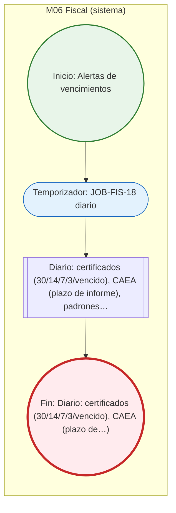

**Pasos del proceso** (actividad tomada del anexo; la columna RF/RN distingue lo citado en el paso de lo asociado por parámetro, permiso, evento o tema compartido).

| Paso | Carril | Actividad | RF/RN que aplican | EVT / JOB / PAN |
|---|---|---|---|---|
| 1 | M06 Fiscal | Diario: certificados (30/14/7/3/vencido), CAEA (plazo de informe), padrones (vigencia), CESP/CAI (vencimiento), declaraciones (calendario), pendientes de autorización (> N días) | — | — |

**Situación actual en ProCoop (nota de cambio).** CTR-FIS-05: en ProCoop, ProCoop considera un CAEA vencido cuando `VTO <= hoy` (el último día no se puede usar) y no controla el uso restringido. Cambio adoptado: Vigencia hasta el fin del día de vencimiento; uso limitado por tabla normativa y `PRM-FIS-022`.

**Excepciones**

| Excepción | Tratamiento |
|---|---|
| Vencimiento | Diario: certificados (30/14/7/3/vencido), CAEA (plazo de informe), padrones (vigencia), CESP/CAI (vencimiento), declaraciones (calendario), pendientes de autorización (> N días) |
| Falla técnica en un paso automático, un job o una integración | Reintento idempotente y reanudable; lo no reparable pasa a la bandeja técnica con responsable (política de recuperación de T11 P-WFL-01 y T01 §9.12; AGR-016). |

---

## 12. PRC-FIS-16 Revalidación de padrón (JOB-FIS-19 `fis:revalidar-condicion`)

| Campo | Contenido |
|---|---|
| Fuente | M06 §9.16, `M06-FIS-fiscal-impuestos.md` (línea 1759) |
| Macroproceso | MP-11 Facturación y fiscal |
| Disparador | Revalidación de padrón |
| Resultado | Nada cambia sin aprobación (PA-FIS-17) |
| Carriles | M06 Fiscal (sistema) |
| Roles de T02 | Solo actores del sistema (sin rol humano) |
| Módulos involucrados | M06 Fiscal |
| Eventos (T11 §12) | — |
| Jobs | JOB-FIS-19 `fis:revalidar-condicion` |
| Relación con 04-procesos-bpmn.md | P3 Facturación periódica y emisión fiscal ([§7](04-procesos-bpmn.md#7-p3--facturación-periódica-y-emisión-fiscal)) |

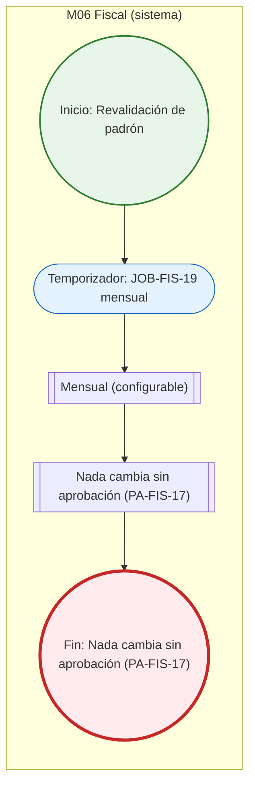

**Pasos del proceso** (actividad tomada del anexo; la columna RF/RN distingue lo citado en el paso de lo asociado por parámetro, permiso, evento o tema compartido).

| Paso | Carril | Actividad | RF/RN que aplican | EVT / JOB / PAN |
|---|---|---|---|---|
| 1 | M06 Fiscal | Mensual (configurable): consulta padrón por lotes con límite de tasa, compara condición IVA/monotributo con M01/M12, genera informe de diferencias y propuestas | asoc.: RF-FIS-018 | — |
| 2 | M06 Fiscal | nada cambia sin aprobación (PA-FIS-17) | asoc.: RF-FIS-018 | — |

**Situación actual en ProCoop (nota de cambio).** Sin contraste específico para este proceso en el anexo (filas `CTR-` con ProCoop) ni en el análisis de brechas. El contraste del dominio está en `15-analisis-brechas-procoop.md` §3.9.

**Excepciones**

| Excepción | Tratamiento |
|---|---|
| Falla técnica en un paso automático, un job o una integración | Reintento idempotente y reanudable; lo no reparable pasa a la bandeja técnica con responsable (política de recuperación de T11 P-WFL-01 y T01 §9.12; AGR-016). |

---

## 13. PRC-FIS-17 Modo pasarela (JOB-FIS-20 `fis:pasarela-importar`)

| Campo | Contenido |
|---|---|
| Fuente | M06 §9.17, `M06-FIS-fiscal-impuestos.md` (línea 1763) |
| Macroproceso | MP-11 Facturación y fiscal |
| Disparador | Modo pasarela |
| Resultado | Resultado por API (GET .../documents/(id)) o archivo de salida… |
| Carriles | M06 Fiscal (sistema) |
| Roles de T02 | Solo actores del sistema (sin rol humano) |
| Módulos involucrados | M06 Fiscal |
| Eventos (T11 §12) | — |
| Jobs | — |
| Relación con 04-procesos-bpmn.md | P3 Facturación periódica y emisión fiscal ([§7](04-procesos-bpmn.md#7-p3--facturación-periódica-y-emisión-fiscal)) |

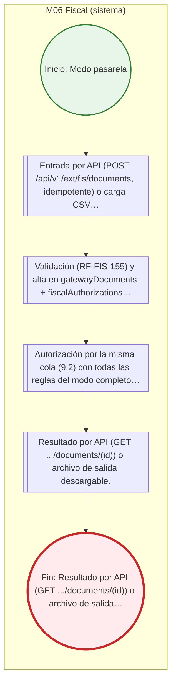

**Pasos del proceso** (actividad tomada del anexo; la columna RF/RN distingue lo citado en el paso de lo asociado por parámetro, permiso, evento o tema compartido).

| Paso | Carril | Actividad | RF/RN que aplican | EVT / JOB / PAN |
|---|---|---|---|---|
| 1 | M06 Fiscal | Entrada por API (`POST /api/v1/ext/fis/documents`, idempotente) o carga CSV desde la pantalla. | — | — |
| 2 | M06 Fiscal | Validación (RF-FIS-155) y alta en `gatewayDocuments` + `fiscalAuthorizations` (`sourceModule = gateway`). | RF-FIS-155; asoc.: RN-FIS-002 | — |
| 3 | M06 Fiscal | Autorización por la misma cola (9.2) con todas las reglas del modo completo, incluido el tratamiento de 10242/10243. | — | — |
| 4 | M06 Fiscal | Resultado por API (`GET .../documents/{id}`) o archivo de salida descargable. | — | — |

**Situación actual en ProCoop (nota de cambio).** Sin contraste específico para este proceso en el anexo (filas `CTR-` con ProCoop) ni en el análisis de brechas. El contraste del dominio está en `15-analisis-brechas-procoop.md` §3.9.

**Excepciones**

| Excepción | Tratamiento |
|---|---|
| Falla técnica en un paso automático, un job o una integración | Reintento idempotente y reanudable; lo no reparable pasa a la bandeja técnica con responsable (política de recuperación de T11 P-WFL-01 y T01 §9.12; AGR-016). |

---

## 14. PRC-FIS-18 Recuperación (ESC-04)

| Campo | Contenido |
|---|---|
| Fuente | M06 §9.18, `M06-FIS-fiscal-impuestos.md` (línea 1770) |
| Macroproceso | MP-11 Facturación y fiscal |
| Disparador | Recuperación |
| Resultado | Nunca reenvía un número que ARCA ya tiene (AGR-019) |
| Carriles | M06 Fiscal (sistema) |
| Roles de T02 | Solo actores del sistema (sin rol humano) |
| Módulos involucrados | M06 Fiscal |
| Eventos (T11 §12) | — |
| Jobs | JOB-FIS-05 `fis:conciliar-arca` |
| Relación con 04-procesos-bpmn.md | P3 Facturación periódica y emisión fiscal ([§7](04-procesos-bpmn.md#7-p3--facturación-periódica-y-emisión-fiscal)) |

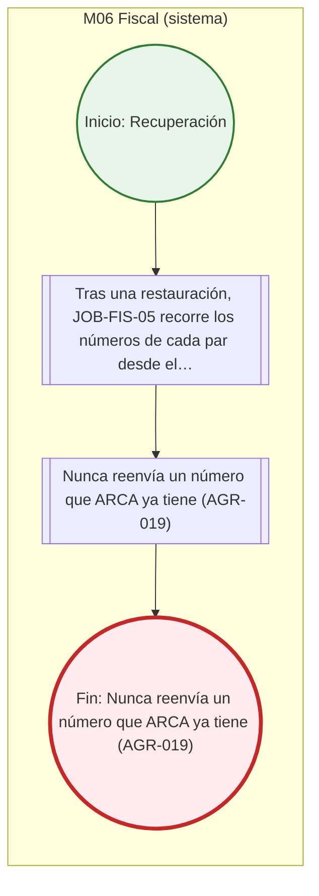

**Pasos del proceso** (actividad tomada del anexo; la columna RF/RN distingue lo citado en el paso de lo asociado por parámetro, permiso, evento o tema compartido).

| Paso | Carril | Actividad | RF/RN que aplican | EVT / JOB / PAN |
|---|---|---|---|---|
| 1 | M06 Fiscal | Tras una restauración, JOB-FIS-05 recorre los números de cada par desde el último autorizado conocido hasta el último de ARCA y recupera CAE y totales | — | JOB-FIS-05 |
| 2 | M06 Fiscal | nunca reenvía un número que ARCA ya tiene (AGR-019) | — | — |

**Situación actual en ProCoop (nota de cambio).** Sin contraste específico para este proceso en el anexo (filas `CTR-` con ProCoop) ni en el análisis de brechas. El contraste del dominio está en `15-analisis-brechas-procoop.md` §3.9.

**Excepciones**

| Excepción | Tratamiento |
|---|---|
| Falla técnica en un paso automático, un job o una integración | Reintento idempotente y reanudable; lo no reparable pasa a la bandeja técnica con responsable (política de recuperación de T11 P-WFL-01 y T01 §9.12; AGR-016). |

---

## 15. PRC-MOR-01 Cálculo de importes por vencimiento al emitir (O4)

| Campo | Contenido |
|---|---|
| Fuente | M08 §9.1, `M08-MOR-mora-financiacion.md` (línea 1919); ola O4 |
| Macroproceso | MP-12 Mora, corte y financiación |
| Disparador | Cálculo de importes por vencimiento al emitir |
| Resultado | Devuelve [( dueDate, total, surchargeNet, surchargeVat )] |
| Carriles | M05 Facturación; M08 Mora (sistema) |
| Roles de T02 | Solo actores del sistema (sin rol humano) |
| Módulos involucrados | M05 Facturación, M08 Mora |
| Eventos (T11 §12) | — |
| Jobs | — |
| Relación con 04-procesos-bpmn.md | P5 Mora, aviso, suspensión o restricción, rehabilitación y financiación ([§9](04-procesos-bpmn.md#9-p5--mora-aviso-suspensión-o-restricción-rehabilitación-y-financiación)) |

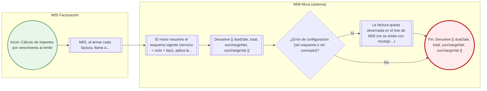

**Pasos del proceso** (actividad tomada del anexo; la columna RF/RN distingue lo citado en el paso de lo asociado por parámetro, permiso, evento o tema compartido).

| Paso | Carril | Actividad | RF/RN que aplican | EVT / JOB / PAN |
|---|---|---|---|---|
| 1 | M05 Facturación | M05, al armar cada factura, llama a `mor.interestEngine.dueDateSchedule(document, scheme)` con TOTAL1, VTO1..VTO4, tipo de documento, servicio, ciclo y situación fiscal. | asoc.: RN-MOR-001 | — |
| 2 | M08 Mora | El motor resuelve el esquema vigente (servicio + ciclo + tipo), aplica la variante (RN-MOR-028 a RN-MOR-033) y calcula el IVA del recargo con el concepto del esquema. | RN-MOR-028, RN-MOR-033; asoc.: RF-MOR-011 | — |
| 3 | M08 Mora | Devuelve `[{ dueDate, total, surchargeNet, surchargeVat }]`; M05 lo imprime y lo expone al portal. | — | — |
| 4 | M08 Mora | Error de configuración (sin esquema o sin concepto) → la factura queda observada en el lote de M05 (no se emite con recargo incorrecto). | — | — |

**Situación actual en ProCoop (nota de cambio).** CTR-MOR-15: en ProCoop, BASE §97.3 (recargo cobrado en documento posterior) vs. ProCoop (TOTAL2..4 impresos en la factura). Cambio adoptado: No es conflicto: los TOTALk se informan en la factura y el recargo efectivamente cobrado se documenta al cobrar (RF-MOR-020).

**Excepciones**

| Excepción | Tratamiento |
|---|---|
| Falla o error | Error de configuración (sin esquema o sin concepto) → la factura queda observada en el lote de M05 (no se emite con recargo incorrecto) |
| Falla técnica en un paso automático, un job o una integración | Reintento idempotente y reanudable; lo no reparable pasa a la bandeja técnica con responsable (política de recuperación de T11 P-WFL-01 y T01 §9.12; AGR-016). |

---

## 16. PRC-MOR-02 Cotización y liquidación al cobrar (O5)

| Campo | Contenido |
|---|---|
| Fuente | M08 §9.2, `M08-MOR-mora-financiacion.md` (línea 1926); ola O5 |
| Macroproceso | MP-12 Mora, corte y financiación |
| Disparador | Cotización y liquidación al cobrar |
| Resultado | Reintento con el mismo Idempotency-Key devuelve el mismo… |
| Carriles | M07 Cuenta corriente y cobranza; M08 Mora (sistema) |
| Roles de T02 | Solo actores del sistema (sin rol humano) |
| Módulos involucrados | M07 Cuenta corriente y cobranza, M08 Mora |
| Eventos (T11 §12) | EVT-MOR-02 `mor.interest.settled` |
| Jobs | — |
| Relación con 04-procesos-bpmn.md | P5 Mora, aviso, suspensión o restricción, rehabilitación y financiación ([§9](04-procesos-bpmn.md#9-p5--mora-aviso-suspensión-o-restricción-rehabilitación-y-financiación)) |

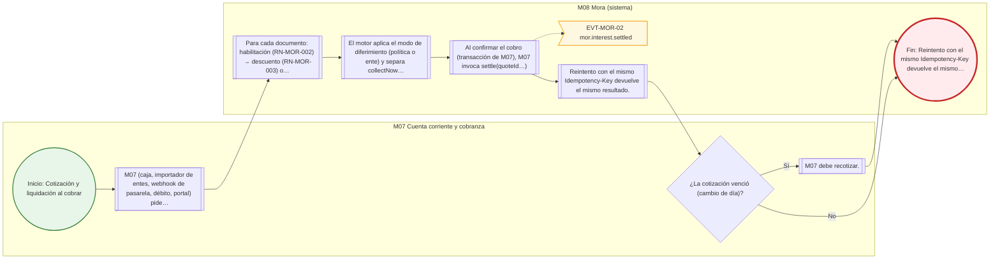

**Pasos del proceso** (actividad tomada del anexo; la columna RF/RN distingue lo citado en el paso de lo asociado por parámetro, permiso, evento o tema compartido).

| Paso | Carril | Actividad | RF/RN que aplican | EVT / JOB / PAN |
|---|---|---|---|---|
| 1 | M07 Cuenta corriente y cobranza | M07 (caja, importador de entes, webhook de pasarela, débito, portal) pide `quote(documents[], calculationDate, channel, entityId)`. | — | — |
| 2 | M08 Mora | Para cada documento: habilitación (RN-MOR-002) → descuento (RN-MOR-003) o recargo entre vencimientos (RN-MOR-004) o mora (RN-MOR-005 a -016) desde `interestSettledUntil` → fiscalidad → mínimo → gastos → redondeo. | RN-MOR-002, RN-MOR-003, RN-MOR-004, RN-MOR-005; asoc.: RN-MOR-017, RN-MOR-047 | — |
| 3 | M08 Mora | El motor aplica el modo de diferimiento (política o ente) y separa `collectNow` y `defer`. | — | — |
| 4 | M08 Mora | Al confirmar el cobro (transacción de M07), M07 invoca `settle(quoteId, receiptRef)`: M08 registra `interestCalculations`, actualiza `interestSettledUntil`, crea `chargeRequests` a M05 (cobrado en el acto) y `deferredInterests` (diferido) en la misma transacción vía servicio de dominio; publica `mor.interest.settled`. | asoc.: RN-MOR-017, RN-MOR-047 | EVT-MOR-02 |
| 5 | M08 Mora | Reintento con el mismo `Idempotency-Key` devuelve el mismo resultado. | — | — |
| 6 | M07 Cuenta corriente y cobranza | Si la cotización venció (cambio de día), M07 debe recotizar. | — | — |

**Situación actual en ProCoop (nota de cambio).** CTR-MOR-15: en ProCoop, BASE §97.3 (recargo cobrado en documento posterior) vs. ProCoop (TOTAL2..4 impresos en la factura). Cambio adoptado: No es conflicto: los TOTALk se informan en la factura y el recargo efectivamente cobrado se documenta al cobrar (RF-MOR-020).

**Excepciones**

| Excepción | Tratamiento |
|---|---|
| Vencimiento | Para cada documento: habilitación (RN-MOR-002) → descuento (RN-MOR-003) o recargo entre vencimientos (RN-MOR-004) o mora (RN-MOR-005 a -016) desde `interestSettledUntil` → fiscalidad → mínimo → gastos → redondeo |
| Reintento | Reintento con el mismo `Idempotency-Key` devuelve el mismo resultado |
| Si la cotización venció (cambio de día) | M07 debe recotizar |
| Falla técnica en un paso automático, un job o una integración | Reintento idempotente y reanudable; lo no reparable pasa a la bandeja técnica con responsable (política de recuperación de T11 P-WFL-01 y T01 §9.12; AGR-016). |

---

## 17. PRC-MOR-03 JOB-MOR-01 `mor:intereses-facturar` (O6)

| Campo | Contenido |
|---|---|
| Fuente | M08 §9.3, `M08-MOR-mora-financiacion.md` (línea 1935); ola O6 |
| Macroproceso | MP-12 Mora, corte y financiación |
| Disparador | JOB-MOR-01 mor:intereses-facturar |
| Resultado | Cancelación: solo antes de generar |
| Carriles | Comercial / Atención al socio (T-ATE); M08 Mora (sistema) |
| Roles de T02 | T-ATE Comercial / Atención al socio |
| Módulos involucrados | M08 Mora |
| Eventos (T11 §12) | — |
| Jobs | JOB-MOR-01 `mor:intereses-facturar` |
| Relación con 04-procesos-bpmn.md | P5 Mora, aviso, suspensión o restricción, rehabilitación y financiación ([§9](04-procesos-bpmn.md#9-p5--mora-aviso-suspensión-o-restricción-rehabilitación-y-financiación)) |

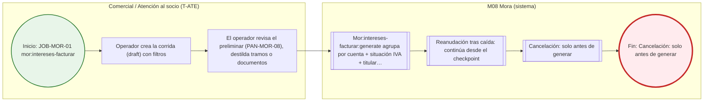

**Pasos del proceso** (actividad tomada del anexo; la columna RF/RN distingue lo citado en el paso de lo asociado por parámetro, permiso, evento o tema compartido).

| Paso | Carril | Actividad | RF/RN que aplican | EVT / JOB / PAN |
|---|---|---|---|---|
| 1 | Comercial / Atención al socio | Operador crea la corrida (`draft`) con filtros; el job `mor:intereses-facturar:preview` selecciona documentos (RN-MOR-041) en bloques de 500, calcula tramos (RN-MOR-042 a -044) y crea ítems `preview`. | RN-MOR-041, RN-MOR-042; asoc.: RF-MOR-049 | — |
| 2 | Comercial / Atención al socio | El operador revisa el preliminar (PAN-MOR-08), destilda tramos o documentos; si la política lo exige, el contador aprueba. | asoc.: RF-MOR-055 | PAN-MOR-08 |
| 3 | M08 Mora | `mor:intereses-facturar:generate` agrupa por cuenta + situación IVA + titular, crea un `chargeRequest` por cuenta a M05 (forma "próxima facturación") y actualiza `interestSettledUntil` por documento, en transacción por cuenta; checkpoint cada bloque. | asoc.: RN-MOR-017, RN-MOR-046 | — |
| 4 | M08 Mora | Reanudación tras caída: continúa desde el checkpoint; ítems ya `charged` se omiten (idempotencia por `runId + documentId`). | — | — |
| 5 | M08 Mora | Cancelación: solo antes de generar. Anulación posterior: se anulan los cargos pendientes en M05 y se restituyen las marcas. | — | — |

**Situación actual en ProCoop (nota de cambio).** Sin contraste específico para este proceso en el anexo (filas `CTR-` con ProCoop) ni en el análisis de brechas. El contraste del dominio está en `15-analisis-brechas-procoop.md` §3.11.

**Excepciones**

| Excepción | Tratamiento |
|---|---|
| Si la política lo exige | el contador aprueba |
| Falla o error | Reanudación tras caída: continúa desde el checkpoint; ítems ya `charged` se omiten (idempotencia por `runId + documentId`) |
| Cancelación, anulación o reversión | Cancelación: solo antes de generar |
| Cancelación, anulación o reversión | Anulación posterior: se anulan los cargos pendientes en M05 y se restituyen las marcas |
| Falla técnica en un paso automático, un job o una integración | Reintento idempotente y reanudable; lo no reparable pasa a la bandeja técnica con responsable (política de recuperación de T11 P-WFL-01 y T01 §9.12; AGR-016). |

---

## 18. PRC-MOR-04 JOB-MOR-02 `mor:evaluar-mora` (diario, O6)

| Campo | Contenido |
|---|---|
| Fuente | M08 §9.4, `M08-MOR-mora-financiacion.md` (línea 1943); ola O6 |
| Macroproceso | MP-12 Mora, corte y financiación |
| Disparador | JOB-MOR-02 mor:evaluar-mora |
| Resultado | Resultado en tablero; sin efectos sobre servicios. |
| Carriles | M08 Mora (sistema) |
| Roles de T02 | Solo actores del sistema (sin rol humano) |
| Módulos involucrados | M08 Mora |
| Eventos (T11 §12) | — |
| Jobs | JOB-MOR-02 `mor:evaluar-mora` |
| Relación con 04-procesos-bpmn.md | P5 Mora, aviso, suspensión o restricción, rehabilitación y financiación ([§9](04-procesos-bpmn.md#9-p5--mora-aviso-suspensión-o-restricción-rehabilitación-y-financiación)) |

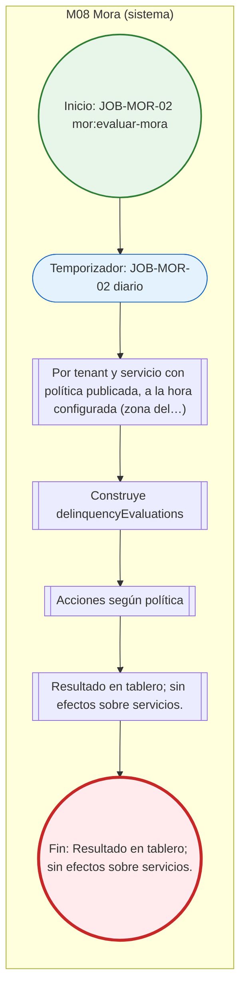

**Pasos del proceso** (actividad tomada del anexo; la columna RF/RN distingue lo citado en el paso de lo asociado por parámetro, permiso, evento o tema compartido).

| Paso | Carril | Actividad | RF/RN que aplican | EVT / JOB / PAN |
|---|---|---|---|---|
| 1 | M08 Mora | Por tenant y servicio con política publicada, a la hora configurada (zona del tenant), toma cuentas con documentos vencidos según `candidate.daysAfterDueDate`. | asoc.: RF-MOR-065 | — |
| 2 | M08 Mora | Construye `delinquencyEvaluations`: saldo elegible (excluye convenios no vencidos, reclamos, pagos informados, deuda en gestión judicial, incobrable, prescripta), mínimo de pago, instancia alcanzada y decisión por servicio (matriz, protecciones). | asoc.: RF-MOR-115 | — |
| 3 | M08 Mora | Acciones según política: proponer candidatos (si `autoGenerate`), proponer avance de instancias con `autoAdvance`, proponer casos de interrupción (siempre en estado `requested`, nunca ejecutados). | — | — |
| 4 | M08 Mora | Resultado en tablero; sin efectos sobre servicios. | — | — |

**Situación actual en ProCoop (nota de cambio).** Análisis de brechas (`15-analisis-brechas-procoop.md` §3.11, Mora): hoy Notificaciones por instancia, tratamiento de morosos, excepciones e instancias de mora; en GoodApps, política de mora, candidatos, notificaciones con constancia y protecciones (brecha "Se mantiene"; fuente M08; DFA Módulo 11; RN-04; REL §1).

**Excepciones**

| Excepción | Tratamiento |
|---|---|
| Vencimiento | Por tenant y servicio con política publicada, a la hora configurada (zona del tenant), toma cuentas con documentos vencidos según `candidate.daysAfterDueDate` |
| Vencimiento | Construye `delinquencyEvaluations`: saldo elegible (excluye convenios no vencidos, reclamos, pagos informados, deuda en gestión judicial, incobrable, prescripta), mínimo de pago, instancia alcanzada y decisión por servicio (matriz, protecciones) |
| Falla técnica en un paso automático, un job o una integración | Reintento idempotente y reanudable; lo no reparable pasa a la bandeja técnica con responsable (política de recuperación de T11 P-WFL-01 y T01 §9.12; AGR-016). |

---

## 19. PRC-MOR-05 Generar candidatos (manual o JOB-MOR-03 `mor:generar-candidatos`)

| Campo | Contenido |
|---|---|
| Fuente | M08 §9.5, `M08-MOR-mora-financiacion.md` (línea 1950) |
| Macroproceso | MP-12 Mora, corte y financiación |
| Disparador | Generar candidatos |
| Resultado | Evento mor.batch.generated. |
| Carriles | M08 Mora (sistema) |
| Roles de T02 | Solo actores del sistema (sin rol humano) |
| Módulos involucrados | M08 Mora |
| Eventos (T11 §12) | EVT-MOR-07 `mor.batch.generated` |
| Jobs | — |
| Relación con 04-procesos-bpmn.md | P5 Mora, aviso, suspensión o restricción, rehabilitación y financiación ([§9](04-procesos-bpmn.md#9-p5--mora-aviso-suspensión-o-restricción-rehabilitación-y-financiación)) |

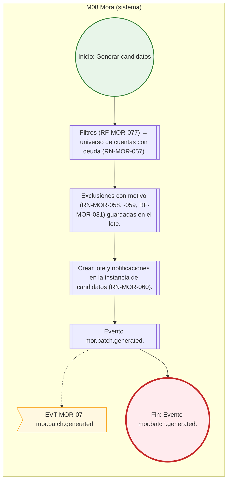

**Pasos del proceso** (actividad tomada del anexo; la columna RF/RN distingue lo citado en el paso de lo asociado por parámetro, permiso, evento o tema compartido).

| Paso | Carril | Actividad | RF/RN que aplican | EVT / JOB / PAN |
|---|---|---|---|---|
| 1 | M08 Mora | Filtros (RF-MOR-077) → universo de cuentas con deuda (RN-MOR-057). | RF-MOR-077, RN-MOR-057 | — |
| 2 | M08 Mora | Exclusiones con motivo (RN-MOR-058, -059, RF-MOR-081) guardadas en el lote. | RF-MOR-081, RN-MOR-058 | — |
| 3 | M08 Mora | Crear lote y notificaciones en la instancia de candidatos (RN-MOR-060). | RN-MOR-060 | — |
| 4 | M08 Mora | Evento `mor.batch.generated`. | — | EVT-MOR-07 |

**Situación actual en ProCoop (nota de cambio).** Análisis de brechas (`15-analisis-brechas-procoop.md` §3.11, Mora): hoy Notificaciones por instancia, tratamiento de morosos, excepciones e instancias de mora; en GoodApps, política de mora, candidatos, notificaciones con constancia y protecciones (brecha "Se mantiene"; fuente M08; DFA Módulo 11; RN-04; REL §1).

**Excepciones**

| Excepción | Tratamiento |
|---|---|
| Falla técnica en un paso automático, un job o una integración | Reintento idempotente y reanudable; lo no reparable pasa a la bandeja técnica con responsable (política de recuperación de T11 P-WFL-01 y T01 §9.12; AGR-016). |

---

## 20. PRC-MOR-06 Procesar instancia (manual o JOB-MOR-04 `mor:procesar-instancia`)

| Campo | Contenido |
|---|---|
| Fuente | M08 §9.6, `M08-MOR-mora-financiacion.md` (línea 1957) |
| Macroproceso | MP-12 Mora, corte y financiación |
| Disparador | Procesar instancia |
| Resultado | Reintentos de envío: los gestiona T09 |
| Carriles | M08 Mora (sistema) |
| Roles de T02 | Solo actores del sistema (sin rol humano) |
| Módulos involucrados | M08 Mora, T06 Integraciones, T09 Comunicaciones |
| Eventos (T11 §12) | EVT-COM-27 `com.communication.delivered`; EVT-COM-28 `com.communication.milestoneReached`; EVT-COM-29 `com.communication.allChannelsFailed`; EVT-MOR-09 `mor.notice.dispatchRequested`; EVT-INT-15 `int.network.provisioningResult` |
| Jobs | — |
| Relación con 04-procesos-bpmn.md | P5 Mora, aviso, suspensión o restricción, rehabilitación y financiación ([§9](04-procesos-bpmn.md#9-p5--mora-aviso-suspensión-o-restricción-rehabilitación-y-financiación)) |

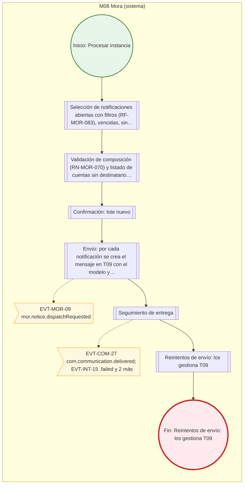

**Pasos del proceso** (actividad tomada del anexo; la columna RF/RN distingue lo citado en el paso de lo asociado por parámetro, permiso, evento o tema compartido).

| Paso | Carril | Actividad | RF/RN que aplican | EVT / JOB / PAN |
|---|---|---|---|---|
| 1 | M08 Mora | Selección de notificaciones abiertas con filtros (RF-MOR-083), vencidas, sin promesa vigente, con evidencia satisfecha si la instancia origen la exige. | RF-MOR-083; asoc.: RF-MOR-099 | — |
| 2 | M08 Mora | Validación de composición (RN-MOR-070) y listado de cuentas sin destinatario para el canal elegido (RN-MOR-073), con opción de descartar o cambiar canal. | RN-MOR-070, RN-MOR-073 | — |
| 3 | M08 Mora | Confirmación: lote nuevo; por cada notificación, transacción con RN-MOR-062 (costo si habilitado, nueva notificación, ítems, nota, anterior `processed`/`paid`, bloqueo y comprobante de deuda opcionales). | RN-MOR-062 | — |
| 4 | M08 Mora | Envío: por cada notificación se crea el mensaje en T09 con el modelo y variables (`mor.notice.dispatchRequested`); impresión agrupada por titular para canal impreso (RN-MOR-072). | RN-MOR-072; asoc.: RF-MOR-089 | EVT-MOR-09 |
| 5 | M08 Mora | Seguimiento de entrega: T09 publica `com.communication.delivered` / `.failed` / `.bounced` (EVT-COM-27), `com.communication.milestoneReached` (EVT-COM-28) y `com.communication.allChannelsFailed` (EVT-COM-29); M08 actualiza `delivery` y `evidenceSatisfied` (la evidencia solo se da por satisfecha con el hito de EVT-COM-28); un fallo en instancia con evidencia obligatoria crea tarea "canal alternativo" (M09) y deja la notificación sin evidencia. | asoc.: RN-MOR-064 | EVT-COM-27, EVT-COM-28, EVT-COM-29, EVT-INT-15 |
| 6 | M08 Mora | Reintentos de envío: los gestiona T09; M08 solo cambia de canal por decisión del gestor o por regla de la política (`fallbackChannels`). | — | — |

**Situación actual en ProCoop (nota de cambio).** Análisis de brechas (`15-analisis-brechas-procoop.md` §3.11, Mora): hoy Notificaciones por instancia, tratamiento de morosos, excepciones e instancias de mora; en GoodApps, política de mora, candidatos, notificaciones con constancia y protecciones (brecha "Se mantiene"; fuente M08; DFA Módulo 11; RN-04; REL §1).

**Excepciones**

| Excepción | Tratamiento |
|---|---|
| Vencimiento | Selección de notificaciones abiertas con filtros (RF-MOR-083), vencidas, sin promesa vigente, con evidencia satisfecha si la instancia origen la exige |
| Bloqueo | Confirmación: lote nuevo; por cada notificación, transacción con RN-MOR-062 (costo si habilitado, nueva notificación, ítems, nota, anterior `processed`/`paid`, bloqueo y comprobante de deuda opcionales) |
| Falla o error | M08 actualiza `delivery` y `evidenceSatisfied` (la evidencia solo se da por satisfecha con el hito de EVT-COM-28); un fallo en instancia con evidencia obligatoria crea tarea "canal alternativo" (M09) y deja la notificación sin evidencia |
| Reintento | Reintentos de envío: los gestiona T09 |
| Falla técnica en un paso automático, un job o una integración | Reintento idempotente y reanudable; lo no reparable pasa a la bandeja técnica con responsable (política de recuperación de T11 P-WFL-01 y T01 §9.12; AGR-016). |

---

## 21. PRC-MOR-07 Tratamiento de morosos e interrupción

| Campo | Contenido |
|---|---|
| Fuente | M08 §9.7, `M08-MOR-mora-financiacion.md` (línea 1966) |
| Macroproceso | MP-12 Mora, corte y financiación |
| Disparador | Tratamiento de morosos e interrupción |
| Resultado | Pago confirmado antes de ejecución → JOB-MOR-07 cancela la… |
| Carriles | Comercial / Atención al socio (T-ATE); M08 Mora (sistema) |
| Roles de T02 | T-ATE Comercial / Atención al socio |
| Módulos involucrados | M08 Mora, M10 Técnica y campo, T06 Integraciones |
| Eventos (T11 §12) | EVT-TEC-07 `tec.workOrder.closed`; EVT-TEC-18 `tec.disconnection.executed`; EVT-INT-15 `int.network.provisioningResult`, `int.network.provisioning-result`; EVT-TEC-14 `tec.visit.failed`; EVT-TEC-08 `tec.workOrder.cancelled`; EVT-TEC-19 `tec.reconnection.executed` |
| Jobs | JOB-MOR-07 `mor:evaluar-reconexion` |
| Relación con 04-procesos-bpmn.md | P5 Mora, aviso, suspensión o restricción, rehabilitación y financiación ([§9](04-procesos-bpmn.md#9-p5--mora-aviso-suspensión-o-restricción-rehabilitación-y-financiación)) |

```mermaid
flowchart LR
  subgraph L_LTATE["Comercial / Atención al socio (T-ATE)"]
    ni(("Inicio: Tratamiento de morosos e interrupción"))
    ns1["El gestor abre PAN-MOR-19 con notificaciones de la instancia de corte (o…)"]
    ns2["Selecciona servicios y acción (RF-MOR-100)"]
  end
  subgraph L_LSIS["M08 Mora (sistema)"]
    ns3[["Se crea interruptionCase (requested) → evaluación (RN-MOR-081, -082) →…"]]
    ns4[["Scheduled: si requiere técnica → tec.workOrder.request (M10) con origen…"]]
    ns5[["Confirmación (tec.workOrder.closed EVT-TEC-07, tec.disconnection.executed /…)"]]
    ne5>"EVT-TEC-07 tec.workOrder.closed; EVT-TEC-18 tec.disconnection.executed y 2 más"]
    nx6{"¿Falla (tec.visit.failed EVT-TEC-14)?"}
    ns6[["Tec.workOrder.cancelled EVT-TEC-08, o int.network.provisioningResult…"]]
    ne6>"EVT-TEC-14 tec.visit.failed; EVT-TEC-08 tec.workOrder.cancelled y 1 más"]
    ns7[["Pago confirmado antes de ejecución → JOB-MOR-07 cancela la orden (RN-MOR-091)."]]
    nf(("Fin: Pago confirmado antes de ejecución → JOB-MOR-07 cancela la…"))
  end
  ni --> ns1
  ns1 --> ns2
  ns2 --> ns3
  ns3 --> ns4
  ns4 --> ns5
  ns5 -.-> ne5
  ns5 --> nx6
  nx6 -->|"Sí"| ns6
  ns6 -.-> ne6
  ns6 --> ns7
  nx6 -->|"No"| ns7
  ns7 --> nf
  classDef inicio fill:#e8f5e9,stroke:#2e7d32,stroke-width:2px
  classDef fin fill:#ffebee,stroke:#c62828,stroke-width:4px
  classDef evento fill:#fff8e1,stroke:#f9a825
  classDef temporizador fill:#e3f2fd,stroke:#1565c0
  class ni inicio
  class nf fin
  class ne5,ne6 evento
```

**Pasos del proceso** (actividad tomada del anexo; la columna RF/RN distingue lo citado en el paso de lo asociado por parámetro, permiso, evento o tema compartido).

| Paso | Carril | Actividad | RF/RN que aplican | EVT / JOB / PAN |
|---|---|---|---|---|
| 1 | Comercial / Atención al socio | El gestor abre PAN-MOR-19 con notificaciones de la instancia de corte (o tratamiento) vencidas. | — | PAN-MOR-19 |
| 2 | Comercial / Atención al socio | Selecciona servicios y acción (RF-MOR-100). Validación de orden pendiente (RN-MOR-077). | RF-MOR-100, RN-MOR-077 | — |
| 3 | M08 Mora | Se crea `interruptionCase` (`requested`) → evaluación (RN-MOR-081, -082) → `blocked` / `pendingApproval` / `pendingEvidence` / `scheduled`. | RN-MOR-081 | — |
| 4 | M08 Mora | `scheduled`: si requiere técnica → `tec.workOrder.request` (M10; antes `tec.workOrders.create`: nombre del comando que emite M09 y consume M10, sin chocar con la capability `tec.ordenes.crear` de T02) con origen `delinquency`; si es remoto (Internet) → M10 crea orden con acción de red y T06 ejecuta en la ventana; si no requiere técnica → cambio directo con confirmación del operador. | asoc.: RF-MOR-103 | — |
| 5 | M08 Mora | Confirmación (`tec.workOrder.closed` EVT-TEC-07, `tec.disconnection.executed` / `tec.reconnection.executed` EVT-TEC-18/19, o `int.network.provisioningResult` (antes `int.network.provisioning-result`) EVT-INT-15 con resultado exitoso) → `executed`: M01/M02 cambia `serviceStatus`, se registran cargos "después", prorrateo, comunicación al socio (T09, plantilla "Servicio suspendido" con medios de pago y cómo reactivar), notificación `inTechnical` → se mantiene abierta hasta pago. | — | EVT-TEC-07, EVT-TEC-18, EVT-INT-15, EVT-TEC-19 |
| 6 | M08 Mora | Falla (`tec.visit.failed` EVT-TEC-14, `tec.workOrder.cancelled` EVT-TEC-08, o `int.network.provisioningResult` (antes `int.network.provisioning-result`) EVT-INT-15 con resultado fallido) → `executionFailed`; tarea al coordinador; reintento. | — | EVT-TEC-14, EVT-TEC-08, EVT-INT-15 |
| 7 | M08 Mora | Pago confirmado antes de ejecución → JOB-MOR-07 cancela la orden (RN-MOR-091). | RN-MOR-091; asoc.: RF-MOR-121 | JOB-MOR-07 |

**Situación actual en ProCoop (nota de cambio).** CTR-MOR-03: en ProCoop, ProCoop (corte directo al procesar tratamiento) vs. BASE §14, §68, §86–91. Cambio adoptado: Toda interrupción pasa por evaluación, restricciones, evidencia, aprobación y ventana (RN-MOR-081). Análisis de brechas (`15-analisis-brechas-procoop.md` §3.11, Mora): hoy Reconexión después del pago con gestión manual; en GoodApps, reconexión automática en servicios remotos al confirmarse el pago sin deuda vencida; OT automática si requiere técnico (brecha "Cambia"; fuente DEC-014).

**Excepciones**

| Excepción | Tratamiento |
|---|---|
| Vencimiento | El gestor abre PAN-MOR-19 con notificaciones de la instancia de corte (o tratamiento) vencidas |
| Si requiere técnica | `tec.workOrder.request` (M10; antes `tec.workOrders.create`: nombre del comando que emite M09 y consume M10, sin chocar con la capability `tec.ordenes.crear` de T02) con origen `delinquency`; si es remoto (Internet) → M10 crea orden con acción de red y T06 ejecuta en la ventana; si no requiere técnica → cambio directo con confirmación del operador |
| Falla o error | Falla (`tec.visit.failed` EVT-TEC-14, `tec.workOrder.cancelled` EVT-TEC-08, o `int.network.provisioningResult` (antes `int.network.provisioning-result`) EVT-INT-15 con resultado fallido) → `executionFailed`; tarea al coordinador; reintento |
| Cancelación, anulación o reversión | Pago confirmado antes de ejecución → JOB-MOR-07 cancela la orden (RN-MOR-091) |
| Falla técnica en un paso automático, un job o una integración | Reintento idempotente y reanudable; lo no reparable pasa a la bandeja técnica con responsable (política de recuperación de T11 P-WFL-01 y T01 §9.12; AGR-016). |

---

## Inconsistencias detectadas en la especificación (esta parte)

No se detectaron inconsistencias en los procesos de esta parte.

## Cobertura de esta parte

| Universo de la parte | Diagramados | Con nota ProCoop específica | Pendientes |
|---|---|---|---|
| 21 (PRC-FIS-05 a PRC-MOR-07) | 21 | 8 | 0 |
