# GoodApps Cooperativas

## Procesos de negocio — Mora, corte y financiación y Atención y autogestión del socio (M08, M09, M19)

**Entregable de Análisis y Diseño Detallado — Artefacto 2.1 (Procesos de negocio BPMN). Parte de [`04-procesos-bpmn.md`](04-procesos-bpmn.md).**

| Dato | Valor |
|---|---|
| Documento | Diagramas BPMN, pasos, situación actual en ProCoop y excepciones de los procesos PRC-MOR-08 a PRC-POR-03, derivados de la sección 9 de M08, M09, M19 |
| Carácter | Derivado de la especificación vigente; no la reemplaza. Ante diferencias prevalecen la maestra `00`, los anexos, T05, T11 y el registro de decisiones `01` |
| Generación | Script `_trabajo/generar_bpmn.py` con la ampliación `_trabajo/generar_prc.py` (derivación automática desde el texto de la sección 9 de cada anexo, `_trabajo/prc_auto.py`) |
| Versión | 1.1 (regenerada contra la especificación corregida) |
| Fecha | 05-11-2026 |

**Cómo leer cada proceso.** La notación es la de [`04-procesos-bpmn.md` §3](04-procesos-bpmn.md#3-notación-equivalencia-mermaid--bpmn) (carriles, eventos de inicio y fin, tareas de usuario y de servicio, compuertas XOR y AND, eventos de dominio como banderas, temporizadores y jobs como estadios). La tabla de pasos reproduce la actividad del anexo; en la columna RF/RN, los identificadores sin prefijo son los que el anexo cita en el paso y los marcados "asoc." son reglas o requisitos del mismo anexo que comparten parámetro, permiso, evento o tema con el paso (asociación generada por el script y revisada). Los eventos se nombran con su ID del catálogo de T11 §12.

**Derivación automática (v1.2).** Los procesos `PRC-<MOD>-nn` de esta parte se generaron con `_trabajo/generar_prc.py` y `_trabajo/prc_auto.py` a partir del texto de cada subsección §9.n del anexo, sin curaduría paso a paso (a diferencia de los 94 procesos `P-XXX-nn` de las partes 04b a 04i). Reglas: (1) los pasos son los numerados o viñetas del anexo; si la subsección es prosa, se parte por flechas o por oraciones; si es una tabla de pasos o de jobs, cada fila es un paso; (2) el carril de cada paso es el primer actor nombrado al comienzo del paso (rol de T02 §4, otro módulo, sistema externo, dispositivo o job); si no se nombra ninguno, el paso es del sistema del módulo dueño; (3) los pasos que empiezan con "Si …" se dibujan como compuerta XOR; (4) los eventos son los nombres del catálogo de T11 §12 citados en el paso (bandera entrante si el paso los consume, saliente si los publica); el temporizador aparece cuando el título nombra un job periódico; (5) las excepciones son las oraciones del anexo con condición o con palabras de falla, rechazo, vencimiento, duplicado o umbral, más la política de recuperación del anexo; (6) la nota ProCoop combina lo que dice el propio anexo, la fila `CTR-` del anexo que contrasta con ProCoop y la fila de `15-analisis-brechas-procoop.md` §3 de mayor afinidad; si ninguna alcanza el umbral, la nota lo dice y remite al contraste del dominio en esa sección. La revisión manual de una muestra está en `_trabajo/prc_revision.md`; ante diferencias, prevalece el texto del anexo citado en la ficha.

## Índice de procesos de esta parte

1. [PRC-MOR-08 JOB-MOR-07 `mor:evaluar-reconexion` (por evento `cob.payment.confirmed`, `mor.agreement.activated`)](#1-prc-mor-08-job-mor-07-morevaluar-reconexion-por-evento-cobpaymentconfirmed-moragreementactivated)
2. [PRC-MOR-09 Suspensión voluntaria, baja y reactivación (BASE §53)](#2-prc-mor-09-suspensión-voluntaria-baja-y-reactivación-base-53)
3. [PRC-MOR-10 Convenio de punta a punta](#3-prc-mor-10-convenio-de-punta-a-punta)
4. [PRC-CRM-01 Ingreso y supervisión de un caso (circuito BASE §47)](#4-prc-crm-01-ingreso-y-supervisión-de-un-caso-circuito-base-47)
5. [PRC-CRM-02 Solicitud de alta de servicio (piloto Internet, CU-15, CU-SOL-01)](#5-prc-crm-02-solicitud-de-alta-de-servicio-piloto-internet-cu-15-cu-sol-01)
6. [PRC-CRM-03 Solicitud de baja autenticada y pública (CIC-001, BASE §52.3)](#6-prc-crm-03-solicitud-de-baja-autenticada-y-pública-cic-001-base-523)
7. [PRC-CRM-04 Suspensión temporal y reactivación (CU-CIC-01)](#7-prc-crm-04-suspensión-temporal-y-reactivación-cu-cic-01)
8. [PRC-CRM-05 Cambio de plan, cambio de titular, traslado](#8-prc-crm-05-cambio-de-plan-cambio-de-titular-traslado)
9. [PRC-CRM-06 Reclamo técnico con incidente común (CU-16, piloto Internet)](#9-prc-crm-06-reclamo-técnico-con-incidente-común-cu-16-piloto-internet)
10. [PRC-CRM-07 SLA (JOB-CRM-01)](#10-prc-crm-07-sla-job-crm-01)
11. [PRC-CRM-08 Bot de WhatsApp (O6)](#11-prc-crm-08-bot-de-whatsapp-o6)
12. [PRC-CRM-09 Email entrante (O6)](#12-prc-crm-09-email-entrante-o6)
13. [PRC-CRM-10 Turnero (O10)](#13-prc-crm-10-turnero-o10)
14. [PRC-CRM-11 Actividades internas (O10)](#14-prc-crm-11-actividades-internas-o10)
15. [PRC-CRM-12 Trámites con vencimiento (O7)](#15-prc-crm-12-trámites-con-vencimiento-o7)
16. [PRC-CRM-13 Circulares (O6)](#16-prc-crm-13-circulares-o6)
17. [PRC-POR-01 Resolución de tenant y carga de marca (landing y PWA)](#17-prc-por-01-resolución-de-tenant-y-carga-de-marca-landing-y-pwa)
18. [PRC-POR-02 Registro y primer ingreso (O2)](#18-prc-por-02-registro-y-primer-ingreso-o2)
19. [PRC-POR-03 Vinculación de cuenta (O2)](#19-prc-por-03-vinculación-de-cuenta-o2)

---

## 1. PRC-MOR-08 JOB-MOR-07 `mor:evaluar-reconexion` (por evento `cob.payment.confirmed`, `mor.agreement.activated`)

| Campo | Contenido |
|---|---|
| Fuente | M08 §9.8, `M08-MOR-mora-financiacion.md` (línea 1976) |
| Macroproceso | MP-12 Mora, corte y financiación |
| Disparador | JOB-MOR-07 mor:evaluar-reconexion |
| Resultado | Idempotencia: clave paymentId + caseId. |
| Carriles | M08 Mora (sistema) |
| Roles de T02 | Solo actores del sistema (sin rol humano) |
| Módulos involucrados | M08 Mora |
| Eventos (T11 §12) | — |
| Jobs | JOB-MOR-07 `mor:evaluar-reconexion` |
| Relación con 04-procesos-bpmn.md | P5 Mora, aviso, suspensión o restricción, rehabilitación y financiación ([§9](04-procesos-bpmn.md#9-p5--mora-aviso-suspensión-o-restricción-rehabilitación-y-financiación)) |

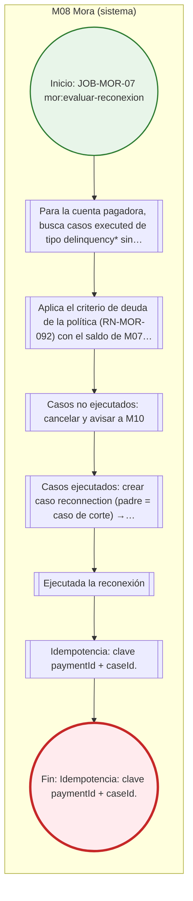

**Pasos del proceso** (actividad tomada del anexo; la columna RF/RN distingue lo citado en el paso de lo asociado por parámetro, permiso, evento o tema compartido).

| Paso | Carril | Actividad | RF/RN que aplican | EVT / JOB / PAN |
|---|---|---|---|---|
| 1 | M08 Mora | Para la cuenta pagadora, busca casos `executed` de tipo `delinquency*` sin reconexión, y casos `scheduled`/`pendingEvidence` de mora. | — | — |
| 2 | M08 Mora | Aplica el criterio de deuda de la política (RN-MOR-092) con el saldo de M07 tras la imputación. | RN-MOR-092 | — |
| 3 | M08 Mora | Casos no ejecutados: cancelar y avisar a M10; quitar marca de moroso (RN-MOR-091). | RN-MOR-091 | — |
| 4 | M08 Mora | Casos ejecutados: crear caso `reconnection` (padre = caso de corte) → evaluación de reconexión (titular fallecido, factibilidad, inspección de gas, cargo "antes") → ejecución directa, orden técnica o acción remota; confirmación automática solo con respuesta exitosa de T06 (RN-MOR-094). | RN-MOR-094; asoc.: RF-MOR-128, RN-MOR-097 | — |
| 5 | M08 Mora | Ejecutada la reconexión: estado activo, prorrateo (RN-MOR-096), cargo "después" si habilitado, comunicación al socio. | RN-MOR-096 | — |
| 6 | M08 Mora | Idempotencia: clave `paymentId + caseId`. | — | — |

**Situación actual en ProCoop (nota de cambio).** Análisis de brechas (`15-analisis-brechas-procoop.md` §3.11, Mora): hoy Reconexión después del pago con gestión manual; en GoodApps, reconexión automática en servicios remotos al confirmarse el pago sin deuda vencida; OT automática si requiere técnico (brecha "Cambia"; fuente DEC-014).

**Excepciones**

| Excepción | Tratamiento |
|---|---|
| Cancelación, anulación o reversión | Casos no ejecutados: cancelar y avisar a M10; quitar marca de moroso (RN-MOR-091) |
| Falla técnica en un paso automático, un job o una integración | Reintento idempotente y reanudable; lo no reparable pasa a la bandeja técnica con responsable (política de recuperación de T11 P-WFL-01 y T01 §9.12; AGR-016). |

---

## 2. PRC-MOR-09 Suspensión voluntaria, baja y reactivación (BASE §53)

| Campo | Contenido |
|---|---|
| Fuente | M08 §9.9, `M08-MOR-mora-financiacion.md` (línea 1985) |
| Macroproceso | MP-12 Mora, corte y financiación |
| Disparador | Suspensión voluntaria, baja y reactivación |
| Resultado | Fin automático de suspensión voluntaria por duración |
| Carriles | Socio titular (C-SOC); M08 Mora (sistema) |
| Roles de T02 | C-SOC Socio titular |
| Módulos involucrados | M02 Catálogo y contratos, M08 Mora |
| Eventos (T11 §12) | EVT-CAT-12 `cat.contract.reactivated` |
| Jobs | JOB-CAT-08 `cat:fin-suspension-voluntaria`; JOB-MOR-08 `mor:fin-suspension-voluntaria` |
| Relación con 04-procesos-bpmn.md | P5 Mora, aviso, suspensión o restricción, rehabilitación y financiación ([§9](04-procesos-bpmn.md#9-p5--mora-aviso-suspensión-o-restricción-rehabilitación-y-financiación)) |

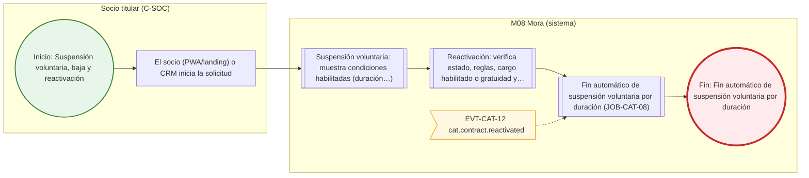

**Pasos del proceso** (actividad tomada del anexo; la columna RF/RN distingue lo citado en el paso de lo asociado por parámetro, permiso, evento o tema compartido).

| Paso | Carril | Actividad | RF/RN que aplican | EVT / JOB / PAN |
|---|---|---|---|---|
| 1 | Socio titular | El socio (PWA/landing) o CRM inicia la solicitud; para baja, M09/M19 registra y emite el código identificador; M08 aplica RN-MOR-100 (sin cargo) y crea el caso de ejecución si hay que desactivar el servicio. | RN-MOR-100; asoc.: RF-MOR-131 | — |
| 2 | M08 Mora | Suspensión voluntaria: muestra condiciones habilitadas (duración mínima/máxima, pausa de cargos, costo habilitado o ARS 0), conserva aceptación, crea caso `voluntarySuspension` → orden/acción → `executed` en la fecha efectiva. | asoc.: RF-MOR-137, RN-MOR-101 | — |
| 3 | M08 Mora | Reactivación: verifica estado, reglas, cargo habilitado o gratuidad y necesidad de intervención; la app muestra "Reactivación en trámite" hasta `executed`. | asoc.: RF-MOR-070 | — |
| 4 | M08 Mora | Fin automático de suspensión voluntaria por duración: el vencimiento lo detecta M02 (JOB-CAT-08, dueño del contrato; T11 §12.9); M08 consume `cat.contract.reactivated` (EVT-CAT-12) y cierra el caso `voluntarySuspension`, creando el caso `reactivation` solo si el servicio requiere intervención técnica o remota (JOB-MOR-08 queda como manejador del evento, sin programación propia). | — | JOB-CAT-08, EVT-CAT-12, JOB-MOR-08 |

**Situación actual en ProCoop (nota de cambio).** CTR-MOR-04: en ProCoop, ProCoop (cargo de reconexión automático, `CONEXION`) vs. BASE §52.3/§53. Cambio adoptado: Reglas migran deshabilitadas; gratuidad por defecto (PA-MOR-12). Análisis de brechas (`15-analisis-brechas-procoop.md` §3.11, Mora): hoy Reconexión después del pago con gestión manual; en GoodApps, reconexión automática en servicios remotos al confirmarse el pago sin deuda vencida; OT automática si requiere técnico (brecha "Cambia"; fuente DEC-014).

**Excepciones**

| Excepción | Tratamiento |
|---|---|
| Vencimiento | Fin automático de suspensión voluntaria por duración: el vencimiento lo detecta M02 (JOB-CAT-08, dueño del contrato; T11 §12.9) |
| Falla técnica en un paso automático, un job o una integración | Reintento idempotente y reanudable; lo no reparable pasa a la bandeja técnica con responsable (política de recuperación de T11 P-WFL-01 y T01 §9.12; AGR-016). |

---

## 3. PRC-MOR-10 Convenio de punta a punta

| Campo | Contenido |
|---|---|
| Fuente | M08 §9.10, `M08-MOR-mora-financiacion.md` (línea 1992) |
| Macroproceso | MP-12 Mora, corte y financiación |
| Disparador | Convenio de punta a punta |
| Resultado | Anulación (RN-MOR-121) o refinanciación (RN-MOR-116). |
| Carriles | M08 Mora (sistema); M05 Facturación |
| Roles de T02 | Solo actores del sistema (sin rol humano) |
| Módulos involucrados | M05 Facturación, M08 Mora |
| Eventos (T11 §12) | — |
| Jobs | JOB-MOR-09 `mor:vencer-anticipos`; JOB-MOR-10 `mor:emitir-cuotas`; JOB-MOR-11 `mor:control-convenios` |
| Relación con 04-procesos-bpmn.md | P5 Mora, aviso, suspensión o restricción, rehabilitación y financiación ([§9](04-procesos-bpmn.md#9-p5--mora-aviso-suspensión-o-restricción-rehabilitación-y-financiación)) |

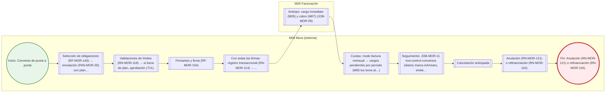

**Pasos del proceso** (actividad tomada del anexo; la columna RF/RN distingue lo citado en el paso de lo asociado por parámetro, permiso, evento o tema compartido).

| Paso | Carril | Actividad | RF/RN que aplican | EVT / JOB / PAN |
|---|---|---|---|---|
| 1 | M08 Mora | Selección de obligaciones (RF-MOR-145) → simulación (PAN-MOR-30) con plan, anticipo, cuotas, quitas → cronograma, CFT. | RF-MOR-145 | PAN-MOR-30 |
| 2 | M08 Mora | Validaciones de límites (RN-MOR-118) → si fuera de plan, aprobación (T11). | RN-MOR-118 | — |
| 3 | M08 Mora | Firmantes y firma (RF-MOR-154): presencial en tableta o electrónica por enlace con OTP; el PDF se genera desde plantilla con/ sin garante y se guarda con hash. | RF-MOR-154 | — |
| 4 | M08 Mora | Con todas las firmas: registro transaccional (RN-MOR-114) → `pendingDownPayment` o `active`. | RN-MOR-114 | — |
| 5 | M05 Facturación | Anticipo: cargo inmediato (M05) y cobro (M07); confirmación → `active`; plazo vencido → JOB-MOR-09 `mor:vencer-anticipos` → `lapsedNoDownPayment` con restitución. | — | JOB-MOR-09 |
| 6 | M08 Mora | Cuotas: modo factura mensual → cargos pendientes por período (M05 los toma al facturar, con ajuste por índice y bonificación por adelanto); modo documento propio → JOB-MOR-10 `mor:emitir-cuotas` solicita a M05 la emisión de cada cuota con anticipación configurable. | asoc.: RN-MOR-120 | JOB-MOR-10 |
| 7 | M08 Mora | Seguimiento: JOB-MOR-11 `mor:control-convenios` (diario) marca `inArrears`, emite aviso previo de caducidad y declara `defaulted` según la regla del plan (RN-MOR-123). | RN-MOR-123 | JOB-MOR-11 |
| 8 | M08 Mora | Cancelación anticipada: cotización de saldo con bonificación → pago → cuotas `cancelledEarly` → `completed`. | asoc.: RN-MOR-120, RF-MOR-212 | — |
| 9 | M08 Mora | Anulación (RN-MOR-121) o refinanciación (RN-MOR-116). | RN-MOR-116, RN-MOR-121 | — |

**Situación actual en ProCoop (nota de cambio).** CTR-MOR-07: en ProCoop, ProCoop (sin caducidad de convenios) vs. DFA M12 y AGR-014. Cambio adoptado: Caducidad configurable por plan (RN-MOR-123, PA-MOR-13). Análisis de brechas (`15-analisis-brechas-procoop.md` §3.11, Mora): hoy Planes de financiación; en GoodApps, planes de pago, convenios, planes de cuotas y garantías (brecha "Se mantiene"; fuente M08; DFA Módulo 12; DEC-078).

**Excepciones**

| Excepción | Tratamiento |
|---|---|
| Vencimiento | Anticipo: cargo inmediato (M05) y cobro (M07); confirmación → `active`; plazo vencido → JOB-MOR-09 `mor:vencer-anticipos` → `lapsedNoDownPayment` con restitución |
| Cancelación, anulación o reversión | Cancelación anticipada: cotización de saldo con bonificación → pago → cuotas `cancelledEarly` → `completed` |
| Cancelación, anulación o reversión | Anulación (RN-MOR-121) o refinanciación (RN-MOR-116) |
| Falla técnica en un paso automático, un job o una integración | Reintento idempotente y reanudable; lo no reparable pasa a la bandeja técnica con responsable (política de recuperación de T11 P-WFL-01 y T01 §9.12; AGR-016). |

---

## 4. PRC-CRM-01 Ingreso y supervisión de un caso (circuito BASE §47)

| Campo | Contenido |
|---|---|
| Fuente | M09 §9.1, `M09-CRM-atencion.md` (línea 1680) |
| Macroproceso | MP-13 Atención y autogestión del socio |
| Disparador | Ingreso y supervisión de un caso |
| Resultado | Reapertura: dentro de la ventana el socio o supervisor reabre |
| Carriles | Socio titular (C-SOC); M09 Atención (sistema); Supervisor de atención (T-SAT); Comercial / Atención al socio (T-ATE) |
| Roles de T02 | C-SOC Socio titular, T-ATE Comercial / Atención al socio, T-SAT Supervisor de atención |
| Módulos involucrados | M09 Atención |
| Eventos (T11 §12) | EVT-CRM-01 `crm.case.created` |
| Jobs | JOB-CRM-02 `crm:ai-classify`; JOB-CRM-03 `crm:auto-close-resolved` |
| Relación con 04-procesos-bpmn.md | P6 Reclamo y orden de trabajo ([§10](04-procesos-bpmn.md#10-p6--reclamo-y-orden-de-trabajo)) |

```mermaid
flowchart LR
  subgraph L_LCSOC["Socio titular (C-SOC)"]
    ni(("Inicio: Ingreso y supervisión de un caso"))
    ns1["Ingreso: el socio se identifica (o no, en canales públicos), elige servicio y…"]
    ns13["Reapertura: dentro de la ventana el socio o supervisor reabre"]
    nf(("Fin: Reapertura: dentro de la ventana el socio o supervisor reabre"))
  end
  subgraph L_LSIS["M09 Atención (sistema)"]
    ns2[["Validación: se valida pertenencia de la cuenta (RN-CRM-005), datos mínimos…"]]
    ns3[["Evidencia: adjuntos se suben a T11 (escaneo antivirus)"]]
    ns4[["Asistencia IA (si habilitada, O6): se encola crm:ai-classify"]]
    ns5[["Registro: transacción Mongo que crea crmCases, primer crmCaseEvents y outbox…"]]
    ne5>"EVT-CRM-01 crm.case.created"]
    ns6[["Duplicados: búsqueda por cuenta + servicio + subtipo en ventana"]]
    ns7[["Urgencias: si el subtipo es urgentSafety, se ejecutan reglas onCallNotify…"]]
    ns9[["Derivación: elige área (o acepta la sugerida por regla)"]]
    ns11[["Resolución: registra solución, código y resultado real"]]
    ns12[["Cierre: por conformidad del socio, por empleado con tipo de cierre, o…"]]
  end
  subgraph L_LTSAT["Supervisor de atención (T-SAT)"]
    ns8["Supervisión: el caso aparece en 'sin derivación'"]
  end
  subgraph L_LTATE["Comercial / Atención al socio (T-ATE)"]
    ns10["Atención: el empleado toma el caso, conversa, pide datos (pendingInfo)…"]
  end
  ni --> ns1
  ns1 --> ns2
  ns2 --> ns3
  ns3 --> ns4
  ns4 --> ns5
  ns5 -.-> ne5
  ns5 --> ns6
  ns6 --> ns7
  ns7 --> ns8
  ns8 --> ns9
  ns9 --> ns10
  ns10 --> ns11
  ns11 --> ns12
  ns12 --> ns13
  ns13 --> nf
  classDef inicio fill:#e8f5e9,stroke:#2e7d32,stroke-width:2px
  classDef fin fill:#ffebee,stroke:#c62828,stroke-width:4px
  classDef evento fill:#fff8e1,stroke:#f9a825
  classDef temporizador fill:#e3f2fd,stroke:#1565c0
  class ni inicio
  class nf fin
  class ne5 evento
```

**Pasos del proceso** (actividad tomada del anexo; la columna RF/RN distingue lo citado en el paso de lo asociado por parámetro, permiso, evento o tema compartido).

| Paso | Carril | Actividad | RF/RN que aplican | EVT / JOB / PAN |
|---|---|---|---|---|
| 1 | Socio titular | Ingreso: el socio se identifica (o no, en canales públicos), elige servicio y cuenta cuando corresponda, describe la gestión por formulario, conversación o bot. El agente puede registrar en nombre del socio (ventanilla, teléfono). | — | — |
| 2 | M09 Atención | Validación: se valida pertenencia de la cuenta (RN-CRM-005), datos mínimos del tipo y vía de ingreso (RN-CRM-058). Si falta identificar la cuenta, se crea igual con `context.accountId = null` y marca "cuenta a identificar". | RN-CRM-005, RN-CRM-058 | — |
| 3 | M09 Atención | Evidencia: adjuntos se suben a T11 (escaneo antivirus; límites PRM-CRM-017/018) y se ligan al mensaje. | — | — |
| 4 | M09 Atención | Asistencia IA (si habilitada, O6): se encola `crm:ai-classify`; la sugerencia aparece al supervisor; no bloquea. | — | JOB-CRM-02 |
| 5 | M09 Atención | Registro: transacción Mongo que crea `crmCases`, primer `crmCaseEvents` y outbox `crm.case.created`; número del contador atómico; SLA calculado. Respuesta al socio con número y constancia. | asoc.: RF-CRM-010 | EVT-CRM-01 |
| 6 | M09 Atención | Duplicados: búsqueda por cuenta + servicio + subtipo en ventana; si hay coincidencia, se marca `possibleDuplicateOf` para supervisión (no bloquea). | asoc.: RN-CRM-029 | — |
| 7 | M09 Atención | Urgencias: si el subtipo es `urgentSafety`, se ejecutan reglas `onCallNotify` inmediatamente y se muestra al socio el mensaje de seguridad (PRM-CRM-019). | asoc.: RF-CRM-122, RF-CRM-260 | — |
| 8 | Supervisor de atención | Supervisión: el caso aparece en "sin derivación". El supervisor revisa servicio, cuenta, motivo, evidencia y propuesta IA; acepta o corrige la clasificación (registro en `crmAiSuggestions`), ajusta prioridad. | asoc.: RF-CRM-200, RF-CRM-008 | — |
| 9 | M09 Atención | Derivación: elige área (o acepta la sugerida por regla); opcionalmente asigna responsable. Con `autoDerive` habilitado (PA-CRM-02), la regla deriva sola y el caso sigue visible en supervisión. | asoc.: RN-CRM-019 | — |
| 10 | Comercial / Atención al socio | Atención: el empleado toma el caso, conversa, pide datos (`pendingInfo`), vincula o solicita OT (comando `tec.workOrder.request`), registra intervenciones y tiempo. | — | — |
| 11 | M09 Atención | Resolución: registra solución, código y resultado real; el sistema avisa al socio; el caso queda `resolved`. | — | — |
| 12 | M09 Atención | Cierre: por conformidad del socio, por empleado con tipo de cierre, o automático tras `autoCloseDays` (JOB-CRM-03). Se envía la encuesta post-cierre (T09). | — | JOB-CRM-03 |
| 13 | Socio titular | Reapertura: dentro de la ventana el socio o supervisor reabre; fuera, se crea caso nuevo vinculado. | — | — |

**Situación actual en ProCoop (nota de cambio).** CTR-CRM-02: en ProCoop, En ProCoop un reclamo es una OT (`TECNICA` con transacción de reclamo); la BASE pide caso CRM con OT vinculada. Cambio adoptado: El reclamo es un caso CRM; la OT se solicita a M10 y se vincula (`workOrderId`).

**Excepciones**

| Excepción | Tratamiento |
|---|---|
| Si falta identificar la cuenta | se crea igual con `context.accountId = null` y marca "cuenta a identificar" |
| Bloqueo | Asistencia IA (si habilitada, O6): se encola `crm:ai-classify`; la sugerencia aparece al supervisor; no bloquea |
| Si hay coincidencia | se marca `possibleDuplicateOf` para supervisión (no bloquea) |
| Si el subtipo es `urgentSafety` | se ejecutan reglas `onCallNotify` inmediatamente y se muestra al socio el mensaje de seguridad (PRM-CRM-019) |
| Falla técnica en un paso automático, un job o una integración | Reintento idempotente y reanudable; lo no reparable pasa a la bandeja técnica con responsable (política de recuperación de M09 §9.14; AGR-016). |

---

## 5. PRC-CRM-02 Solicitud de alta de servicio (piloto Internet, CU-15, CU-SOL-01)

| Campo | Contenido |
|---|---|
| Fuente | M09 §9.2, `M09-CRM-atencion.md` (línea 1696) |
| Macroproceso | MP-13 Atención y autogestión del socio |
| Disparador | Solicitud de alta de servicio |
| Resultado | Cancelación por el socio antes de instalar |
| Carriles | Socio titular (C-SOC); M09 Atención (sistema); M10 Técnica y campo |
| Roles de T02 | C-SOC Socio titular |
| Módulos involucrados | M02 Catálogo y contratos, M09 Atención, M10 Técnica y campo |
| Eventos (T11 §12) | EVT-TEC-02 `tec.feasibility.verdictIssued`; EVT-CAT-09 `cat.contract.activated` |
| Jobs | — |
| Relación con 04-procesos-bpmn.md | P6 Reclamo y orden de trabajo ([§10](04-procesos-bpmn.md#10-p6--reclamo-y-orden-de-trabajo)); P1 Alta de socio y contratación de servicio ([§5](04-procesos-bpmn.md#5-p1--alta-de-socio-y-contratación-de-servicio)) |

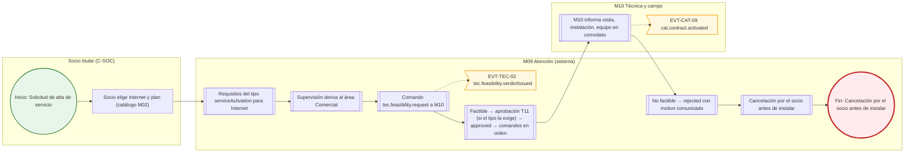

**Pasos del proceso** (actividad tomada del anexo; la columna RF/RN distingue lo citado en el paso de lo asociado por parámetro, permiso, evento o tema compartido).

| Paso | Carril | Actividad | RF/RN que aplican | EVT / JOB / PAN |
|---|---|---|---|---|
| 1 | Socio titular | Socio elige Internet y plan (catálogo M02); el sistema registra `requestedServiceId` y `requestedPlanId` sin contrato. | asoc.: RF-CRM-004 | — |
| 2 | M09 Atención | Requisitos del tipo `serviceActivation` para Internet: domicilio de instalación, documento, aceptación de condiciones (versión), factibilidad. | asoc.: RF-CRM-063 | — |
| 3 | M09 Atención | Supervisión deriva al área Comercial. Si faltan requisitos → `pendingInfo`. | — | — |
| 4 | M09 Atención | Comando `tec.feasibility.request` a M10; el caso queda `inEvaluation` esperando `tec.feasibility.verdictIssued` (EVT-TEC-02). | — | EVT-TEC-02 |
| 5 | M09 Atención | Factible → aprobación T11 (si el tipo la exige) → `approved` → comandos en orden: `cat.contract.requestActivation` (crea contrato `Solicitado/Pendiente de instalación` en M02) y `tec.workOrder.request` (instalación). Estado `inExecution`. | asoc.: RF-CRM-060, RF-CRM-004 | — |
| 6 | M10 Técnica y campo | M10 informa visita, instalación, equipo en comodato; M02 activa el contrato con fecha efectiva (`cat.contract.activated`). El caso pasa a `resolved` con fecha efectiva; aviso al socio. | — | EVT-CAT-09 |
| 7 | M09 Atención | No factible → `rejected` con motivo comunicado; el caso conserva la evidencia. | — | — |
| 8 | M09 Atención | Cancelación por el socio antes de instalar: se pide `tec.workOrder.requestCancel` y `cat.contract.requestCancellation` (si se creó); no se exige retiro de equipo (RN-CRM-027). Si M10 informa instalación ejecutada offline después de la cancelación → `conflict` (ESC-03). | RN-CRM-027; asoc.: RF-CRM-076 | — |

**Situación actual en ProCoop (nota de cambio).** Sin contraste específico para este proceso en el anexo (filas `CTR-` con ProCoop) ni en el análisis de brechas. El contraste del dominio está en `15-analisis-brechas-procoop.md` §3.12.

**Excepciones**

| Excepción | Tratamiento |
|---|---|
| Si faltan requisitos | `pendingInfo` |
| Cancelación, anulación o reversión | Cancelación por el socio antes de instalar: se pide `tec.workOrder.requestCancel` y `cat.contract.requestCancellation` (si se creó); no se exige retiro de equipo (RN-CRM-027) |
| Si M10 informa instalación ejecutada offline después de la cancelación | `conflict` (ESC-03) |
| Falla técnica en un paso automático, un job o una integración | Reintento idempotente y reanudable; lo no reparable pasa a la bandeja técnica con responsable (política de recuperación de M09 §9.14; AGR-016). |

---

## 6. PRC-CRM-03 Solicitud de baja autenticada y pública (CIC-001, BASE §52.3)

| Campo | Contenido |
|---|---|
| Fuente | M09 §9.3, `M09-CRM-atencion.md` (línea 1707) |
| Macroproceso | MP-13 Atención y autogestión del socio |
| Disparador | Solicitud de baja autenticada y pública |
| Resultado | Cierre: con evento cat.contract.cancelled |
| Carriles | Socio titular (C-SOC); M09 Atención (sistema) |
| Roles de T02 | C-SOC Socio titular |
| Módulos involucrados | M02 Catálogo y contratos, M09 Atención |
| Eventos (T11 §12) | EVT-CAT-16 `cat.contract.cancelled` |
| Jobs | JOB-CRM-06 `crm:cancellation-receipts` |
| Relación con 04-procesos-bpmn.md | P6 Reclamo y orden de trabajo ([§10](04-procesos-bpmn.md#10-p6--reclamo-y-orden-de-trabajo)) |

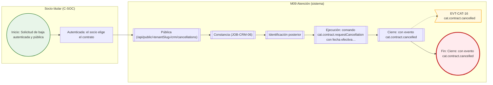

**Pasos del proceso** (actividad tomada del anexo; la columna RF/RN distingue lo citado en el paso de lo asociado por parámetro, permiso, evento o tema compartido).

| Paso | Carril | Actividad | RF/RN que aplican | EVT / JOB / PAN |
|---|---|---|---|---|
| 1 | Socio titular | Autenticada: el socio elige el contrato; el sistema muestra fecha solicitada, plazo de respuesta, efectos (equipos a devolver, facturación final de lo devengado informada por M05) y sin cargo por solicitar. Confirma; se crea el caso con constancia y código. | — | — |
| 2 | M09 Atención | Pública (`/api/public/<tenantSlug>/crm/cancellations`): formulario visible sin login con datos mínimos (PA-CRM-15): nombre, documento, servicio, domicilio o número de cuenta, canal de contacto. Rate limit y captcha. Se crea el caso con `requester.identityStatus = unverified`, `cancellationRequest.isPublic = true`, código identificador mostrado en pantalla y enviado por el mismo medio (email/SMS) con `receiptDeadlineAt = recepción + 24 h`. | asoc.: RN-CRM-008, RF-CRM-066 | — |
| 3 | M09 Atención | Constancia (JOB-CRM-06): verifica que la constancia fue entregada antes del plazo; si el canal falla, intenta canal alternativo y alerta a supervisión; registra evidencia (AGR-024). | — | JOB-CRM-06 |
| 4 | M09 Atención | Identificación posterior: supervisión vincula el caso con la persona/contrato sin exigir trámites obstructivos; si no hay coincidencia, contacta al solicitante. | — | — |
| 5 | M09 Atención | Ejecución: comando `cat.contract.requestCancellation` con fecha efectiva solicitada; M10 retiro de equipos si corresponde; M05 facturación final de lo devengado. La deuda previa se informa pero no condiciona (RN-CRM-015). | RN-CRM-015 | — |
| 6 | M09 Atención | Cierre: con evento `cat.contract.cancelled`; aviso con fecha efectiva; el vínculo asociativo no cambia (RN-CRM-010). | RN-CRM-010 | EVT-CAT-16 |

**Situación actual en ProCoop (nota de cambio).** Sin contraste específico para este proceso en el anexo (filas `CTR-` con ProCoop) ni en el análisis de brechas. El contraste del dominio está en `15-analisis-brechas-procoop.md` §3.12.

**Excepciones**

| Excepción | Tratamiento |
|---|---|
| Cancelación, anulación o reversión | Pública (`/api/public/<tenantSlug>/crm/cancellations`): formulario visible sin login con datos mínimos (PA-CRM-15): nombre, documento, servicio, domicilio o número de cuenta, canal de contacto |
| Cancelación, anulación o reversión | Se crea el caso con `requester.identityStatus = unverified`, `cancellationRequest.isPublic = true`, código identificador mostrado en pantalla y enviado por el mismo medio (email/SMS) con `receiptDeadlineAt = recepción + 24 h` |
| Si el canal falla | intenta canal alternativo y alerta a supervisión; registra evidencia (AGR-024) |
| Si no hay coincidencia | contacta al solicitante |
| Falla técnica en un paso automático, un job o una integración | Reintento idempotente y reanudable; lo no reparable pasa a la bandeja técnica con responsable (política de recuperación de M09 §9.14; AGR-016). |

---

## 7. PRC-CRM-04 Suspensión temporal y reactivación (CU-CIC-01)

| Campo | Contenido |
|---|---|
| Fuente | M09 §9.4, `M09-CRM-atencion.md` (línea 1716) |
| Macroproceso | MP-13 Atención y autogestión del socio |
| Disparador | Suspensión temporal y reactivación |
| Resultado | Reactivación: el sistema consulta estado y reglas (M02/M08) |
| Carriles | Socio titular (C-SOC); M09 Atención (sistema) |
| Roles de T02 | C-SOC Socio titular |
| Módulos involucrados | M02 Catálogo y contratos, M09 Atención |
| Eventos (T11 §12) | EVT-CAT-12 `cat.contract.reactivated` |
| Jobs | — |
| Relación con 04-procesos-bpmn.md | P6 Reclamo y orden de trabajo ([§10](04-procesos-bpmn.md#10-p6--reclamo-y-orden-de-trabajo)) |

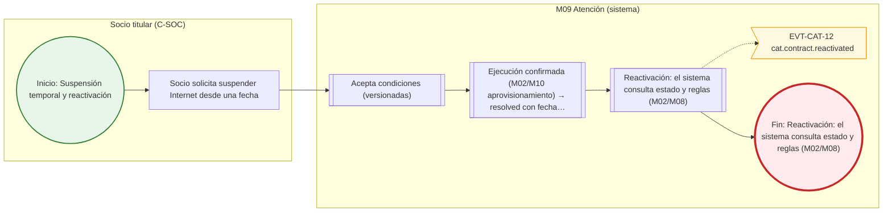

**Pasos del proceso** (actividad tomada del anexo; la columna RF/RN distingue lo citado en el paso de lo asociado por parámetro, permiso, evento o tema compartido).

| Paso | Carril | Actividad | RF/RN que aplican | EVT / JOB / PAN |
|---|---|---|---|---|
| 1 | Socio titular | Socio solicita suspender Internet desde una fecha; la app muestra modalidades habilitadas y validadas para su contrato (gratuita o arancelada, PRM-CRM-034). | asoc.: RF-CRM-070 | — |
| 2 | M09 Atención | Acepta condiciones (versionadas); comando `cat.contract.requestSuspension`. | — | — |
| 3 | M09 Atención | Ejecución confirmada (M02/M10 aprovisionamiento) → `resolved` con fecha efectiva. | — | — |
| 4 | M09 Atención | Reactivación: el sistema consulta estado y reglas (M02/M08); si hay cargo válido, se informa; si se paga, el caso sigue en trámite hasta `cat.contract.reactivated` (RN-CRM-013). | RN-CRM-013 | EVT-CAT-12 |

**Situación actual en ProCoop (nota de cambio).** Sin contraste específico para este proceso en el anexo (filas `CTR-` con ProCoop) ni en el análisis de brechas. El contraste del dominio está en `15-analisis-brechas-procoop.md` §3.12.

**Excepciones**

| Excepción | Tratamiento |
|---|---|
| Si hay cargo válido | se informa; si se paga, el caso sigue en trámite hasta `cat.contract.reactivated` (RN-CRM-013) |
| Falla técnica en un paso automático, un job o una integración | Reintento idempotente y reanudable; lo no reparable pasa a la bandeja técnica con responsable (política de recuperación de M09 §9.14; AGR-016). |

---

## 8. PRC-CRM-05 Cambio de plan, cambio de titular, traslado

| Campo | Contenido |
|---|---|
| Fuente | M09 §9.5, `M09-CRM-atencion.md` (línea 1723) |
| Macroproceso | MP-13 Atención y autogestión del socio |
| Disparador | Cambio de plan, cambio de titular, traslado |
| Resultado | Traslado: nuevo domicilio y factibilidad |
| Carriles | M04 Tarifas; M09 Atención (sistema) |
| Roles de T02 | Solo actores del sistema (sin rol humano) |
| Módulos involucrados | M04 Tarifas, M09 Atención |
| Eventos (T11 §12) | — |
| Jobs | — |
| Relación con 04-procesos-bpmn.md | P6 Reclamo y orden de trabajo ([§10](04-procesos-bpmn.md#10-p6--reclamo-y-orden-de-trabajo)) |

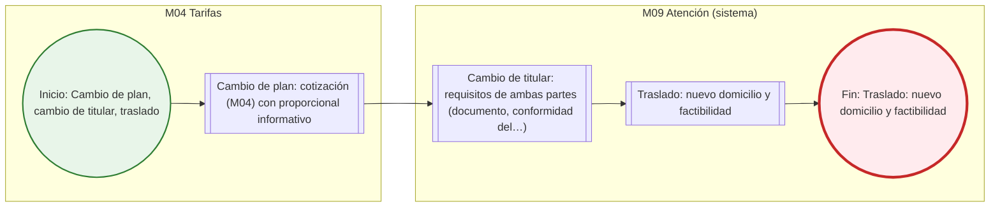

**Pasos del proceso** (actividad tomada del anexo; la columna RF/RN distingue lo citado en el paso de lo asociado por parámetro, permiso, evento o tema compartido).

| Paso | Carril | Actividad | RF/RN que aplican | EVT / JOB / PAN |
|---|---|---|---|---|
| 1 | M04 Tarifas | Cambio de plan: cotización (M04) con proporcional informativo; comando `cat.contract.requestPlanChange` con fecha efectiva; el proporcional lo calcula M05. | — | — |
| 2 | M09 Atención | Cambio de titular: requisitos de ambas partes (documento, conformidad del cedente, aceptación del cesionario, libre deuda solo si una norma lo habilita y está configurado); comando `per.account.requestOwnerTransfer`; M01 registra la transferencia (`TRANSFER`). | asoc.: RF-CRM-071 | — |
| 3 | M09 Atención | Traslado: nuevo domicilio y factibilidad; comandos `tec.feasibility.request` y `tec.workOrder.request` (operación traslado); al ejecutarse, M01 actualiza domicilio del servicio. | asoc.: RF-CRM-073 | — |

**Situación actual en ProCoop (nota de cambio).** Sin contraste específico para este proceso en el anexo (filas `CTR-` con ProCoop) ni en el análisis de brechas. El contraste del dominio está en `15-analisis-brechas-procoop.md` §3.12.

**Excepciones**

| Excepción | Tratamiento |
|---|---|
| Falla técnica en un paso automático, un job o una integración | Reintento idempotente y reanudable; lo no reparable pasa a la bandeja técnica con responsable (política de recuperación de M09 §9.14; AGR-016). |

---

## 9. PRC-CRM-06 Reclamo técnico con incidente común (CU-16, piloto Internet)

| Campo | Contenido |
|---|---|
| Fuente | M09 §9.6, `M09-CRM-atencion.md` (línea 1729) |
| Macroproceso | MP-13 Atención y autogestión del socio |
| Disparador | Reclamo técnico con incidente común |
| Resultado | Cierre del incidente tras el plazo de observación |
| Carriles | M09 Atención (sistema); Supervisor de atención (T-SAT); M10 Técnica y campo |
| Roles de T02 | T-SAT Supervisor de atención |
| Módulos involucrados | M09 Atención, M10 Técnica y campo |
| Eventos (T11 §12) | — |
| Jobs | JOB-CRM-05 `crm:incident-detect` |
| Relación con 04-procesos-bpmn.md | P6 Reclamo y orden de trabajo ([§10](04-procesos-bpmn.md#10-p6--reclamo-y-orden-de-trabajo)) |

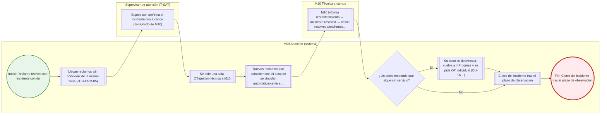

**Pasos del proceso** (actividad tomada del anexo; la columna RF/RN distingue lo citado en el paso de lo asociado por parámetro, permiso, evento o tema compartido).

| Paso | Carril | Actividad | RF/RN que aplican | EVT / JOB / PAN |
|---|---|---|---|---|
| 1 | M09 Atención | Llegan reclamos "sin conexión" de la misma zona; JOB-CRM-05 detecta ≥ N casos en la ventana y propone INC al supervisor. | asoc.: RF-CRM-107 | JOB-CRM-05 |
| 2 | Supervisor de atención | Supervisor confirma el incidente con alcance (zona/nodo de M10); el sistema vincula casos abiertos coincidentes y calcula afectados. | asoc.: RF-CRM-108 | — |
| 3 | M09 Atención | Se pide una sola OT/gestión técnica a M10; se envía aviso a afectados (T09) con estimado. | — | — |
| 4 | M09 Atención | Nuevos reclamos que coinciden con el alcance se vinculan automáticamente si el supervisor habilitó "vinculación automática al incidente confirmado" (PRM-CRM-039) y el socio recibe el mensaje del incidente. | — | — |
| 5 | M10 Técnica y campo | M10 informa restablecimiento → incidente `restored` → casos `resolved` pendientes de confirmación; aviso de restablecimiento. | — | — |
| 6 | M09 Atención | Si un socio responde que sigue sin servicio, su caso se desvincula, vuelve a `inProgress` y se pide OT individual (CU-16 excepción). | asoc.: RF-CRM-110 | — |
| 7 | M09 Atención | Cierre del incidente tras el plazo de observación; métricas e informe regulatorio. | — | — |

**Situación actual en ProCoop (nota de cambio).** Análisis de brechas (`15-analisis-brechas-procoop.md` §3.12, Atención): hoy Reclamos y trámites sin expediente único; en GoodApps, expediente único con número de seguimiento, SLA, asignación y escalamiento (brecha "Cambia"; fuente M09; DEC-011).

**Excepciones**

| Excepción | Tratamiento |
|---|---|
| Si un socio responde que sigue sin servicio | su caso se desvincula, vuelve a `inProgress` y se pide OT individual (CU-16 excepción) |
| Falla técnica en un paso automático, un job o una integración | Reintento idempotente y reanudable; lo no reparable pasa a la bandeja técnica con responsable (política de recuperación de M09 §9.14; AGR-016). |

---

## 10. PRC-CRM-07 SLA (JOB-CRM-01)

| Campo | Contenido |
|---|---|
| Fuente | M09 §9.7, `M09-CRM-atencion.md` (línea 1739) |
| Macroproceso | MP-13 Atención y autogestión del socio |
| Disparador | SLA |
| Resultado | El supervisor con crm.sla.excepcionar puede registrar excepción… |
| Carriles | M09 Atención (sistema); Supervisor de atención (T-SAT) |
| Roles de T02 | T-SAT Supervisor de atención |
| Módulos involucrados | M09 Atención |
| Eventos (T11 §12) | EVT-CRM-06 `crm.case.slaWarning`; EVT-CRM-07 `crm.case.slaBreached` |
| Jobs | JOB-CRM-01 `crm:sla-monitor` |
| Relación con 04-procesos-bpmn.md | P6 Reclamo y orden de trabajo ([§10](04-procesos-bpmn.md#10-p6--reclamo-y-orden-de-trabajo)) |

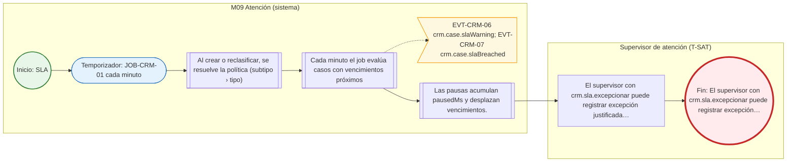

**Pasos del proceso** (actividad tomada del anexo; la columna RF/RN distingue lo citado en el paso de lo asociado por parámetro, permiso, evento o tema compartido).

| Paso | Carril | Actividad | RF/RN que aplican | EVT / JOB / PAN |
|---|---|---|---|---|
| 1 | M09 Atención | Al crear o reclasificar, se resuelve la política (subtipo > tipo; servicio; prioridad) y se calculan vencimientos con el calendario hábil de T04 (feriados del tenant y de la localidad). | asoc.: RN-CRM-052, RF-CRM-103 | — |
| 2 | M09 Atención | Cada minuto el job evalúa casos con vencimientos próximos: al `warnAtPercent` emite `crm.case.slaWarning` y avisa al responsable; al 100 % emite `crm.case.slaBreached`, escala según niveles y marca incumplimiento (no se borra aunque luego se cumpla). | asoc.: RF-CRM-104 | EVT-CRM-06, EVT-CRM-07 |
| 3 | M09 Atención | Las pausas acumulan `pausedMs` y desplazan vencimientos. | — | — |
| 4 | Supervisor de atención | El supervisor con `crm.sla.excepcionar` puede registrar excepción justificada (no borra el incumplimiento; lo califica). | — | — |

**Situación actual en ProCoop (nota de cambio).** Sin contraste específico para este proceso en el anexo (filas `CTR-` con ProCoop) ni en el análisis de brechas. El contraste del dominio está en `15-analisis-brechas-procoop.md` §3.12.

**Excepciones**

| Excepción | Tratamiento |
|---|---|
| Vencimiento | Al crear o reclasificar, se resuelve la política (subtipo > tipo; servicio; prioridad) y se calculan vencimientos con el calendario hábil de T04 (feriados del tenant y de la localidad) |
| Vencimiento | Cada minuto el job evalúa casos con vencimientos próximos: al `warnAtPercent` emite `crm.case.slaWarning` y avisa al responsable; al 100 % emite `crm.case.slaBreached`, escala según niveles y marca incumplimiento (no se borra aunque luego se cumpla) |
| Vencimiento | Las pausas acumulan `pausedMs` y desplazan vencimientos |
| Falla técnica en un paso automático, un job o una integración | Reintento idempotente y reanudable; lo no reparable pasa a la bandeja técnica con responsable (política de recuperación de M09 §9.14; AGR-016). |

---

## 11. PRC-CRM-08 Bot de WhatsApp (O6)

| Campo | Contenido |
|---|---|
| Fuente | M09 §9.8, `M09-CRM-atencion.md` (línea 1746); ola O6 |
| Macroproceso | MP-13 Atención y autogestión del socio |
| Disparador | Bot de WhatsApp |
| Resultado | Salientes fuera de ventana |
| Carriles | T06 Integraciones; Bot / asistente IA (S-BOT); M09 Atención (sistema) |
| Roles de T02 | S-BOT Bot / asistente IA |
| Módulos involucrados | M09 Atención, T06 Integraciones |
| Eventos (T11 §12) | — |
| Jobs | JOB-CRM-13 `crm:bot-step` |
| Relación con 04-procesos-bpmn.md | P6 Reclamo y orden de trabajo ([§10](04-procesos-bpmn.md#10-p6--reclamo-y-orden-de-trabajo)) |

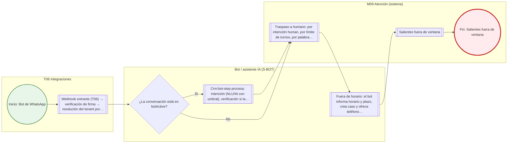

**Pasos del proceso** (actividad tomada del anexo; la columna RF/RN distingue lo citado en el paso de lo asociado por parámetro, permiso, evento o tema compartido).

| Paso | Carril | Actividad | RF/RN que aplican | EVT / JOB / PAN |
|---|---|---|---|---|
| 1 | T06 Integraciones | Webhook entrante (T06) → verificación de firma → resolución del tenant por número → idempotencia por `providerMessageId` → `crmMessages`. | — | — |
| 2 | Bot / asistente IA | Si la conversación está en `botActive`, `crm:bot-step` procesa: intención (NLU/IA con umbral), verificación si la intención la exige (PA-CRM-07), ejecución de la consulta (saldo M07, segunda vía M05, link de pago M07, estado de casos, cortes programados de incidentes) o creación de caso. | asoc.: RF-CRM-174, RF-CRM-175 | JOB-CRM-13 |
| 3 | M09 Atención | Traspaso a humano: por intención `human`, por límite de turnos, por palabra clave, por baja confianza o por error; la conversación pasa a `queued` del área del canal con transcripción y resumen. | asoc.: RF-CRM-176 | — |
| 4 | Bot / asistente IA | Fuera de horario: el bot informa horario y plazo, crea caso y ofrece teléfono de guardia si la intención es urgencia (PA-CRM-08). | asoc.: RF-CRM-176 | — |
| 5 | M09 Atención | Salientes fuera de ventana: solo plantillas aprobadas (RN-CRM-082). | RN-CRM-082; asoc.: RF-CRM-172 | — |

**Situación actual en ProCoop (nota de cambio).** Sin contraste específico para este proceso en el anexo (filas `CTR-` con ProCoop) ni en el análisis de brechas. El contraste del dominio está en `15-analisis-brechas-procoop.md` §3.12.

**Excepciones**

| Excepción | Tratamiento |
|---|---|
| Si la conversación está en `botActive` | `crm:bot-step` procesa: intención (NLU/IA con umbral), verificación si la intención la exige (PA-CRM-07), ejecución de la consulta (saldo M07, segunda vía M05, link de pago M07, estado de casos, cortes programados de incidentes) o creación de caso |
| Falla o error | Traspaso a humano: por intención `human`, por límite de turnos, por palabra clave, por baja confianza o por error; la conversación pasa a `queued` del área del canal con transcripción y resumen |
| Falla técnica en un paso automático, un job o una integración | Reintento idempotente y reanudable; lo no reparable pasa a la bandeja técnica con responsable (política de recuperación de M09 §9.14; AGR-016). |

---

## 12. PRC-CRM-09 Email entrante (O6)

| Campo | Contenido |
|---|---|
| Fuente | M09 §9.9, `M09-CRM-atencion.md` (línea 1754); ola O6 |
| Macroproceso | MP-13 Atención y autogestión del socio |
| Disparador | Email entrante |
| Resultado | Respuestas automáticas y rebotes se descartan como interacción… |
| Carriles | M09 Atención (sistema) |
| Roles de T02 | Solo actores del sistema (sin rol humano) |
| Módulos involucrados | M09 Atención |
| Eventos (T11 §12) | — |
| Jobs | JOB-CRM-12 `crm:email-ingest` |
| Relación con 04-procesos-bpmn.md | P6 Reclamo y orden de trabajo ([§10](04-procesos-bpmn.md#10-p6--reclamo-y-orden-de-trabajo)) |

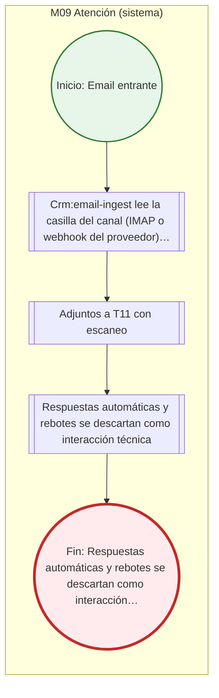

**Pasos del proceso** (actividad tomada del anexo; la columna RF/RN distingue lo citado en el paso de lo asociado por parámetro, permiso, evento o tema compartido).

| Paso | Carril | Actividad | RF/RN que aplican | EVT / JOB / PAN |
|---|---|---|---|---|
| 1 | M09 Atención | `crm:email-ingest` lee la casilla del canal (IMAP o webhook del proveedor), detecta número de caso en el asunto (`[TCK-…]`) o en cabeceras de respuesta, agrega el mensaje al caso o crea uno nuevo en supervisión | — | JOB-CRM-12 |
| 2 | M09 Atención | adjuntos a T11 con escaneo | — | — |
| 3 | M09 Atención | respuestas automáticas y rebotes se descartan como interacción técnica | — | — |

**Situación actual en ProCoop (nota de cambio).** Sin contraste específico para este proceso en el anexo (filas `CTR-` con ProCoop) ni en el análisis de brechas. El contraste del dominio está en `15-analisis-brechas-procoop.md` §3.12.

**Excepciones**

| Excepción | Tratamiento |
|---|---|
| Falla técnica en un paso automático, un job o una integración | Reintento idempotente y reanudable; lo no reparable pasa a la bandeja técnica con responsable (política de recuperación de M09 §9.14; AGR-016). |

---

## 13. PRC-CRM-10 Turnero (O10)

| Campo | Contenido |
|---|---|
| Fuente | M09 §9.10, `M09-CRM-atencion.md` (línea 1758); ola O10 |
| Macroproceso | MP-13 Atención y autogestión del socio |
| Disparador | Turnero |
| Resultado | Hardware: impresión del ticket por el agente local (T06) con… |
| Carriles | Dispositivo kiosco/tótem/turnero (S-KSK); Comercial / Atención al socio (T-ATE); M09 Atención (sistema) |
| Roles de T02 | S-KSK Dispositivo kiosco/tótem/turnero, T-ATE Comercial / Atención al socio |
| Módulos involucrados | M09 Atención |
| Eventos (T11 §12) | — |
| Jobs | JOB-CRM-08 `crm:queue-day-close` |
| Relación con 04-procesos-bpmn.md | P6 Reclamo y orden de trabajo ([§10](04-procesos-bpmn.md#10-p6--reclamo-y-orden-de-trabajo)) |

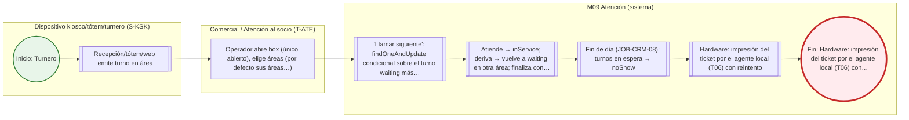

**Pasos del proceso** (actividad tomada del anexo; la columna RF/RN distingue lo citado en el paso de lo asociado por parámetro, permiso, evento o tema compartido).

| Paso | Carril | Actividad | RF/RN que aplican | EVT / JOB / PAN |
|---|---|---|---|---|
| 1 | Dispositivo kiosco/tótem/turnero | Recepción/tótem/web emite turno en área: contador atómico por (sucursal, día, área de origen); código visible según PRM-CRM-100/101; acciones `received` y `waiting`; estimado de espera. | asoc.: RN-CRM-061 | — |
| 2 | Comercial / Atención al socio | Operador abre box (único abierto), elige áreas (por defecto sus áreas asignadas). | — | — |
| 3 | M09 Atención | "Llamar siguiente": `findOneAndUpdate` condicional sobre el turno `waiting` más prioritario y antiguo de sus áreas → `calling`; evento a pantallas (WebSocket) y voz; aviso push/WhatsApp si es turno remoto. | asoc.: RN-CRM-063, RF-CRM-145 | — |
| 4 | M09 Atención | Atiende → `inService`; deriva → vuelve a `waiting` en otra área; finaliza con motivo y resultado → interacción y caso opcional. | — | — |
| 5 | M09 Atención | Fin de día (JOB-CRM-08): turnos en espera → `noShow`; boxes abiertos se cierran con nota. | — | JOB-CRM-08 |
| 6 | M09 Atención | Hardware: impresión del ticket por el agente local (T06) con reintento; si no hay agente, se muestra QR/código en pantalla. | asoc.: RF-CRM-155 | — |

**Situación actual en ProCoop (nota de cambio).** Sin contraste específico para este proceso en el anexo (filas `CTR-` con ProCoop) ni en el análisis de brechas. El contraste del dominio está en `15-analisis-brechas-procoop.md` §3.12.

**Excepciones**

| Excepción | Tratamiento |
|---|---|
| Si no hay agente | se muestra QR/código en pantalla |
| Falla técnica en un paso automático, un job o una integración | Reintento idempotente y reanudable; lo no reparable pasa a la bandeja técnica con responsable (política de recuperación de M09 §9.14; AGR-016). |

---

## 14. PRC-CRM-11 Actividades internas (O10)

| Campo | Contenido |
|---|---|
| Fuente | M09 §9.11, `M09-CRM-atencion.md` (línea 1767); ola O10 |
| Macroproceso | MP-13 Atención y autogestión del socio |
| Disparador | Actividades internas |
| Resultado | Cierre: responsable registra observación, evidencia, revisión |
| Carriles | M09 Atención (sistema); Comercial / Atención al socio (T-ATE) |
| Roles de T02 | T-ATE Comercial / Atención al socio |
| Módulos involucrados | M09 Atención |
| Eventos (T11 §12) | — |
| Jobs | JOB-CRM-09 `crm:activity-generate`; JOB-CRM-10 `crm:activity-reminders` |
| Relación con 04-procesos-bpmn.md | P6 Reclamo y orden de trabajo ([§10](04-procesos-bpmn.md#10-p6--reclamo-y-orden-de-trabajo)) |

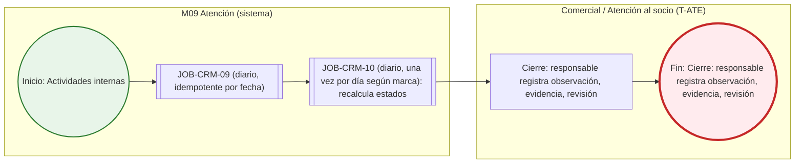

**Pasos del proceso** (actividad tomada del anexo; la columna RF/RN distingue lo citado en el paso de lo asociado por parámetro, permiso, evento o tema compartido).

| Paso | Carril | Actividad | RF/RN que aplican | EVT / JOB / PAN |
|---|---|---|---|---|
| 1 | M09 Atención | JOB-CRM-09 (diario, idempotente por fecha): por cada actividad automática vigente, calcula la próxima fecha; si próxima fecha − margen anterior ≤ hoy y no existe ocurrencia para esa fecha y no supera la vigencia, crea la ocurrencia y la cita del responsable. | asoc.: RF-CRM-225, RN-CRM-073 | JOB-CRM-09 |
| 2 | M09 Atención | JOB-CRM-10 (diario, una vez por día según marca): recalcula estados; envía recordatorios por actividad, por responsable y por área en los días de envío configurados, con resumen de atraso promedio; escala vencidas tras N días. | asoc.: RF-CRM-227 | JOB-CRM-10 |
| 3 | Comercial / Atención al socio | Cierre: responsable registra observación, evidencia, revisión; si requiere aprobación, queda pendiente; al cerrar se envía aviso de finalización. | asoc.: RF-CRM-229 | — |

**Situación actual en ProCoop (nota de cambio).** Sin contraste específico para este proceso en el anexo (filas `CTR-` con ProCoop) ni en el análisis de brechas. El contraste del dominio está en `15-analisis-brechas-procoop.md` §3.12.

**Excepciones**

| Excepción | Tratamiento |
|---|---|
| Si próxima fecha − margen anterior ≤ hoy y no existe ocurrencia para esa fecha y no supera la vigencia | crea la ocurrencia y la cita del responsable |
| Vencimiento | JOB-CRM-10 (diario, una vez por día según marca): recalcula estados; envía recordatorios por actividad, por responsable y por área en los días de envío configurados, con resumen de atraso promedio; escala vencidas tras N días |
| Si requiere aprobación | queda pendiente; al cerrar se envía aviso de finalización |
| Falla técnica en un paso automático, un job o una integración | Reintento idempotente y reanudable; lo no reparable pasa a la bandeja técnica con responsable (política de recuperación de M09 §9.14; AGR-016). |

---

## 15. PRC-CRM-12 Trámites con vencimiento (O7)

| Campo | Contenido |
|---|---|
| Fuente | M09 §9.12, `M09-CRM-atencion.md` (línea 1773); ola O7 |
| Macroproceso | MP-13 Atención y autogestión del socio |
| Disparador | Trámites con vencimiento |
| Resultado | Al alta de un trámite, ejecuta acciones onCreate |
| Carriles | M09 Atención (sistema) |
| Roles de T02 | Solo actores del sistema (sin rol humano) |
| Módulos involucrados | M09 Atención |
| Eventos (T11 §12) | — |
| Jobs | JOB-CRM-07 `crm:procedure-expiry` |
| Relación con 04-procesos-bpmn.md | P6 Reclamo y orden de trabajo ([§10](04-procesos-bpmn.md#10-p6--reclamo-y-orden-de-trabajo)) |

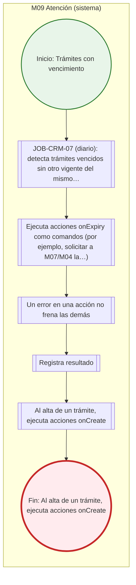

**Pasos del proceso** (actividad tomada del anexo; la columna RF/RN distingue lo citado en el paso de lo asociado por parámetro, permiso, evento o tema compartido).

| Paso | Carril | Actividad | RF/RN que aplican | EVT / JOB / PAN |
|---|---|---|---|---|
| 1 | M09 Atención | JOB-CRM-07 (diario): detecta trámites vencidos sin otro vigente del mismo tipo para la misma entidad; marca `expired` | — | JOB-CRM-07 |
| 2 | M09 Atención | ejecuta acciones `onExpiry` como comandos (por ejemplo, solicitar a M07/M04 la baja de un beneficio de tarifa social) | — | — |
| 3 | M09 Atención | un error en una acción no frena las demás | — | — |
| 4 | M09 Atención | registra resultado | — | — |
| 5 | M09 Atención | Al alta de un trámite, ejecuta acciones `onCreate` | — | — |

**Situación actual en ProCoop (nota de cambio).** Sin contraste específico para este proceso en el anexo (filas `CTR-` con ProCoop) ni en el análisis de brechas. El contraste del dominio está en `15-analisis-brechas-procoop.md` §3.12.

**Excepciones**

| Excepción | Tratamiento |
|---|---|
| Falla o error | JOB-CRM-07 (diario): detecta trámites vencidos sin otro vigente del mismo tipo para la misma entidad; marca `expired` ejecuta acciones `onExpiry` como comandos (por ejemplo, solicitar a M07/M04 la baja de un beneficio de tarifa social) un error en una acción no frena las demás registra resultado Al alta de un trámite, ejecuta acciones `onCreate` |
| Falla técnica en un paso automático, un job o una integración | Reintento idempotente y reanudable; lo no reparable pasa a la bandeja técnica con responsable (política de recuperación de M09 §9.14; AGR-016). |

---

## 16. PRC-CRM-13 Circulares (O6)

| Campo | Contenido |
|---|---|
| Fuente | M09 §9.13, `M09-CRM-atencion.md` (línea 1777); ola O6 |
| Macroproceso | MP-13 Atención y autogestión del socio |
| Disparador | Circulares |
| Resultado | Informe de comunicación con entregados/fallidos. |
| Carriles | Comercial / Atención al socio (T-ATE); M09 Atención (sistema) |
| Roles de T02 | T-ATE Comercial / Atención al socio |
| Módulos involucrados | M09 Atención |
| Eventos (T11 §12) | — |
| Jobs | JOB-CRM-11 `crm:circular-generate` |
| Relación con 04-procesos-bpmn.md | P6 Reclamo y orden de trabajo ([§10](04-procesos-bpmn.md#10-p6--reclamo-y-orden-de-trabajo)) |

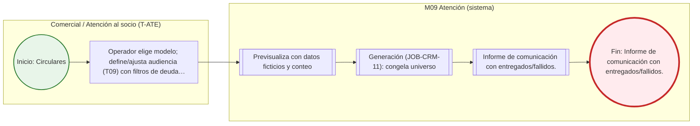

**Pasos del proceso** (actividad tomada del anexo; la columna RF/RN distingue lo citado en el paso de lo asociado por parámetro, permiso, evento o tema compartido).

| Paso | Carril | Actividad | RF/RN que aplican | EVT / JOB / PAN |
|---|---|---|---|---|
| 1 | Comercial / Atención al socio | Operador elige modelo; define/ajusta audiencia (T09) con filtros de deuda, mora, adhesión y servicio. | — | — |
| 2 | M09 Atención | Previsualiza con datos ficticios y conteo; si el modelo requiere, pasa a aprobación. | — | — |
| 3 | M09 Atención | Generación (JOB-CRM-11): congela universo; produce PDF de impresión y etiquetas, o envía por T09 por canal; opcionalmente pide OT masivas a M10 por comando idempotente por cuenta. | asoc.: RF-CRM-251 | JOB-CRM-11 |
| 4 | M09 Atención | Informe de comunicación con entregados/fallidos. | — | — |

**Situación actual en ProCoop (nota de cambio).** Sin contraste específico para este proceso en el anexo (filas `CTR-` con ProCoop) ni en el análisis de brechas. El contraste del dominio está en `15-analisis-brechas-procoop.md` §3.12.

**Excepciones**

| Excepción | Tratamiento |
|---|---|
| Si el modelo requiere | pasa a aprobación |
| Falla técnica en un paso automático, un job o una integración | Reintento idempotente y reanudable; lo no reparable pasa a la bandeja técnica con responsable (política de recuperación de M09 §9.14; AGR-016). |

---

## 17. PRC-POR-01 Resolución de tenant y carga de marca (landing y PWA)

| Campo | Contenido |
|---|---|
| Fuente | M19 §9.1, `M19-POR-portal-socio-landing.md` (línea 966) |
| Macroproceso | MP-13 Atención y autogestión del socio |
| Disparador | Resolución de tenant y carga de marca |
| Resultado | La PWA aplica applyBrandingCssVars, applyTenantPwaIdentity… |
| Carriles | M19 Portal (sistema) |
| Roles de T02 | Solo actores del sistema (sin rol humano) |
| Módulos involucrados | M19 Portal |
| Eventos (T11 §12) | — |
| Jobs | — |
| Relación con 04-procesos-bpmn.md | — |

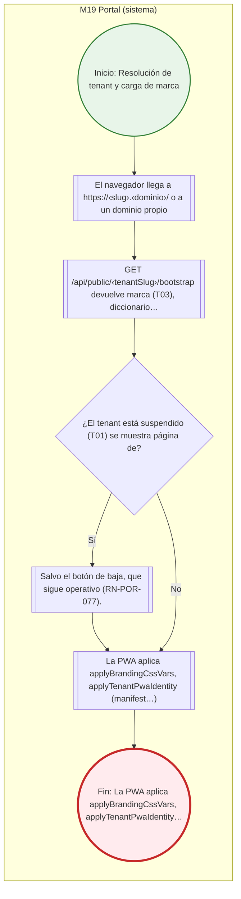

**Pasos del proceso** (actividad tomada del anexo; la columna RF/RN distingue lo citado en el paso de lo asociado por parámetro, permiso, evento o tema compartido).

| Paso | Carril | Actividad | RF/RN que aplican | EVT / JOB / PAN |
|---|---|---|---|---|
| 1 | M19 Portal | El navegador llega a `https://<slug>.<dominio>/` o a un dominio propio; el edge resuelve `slug` → `tenantId` con `landingPages` (único lugar donde el tenant no sale del token: solo para contenido público). | — | — |
| 2 | M19 Portal | `GET /api/public/<tenantSlug>/bootstrap` devuelve marca (T03), diccionario público, versión publicada de la landing, oferta pública (M02), parámetros públicos del portal y estado del tenant. | — | — |
| 3 | M19 Portal | Si el tenant está suspendido (T01) se muestra página de servicio no disponible con datos de contacto, salvo el botón de baja, que sigue operativo (RN-POR-077). | RN-POR-077 | — |
| 4 | M19 Portal | La PWA aplica `applyBrandingCssVars`, `applyTenantPwaIdentity` (manifest dinámico) y `applySystemChromeTheme` (CNX §3.2), con el ajuste de contraste de RN-POR-063. | RN-POR-063 | — |

**Situación actual en ProCoop (nota de cambio).** Sin contraste específico para este proceso en el anexo (filas `CTR-` con ProCoop) ni en el análisis de brechas. El contraste del dominio está en `15-analisis-brechas-procoop.md` §3.13.

**Excepciones**

| Excepción | Tratamiento |
|---|---|
| Si el tenant está suspendido (T01) se muestra página de servicio no disponible con datos de contacto | salvo el botón de baja, que sigue operativo (RN-POR-077) |
| Falla técnica en un paso automático, un job o una integración | Reintento idempotente y reanudable; lo no reparable pasa a la bandeja técnica con responsable (política de recuperación de T11 P-WFL-01 y T01 §9.12; AGR-016). |

---

## 18. PRC-POR-02 Registro y primer ingreso (O2)

| Campo | Contenido |
|---|---|
| Fuente | M19 §9.2, `M19-POR-portal-socio-landing.md` (línea 973); ola O2 |
| Macroproceso | MP-13 Atención y autogestión del socio |
| Disparador | Registro y primer ingreso |
| Resultado | POR crea portalUserPreferences, calcula rol registrado y… |
| Carriles | Visitante registrado (C-VIS); T02 Identidad y roles; M19 Portal (sistema) |
| Roles de T02 | C-VIS Visitante registrado |
| Módulos involucrados | M19 Portal, T02 Identidad y roles |
| Eventos (T11 §12) | EVT-IAM-01 `iam.identity.created`; EVT-IAM-03 `iam.membership.activated` |
| Jobs | — |
| Relación con 04-procesos-bpmn.md | — |

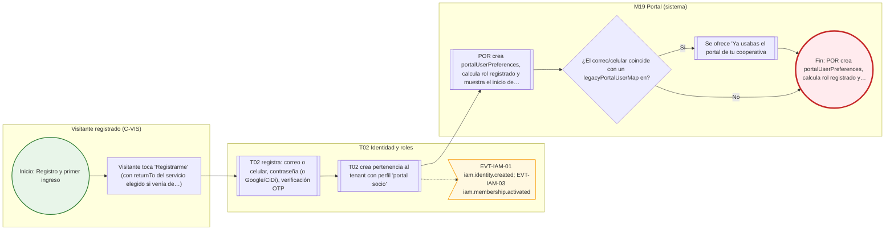

**Pasos del proceso** (actividad tomada del anexo; la columna RF/RN distingue lo citado en el paso de lo asociado por parámetro, permiso, evento o tema compartido).

| Paso | Carril | Actividad | RF/RN que aplican | EVT / JOB / PAN |
|---|---|---|---|---|
| 1 | Visitante registrado | Visitante toca "Registrarme" (con `returnTo` del servicio elegido si venía de "Contratar"). | asoc.: RF-POR-015 | — |
| 2 | T02 Identidad y roles | T02 registra: correo o celular, contraseña (o Google/CiDi), verificación OTP; acepta términos (versión). | — | — |
| 3 | T02 Identidad y roles | T02 crea pertenencia al tenant con perfil "portal socio"; emite `iam.identity.created` y `iam.membership.activated` (EVT-IAM-01/03). | — | EVT-IAM-01, EVT-IAM-03 |
| 4 | M19 Portal | POR crea `portalUserPreferences`, calcula rol `registrado` y muestra el inicio de usuario registrado (o retoma `returnTo`). | — | — |
| 5 | M19 Portal | Si el correo/celular coincide con un `legacyPortalUserMap` en estado `invitado`, se ofrece "Ya usabas el portal de tu cooperativa: activá tu acceso" (flujo 9.4). | — | — |

**Situación actual en ProCoop (nota de cambio).** El anexo indica: Si el correo/celular coincide con un `legacyPortalUserMap` en estado `invitado`, se ofrece "Ya usabas el portal de tu cooperativa: activá tu acceso" (flujo 9.4).

**Excepciones**

| Excepción | Tratamiento |
|---|---|
| Si el correo/celular coincide con un `legacyPortalUserMap` en estado `invitado` | se ofrece "Ya usabas el portal de tu cooperativa: activá tu acceso" (flujo 9.4) |
| Falla técnica en un paso automático, un job o una integración | Reintento idempotente y reanudable; lo no reparable pasa a la bandeja técnica con responsable (política de recuperación de T11 P-WFL-01 y T01 §9.12; AGR-016). |

---

## 19. PRC-POR-03 Vinculación de cuenta (O2)

| Campo | Contenido |
|---|---|
| Fuente | M19 §9.3, `M19-POR-portal-socio-landing.md` (línea 981); ola O2 |
| Macroproceso | MP-13 Atención y autogestión del socio |
| Disparador | Vinculación de cuenta |
| Resultado | Evento por.accountAccess.granted → T09 avisa al titular… |
| Carriles | Socio titular (C-SOC); Administrador de la cooperativa (T-ADM); M19 Portal (sistema) |
| Roles de T02 | C-SOC Socio titular, T-ADM Administrador de la cooperativa |
| Módulos involucrados | M19 Portal |
| Eventos (T11 §12) | EVT-POR-01 `por.accountAccess.granted` |
| Jobs | — |
| Relación con 04-procesos-bpmn.md | — |

```mermaid
flowchart LR
  subgraph L_LCSOC["Socio titular (C-SOC)"]
    ni(("Inicio: Vinculación de cuenta"))
    ns1["Usuario abre 'Vincular cuenta' (modal desde FAB en Mis cuentas)"]
  end
  subgraph L_LTADM["Administrador de la cooperativa (T-ADM)"]
    ns2["Ingresa datos; el cliente envía POST /api/por/account-links con…"]
  end
  subgraph L_LSIS["M19 Portal (sistema)"]
    ns3[["Servidor verifica límites (RN-POR-005)"]]
    nx4{"¿Coincide y el método es suficiente?"}
    ns4[["Crea acceso activo con rol según relación en M01 (titular si el documento del…)"]]
    nx5{"¿Requiere evidencia (representante legal)?"}
    ns5[["Persona jurídica) → pendienteVerificacion con storedFileIds"]]
    nx6{"¿Falla?"}
    ns6[["Respuesta genérica 'No pudimos verificar los datos"]]
    ns7[["Evento por.accountAccess.granted → T09 avisa al titular (RN-POR-006)."]]
    ne7>"EVT-POR-01 por.accountAccess.granted"]
    nf(("Fin: Evento por.accountAccess.granted → T09 avisa al titular…"))
  end
  ni --> ns1
  ns1 --> ns2
  ns2 --> ns3
  ns3 --> nx4
  nx4 -->|"Sí"| ns4
  ns4 --> nx5
  nx4 -->|"No"| nx5
  nx5 -->|"Sí"| ns5
  ns5 --> nx6
  nx5 -->|"No"| nx6
  nx6 -->|"Sí"| ns6
  ns6 --> ns7
  nx6 -->|"No"| ns7
  ns7 -.-> ne7
  ns7 --> nf
  classDef inicio fill:#e8f5e9,stroke:#2e7d32,stroke-width:2px
  classDef fin fill:#ffebee,stroke:#c62828,stroke-width:4px
  classDef evento fill:#fff8e1,stroke:#f9a825
  classDef temporizador fill:#e3f2fd,stroke:#1565c0
  class ni inicio
  class nf fin
  class ne7 evento
```

**Pasos del proceso** (actividad tomada del anexo; la columna RF/RN distingue lo citado en el paso de lo asociado por parámetro, permiso, evento o tema compartido).

| Paso | Carril | Actividad | RF/RN que aplican | EVT / JOB / PAN |
|---|---|---|---|---|
| 1 | Socio titular | Usuario abre "Vincular cuenta" (modal desde FAB en Mis cuentas). Elige método entre los habilitados (PRM-POR-010). | — | — |
| 2 | Administrador de la cooperativa | Ingresa datos; el cliente envía `POST /api/por/account-links` con `Idempotency-Key`. | — | — |
| 3 | M19 Portal | Servidor verifica límites (RN-POR-005); calcula `inputFingerprint`; consulta M01 con los datos (sin revelar resultado parcial). | RN-POR-005 | — |
| 4 | M19 Portal | Si coincide y el método es suficiente → crea acceso `activo` con rol según relación en M01 (titular si el documento del perfil coincide con el titular; si no, `autorizadoConsulta` + `pendienteConfirmacionTitular`). | asoc.: RF-POR-035, RF-POR-169 | — |
| 5 | M19 Portal | Si requiere evidencia (representante legal, persona jurídica) → `pendienteVerificacion` con `storedFileIds`; tarea en bandeja. | — | — |
| 6 | M19 Portal | Si falla → respuesta genérica "No pudimos verificar los datos. Revisalos o pedí ayuda" con acción "Solicitar vinculación asistida" (RF-POR-037). | RF-POR-037 | — |
| 7 | M19 Portal | Evento `por.accountAccess.granted` → T09 avisa al titular (RN-POR-006). | RN-POR-006 | EVT-POR-01 |

**Situación actual en ProCoop (nota de cambio).** Sin contraste específico para este proceso en el anexo (filas `CTR-` con ProCoop) ni en el análisis de brechas. El contraste del dominio está en `15-analisis-brechas-procoop.md` §3.13.

**Excepciones**

| Excepción | Tratamiento |
|---|---|
| Si coincide y el método es suficiente | crea acceso `activo` con rol según relación en M01 (titular si el documento del perfil coincide con el titular; si no, `autorizadoConsulta` + `pendienteConfirmacionTitular`) |
| Si requiere evidencia (representante legal | persona jurídica) → `pendienteVerificacion` con `storedFileIds`; tarea en bandeja |
| Si falla | respuesta genérica "No pudimos verificar los datos |
| Falla técnica en un paso automático, un job o una integración | Reintento idempotente y reanudable; lo no reparable pasa a la bandeja técnica con responsable (política de recuperación de T11 P-WFL-01 y T01 §9.12; AGR-016). |

---

## Inconsistencias detectadas en la especificación (esta parte)

No se detectaron inconsistencias en los procesos de esta parte.

## Cobertura de esta parte

| Universo de la parte | Diagramados | Con nota ProCoop específica | Pendientes |
|---|---|---|---|
| 19 (PRC-MOR-08 a PRC-POR-03) | 19 | 6 | 0 |
