# GoodApps Cooperativas

## Procesos de negocio — Atención y autogestión del socio y Operación técnica, redes y stock (M10, M19)

**Entregable de Análisis y Diseño Detallado — Artefacto 2.1 (Procesos de negocio BPMN). Parte de [`04-procesos-bpmn.md`](04-procesos-bpmn.md).**

| Dato | Valor |
|---|---|
| Documento | Diagramas BPMN, pasos, situación actual en ProCoop y excepciones de los procesos PRC-POR-04 a PRC-TEC-06, derivados de la sección 9 de M10, M19 |
| Carácter | Derivado de la especificación vigente; no la reemplaza. Ante diferencias prevalecen la maestra `00`, los anexos, T05, T11 y el registro de decisiones `01` |
| Generación | Script `_trabajo/generar_bpmn.py` con la ampliación `_trabajo/generar_prc.py` (derivación automática desde el texto de la sección 9 de cada anexo, `_trabajo/prc_auto.py`) |
| Versión | 1.1 (regenerada contra la especificación corregida) |
| Fecha | 05-11-2026 |

**Cómo leer cada proceso.** La notación es la de [`04-procesos-bpmn.md` §3](04-procesos-bpmn.md#3-notación-equivalencia-mermaid--bpmn) (carriles, eventos de inicio y fin, tareas de usuario y de servicio, compuertas XOR y AND, eventos de dominio como banderas, temporizadores y jobs como estadios). La tabla de pasos reproduce la actividad del anexo; en la columna RF/RN, los identificadores sin prefijo son los que el anexo cita en el paso y los marcados "asoc." son reglas o requisitos del mismo anexo que comparten parámetro, permiso, evento o tema con el paso (asociación generada por el script y revisada). Los eventos se nombran con su ID del catálogo de T11 §12.

**Derivación automática (v1.2).** Los procesos `PRC-<MOD>-nn` de esta parte se generaron con `_trabajo/generar_prc.py` y `_trabajo/prc_auto.py` a partir del texto de cada subsección §9.n del anexo, sin curaduría paso a paso (a diferencia de los 94 procesos `P-XXX-nn` de las partes 04b a 04i). Reglas: (1) los pasos son los numerados o viñetas del anexo; si la subsección es prosa, se parte por flechas o por oraciones; si es una tabla de pasos o de jobs, cada fila es un paso; (2) el carril de cada paso es el primer actor nombrado al comienzo del paso (rol de T02 §4, otro módulo, sistema externo, dispositivo o job); si no se nombra ninguno, el paso es del sistema del módulo dueño; (3) los pasos que empiezan con "Si …" se dibujan como compuerta XOR; (4) los eventos son los nombres del catálogo de T11 §12 citados en el paso (bandera entrante si el paso los consume, saliente si los publica); el temporizador aparece cuando el título nombra un job periódico; (5) las excepciones son las oraciones del anexo con condición o con palabras de falla, rechazo, vencimiento, duplicado o umbral, más la política de recuperación del anexo; (6) la nota ProCoop combina lo que dice el propio anexo, la fila `CTR-` del anexo que contrasta con ProCoop y la fila de `15-analisis-brechas-procoop.md` §3 de mayor afinidad; si ninguna alcanza el umbral, la nota lo dice y remite al contraste del dominio en esa sección. La revisión manual de una muestra está en `_trabajo/prc_revision.md`; ante diferencias, prevalece el texto del anexo citado en la ficha.

## Índice de procesos de esta parte

1. [PRC-POR-04 Migración y activación de usuarios de CoopOnline (O6 piloto, O11 repetible)](#1-prc-por-04-migración-y-activación-de-usuarios-de-cooponline-o6-piloto-o11-repetible)
2. [PRC-POR-05 Contratación de un servicio (piloto Internet, O2–O3)](#2-prc-por-05-contratación-de-un-servicio-piloto-internet-o2o3)
3. [PRC-POR-06 Coordinación de visita e instalación (O3)](#3-prc-por-06-coordinación-de-visita-e-instalación-o3)
4. [PRC-POR-07 Consulta y pago de facturas (O4–O5)](#4-prc-por-07-consulta-y-pago-de-facturas-o4o5)
5. [PRC-POR-08 Pago por terceros (O5)](#5-prc-por-08-pago-por-terceros-o5)
6. [PRC-POR-09 Baja pública (O2)](#6-prc-por-09-baja-pública-o2)
7. [PRC-POR-10 Baja, suspensión y reactivación en sesión (O2/O6)](#7-prc-por-10-baja-suspensión-y-reactivación-en-sesión-o2o6)
8. [PRC-POR-11 Gestión (reclamo) con fotos y offline (O2)](#8-prc-por-11-gestión-reclamo-con-fotos-y-offline-o2)
9. [PRC-POR-12 Autolectura (O7)](#9-prc-por-12-autolectura-o7)
10. [PRC-POR-13 Recarga prepaga (O7)](#10-prc-por-13-recarga-prepaga-o7)
11. [PRC-POR-14 Representación (O5)](#11-prc-por-14-representación-o5)
12. [PRC-POR-15 Portal del empleado (O9)](#12-prc-por-15-portal-del-empleado-o9)
13. [PRC-POR-16 Tótem (O10, PA-POR-06)](#13-prc-por-16-tótem-o10-pa-por-06)
14. [PRC-TEC-01 Alta de Internet de punta a punta (piloto DEC-005, CU-AUT-01, CU-INS-01)](#14-prc-tec-01-alta-de-internet-de-punta-a-punta-piloto-dec-005-cu-aut-01-cu-ins-01)
15. [PRC-TEC-02 OT genérica de trabajo (creación → cierre)](#15-prc-tec-02-ot-genérica-de-trabajo-creación--cierre)
16. [PRC-TEC-03 Cierre masivo (JOB-TEC-03)](#16-prc-tec-03-cierre-masivo-job-tec-03)
17. [PRC-TEC-04 Sincronización offline y conflictos (AGR-025, ESC-03)](#17-prc-tec-04-sincronización-offline-y-conflictos-agr-025-esc-03)
18. [PRC-TEC-05 Corte y reconexión por mora (O6)](#18-prc-tec-05-corte-y-reconexión-por-mora-o6)
19. [PRC-TEC-06 Interrupción planificada y análisis de impacto (O7)](#19-prc-tec-06-interrupción-planificada-y-análisis-de-impacto-o7)

---

## 1. PRC-POR-04 Migración y activación de usuarios de CoopOnline (O6 piloto, O11 repetible)

| Campo | Contenido |
|---|---|
| Fuente | M19 §9.4, `M19-POR-portal-socio-landing.md` (línea 991); ola O6 |
| Macroproceso | MP-13 Atención y autogestión del socio |
| Disparador | Migración y activación de usuarios de CoopOnline |
| Resultado | Reversión: dentro de 7 días y solo para usuarios no activados. |
| Carriles | Administrador de la cooperativa (T-ADM); M19 Portal (sistema); Socio titular (C-SOC) |
| Roles de T02 | C-SOC Socio titular, T-ADM Administrador de la cooperativa |
| Módulos involucrados | M19 Portal |
| Eventos (T11 §12) | — |
| Jobs | JOB-POR-05 `por:importar-usuarios-cooponline`; JOB-POR-06 `por:invitar-usuarios-migrados` |
| Relación con 04-procesos-bpmn.md | — |

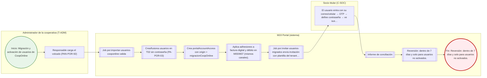

**Pasos del proceso** (actividad tomada del anexo; la columna RF/RN distingue lo citado en el paso de lo asociado por parámetro, permiso, evento o tema compartido).

| Paso | Carril | Actividad | RF/RN que aplican | EVT / JOB / PAN |
|---|---|---|---|---|
| 1 | Administrador de la cooperativa | Responsable carga el volcado (PAN-POR-92): `WS_USERS`, `WS_USERS_ACCOUNTS`, adhesiones a factura digital y débito, notificaciones vigentes. | asoc.: RF-POR-170 | PAN-POR-92 |
| 2 | M19 Portal | Job `por:importar-usuarios-cooponline` valida: correo normalizado, celular E.164, duplicados, cuentas existentes en M01 (migradas por T07), coincidencia de documento del usuario con el titular cuando el dato existe. | asoc.: RF-POR-169, RF-POR-031 | JOB-POR-05 |
| 3 | M19 Portal | Crea/fusiona usuarios en T02 sin contraseña (PA-POR-03): estado "pendiente de activación"; nunca se importa `WS_USERS.PASSWORD`. | asoc.: RF-POR-031 | — |
| 4 | M19 Portal | Crea `portalAccountAccess` con `origin = migracionCoopOnline`: `titular` si el documento coincide; si no hay documento comparable, `autorizado` con acciones `consultar` y `pagar` (equivalente a lo que tenía) y marca de revisión. | asoc.: RF-POR-169, RN-POR-007 | — |
| 5 | M19 Portal | Aplica adhesiones a factura digital y débito en M05/M07 (mismos canales). | — | — |
| 6 | M19 Portal | Job `por:invitar-usuarios-migrados` envía invitación con plantilla del tenant (T09) y registra entrega. | asoc.: RF-POR-173 | JOB-POR-06 |
| 7 | Socio titular | El usuario entra con su correo/celular → OTP → define contraseña → ve sus cuentas. Estado `activado` en `legacyPortalUserMap`. | — | — |
| 8 | M19 Portal | Informe de conciliación: filas del volcado = creados + fusionados + conflictos + descartados; vínculos del volcado = accesos creados + rechazados con motivo. | asoc.: RF-POR-157 | — |
| 9 | M19 Portal | Reversión: dentro de 7 días y solo para usuarios no activados. | — | — |

**Situación actual en ProCoop (nota de cambio).** El anexo indica: Crea `portalAccountAccess` con `origin = migracionCoopOnline`: `titular` si el documento coincide; Estado `activado` en `legacyPortalUserMap`. CTR-POR-08: en ProCoop, Validación del DNI con CiDi en CoopOnline (vincula por coincidencia) vs. AGR-006 (identidad no concede pertenencia). Cambio adoptado: Equilibra autoservicio y control. Análisis de brechas (`15-analisis-brechas-procoop.md` §3.13, Portal): hoy Portal con funciones acotadas; en GoodApps, pWA del socio con marca, vinculación verificada de cuentas, ingreso con contraseña u OTP y CiDi (brecha "Nuevo"; fuente DEC-043, DEC-066, DEC-067; M19).

**Excepciones**

| Excepción | Tratamiento |
|---|---|
| Duplicado | Job `por:importar-usuarios-cooponline` valida: correo normalizado, celular E.164, duplicados, cuentas existentes en M01 (migradas por T07), coincidencia de documento del usuario con el titular cuando el dato existe |
| Si no hay documento comparable | `autorizado` con acciones `consultar` y `pagar` (equivalente a lo que tenía) y marca de revisión |
| Rechazo | Informe de conciliación: filas del volcado = creados + fusionados + conflictos + descartados; vínculos del volcado = accesos creados + rechazados con motivo |
| Cancelación, anulación o reversión | Reversión: dentro de 7 días y solo para usuarios no activados |
| Falla técnica en un paso automático, un job o una integración | Reintento idempotente y reanudable; lo no reparable pasa a la bandeja técnica con responsable (política de recuperación de T11 P-WFL-01 y T01 §9.12; AGR-016). |

---

## 2. PRC-POR-05 Contratación de un servicio (piloto Internet, O2–O3)

| Campo | Contenido |
|---|---|
| Fuente | M19 §9.5, `M19-POR-portal-socio-landing.md` (línea 1003); ola O2 |
| Macroproceso | MP-13 Atención y autogestión del socio |
| Disparador | Contratación de un servicio |
| Resultado | Cat.contract.activated → el contrato aparece 'Activo' con fecha… |
| Carriles | Socio titular (C-SOC); M19 Portal (sistema); M09 Atención |
| Roles de T02 | C-SOC Socio titular |
| Módulos involucrados | M02 Catálogo y contratos, M09 Atención, M19 Portal |
| Eventos (T11 §12) | EVT-CRM-05 `crm.case.statusChanged`; EVT-CAT-09 `cat.contract.activated` |
| Jobs | — |
| Relación con 04-procesos-bpmn.md | P1 Alta de socio y contratación de servicio ([§5](04-procesos-bpmn.md#5-p1--alta-de-socio-y-contratación-de-servicio)) |

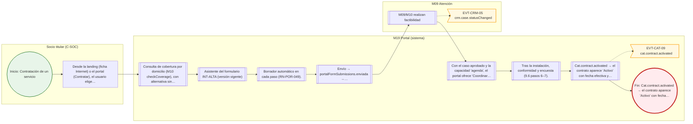

**Pasos del proceso** (actividad tomada del anexo; la columna RF/RN distingue lo citado en el paso de lo asociado por parámetro, permiso, evento o tema compartido).

| Paso | Carril | Actividad | RF/RN que aplican | EVT / JOB / PAN |
|---|---|---|---|---|
| 1 | Socio titular | Desde la landing (ficha Internet) o el portal (Contratar), el usuario elige plan; si no tiene sesión, registro/ingreso y retorno. | — | — |
| 2 | M19 Portal | Consulta de cobertura por domicilio (M10 `checkCoverage`), con alternativa sin mapa. | asoc.: RF-POR-006 | — |
| 3 | M19 Portal | Asistente del formulario `INT-ALTA` (versión vigente): datos del titular (prellenados desde el perfil/M01), domicilio de instalación, plan, requisitos adjuntos, condición fiscal si se factura con CUIT, asociación si se exige, T&C y firma. | — | — |
| 4 | M19 Portal | Borrador automático en cada paso (RN-POR-049). | RN-POR-049 | — |
| 5 | M19 Portal | Envío → `portalFormSubmissions.enviada` → `crm.openCase(caseTypeCode=serviceActivation)` (antes `crm.openCase(type=solicitudAlta)`: `solicitudAlta` es el `kind` del formulario de M19, no un tipo de caso; el tipo de caso de M09 es `serviceActivation` y la firma de `crm.openCase` está en M09 §11.5); constancia. | — | — |
| 6 | M09 Atención | M09/M10 realizan factibilidad; cada cambio llega por `crm.case.statusChanged` y actualiza la línea de tiempo. | asoc.: RF-POR-110 | EVT-CRM-05 |
| 7 | M19 Portal | Con el caso aprobado y la capacidad "agenda", el portal ofrece "Coordinar visita" (9.6). | — | — |
| 8 | M19 Portal | Tras la instalación, conformidad y encuesta (9.6 pasos 6–7). | — | — |
| 9 | M19 Portal | `cat.contract.activated` → el contrato aparece "Activo" con fecha efectiva y primer cobro (RF-POR-055); si el usuario no tenía cuenta, M01 creó la cuenta y POR crea el acceso `titular` con `origin = altaPorTramite`. | RF-POR-055; asoc.: RN-POR-011, RF-POR-071 | EVT-CAT-09 |

**Situación actual en ProCoop (nota de cambio).** Análisis de brechas (`15-analisis-brechas-procoop.md` §3.13, Portal): hoy ProCoop WEB publicaba requisitos, trámites y archivos; en GoodApps, landing por cooperativa con servicios habilitados, noticias, registro, consulta y pago sin login (brecha "Nuevo"; fuente M19; REL §1).

**Excepciones**

| Excepción | Tratamiento |
|---|---|
| Si no tiene sesión | registro/ingreso y retorno |
| Si el usuario no tenía cuenta | M01 creó la cuenta y POR crea el acceso `titular` con `origin = altaPorTramite` |
| Falla técnica en un paso automático, un job o una integración | Reintento idempotente y reanudable; lo no reparable pasa a la bandeja técnica con responsable (política de recuperación de T11 P-WFL-01 y T01 §9.12; AGR-016). |

---

## 3. PRC-POR-06 Coordinación de visita e instalación (O3)

| Campo | Contenido |
|---|---|
| Fuente | M19 §9.6, `M19-POR-portal-socio-landing.md` (línea 1015); ola O3 |
| Macroproceso | MP-13 Atención y autogestión del socio |
| Disparador | Coordinación de visita e instalación |
| Resultado | Tec.visit.failed (incluye motivo 'sin acceso') → ofrecer… |
| Carriles | M19 Portal (sistema); Socio titular (C-SOC); T09 Comunicaciones |
| Roles de T02 | C-SOC Socio titular |
| Módulos involucrados | M10 Técnica y campo, M19 Portal, T09 Comunicaciones |
| Eventos (T11 §12) | EVT-TEC-13 `tec.visit.statusChanged`; EVT-TEC-14 `tec.visit.failed` |
| Jobs | — |
| Relación con 04-procesos-bpmn.md | P6 Reclamo y orden de trabajo ([§10](04-procesos-bpmn.md#10-p6--reclamo-y-orden-de-trabajo)) |

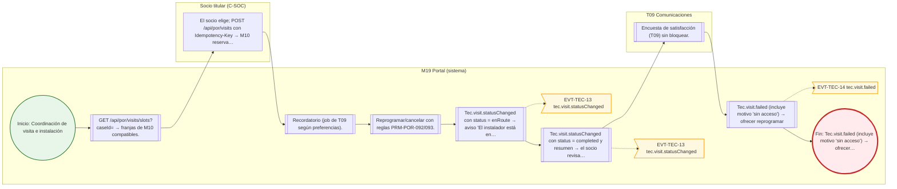

**Pasos del proceso** (actividad tomada del anexo; la columna RF/RN distingue lo citado en el paso de lo asociado por parámetro, permiso, evento o tema compartido).

| Paso | Carril | Actividad | RF/RN que aplican | EVT / JOB / PAN |
|---|---|---|---|---|
| 1 | M19 Portal | `GET /api/por/visits/slots?caseId=` → franjas de M10 compatibles. | — | — |
| 2 | Socio titular | El socio elige; `POST /api/por/visits` con `Idempotency-Key` → M10 reserva atómicamente (RN-POR-023); conflicto → 409 con nuevas franjas. | RN-POR-023 | — |
| 3 | M19 Portal | Recordatorio (job de T09 según preferencias). | — | — |
| 4 | M19 Portal | Reprogramar/cancelar con reglas PRM-POR-092/093. | — | — |
| 5 | M19 Portal | `tec.visit.statusChanged` con `status = enRoute` → aviso "El instalador está en camino" con ETA. | asoc.: RF-POR-075 | EVT-TEC-13 |
| 6 | M19 Portal | `tec.visit.statusChanged` con `status = completed` y resumen → el socio revisa tareas y equipo en comodato y firma (`POST /api/por/visits/:id/conformity`; firma manuscrita + aceptación con OTP opcional). | asoc.: RF-POR-075 | EVT-TEC-13 |
| 7 | T09 Comunicaciones | Encuesta de satisfacción (T09) sin bloquear. | asoc.: RF-POR-076 | — |
| 8 | M19 Portal | `tec.visit.failed` (incluye motivo "sin acceso") → ofrecer reprogramar; el servicio sigue "Pendiente de alta" (RN-POR-021). | RN-POR-021 | EVT-TEC-14 |

**Situación actual en ProCoop (nota de cambio).** Sin contraste específico para este proceso en el anexo (filas `CTR-` con ProCoop) ni en el análisis de brechas. El contraste del dominio está en `15-analisis-brechas-procoop.md` §3.13.

**Excepciones**

| Excepción | Tratamiento |
|---|---|
| Conflicto | `POST /api/por/visits` con `Idempotency-Key` → M10 reserva atómicamente (RN-POR-023); conflicto → 409 con nuevas franjas |
| Cancelación, anulación o reversión | Reprogramar/cancelar con reglas PRM-POR-092/093 |
| Bloqueo | Encuesta de satisfacción (T09) sin bloquear |
| Falla técnica en un paso automático, un job o una integración | Reintento idempotente y reanudable; lo no reparable pasa a la bandeja técnica con responsable (política de recuperación de T11 P-WFL-01 y T01 §9.12; AGR-016). |

---

## 4. PRC-POR-07 Consulta y pago de facturas (O4–O5)

| Campo | Contenido |
|---|---|
| Fuente | M19 §9.7, `M19-POR-portal-socio-landing.md` (línea 1026); ola O4 |
| Macroproceso | MP-13 Atención y autogestión del socio |
| Disparador | Consulta y pago de facturas |
| Resultado | Incierto (sin confirmación en el plazo de M07) → 'En… |
| Carriles | M19 Portal (sistema); Socio titular (C-SOC) |
| Roles de T02 | C-SOC Socio titular |
| Módulos involucrados | M07 Cuenta corriente y cobranza, M19 Portal |
| Eventos (T11 §12) | EVT-COB-20 `cob.paymentIntent.statusChanged`; EVT-COB-04 `cob.payment.confirmed` |
| Jobs | — |
| Relación con 04-procesos-bpmn.md | P4 Cobranza: caja, pasarelas, débito, rendición y depósito ([§8](04-procesos-bpmn.md#8-p4--cobranza-caja-pasarelas-débito-rendición-y-depósito)) |

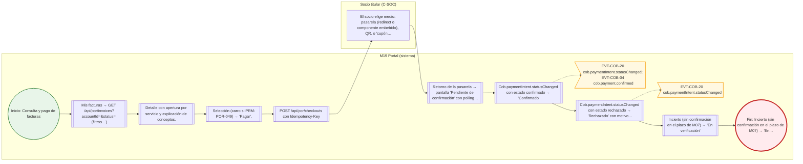

**Pasos del proceso** (actividad tomada del anexo; la columna RF/RN distingue lo citado en el paso de lo asociado por parámetro, permiso, evento o tema compartido).

| Paso | Carril | Actividad | RF/RN que aplican | EVT / JOB / PAN |
|---|---|---|---|---|
| 1 | M19 Portal | Mis facturas → `GET /api/por/invoices?accountId=&status=` (filtros PRM-POR-030…035). | asoc.: RN-POR-062 | — |
| 2 | M19 Portal | Detalle con apertura por servicio y explicación de conceptos. | — | — |
| 3 | M19 Portal | Selección (carro si PRM-POR-049) → "Pagar". | — | — |
| 4 | M19 Portal | `POST /api/por/checkouts` con `Idempotency-Key`: M07 recalcula deuda (RN-POR-026), valida mínimo (RN-POR-027), bloqueos (RN-POR-028), débito (RN-POR-041), recargos/percepciones (M08/M06) y devuelve resumen; si cambió, el portal muestra diferencias y pide confirmar. | RN-POR-026, RN-POR-027, RN-POR-028, RN-POR-041 | — |
| 5 | Socio titular | El socio elige medio: pasarela (redirect o componente embebido), QR, o "cupón para efectivo" (PDF con código de barras, vencimiento PRM-POR-043). | — | — |
| 6 | M19 Portal | Retorno de la pasarela → pantalla "Pendiente de confirmación" con polling corto (`GET /api/por/checkouts/:id`, cada 3 s hasta 60 s) y luego aviso push. | asoc.: RN-POR-024, RF-POR-094 | — |
| 7 | M19 Portal | `cob.paymentIntent.statusChanged` con estado confirmado → "Confirmado"; `cob.payment.confirmed` (recibo e imputación) → "Imputado" + recibo; envío de recibo/factura de intereses (RN-POR-036) → "Comprobante enviado". | RN-POR-036; asoc.: RF-POR-094, RF-POR-095 | EVT-COB-20, EVT-COB-04 |
| 8 | M19 Portal | `cob.paymentIntent.statusChanged` con estado rechazado → "Rechazado" con motivo de la entidad y opción de reintentar (nueva clave de idempotencia). | — | EVT-COB-20 |
| 9 | M19 Portal | Incierto (sin confirmación en el plazo de M07) → "En verificación"; no se permite pagar las mismas facturas por otro medio hasta conciliar (BASE §105 sol. 6: un pago incierto no se reenvía sin conciliar), salvo cupón en efectivo con aviso. | — | — |

**Situación actual en ProCoop (nota de cambio).** Sin contraste específico para este proceso en el anexo (filas `CTR-` con ProCoop) ni en el análisis de brechas. El contraste del dominio está en `15-analisis-brechas-procoop.md` §3.13.

**Excepciones**

| Excepción | Tratamiento |
|---|---|
| Si cambió | el portal muestra diferencias y pide confirmar |
| Vencimiento | El socio elige medio: pasarela (redirect o componente embebido), QR, o "cupón para efectivo" (PDF con código de barras, vencimiento PRM-POR-043) |
| Rechazo | `cob.paymentIntent.statusChanged` con estado rechazado → "Rechazado" con motivo de la entidad y opción de reintentar (nueva clave de idempotencia) |
| Resultado incierto o sin respuesta | Incierto (sin confirmación en el plazo de M07) → "En verificación"; no se permite pagar las mismas facturas por otro medio hasta conciliar (BASE §105 sol. 6: un pago incierto no se reenvía sin conciliar), salvo cupón en efectivo con aviso |
| Falla técnica en un paso automático, un job o una integración | Reintento idempotente y reanudable; lo no reparable pasa a la bandeja técnica con responsable (política de recuperación de T11 P-WFL-01 y T01 §9.12; AGR-016). |

---

## 5. PRC-POR-08 Pago por terceros (O5)

| Campo | Contenido |
|---|---|
| Fuente | M19 §9.8, `M19-POR-portal-socio-landing.md` (línea 1038); ola O5 |
| Macroproceso | MP-13 Atención y autogestión del socio |
| Disparador | Pago por terceros |
| Resultado | Pagador eventual (PA-POR-08) |
| Carriles | M19 Portal (sistema); Socio titular (C-SOC) |
| Roles de T02 | C-SOC Socio titular |
| Módulos involucrados | M19 Portal |
| Eventos (T11 §12) | — |
| Jobs | — |
| Relación con 04-procesos-bpmn.md | P4 Cobranza: caja, pasarelas, débito, rendición y depósito ([§8](04-procesos-bpmn.md#8-p4--cobranza-caja-pasarelas-débito-rendición-y-depósito)) |

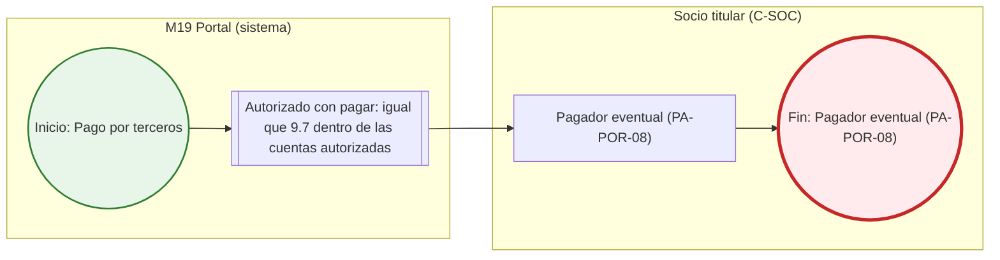

**Pasos del proceso** (actividad tomada del anexo; la columna RF/RN distingue lo citado en el paso de lo asociado por parámetro, permiso, evento o tema compartido).

| Paso | Carril | Actividad | RF/RN que aplican | EVT / JOB / PAN |
|---|---|---|---|---|
| 1 | M19 Portal | Autorizado con `pagar`: igual que 9.7 dentro de las cuentas autorizadas; el checkout registra `onBehalfOfPersonId`. | asoc.: RF-POR-046 | — |
| 2 | Socio titular | Pagador eventual (PA-POR-08): `POST /api/por/checkouts/by-code` con código de pago impreso/QR; solo devuelve importe, vencimiento y servicio genérico; el excedente sigue ESC-01 (RN-POR-030). | RN-POR-030; asoc.: RF-POR-045, RF-POR-100 | — |

**Situación actual en ProCoop (nota de cambio).** CTR-POR-09: en ProCoop, CoopOnline rechaza la cobranza si el importe pagado difiere del registrado vs. ESC-01 y AGR-012 (imputación con excedente). Cambio adoptado: Evita pagos "perdidos" y protege a terceros.

**Excepciones**

| Excepción | Tratamiento |
|---|---|
| Vencimiento | Pagador eventual (PA-POR-08): `POST /api/por/checkouts/by-code` con código de pago impreso/QR; solo devuelve importe, vencimiento y servicio genérico; el excedente sigue ESC-01 (RN-POR-030) |
| Falla técnica en un paso automático, un job o una integración | Reintento idempotente y reanudable; lo no reparable pasa a la bandeja técnica con responsable (política de recuperación de T11 P-WFL-01 y T01 §9.12; AGR-016). |

---

## 6. PRC-POR-09 Baja pública (O2)

| Campo | Contenido |
|---|---|
| Fuente | M19 §9.9, `M19-POR-portal-socio-landing.md` (línea 1043); ola O2 |
| Macroproceso | MP-13 Atención y autogestión del socio |
| Disparador | Baja pública |
| Resultado | Seguimiento por código en /baja/seguimiento. |
| Carriles | Visitante registrado (C-VIS); Administrador de la cooperativa (T-ADM); M19 Portal (sistema) |
| Roles de T02 | C-VIS Visitante registrado, T-ADM Administrador de la cooperativa |
| Módulos involucrados | M19 Portal |
| Eventos (T11 §12) | — |
| Jobs | JOB-POR-03 `por:identificar-bajas-publicas`; JOB-POR-04 `por:controlar-plazos-baja-publica` |
| Relación con 04-procesos-bpmn.md | — |

```mermaid
flowchart LR
  subgraph L_LCVIS["Visitante registrado (C-VIS)"]
    ni(("Inicio: Baja pública"))
    ns1["Visitante toca 'Botón de baja' en la landing."]
  end
  subgraph L_LTADM["Administrador de la cooperativa (T-ADM)"]
    ns2["Elige servicio (solo servicios con capacidad botón de baja o todos si el…)"]
    ns3["Ingresa nombre, documento, número de cuenta o suministro si lo conoce…"]
  end
  subgraph L_LSIS["M19 Portal (sistema)"]
    ns4[["Antiabuso no obstructivo (captcha invisible)"]]
    ns5[["POST /api/public/‹tenantSlug›/unsubscribe-requests →…"]]
    ns6[["Job por:identificar-bajas-publicas intenta identificar contrato (documento +…)"]]
    ns7[["Constancia emitida y enviada ≤ 72 h (job de control…)"]]
    ns8[["Seguimiento por código en /baja/seguimiento."]]
    nf(("Fin: Seguimiento por código en /baja/seguimiento."))
  end
  ni --> ns1
  ns1 --> ns2
  ns2 --> ns3
  ns3 --> ns4
  ns4 --> ns5
  ns5 --> ns6
  ns6 --> ns7
  ns7 --> ns8
  ns8 --> nf
  classDef inicio fill:#e8f5e9,stroke:#2e7d32,stroke-width:2px
  classDef fin fill:#ffebee,stroke:#c62828,stroke-width:4px
  classDef evento fill:#fff8e1,stroke:#f9a825
  classDef temporizador fill:#e3f2fd,stroke:#1565c0
  class ni inicio
  class nf fin
```

**Pasos del proceso** (actividad tomada del anexo; la columna RF/RN distingue lo citado en el paso de lo asociado por parámetro, permiso, evento o tema compartido).

| Paso | Carril | Actividad | RF/RN que aplican | EVT / JOB / PAN |
|---|---|---|---|---|
| 1 | Visitante registrado | Visitante toca "Botón de baja" en la landing. | — | — |
| 2 | Administrador de la cooperativa | Elige servicio (solo servicios con capacidad botón de baja o todos si el tenant amplía). | — | — |
| 3 | Administrador de la cooperativa | Ingresa nombre, documento, número de cuenta o suministro si lo conoce, domicilio del servicio y medio de contacto. Sin registro, sin login, sin pago. | asoc.: RF-POR-010 | — |
| 4 | M19 Portal | Antiabuso no obstructivo (captcha invisible; ante sospecha, verificación del medio por OTP, nunca bloqueo). | — | — |
| 5 | M19 Portal | `POST /api/public/<tenantSlug>/unsubscribe-requests` → `publicSubmissions.recibida`, código mostrado en pantalla (RN-POR-015) y enviado por el medio informado. | RN-POR-015 | — |
| 6 | M19 Portal | Job `por:identificar-bajas-publicas` intenta identificar contrato (documento + cuenta/suministro/domicilio); éxito → caso M09 `solicitudBaja`; si no, caso de identificación. | — | JOB-POR-03 |
| 7 | M19 Portal | Constancia emitida y enviada ≤ 72 h (job de control `por:controlar-plazos-baja-publica` cada 15 min alerta a las 20 h y 60 h). | — | JOB-POR-04 |
| 8 | M19 Portal | Seguimiento por código en `/baja/seguimiento`. | — | — |

**Situación actual en ProCoop (nota de cambio).** Sin contraste específico para este proceso en el anexo (filas `CTR-` con ProCoop) ni en el análisis de brechas. El contraste del dominio está en `15-analisis-brechas-procoop.md` §3.13.

**Excepciones**

| Excepción | Tratamiento |
|---|---|
| Ante sospecha | verificación del medio por OTP, nunca bloqueo) |
| Falla técnica en un paso automático, un job o una integración | Reintento idempotente y reanudable; lo no reparable pasa a la bandeja técnica con responsable (política de recuperación de T11 P-WFL-01 y T01 §9.12; AGR-016). |

---

## 7. PRC-POR-10 Baja, suspensión y reactivación en sesión (O2/O6)

| Campo | Contenido |
|---|---|
| Fuente | M19 §9.10, `M19-POR-portal-socio-landing.md` (línea 1054); ola O2 |
| Macroproceso | MP-13 Atención y autogestión del socio |
| Disparador | Baja, suspensión y reactivación en sesión |
| Resultado | El servicio muestra 'baja solicitada' hasta… |
| Carriles | M19 Portal (sistema); Socio titular (C-SOC) |
| Roles de T02 | C-SOC Socio titular |
| Módulos involucrados | M02 Catálogo y contratos, M19 Portal |
| Eventos (T11 §12) | EVT-CAT-15 `cat.contract.terminated` |
| Jobs | — |
| Relación con 04-procesos-bpmn.md | — |

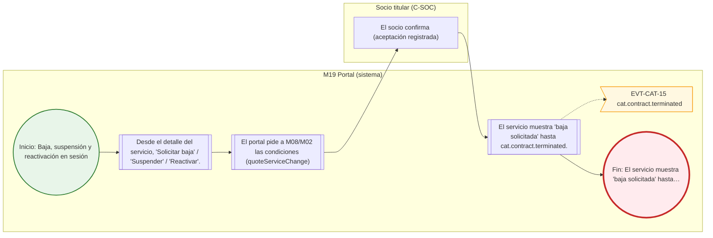

**Pasos del proceso** (actividad tomada del anexo; la columna RF/RN distingue lo citado en el paso de lo asociado por parámetro, permiso, evento o tema compartido).

| Paso | Carril | Actividad | RF/RN que aplican | EVT / JOB / PAN |
|---|---|---|---|---|
| 1 | M19 Portal | Desde el detalle del servicio, "Solicitar baja" / "Suspender" / "Reactivar". | — | — |
| 2 | M19 Portal | El portal pide a M08/M02 las condiciones (`quoteServiceChange`): fecha efectiva posible, cargos habilitados (0 para baja), efectos (equipos a devolver, facturación de lo devengado). | asoc.: RF-POR-066 | — |
| 3 | Socio titular | El socio confirma (aceptación registrada); se crea la presentación del formulario correspondiente y el caso M09. | — | — |
| 4 | M19 Portal | El servicio muestra "baja solicitada" hasta `cat.contract.terminated`. | asoc.: RN-POR-011 | EVT-CAT-15 |

**Situación actual en ProCoop (nota de cambio).** Sin contraste específico para este proceso en el anexo (filas `CTR-` con ProCoop) ni en el análisis de brechas. El contraste del dominio está en `15-analisis-brechas-procoop.md` §3.13.

**Excepciones**

| Excepción | Tratamiento |
|---|---|
| Falla técnica en un paso automático, un job o una integración | Reintento idempotente y reanudable; lo no reparable pasa a la bandeja técnica con responsable (política de recuperación de T11 P-WFL-01 y T01 §9.12; AGR-016). |

---

## 8. PRC-POR-11 Gestión (reclamo) con fotos y offline (O2)

| Campo | Contenido |
|---|---|
| Fuente | M19 §9.11, `M19-POR-portal-socio-landing.md` (línea 1061); ola O2 |
| Macroproceso | MP-13 Atención y autogestión del socio |
| Disparador | Gestión (reclamo) con fotos y offline |
| Resultado | Seguimiento, chat, conformidad, reapertura (PRM-POR-084)… |
| Carriles | M19 Portal (sistema) |
| Roles de T02 | Solo actores del sistema (sin rol humano) |
| Módulos involucrados | M19 Portal |
| Eventos (T11 §12) | — |
| Jobs | — |
| Relación con 04-procesos-bpmn.md | P6 Reclamo y orden de trabajo ([§10](04-procesos-bpmn.md#10-p6--reclamo-y-orden-de-trabajo)) |

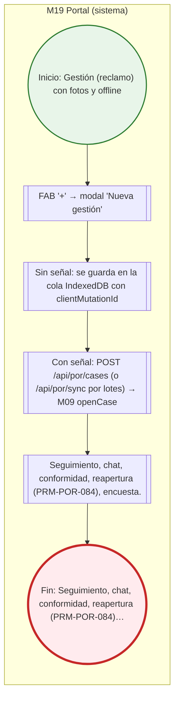

**Pasos del proceso** (actividad tomada del anexo; la columna RF/RN distingue lo citado en el paso de lo asociado por parámetro, permiso, evento o tema compartido).

| Paso | Carril | Actividad | RF/RN que aplican | EVT / JOB / PAN |
|---|---|---|---|---|
| 1 | M19 Portal | FAB "+" → modal "Nueva gestión": tipo, servicio/contrato, descripción, fotos (cámara), ubicación opcional. | asoc.: RF-POR-109 | — |
| 2 | M19 Portal | Sin señal: se guarda en la cola IndexedDB con `clientMutationId`; banner de pendientes. | asoc.: RF-POR-117, RN-POR-025 | — |
| 3 | M19 Portal | Con señal: `POST /api/por/cases` (o `/api/por/sync` por lotes) → M09 `openCase`; si PRM-POR-074 y tipología técnica → OT M10. | asoc.: RN-POR-070 | — |
| 4 | M19 Portal | Seguimiento, chat, conformidad, reapertura (PRM-POR-084), encuesta. | asoc.: RF-POR-112 | — |

**Situación actual en ProCoop (nota de cambio).** Sin contraste específico para este proceso en el anexo (filas `CTR-` con ProCoop) ni en el análisis de brechas. El contraste del dominio está en `15-analisis-brechas-procoop.md` §3.13.

**Excepciones**

| Excepción | Tratamiento |
|---|---|
| Si PRM-POR-074 y tipología técnica | OT M10 |
| Falla técnica en un paso automático, un job o una integración | Reintento idempotente y reanudable; lo no reparable pasa a la bandeja técnica con responsable (política de recuperación de T11 P-WFL-01 y T01 §9.12; AGR-016). |

---

## 9. PRC-POR-12 Autolectura (O7)

| Campo | Contenido |
|---|---|
| Fuente | M19 §9.12, `M19-POR-portal-socio-landing.md` (línea 1068); ola O7 |
| Macroproceso | MP-13 Atención y autogestión del socio |
| Disparador | Autolectura |
| Resultado | M03 valida (rango, consumo histórico) |
| Carriles | M03 Medición; Socio titular (C-SOC); M19 Portal (sistema) |
| Roles de T02 | C-SOC Socio titular |
| Módulos involucrados | M03 Medición, M19 Portal |
| Eventos (T11 §12) | — |
| Jobs | — |
| Relación con 04-procesos-bpmn.md | P2 Ciclo de medición y lectura ([§6](04-procesos-bpmn.md#6-p2--ciclo-de-medición-y-lectura)) |

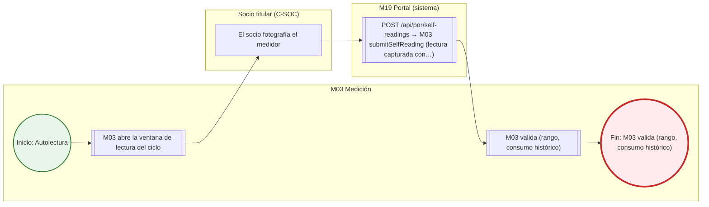

**Pasos del proceso** (actividad tomada del anexo; la columna RF/RN distingue lo citado en el paso de lo asociado por parámetro, permiso, evento o tema compartido).

| Paso | Carril | Actividad | RF/RN que aplican | EVT / JOB / PAN |
|---|---|---|---|---|
| 1 | M03 Medición | M03 abre la ventana de lectura del ciclo; T09 avisa a los socios con autolectura habilitada. | asoc.: RN-POR-065, RF-POR-107 | — |
| 2 | Socio titular | El socio fotografía el medidor; OCR propone el valor (IA propone); el socio confirma o corrige. | — | — |
| 3 | M19 Portal | `POST /api/por/self-readings` → M03 `submitSelfReading` (lectura capturada con origen `socio`, foto, geolocalización si la dio). | — | — |
| 4 | M03 Medición | M03 valida (rango, consumo histórico); estado `aceptada` / `enRevision` / `rechazada` con motivo, visible en Consumos. | asoc.: RN-POR-065 | — |

**Situación actual en ProCoop (nota de cambio).** Sin contraste específico para este proceso en el anexo (filas `CTR-` con ProCoop) ni en el análisis de brechas. El contraste del dominio está en `15-analisis-brechas-procoop.md` §3.13.

**Excepciones**

| Excepción | Tratamiento |
|---|---|
| Rechazo | M03 valida (rango, consumo histórico); estado `aceptada` / `enRevision` / `rechazada` con motivo, visible en Consumos |
| Falla técnica en un paso automático, un job o una integración | Reintento idempotente y reanudable; lo no reparable pasa a la bandeja técnica con responsable (política de recuperación de T11 P-WFL-01 y T01 §9.12; AGR-016). |

---

## 10. PRC-POR-13 Recarga prepaga (O7)

| Campo | Contenido |
|---|---|
| Fuente | M19 §9.13, `M19-POR-portal-socio-landing.md` (línea 1075); ola O7 |
| Macroproceso | MP-13 Atención y autogestión del socio |
| Disparador | Recarga prepaga |
| Resultado | Confirmación → M03 acredita y devuelve token/crédito |
| Carriles | M19 Portal (sistema) |
| Roles de T02 | Solo actores del sistema (sin rol humano) |
| Módulos involucrados | M19 Portal |
| Eventos (T11 §12) | — |
| Jobs | — |
| Relación con 04-procesos-bpmn.md | — |

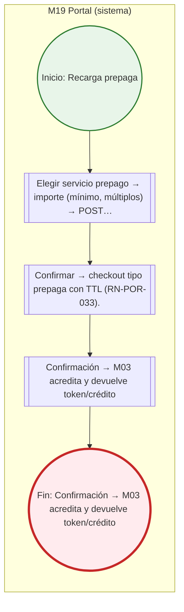

**Pasos del proceso** (actividad tomada del anexo; la columna RF/RN distingue lo citado en el paso de lo asociado por parámetro, permiso, evento o tema compartido).

| Paso | Carril | Actividad | RF/RN que aplican | EVT / JOB / PAN |
|---|---|---|---|---|
| 1 | M19 Portal | Elegir servicio prepago → importe (mínimo, múltiplos) → `POST /api/por/prepaid/quotes` (M03/M07): capital, recargo, bonificación, retención, energía equivalente. | asoc.: RF-POR-108, RN-POR-034 | — |
| 2 | M19 Portal | Confirmar → checkout tipo `prepaga` con TTL (RN-POR-033). | RN-POR-033 | — |
| 3 | M19 Portal | Confirmación → M03 acredita y devuelve token/crédito; factura de autogestión enviada (RN-POR-036). | RN-POR-036 | — |

**Situación actual en ProCoop (nota de cambio).** Sin contraste específico para este proceso en el anexo (filas `CTR-` con ProCoop) ni en el análisis de brechas. El contraste del dominio está en `15-analisis-brechas-procoop.md` §3.13.

**Excepciones**

| Excepción | Tratamiento |
|---|---|
| Falla técnica en un paso automático, un job o una integración | Reintento idempotente y reanudable; lo no reparable pasa a la bandeja técnica con responsable (política de recuperación de T11 P-WFL-01 y T01 §9.12; AGR-016). |

---

## 11. PRC-POR-14 Representación (O5)

| Campo | Contenido |
|---|---|
| Fuente | M19 §9.14, `M19-POR-portal-socio-landing.md` (línea 1081); ola O5 |
| Macroproceso | MP-13 Atención y autogestión del socio |
| Disparador | Representación |
| Resultado | Titular puede revocar en cualquier momento |
| Carriles | Socio titular (C-SOC); M19 Portal (sistema) |
| Roles de T02 | C-SOC Socio titular |
| Módulos involucrados | M19 Portal |
| Eventos (T11 §12) | — |
| Jobs | — |
| Relación con 04-procesos-bpmn.md | — |

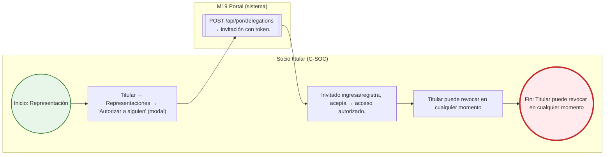

**Pasos del proceso** (actividad tomada del anexo; la columna RF/RN distingue lo citado en el paso de lo asociado por parámetro, permiso, evento o tema compartido).

| Paso | Carril | Actividad | RF/RN que aplican | EVT / JOB / PAN |
|---|---|---|---|---|
| 1 | Socio titular | Titular → Representaciones → "Autorizar a alguien" (modal): contacto del invitado, cuentas/contratos, acciones, vigencia. | asoc.: RF-POR-043 | — |
| 2 | M19 Portal | `POST /api/por/delegations` → invitación con token. | — | — |
| 3 | Socio titular | Invitado ingresa/registra, acepta → acceso `autorizado`. | — | — |
| 4 | Socio titular | Titular puede revocar en cualquier momento; job vence accesos. | — | — |

**Situación actual en ProCoop (nota de cambio).** Sin contraste específico para este proceso en el anexo (filas `CTR-` con ProCoop) ni en el análisis de brechas. El contraste del dominio está en `15-analisis-brechas-procoop.md` §3.13.

**Excepciones**

| Excepción | Tratamiento |
|---|---|
| Vencimiento | Titular puede revocar en cualquier momento; job vence accesos |
| Falla técnica en un paso automático, un job o una integración | Reintento idempotente y reanudable; lo no reparable pasa a la bandeja técnica con responsable (política de recuperación de T11 P-WFL-01 y T01 §9.12; AGR-016). |

---

## 12. PRC-POR-15 Portal del empleado (O9)

| Campo | Contenido |
|---|---|
| Fuente | M19 §9.15, `M19-POR-portal-socio-landing.md` (línea 1088); ola O9 |
| Macroproceso | MP-13 Atención y autogestión del socio |
| Disparador | Portal del empleado |
| Resultado | Vacaciones/licencias: formulario → workflow M16/T11 → estados. |
| Carriles | Socio titular (C-SOC); M19 Portal (sistema) |
| Roles de T02 | C-SOC Socio titular |
| Módulos involucrados | M19 Portal |
| Eventos (T11 §12) | — |
| Jobs | — |
| Relación con 04-procesos-bpmn.md | — |

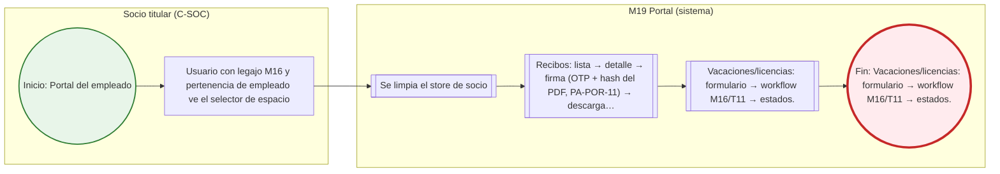

**Pasos del proceso** (actividad tomada del anexo; la columna RF/RN distingue lo citado en el paso de lo asociado por parámetro, permiso, evento o tema compartido).

| Paso | Carril | Actividad | RF/RN que aplican | EVT / JOB / PAN |
|---|---|---|---|---|
| 1 | Socio titular | Usuario con legajo M16 y pertenencia de empleado ve el selector de espacio; elige "Mi trabajo". | — | — |
| 2 | M19 Portal | Se limpia el store de socio; se carga menú de empleado; paso de reautenticación si corresponde (RF-POR-136). | RF-POR-136 | — |
| 3 | M19 Portal | Recibos: lista → detalle → firma (OTP + hash del PDF, PA-POR-11) → descarga (reglas 3122/3166). | asoc.: RF-POR-130 | — |
| 4 | M19 Portal | Vacaciones/licencias: formulario → workflow M16/T11 → estados. | — | — |

**Situación actual en ProCoop (nota de cambio).** Sin contraste específico para este proceso en el anexo (filas `CTR-` con ProCoop) ni en el análisis de brechas. El contraste del dominio está en `15-analisis-brechas-procoop.md` §3.13.

**Excepciones**

| Excepción | Tratamiento |
|---|---|
| Falla técnica en un paso automático, un job o una integración | Reintento idempotente y reanudable; lo no reparable pasa a la bandeja técnica con responsable (política de recuperación de T11 P-WFL-01 y T01 §9.12; AGR-016). |

---

## 13. PRC-POR-16 Tótem (O10, PA-POR-06)

| Campo | Contenido |
|---|---|
| Fuente | M19 §9.16, `M19-POR-portal-socio-landing.md` (línea 1095); ola O10 |
| Macroproceso | MP-13 Atención y autogestión del socio |
| Disparador | Tótem |
| Resultado | Cierre administrativo con clave del dispositivo. |
| Carriles | Dispositivo kiosco/tótem/turnero (S-KSK); M19 Portal (sistema) |
| Roles de T02 | S-KSK Dispositivo kiosco/tótem/turnero |
| Módulos involucrados | M19 Portal |
| Eventos (T11 §12) | — |
| Jobs | — |
| Relación con 04-procesos-bpmn.md | — |

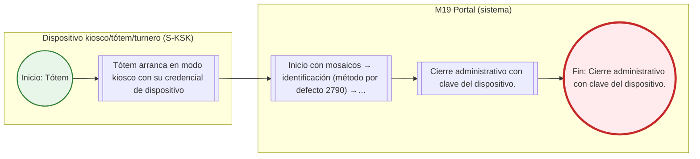

**Pasos del proceso** (actividad tomada del anexo; la columna RF/RN distingue lo citado en el paso de lo asociado por parámetro, permiso, evento o tema compartido).

| Paso | Carril | Actividad | RF/RN que aplican | EVT / JOB / PAN |
|---|---|---|---|---|
| 1 | Dispositivo kiosco/tótem/turnero | Tótem arranca en modo kiosco con su credencial de dispositivo; heartbeat cada 60 s. | — | — |
| 2 | M19 Portal | Inicio con mosaicos → identificación (método por defecto 2790) → deuda/selección o recarga → medio de pago (agente local para lector de tarjeta/billetes; QR) → registro en la caja del dispositivo (M07) → comprobante impreso o por correo → vuelta al inicio y borrado de datos. | — | — |
| 3 | M19 Portal | Cierre administrativo con clave del dispositivo. | — | — |

**Situación actual en ProCoop (nota de cambio).** Sin contraste específico para este proceso en el anexo (filas `CTR-` con ProCoop) ni en el análisis de brechas. El contraste del dominio está en `15-analisis-brechas-procoop.md` §3.13.

**Excepciones**

| Excepción | Tratamiento |
|---|---|
| Falla técnica en un paso automático, un job o una integración | Reintento idempotente y reanudable; lo no reparable pasa a la bandeja técnica con responsable (política de recuperación de T11 P-WFL-01 y T01 §9.12; AGR-016). |

---

## 14. PRC-TEC-01 Alta de Internet de punta a punta (piloto DEC-005, CU-AUT-01, CU-INS-01)

| Campo | Contenido |
|---|---|
| Fuente | M10 §9.1, `M10-TEC-tecnica-campo-redes.md` (línea 2507) |
| Macroproceso | MP-14 Operación técnica, redes y stock |
| Disparador | Alta de Internet de punta a punta |
| Resultado | Excepciones: visita fallida (8.3) → nueva cita, equipo sigue en… |
| Carriles | M09 Atención; M10 Técnica y campo (sistema); Socio titular (C-SOC); Supervisor técnico (T-STE); Técnico (campo) (T-TEC) |
| Roles de T02 | C-SOC Socio titular, T-STE Supervisor técnico, T-TEC Técnico (campo) |
| Módulos involucrados | M09 Atención, M10 Técnica y campo |
| Eventos (T11 §12) | EVT-CRM-13 `crm.commandRequest.requested` |
| Jobs | — |
| Relación con 04-procesos-bpmn.md | P6 Reclamo y orden de trabajo ([§10](04-procesos-bpmn.md#10-p6--reclamo-y-orden-de-trabajo)) |

```mermaid
flowchart LR
  subgraph L_LM09["M09 Atención"]
    ni(("Inicio: Alta de Internet de punta a punta"))
    ns1[["M09 recibe la solicitud (landing/app) y valida requisitos"]]
    ne1>"EVT-CRM-13 crm.commandRequest.requested"]
  end
  subgraph L_LSIS["M10 Técnica y campo (sistema)"]
    ns2[["TEC crea feasibilityRequests con el punto de prestación (BASE §77)"]]
    ns3[["El evaluador dictamina"]]
    ns4[["El contrato se crea en el módulo dueño (pendiente de conectar) con…"]]
    ns5[["TEC crea la OT con instalación integral (pendingAppointment), materiales…"]]
    ns9[["Presenta el detalle de instalación (versión + hash), captura…"]]
    ns10[["Al sincronizar: mutaciones aplicadas idempotentemente"]]
    ns11[["TEC emite provisioningCommands.activate con perfil del plan"]]
    ns12[["TEC publica tec.installation.activationConfirmed ( contractId, effectiveAt…)"]]
    ns13[["TEC solicita a T09 la invitación de encuesta"]]
    ns14[["Excepciones: visita fallida (8.3) → nueva cita, equipo sigue en custodia"]]
    nf(("Fin: Excepciones: visita fallida (8.3) → nueva cita, equipo sigue en…"))
  end
  subgraph L_LCSOC["Socio titular (C-SOC)"]
    ns6["El socio elige franja en la app: reserva temporal → confirmada (RF-TEC-076)"]
  end
  subgraph L_LTSTE["Supervisor técnico (T-STE)"]
    ns7["El despachante asigna cuadrilla"]
  end
  subgraph L_LTTEC["Técnico (campo) (T-TEC)"]
    ns8["El técnico descarga 'Mi día'"]
  end
  ni --> ns1
  ne1 -.-> ns1
  ns1 --> ns2
  ns2 --> ns3
  ns3 --> ns4
  ns4 --> ns5
  ns5 --> ns6
  ns6 --> ns7
  ns7 --> ns8
  ns8 --> ns9
  ns9 --> ns10
  ns10 --> ns11
  ns11 --> ns12
  ns12 --> ns13
  ns13 --> ns14
  ns14 --> nf
  classDef inicio fill:#e8f5e9,stroke:#2e7d32,stroke-width:2px
  classDef fin fill:#ffebee,stroke:#c62828,stroke-width:4px
  classDef evento fill:#fff8e1,stroke:#f9a825
  classDef temporizador fill:#e3f2fd,stroke:#1565c0
  class ni inicio
  class nf fin
  class ne1 evento
```

**Pasos del proceso** (actividad tomada del anexo; la columna RF/RN distingue lo citado en el paso de lo asociado por parámetro, permiso, evento o tema compartido).

| Paso | Carril | Actividad | RF/RN que aplican | EVT / JOB / PAN |
|---|---|---|---|---|
| 1 | M09 Atención | M09 recibe la solicitud (landing/app) y valida requisitos; si el servicio exige factibilidad (PRM-TEC-024), emite `crm.commandRequest.requested` (EVT-CRM-13, comando `tec.feasibility.request`). | asoc.: RN-TEC-005, RF-TEC-011 | EVT-CRM-13 |
| 2 | M10 Técnica y campo | TEC crea `feasibilityRequests` con el punto de prestación (BASE §77); propone recurso (OLT/puerto/splitter libre en la red) y, si hace falta, agenda inspección. | — | — |
| 3 | M10 Técnica y campo | El evaluador dictamina; si requiere obra o materiales extraordinarios, prepara `connectionEstimates` y M11 emite presupuesto; al aceptarse, la factibilidad queda apta. | — | — |
| 4 | M10 Técnica y campo | El contrato se crea en el módulo dueño (pendiente de conectar) con `feasibilityRequestId`; M09 solicita OT de alta (`connect`). | — | — |
| 5 | M10 Técnica y campo | TEC crea la OT con instalación integral (`pendingAppointment`), materiales previstos desde la estimación y reglas encadenadas. | — | — |
| 6 | Socio titular | El socio elige franja en la app: reserva temporal → confirmada (RF-TEC-076); OT `scheduled`. | RF-TEC-076 | — |
| 7 | Supervisor técnico | El despachante asigna cuadrilla; TEC solicita a M13 reservar ONT/módem serializado y transferirlo a custodia del instalador (vale) — `equipmentInCustody`. | — | — |
| 8 | Técnico | El técnico descarga "Mi día"; el día de la visita informa En camino (aviso al socio), llega, verifica equipo (escaneo), instala, prueba, registra materiales usados desde su custodia y fotos. | — | — |
| 9 | M10 Técnica y campo | Presenta el detalle de instalación (versión + hash), captura conformidad/firma del receptor identificado. | asoc.: RF-TEC-091 | — |
| 10 | M10 Técnica y campo | Al sincronizar: mutaciones aplicadas idempotentemente; M13 aplica el equipo (custodia → domicilio/contrato, modalidad comodato); OT `executed`. | asoc.: RF-TEC-092 | — |
| 11 | M10 Técnica y campo | TEC emite `provisioningCommands.activate` con perfil del plan; al confirmarse, `installation.stage=activationConfirmed` (o `awaitingReview` si hay revisión). | asoc.: RF-TEC-093 | — |
| 12 | M10 Técnica y campo | TEC publica `tec.installation.activationConfirmed { contractId, effectiveAt, workOrderId }`; el contrato se activa desde `effectiveAt`; M05 genera cargo de instalación y primer abono (prorrateo y modalidad según reglas; ejemplo §73 se valida en M05). | asoc.: RF-TEC-093 | — |
| 13 | M10 Técnica y campo | TEC solicita a T09 la invitación de encuesta; respuesta ≤ umbral crea caso en M09 (PA-TEC-08). La encuesta no afecta la activación. | asoc.: RF-TEC-096 | — |
| 14 | M10 Técnica y campo | Excepciones: visita fallida (8.3) → nueva cita, equipo sigue en custodia; prueba fallida → `testFailed`; disconformidad → decisión supervisor; aprovisionamiento fallido → `manualPending` y activación diferida; conflicto offline → §9.4. | — | — |

**Situación actual en ProCoop (nota de cambio).** Análisis de brechas (`15-analisis-brechas-procoop.md` §3.14, Técnica): hoy Gestión de Internet y telefonía con tablas propias; en GoodApps, aprovisionamiento automático asíncrono en MikroTik, Radius y SmartOLT con respaldo manual (brecha "Cambia"; fuente DEC-041, DEC-042).

**Excepciones**

| Excepción | Tratamiento |
|---|---|
| Si el servicio exige factibilidad (PRM-TEC-024) | emite `crm.commandRequest.requested` (EVT-CRM-13, comando `tec.feasibility.request`) |
| Si hace falta | agenda inspección |
| Si requiere obra o materiales extraordinarios | prepara `connectionEstimates` y M11 emite presupuesto; al aceptarse, la factibilidad queda apta |
| Umbral o tolerancia superada | TEC solicita a T09 la invitación de encuesta; respuesta ≤ umbral crea caso en M09 (PA-TEC-08) |
| Falla técnica en un paso automático, un job o una integración | Reintento idempotente y reanudable; lo no reparable pasa a la bandeja técnica con responsable (política de recuperación de T11 P-WFL-01 y T01 §9.12; AGR-016). |

---

## 15. PRC-TEC-02 OT genérica de trabajo (creación → cierre)

| Campo | Contenido |
|---|---|
| Fuente | M10 §9.2, `M10-TEC-tecnica-campo-redes.md` (línea 2524) |
| Macroproceso | MP-14 Operación técnica, redes y stock |
| Disparador | OT genérica de trabajo |
| Resultado | Cierre: numeración visible (si se asigna al cerrar), cargos… |
| Carriles | M10 Técnica y campo (sistema); M04 Tarifas |
| Roles de T02 | Solo actores del sistema (sin rol humano) |
| Módulos involucrados | M04 Tarifas, M10 Técnica y campo |
| Eventos (T11 §12) | EVT-TEC-07 `tec.workOrder.closed` |
| Jobs | — |
| Relación con 04-procesos-bpmn.md | P6 Reclamo y orden de trabajo ([§10](04-procesos-bpmn.md#10-p6--reclamo-y-orden-de-trabajo)) |

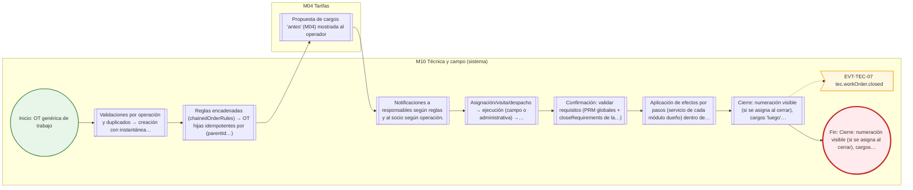

**Pasos del proceso** (actividad tomada del anexo; la columna RF/RN distingue lo citado en el paso de lo asociado por parámetro, permiso, evento o tema compartido).

| Paso | Carril | Actividad | RF/RN que aplican | EVT / JOB / PAN |
|---|---|---|---|---|
| 1 | M10 Técnica y campo | Validaciones por operación y duplicados → creación con instantánea, numeración y nota en cuenta. | — | — |
| 2 | M10 Técnica y campo | Reglas encadenadas (`chainedOrderRules`) → OT hijas idempotentes por `(parentId, ruleId)`. | — | — |
| 3 | M04 Tarifas | Propuesta de cargos "antes" (M04) mostrada al operador; aceptación genera cargo en `billableItems` de M05 con `fac.service.upsertBillableItem` (`sourceModule = TEC`, idempotente por OT + regla + momento; RF-TEC-062) o cobro en mostrador (M07). | RF-TEC-062; asoc.: RN-TEC-041 | — |
| 4 | M10 Técnica y campo | Notificaciones a responsables según reglas y al socio según operación. | — | — |
| 5 | M10 Técnica y campo | Asignación/visita/despacho → ejecución (campo o administrativa) → confirmación. | — | — |
| 6 | M10 Técnica y campo | Confirmación: validar requisitos (PRM globales + `closeRequirements` de la operación), pagos pendientes (PRM-TEC-075), cadena (orden origen/destino), conflicto abierto. | — | — |
| 7 | M10 Técnica y campo | Aplicación de efectos por pasos (servicio de cada módulo dueño) dentro de transacción + outbox; si un paso externo (aprovisionamiento/telemedición) es asíncrono, la OT queda `closing` hasta confirmar o pasar a manual. | asoc.: RN-TEC-071, RF-TEC-038 | — |
| 8 | M10 Técnica y campo | Cierre: numeración visible (si se asigna al cerrar), cargos "luego" (aceptados → `fac.service.upsertBillableItem` de M05, RF-TEC-062), proporcionales (evento a M04/M05), lectura (M03), notificación de cierre, evento `tec.workOrder.closed` (con el detalle de envases si la operación es `bottledGasDelivery`, RF-TEC-239). | RF-TEC-062, RF-TEC-239; asoc.: RF-TEC-063, RN-TEC-041 | EVT-TEC-07 |

**Situación actual en ProCoop (nota de cambio).** Análisis de brechas (`15-analisis-brechas-procoop.md` §3.14, Técnica): hoy Gestión de Internet y telefonía con tablas propias; en GoodApps, aprovisionamiento automático asíncrono en MikroTik, Radius y SmartOLT con respaldo manual (brecha "Cambia"; fuente DEC-041, DEC-042).

**Excepciones**

| Excepción | Tratamiento |
|---|---|
| Duplicado | Validaciones por operación y duplicados → creación con instantánea, numeración y nota en cuenta |
| Conflicto | Confirmación: validar requisitos (PRM globales + `closeRequirements` de la operación), pagos pendientes (PRM-TEC-075), cadena (orden origen/destino), conflicto abierto |
| Si un paso externo (aprovisionamiento/telemedición) es asíncrono | la OT queda `closing` hasta confirmar o pasar a manual |
| Falla técnica en un paso automático, un job o una integración | Reintento idempotente y reanudable; lo no reparable pasa a la bandeja técnica con responsable (política de recuperación de T11 P-WFL-01 y T01 §9.12; AGR-016). |

---

## 16. PRC-TEC-03 Cierre masivo (JOB-TEC-03)

| Campo | Contenido |
|---|---|
| Fuente | M10 §9.3, `M10-TEC-tecnica-campo-redes.md` (línea 2535) |
| Macroproceso | MP-14 Operación técnica, redes y stock |
| Disparador | Cierre masivo |
| Resultado | Informe imprimible y notificación opcional |
| Carriles | M10 Técnica y campo (sistema) |
| Roles de T02 | Solo actores del sistema (sin rol humano) |
| Módulos involucrados | M10 Técnica y campo |
| Eventos (T11 §12) | — |
| Jobs | — |
| Relación con 04-procesos-bpmn.md | P6 Reclamo y orden de trabajo ([§10](04-procesos-bpmn.md#10-p6--reclamo-y-orden-de-trabajo)) |

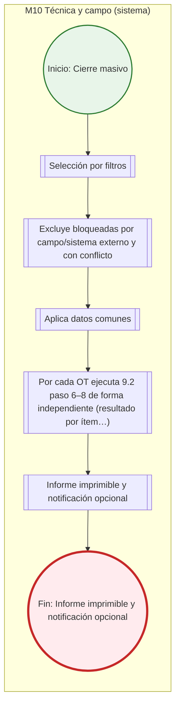

**Pasos del proceso** (actividad tomada del anexo; la columna RF/RN distingue lo citado en el paso de lo asociado por parámetro, permiso, evento o tema compartido).

| Paso | Carril | Actividad | RF/RN que aplican | EVT / JOB / PAN |
|---|---|---|---|---|
| 1 | M10 Técnica y campo | Selección por filtros | — | — |
| 2 | M10 Técnica y campo | excluye bloqueadas por campo/sistema externo y con conflicto | asoc.: RF-TEC-052 | — |
| 3 | M10 Técnica y campo | aplica datos comunes | — | — |
| 4 | M10 Técnica y campo | por cada OT ejecuta 9.2 paso 6–8 de forma independiente (resultado por ítem, idempotente por `(batchId, workOrderId)`) | — | — |
| 5 | M10 Técnica y campo | informe imprimible y notificación opcional; reanudable | — | — |

**Situación actual en ProCoop (nota de cambio).** Sin contraste específico para este proceso en el anexo (filas `CTR-` con ProCoop) ni en el análisis de brechas. El contraste del dominio está en `15-analisis-brechas-procoop.md` §3.14.

**Excepciones**

| Excepción | Tratamiento |
|---|---|
| Conflicto | Selección por filtros excluye bloqueadas por campo/sistema externo y con conflicto aplica datos comunes por cada OT ejecuta 9.2 paso 6–8 de forma independiente (resultado por ítem, idempotente por `(batchId, workOrderId)`) informe imprimible y notificación opcional; reanudable |
| Falla técnica en un paso automático, un job o una integración | Reintento idempotente y reanudable; lo no reparable pasa a la bandeja técnica con responsable (política de recuperación de T11 P-WFL-01 y T01 §9.12; AGR-016). |

---

## 17. PRC-TEC-04 Sincronización offline y conflictos (AGR-025, ESC-03)

| Campo | Contenido |
|---|---|
| Fuente | M10 §9.4, `M10-TEC-tecnica-campo-redes.md` (línea 2539) |
| Macroproceso | MP-14 Operación técnica, redes y stock |
| Disparador | Sincronización offline y conflictos |
| Resultado | El dispositivo recibe el resultado por ítem y actualiza estado… |
| Carriles | M10 Técnica y campo (sistema); Supervisor técnico (T-STE); Técnico (campo) (T-TEC) |
| Roles de T02 | T-STE Supervisor técnico, T-TEC Técnico (campo) |
| Módulos involucrados | M10 Técnica y campo |
| Eventos (T11 §12) | — |
| Jobs | — |
| Relación con 04-procesos-bpmn.md | P6 Reclamo y orden de trabajo ([§10](04-procesos-bpmn.md#10-p6--reclamo-y-orden-de-trabajo)) |

```mermaid
flowchart LR
  subgraph L_LSIS["M10 Técnica y campo (sistema)"]
    ni(("Inicio: Sincronización offline y conflictos"))
    ns1[["Descarga: GET /api/field/my-day devuelve paquetes con serverVersion por…"]]
    ns2[["Offline: cada acción genera una mutación en la cola única IndexedDB…"]]
    ns3[["Al volver la red: POST /api/field/sync por lotes (PRM-TEC-145) con evidencias…"]]
    ns4[["Servidor por ítem: si clientMutationId existe → duplicate con resultado…"]]
    ns5[["Desvío de reloj › PRM-TEC-140 → aplica pero marca revisión."]]
  end
  subgraph L_LTSTE["Supervisor técnico (T-STE)"]
    ns6["El supervisor resuelve (8.8)"]
  end
  subgraph L_LTTEC["Técnico (campo) (T-TEC)"]
    ns7["El dispositivo recibe el resultado por ítem y actualiza estado local"]
    nf(("Fin: El dispositivo recibe el resultado por ítem y actualiza estado…"))
  end
  ni --> ns1
  ns1 --> ns2
  ns2 --> ns3
  ns3 --> ns4
  ns4 --> ns5
  ns5 --> ns6
  ns6 --> ns7
  ns7 --> nf
  classDef inicio fill:#e8f5e9,stroke:#2e7d32,stroke-width:2px
  classDef fin fill:#ffebee,stroke:#c62828,stroke-width:4px
  classDef evento fill:#fff8e1,stroke:#f9a825
  classDef temporizador fill:#e3f2fd,stroke:#1565c0
  class ni inicio
  class nf fin
```

**Pasos del proceso** (actividad tomada del anexo; la columna RF/RN distingue lo citado en el paso de lo asociado por parámetro, permiso, evento o tema compartido).

| Paso | Carril | Actividad | RF/RN que aplican | EVT / JOB / PAN |
|---|---|---|---|---|
| 1 | M10 Técnica y campo | Descarga: `GET /api/field/my-day` devuelve paquetes con `serverVersion` por entidad y la lista de custodia del técnico. | asoc.: RF-TEC-113 | — |
| 2 | M10 Técnica y campo | Offline: cada acción genera una mutación en la cola única IndexedDB (`clientMutationId`, `baseVersion`, `occurredAt`); fotos/firmas como blobs en IndexedDB. | asoc.: RF-TEC-114, RF-TEC-092 | — |
| 3 | M10 Técnica y campo | Al volver la red: `POST /api/field/sync` por lotes (PRM-TEC-145) con evidencias subidas previamente por URL firmada. | — | — |
| 4 | M10 Técnica y campo | Servidor por ítem: si `clientMutationId` existe → `duplicate` con resultado original; si permiso inválido → `rejected`; si `baseVersion` = actual o el cambio no afecta campos sensibles → `applied`; si la OT fue cancelada/reasignada/modificada o el equipo/titular cambió → guardar evidencias y materiales como "hechos de campo", crear `syncConflicts`, marcar `workOrders.conflictOpen=true` y responder `conflict`. | asoc.: RF-TEC-114, RF-TEC-124 | — |
| 5 | M10 Técnica y campo | Desvío de reloj > PRM-TEC-140 → aplica pero marca revisión. | asoc.: RN-TEC-069 | — |
| 6 | Supervisor técnico | El supervisor resuelve (8.8). Ejemplo ESC-03: OT cancelada en admin mientras el técnico instaló offline con firma y equipo: se conserva evidencia, M13 registra que el equipo salió de custodia (hecho físico), y el supervisor decide `acceptField` (reabrir y activar con fecha real) o `acceptServer` (crear OT de retiro y devolver equipo). No hay doble salida de equipo ni borrado. | asoc.: RF-TEC-124, RN-TEC-067 | — |
| 7 | Técnico | El dispositivo recibe el resultado por ítem y actualiza estado local; banner único con pendientes y "Reintentar". | — | — |

**Situación actual en ProCoop (nota de cambio).** Sin contraste específico para este proceso en el anexo (filas `CTR-` con ProCoop) ni en el análisis de brechas. El contraste del dominio está en `15-analisis-brechas-procoop.md` §3.14.

**Excepciones**

| Excepción | Tratamiento |
|---|---|
| Si `clientMutationId` existe | `duplicate` con resultado original; si permiso inválido → `rejected`; si `baseVersion` = actual o el cambio no afecta campos sensibles → `applied`; si la OT fue cancelada/reasignada/modificada o el equipo/titular cambió → guardar evidencias y materiales como "hechos de campo", crear `syncConflicts`, marcar `workOrders.conflictOpen=true` y responder `conflict` |
| Cancelación, anulación o reversión | Ejemplo ESC-03: OT cancelada en admin mientras el técnico instaló offline con firma y equipo: se conserva evidencia, M13 registra que el equipo salió de custodia (hecho físico), y el supervisor decide `acceptField` (reabrir y activar con fecha real) o `acceptServer` (crear OT de retiro y devolver equipo) |
| Reintento | El dispositivo recibe el resultado por ítem y actualiza estado local; banner único con pendientes y "Reintentar" |
| Falla técnica en un paso automático, un job o una integración | Reintento idempotente y reanudable; lo no reparable pasa a la bandeja técnica con responsable (política de recuperación de T11 P-WFL-01 y T01 §9.12; AGR-016). |

---

## 18. PRC-TEC-05 Corte y reconexión por mora (O6)

| Campo | Contenido |
|---|---|
| Fuente | M10 §9.5, `M10-TEC-tecnica-campo-redes.md` (línea 2549); ola O6 |
| Macroproceso | MP-14 Operación técnica, redes y stock |
| Disparador | Corte y reconexión por mora |
| Resultado | Reconexión: mor.interruption.approved (EVT-MOR-12, tipo…) |
| Carriles | M08 Mora; M10 Técnica y campo (sistema); Socio titular (C-SOC) |
| Roles de T02 | C-SOC Socio titular |
| Módulos involucrados | M08 Mora, M10 Técnica y campo |
| Eventos (T11 §12) | EVT-MOR-12 `mor.interruption.approved`; EVT-MOR-13 `mor.interruption.cancelled`; EVT-TEC-18 `tec.disconnection.executed` |
| Jobs | — |
| Relación con 04-procesos-bpmn.md | P6 Reclamo y orden de trabajo ([§10](04-procesos-bpmn.md#10-p6--reclamo-y-orden-de-trabajo)) |

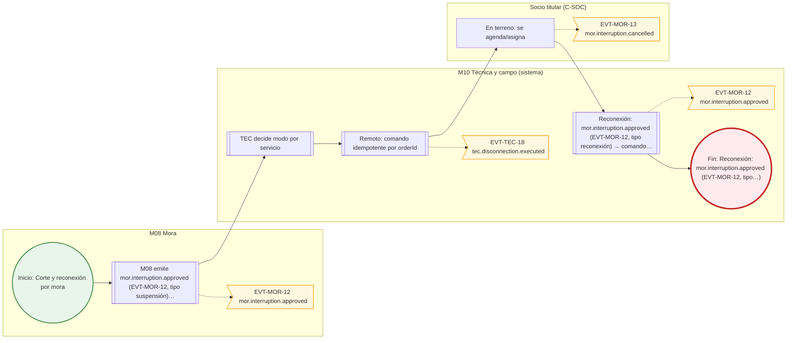

**Pasos del proceso** (actividad tomada del anexo; la columna RF/RN distingue lo citado en el paso de lo asociado por parámetro, permiso, evento o tema compartido).

| Paso | Carril | Actividad | RF/RN que aplican | EVT / JOB / PAN |
|---|---|---|---|---|
| 1 | M08 Mora | M08 emite `mor.interruption.approved` (EVT-MOR-12, tipo suspensión) `{ contractId, orderId, mode }`. | asoc.: RF-TEC-238 | EVT-MOR-12 |
| 2 | M10 Técnica y campo | TEC decide modo por servicio: remoto (comando `suspend`) o en terreno (OT `disconnect` con `dunningOrigin`, `isDelinquent=true`), o directo sin técnica (RF-TEC-049). Si la orden llega con `serviceMode = restricted`, se aplica el perfil de restricción en lugar del corte: OT `flowRestriction` en agua, bloqueo saliente en telefonía o grilla mínima en TV (RF-TEC-238, RN-MOR-137 a RN-MOR-139 de M08). | RF-TEC-049, RF-TEC-238, RN-MOR-137, RN-MOR-139; asoc.: RF-TEC-023 | — |
| 3 | M10 Técnica y campo | Remoto: comando idempotente por `orderId`; confirmado → `tec.disconnection.executed`; fallido → OT en terreno o manual. | asoc.: RF-TEC-238 | EVT-TEC-18 |
| 4 | Socio titular | En terreno: se agenda/asigna; si el socio paga antes de ejecutar, M08 emite `mor.interruption.cancelled` (EVT-MOR-13) → TEC cancela OT/comando pendiente (`cancelled`) e informa. | — | EVT-MOR-13 |
| 5 | M10 Técnica y campo | Reconexión: `mor.interruption.approved` (EVT-MOR-12, tipo reconexión) → comando `reactivate` o OT `reconnect` (cierre y reconexión en un paso si remoto confirmado); sin sistema remoto, OT pendiente para cuadrilla (RN-TEC-072). Proporcionales por evento a M04/M05. | RN-TEC-072; asoc.: RF-TEC-238, RF-TEC-134 | EVT-MOR-12 |

**Situación actual en ProCoop (nota de cambio).** CTR-TEC-11: en ProCoop, ProCoop corta directo en MikroTik de forma síncrona, sin trazabilidad del origen. Cambio adoptado: Comando asíncrono, idempotente, con origen (OT o mora) y reintentos.

**Excepciones**

| Excepción | Tratamiento |
|---|---|
| Si la orden llega con `serviceMode = restricted` | se aplica el perfil de restricción en lugar del corte: OT `flowRestriction` en agua, bloqueo saliente en telefonía o grilla mínima en TV (RF-TEC-238, RN-MOR-137 a RN-MOR-139 de M08) |
| Si el socio paga antes de ejecutar | M08 emite `mor.interruption.cancelled` (EVT-MOR-13) → TEC cancela OT/comando pendiente (`cancelled`) e informa |
| Falla técnica en un paso automático, un job o una integración | Reintento idempotente y reanudable; lo no reparable pasa a la bandeja técnica con responsable (política de recuperación de T11 P-WFL-01 y T01 §9.12; AGR-016). |

---

## 19. PRC-TEC-06 Interrupción planificada y análisis de impacto (O7)

| Campo | Contenido |
|---|---|
| Fuente | M10 §9.6, `M10-TEC-tecnica-campo-redes.md` (línea 2557); ola O7 |
| Macroproceso | MP-14 Operación técnica, redes y stock |
| Disparador | Interrupción planificada y análisis de impacto |
| Resultado | Inicio/fin reales registrados → informe de interrupción para… |
| Carriles | Supervisor técnico (T-STE); M10 Técnica y campo (sistema) |
| Roles de T02 | T-STE Supervisor técnico |
| Módulos involucrados | M10 Técnica y campo |
| Eventos (T11 §12) | — |
| Jobs | — |
| Relación con 04-procesos-bpmn.md | P6 Reclamo y orden de trabajo ([§10](04-procesos-bpmn.md#10-p6--reclamo-y-orden-de-trabajo)) |

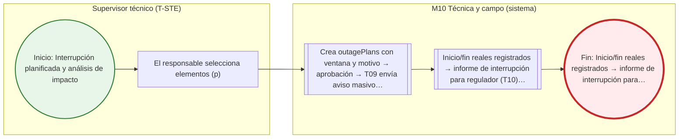

**Pasos del proceso** (actividad tomada del anexo; la columna RF/RN distingue lo citado en el paso de lo asociado por parámetro, permiso, evento o tema compartido).

| Paso | Carril | Actividad | RF/RN que aplican | EVT / JOB / PAN |
|---|---|---|---|---|
| 1 | Supervisor técnico | El responsable selecciona elementos (p. ej., transformador TR-DEMO-01) → `GET impact` recorre descendientes (`ancestorIds`) y conexiones vigentes → lista de contratos, críticos (electrodependientes) y conteos. | asoc.: RF-TEC-156, RN-TEC-085 | — |
| 2 | M10 Técnica y campo | Crea `outagePlans` con ventana y motivo → aprobación → T09 envía aviso masivo (constancia por destinatario) → OT de mantenimiento asociadas. | — | — |
| 3 | M10 Técnica y campo | Inicio/fin reales registrados → informe de interrupción para regulador (T10) → avisos de restablecimiento. | — | — |

**Situación actual en ProCoop (nota de cambio).** Sin contraste específico para este proceso en el anexo (filas `CTR-` con ProCoop) ni en el análisis de brechas. El contraste del dominio está en `15-analisis-brechas-procoop.md` §3.14.

**Excepciones**

| Excepción | Tratamiento |
|---|---|
| Falla técnica en un paso automático, un job o una integración | Reintento idempotente y reanudable; lo no reparable pasa a la bandeja técnica con responsable (política de recuperación de T11 P-WFL-01 y T01 §9.12; AGR-016). |

---

## Inconsistencias detectadas en la especificación (esta parte)

No se detectaron inconsistencias en los procesos de esta parte.

## Cobertura de esta parte

| Universo de la parte | Diagramados | Con nota ProCoop específica | Pendientes |
|---|---|---|---|
| 19 (PRC-POR-04 a PRC-TEC-06) | 19 | 6 | 0 |
