# GoodApps Cooperativas

## Procesos de negocio — Operación técnica, redes y stock y Compras y proveedores (M10, M12, M13)

**Entregable de Análisis y Diseño Detallado — Artefacto 2.1 (Procesos de negocio BPMN). Parte de [`04-procesos-bpmn.md`](04-procesos-bpmn.md).**

| Dato | Valor |
|---|---|
| Documento | Diagramas BPMN, pasos, situación actual en ProCoop y excepciones de los procesos PRC-TEC-07 a PRC-CMP-02, derivados de la sección 9 de M10, M12, M13 |
| Carácter | Derivado de la especificación vigente; no la reemplaza. Ante diferencias prevalecen la maestra `00`, los anexos, T05, T11 y el registro de decisiones `01` |
| Generación | Script `_trabajo/generar_bpmn.py` con la ampliación `_trabajo/generar_prc.py` (derivación automática desde el texto de la sección 9 de cada anexo, `_trabajo/prc_auto.py`) |
| Versión | 1.1 (regenerada contra la especificación corregida) |
| Fecha | 05-11-2026 |

**Cómo leer cada proceso.** La notación es la de [`04-procesos-bpmn.md` §3](04-procesos-bpmn.md#3-notación-equivalencia-mermaid--bpmn) (carriles, eventos de inicio y fin, tareas de usuario y de servicio, compuertas XOR y AND, eventos de dominio como banderas, temporizadores y jobs como estadios). La tabla de pasos reproduce la actividad del anexo; en la columna RF/RN, los identificadores sin prefijo son los que el anexo cita en el paso y los marcados "asoc." son reglas o requisitos del mismo anexo que comparten parámetro, permiso, evento o tema con el paso (asociación generada por el script y revisada). Los eventos se nombran con su ID del catálogo de T11 §12.

**Derivación automática (v1.2).** Los procesos `PRC-<MOD>-nn` de esta parte se generaron con `_trabajo/generar_prc.py` y `_trabajo/prc_auto.py` a partir del texto de cada subsección §9.n del anexo, sin curaduría paso a paso (a diferencia de los 94 procesos `P-XXX-nn` de las partes 04b a 04i). Reglas: (1) los pasos son los numerados o viñetas del anexo; si la subsección es prosa, se parte por flechas o por oraciones; si es una tabla de pasos o de jobs, cada fila es un paso; (2) el carril de cada paso es el primer actor nombrado al comienzo del paso (rol de T02 §4, otro módulo, sistema externo, dispositivo o job); si no se nombra ninguno, el paso es del sistema del módulo dueño; (3) los pasos que empiezan con "Si …" se dibujan como compuerta XOR; (4) los eventos son los nombres del catálogo de T11 §12 citados en el paso (bandera entrante si el paso los consume, saliente si los publica); el temporizador aparece cuando el título nombra un job periódico; (5) las excepciones son las oraciones del anexo con condición o con palabras de falla, rechazo, vencimiento, duplicado o umbral, más la política de recuperación del anexo; (6) la nota ProCoop combina lo que dice el propio anexo, la fila `CTR-` del anexo que contrasta con ProCoop y la fila de `15-analisis-brechas-procoop.md` §3 de mayor afinidad; si ninguna alcanza el umbral, la nota lo dice y remite al contraste del dominio en esa sección. La revisión manual de una muestra está en `_trabajo/prc_revision.md`; ante diferencias, prevalece el texto del anexo citado en la ficha.

## Índice de procesos de esta parte

1. [PRC-TEC-07 Mantenimiento preventivo (JOB-TEC-05)](#1-prc-tec-07-mantenimiento-preventivo-job-tec-05)
2. [PRC-TEC-08 Importación de CDR (O10)](#2-prc-tec-08-importación-de-cdr-o10)
3. [PRC-TEC-09 Aprovisionamiento: reintentos y recuperación (AGR-016, ESC-04)](#3-prc-tec-09-aprovisionamiento-reintentos-y-recuperación-agr-016-esc-04)
4. [PRC-TEC-10 Contribución por mejoras (O7)](#4-prc-tec-10-contribución-por-mejoras-o7)
5. [PRC-TEC-11 Inspección y recupero (O7)](#5-prc-tec-11-inspección-y-recupero-o7)
6. [PRC-TEC-12 Emergencia de seguridad con guardia (HUE-GAS-05)](#6-prc-tec-12-emergencia-de-seguridad-con-guardia-hue-gas-05)
7. [PRC-STK-01 Ingreso por compra (O8; en O3 por vale de entrada)](#7-prc-stk-01-ingreso-por-compra-o8-en-o3-por-vale-de-entrada)
8. [PRC-STK-02 Instalación de Internet con equipo en comodato (O3, CU-INS-01, INS-004)](#8-prc-stk-02-instalación-de-internet-con-equipo-en-comodato-o3-cu-ins-01-ins-004)
9. [PRC-STK-03 Consumo de materiales desde la OT (CU-20)](#9-prc-stk-03-consumo-de-materiales-desde-la-ot-cu-20)
10. [PRC-STK-04 Retiro de equipo en baja (Internet)](#10-prc-stk-04-retiro-de-equipo-en-baja-internet)
11. [PRC-STK-05 Cambio de equipo por falla](#11-prc-stk-05-cambio-de-equipo-por-falla)
12. [PRC-STK-06 Rendición de cuadrilla (JOB-STK-04 y manual)](#12-prc-stk-06-rendición-de-cuadrilla-job-stk-04-y-manual)
13. [PRC-STK-07 Inventario físico](#13-prc-stk-07-inventario-físico)
14. [PRC-STK-08 Reposición por stock mínimo (JOB-STK-03, diario)](#14-prc-stk-08-reposición-por-stock-mínimo-job-stk-03-diario)
15. [PRC-STK-09 Valorización, revaluación y cierre de stock](#15-prc-stk-09-valorización-revaluación-y-cierre-de-stock)
16. [PRC-STK-10 Amortización de bienes de uso (JOB-STK-07)](#16-prc-stk-10-amortización-de-bienes-de-uso-job-stk-07)
17. [PRC-STK-11 RMA](#17-prc-stk-11-rma)
18. [PRC-STK-12 Fabricación (O10)](#18-prc-stk-12-fabricación-o10)
19. [PRC-CMP-01 Circuito completo (CU-19)](#19-prc-cmp-01-circuito-completo-cu-19)
20. [PRC-CMP-02 Orden de pago con retención (CU-FIS-01)](#20-prc-cmp-02-orden-de-pago-con-retención-cu-fis-01)

---

## 1. PRC-TEC-07 Mantenimiento preventivo (JOB-TEC-05)

| Campo | Contenido |
|---|---|
| Fuente | M10 §9.7, `M10-TEC-tecnica-campo-redes.md` (línea 2563) |
| Macroproceso | MP-14 Operación técnica, redes y stock |
| Disparador | Mantenimiento preventivo |
| Resultado | Avería detectada durante el preventivo → OT correctiva… |
| Carriles | M10 Técnica y campo (sistema) |
| Roles de T02 | Solo actores del sistema (sin rol humano) |
| Módulos involucrados | M10 Técnica y campo |
| Eventos (T11 §12) | — |
| Jobs | JOB-TEC-05 `tec:generar-mantenimiento` |
| Relación con 04-procesos-bpmn.md | P6 Reclamo y orden de trabajo ([§10](04-procesos-bpmn.md#10-p6--reclamo-y-orden-de-trabajo)) |

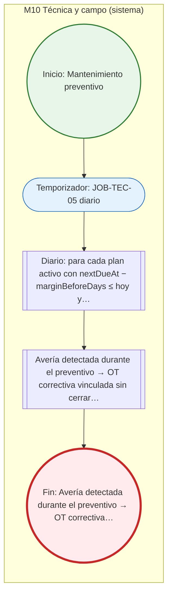

**Pasos del proceso** (actividad tomada del anexo; la columna RF/RN distingue lo citado en el paso de lo asociado por parámetro, permiso, evento o tema compartido).

| Paso | Carril | Actividad | RF/RN que aplican | EVT / JOB / PAN |
|---|---|---|---|---|
| 1 | M10 Técnica y campo | Diario: para cada plan activo con `nextDueAt − marginBeforeDays ≤ hoy` y `nextDueAt ≤ validUntil`, crear OT `maintenance` (idempotente por `(planId, nextDueAt)`), recalcular `nextDueAt` por frecuencia | — | — |
| 2 | M10 Técnica y campo | Avería detectada durante el preventivo → OT correctiva vinculada sin cerrar el preventivo | — | — |

**Situación actual en ProCoop (nota de cambio).** Sin contraste específico para este proceso en el anexo (filas `CTR-` con ProCoop) ni en el análisis de brechas. El contraste del dominio está en `15-analisis-brechas-procoop.md` §3.14.

**Excepciones**

| Excepción | Tratamiento |
|---|---|
| Falla técnica en un paso automático, un job o una integración | Reintento idempotente y reanudable; lo no reparable pasa a la bandeja técnica con responsable (política de recuperación de T11 P-WFL-01 y T01 §9.12; AGR-016). |

---

## 2. PRC-TEC-08 Importación de CDR (O10)

| Campo | Contenido |
|---|---|
| Fuente | M10 §9.8, `M10-TEC-tecnica-campo-redes.md` (línea 2567); ola O10 |
| Macroproceso | MP-14 Operación técnica, redes y stock |
| Disparador | Importación de CDR |
| Resultado | M05 agrupa en consumos al facturar |
| Carriles | M10 Técnica y campo (sistema); M05 Facturación |
| Roles de T02 | Solo actores del sistema (sin rol humano) |
| Módulos involucrados | M04 Tarifas, M05 Facturación, M10 Técnica y campo |
| Eventos (T11 §12) | EVT-TAR-019 `tar.calls.rated`; EVT-TEC-27 `tec.cdr.attributed` |
| Jobs | JOB-TEC-09 `tec:importar-cdr` |
| Relación con 04-procesos-bpmn.md | P6 Reclamo y orden de trabajo ([§10](04-procesos-bpmn.md#10-p6--reclamo-y-orden-de-trabajo)) |

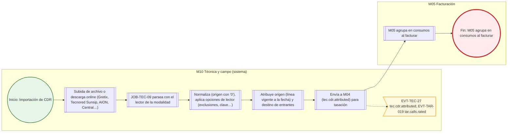

**Pasos del proceso** (actividad tomada del anexo; la columna RF/RN distingue lo citado en el paso de lo asociado por parámetro, permiso, evento o tema compartido).

| Paso | Carril | Actividad | RF/RN que aplican | EVT / JOB / PAN |
|---|---|---|---|---|
| 1 | M10 Técnica y campo | Subida de archivo o descarga online (Gretix, Tecnored Sunsip, AION, Central Online) por central/fechas → `cdrImports` (`uploaded`), rechazo por `fileHash` repetido. | — | — |
| 2 | M10 Técnica y campo | JOB-TEC-09 parsea con el lector de la modalidad; error de fila aborta con número de fila (`withErrors`). | — | JOB-TEC-09 |
| 3 | M10 Técnica y campo | Normaliza (origen con "0"), aplica opciones de lector (exclusiones, clave 99), deduplica por `dedupeKey` (PRM-TEC-108). | — | — |
| 4 | M10 Técnica y campo | Atribuye origen (línea vigente a la fecha) y destino de entrantes; marca no atribuidas para asignación manual. | asoc.: RF-TEC-207 | — |
| 5 | M10 Técnica y campo | Envía a M04 (`tec.cdr.attributed`) para tasación; recibe `tar.calls.rated` (EVT-TAR-019). | asoc.: RF-TEC-211 | EVT-TAR-019, EVT-TEC-27 |
| 6 | M05 Facturación | M05 agrupa en consumos al facturar; desde entonces el lote no se revierte. | — | — |

**Situación actual en ProCoop (nota de cambio).** Sin contraste específico para este proceso en el anexo (filas `CTR-` con ProCoop) ni en el análisis de brechas. El contraste del dominio está en `15-analisis-brechas-procoop.md` §3.14.

**Excepciones**

| Excepción | Tratamiento |
|---|---|
| Rechazo | Subida de archivo o descarga online (Gretix, Tecnored Sunsip, AION, Central Online) por central/fechas → `cdrImports` (`uploaded`), rechazo por `fileHash` repetido |
| Falla o error | JOB-TEC-09 parsea con el lector de la modalidad; error de fila aborta con número de fila (`withErrors`) |
| Duplicado | Normaliza (origen con "0"), aplica opciones de lector (exclusiones, clave 99), deduplica por `dedupeKey` (PRM-TEC-108) |
| Falla técnica en un paso automático, un job o una integración | Reintento idempotente y reanudable; lo no reparable pasa a la bandeja técnica con responsable (política de recuperación de T11 P-WFL-01 y T01 §9.12; AGR-016). |

---

## 3. PRC-TEC-09 Aprovisionamiento: reintentos y recuperación (AGR-016, ESC-04)

| Campo | Contenido |
|---|---|
| Fuente | M10 §9.9, `M10-TEC-tecnica-campo-redes.md` (línea 2576) |
| Macroproceso | MP-14 Operación técnica, redes y stock |
| Disparador | Aprovisionamiento: reintentos y recuperación |
| Resultado | Tras restauración de backup, JOB-TEC-11 concilia comandos… |
| Carriles | M10 Técnica y campo (sistema) |
| Roles de T02 | Solo actores del sistema (sin rol humano) |
| Módulos involucrados | M10 Técnica y campo |
| Eventos (T11 §12) | — |
| Jobs | JOB-TEC-06 `tec:aprovisionar`; JOB-TEC-11 `tec:conciliar-aprovisionamiento` |
| Relación con 04-procesos-bpmn.md | P6 Reclamo y orden de trabajo ([§10](04-procesos-bpmn.md#10-p6--reclamo-y-orden-de-trabajo)) |

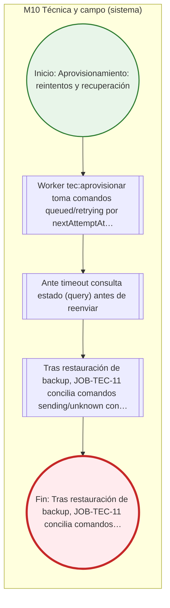

**Pasos del proceso** (actividad tomada del anexo; la columna RF/RN distingue lo citado en el paso de lo asociado por parámetro, permiso, evento o tema compartido).

| Paso | Carril | Actividad | RF/RN que aplican | EVT / JOB / PAN |
|---|---|---|---|---|
| 1 | M10 Técnica y campo | Worker `tec:aprovisionar` toma comandos `queued\|retrying` por `nextAttemptAt`, aplica rate limit por sistema, envía con `commandId` como clave de idempotencia cuando el sistema la soporta | asoc.: RF-TEC-194 | JOB-TEC-06 |
| 2 | M10 Técnica y campo | ante timeout consulta estado (`query`) antes de reenviar | — | — |
| 3 | M10 Técnica y campo | tras restauración de backup, JOB-TEC-11 concilia comandos `sending/unknown` con el estado real del sistema externo antes de reanudar | — | JOB-TEC-11 |

**Situación actual en ProCoop (nota de cambio).** Sin contraste específico para este proceso en el anexo (filas `CTR-` con ProCoop) ni en el análisis de brechas. El contraste del dominio está en `15-analisis-brechas-procoop.md` §3.14.

**Excepciones**

| Excepción | Tratamiento |
|---|---|
| Resultado incierto o sin respuesta | Worker `tec:aprovisionar` toma comandos `queued\|retrying` por `nextAttemptAt`, aplica rate limit por sistema, envía con `commandId` como clave de idempotencia cuando el sistema la soporta ante timeout consulta estado (`query`) antes de reenviar tras restauración de backup, JOB-TEC-11 concilia comandos `sending/unknown` con el estado real del sistema externo antes de reanudar |
| Falla técnica en un paso automático, un job o una integración | Reintento idempotente y reanudable; lo no reparable pasa a la bandeja técnica con responsable (política de recuperación de T11 P-WFL-01 y T01 §9.12; AGR-016). |

---

## 4. PRC-TEC-10 Contribución por mejoras (O7)

| Campo | Contenido |
|---|---|
| Fuente | M10 §9.10, `M10-TEC-tecnica-campo-redes.md` (línea 2580); ola O7 |
| Macroproceso | MP-14 Operación técnica, redes y stock |
| Disparador | Contribución por mejoras |
| Resultado | Por defecto no interviene M08 (PRM-TEC-155 = installmentPlan17) |
| Carriles | M10 Técnica y campo (sistema); M08 Mora; M02 Catálogo y contratos; M05 Facturación; T09 Comunicaciones |
| Roles de T02 | Solo actores del sistema (sin rol humano) |
| Módulos involucrados | M02 Catálogo y contratos, M05 Facturación, M08 Mora, M10 Técnica y campo, T09 Comunicaciones |
| Eventos (T11 §12) | EVT-TEC-25 `tec.levy.approved` |
| Jobs | JOB-CAT-13 `cat:crear-contratos-obra` |
| Relación con 04-procesos-bpmn.md | P6 Reclamo y orden de trabajo ([§10](04-procesos-bpmn.md#10-p6--reclamo-y-orden-de-trabajo)) |

```mermaid
flowchart LR
  subgraph L_LSIS["M10 Técnica y campo (sistema)"]
    ni(("Inicio: Contribución por mejoras"))
    ns1[["Obra aprobada con base legal"]]
    ns2[["Importación del padrón (ExcelImportWizard)"]]
    ns3[["Elección de criterio"]]
    ns4[["Simulación (share = medida / Σ medidas, importe con redondeo explícito y…)"]]
    ns6[["Seguimiento de cobro por beneficiario"]]
    ns7[["Precisión del envío (HUECO-OBR-01 y HUECO-OBR-02)"]]
    ne7>"EVT-TEC-25 tec.levy.approved"]
    ns11[["Por defecto no interviene M08 (PRM-TEC-155 = installmentPlan17)"]]
    nf(("Fin: Por defecto no interviene M08 (PRM-TEC-155 = installmentPlan17)"))
  end
  subgraph L_LM08["M08 Mora"]
    ns5[["Envío a M05/M08 (cuotas o plan)"]]
  end
  subgraph L_LM02["M02 Catálogo y contratos"]
    ns8[["M02 crea un contrato tipo 17 por beneficiario (JOB-CAT-13…)"]]
  end
  subgraph L_LM05["M05 Facturación"]
    ns9[["M05 factura cada cuota por el contrato"]]
  end
  subgraph L_LT09["T09 Comunicaciones"]
    ns10[["T09 envía al frentista el aviso tec.levy.approved con el importe y el plan"]]
    ne10>"EVT-TEC-25 tec.levy.approved"]
  end
  ni --> ns1
  ns1 --> ns2
  ns2 --> ns3
  ns3 --> ns4
  ns4 --> ns5
  ns5 --> ns6
  ns6 --> ns7
  ns7 -.-> ne7
  ns7 --> ns8
  ns8 --> ns9
  ns9 --> ns10
  ns10 -.-> ne10
  ns10 --> ns11
  ns11 --> nf
  classDef inicio fill:#e8f5e9,stroke:#2e7d32,stroke-width:2px
  classDef fin fill:#ffebee,stroke:#c62828,stroke-width:4px
  classDef evento fill:#fff8e1,stroke:#f9a825
  classDef temporizador fill:#e3f2fd,stroke:#1565c0
  class ni inicio
  class nf fin
  class ne7,ne10 evento
```

**Pasos del proceso** (actividad tomada del anexo; la columna RF/RN distingue lo citado en el paso de lo asociado por parámetro, permiso, evento o tema compartido).

| Paso | Carril | Actividad | RF/RN que aplican | EVT / JOB / PAN |
|---|---|---|---|---|
| 1 | M10 Técnica y campo | Obra aprobada con base legal | — | — |
| 2 | M10 Técnica y campo | importación del padrón (ExcelImportWizard) | — | — |
| 3 | M10 Técnica y campo | elección de criterio | — | — |
| 4 | M10 Técnica y campo | simulación (`share = medida / Σ medidas`, importe con redondeo explícito y ajuste de centavos al último beneficiario); aprobación | asoc.: RF-TEC-173 | — |
| 5 | M08 Mora | envío a M05/M08 (cuotas o plan) | — | — |
| 6 | M10 Técnica y campo | seguimiento de cobro por beneficiario | — | — |
| 7 | M10 Técnica y campo | Precisión del envío (HUECO-OBR-01 y HUECO-OBR-02): la aprobación publica EVT-TEC-25 `tec.levy.approved` (un renglón por beneficiario) | asoc.: RF-TEC-173, RN-TEC-115 | EVT-TEC-25 |
| 8 | M02 Catálogo y contratos | M02 crea un contrato tipo 17 por beneficiario (JOB-CAT-13 `cat:crear-contratos-obra`, RF-CAT-115, idempotente por obra + inmueble) y M04 crea su `worksInstallmentPlans` con la cantidad de cuotas aprobada | RF-CAT-115; asoc.: RF-TEC-173, RN-TEC-115 | JOB-CAT-13 |
| 9 | M05 Facturación | M05 factura cada cuota por el contrato | — | — |
| 10 | T09 Comunicaciones | T09 envía al frentista el aviso `tec.levy.approved` con el importe y el plan | asoc.: RF-TEC-173 | EVT-TEC-25 |
| 11 | M10 Técnica y campo | Por defecto no interviene M08 (PRM-TEC-155 = `installmentPlan17`): si el frentista deja cuotas vencidas, M08 puede refinanciarlas con un convenio sobre esas cuotas (RN-TEC-115) | RN-TEC-115; asoc.: RF-TEC-173 | — |

**Situación actual en ProCoop (nota de cambio).** Sin contraste específico para este proceso en el anexo (filas `CTR-` con ProCoop) ni en el análisis de brechas. El contraste del dominio está en `15-analisis-brechas-procoop.md` §3.14.

**Excepciones**

| Excepción | Tratamiento |
|---|---|
| Si el frentista deja cuotas vencidas | M08 puede refinanciarlas con un convenio sobre esas cuotas (RN-TEC-115) |
| Falla técnica en un paso automático, un job o una integración | Reintento idempotente y reanudable; lo no reparable pasa a la bandeja técnica con responsable (política de recuperación de T11 P-WFL-01 y T01 §9.12; AGR-016). |

---

## 5. PRC-TEC-11 Inspección y recupero (O7)

| Campo | Contenido |
|---|---|
| Fuente | M10 §9.11, `M10-TEC-tecnica-campo-redes.md` (línea 2586); ola O7 |
| Macroproceso | MP-14 Operación técnica, redes y stock |
| Disparador | Inspección y recupero |
| Resultado | Regularización (OT de normalización/precinto) |
| Carriles | M03 Medición; M10 Técnica y campo (sistema); Aprobador según política (T11 aprobaciones); M05 Facturación |
| Roles de T02 | Solo actores del sistema (sin rol humano) |
| Módulos involucrados | M03 Medición, M05 Facturación, M10 Técnica y campo, T11 Workflow, eventos y documentos |
| Eventos (T11 §12) | — |
| Jobs | — |
| Relación con 04-procesos-bpmn.md | P6 Reclamo y orden de trabajo ([§10](04-procesos-bpmn.md#10-p6--reclamo-y-orden-de-trabajo)) |

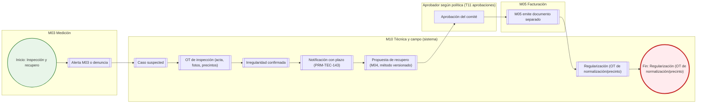

**Pasos del proceso** (actividad tomada del anexo; la columna RF/RN distingue lo citado en el paso de lo asociado por parámetro, permiso, evento o tema compartido).

| Paso | Carril | Actividad | RF/RN que aplican | EVT / JOB / PAN |
|---|---|---|---|---|
| 1 | M03 Medición | Alerta M03 o denuncia | — | — |
| 2 | M10 Técnica y campo | caso `suspected` | — | — |
| 3 | M10 Técnica y campo | OT de inspección (acta, fotos, precintos) | — | — |
| 4 | M10 Técnica y campo | irregularidad confirmada | — | — |
| 5 | M10 Técnica y campo | notificación con plazo (PRM-TEC-143); descargo | asoc.: RN-TEC-094 | — |
| 6 | M10 Técnica y campo | propuesta de recupero (M04, método versionado) | asoc.: RF-TEC-180 | — |
| 7 | Aprobador según política | aprobación del comité | — | — |
| 8 | M05 Facturación | M05 emite documento separado | — | — |
| 9 | M10 Técnica y campo | regularización (OT de normalización/precinto); cierre | — | — |

**Situación actual en ProCoop (nota de cambio).** Sin contraste específico para este proceso en el anexo (filas `CTR-` con ProCoop) ni en el análisis de brechas. El contraste del dominio está en `15-analisis-brechas-procoop.md` §3.14.

**Excepciones**

| Excepción | Tratamiento |
|---|---|
| Falla técnica en un paso automático, un job o una integración | Reintento idempotente y reanudable; lo no reparable pasa a la bandeja técnica con responsable (política de recuperación de T11 P-WFL-01 y T01 §9.12; AGR-016). |

---

## 6. PRC-TEC-12 Emergencia de seguridad con guardia (HUE-GAS-05)

| Campo | Contenido |
|---|---|
| Fuente | M10 §9.11.1, `M10-TEC-tecnica-campo-redes.md` (línea 2590) |
| Macroproceso | MP-14 Operación técnica, redes y stock |
| Disparador | Emergencia de seguridad con guardia |
| Resultado | Normalización con acta y prueba |
| Carriles | M09 Atención; M10 Técnica y campo (sistema) |
| Roles de T02 | Solo actores del sistema (sin rol humano) |
| Módulos involucrados | M09 Atención, M10 Técnica y campo |
| Eventos (T11 §12) | EVT-TEC-35 `tec.emergency.declared`, `tec.emergency.closed`; EVT-TEC-36 `tec.onCall.escalated` |
| Jobs | — |
| Relación con 04-procesos-bpmn.md | P6 Reclamo y orden de trabajo ([§10](04-procesos-bpmn.md#10-p6--reclamo-y-orden-de-trabajo)) |

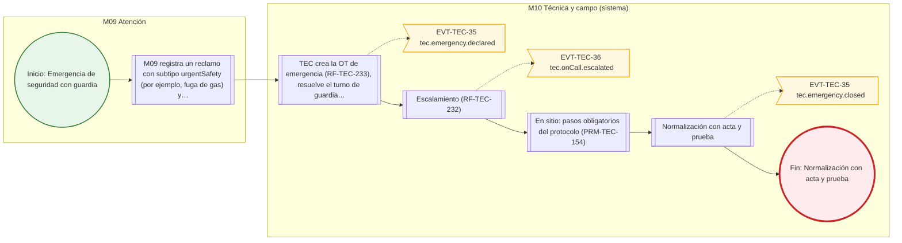

**Pasos del proceso** (actividad tomada del anexo; la columna RF/RN distingue lo citado en el paso de lo asociado por parámetro, permiso, evento o tema compartido).

| Paso | Carril | Actividad | RF/RN que aplican | EVT / JOB / PAN |
|---|---|---|---|---|
| 1 | M09 Atención | M09 registra un reclamo con subtipo `urgentSafety` (por ejemplo, fuga de gas) y emite el comando `tec.workOrder.request` (antes `tec.workOrder.create`, que es alias de la capability `tec.ordenes.crear` en T02) con prioridad crítica y el protocolo del subtipo (RF-CRM-122). | RF-CRM-122; asoc.: RF-TEC-233 | — |
| 2 | M10 Técnica y campo | TEC crea la OT de emergencia (RF-TEC-233), resuelve el turno de guardia vigente por servicio y zona (`onCallShifts`) y publica EVT-TEC-35 `tec.emergency.declared`; T09 envía al socio el aviso de emergencia `tec.emergency.notice` (instrucciones de seguridad y teléfono de guardia) y a la guardia la alerta interna. | RF-TEC-233; asoc.: RN-TEC-116, RF-TEC-231 | EVT-TEC-35 |
| 3 | M10 Técnica y campo | Escalamiento (RF-TEC-232): sin aceptación en PRM-TEC-152 minutos se avisa al suplente y luego al jefe de guardia (EVT-TEC-36 `tec.onCall.escalated` por nivel). | RF-TEC-232; asoc.: RN-TEC-116 | EVT-TEC-36 |
| 4 | M10 Técnica y campo | En sitio: pasos obligatorios del protocolo (PRM-TEC-154); si corresponde, corte preventivo del suministro o de la zona como interrupción no programada (`outagePlans`, aviso a afectados por T09) sin aprobación previa (RN-TEC-116). | RN-TEC-116; asoc.: RF-TEC-233 | — |
| 5 | M10 Técnica y campo | Normalización con acta y prueba; la OT pasa a `closed` y se publica `tec.emergency.closed` (EVT-TEC-35); M09 cierra el SLA de seguridad (RF-CRM-260) con las marcas `arrivedAt` y `safeAt`. | RF-CRM-260; asoc.: RF-TEC-233 | EVT-TEC-35 |

**Situación actual en ProCoop (nota de cambio).** Análisis de brechas (`15-analisis-brechas-procoop.md` §3.14, Técnica): hoy Sin guardias de emergencia relevadas; en GoodApps, guardias, prioridad de reclamos de seguridad y plazos de respuesta (brecha "Nuevo"; fuente HUE-GAS-05; M10).

**Excepciones**

| Excepción | Tratamiento |
|---|---|
| Si corresponde | corte preventivo del suministro o de la zona como interrupción no programada (`outagePlans`, aviso a afectados por T09) sin aprobación previa (RN-TEC-116) |
| Falla técnica en un paso automático, un job o una integración | Reintento idempotente y reanudable; lo no reparable pasa a la bandeja técnica con responsable (política de recuperación de T11 P-WFL-01 y T01 §9.12; AGR-016). |

---

## 7. PRC-STK-01 Ingreso por compra (O8; en O3 por vale de entrada)

| Campo | Contenido |
|---|---|
| Fuente | M13 §9.1, `M13-STK-stock-activos-fabricacion.md` (línea 1581); ola O8 |
| Macroproceso | MP-14 Operación técnica, redes y stock |
| Disparador | Ingreso por compra |
| Resultado | Al llegar la factura con diferencia de precio, M12 publica… |
| Carriles | M12 Compras; M13 Stock (sistema) |
| Roles de T02 | Solo actores del sistema (sin rol humano) |
| Módulos involucrados | M12 Compras, M13 Stock |
| Eventos (T11 §12) | EVT-CMP-10 `cmp.matchException.raised`; EVT-STK-01 `stk.goods.received` |
| Jobs | — |
| Relación con 04-procesos-bpmn.md | P6 Reclamo y orden de trabajo ([§10](04-procesos-bpmn.md#10-p6--reclamo-y-orden-de-trabajo)) |

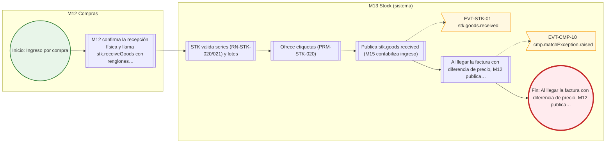

**Pasos del proceso** (actividad tomada del anexo; la columna RF/RN distingue lo citado en el paso de lo asociado por parámetro, permiso, evento o tema compartido).

| Paso | Carril | Actividad | RF/RN que aplican | EVT / JOB / PAN |
|---|---|---|---|---|
| 1 | M12 Compras | M12 confirma la recepción física y llama `stk.receiveGoods` con renglones, cantidades, series/lotes y costo de OC/remito (`Idempotency-Key` = id de recepción). | — | — |
| 2 | M13 Stock | STK valida series (RN-STK-020/021) y lotes; crea `stockDocument` `purchaseReceipt` `posted`, movimientos `in` al depósito de recepción con `stockState = available`, actualiza costo perpetuo (RN-STK-028/029) y crea `serialUnits`. | RN-STK-020, RN-STK-028; asoc.: RF-STK-139 | — |
| 3 | M13 Stock | Ofrece etiquetas (PRM-STK-020). Si el artículo es bien de uso, crea `fixedAssets` en `draft` (RN-STK-047). | RN-STK-047 | — |
| 4 | M13 Stock | Publica `stk.goods.received` (M15 contabiliza ingreso; M12 cierra pendiente). | — | EVT-STK-01 |
| 5 | M13 Stock | Al llegar la factura con diferencia de precio, M12 publica `cmp.matchException.raised` (EVT-CMP-10, tipo `price`) y STK registra el movimiento de valor (RN-STK-030). | RN-STK-030 | EVT-CMP-10 |

**Situación actual en ProCoop (nota de cambio).** Sin contraste específico para este proceso en el anexo (filas `CTR-` con ProCoop) ni en el análisis de brechas. El contraste del dominio está en `15-analisis-brechas-procoop.md` §3.15.

**Excepciones**

| Excepción | Tratamiento |
|---|---|
| Si el artículo es bien de uso | crea `fixedAssets` en `draft` (RN-STK-047) |
| Falla técnica en un paso automático, un job o una integración | Reintento idempotente y reanudable; lo no reparable pasa a la bandeja técnica con responsable (política de recuperación de M13 §9.13; AGR-016). |

---

## 8. PRC-STK-02 Instalación de Internet con equipo en comodato (O3, CU-INS-01, INS-004)

| Campo | Contenido |
|---|---|
| Fuente | M13 §9.2, `M13-STK-stock-activos-fabricacion.md` (línea 1591); ola O3 |
| Macroproceso | MP-14 Operación técnica, redes y stock |
| Disparador | Instalación de Internet con equipo en comodato |
| Resultado | Resultado por ítem a la app; reintento seguro |
| Carriles | M10 Técnica y campo; Técnico (campo) (T-TEC); M13 Stock (sistema) |
| Roles de T02 | T-TEC Técnico (campo) |
| Módulos involucrados | M10 Técnica y campo, M13 Stock |
| Eventos (T11 §12) | EVT-TEC-05 `tec.workOrder.statusChanged`; EVT-STK-04 `stk.equipment.applied`; EVT-STK-02 `stk.materials.consumed` |
| Jobs | — |
| Relación con 04-procesos-bpmn.md | P6 Reclamo y orden de trabajo ([§10](04-procesos-bpmn.md#10-p6--reclamo-y-orden-de-trabajo)) |

```mermaid
flowchart LR
  subgraph L_LM10["M10 Técnica y campo"]
    ni(("Inicio: Instalación de Internet con equipo en comodato"))
    ns1[["M10 crea la OT y publica tec.workOrder.statusChanged (EVT-TEC-05, estado…)"]]
    ne1>"EVT-TEC-05 tec.workOrder.statusChanged"]
  end
  subgraph L_LTTEC["Técnico (campo) (T-TEC)"]
    ns2["Entrega al instalador: el encargado emite crewDelivery (o el técnico ya tiene…)"]
    ns3["El técnico informa En camino (M10)"]
  end
  subgraph L_LSIS["M13 Stock (sistema)"]
    ns4[["En el domicilio escanea la serie y la MAC"]]
    ns5[["Al sincronizar (POST /api/stk/field/sync), STK por cada mutación"]]
    nx6{"¿Es válida?"}
    ns6[["Documento equipmentApplication (unidad inCustody → applied, ubicación…)"]]
    ns7[["Publica stk.equipment.applied (M10 aprovisiona OLT/Radius con MAC/GPON SN)"]]
    ne7>"EVT-STK-04 stk.equipment.applied; EVT-STK-02 stk.materials.consumed"]
    ns8[["Resultado por ítem a la app; reintento seguro"]]
    nx9{"¿La visita falla?"}
    ns9[["La app envía visitFailed"]]
    nf(("Fin: Resultado por ítem a la app; reintento seguro"))
  end
  ni --> ns1
  ns1 -.-> ne1
  ns1 --> ns2
  ns2 --> ns3
  ns3 --> ns4
  ns4 --> ns5
  ns5 --> nx6
  nx6 -->|"Sí"| ns6
  ns6 --> ns7
  nx6 -->|"No"| ns7
  ns7 -.-> ne7
  ns7 --> ns8
  ns8 --> nx9
  nx9 -->|"Sí"| ns9
  ns9 --> nf
  nx9 -->|"No"| nf
  classDef inicio fill:#e8f5e9,stroke:#2e7d32,stroke-width:2px
  classDef fin fill:#ffebee,stroke:#c62828,stroke-width:4px
  classDef evento fill:#fff8e1,stroke:#f9a825
  classDef temporizador fill:#e3f2fd,stroke:#1565c0
  class ni inicio
  class nf fin
  class ne1,ne7 evento
```

**Pasos del proceso** (actividad tomada del anexo; la columna RF/RN distingue lo citado en el paso de lo asociado por parámetro, permiso, evento o tema compartido).

| Paso | Carril | Actividad | RF/RN que aplican | EVT / JOB / PAN |
|---|---|---|---|---|
| 1 | M10 Técnica y campo | M10 crea la OT y publica `tec.workOrder.statusChanged` (EVT-TEC-05, estado agendada); STK crea la reserva por modelo o por serie según PRM-STK-050 (`active`). | — | EVT-TEC-05 |
| 2 | Técnico | Entrega al instalador: el encargado emite `crewDelivery` (o el técnico ya tiene stock rodante); la unidad pasa a `inTransit`; el técnico acepta en la app (`inCustody`). Depósito central −1; custodia técnico +1; existencia total sin cambio. | asoc.: RF-STK-059 | — |
| 3 | Técnico | El técnico informa En camino (M10). Sin conexión, la app conserva "Mi stock" y la OT descargada. | — | — |
| 4 | M13 Stock | En el domicilio escanea la serie y la MAC; registra materiales usados (cable drop, conectores). La app encola en IndexedDB una mutación `applyEquipment` y una `consumeMaterials` con `clientMutationId` propios, vinculadas a la versión de la OT. | asoc.: RF-STK-068, RF-STK-061 | — |
| 5 | M13 Stock | Al sincronizar (`POST /api/stk/field/sync`), STK por cada mutación: verifica idempotencia; valida custodia (RN-STK-014/017), compatibilidad (RN-STK-019) y estado de la OT; si la OT está cancelada o reasignada, marca `conflict` (RF-STK-067). | RF-STK-067, RN-STK-014, RN-STK-019 | — |
| 6 | M13 Stock | Si es válida: documento `equipmentApplication` (unidad `inCustody` → `applied`, ubicación `customerPremisesPool` + `contractId`), M02 registra la asignación `active` en `contractEquipmentAssignments` con `mode = loanForUse` (CTR-DAT-28; antes `equipmentAssignments` de M13), consumo de la reserva; documento `workOrderConsumption` por materiales desde la custodia del técnico. | asoc.: RF-STK-139, RF-STK-072 | — |
| 7 | M13 Stock | Publica `stk.equipment.applied` (M10 aprovisiona OLT/Radius con MAC/GPON SN; M10 vincula a la conformidad) y `stk.materials.consumed` (M15 costo con destino OT, servicio Internet y centro de costo). | asoc.: RF-STK-062 | EVT-STK-04, EVT-STK-02 |
| 8 | M13 Stock | Resultado por ítem a la app; reintento seguro. Una segunda sincronización del mismo cierre devuelve los resultados originales (escenario 70). | — | — |
| 9 | M13 Stock | Si la visita falla: la app envía `visitFailed`; no hay aplicación; la reserva se mantiene o libera según la reprogramación (RN-STK-016). | RN-STK-016 | — |

**Situación actual en ProCoop (nota de cambio).** Sin contraste específico para este proceso en el anexo (filas `CTR-` con ProCoop) ni en el análisis de brechas. El contraste del dominio está en `15-analisis-brechas-procoop.md` §3.15.

**Excepciones**

| Excepción | Tratamiento |
|---|---|
| Si la OT está cancelada o reasignada | marca `conflict` (RF-STK-067) |
| Si es válida | documento `equipmentApplication` (unidad `inCustody` → `applied`, ubicación `customerPremisesPool` + `contractId`), M02 registra la asignación `active` en `contractEquipmentAssignments` con `mode = loanForUse` (CTR-DAT-28; antes `equipmentAssignments` de M13), consumo de la reserva; documento `workOrderConsumption` por materiales desde la custodia del técnico |
| Reintento | Resultado por ítem a la app; reintento seguro |
| Si la visita falla | la app envía `visitFailed`; no hay aplicación; la reserva se mantiene o libera según la reprogramación (RN-STK-016) |
| Falla técnica en un paso automático, un job o una integración | Reintento idempotente y reanudable; lo no reparable pasa a la bandeja técnica con responsable (política de recuperación de M13 §9.13; AGR-016). |

---

## 9. PRC-STK-03 Consumo de materiales desde la OT (CU-20)

| Campo | Contenido |
|---|---|
| Fuente | M13 §9.3, `M13-STK-stock-activos-fabricacion.md` (línea 1603) |
| Macroproceso | MP-14 Operación técnica, redes y stock |
| Disparador | Consumo de materiales desde la OT |
| Resultado | Rendición: entregado 4 − consumido 3 − devuelto 1 = 0 |
| Carriles | M13 Stock (sistema); Técnico (campo) (T-TEC) |
| Roles de T02 | T-TEC Técnico (campo) |
| Módulos involucrados | M13 Stock |
| Eventos (T11 §12) | — |
| Jobs | — |
| Relación con 04-procesos-bpmn.md | P6 Reclamo y orden de trabajo ([§10](04-procesos-bpmn.md#10-p6--reclamo-y-orden-de-trabajo)) |

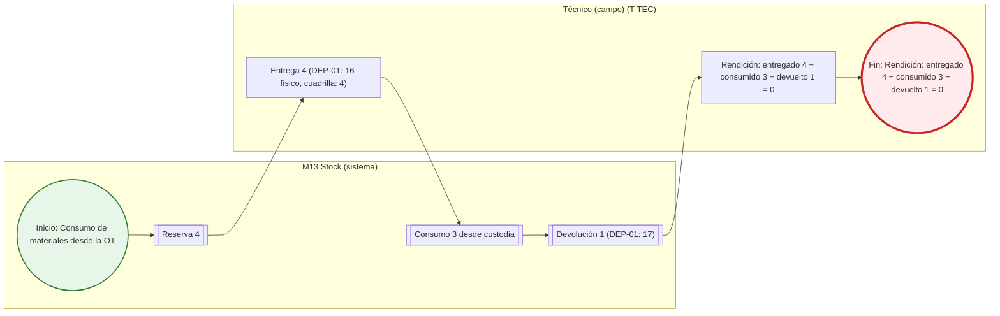

**Pasos del proceso** (actividad tomada del anexo; la columna RF/RN distingue lo citado en el paso de lo asociado por parámetro, permiso, evento o tema compartido).

| Paso | Carril | Actividad | RF/RN que aplican | EVT / JOB / PAN |
|---|---|---|---|---|
| 1 | M13 Stock | Reserva 4 | — | — |
| 2 | Técnico | entrega 4 (DEP-01: 16 físico, cuadrilla: 4) | — | — |
| 3 | M13 Stock | consumo 3 desde custodia | — | — |
| 4 | M13 Stock | devolución 1 (DEP-01: 17) | — | — |
| 5 | Técnico | rendición: entregado 4 − consumido 3 − devuelto 1 = 0. Si el técnico declara 3 pero en la rendición cuenta 0 sobrante sin devolución, se registra faltante 1 con evidencia y ajuste aprobado (RN-STK-041) | RN-STK-041; asoc.: RF-STK-066, RF-STK-027 | — |

**Situación actual en ProCoop (nota de cambio).** Sin contraste específico para este proceso en el anexo (filas `CTR-` con ProCoop) ni en el análisis de brechas. El contraste del dominio está en `15-analisis-brechas-procoop.md` §3.15.

**Excepciones**

| Excepción | Tratamiento |
|---|---|
| Si el técnico declara 3 pero en la rendición cuenta 0 sobrante sin devolución | se registra faltante 1 con evidencia y ajuste aprobado (RN-STK-041) |
| Falla técnica en un paso automático, un job o una integración | Reintento idempotente y reanudable; lo no reparable pasa a la bandeja técnica con responsable (política de recuperación de M13 §9.13; AGR-016). |

---

## 10. PRC-STK-04 Retiro de equipo en baja (Internet)

| Campo | Contenido |
|---|---|
| Fuente | M13 §9.4, `M13-STK-stock-activos-fabricacion.md` (línea 1607) |
| Macroproceso | MP-14 Operación técnica, redes y stock |
| Disparador | Retiro de equipo en baja |
| Resultado | El técnico devuelve al depósito |
| Carriles | M09 Atención; Técnico (campo) (T-TEC); M13 Stock (sistema) |
| Roles de T02 | T-TEC Técnico (campo) |
| Módulos involucrados | M02 Catálogo y contratos, M09 Atención, M13 Stock |
| Eventos (T11 §12) | EVT-CAT-15 `cat.contract.terminated` |
| Jobs | JOB-STK-05 `stk:devoluciones-vencidas` |
| Relación con 04-procesos-bpmn.md | P6 Reclamo y orden de trabajo ([§10](04-procesos-bpmn.md#10-p6--reclamo-y-orden-de-trabajo)) |

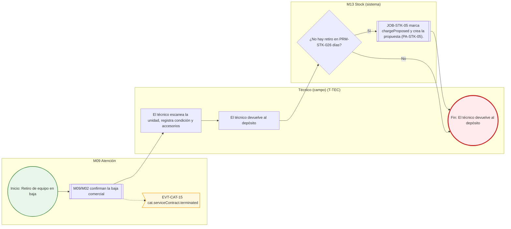

**Pasos del proceso** (actividad tomada del anexo; la columna RF/RN distingue lo citado en el paso de lo asociado por parámetro, permiso, evento o tema compartido).

| Paso | Carril | Actividad | RF/RN que aplican | EVT / JOB / PAN |
|---|---|---|---|---|
| 1 | M09 Atención | M09/M02 confirman la baja comercial; M02 publica `cat.contract.terminated` (EVT-CAT-15; antes citado como `cat.serviceContract.terminated`, que no está en el catálogo de T11); STK pasa la asignación a `pendingReturn` y M10 genera la OT de retiro. | — | EVT-CAT-15 |
| 2 | Técnico | El técnico escanea la unidad, registra condición y accesorios; sincroniza → `equipmentRetrieval`; unidad `retrievedPendingReview` en custodia del técnico; asignación `returned`/`returnedIncomplete`. | asoc.: RF-STK-071 | — |
| 3 | Técnico | El técnico devuelve al depósito; el responsable revisa (RF-STK-113). | RF-STK-113 | — |
| 4 | M13 Stock | Si no hay retiro en PRM-STK-026 días: JOB-STK-05 marca `chargeProposed` y crea la propuesta (PA-STK-05). | asoc.: RF-STK-078 | JOB-STK-05 |

**Situación actual en ProCoop (nota de cambio).** Sin contraste específico para este proceso en el anexo (filas `CTR-` con ProCoop) ni en el análisis de brechas. El contraste del dominio está en `15-analisis-brechas-procoop.md` §3.15.

**Excepciones**

| Excepción | Tratamiento |
|---|---|
| Si no hay retiro en PRM-STK-026 días | JOB-STK-05 marca `chargeProposed` y crea la propuesta (PA-STK-05) |
| Falla técnica en un paso automático, un job o una integración | Reintento idempotente y reanudable; lo no reparable pasa a la bandeja técnica con responsable (política de recuperación de M13 §9.13; AGR-016). |

---

## 11. PRC-STK-05 Cambio de equipo por falla

| Campo | Contenido |
|---|---|
| Fuente | M13 §9.5, `M13-STK-stock-activos-fabricacion.md` (línea 1614) |
| Macroproceso | MP-14 Operación técnica, redes y stock |
| Disparador | Cambio de equipo por falla |
| Resultado | Publica stk.equipment.swapped con identificadores de A y B |
| Carriles | M13 Stock (sistema) |
| Roles de T02 | Solo actores del sistema (sin rol humano) |
| Módulos involucrados | M13 Stock |
| Eventos (T11 §12) | EVT-STK-06 `stk.equipment.swapped` |
| Jobs | — |
| Relación con 04-procesos-bpmn.md | P6 Reclamo y orden de trabajo ([§10](04-procesos-bpmn.md#10-p6--reclamo-y-orden-de-trabajo)) |

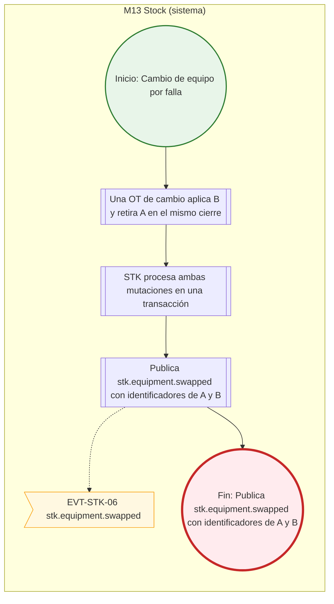

**Pasos del proceso** (actividad tomada del anexo; la columna RF/RN distingue lo citado en el paso de lo asociado por parámetro, permiso, evento o tema compartido).

| Paso | Carril | Actividad | RF/RN que aplican | EVT / JOB / PAN |
|---|---|---|---|---|
| 1 | M13 Stock | Una OT de cambio aplica B y retira A en el mismo cierre | — | — |
| 2 | M13 Stock | STK procesa ambas mutaciones en una transacción | — | — |
| 3 | M13 Stock | publica `stk.equipment.swapped` con identificadores de A y B; A queda en revisión y típicamente pasa a RMA | asoc.: RF-STK-081 | EVT-STK-06 |

**Situación actual en ProCoop (nota de cambio).** Sin contraste específico para este proceso en el anexo (filas `CTR-` con ProCoop) ni en el análisis de brechas. El contraste del dominio está en `15-analisis-brechas-procoop.md` §3.15.

**Excepciones**

| Excepción | Tratamiento |
|---|---|
| Falla técnica en un paso automático, un job o una integración | Reintento idempotente y reanudable; lo no reparable pasa a la bandeja técnica con responsable (política de recuperación de M13 §9.13; AGR-016). |

---

## 12. PRC-STK-06 Rendición de cuadrilla (JOB-STK-04 y manual)

| Campo | Contenido |
|---|---|
| Fuente | M13 §9.6, `M13-STK-stock-activos-fabricacion.md` (línea 1618) |
| Macroproceso | MP-14 Operación técnica, redes y stock |
| Disparador | Rendición de cuadrilla |
| Resultado | Diferencias → ajustes con motivo (faltante imputable/no…) |
| Carriles | M13 Stock (sistema); Técnico (campo) (T-TEC) |
| Roles de T02 | T-TEC Técnico (campo) |
| Módulos involucrados | M13 Stock |
| Eventos (T11 §12) | — |
| Jobs | — |
| Relación con 04-procesos-bpmn.md | P6 Reclamo y orden de trabajo ([§10](04-procesos-bpmn.md#10-p6--reclamo-y-orden-de-trabajo)) |

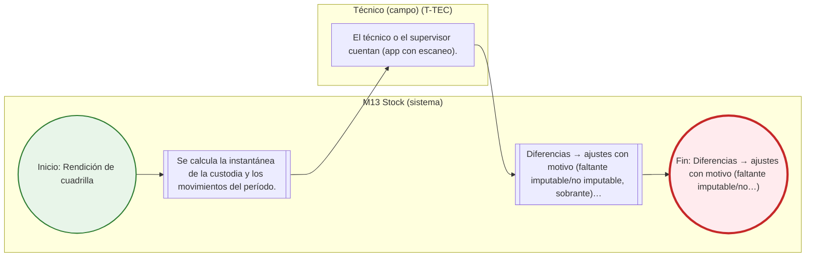

**Pasos del proceso** (actividad tomada del anexo; la columna RF/RN distingue lo citado en el paso de lo asociado por parámetro, permiso, evento o tema compartido).

| Paso | Carril | Actividad | RF/RN que aplican | EVT / JOB / PAN |
|---|---|---|---|---|
| 1 | M13 Stock | Se calcula la instantánea de la custodia y los movimientos del período. | — | — |
| 2 | Técnico | El técnico o el supervisor cuentan (app con escaneo). | — | — |
| 3 | M13 Stock | Diferencias → ajustes con motivo (faltante imputable/no imputable, sobrante) → aprobación → cierre. | asoc.: RF-STK-084 | — |

**Situación actual en ProCoop (nota de cambio).** Sin contraste específico para este proceso en el anexo (filas `CTR-` con ProCoop) ni en el análisis de brechas. El contraste del dominio está en `15-analisis-brechas-procoop.md` §3.15.

**Excepciones**

| Excepción | Tratamiento |
|---|---|
| Falla técnica en un paso automático, un job o una integración | Reintento idempotente y reanudable; lo no reparable pasa a la bandeja técnica con responsable (política de recuperación de M13 §9.13; AGR-016). |

---

## 13. PRC-STK-07 Inventario físico

| Campo | Contenido |
|---|---|
| Fuente | M13 §9.7, `M13-STK-stock-activos-fabricacion.md` (línea 1624) |
| Macroproceso | MP-14 Operación técnica, redes y stock |
| Disparador | Inventario físico |
| Resultado | Evento stk.physicalCount.closed |
| Carriles | M13 Stock (sistema) |
| Roles de T02 | Solo actores del sistema (sin rol humano) |
| Módulos involucrados | M13 Stock |
| Eventos (T11 §12) | EVT-STK-16 `stk.physicalCount.closed` |
| Jobs | — |
| Relación con 04-procesos-bpmn.md | P6 Reclamo y orden de trabajo ([§10](04-procesos-bpmn.md#10-p6--reclamo-y-orden-de-trabajo)) |

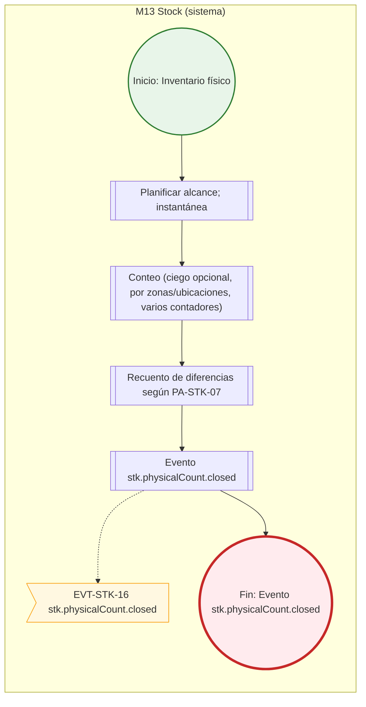

**Pasos del proceso** (actividad tomada del anexo; la columna RF/RN distingue lo citado en el paso de lo asociado por parámetro, permiso, evento o tema compartido).

| Paso | Carril | Actividad | RF/RN que aplican | EVT / JOB / PAN |
|---|---|---|---|---|
| 1 | M13 Stock | Planificar alcance; instantánea | — | — |
| 2 | M13 Stock | conteo (ciego opcional, por zonas/ubicaciones, varios contadores) | — | — |
| 3 | M13 Stock | recuento de diferencias según PA-STK-07; revisión; ajuste aprobado; cierre | asoc.: RF-STK-083 | — |
| 4 | M13 Stock | evento `stk.physicalCount.closed` | — | EVT-STK-16 |

**Situación actual en ProCoop (nota de cambio).** Sin contraste específico para este proceso en el anexo (filas `CTR-` con ProCoop) ni en el análisis de brechas. El contraste del dominio está en `15-analisis-brechas-procoop.md` §3.15.

**Excepciones**

| Excepción | Tratamiento |
|---|---|
| Falla técnica en un paso automático, un job o una integración | Reintento idempotente y reanudable; lo no reparable pasa a la bandeja técnica con responsable (política de recuperación de M13 §9.13; AGR-016). |

---

## 14. PRC-STK-08 Reposición por stock mínimo (JOB-STK-03, diario)

| Campo | Contenido |
|---|---|
| Fuente | M13 §9.8, `M13-STK-stock-activos-fabricacion.md` (línea 1628) |
| Macroproceso | MP-14 Operación técnica, redes y stock |
| Disparador | Reposición por stock mínimo |
| Resultado | Guarda requisitionId |
| Carriles | M13 Stock (sistema) |
| Roles de T02 | Solo actores del sistema (sin rol humano) |
| Módulos involucrados | M13 Stock |
| Eventos (T11 §12) | — |
| Jobs | JOB-STK-03 `stk:sugerir-reposicion` |
| Relación con 04-procesos-bpmn.md | P6 Reclamo y orden de trabajo ([§10](04-procesos-bpmn.md#10-p6--reclamo-y-orden-de-trabajo)) |

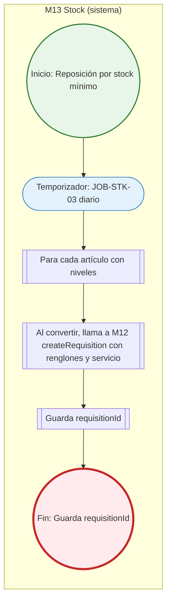

**Pasos del proceso** (actividad tomada del anexo; la columna RF/RN distingue lo citado en el paso de lo asociado por parámetro, permiso, evento o tema compartido).

| Paso | Carril | Actividad | RF/RN que aplican | EVT / JOB / PAN |
|---|---|---|---|---|
| 1 | M13 Stock | Para cada artículo con niveles: calcula RN-STK-043, crea/actualiza `reorderSuggestions` `open`, notifica a compras | RN-STK-043 | — |
| 2 | M13 Stock | al convertir, llama a M12 `createRequisition` con renglones y servicio | — | — |
| 3 | M13 Stock | guarda `requisitionId` | — | — |

**Situación actual en ProCoop (nota de cambio).** Sin contraste específico para este proceso en el anexo (filas `CTR-` con ProCoop) ni en el análisis de brechas. El contraste del dominio está en `15-analisis-brechas-procoop.md` §3.15.

**Excepciones**

| Excepción | Tratamiento |
|---|---|
| Falla técnica en un paso automático, un job o una integración | Reintento idempotente y reanudable; lo no reparable pasa a la bandeja técnica con responsable (política de recuperación de M13 §9.13; AGR-016). |

---

## 15. PRC-STK-09 Valorización, revaluación y cierre de stock

| Campo | Contenido |
|---|---|
| Fuente | M13 §9.9, `M13-STK-stock-activos-fabricacion.md` (línea 1632) |
| Macroproceso | MP-14 Operación técnica, redes y stock |
| Disparador | Valorización, revaluación y cierre de stock |
| Resultado | Revaluación: borrador → cálculo de factores (RN-STK-033) →… |
| Carriles | M13 Stock (sistema) |
| Roles de T02 | Solo actores del sistema (sin rol humano) |
| Módulos involucrados | M13 Stock |
| Eventos (T11 §12) | — |
| Jobs | JOB-STK-06 `stk:preparar-cierre`; JOB-STK-01 `stk:verificar-saldos` |
| Relación con 04-procesos-bpmn.md | P6 Reclamo y orden de trabajo ([§10](04-procesos-bpmn.md#10-p6--reclamo-y-orden-de-trabajo)) |

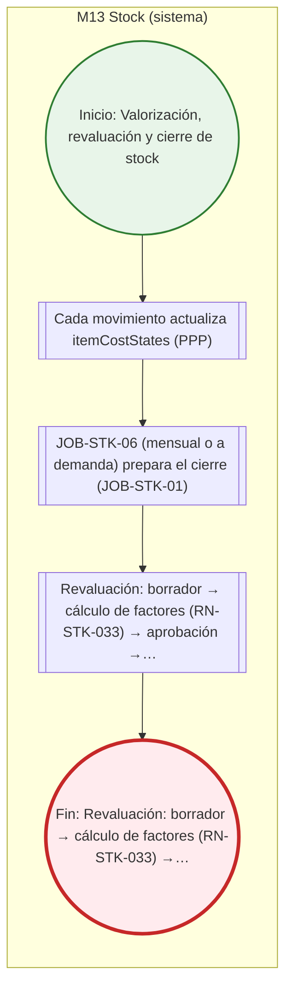

**Pasos del proceso** (actividad tomada del anexo; la columna RF/RN distingue lo citado en el paso de lo asociado por parámetro, permiso, evento o tema compartido).

| Paso | Carril | Actividad | RF/RN que aplican | EVT / JOB / PAN |
|---|---|---|---|---|
| 1 | M13 Stock | Cada movimiento actualiza `itemCostStates` (PPP: nuevo promedio = (valor + entrada) / (cantidad + entrada); PEPS: capas). | — | — |
| 2 | M13 Stock | JOB-STK-06 (mensual o a demanda) prepara el cierre: verifica saldos (JOB-STK-01), movimientos con costo provisorio, conflictos pendientes; el responsable cierra el período `stk` (T04/M15). | asoc.: RN-STK-005 | JOB-STK-06, JOB-STK-01 |
| 3 | M13 Stock | Revaluación: borrador → cálculo de factores (RN-STK-033) → aprobación → movimientos de valor → evento. | RN-STK-033 | — |

**Situación actual en ProCoop (nota de cambio).** Sin contraste específico para este proceso en el anexo (filas `CTR-` con ProCoop) ni en el análisis de brechas. El contraste del dominio está en `15-analisis-brechas-procoop.md` §3.15.

**Excepciones**

| Excepción | Tratamiento |
|---|---|
| Conflicto | JOB-STK-06 (mensual o a demanda) prepara el cierre: verifica saldos (JOB-STK-01), movimientos con costo provisorio, conflictos pendientes; el responsable cierra el período `stk` (T04/M15) |
| Falla técnica en un paso automático, un job o una integración | Reintento idempotente y reanudable; lo no reparable pasa a la bandeja técnica con responsable (política de recuperación de M13 §9.13; AGR-016). |

---

## 16. PRC-STK-10 Amortización de bienes de uso (JOB-STK-07)

| Campo | Contenido |
|---|---|
| Fuente | M13 §9.10, `M13-STK-stock-activos-fabricacion.md` (línea 1638) |
| Macroproceso | MP-14 Operación técnica, redes y stock |
| Disparador | Amortización de bienes de uso |
| Resultado | Idempotente por (periodFrom, periodTo, type) contabilizado. |
| Carriles | M13 Stock (sistema) |
| Roles de T02 | Solo actores del sistema (sin rol humano) |
| Módulos involucrados | M13 Stock |
| Eventos (T11 §12) | EVT-STK-18 `stk.depreciation.posted` |
| Jobs | — |
| Relación con 04-procesos-bpmn.md | P6 Reclamo y orden de trabajo ([§10](04-procesos-bpmn.md#10-p6--reclamo-y-orden-de-trabajo)) |

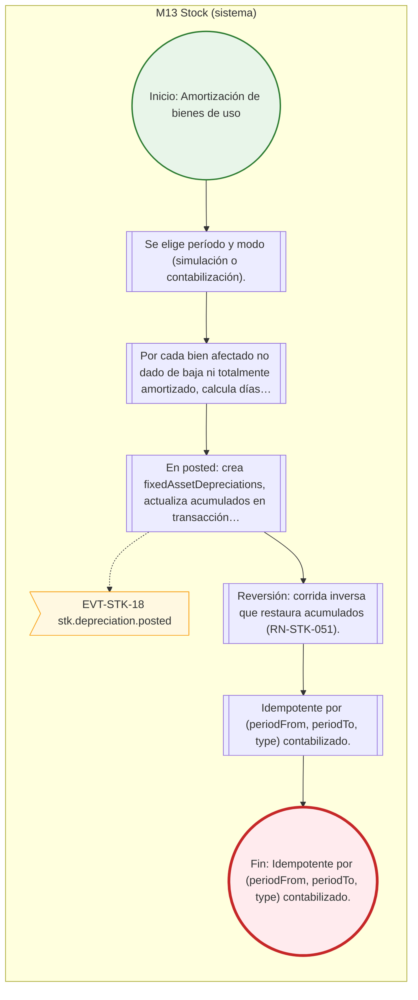

**Pasos del proceso** (actividad tomada del anexo; la columna RF/RN distingue lo citado en el paso de lo asociado por parámetro, permiso, evento o tema compartido).

| Paso | Carril | Actividad | RF/RN que aplican | EVT / JOB / PAN |
|---|---|---|---|---|
| 1 | M13 Stock | Se elige período y modo (simulación o contabilización). | — | — |
| 2 | M13 Stock | Por cada bien afectado no dado de baja ni totalmente amortizado, calcula días y monto (RN-STK-048/049), separa mejoras, aplica distribución por centros (RN-STK-053), valores históricos/ajustados (RN-STK-050). | RN-STK-048, RN-STK-050, RN-STK-053; asoc.: RF-STK-103 | — |
| 3 | M13 Stock | En `posted`: crea `fixedAssetDepreciations`, actualiza acumulados en transacción, publica `stk.depreciation.posted` (M15 genera el asiento y devuelve `journalRef`). | asoc.: RF-STK-102 | EVT-STK-18 |
| 4 | M13 Stock | Reversión: corrida inversa que restaura acumulados (RN-STK-051). | RN-STK-051; asoc.: RF-STK-102 | — |
| 5 | M13 Stock | Idempotente por `{periodFrom, periodTo, type}` contabilizado. | — | — |

**Situación actual en ProCoop (nota de cambio).** Sin contraste específico para este proceso en el anexo (filas `CTR-` con ProCoop) ni en el análisis de brechas. El contraste del dominio está en `15-analisis-brechas-procoop.md` §3.15.

**Excepciones**

| Excepción | Tratamiento |
|---|---|
| Cancelación, anulación o reversión | Reversión: corrida inversa que restaura acumulados (RN-STK-051) |
| Falla técnica en un paso automático, un job o una integración | Reintento idempotente y reanudable; lo no reparable pasa a la bandeja técnica con responsable (política de recuperación de M13 §9.13; AGR-016). |

---

## 17. PRC-STK-11 RMA

| Campo | Contenido |
|---|---|
| Fuente | M13 §9.11, `M13-STK-stock-activos-fabricacion.md` (línea 1648) |
| Macroproceso | MP-14 Operación técnica, redes y stock |
| Disparador | RMA |
| Resultado | Cierre. M12 gestiona nota de crédito o reposición |
| Carriles | M13 Stock (sistema); Depósito (T-DEP); M12 Compras |
| Roles de T02 | T-DEP Depósito |
| Módulos involucrados | M12 Compras, M13 Stock |
| Eventos (T11 §12) | — |
| Jobs | — |
| Relación con 04-procesos-bpmn.md | P6 Reclamo y orden de trabajo ([§10](04-procesos-bpmn.md#10-p6--reclamo-y-orden-de-trabajo)) |

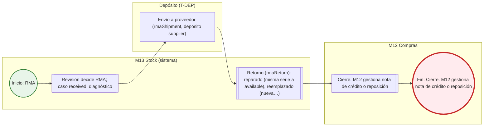

**Pasos del proceso** (actividad tomada del anexo; la columna RF/RN distingue lo citado en el paso de lo asociado por parámetro, permiso, evento o tema compartido).

| Paso | Carril | Actividad | RF/RN que aplican | EVT / JOB / PAN |
|---|---|---|---|---|
| 1 | M13 Stock | Revisión decide RMA; caso `received`; diagnóstico | — | — |
| 2 | Depósito | envío a proveedor (`rmaShipment`, depósito `supplier`) | — | — |
| 3 | M13 Stock | retorno (`rmaReturn`): reparado (misma serie a `available`), reemplazado (nueva unidad, RN-STK-056; la original `replacedBySupplier`), rechazado (`quarantine`/`scrapped`) | RN-STK-056; asoc.: RF-STK-110 | — |
| 4 | M12 Compras | cierre. M12 gestiona nota de crédito o reposición | — | — |

**Situación actual en ProCoop (nota de cambio).** Sin contraste específico para este proceso en el anexo (filas `CTR-` con ProCoop) ni en el análisis de brechas. El contraste del dominio está en `15-analisis-brechas-procoop.md` §3.15.

**Excepciones**

| Excepción | Tratamiento |
|---|---|
| Rechazo | Revisión decide RMA; caso `received`; diagnóstico envío a proveedor (`rmaShipment`, depósito `supplier`) retorno (`rmaReturn`): reparado (misma serie a `available`), reemplazado (nueva unidad, RN-STK-056; la original `replacedBySupplier`), rechazado (`quarantine`/`scrapped`) cierre |
| Falla técnica en un paso automático, un job o una integración | Reintento idempotente y reanudable; lo no reparable pasa a la bandeja técnica con responsable (política de recuperación de M13 §9.13; AGR-016). |

---

## 18. PRC-STK-12 Fabricación (O10)

| Campo | Contenido |
|---|---|
| Fuente | M13 §9.12, `M13-STK-stock-activos-fabricacion.md` (línea 1652); ola O10 |
| Macroproceso | MP-14 Operación técnica, redes y stock |
| Disparador | Fabricación |
| Resultado | Eventos de productos en proceso y terminados (RF-STK-127) |
| Carriles | M13 Stock (sistema) |
| Roles de T02 | Solo actores del sistema (sin rol humano) |
| Módulos involucrados | M13 Stock |
| Eventos (T11 §12) | — |
| Jobs | JOB-STK-08 `stk:mrp` |
| Relación con 04-procesos-bpmn.md | P6 Reclamo y orden de trabajo ([§10](04-procesos-bpmn.md#10-p6--reclamo-y-orden-de-trabajo)) |

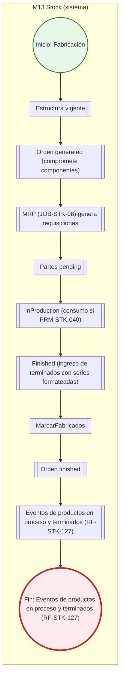

**Pasos del proceso** (actividad tomada del anexo; la columna RF/RN distingue lo citado en el paso de lo asociado por parámetro, permiso, evento o tema compartido).

| Paso | Carril | Actividad | RF/RN que aplican | EVT / JOB / PAN |
|---|---|---|---|---|
| 1 | M13 Stock | Estructura vigente | — | — |
| 2 | M13 Stock | orden `generated` (compromete componentes) | — | — |
| 3 | M13 Stock | MRP (JOB-STK-08) genera requisiciones; `launched` | — | JOB-STK-08 |
| 4 | M13 Stock | partes `pending` | — | — |
| 5 | M13 Stock | `inProduction` (consumo si PRM-STK-040) | — | — |
| 6 | M13 Stock | `finished` (ingreso de terminados con series formateadas) | — | — |
| 7 | M13 Stock | `MarcarFabricados` | asoc.: RN-STK-060, RF-STK-122 | — |
| 8 | M13 Stock | orden `finished` | — | — |
| 9 | M13 Stock | eventos de productos en proceso y terminados (RF-STK-127). Dañados: cambio de producto, destrucción o reasignación vía orden genérica (PRM-STK-047) | RF-STK-127; asoc.: RF-STK-123 | — |

**Situación actual en ProCoop (nota de cambio).** Sin contraste específico para este proceso en el anexo (filas `CTR-` con ProCoop) ni en el análisis de brechas. El contraste del dominio está en `15-analisis-brechas-procoop.md` §3.15.

**Excepciones**

| Excepción | Tratamiento |
|---|---|
| Falla técnica en un paso automático, un job o una integración | Reintento idempotente y reanudable; lo no reparable pasa a la bandeja técnica con responsable (política de recuperación de M13 §9.13; AGR-016). |

---

## 19. PRC-CMP-01 Circuito completo (CU-19)

| Campo | Contenido |
|---|---|
| Fuente | M12 §9.1, `M12-CMP-compras-proveedores.md` (línea 996) |
| Macroproceso | MP-15 Compras y proveedores |
| Disparador | Circuito completo |
| Resultado | Se prepara la OP, M06 calcula retenciones, se aprueba |
| Carriles | Depósito (T-DEP); T11 Workflow, eventos y documentos; Compras (T-CMP); M12 Compras (sistema) |
| Roles de T02 | T-CMP Compras, T-DEP Depósito |
| Módulos involucrados | M12 Compras, T11 Workflow, eventos y documentos |
| Eventos (T11 §12) | — |
| Jobs | — |
| Relación con 04-procesos-bpmn.md | P7 Compras y pago a proveedores ([§11](04-procesos-bpmn.md#11-p7--compras-y-pago-a-proveedores)) |

```mermaid
flowchart LR
  subgraph L_LTDEP["Depósito (T-DEP)"]
    ni(("Inicio: Circuito completo"))
    ns1["Depósito crea la SA de 10 medidores para reposición (línea con servicio…)"]
  end
  subgraph L_LT11["T11 Workflow, eventos y documentos"]
    ns2[["La SA se aprueba (T11)."]]
  end
  subgraph L_LTCMP["Compras (T-CMP)"]
    ns3["Compras genera cotizaciones a 3 proveedores"]
  end
  subgraph L_LSIS["M12 Compras (sistema)"]
    ns4[["Se crea OC-001 por 10 × ARS 20.000 = ARS 200.000"]]
    ns5[["Llegan 6: el receptor registra la recepción"]]
    ns6[["Llega la factura por 10"]]
    ns7[["Se decide: reclamar NC o esperar la entrega"]]
    ns8[["Se prepara la OP, M06 calcula retenciones, se aprueba"]]
    nf(("Fin: Se prepara la OP, M06 calcula retenciones, se aprueba"))
  end
  ni --> ns1
  ns1 --> ns2
  ns2 --> ns3
  ns3 --> ns4
  ns4 --> ns5
  ns5 --> ns6
  ns6 --> ns7
  ns7 --> ns8
  ns8 --> nf
  classDef inicio fill:#e8f5e9,stroke:#2e7d32,stroke-width:2px
  classDef fin fill:#ffebee,stroke:#c62828,stroke-width:4px
  classDef evento fill:#fff8e1,stroke:#f9a825
  classDef temporizador fill:#e3f2fd,stroke:#1565c0
  class ni inicio
  class nf fin
```

**Pasos del proceso** (actividad tomada del anexo; la columna RF/RN distingue lo citado en el paso de lo asociado por parámetro, permiso, evento o tema compartido).

| Paso | Carril | Actividad | RF/RN que aplican | EVT / JOB / PAN |
|---|---|---|---|---|
| 1 | Depósito | Depósito crea la SA de 10 medidores para reposición (línea con servicio "energía", centro de costo "redes"). | — | — |
| 2 | T11 Workflow, eventos y documentos | La SA se aprueba (T11). | — | — |
| 3 | Compras | Compras genera cotizaciones a 3 proveedores; compara y adjudica a ARS 20.000 por unidad. | — | — |
| 4 | M12 Compras | Se crea OC-001 por 10 × ARS 20.000 = ARS 200.000; aprobación por banda; envío al proveedor; compromiso de fondos. | — | — |
| 5 | M12 Compras | Llegan 6: el receptor registra la recepción; M13 ingresa 6 al depósito; OC queda con 4 pendientes. | asoc.: RF-CMP-060 | — |
| 6 | M12 Compras | Llega la factura por 10: la conciliación detecta excepción de cantidad por 4 (ARS 80.000 en disputa); la factura queda `onHold` o con habilitación parcial de ARS 120.000 según política. | — | — |
| 7 | M12 Compras | Se decide: reclamar NC o esperar la entrega; al recibirse las 4 restantes se cierra la excepción. | — | — |
| 8 | M12 Compras | Se prepara la OP, M06 calcula retenciones, se aprueba; M14 ejecuta; M12 marca pagado. | — | — |

**Situación actual en ProCoop (nota de cambio).** Sin contraste específico para este proceso en el anexo (filas `CTR-` con ProCoop) ni en el análisis de brechas. El contraste del dominio está en `15-analisis-brechas-procoop.md` §3.15.

**Excepciones**

| Excepción | Tratamiento |
|---|---|
| Falla técnica en un paso automático, un job o una integración | Reintento idempotente y reanudable; lo no reparable pasa a la bandeja técnica con responsable (política de recuperación de T11 P-WFL-01 y T01 §9.12; AGR-016). |

---

## 20. PRC-CMP-02 Orden de pago con retención (CU-FIS-01)

| Campo | Contenido |
|---|---|
| Fuente | M12 §9.2, `M12-CMP-compras-proveedores.md` (línea 1007) |
| Macroproceso | MP-15 Compras y proveedores |
| Disparador | Orden de pago con retención |
| Resultado | Factura cancelada por 100.000 (98.000 + 2.000) |
| Carriles | Proveedor (portal de proveedores) (C-PRV); M12 Compras (sistema); M06 Fiscal; M14 Tesorería |
| Roles de T02 | C-PRV Proveedor (portal de proveedores) |
| Módulos involucrados | M06 Fiscal, M12 Compras, M14 Tesorería |
| Eventos (T11 §12) | EVT-CMP-11 `cmp.paymentOrder.approved`; EVT-TES-15 `tes.paymentExecution.executed` |
| Jobs | — |
| Relación con 04-procesos-bpmn.md | P7 Compras y pago a proveedores ([§11](04-procesos-bpmn.md#11-p7--compras-y-pago-a-proveedores)) |

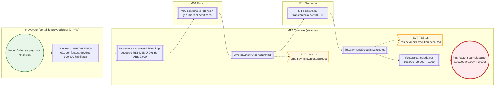

**Pasos del proceso** (actividad tomada del anexo; la columna RF/RN distingue lo citado en el paso de lo asociado por parámetro, permiso, evento o tema compartido).

| Paso | Carril | Actividad | RF/RN que aplican | EVT / JOB / PAN |
|---|---|---|---|---|
| 1 | Proveedor | Proveedor PROV-DEMO-001 con factura de ARS 100.000 habilitada; OP en borrador | — | — |
| 2 | M12 Compras | `fis.service.calculateWithholdings` (antes `fis.withholding.calculate`) devuelve RET-DEMO-001 por ARS 2.000; neto ARS 98.000; aprobación | asoc.: RF-CMP-101 | — |
| 3 | M06 Fiscal | M06 confirma la retención y numera el certificado | — | — |
| 4 | M12 Compras | `cmp.paymentOrder.approved` | asoc.: RF-CMP-104 | EVT-CMP-11 |
| 5 | M14 Tesorería | M14 ejecuta la transferencia por 98.000 | — | — |
| 6 | M12 Compras | `tes.paymentExecution.executed` | asoc.: RF-CMP-106 | EVT-TES-15 |
| 7 | M12 Compras | factura cancelada por 100.000 (98.000 + 2.000). Un reintento de la aprobación (misma Idempotency-Key) no genera otra retención | — | — |

**Situación actual en ProCoop (nota de cambio).** Sin contraste específico para este proceso en el anexo (filas `CTR-` con ProCoop) ni en el análisis de brechas. El contraste del dominio está en `15-analisis-brechas-procoop.md` §3.15.

**Excepciones**

| Excepción | Tratamiento |
|---|---|
| Cancelación, anulación o reversión | OP en borrador `fis.service.calculateWithholdings` (antes `fis.withholding.calculate`) devuelve RET-DEMO-001 por ARS 2.000; neto ARS 98.000; aprobación M06 confirma la retención y numera el certificado `cmp.paymentOrder.approved` M14 ejecuta la transferencia por 98.000 `tes.paymentExecution.executed` factura cancelada por 100.000 (98.000 + 2.000) |
| Reintento | Un reintento de la aprobación (misma Idempotency-Key) no genera otra retención |
| Falla técnica en un paso automático, un job o una integración | Reintento idempotente y reanudable; lo no reparable pasa a la bandeja técnica con responsable (política de recuperación de T11 P-WFL-01 y T01 §9.12; AGR-016). |

---

## Inconsistencias detectadas en la especificación (esta parte)

No se detectaron inconsistencias en los procesos de esta parte.

**Resueltas en la especificación vigente.** Observaciones de la versión anterior de esta parte que la corrección de la especificación (05-11-2026) ya resolvió; se conservan como registro y el diagrama sigue el texto corregido.

| Proceso | Observación anterior | Resolución en la especificación |
|---|---|---|
| PRC-STK-04 | Nombra el evento `cat.serviceContract.terminated`, que no figura en el catálogo de T11 §12.2 a §12.4. | M13 §9.4 publica ahora `cat.contract.terminated` (EVT-CAT-15) y deja el nombre anterior como "antes citado como". |

## Cobertura de esta parte

| Universo de la parte | Diagramados | Con nota ProCoop específica | Pendientes |
|---|---|---|---|
| 20 (PRC-TEC-07 a PRC-CMP-02) | 20 | 1 | 0 |
