# GoodApps Cooperativas

## Procesos de negocio — Compras y proveedores y Personal y sueldos y Institucional y servicios sociales (M12, M16, M17)

**Entregable de Análisis y Diseño Detallado — Artefacto 2.1 (Procesos de negocio BPMN). Parte de [`04-procesos-bpmn.md`](04-procesos-bpmn.md).**

| Dato | Valor |
|---|---|
| Documento | Diagramas BPMN, pasos, situación actual en ProCoop y excepciones de los procesos PRC-CMP-03 a PRC-INS-06, derivados de la sección 9 de M12, M16, M17 |
| Carácter | Derivado de la especificación vigente; no la reemplaza. Ante diferencias prevalecen la maestra `00`, los anexos, T05, T11 y el registro de decisiones `01` |
| Generación | Script `_trabajo/generar_bpmn.py` con la ampliación `_trabajo/generar_prc.py` (derivación automática desde el texto de la sección 9 de cada anexo, `_trabajo/prc_auto.py`) |
| Versión | 1.1 (regenerada contra la especificación corregida) |
| Fecha | 05-11-2026 |

**Cómo leer cada proceso.** La notación es la de [`04-procesos-bpmn.md` §3](04-procesos-bpmn.md#3-notación-equivalencia-mermaid--bpmn) (carriles, eventos de inicio y fin, tareas de usuario y de servicio, compuertas XOR y AND, eventos de dominio como banderas, temporizadores y jobs como estadios). La tabla de pasos reproduce la actividad del anexo; en la columna RF/RN, los identificadores sin prefijo son los que el anexo cita en el paso y los marcados "asoc." son reglas o requisitos del mismo anexo que comparten parámetro, permiso, evento o tema con el paso (asociación generada por el script y revisada). Los eventos se nombran con su ID del catálogo de T11 §12.

**Derivación automática (v1.2).** Los procesos `PRC-<MOD>-nn` de esta parte se generaron con `_trabajo/generar_prc.py` y `_trabajo/prc_auto.py` a partir del texto de cada subsección §9.n del anexo, sin curaduría paso a paso (a diferencia de los 94 procesos `P-XXX-nn` de las partes 04b a 04i). Reglas: (1) los pasos son los numerados o viñetas del anexo; si la subsección es prosa, se parte por flechas o por oraciones; si es una tabla de pasos o de jobs, cada fila es un paso; (2) el carril de cada paso es el primer actor nombrado al comienzo del paso (rol de T02 §4, otro módulo, sistema externo, dispositivo o job); si no se nombra ninguno, el paso es del sistema del módulo dueño; (3) los pasos que empiezan con "Si …" se dibujan como compuerta XOR; (4) los eventos son los nombres del catálogo de T11 §12 citados en el paso (bandera entrante si el paso los consume, saliente si los publica); el temporizador aparece cuando el título nombra un job periódico; (5) las excepciones son las oraciones del anexo con condición o con palabras de falla, rechazo, vencimiento, duplicado o umbral, más la política de recuperación del anexo; (6) la nota ProCoop combina lo que dice el propio anexo, la fila `CTR-` del anexo que contrasta con ProCoop y la fila de `15-analisis-brechas-procoop.md` §3 de mayor afinidad; si ninguna alcanza el umbral, la nota lo dice y remite al contraste del dominio en esa sección. La revisión manual de una muestra está en `_trabajo/prc_revision.md`; ante diferencias, prevalece el texto del anexo citado en la ficha.

## Índice de procesos de esta parte

1. [PRC-CMP-03 Factura anticipada y servicios](#1-prc-cmp-03-factura-anticipada-y-servicios)
2. [PRC-CMP-04 Importación de Mis Comprobantes](#2-prc-cmp-04-importación-de-mis-comprobantes)
3. [PRC-CMP-05 Lectura con IA](#3-prc-cmp-05-lectura-con-ia)
4. [PRC-CMP-06 Portal de proveedores](#4-prc-cmp-06-portal-de-proveedores)
5. [PRC-SUE-01 Alta de empleado](#5-prc-sue-01-alta-de-empleado)
6. [PRC-SUE-02 Configuración y publicación (AGR-009)](#6-prc-sue-02-configuración-y-publicación-agr-009)
7. [PRC-SUE-03 Aplicar aumentos](#7-prc-sue-03-aplicar-aumentos)
8. [PRC-SUE-04 Novedades desde órdenes de trabajo, cuadrillas y flota (CU-104 paso 1)](#8-prc-sue-04-novedades-desde-órdenes-de-trabajo-cuadrillas-y-flota-cu-104-paso-1)
9. [PRC-SUE-05 Licencias](#9-prc-sue-05-licencias)
10. [PRC-SUE-06 Liquidación mensual o quincenal (CU-104 pasos 2 y 3)](#10-prc-sue-06-liquidación-mensual-o-quincenal-cu-104-pasos-2-y-3)
11. [PRC-SUE-07 SAC, vacaciones, final, complementaria y rectificativa](#11-prc-sue-07-sac-vacaciones-final-complementaria-y-rectificativa)
12. [PRC-SUE-08 Ganancias y presentaciones](#12-prc-sue-08-ganancias-y-presentaciones)
13. [PRC-SUE-09 Pago de haberes (CU-104 paso 4)](#13-prc-sue-09-pago-de-haberes-cu-104-paso-4)
14. [PRC-SUE-10 Egreso](#14-prc-sue-10-egreso)
15. [PRC-SUE-11 Importación de liquidación externa (CU-28, O8)](#15-prc-sue-11-importación-de-liquidación-externa-cu-28-o8)
16. [PRC-INS-01 Ingreso de asociado](#16-prc-ins-01-ingreso-de-asociado)
17. [PRC-INS-02 Egreso](#17-prc-ins-02-egreso)
18. [PRC-INS-03 Registración de capital desde facturación y cobranza (O5 si se habilita)](#18-prc-ins-03-registración-de-capital-desde-facturación-y-cobranza-o5-si-se-habilita)
19. [PRC-INS-04 Revisión y cierre de capital](#19-prc-ins-04-revisión-y-cierre-de-capital)
20. [PRC-INS-05 Rescate / reembolso](#20-prc-ins-05-rescate--reembolso)
21. [PRC-INS-06 Distribución de excedentes](#21-prc-ins-06-distribución-de-excedentes)

---

## 1. PRC-CMP-03 Factura anticipada y servicios

| Campo | Contenido |
|---|---|
| Fuente | M12 §9.3, `M12-CMP-compras-proveedores.md` (línea 1011) |
| Macroproceso | MP-15 Compras y proveedores |
| Disparador | Factura anticipada y servicios |
| Resultado | Servicios: la conformidad del responsable reemplaza la recepción |
| Carriles | M12 Compras (sistema) |
| Roles de T02 | Solo actores del sistema (sin rol humano) |
| Módulos involucrados | M12 Compras |
| Eventos (T11 §12) | — |
| Jobs | — |
| Relación con 04-procesos-bpmn.md | P7 Compras y pago a proveedores ([§11](04-procesos-bpmn.md#11-p7--compras-y-pago-a-proveedores)) |

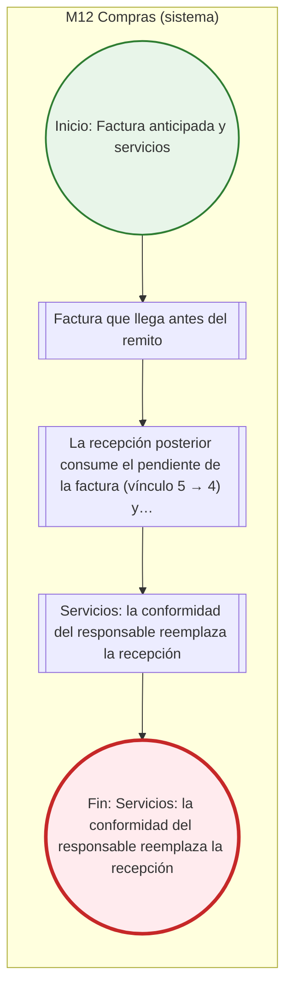

**Pasos del proceso** (actividad tomada del anexo; la columna RF/RN distingue lo citado en el paso de lo asociado por parámetro, permiso, evento o tema compartido).

| Paso | Carril | Actividad | RF/RN que aplican | EVT / JOB / PAN |
|---|---|---|---|---|
| 1 | M12 Compras | Factura que llega antes del remito: se registra, queda `onHold` (sin recepción) | — | — |
| 2 | M12 Compras | la recepción posterior consume el pendiente de la factura (vínculo 5 → 4) y la conciliación la libera | asoc.: RN-CMP-030 | — |
| 3 | M12 Compras | Servicios: la conformidad del responsable reemplaza la recepción | asoc.: RF-CMP-062 | — |

**Situación actual en ProCoop (nota de cambio).** Sin contraste específico para este proceso en el anexo (filas `CTR-` con ProCoop) ni en el análisis de brechas. El contraste del dominio está en `15-analisis-brechas-procoop.md` §3.15.

**Excepciones**

| Excepción | Tratamiento |
|---|---|
| Falla técnica en un paso automático, un job o una integración | Reintento idempotente y reanudable; lo no reparable pasa a la bandeja técnica con responsable (política de recuperación de T11 P-WFL-01 y T01 §9.12; AGR-016). |

---

## 2. PRC-CMP-04 Importación de Mis Comprobantes

| Campo | Contenido |
|---|---|
| Fuente | M12 §9.4, `M12-CMP-compras-proveedores.md` (línea 1015) |
| Macroproceso | MP-15 Compras y proveedores |
| Disparador | Importación de Mis Comprobantes |
| Resultado | La conciliación de M06 se actualiza |
| Carriles | M06 Fiscal; M12 Compras (sistema); Compras (T-CMP) |
| Roles de T02 | T-CMP Compras |
| Módulos involucrados | M06 Fiscal, M12 Compras |
| Eventos (T11 §12) | — |
| Jobs | JOB-FIS-12 `fis:conciliar-mis-comprobantes`; JOB-CMP-04 `cmp:borradores-mis-comprobantes` |
| Relación con 04-procesos-bpmn.md | P7 Compras y pago a proveedores ([§11](04-procesos-bpmn.md#11-p7--compras-y-pago-a-proveedores)) |

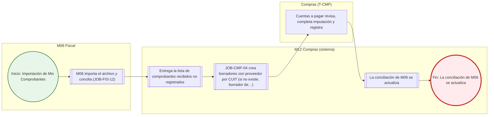

**Pasos del proceso** (actividad tomada del anexo; la columna RF/RN distingue lo citado en el paso de lo asociado por parámetro, permiso, evento o tema compartido).

| Paso | Carril | Actividad | RF/RN que aplican | EVT / JOB / PAN |
|---|---|---|---|---|
| 1 | M06 Fiscal | M06 importa el archivo y concilia (JOB-FIS-12) | — | JOB-FIS-12 |
| 2 | M12 Compras | entrega la lista de comprobantes recibidos no registrados | — | — |
| 3 | M12 Compras | `JOB-CMP-04` crea borradores con proveedor por CUIT (si no existe, borrador de proveedor con datos del padrón) | — | JOB-CMP-04 |
| 4 | Compras | cuentas a pagar revisa, completa imputación y registra | — | — |
| 5 | M12 Compras | la conciliación de M06 se actualiza | — | — |

**Situación actual en ProCoop (nota de cambio).** Sin contraste específico para este proceso en el anexo (filas `CTR-` con ProCoop) ni en el análisis de brechas. El contraste del dominio está en `15-analisis-brechas-procoop.md` §3.15.

**Excepciones**

| Excepción | Tratamiento |
|---|---|
| Falla técnica en un paso automático, un job o una integración | Reintento idempotente y reanudable; lo no reparable pasa a la bandeja técnica con responsable (política de recuperación de T11 P-WFL-01 y T01 §9.12; AGR-016). |

---

## 3. PRC-CMP-05 Lectura con IA

| Campo | Contenido |
|---|---|
| Fuente | M12 §9.5, `M12-CMP-compras-proveedores.md` (línea 1019) |
| Macroproceso | MP-15 Compras y proveedores |
| Disparador | Lectura con IA |
| Resultado | Se audita resultado y correcciones |
| Carriles | Compras (T-CMP); M12 Compras (sistema) |
| Roles de T02 | T-CMP Compras |
| Módulos involucrados | M12 Compras |
| Eventos (T11 §12) | — |
| Jobs | JOB-CMP-05 `cmp:lectura-ia` |
| Relación con 04-procesos-bpmn.md | P7 Compras y pago a proveedores ([§11](04-procesos-bpmn.md#11-p7--compras-y-pago-a-proveedores)) |

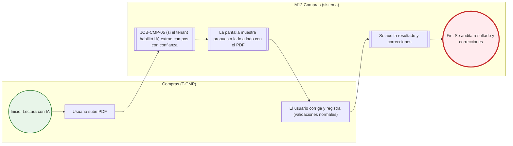

**Pasos del proceso** (actividad tomada del anexo; la columna RF/RN distingue lo citado en el paso de lo asociado por parámetro, permiso, evento o tema compartido).

| Paso | Carril | Actividad | RF/RN que aplican | EVT / JOB / PAN |
|---|---|---|---|---|
| 1 | Compras | Usuario sube PDF | — | — |
| 2 | M12 Compras | `JOB-CMP-05` (si el tenant habilitó IA) extrae campos con confianza | — | JOB-CMP-05 |
| 3 | M12 Compras | la pantalla muestra propuesta lado a lado con el PDF | — | — |
| 4 | Compras | el usuario corrige y registra (validaciones normales) | — | — |
| 5 | M12 Compras | se audita resultado y correcciones | — | — |

**Situación actual en ProCoop (nota de cambio).** Sin contraste específico para este proceso en el anexo (filas `CTR-` con ProCoop) ni en el análisis de brechas. El contraste del dominio está en `15-analisis-brechas-procoop.md` §3.15.

**Excepciones**

| Excepción | Tratamiento |
|---|---|
| Falla técnica en un paso automático, un job o una integración | Reintento idempotente y reanudable; lo no reparable pasa a la bandeja técnica con responsable (política de recuperación de T11 P-WFL-01 y T01 §9.12; AGR-016). |

---

## 4. PRC-CMP-06 Portal de proveedores

| Campo | Contenido |
|---|---|
| Fuente | M12 §9.6, `M12-CMP-compras-proveedores.md` (línea 1023) |
| Macroproceso | MP-15 Compras y proveedores |
| Disparador | Portal de proveedores |
| Resultado | El proveedor sigue estados y descarga certificados de retención… |
| Carriles | T02 Identidad y roles; Proveedor (portal de proveedores) (C-PRV); Compras (T-CMP) |
| Roles de T02 | C-PRV Proveedor (portal de proveedores), T-CMP Compras |
| Módulos involucrados | M12 Compras, T02 Identidad y roles |
| Eventos (T11 §12) | — |
| Jobs | — |
| Relación con 04-procesos-bpmn.md | P7 Compras y pago a proveedores ([§11](04-procesos-bpmn.md#11-p7--compras-y-pago-a-proveedores)) |

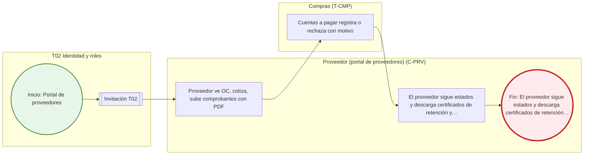

**Pasos del proceso** (actividad tomada del anexo; la columna RF/RN distingue lo citado en el paso de lo asociado por parámetro, permiso, evento o tema compartido).

| Paso | Carril | Actividad | RF/RN que aplican | EVT / JOB / PAN |
|---|---|---|---|---|
| 1 | T02 Identidad y roles | Invitación T02 | — | — |
| 2 | Proveedor | proveedor ve OC, cotiza, sube comprobantes con PDF | — | — |
| 3 | Compras | cuentas a pagar registra o rechaza con motivo | — | — |
| 4 | Proveedor | el proveedor sigue estados y descarga certificados de retención y comprobantes de pago | asoc.: RF-CMP-112 | — |

**Situación actual en ProCoop (nota de cambio).** Sin contraste específico para este proceso en el anexo (filas `CTR-` con ProCoop) ni en el análisis de brechas. El contraste del dominio está en `15-analisis-brechas-procoop.md` §3.15.

**Excepciones**

| Excepción | Tratamiento |
|---|---|
| Rechazo | Invitación T02 proveedor ve OC, cotiza, sube comprobantes con PDF cuentas a pagar registra o rechaza con motivo el proveedor sigue estados y descarga certificados de retención y comprobantes de pago |
| Falla técnica en un paso automático, un job o una integración | Reintento idempotente y reanudable; lo no reparable pasa a la bandeja técnica con responsable (política de recuperación de T11 P-WFL-01 y T01 §9.12; AGR-016). |

---

## 5. PRC-SUE-01 Alta de empleado

| Campo | Contenido |
|---|---|
| Fuente | M16 §9.1, `M16-SUE-personal-sueldos.md` (línea 1933) |
| Macroproceso | MP-16 Personal y sueldos |
| Disparador | Alta de empleado |
| Resultado | Pasa el legajo a active |
| Carriles | RRHH / Liquidador (T-RRHH); M16 Sueldos (sistema) |
| Roles de T02 | T-RRHH RRHH / Liquidador |
| Módulos involucrados | M16 Sueldos |
| Eventos (T11 §12) | — |
| Jobs | — |
| Relación con 04-procesos-bpmn.md | — |

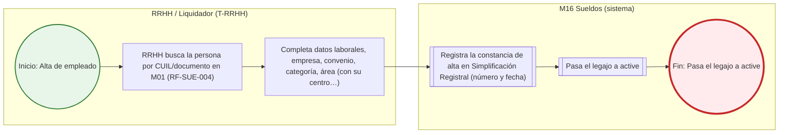

**Pasos del proceso** (actividad tomada del anexo; la columna RF/RN distingue lo citado en el paso de lo asociado por parámetro, permiso, evento o tema compartido).

| Paso | Carril | Actividad | RF/RN que aplican | EVT / JOB / PAN |
|---|---|---|---|---|
| 1 | RRHH / Liquidador | RRHH busca la persona por CUIL/documento en M01 (RF-SUE-004); si no existe, la crea por el servicio de M01. | RF-SUE-004 | — |
| 2 | RRHH / Liquidador | Completa datos laborales, empresa, convenio, categoría, área (con su centro de costo), distribución, turno, obra social, modalidad, situación de revista inicial, cuentas de acreditación y familiares. | asoc.: RF-SUE-002 | — |
| 3 | M16 Sueldos | Registra la constancia de alta en Simplificación Registral (número y fecha) — debe hacerse antes del inicio de la relación laboral. | asoc.: RF-SUE-124 | — |
| 4 | M16 Sueldos | Pasa el legajo a `active`; T02 crea o vincula el perfil empleado y envía invitación al portal si PRM-SUE-048 está activo. | — | — |

**Situación actual en ProCoop (nota de cambio).** Sin contraste específico para este proceso en el anexo (filas `CTR-` con ProCoop) ni en el análisis de brechas. El contraste del dominio está en `15-analisis-brechas-procoop.md` §3.16.

**Excepciones**

| Excepción | Tratamiento |
|---|---|
| Si no existe | la crea por el servicio de M01 |
| Falla técnica en un paso automático, un job o una integración | Reintento idempotente y reanudable; lo no reparable pasa a la bandeja técnica con responsable (política de recuperación de M16 §9.12; AGR-016). |

---

## 6. PRC-SUE-02 Configuración y publicación (AGR-009)

| Campo | Contenido |
|---|---|
| Fuente | M16 §9.2, `M16-SUE-personal-sueldos.md` (línea 1940) |
| Macroproceso | MP-16 Personal y sueldos |
| Disparador | Configuración y publicación |
| Resultado | Envía a revisión; el aprobador (≠ autor) revisa diferencias y… |
| Carriles | RRHH / Liquidador (T-RRHH); M16 Sueldos (sistema); Aprobador según política (T11 aprobaciones) |
| Roles de T02 | T-RRHH RRHH / Liquidador |
| Módulos involucrados | M16 Sueldos, T11 Workflow, eventos y documentos |
| Eventos (T11 §12) | — |
| Jobs | JOB-SUE-02 `sue:simular-configuracion` |
| Relación con 04-procesos-bpmn.md | — |

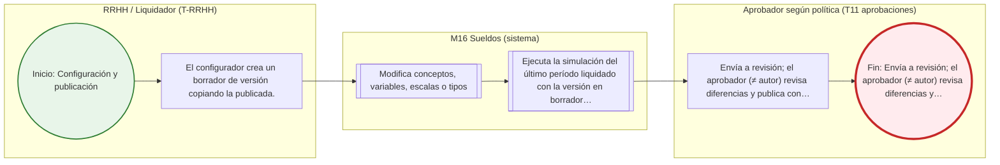

**Pasos del proceso** (actividad tomada del anexo; la columna RF/RN distingue lo citado en el paso de lo asociado por parámetro, permiso, evento o tema compartido).

| Paso | Carril | Actividad | RF/RN que aplican | EVT / JOB / PAN |
|---|---|---|---|---|
| 1 | RRHH / Liquidador | El configurador crea un borrador de versión copiando la publicada. | — | — |
| 2 | M16 Sueldos | Modifica conceptos, variables, escalas o tipos; el editor valida cada fórmula y sus dependencias (RN-SUE-021). | RN-SUE-021; asoc.: RF-SUE-040 | — |
| 3 | M16 Sueldos | Ejecuta la simulación del último período liquidado con la versión en borrador (`JOB-SUE-02`) y obtiene el informe de diferencias por empleado y concepto. | asoc.: RF-SUE-041, RN-SUE-033 | JOB-SUE-02 |
| 4 | Aprobador según política | Envía a revisión; el aprobador (≠ autor) revisa diferencias y publica con fecha efectiva. Publicación atómica. | asoc.: RF-SUE-041, RN-SUE-033 | — |

**Situación actual en ProCoop (nota de cambio).** Sin contraste específico para este proceso en el anexo (filas `CTR-` con ProCoop) ni en el análisis de brechas. El contraste del dominio está en `15-analisis-brechas-procoop.md` §3.16.

**Excepciones**

| Excepción | Tratamiento |
|---|---|
| Falla técnica en un paso automático, un job o una integración | Reintento idempotente y reanudable; lo no reparable pasa a la bandeja técnica con responsable (política de recuperación de M16 §9.12; AGR-016). |

---

## 7. PRC-SUE-03 Aplicar aumentos

| Campo | Contenido |
|---|---|
| Fuente | M16 §9.3, `M16-SUE-personal-sueldos.md` (línea 1947) |
| Macroproceso | MP-16 Personal y sueldos |
| Disparador | Aplicar aumentos |
| Resultado | Al publicarse con fecha efectiva pasada, el sistema sugiere la… |
| Carriles | M16 Sueldos (sistema) |
| Roles de T02 | Solo actores del sistema (sin rol humano) |
| Módulos involucrados | M16 Sueldos |
| Eventos (T11 §12) | — |
| Jobs | — |
| Relación con 04-procesos-bpmn.md | — |

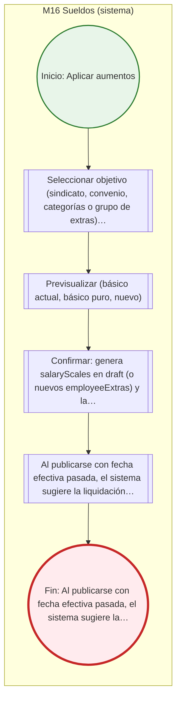

**Pasos del proceso** (actividad tomada del anexo; la columna RF/RN distingue lo citado en el paso de lo asociado por parámetro, permiso, evento o tema compartido).

| Paso | Carril | Actividad | RF/RN que aplican | EVT / JOB / PAN |
|---|---|---|---|---|
| 1 | M16 Sueldos | Seleccionar objetivo (sindicato, convenio, categorías o grupo de extras), modo, valor, fecha efectiva y redondeo. | asoc.: RF-SUE-043 | — |
| 2 | M16 Sueldos | Previsualizar (básico actual, básico puro, nuevo; RN-SUE-014). | RN-SUE-014 | — |
| 3 | M16 Sueldos | Confirmar: genera `salaryScales` en `draft` (o nuevos `employeeExtras`) y la aprobación correspondiente. | — | — |
| 4 | M16 Sueldos | Al publicarse con fecha efectiva pasada, el sistema sugiere la liquidación complementaria de los períodos cerrados afectados (PA-SUE-14). | asoc.: RF-SUE-076 | — |

**Situación actual en ProCoop (nota de cambio).** Sin contraste específico para este proceso en el anexo (filas `CTR-` con ProCoop) ni en el análisis de brechas. El contraste del dominio está en `15-analisis-brechas-procoop.md` §3.16.

**Excepciones**

| Excepción | Tratamiento |
|---|---|
| Falla técnica en un paso automático, un job o una integración | Reintento idempotente y reanudable; lo no reparable pasa a la bandeja técnica con responsable (política de recuperación de M16 §9.12; AGR-016). |

---

## 8. PRC-SUE-04 Novedades desde órdenes de trabajo, cuadrillas y flota (CU-104 paso 1)

| Campo | Contenido |
|---|---|
| Fuente | M16 §9.4, `M16-SUE-personal-sueldos.md` (línea 1954) |
| Macroproceso | MP-16 Personal y sueldos |
| Disparador | Novedades desde órdenes de trabajo, cuadrillas y flota |
| Resultado | Con PRM-SUE-042/043 desactivados, el proceso solo corre a… |
| Carriles | M10 Técnica y campo; M16 Sueldos (sistema); RRHH / Liquidador (T-RRHH) |
| Roles de T02 | T-RRHH RRHH / Liquidador |
| Módulos involucrados | M10 Técnica y campo, M16 Sueldos, M18 Servicios sociales |
| Eventos (T11 §12) | EVT-TEC-32 `tec.crewTimesheet.approved`; EVT-TEC-07 `tec.workOrder.closed`; EVT-SOC-12 `soc.vehicle.usageRecorded` |
| Jobs | JOB-SUE-07 `sue:proponer-novedades-operativas` |
| Relación con 04-procesos-bpmn.md | — |

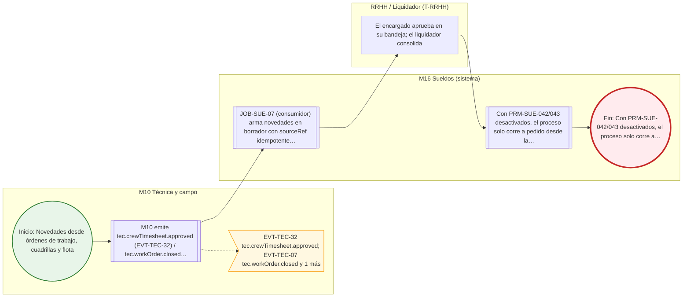

**Pasos del proceso** (actividad tomada del anexo; la columna RF/RN distingue lo citado en el paso de lo asociado por parámetro, permiso, evento o tema compartido).

| Paso | Carril | Actividad | RF/RN que aplican | EVT / JOB / PAN |
|---|---|---|---|---|
| 1 | M10 Técnica y campo | M10 emite `tec.crewTimesheet.approved` (EVT-TEC-32) / `tec.workOrder.closed` (EVT-TEC-07) con integrantes, fechas, horas normales, extra y guardias; M18 emite `soc.vehicle.usageRecorded` (EVT-SOC-12) con conductor, horas, km y viáticos. | asoc.: RF-SUE-049 | EVT-TEC-32, EVT-TEC-07, EVT-SOC-12 |
| 2 | M16 Sueldos | `JOB-SUE-07` (consumidor) arma novedades en borrador con `sourceRef` idempotente (RN-SUE-037), clasificando horas al 50 % o 100 % según día, feriado y turno del empleado (RN-SUE-048). | RN-SUE-037, RN-SUE-048 | JOB-SUE-07 |
| 3 | RRHH / Liquidador | El encargado aprueba en su bandeja; el liquidador consolida. Si la OT se reabre y cambia, la novedad en borrador se actualiza; si ya se liquidó, se genera ajuste. | asoc.: RF-SUE-055 | — |
| 4 | M16 Sueldos | Con PRM-SUE-042/043 desactivados, el proceso solo corre a pedido desde la pantalla de importación. | — | — |

**Situación actual en ProCoop (nota de cambio).** Sin contraste específico para este proceso en el anexo (filas `CTR-` con ProCoop) ni en el análisis de brechas. El contraste del dominio está en `15-analisis-brechas-procoop.md` §3.16.

**Excepciones**

| Excepción | Tratamiento |
|---|---|
| Si ya se liquidó | se genera ajuste |
| Falla técnica en un paso automático, un job o una integración | Reintento idempotente y reanudable; lo no reparable pasa a la bandeja técnica con responsable (política de recuperación de M16 §9.12; AGR-016). |

---

## 9. PRC-SUE-05 Licencias

| Campo | Contenido |
|---|---|
| Fuente | M16 §9.5, `M16-SUE-personal-sueldos.md` (línea 1961) |
| Macroproceso | MP-16 Personal y sueldos |
| Disparador | Licencias |
| Resultado | Al autorizar se generan novedades por mes, situación de revista… |
| Carriles | Empleado en portal (C-EMP); RRHH / Liquidador (T-RRHH); M16 Sueldos (sistema) |
| Roles de T02 | C-EMP Empleado en portal, T-RRHH RRHH / Liquidador |
| Módulos involucrados | M16 Sueldos |
| Eventos (T11 §12) | — |
| Jobs | JOB-SUE-12 `sue:recalcular-saldos-vacaciones` |
| Relación con 04-procesos-bpmn.md | — |

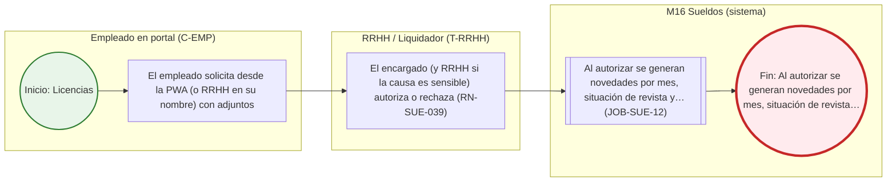

**Pasos del proceso** (actividad tomada del anexo; la columna RF/RN distingue lo citado en el paso de lo asociado por parámetro, permiso, evento o tema compartido).

| Paso | Carril | Actividad | RF/RN que aplican | EVT / JOB / PAN |
|---|---|---|---|---|
| 1 | Empleado en portal | El empleado solicita desde la PWA (o RRHH en su nombre) con adjuntos; validaciones RN-SUE-038/040/041. | RN-SUE-038 | — |
| 2 | RRHH / Liquidador | El encargado (y RRHH si la causa es sensible) autoriza o rechaza (RN-SUE-039); notificación por T09. | RN-SUE-039 | — |
| 3 | M16 Sueldos | Al autorizar se generan novedades por mes, situación de revista y actualización del saldo (`JOB-SUE-12`). | — | JOB-SUE-12 |

**Situación actual en ProCoop (nota de cambio).** Sin contraste específico para este proceso en el anexo (filas `CTR-` con ProCoop) ni en el análisis de brechas. El contraste del dominio está en `15-analisis-brechas-procoop.md` §3.16.

**Excepciones**

| Excepción | Tratamiento |
|---|---|
| Rechazo | El encargado (y RRHH si la causa es sensible) autoriza o rechaza (RN-SUE-039); notificación por T09 |
| Falla técnica en un paso automático, un job o una integración | Reintento idempotente y reanudable; lo no reparable pasa a la bandeja técnica con responsable (política de recuperación de M16 §9.12; AGR-016). |

---

## 10. PRC-SUE-06 Liquidación mensual o quincenal (CU-104 pasos 2 y 3)

| Campo | Contenido |
|---|---|
| Fuente | M16 §9.6, `M16-SUE-personal-sueldos.md` (línea 1967) |
| Macroproceso | MP-16 Personal y sueldos |
| Disparador | Liquidación mensual o quincenal |
| Resultado | Se solicita el pago a M14 (§9.9) y se generan las… |
| Carriles | RRHH / Liquidador (T-RRHH); M16 Sueldos (sistema); Aprobador según política (T11 aprobaciones) |
| Roles de T02 | T-RRHH RRHH / Liquidador |
| Módulos involucrados | M16 Sueldos, T11 Workflow, eventos y documentos |
| Eventos (T11 §12) | EVT-SUE-11 `sue.payrollRun.approved` |
| Jobs | JOB-SUE-01 `sue:calcular-liquidacion`; JOB-SUE-03 `sue:emitir-recibos-pdf`; JOB-SUE-04 `sue:firmar-recibos-empleador`; JOB-SUE-05 `sue:notificar-recibos` |
| Relación con 04-procesos-bpmn.md | — |

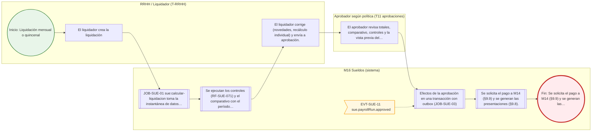

**Pasos del proceso** (actividad tomada del anexo; la columna RF/RN distingue lo citado en el paso de lo asociado por parámetro, permiso, evento o tema compartido).

| Paso | Carril | Actividad | RF/RN que aplican | EVT / JOB / PAN |
|---|---|---|---|---|
| 1 | RRHH / Liquidador | El liquidador crea la liquidación: empresa, tipo, período, universo, fecha de pago y constancia del último depósito de aportes. | — | — |
| 2 | M16 Sueldos | `JOB-SUE-01 sue:calcular-liquidacion` toma la instantánea de datos (RN-SUE-022), evalúa por empleado (RF-SUE-068/069), calcula Ganancias (RF-SUE-087), aportes y contribuciones (RF-SUE-096), embargos (RN-SUE-062) y guarda recibos `calculated` con traza. Procesa por lotes de 50 empleados, registra progreso, es reanudable y marca errores por empleado sin abortar el lote. | RF-SUE-068, RF-SUE-087, RF-SUE-096, RN-SUE-022, RN-SUE-062; asoc.: RN-SUE-054 | JOB-SUE-01 |
| 3 | M16 Sueldos | Se ejecutan los controles (RF-SUE-071) y el comparativo con el período anterior. | RF-SUE-071 | — |
| 4 | RRHH / Liquidador | El liquidador corrige (novedades, recálculo individual) y envía a aprobación. | — | — |
| 5 | Aprobador según política | El aprobador revisa totales, comparativo, controles y la vista previa del asiento, y aprueba. | — | — |
| 6 | M16 Sueldos | Efectos de la aprobación en una transacción con outbox: numeración de recibos, saldos de planes, novedades `settled`, `sue.payrollRun.approved` (M15 asienta por centro de costo), `JOB-SUE-03` (PDF), `JOB-SUE-04` (pide a T11 la firma del empleador), `JOB-SUE-05` (notificación a empleados). | — | JOB-SUE-03, JOB-SUE-04, JOB-SUE-05, EVT-SUE-11 |
| 7 | M16 Sueldos | Se solicita el pago a M14 (§9.9) y se generan las presentaciones (§9.8). | — | — |

**Situación actual en ProCoop (nota de cambio).** CTR-SUE-03: en ProCoop, RN-08 §11.6 y §14.11 (ProCoop no calcula F.931, delega en SICOSS) vs SUE-007 («aportes y contribuciones, declaración jurada F.931»). Cambio adoptado: Se calculan aportes y contribuciones para asiento y control y se generan LSD y SICOSS; la DJ se obtiene y presenta en ARCA. A validar PA-SUE-02. Análisis de brechas (`15-analisis-brechas-procoop.md` §3.16, Sueldos): hoy Liquidación en el mismo sistema; en GoodApps, importación de un liquidador externo en O8 y liquidación propia en O9 con dos períodos en paralelo (brecha "Cambia"; fuente DEC-058).

**Excepciones**

| Excepción | Tratamiento |
|---|---|
| Falla o error | Procesa por lotes de 50 empleados, registra progreso, es reanudable y marca errores por empleado sin abortar el lote |
| Si el job cae | retoma desde el último empleado confirmado |
| Cancelación, anulación o reversión | Cancelación: el liquidador puede cancelar el cálculo; los recibos calculados quedan descartados |
| Reintento | Reintentos: los consumidores de eventos (M15, M14) son idempotentes por `payrollRunId` + versión |
| Falla técnica en un paso automático, un job o una integración | Reintento idempotente y reanudable; lo no reparable pasa a la bandeja técnica con responsable (política de recuperación de M16 §9.12; AGR-016). |

---

## 11. PRC-SUE-07 SAC, vacaciones, final, complementaria y rectificativa

| Campo | Contenido |
|---|---|
| Fuente | M16 §9.7, `M16-SUE-personal-sueldos.md` (línea 1979) |
| Macroproceso | MP-16 Personal y sueldos |
| Disparador | SAC, vacaciones, final, complementaria y rectificativa |
| Resultado | Rectificativa: anula el recibo original (sin borrarlo), emite… |
| Carriles | M16 Sueldos (sistema) |
| Roles de T02 | Solo actores del sistema (sin rol humano) |
| Módulos involucrados | M16 Sueldos |
| Eventos (T11 §12) | — |
| Jobs | — |
| Relación con 04-procesos-bpmn.md | — |

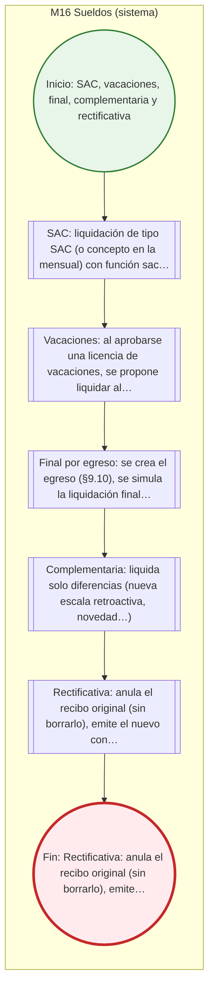

**Pasos del proceso** (actividad tomada del anexo; la columna RF/RN distingue lo citado en el paso de lo asociado por parámetro, permiso, evento o tema compartido).

| Paso | Carril | Actividad | RF/RN que aplican | EVT / JOB / PAN |
|---|---|---|---|---|
| 1 | M16 Sueldos | SAC: liquidación de tipo SAC (o concepto en la mensual) con función `sac` (RN-SUE-024, RN-SUE-057). Calendario: alerta 10 días antes del 30-06 y del 18-12. | RN-SUE-024, RN-SUE-057 | — |
| 2 | M16 Sueldos | Vacaciones: al aprobarse una licencia de vacaciones, se propone liquidar al inicio del goce (RN-SUE-058). | RN-SUE-058 | — |
| 3 | M16 Sueldos | Final por egreso: se crea el egreso (§9.10), se simula la liquidación final con el modelo del motivo (RN-SUE-059), se aprueba y paga; se emiten certificados. | RN-SUE-059 | — |
| 4 | M16 Sueldos | Complementaria: liquida solo diferencias (nueva escala retroactiva, novedad tardía) informando el período de devengamiento; Ganancias recalcula el acumulado. | asoc.: RF-SUE-076 | — |
| 5 | M16 Sueldos | Rectificativa: anula el recibo original (sin borrarlo), emite el nuevo con referencia y regenera presentaciones del período como rectificativas. | — | — |

**Situación actual en ProCoop (nota de cambio).** Sin contraste específico para este proceso en el anexo (filas `CTR-` con ProCoop) ni en el análisis de brechas. El contraste del dominio está en `15-analisis-brechas-procoop.md` §3.16.

**Excepciones**

| Excepción | Tratamiento |
|---|---|
| Cancelación, anulación o reversión | Rectificativa: anula el recibo original (sin borrarlo), emite el nuevo con referencia y regenera presentaciones del período como rectificativas |
| Falla técnica en un paso automático, un job o una integración | Reintento idempotente y reanudable; lo no reparable pasa a la bandeja técnica con responsable (política de recuperación de M16 §9.12; AGR-016). |

---

## 12. PRC-SUE-08 Ganancias y presentaciones

| Campo | Contenido |
|---|---|
| Fuente | M16 §9.8, `M16-SUE-personal-sueldos.md` (línea 1987) |
| Macroproceso | MP-16 Personal y sueldos |
| Disparador | Ganancias y presentaciones |
| Resultado | SICORE de sueldos y archivos sindicales |
| Carriles | M16 Sueldos (sistema) |
| Roles de T02 | Solo actores del sistema (sin rol humano) |
| Módulos involucrados | M16 Sueldos |
| Eventos (T11 §12) | — |
| Jobs | JOB-SUE-08 `sue:importar-siradig`; JOB-SUE-09 `sue:liquidacion-anual-ganancias`; JOB-SUE-10 `sue:generar-lsd`; JOB-SUE-11 `sue:generar-sicoss`; JOB-SUE-13 `sue:generar-sicore-sueldos`; JOB-SUE-14 `sue:generar-archivos-sindicales` |
| Relación con 04-procesos-bpmn.md | — |

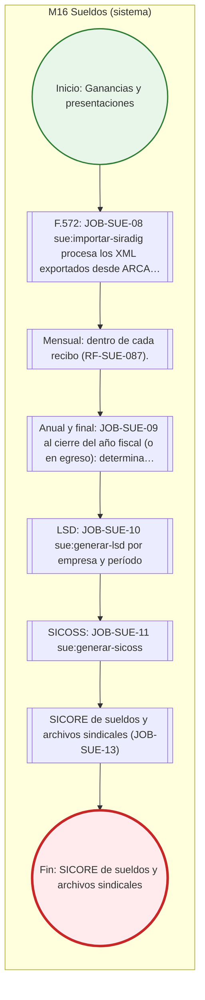

**Pasos del proceso** (actividad tomada del anexo; la columna RF/RN distingue lo citado en el paso de lo asociado por parámetro, permiso, evento o tema compartido).

| Paso | Carril | Actividad | RF/RN que aplican | EVT / JOB / PAN |
|---|---|---|---|---|
| 1 | M16 Sueldos | F.572: `JOB-SUE-08 sue:importar-siradig` procesa los XML exportados desde ARCA por la empresa; aplica la versión más reciente por empleado; genera novedades de otros empleos (RN-SUE-051/052). | RN-SUE-051; asoc.: RF-SUE-086 | JOB-SUE-08 |
| 2 | M16 Sueldos | Mensual: dentro de cada recibo (RF-SUE-087). | RF-SUE-087 | — |
| 3 | M16 Sueldos | Anual y final: `JOB-SUE-09` al cierre del año fiscal (o en egreso): determina el impuesto anual, ajusta en el recibo correspondiente (retención o devolución) y emite el formulario informativo. | — | JOB-SUE-09 |
| 4 | M16 Sueldos | LSD: `JOB-SUE-10 sue:generar-lsd` por empresa y período; valida códigos de conceptos y registros; el aprobador lo aprueba; el usuario lo presenta en ARCA y carga el acuse. | — | JOB-SUE-10 |
| 5 | M16 Sueldos | SICOSS: `JOB-SUE-11 sue:generar-sicoss`; control de totales; el F.931 se obtiene en ARCA y su VEP se registra como obligación en M14. | — | JOB-SUE-11 |
| 6 | M16 Sueldos | SICORE de sueldos y archivos sindicales: `JOB-SUE-13`, `JOB-SUE-14`. | — | JOB-SUE-13, JOB-SUE-14 |

**Situación actual en ProCoop (nota de cambio).** Sin contraste específico para este proceso en el anexo (filas `CTR-` con ProCoop) ni en el análisis de brechas. El contraste del dominio está en `15-analisis-brechas-procoop.md` §3.16.

**Excepciones**

| Excepción | Tratamiento |
|---|---|
| Falla técnica en un paso automático, un job o una integración | Reintento idempotente y reanudable; lo no reparable pasa a la bandeja técnica con responsable (política de recuperación de M16 §9.12; AGR-016). |

---

## 13. PRC-SUE-09 Pago de haberes (CU-104 paso 4)

| Campo | Contenido |
|---|---|
| Fuente | M16 §9.9, `M16-SUE-personal-sueldos.md` (línea 1996) |
| Macroproceso | MP-16 Personal y sueldos |
| Disparador | Pago de haberes |
| Resultado | Obligaciones (F.931, sindicatos, embargos, seguro de vida) |
| Carriles | RRHH / Liquidador (T-RRHH); M16 Sueldos (sistema); M14 Tesorería |
| Roles de T02 | T-RRHH RRHH / Liquidador |
| Módulos involucrados | M14 Tesorería, M16 Sueldos |
| Eventos (T11 §12) | EVT-TES-17 `tes.payrollPayment.confirmed` |
| Jobs | — |
| Relación con 04-procesos-bpmn.md | — |

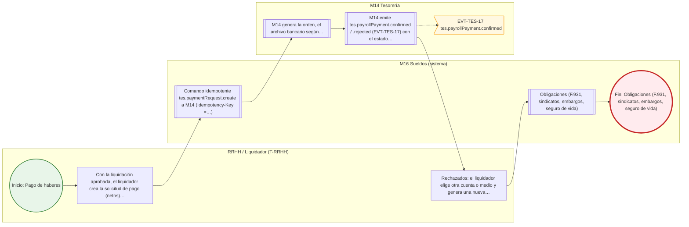

**Pasos del proceso** (actividad tomada del anexo; la columna RF/RN distingue lo citado en el paso de lo asociado por parámetro, permiso, evento o tema compartido).

| Paso | Carril | Actividad | RF/RN que aplican | EVT / JOB / PAN |
|---|---|---|---|---|
| 1 | RRHH / Liquidador | Con la liquidación aprobada, el liquidador crea la solicitud de pago (netos) con fecha y medio; se arma un ítem por empleado y cuenta (RN-SUE-007). | RN-SUE-007 | — |
| 2 | M16 Sueldos | Comando idempotente `tes.paymentRequest.create` a M14 (`Idempotency-Key` = `payrollRunId` + tipo + intento). | — | — |
| 3 | M14 Tesorería | M14 genera la orden, el archivo bancario según `legalEntities.employer.bankAgreements` y el layout del banco, lo envía (Interbanking o archivo) y concilia. | — | — |
| 4 | M14 Tesorería | M14 emite `tes.payrollPayment.confirmed` / `.rejected` (EVT-TES-17) con el estado por ítem; SUE actualiza `paymentSplit` de cada recibo. | — | EVT-TES-17 |
| 5 | RRHH / Liquidador | Rechazados: el liquidador elige otra cuenta o medio y genera una nueva solicitud solo con esos ítems. | — | — |
| 6 | M16 Sueldos | Obligaciones (F.931, sindicatos, embargos, seguro de vida): solicitudes de tipo propio con su período. | — | — |

**Situación actual en ProCoop (nota de cambio).** Sin contraste específico para este proceso en el anexo (filas `CTR-` con ProCoop) ni en el análisis de brechas. El contraste del dominio está en `15-analisis-brechas-procoop.md` §3.16.

**Excepciones**

| Excepción | Tratamiento |
|---|---|
| Rechazo | Rechazados: el liquidador elige otra cuenta o medio y genera una nueva solicitud solo con esos ítems |
| Falla técnica en un paso automático, un job o una integración | Reintento idempotente y reanudable; lo no reparable pasa a la bandeja técnica con responsable (política de recuperación de M16 §9.12; AGR-016). |

---

## 14. PRC-SUE-10 Egreso

| Campo | Contenido |
|---|---|
| Fuente | M16 §9.10, `M16-SUE-personal-sueldos.md` (línea 2005) |
| Macroproceso | MP-16 Personal y sueldos |
| Disparador | Egreso |
| Resultado | Legajo terminated en la fecha, sue.employee.terminated (T02…) |
| Carriles | RRHH / Liquidador (T-RRHH); M16 Sueldos (sistema) |
| Roles de T02 | T-RRHH RRHH / Liquidador |
| Módulos involucrados | M16 Sueldos |
| Eventos (T11 §12) | EVT-SUE-03 `sue.employee.terminated` |
| Jobs | — |
| Relación con 04-procesos-bpmn.md | — |

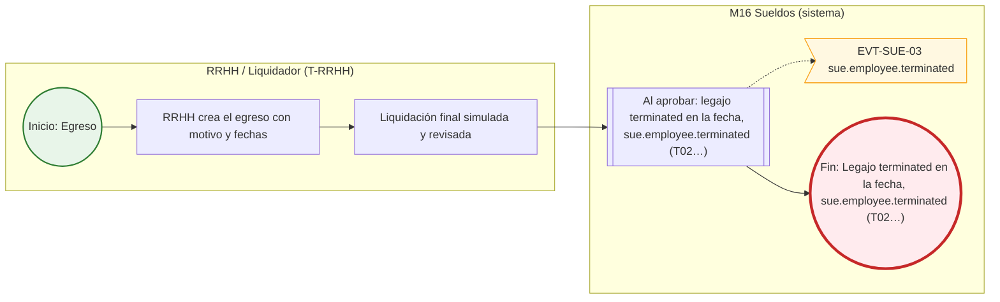

**Pasos del proceso** (actividad tomada del anexo; la columna RF/RN distingue lo citado en el paso de lo asociado por parámetro, permiso, evento o tema compartido).

| Paso | Carril | Actividad | RF/RN que aplican | EVT / JOB / PAN |
|---|---|---|---|---|
| 1 | RRHH / Liquidador | RRHH crea el egreso con motivo y fechas; el sistema arma la lista de tareas (RF-SUE-125). | RF-SUE-125 | — |
| 2 | RRHH / Liquidador | Liquidación final simulada y revisada; aprobación (≠ liquidador). | — | — |
| 3 | M16 Sueldos | Al aprobar: legajo `terminated` en la fecha, `sue.employee.terminated` (T02 revoca, M13 controla devolución de equipos), baja de situación de revista, pendientes de baja registral y certificados art. 80 con fecha límite (PRM-SUE-054). | asoc.: RF-SUE-125 | EVT-SUE-03 |

**Situación actual en ProCoop (nota de cambio).** Sin contraste específico para este proceso en el anexo (filas `CTR-` con ProCoop) ni en el análisis de brechas. El contraste del dominio está en `15-analisis-brechas-procoop.md` §3.16.

**Excepciones**

| Excepción | Tratamiento |
|---|---|
| Falla técnica en un paso automático, un job o una integración | Reintento idempotente y reanudable; lo no reparable pasa a la bandeja técnica con responsable (política de recuperación de M16 §9.12; AGR-016). |

---

## 15. PRC-SUE-11 Importación de liquidación externa (CU-28, O8)

| Campo | Contenido |
|---|---|
| Fuente | M16 §9.11, `M16-SUE-personal-sueldos.md` (línea 2011); ola O8 |
| Macroproceso | MP-16 Personal y sueldos |
| Disparador | Importación de liquidación externa |
| Resultado | El aprobador aprueba; se emiten sue.externalPayroll.approved… |
| Carriles | M16 Sueldos (sistema); Aprobador según política (T11 aprobaciones) |
| Roles de T02 | Solo actores del sistema (sin rol humano) |
| Módulos involucrados | M16 Sueldos, T11 Workflow, eventos y documentos |
| Eventos (T11 §12) | EVT-SUE-24 `sue.externalPayroll.approved` |
| Jobs | JOB-SUE-16 `sue:importar-liquidacion-externa` |
| Relación con 04-procesos-bpmn.md | — |

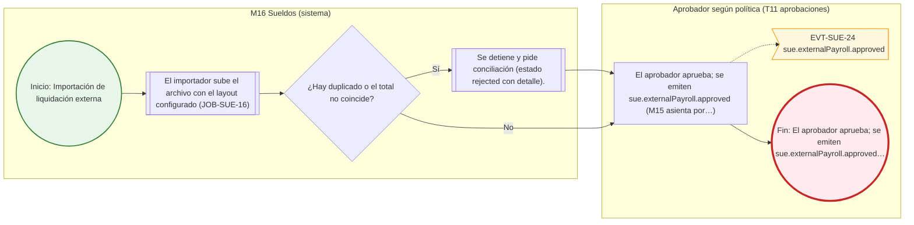

**Pasos del proceso** (actividad tomada del anexo; la columna RF/RN distingue lo citado en el paso de lo asociado por parámetro, permiso, evento o tema compartido).

| Paso | Carril | Actividad | RF/RN que aplican | EVT / JOB / PAN |
|---|---|---|---|---|
| 1 | M16 Sueldos | El importador sube el archivo con el layout configurado; `JOB-SUE-16` valida (RN-SUE-090/091, RF-SUE-141). | RF-SUE-141, RN-SUE-090 | JOB-SUE-16 |
| 2 | M16 Sueldos | Si hay duplicado o el total no coincide, se detiene y pide conciliación (estado `rejected` con detalle). | asoc.: RF-SUE-141 | — |
| 3 | Aprobador según política | El aprobador aprueba; se emiten `sue.externalPayroll.approved` (M15 asienta por cuenta y centro de costo) y, si tiene detalle de netos, la solicitud de pago a M14. | asoc.: RF-SUE-143 | EVT-SUE-24 |

**Situación actual en ProCoop (nota de cambio).** Sin contraste específico para este proceso en el anexo (filas `CTR-` con ProCoop) ni en el análisis de brechas. El contraste del dominio está en `15-analisis-brechas-procoop.md` §3.16.

**Excepciones**

| Excepción | Tratamiento |
|---|---|
| Si hay duplicado o el total no coincide | se detiene y pide conciliación (estado `rejected` con detalle) |
| Si tiene detalle de netos | la solicitud de pago a M14 |
| Falla técnica en un paso automático, un job o una integración | Reintento idempotente y reanudable; lo no reparable pasa a la bandeja técnica con responsable (política de recuperación de M16 §9.12; AGR-016). |

---

## 16. PRC-INS-01 Ingreso de asociado

| Campo | Contenido |
|---|---|
| Fuente | M17 §9.1, `M17-INS-institucional.md` (línea 1216) |
| Macroproceso | MP-17 Institucional y servicios sociales |
| Disparador | Ingreso de asociado |
| Resultado | Rechazo: notificación con motivo. |
| Carriles | M17 Institucional (sistema); Secretaría institucional (T-SEC) |
| Roles de T02 | T-SEC Secretaría institucional |
| Módulos involucrados | M17 Institucional |
| Eventos (T11 §12) | EVT-INS-02 `ins.membership.approved` |
| Jobs | — |
| Relación con 04-procesos-bpmn.md | — |

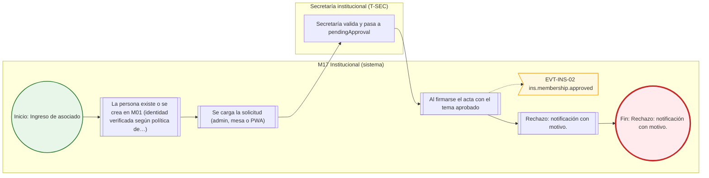

**Pasos del proceso** (actividad tomada del anexo; la columna RF/RN distingue lo citado en el paso de lo asociado por parámetro, permiso, evento o tema compartido).

| Paso | Carril | Actividad | RF/RN que aplican | EVT / JOB / PAN |
|---|---|---|---|---|
| 1 | M17 Institucional | La persona existe o se crea en M01 (identidad verificada según política de M01). | — | — |
| 2 | M17 Institucional | Se carga la solicitud (admin, mesa o PWA): estatuto aceptado (versión), suscripción propuesta según `capitalSubscriptionRules` (`trigger = admission`), documentos. M01 informa avisos (deuda en el domicilio, RN-INS-049). | RN-INS-049; asoc.: RF-INS-005 | — |
| 3 | Secretaría institucional | Secretaría valida y pasa a `pendingApproval`; el sistema agrupa solicitudes en un tema `membershipBatch` del próximo consejo. | asoc.: RN-INS-004, RF-INS-005 | — |
| 4 | M17 Institucional | Al firmarse el acta con el tema aprobado: número desde `numberingSequences` de T11 (CTR-DAT-16; antes `insNumberingSeries`), `active`, credencial digital, suscripción de capital si PRM-INS-015 = `admission`, evento `ins.membership.approved` (M01, M19, T09 bienvenida). | asoc.: RN-INS-002, RN-INS-014 | EVT-INS-02 |
| 5 | M17 Institucional | Rechazo: notificación con motivo. | — | — |

**Situación actual en ProCoop (nota de cambio).** Análisis de brechas (`15-analisis-brechas-procoop.md` §3.16, Institucional): hoy Consejo, actas e INAES; en GoodApps, asociados, capital, asambleas con votación, actas, excedentes e INAES (brecha "Se mantiene"; fuente M17; DFA Módulo 24).

**Excepciones**

| Excepción | Tratamiento |
|---|---|
| Rechazo | Rechazo: notificación con motivo |
| Falla técnica en un paso automático, un job o una integración | Reintento idempotente y reanudable; lo no reparable pasa a la bandeja técnica con responsable (política de recuperación de T11 P-WFL-01 y T01 §9.12; AGR-016). |

---

## 17. PRC-INS-02 Egreso

| Campo | Contenido |
|---|---|
| Fuente | M17 §9.2, `M17-INS-institucional.md` (línea 1224) |
| Macroproceso | MP-17 Institucional y servicios sociales |
| Disparador | Egreso |
| Resultado | M05 aplica PRM-INS-009 |
| Carriles | M17 Institucional (sistema); M05 Facturación |
| Roles de T02 | Solo actores del sistema (sin rol humano) |
| Módulos involucrados | M05 Facturación, M17 Institucional |
| Eventos (T11 §12) | EVT-INS-06 `ins.membership.exited` |
| Jobs | — |
| Relación con 04-procesos-bpmn.md | — |

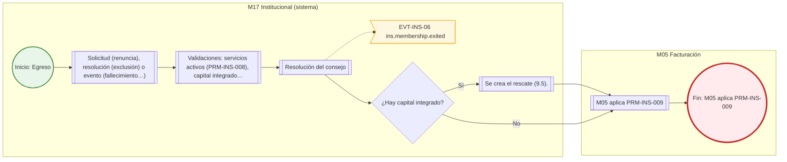

**Pasos del proceso** (actividad tomada del anexo; la columna RF/RN distingue lo citado en el paso de lo asociado por parámetro, permiso, evento o tema compartido).

| Paso | Carril | Actividad | RF/RN que aplican | EVT / JOB / PAN |
|---|---|---|---|---|
| 1 | M17 Institucional | Solicitud (renuncia), resolución (exclusión) o evento (fallecimiento, extinción). | asoc.: RF-INS-010 | — |
| 2 | M17 Institucional | Validaciones: servicios activos (PRM-INS-008), capital integrado (PRM-INS-007), cuentas (PRM-INS-011), mandatos vigentes (se finalizan). | asoc.: RF-INS-010, RN-INS-007 | — |
| 3 | M17 Institucional | Resolución del consejo; registro del egreso; `ins.membership.exited`. | asoc.: RN-INS-006 | EVT-INS-06 |
| 4 | M17 Institucional | Si hay capital integrado: se crea el rescate (9.5). | — | — |
| 5 | M05 Facturación | M05 aplica PRM-INS-009; los servicios no se tocan (RF-INS-101). | RF-INS-101 | — |

**Situación actual en ProCoop (nota de cambio).** Sin contraste específico para este proceso en el anexo (filas `CTR-` con ProCoop) ni en el análisis de brechas. El contraste del dominio está en `15-analisis-brechas-procoop.md` §3.16.

**Excepciones**

| Excepción | Tratamiento |
|---|---|
| Si hay capital integrado | se crea el rescate (9.5) |
| Falla técnica en un paso automático, un job o una integración | Reintento idempotente y reanudable; lo no reparable pasa a la bandeja técnica con responsable (política de recuperación de T11 P-WFL-01 y T01 §9.12; AGR-016). |

---

## 18. PRC-INS-03 Registración de capital desde facturación y cobranza (O5 si se habilita)

| Campo | Contenido |
|---|---|
| Fuente | M17 §9.3, `M17-INS-institucional.md` (línea 1232); ola O5 |
| Macroproceso | MP-17 Institucional y servicios sociales |
| Disparador | Registración de capital desde facturación y cobranza |
| Resultado | Errores: movimiento con rubro inexistente queda rejected con… |
| Carriles | M05 Facturación; M17 Institucional (sistema); M07 Cuenta corriente y cobranza |
| Roles de T02 | Solo actores del sistema (sin rol humano) |
| Módulos involucrados | M05 Facturación, M07 Cuenta corriente y cobranza, M08 Mora, M17 Institucional |
| Eventos (T11 §12) | EVT-FAC-07 `fac.invoice.issued`; EVT-FAC-05 `fac.billingRun.issued`; EVT-INS-08 `ins.capitalMovement.recorded`, `ins.capital.movement.recorded`; EVT-COB-04 `cob.payment.confirmed`; EVT-FAC-08 `fac.invoice.annulled`; EVT-COB-05 `cob.receipt.voided`; EVT-COB-06 `cob.allocation.reversed`; EVT-MOR-14 `mor.agreement.annulled` |
| Jobs | JOB-INS-01 `ins:registrar-capital-lote` |
| Relación con 04-procesos-bpmn.md | — |

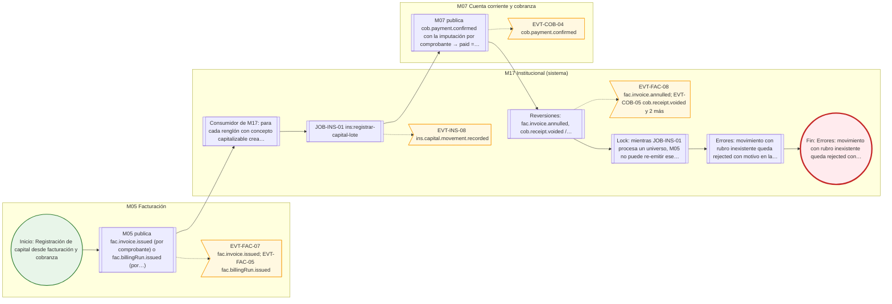

**Pasos del proceso** (actividad tomada del anexo; la columna RF/RN distingue lo citado en el paso de lo asociado por parámetro, permiso, evento o tema compartido).

| Paso | Carril | Actividad | RF/RN que aplican | EVT / JOB / PAN |
|---|---|---|---|---|
| 1 | M05 Facturación | M05 publica `fac.invoice.issued` (por comprobante) o `fac.billingRun.issued` (por lote). | — | EVT-FAC-07, EVT-FAC-05 |
| 2 | M17 Institucional | Consumidor de M17: para cada renglón con concepto capitalizable crea `capitalMovements` tipo `billed` (y `subscribed` si PRM-INS-015 = `billing`) con `idempotencyKey`. | asoc.: RF-INS-036 | — |
| 3 | M17 Institucional | JOB-INS-01 `ins:registrar-capital-lote`: procesa lotes grandes por páginas de 1.000 renglones, registra progreso, reanuda desde el último cursor, y publica `ins.capitalMovement.recorded` (antes `ins.capital.movement.recorded`) por movimiento (o resumen por lote para M15 según PRM de M15). | asoc.: RF-INS-038 | JOB-INS-01, EVT-INS-08 |
| 4 | M07 Cuenta corriente y cobranza | M07 publica `cob.payment.confirmed` con la imputación por comprobante → `paid` = capital del comprobante × imputado / total (RN-INS-015). | RN-INS-015; asoc.: RN-INS-017 | EVT-COB-04 |
| 5 | M17 Institucional | Reversiones: `fac.invoice.annulled`, `cob.receipt.voided` / `cob.allocation.reversed`, `mor.agreement.annulled` → contramovimientos. | — | EVT-FAC-08, EVT-COB-05, EVT-COB-06, EVT-MOR-14 |
| 6 | M17 Institucional | Lock: mientras JOB-INS-01 procesa un universo, M05 no puede re-emitir ese mismo universo (RF-INS-044). | RF-INS-044 | JOB-INS-01 |
| 7 | M17 Institucional | Errores: movimiento con rubro inexistente queda `rejected` con motivo en la bandeja de excepciones; reintento manual tras corregir configuración. | — | — |

**Situación actual en ProCoop (nota de cambio).** Sin contraste específico para este proceso en el anexo (filas `CTR-` con ProCoop) ni en el análisis de brechas. El contraste del dominio está en `15-analisis-brechas-procoop.md` §3.16.

**Excepciones**

| Excepción | Tratamiento |
|---|---|
| Cancelación, anulación o reversión | Reversiones: `fac.invoice.annulled`, `cob.receipt.voided` / `cob.allocation.reversed`, `mor.agreement.annulled` → contramovimientos |
| Falla o error | Errores: movimiento con rubro inexistente queda `rejected` con motivo en la bandeja de excepciones; reintento manual tras corregir configuración |
| Falla técnica en un paso automático, un job o una integración | Reintento idempotente y reanudable; lo no reparable pasa a la bandeja técnica con responsable (política de recuperación de T11 P-WFL-01 y T01 §9.12; AGR-016). |

---

## 19. PRC-INS-04 Revisión y cierre de capital

| Campo | Contenido |
|---|---|
| Fuente | M17 §9.4, `M17-INS-institucional.md` (línea 1242) |
| Macroproceso | MP-17 Institucional y servicios sociales |
| Disparador | Revisión y cierre de capital |
| Resultado | Cierre (capitalClosings): bloquea movimientos con fecha ≤ cierre |
| Carriles | M17 Institucional (sistema) |
| Roles de T02 | Solo actores del sistema (sin rol humano) |
| Módulos involucrados | M17 Institucional |
| Eventos (T11 §12) | — |
| Jobs | JOB-INS-02 `ins:revisar-capital`; JOB-INS-12 `ins:conciliar-capital-contable` |
| Relación con 04-procesos-bpmn.md | — |

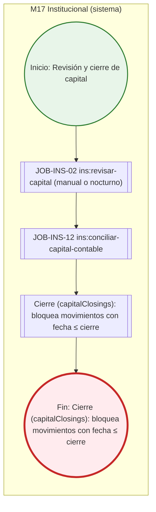

**Pasos del proceso** (actividad tomada del anexo; la columna RF/RN distingue lo citado en el paso de lo asociado por parámetro, permiso, evento o tema compartido).

| Paso | Carril | Actividad | RF/RN que aplican | EVT / JOB / PAN |
|---|---|---|---|---|
| 1 | M17 Institucional | JOB-INS-02 `ins:revisar-capital` (manual o nocturno): recorre comprobantes y pagos del período, calcula movimientos esperados y compara; propone ajustes `review` para aprobación. | asoc.: RF-INS-039, RN-INS-016 | JOB-INS-02 |
| 2 | M17 Institucional | JOB-INS-12 `ins:conciliar-capital-contable`: compara saldos por rubro con M15 y lista diferencias. | — | JOB-INS-12 |
| 3 | M17 Institucional | Cierre (`capitalClosings`): bloquea movimientos con fecha ≤ cierre; reapertura con aprobación. | asoc.: RN-INS-024 | — |

**Situación actual en ProCoop (nota de cambio).** Sin contraste específico para este proceso en el anexo (filas `CTR-` con ProCoop) ni en el análisis de brechas. El contraste del dominio está en `15-analisis-brechas-procoop.md` §3.16.

**Excepciones**

| Excepción | Tratamiento |
|---|---|
| Bloqueo | Cierre (`capitalClosings`): bloquea movimientos con fecha ≤ cierre; reapertura con aprobación |
| Falla técnica en un paso automático, un job o una integración | Reintento idempotente y reanudable; lo no reparable pasa a la bandeja técnica con responsable (política de recuperación de T11 P-WFL-01 y T01 §9.12; AGR-016). |

---

## 20. PRC-INS-05 Rescate / reembolso

| Campo | Contenido |
|---|---|
| Fuente | M17 §9.5, `M17-INS-institucional.md` (línea 1248) |
| Macroproceso | MP-17 Institucional y servicios sociales |
| Disparador | Rescate / reembolso |
| Resultado | Emisión del comprobante de rescate (tipo y concepto…) |
| Carriles | M17 Institucional (sistema); Aprobador según política (T11 aprobaciones) |
| Roles de T02 | Solo actores del sistema (sin rol humano) |
| Módulos involucrados | M17 Institucional, T11 Workflow, eventos y documentos |
| Eventos (T11 §12) | — |
| Jobs | JOB-INS-11 `ins:procesar-cola-rescates` |
| Relación con 04-procesos-bpmn.md | — |

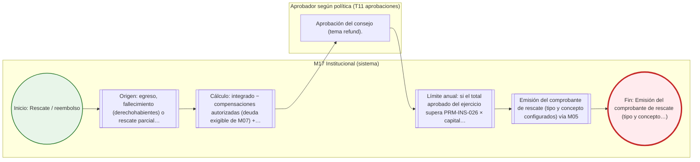

**Pasos del proceso** (actividad tomada del anexo; la columna RF/RN distingue lo citado en el paso de lo asociado por parámetro, permiso, evento o tema compartido).

| Paso | Carril | Actividad | RF/RN que aplican | EVT / JOB / PAN |
|---|---|---|---|---|
| 1 | M17 Institucional | Origen: egreso, fallecimiento (derechohabientes) o rescate parcial estatutario. | — | — |
| 2 | M17 Institucional | Cálculo: integrado − compensaciones autorizadas (deuda exigible de M07) + interés si corresponde. | — | — |
| 3 | Aprobador según política | Aprobación del consejo (tema `refund`). | — | — |
| 4 | M17 Institucional | Límite anual: si el total aprobado del ejercicio supera PRM-INS-026 × capital integrado del último balance, queda `queued` con posición (orden PRM-INS-027). JOB-INS-11 al aprobarse un nuevo balance libera la cola. | asoc.: RN-INS-028, RN-INS-023 | JOB-INS-11 |
| 5 | M17 Institucional | Emisión del comprobante de rescate (tipo y concepto configurados) vía M05; orden de pago vía M14; movimiento `refunded`; asiento vía M15. | asoc.: RF-INS-051 | — |

**Situación actual en ProCoop (nota de cambio).** Sin contraste específico para este proceso en el anexo (filas `CTR-` con ProCoop) ni en el análisis de brechas. El contraste del dominio está en `15-analisis-brechas-procoop.md` §3.16.

**Excepciones**

| Excepción | Tratamiento |
|---|---|
| Si el total aprobado del ejercicio supera PRM-INS-026 × capital integrado del último balance | queda `queued` con posición (orden PRM-INS-027) |
| Falla técnica en un paso automático, un job o una integración | Reintento idempotente y reanudable; lo no reparable pasa a la bandeja técnica con responsable (política de recuperación de T11 P-WFL-01 y T01 §9.12; AGR-016). |

---

## 21. PRC-INS-06 Distribución de excedentes

| Campo | Contenido |
|---|---|
| Fuente | M17 §9.6, `M17-INS-institucional.md` (línea 1256) |
| Macroproceso | MP-17 Institucional y servicios sociales |
| Disparador | Distribución de excedentes |
| Resultado | JOB-INS-07 ins:ejecutar-distribucion |
| Carriles | M15 Contabilidad; Contador / Contable (MT-006) (T-CON); M17 Institucional (sistema) |
| Roles de T02 | T-CON Contador / Contable (MT-006) |
| Módulos involucrados | M15 Contabilidad, M17 Institucional |
| Eventos (T11 §12) | EVT-CON-09 `con.fiscalYear.closed` |
| Jobs | JOB-INS-06 `ins:calcular-distribucion-excedentes`; JOB-INS-07 `ins:ejecutar-distribucion` |
| Relación con 04-procesos-bpmn.md | — |

```mermaid
flowchart LR
  subgraph L_LM15["M15 Contabilidad"]
    ni(("Inicio: Distribución de excedentes"))
    ns1[["M15 cierra el ejercicio y publica con.fiscalYear.closed."]]
    ne1>"EVT-CON-09 con.fiscalYear.closed"]
  end
  subgraph L_LTCON["Contador / Contable (MT-006) (T-CON)"]
    ns2["Contador crea la distribución y ejecuta JOB-INS-06…"]
  end
  subgraph L_LSIS["M17 Institucional (sistema)"]
    ns3[["Se incorpora como documento del expediente de la asamblea ordinaria."]]
    ns4[["La asamblea aprueba (resolución) → approved."]]
    ns5[["JOB-INS-07 ins:ejecutar-distribucion"]]
    nf(("Fin: JOB-INS-07 ins:ejecutar-distribucion"))
  end
  ni --> ns1
  ns1 -.-> ne1
  ns1 --> ns2
  ns2 --> ns3
  ns3 --> ns4
  ns4 --> ns5
  ns5 --> nf
  classDef inicio fill:#e8f5e9,stroke:#2e7d32,stroke-width:2px
  classDef fin fill:#ffebee,stroke:#c62828,stroke-width:4px
  classDef evento fill:#fff8e1,stroke:#f9a825
  classDef temporizador fill:#e3f2fd,stroke:#1565c0
  class ni inicio
  class nf fin
  class ne1 evento
```

**Pasos del proceso** (actividad tomada del anexo; la columna RF/RN distingue lo citado en el paso de lo asociado por parámetro, permiso, evento o tema compartido).

| Paso | Carril | Actividad | RF/RN que aplican | EVT / JOB / PAN |
|---|---|---|---|---|
| 1 | M15 Contabilidad | M15 cierra el ejercicio y publica `con.fiscalYear.closed`. | — | EVT-CON-09 |
| 2 | Contador / Contable | Contador crea la distribución y ejecuta JOB-INS-06 `ins:calcular-distribucion-excedentes` (simulación por asociado con base de retorno elegida). | — | JOB-INS-06 |
| 3 | M17 Institucional | Se incorpora como documento del expediente de la asamblea ordinaria. | — | — |
| 4 | M17 Institucional | La asamblea aprueba (resolución) → `approved`. | — | — |
| 5 | M17 Institucional | JOB-INS-07 `ins:ejecutar-distribucion`: por asociado genera capitalización, crédito (M07) u orden de pago (M14); asientos; constancias. Reanudable por asociado; idempotente por `distributionId + associateMembershipId` (antes `membershipId`). | asoc.: RF-INS-064 | JOB-INS-07 |

**Situación actual en ProCoop (nota de cambio).** Sin contraste específico para este proceso en el anexo (filas `CTR-` con ProCoop) ni en el análisis de brechas. El contraste del dominio está en `15-analisis-brechas-procoop.md` §3.16.

**Excepciones**

| Excepción | Tratamiento |
|---|---|
| Umbral o tolerancia superada | Contador crea la distribución y ejecuta JOB-INS-06 `ins:calcular-distribucion-excedentes` (simulación por asociado con base de retorno elegida) |
| Falla técnica en un paso automático, un job o una integración | Reintento idempotente y reanudable; lo no reparable pasa a la bandeja técnica con responsable (política de recuperación de T11 P-WFL-01 y T01 §9.12; AGR-016). |

---

## Inconsistencias detectadas en la especificación (esta parte)

No se detectaron inconsistencias en los procesos de esta parte.

## Cobertura de esta parte

| Universo de la parte | Diagramados | Con nota ProCoop específica | Pendientes |
|---|---|---|---|
| 21 (PRC-CMP-03 a PRC-INS-06) | 21 | 2 | 0 |
