# GoodApps Cooperativas

## Procesos de negocio — Institucional y servicios sociales y Plataforma, configuración, experiencia e integraciones (M17, M18, T01)

**Entregable de Análisis y Diseño Detallado — Artefacto 2.1 (Procesos de negocio BPMN). Parte de [`04-procesos-bpmn.md`](04-procesos-bpmn.md).**

| Dato | Valor |
|---|---|
| Documento | Diagramas BPMN, pasos, situación actual en ProCoop y excepciones de los procesos PRC-INS-07 a PRC-PLA-05, derivados de la sección 9 de M17, M18, T01 |
| Carácter | Derivado de la especificación vigente; no la reemplaza. Ante diferencias prevalecen la maestra `00`, los anexos, T05, T11 y el registro de decisiones `01` |
| Generación | Script `_trabajo/generar_bpmn.py` con la ampliación `_trabajo/generar_prc.py` (derivación automática desde el texto de la sección 9 de cada anexo, `_trabajo/prc_auto.py`) |
| Versión | 1.1 (regenerada contra la especificación corregida) |
| Fecha | 05-11-2026 |

**Cómo leer cada proceso.** La notación es la de [`04-procesos-bpmn.md` §3](04-procesos-bpmn.md#3-notación-equivalencia-mermaid--bpmn) (carriles, eventos de inicio y fin, tareas de usuario y de servicio, compuertas XOR y AND, eventos de dominio como banderas, temporizadores y jobs como estadios). La tabla de pasos reproduce la actividad del anexo; en la columna RF/RN, los identificadores sin prefijo son los que el anexo cita en el paso y los marcados "asoc." son reglas o requisitos del mismo anexo que comparten parámetro, permiso, evento o tema con el paso (asociación generada por el script y revisada). Los eventos se nombran con su ID del catálogo de T11 §12.

**Derivación automática (v1.2).** Los procesos `PRC-<MOD>-nn` de esta parte se generaron con `_trabajo/generar_prc.py` y `_trabajo/prc_auto.py` a partir del texto de cada subsección §9.n del anexo, sin curaduría paso a paso (a diferencia de los 94 procesos `P-XXX-nn` de las partes 04b a 04i). Reglas: (1) los pasos son los numerados o viñetas del anexo; si la subsección es prosa, se parte por flechas o por oraciones; si es una tabla de pasos o de jobs, cada fila es un paso; (2) el carril de cada paso es el primer actor nombrado al comienzo del paso (rol de T02 §4, otro módulo, sistema externo, dispositivo o job); si no se nombra ninguno, el paso es del sistema del módulo dueño; (3) los pasos que empiezan con "Si …" se dibujan como compuerta XOR; (4) los eventos son los nombres del catálogo de T11 §12 citados en el paso (bandera entrante si el paso los consume, saliente si los publica); el temporizador aparece cuando el título nombra un job periódico; (5) las excepciones son las oraciones del anexo con condición o con palabras de falla, rechazo, vencimiento, duplicado o umbral, más la política de recuperación del anexo; (6) la nota ProCoop combina lo que dice el propio anexo, la fila `CTR-` del anexo que contrasta con ProCoop y la fila de `15-analisis-brechas-procoop.md` §3 de mayor afinidad; si ninguna alcanza el umbral, la nota lo dice y remite al contraste del dominio en esa sección. La revisión manual de una muestra está en `_trabajo/prc_revision.md`; ante diferencias, prevalece el texto del anexo citado en la ficha.

## Índice de procesos de esta parte

1. [PRC-INS-07 Asamblea](#1-prc-ins-07-asamblea)
2. [PRC-INS-08 Reunión de consejo](#2-prc-ins-08-reunión-de-consejo)
3. [PRC-INS-09 Honorarios](#3-prc-ins-09-honorarios)
4. [PRC-INS-10 Informes INAES y libro](#4-prc-ins-10-informes-inaes-y-libro)
5. [PRC-INS-11 Alertas](#5-prc-ins-11-alertas)
6. [PRC-INS-12 Credenciales masivas](#6-prc-ins-12-credenciales-masivas)
7. [PRC-SOC-01 Alta y mantenimiento del grupo](#7-prc-soc-01-alta-y-mantenimiento-del-grupo)
8. [PRC-SOC-02 Solicitud de prestación (CU-24)](#8-prc-soc-02-solicitud-de-prestación-cu-24)
9. [PRC-SOC-03 Sepelio y subsidio](#9-prc-soc-03-sepelio-y-subsidio)
10. [PRC-SOC-04 Cementerio parque (CU-ESP-CEM)](#10-prc-soc-04-cementerio-parque-cu-esp-cem)
11. [PRC-SOC-05 Banco de sangre (CU-ESP-SAN)](#11-prc-soc-05-banco-de-sangre-cu-esp-san)
12. [PRC-SOC-06 Traslados y ambulancias](#12-prc-soc-06-traslados-y-ambulancias)
13. [PRC-SOC-07 Plan de vivienda](#13-prc-soc-07-plan-de-vivienda)
14. [PRC-SOC-08 Flota](#14-prc-soc-08-flota)
15. [PRC-SOC-09 GPS/AVL](#15-prc-soc-09-gpsavl)
16. [PRC-SOC-10 Otros servicios](#16-prc-soc-10-otros-servicios)
17. [PRC-PLA-01 Alta asistida de una cooperativa (CU-PLA-01)](#17-prc-pla-01-alta-asistida-de-una-cooperativa-cu-pla-01)
18. [PRC-PLA-02 Activación de un módulo en producción (CU-PLA-03)](#18-prc-pla-02-activación-de-un-módulo-en-producción-cu-pla-03)
19. [PRC-PLA-03 Suspensión y reactivación (CU-PLA-05)](#19-prc-pla-03-suspensión-y-reactivación-cu-pla-05)
20. [PRC-PLA-04 Soporte con acceso temporal (CU-PLA-06)](#20-prc-pla-04-soporte-con-acceso-temporal-cu-pla-06)
21. [PRC-PLA-05 Sandbox de cooperativa y prueba de configuración (CU-PLA-07)](#21-prc-pla-05-sandbox-de-cooperativa-y-prueba-de-configuración-cu-pla-07)

---

## 1. PRC-INS-07 Asamblea

| Campo | Contenido |
|---|---|
| Fuente | M17 §9.7, `M17-INS-institucional.md` (línea 1264) |
| Macroproceso | MP-17 Institucional y servicios sociales |
| Disparador | Asamblea |
| Resultado | Presentación post-asamblea (RF-INS-091) dentro de PRM-INS-036. |
| Carriles | Consejero (T-CJO); Secretaría institucional (T-SEC); M17 Institucional (sistema); T09 Comunicaciones |
| Roles de T02 | T-CJO Consejero, T-SEC Secretaría institucional |
| Módulos involucrados | M17 Institucional, T09 Comunicaciones |
| Eventos (T11 §12) | — |
| Jobs | JOB-INS-03 `ins:generar-padron` |
| Relación con 04-procesos-bpmn.md | — |

```mermaid
flowchart LR
  subgraph L_LTCJO["Consejero (T-CJO)"]
    ni(("Inicio: Asamblea"))
    ns1["Consejo resuelve convocar (tema en reunión de consejo)."]
  end
  subgraph L_LTSEC["Secretaría institucional (T-SEC)"]
    ns2["Secretaría crea la reunión de asamblea, orden del día, expediente (memoria…)"]
  end
  subgraph L_LSIS["M17 Institucional (sistema)"]
    ns3[["JOB-INS-03 ins:generar-padron con criterios → padrón preliminar"]]
    ns5[["Listas (si hay elección)"]]
    ns6[["Día de la asamblea: acreditación (PAN-INS-20), poderes, quórum"]]
    ns7[["Tratamiento por tema; votaciones (votingSessions); resoluciones."]]
    ns8[["Cierre; acta generada desde temas y resultados; firmas; libro de actas."]]
    ns9[["Efectos: mandatos electos (bodyMandates), distribución aprobada, honorarios…"]]
    ns10[["Presentación post-asamblea (RF-INS-091) dentro de PRM-INS-036."]]
    nf(("Fin: Presentación post-asamblea (RF-INS-091) dentro de PRM-INS-036."))
  end
  subgraph L_LT09["T09 Comunicaciones"]
    ns4[["Publicación de convocatoria (T09) con anticipación PRM-INS-033 y registro de…"]]
  end
  ni --> ns1
  ns1 --> ns2
  ns2 --> ns3
  ns3 --> ns4
  ns4 --> ns5
  ns5 --> ns6
  ns6 --> ns7
  ns7 --> ns8
  ns8 --> ns9
  ns9 --> ns10
  ns10 --> nf
  classDef inicio fill:#e8f5e9,stroke:#2e7d32,stroke-width:2px
  classDef fin fill:#ffebee,stroke:#c62828,stroke-width:4px
  classDef evento fill:#fff8e1,stroke:#f9a825
  classDef temporizador fill:#e3f2fd,stroke:#1565c0
  class ni inicio
  class nf fin
```

**Pasos del proceso** (actividad tomada del anexo; la columna RF/RN distingue lo citado en el paso de lo asociado por parámetro, permiso, evento o tema compartido).

| Paso | Carril | Actividad | RF/RN que aplican | EVT / JOB / PAN |
|---|---|---|---|---|
| 1 | Consejero | Consejo resuelve convocar (tema en reunión de consejo). | — | — |
| 2 | Secretaría institucional | Secretaría crea la reunión de asamblea, orden del día, expediente (memoria, estados contables, informes, proyecto de distribución), modalidad. | asoc.: RF-INS-090, RF-INS-076 | — |
| 3 | M17 Institucional | JOB-INS-03 `ins:generar-padron` con criterios → padrón preliminar; exhibición en PWA; reclamos; versión final aprobada. | asoc.: RF-INS-078 | JOB-INS-03 |
| 4 | T09 Comunicaciones | Publicación de convocatoria (T09) con anticipación PRM-INS-033 y registro de comunicación al INAES/órgano local. | asoc.: RF-INS-076, RN-INS-036 | — |
| 5 | M17 Institucional | Listas (si hay elección): presentación, oficialización por junta electoral. | — | — |
| 6 | M17 Institucional | Día de la asamblea: acreditación (PAN-INS-20), poderes, quórum; primer/segundo llamado. | asoc.: RF-INS-082 | PAN-INS-20 |
| 7 | M17 Institucional | Tratamiento por tema; votaciones (`votingSessions`); resoluciones. | — | — |
| 8 | M17 Institucional | Cierre; acta generada desde temas y resultados; firmas; libro de actas. | — | — |
| 9 | M17 Institucional | Efectos: mandatos electos (`bodyMandates`), distribución aprobada, honorarios aprobados, reglamentos. | — | — |
| 10 | M17 Institucional | Presentación post-asamblea (RF-INS-091) dentro de PRM-INS-036. | RF-INS-091 | — |

**Situación actual en ProCoop (nota de cambio).** Sin contraste específico para este proceso en el anexo (filas `CTR-` con ProCoop) ni en el análisis de brechas. El contraste del dominio está en `15-analisis-brechas-procoop.md` §3.16.

**Excepciones**

| Excepción | Tratamiento |
|---|---|
| Falla técnica en un paso automático, un job o una integración | Reintento idempotente y reanudable; lo no reparable pasa a la bandeja técnica con responsable (política de recuperación de T11 P-WFL-01 y T01 §9.12; AGR-016). |

---

## 2. PRC-INS-08 Reunión de consejo

| Campo | Contenido |
|---|---|
| Fuente | M17 §9.8, `M17-INS-institucional.md` (línea 1277) |
| Macroproceso | MP-17 Institucional y servicios sociales |
| Disparador | Reunión de consejo |
| Resultado | Efectos sobre objetos vinculados (cada linkedRef recibe la…) |
| Carriles | M17 Institucional (sistema) |
| Roles de T02 | Solo actores del sistema (sin rol humano) |
| Módulos involucrados | M17 Institucional |
| Eventos (T11 §12) | EVT-INS-17 `ins.resolution.created` |
| Jobs | — |
| Relación con 04-procesos-bpmn.md | — |

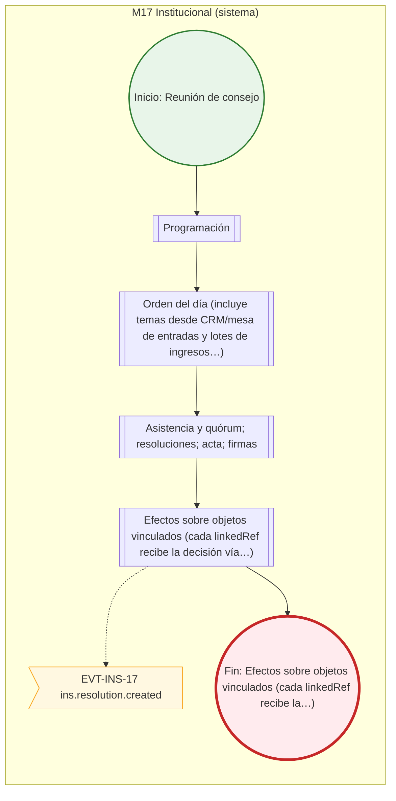

**Pasos del proceso** (actividad tomada del anexo; la columna RF/RN distingue lo citado en el paso de lo asociado por parámetro, permiso, evento o tema compartido).

| Paso | Carril | Actividad | RF/RN que aplican | EVT / JOB / PAN |
|---|---|---|---|---|
| 1 | M17 Institucional | Programación | — | — |
| 2 | M17 Institucional | orden del día (incluye temas desde CRM/mesa de entradas y lotes de ingresos, rescates, transferencias) | — | — |
| 3 | M17 Institucional | asistencia y quórum; resoluciones; acta; firmas | — | — |
| 4 | M17 Institucional | efectos sobre objetos vinculados (cada `linkedRef` recibe la decisión vía evento `ins.resolution.created`) | — | EVT-INS-17 |

**Situación actual en ProCoop (nota de cambio).** Sin contraste específico para este proceso en el anexo (filas `CTR-` con ProCoop) ni en el análisis de brechas. El contraste del dominio está en `15-analisis-brechas-procoop.md` §3.16.

**Excepciones**

| Excepción | Tratamiento |
|---|---|
| Falla técnica en un paso automático, un job o una integración | Reintento idempotente y reanudable; lo no reparable pasa a la bandeja técnica con responsable (política de recuperación de T11 P-WFL-01 y T01 §9.12; AGR-016). |

---

## 3. PRC-INS-09 Honorarios

| Campo | Contenido |
|---|---|
| Fuente | M17 §9.9, `M17-INS-institucional.md` (línea 1281) |
| Macroproceso | MP-17 Institucional y servicios sociales |
| Disparador | Honorarios |
| Resultado | Evento ins.fee.settled a M15 |
| Carriles | M17 Institucional (sistema) |
| Roles de T02 | Solo actores del sistema (sin rol humano) |
| Módulos involucrados | M17 Institucional |
| Eventos (T11 §12) | EVT-INS-20 `ins.fee.settled` |
| Jobs | JOB-INS-10 `ins:liquidar-honorarios` |
| Relación con 04-procesos-bpmn.md | — |

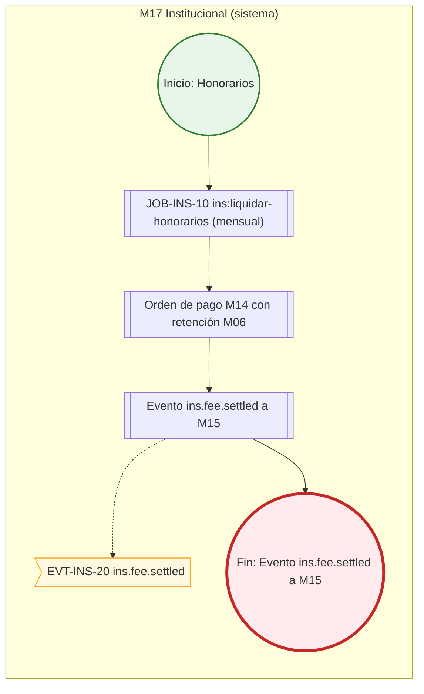

**Pasos del proceso** (actividad tomada del anexo; la columna RF/RN distingue lo citado en el paso de lo asociado por parámetro, permiso, evento o tema compartido).

| Paso | Carril | Actividad | RF/RN que aplican | EVT / JOB / PAN |
|---|---|---|---|---|
| 1 | M17 Institucional | JOB-INS-10 `ins:liquidar-honorarios` (mensual): por `institutionalFees` vigente y mandatos activos en el período calcula importe (prorrateo PRM-INS-038), crea `institutionalFeeSettlements` en `draft`; aprobación | asoc.: RF-INS-096, RN-INS-040 | JOB-INS-10 |
| 2 | M17 Institucional | orden de pago M14 con retención M06 | — | — |
| 3 | M17 Institucional | evento `ins.fee.settled` a M15 | — | EVT-INS-20 |

**Situación actual en ProCoop (nota de cambio).** Sin contraste específico para este proceso en el anexo (filas `CTR-` con ProCoop) ni en el análisis de brechas. El contraste del dominio está en `15-analisis-brechas-procoop.md` §3.16.

**Excepciones**

| Excepción | Tratamiento |
|---|---|
| Falla técnica en un paso automático, un job o una integración | Reintento idempotente y reanudable; lo no reparable pasa a la bandeja técnica con responsable (política de recuperación de T11 P-WFL-01 y T01 §9.12; AGR-016). |

---

## 4. PRC-INS-10 Informes INAES y libro

| Campo | Contenido |
|---|---|
| Fuente | M17 §9.10, `M17-INS-institucional.md` (línea 1285) |
| Macroproceso | MP-17 Institucional y servicios sociales |
| Disparador | Informes INAES y libro |
| Resultado | Validación previa de códigos INAES |
| Carriles | M17 Institucional (sistema) |
| Roles de T02 | Solo actores del sistema (sin rol humano) |
| Módulos involucrados | M17 Institucional |
| Eventos (T11 §12) | — |
| Jobs | JOB-INS-04 `ins:emitir-libro-asociados`; JOB-INS-05 `ins:exportar-inaes` |
| Relación con 04-procesos-bpmn.md | — |

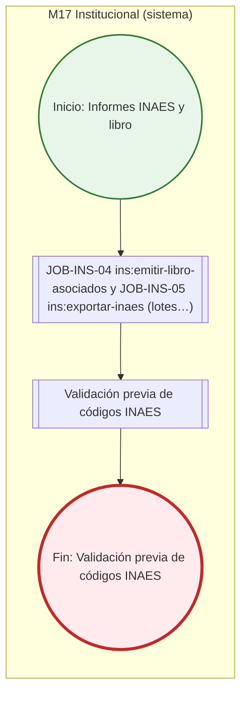

**Pasos del proceso** (actividad tomada del anexo; la columna RF/RN distingue lo citado en el paso de lo asociado por parámetro, permiso, evento o tema compartido).

| Paso | Carril | Actividad | RF/RN que aplican | EVT / JOB / PAN |
|---|---|---|---|---|
| 1 | M17 Institucional | JOB-INS-04 `ins:emitir-libro-asociados` y JOB-INS-05 `ins:exportar-inaes` (lotes por PRM-INS-047) generan archivos con hash | — | JOB-INS-04, JOB-INS-05 |
| 2 | M17 Institucional | validación previa de códigos INAES; registro de presentación y acuse | — | — |

**Situación actual en ProCoop (nota de cambio).** Sin contraste específico para este proceso en el anexo (filas `CTR-` con ProCoop) ni en el análisis de brechas. El contraste del dominio está en `15-analisis-brechas-procoop.md` §3.16.

**Excepciones**

| Excepción | Tratamiento |
|---|---|
| Falla técnica en un paso automático, un job o una integración | Reintento idempotente y reanudable; lo no reparable pasa a la bandeja técnica con responsable (política de recuperación de T11 P-WFL-01 y T01 §9.12; AGR-016). |

---

## 5. PRC-INS-11 Alertas

| Campo | Contenido |
|---|---|
| Fuente | M17 §9.11, `M17-INS-institucional.md` (línea 1289) |
| Macroproceso | MP-17 Institucional y servicios sociales |
| Disparador | Alertas |
| Resultado | JOB-INS-09 ins:alertas-institucionales (diario) |
| Carriles | M17 Institucional (sistema) |
| Roles de T02 | Solo actores del sistema (sin rol humano) |
| Módulos involucrados | M17 Institucional |
| Eventos (T11 §12) | — |
| Jobs | JOB-INS-09 `ins:alertas-institucionales` |
| Relación con 04-procesos-bpmn.md | — |

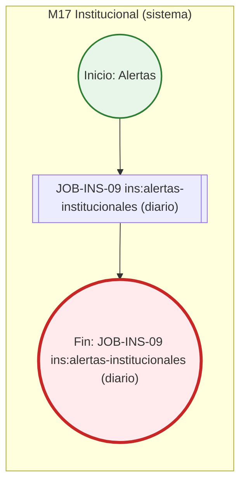

**Pasos del proceso** (actividad tomada del anexo; la columna RF/RN distingue lo citado en el paso de lo asociado por parámetro, permiso, evento o tema compartido).

| Paso | Carril | Actividad | RF/RN que aplican | EVT / JOB / PAN |
|---|---|---|---|---|
| 1 | M17 Institucional | JOB-INS-09 `ins:alertas-institucionales` (diario): mandatos por vencer, asamblea ordinaria pendiente, presentaciones INAES, rescates en cola, resoluciones vencidas, asociados sin servicios (RF-INS-100) | RF-INS-100; asoc.: RF-INS-108, RF-INS-089 | JOB-INS-09 |

**Situación actual en ProCoop (nota de cambio).** Sin contraste específico para este proceso en el anexo (filas `CTR-` con ProCoop) ni en el análisis de brechas. El contraste del dominio está en `15-analisis-brechas-procoop.md` §3.16.

**Excepciones**

| Excepción | Tratamiento |
|---|---|
| Vencimiento | JOB-INS-09 `ins:alertas-institucionales` (diario): mandatos por vencer, asamblea ordinaria pendiente, presentaciones INAES, rescates en cola, resoluciones vencidas, asociados sin servicios (RF-INS-100) |
| Falla técnica en un paso automático, un job o una integración | Reintento idempotente y reanudable; lo no reparable pasa a la bandeja técnica con responsable (política de recuperación de T11 P-WFL-01 y T01 §9.12; AGR-016). |

---

## 6. PRC-INS-12 Credenciales masivas

| Campo | Contenido |
|---|---|
| Fuente | M17 §9.12, `M17-INS-institucional.md` (línea 1293) |
| Macroproceso | MP-17 Institucional y servicios sociales |
| Disparador | Credenciales masivas |
| Resultado | PDF imprimible y activación de credencial digital |
| Carriles | M17 Institucional (sistema) |
| Roles de T02 | Solo actores del sistema (sin rol humano) |
| Módulos involucrados | M17 Institucional |
| Eventos (T11 §12) | — |
| Jobs | JOB-INS-08 `ins:emitir-credenciales-masivas` |
| Relación con 04-procesos-bpmn.md | — |

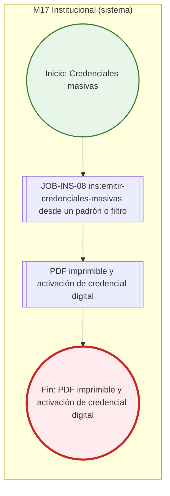

**Pasos del proceso** (actividad tomada del anexo; la columna RF/RN distingue lo citado en el paso de lo asociado por parámetro, permiso, evento o tema compartido).

| Paso | Carril | Actividad | RF/RN que aplican | EVT / JOB / PAN |
|---|---|---|---|---|
| 1 | M17 Institucional | JOB-INS-08 `ins:emitir-credenciales-masivas` desde un padrón o filtro | — | JOB-INS-08 |
| 2 | M17 Institucional | PDF imprimible y activación de credencial digital | — | — |

**Situación actual en ProCoop (nota de cambio).** Sin contraste específico para este proceso en el anexo (filas `CTR-` con ProCoop) ni en el análisis de brechas. El contraste del dominio está en `15-analisis-brechas-procoop.md` §3.16.

**Excepciones**

| Excepción | Tratamiento |
|---|---|
| Falla técnica en un paso automático, un job o una integración | Reintento idempotente y reanudable; lo no reparable pasa a la bandeja técnica con responsable (política de recuperación de T11 P-WFL-01 y T01 §9.12; AGR-016). |

---

## 7. PRC-SOC-01 Alta y mantenimiento del grupo

| Campo | Contenido |
|---|---|
| Fuente | M18 §9.1, `M18-SOC-servicios-sociales-flota.md` (línea 1441) |
| Macroproceso | MP-17 Institucional y servicios sociales |
| Disparador | Alta y mantenimiento del grupo |
| Resultado | Desconexión/reconexión/transferencia/fallecimiento |
| Carriles | M18 Servicios sociales (sistema); Operador de servicios sociales y salud (T-SOC) |
| Roles de T02 | T-SOC Operador de servicios sociales y salud |
| Módulos involucrados | M18 Servicios sociales |
| Eventos (T11 §12) | EVT-SOC-01 `soc.dependent.added` |
| Jobs | JOB-SOC-01 `soc:mayoria-edad`; JOB-SOC-02 `soc:revision-condiciones` |
| Relación con 04-procesos-bpmn.md | P9 Servicio social de sepelio: alta, carencia y prestación ([§13](04-procesos-bpmn.md#13-p9--servicio-social-de-sepelio-alta-carencia-y-prestación)) |

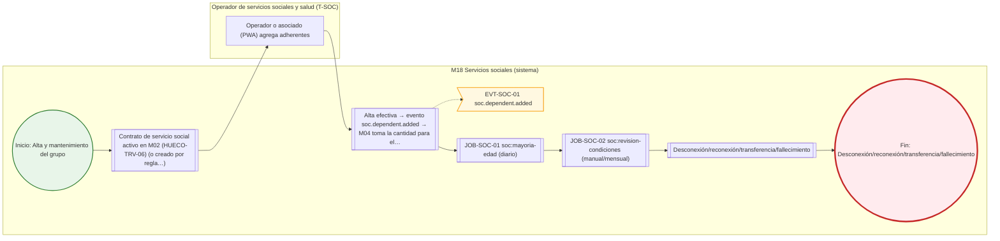

**Pasos del proceso** (actividad tomada del anexo; la columna RF/RN distingue lo citado en el paso de lo asociado por parámetro, permiso, evento o tema compartido).

| Paso | Carril | Actividad | RF/RN que aplican | EVT / JOB / PAN |
|---|---|---|---|---|
| 1 | M18 Servicios sociales | Contrato de servicio social activo en M02 (HUECO-TRV-06; antes "en M01") (o creado por regla de alta automática, RF-SOC-029). | RF-SOC-029; asoc.: RF-SOC-088 | — |
| 2 | Operador de servicios sociales y salud | Operador o asociado (PWA) agrega adherentes: persona en M01, vínculo, requisitos; validaciones RN-SOC-001, RN-SOC-005, RN-SOC-006, RN-SOC-007, RN-SOC-014. | RN-SOC-001, RN-SOC-005, RN-SOC-006, RN-SOC-007, RN-SOC-014; asoc.: RF-SOC-149 | — |
| 3 | M18 Servicios sociales | Alta efectiva → evento `soc.dependent.added` → M04 toma la cantidad para el próximo período. | — | EVT-SOC-01 |
| 4 | M18 Servicios sociales | JOB-SOC-01 `soc:mayoria-edad` (diario): detecta mayoría de edad, notifica y propone baja o recategorización. | asoc.: RF-SOC-017 | JOB-SOC-01 |
| 5 | M18 Servicios sociales | JOB-SOC-02 `soc:revision-condiciones` (manual/mensual): previsualiza bajas por condición o recategorización masiva; aplica con confirmación por lote (reanudable, idempotente por `batchId + dependentId`). | — | JOB-SOC-02 |
| 6 | M18 Servicios sociales | Desconexión/reconexión/transferencia/fallecimiento: consumidores de eventos de M02 (contrato) y M01 (fallecimiento) aplican RN-SOC-008 a 013. | RN-SOC-008 | — |

**Situación actual en ProCoop (nota de cambio).** Sin contraste específico para este proceso en el anexo (filas `CTR-` con ProCoop) ni en el análisis de brechas. El contraste del dominio está en `15-analisis-brechas-procoop.md` §3.17.

**Excepciones**

| Excepción | Tratamiento |
|---|---|
| Falla técnica en un paso automático, un job o una integración | Reintento idempotente y reanudable; lo no reparable pasa a la bandeja técnica con responsable (política de recuperación de T11 P-WFL-01 y T01 §9.12; AGR-016). |

---

## 8. PRC-SOC-02 Solicitud de prestación (CU-24)

| Campo | Contenido |
|---|---|
| Fuente | M18 §9.2, `M18-SOC-servicios-sociales-flota.md` (línea 1450) |
| Macroproceso | MP-17 Institucional y servicios sociales |
| Disparador | Solicitud de prestación |
| Resultado | Cierre con conformidad. |
| Carriles | M18 Servicios sociales (sistema); Operador de servicios sociales y salud (T-SOC) |
| Roles de T02 | T-SOC Operador de servicios sociales y salud |
| Módulos involucrados | M18 Servicios sociales |
| Eventos (T11 §12) | — |
| Jobs | — |
| Relación con 04-procesos-bpmn.md | P9 Servicio social de sepelio: alta, carencia y prestación ([§13](04-procesos-bpmn.md#13-p9--servicio-social-de-sepelio-alta-carencia-y-prestación)) |

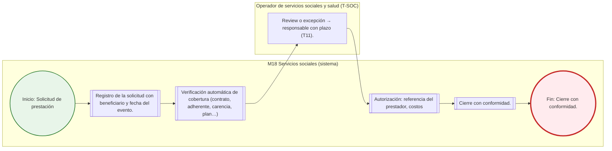

**Pasos del proceso** (actividad tomada del anexo; la columna RF/RN distingue lo citado en el paso de lo asociado por parámetro, permiso, evento o tema compartido).

| Paso | Carril | Actividad | RF/RN que aplican | EVT / JOB / PAN |
|---|---|---|---|---|
| 1 | M18 Servicios sociales | Registro de la solicitud con beneficiario y fecha del evento. | — | — |
| 2 | M18 Servicios sociales | Verificación automática de cobertura (contrato, adherente, carencia, plan, topes, convenio) → `covered`/`notCovered`/`review`. | — | — |
| 3 | Operador de servicios sociales y salud | `review` o excepción → responsable con plazo (T11). | — | — |
| 4 | M18 Servicios sociales | Autorización: referencia del prestador, costos; cargos al socio → M04/M05; factura del prestador → M12. | — | — |
| 5 | M18 Servicios sociales | Cierre con conformidad. | — | — |

**Situación actual en ProCoop (nota de cambio).** Sin contraste específico para este proceso en el anexo (filas `CTR-` con ProCoop) ni en el análisis de brechas. El contraste del dominio está en `15-analisis-brechas-procoop.md` §3.17.

**Excepciones**

| Excepción | Tratamiento |
|---|---|
| Falla técnica en un paso automático, un job o una integración | Reintento idempotente y reanudable; lo no reparable pasa a la bandeja técnica con responsable (política de recuperación de T11 P-WFL-01 y T01 §9.12; AGR-016). |

---

## 9. PRC-SOC-03 Sepelio y subsidio

| Campo | Contenido |
|---|---|
| Fuente | M18 §9.3, `M18-SOC-servicios-sociales-flota.md` (línea 1458) |
| Macroproceso | MP-17 Institucional y servicios sociales |
| Disparador | Sepelio y subsidio |
| Resultado | Subsidio: expediente con beneficiarios, requisitos, aprobación… |
| Carriles | M18 Servicios sociales (sistema) |
| Roles de T02 | Solo actores del sistema (sin rol humano) |
| Módulos involucrados | M01 Personas, M18 Servicios sociales |
| Eventos (T11 §12) | EVT-PER-03 `per.person.deceased` |
| Jobs | JOB-SOC-03 `soc:vencimiento-subsidios` |
| Relación con 04-procesos-bpmn.md | P9 Servicio social de sepelio: alta, carencia y prestación ([§13](04-procesos-bpmn.md#13-p9--servicio-social-de-sepelio-alta-carencia-y-prestación)) |

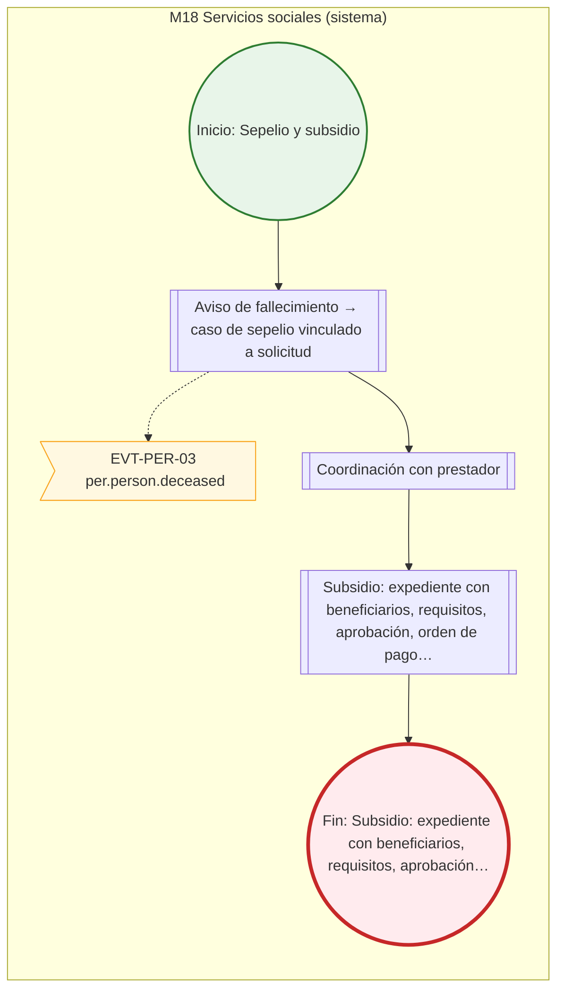

**Pasos del proceso** (actividad tomada del anexo; la columna RF/RN distingue lo citado en el paso de lo asociado por parámetro, permiso, evento o tema compartido).

| Paso | Carril | Actividad | RF/RN que aplican | EVT / JOB / PAN |
|---|---|---|---|---|
| 1 | M18 Servicios sociales | Aviso de fallecimiento → caso de sepelio vinculado a solicitud; si la persona no tiene fallecimiento en M01, se registra (M01 publica `per.person.deceased`). | asoc.: RN-SOC-011 | EVT-PER-03 |
| 2 | M18 Servicios sociales | Coordinación con prestador; traslado y acto de cementerio vinculados si corresponde. | — | — |
| 3 | M18 Servicios sociales | Subsidio: expediente con beneficiarios, requisitos, aprobación, orden de pago M14; JOB-SOC-03 `soc:vencimiento-subsidios` marca `expired` fuera de plazo. | asoc.: RF-SOC-044 | JOB-SOC-03 |

**Situación actual en ProCoop (nota de cambio).** Sin contraste específico para este proceso en el anexo (filas `CTR-` con ProCoop) ni en el análisis de brechas. El contraste del dominio está en `15-analisis-brechas-procoop.md` §3.17.

**Excepciones**

| Excepción | Tratamiento |
|---|---|
| Si la persona no tiene fallecimiento en M01 | se registra (M01 publica `per.person.deceased`) |
| Vencimiento | JOB-SOC-03 `soc:vencimiento-subsidios` marca `expired` fuera de plazo |
| Falla técnica en un paso automático, un job o una integración | Reintento idempotente y reanudable; lo no reparable pasa a la bandeja técnica con responsable (política de recuperación de T11 P-WFL-01 y T01 §9.12; AGR-016). |

---

## 10. PRC-SOC-04 Cementerio parque (CU-ESP-CEM)

| Campo | Contenido |
|---|---|
| Fuente | M18 §9.4, `M18-SOC-servicios-sociales-flota.md` (línea 1464) |
| Macroproceso | MP-17 Institucional y servicios sociales |
| Disparador | Cementerio parque |
| Resultado | Mora: solo cobranza M07/M08 |
| Carriles | M18 Servicios sociales (sistema) |
| Roles de T02 | Solo actores del sistema (sin rol humano) |
| Módulos involucrados | M18 Servicios sociales |
| Eventos (T11 §12) | — |
| Jobs | JOB-SOC-04 `soc:vencer-reservas` |
| Relación con 04-procesos-bpmn.md | P9 Servicio social de sepelio: alta, carencia y prestación ([§13](04-procesos-bpmn.md#13-p9--servicio-social-de-sepelio-alta-carencia-y-prestación)) |

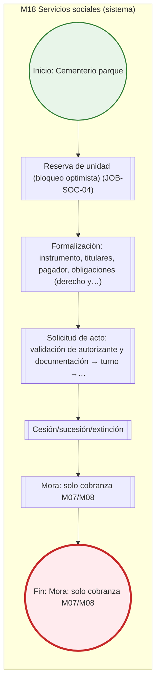

**Pasos del proceso** (actividad tomada del anexo; la columna RF/RN distingue lo citado en el paso de lo asociado por parámetro, permiso, evento o tema compartido).

| Paso | Carril | Actividad | RF/RN que aplican | EVT / JOB / PAN |
|---|---|---|---|---|
| 1 | M18 Servicios sociales | Reserva de unidad (bloqueo optimista; vencimiento por JOB-SOC-04 `soc:vencer-reservas`). | — | JOB-SOC-04 |
| 2 | M18 Servicios sociales | Formalización: instrumento, titulares, pagador, obligaciones (derecho y mantenimiento como conceptos de M02/M04). | — | — |
| 3 | M18 Servicios sociales | Solicitud de acto: validación de autorizante y documentación → turno → realización → ocupación creada o cerrada. | — | — |
| 4 | M18 Servicios sociales | Cesión/sucesión/extinción: expediente T11 con aprobación jurídica. | asoc.: RF-SOC-059 | — |
| 5 | M18 Servicios sociales | Mora: solo cobranza M07/M08; nunca libera ocupación ni cancela derecho. | — | — |

**Situación actual en ProCoop (nota de cambio).** Sin contraste específico para este proceso en el anexo (filas `CTR-` con ProCoop) ni en el análisis de brechas. El contraste del dominio está en `15-analisis-brechas-procoop.md` §3.17.

**Excepciones**

| Excepción | Tratamiento |
|---|---|
| Vencimiento | Reserva de unidad (bloqueo optimista; vencimiento por JOB-SOC-04 `soc:vencer-reservas`) |
| Cancelación, anulación o reversión | Mora: solo cobranza M07/M08; nunca libera ocupación ni cancela derecho |
| Falla técnica en un paso automático, un job o una integración | Reintento idempotente y reanudable; lo no reparable pasa a la bandeja técnica con responsable (política de recuperación de T11 P-WFL-01 y T01 §9.12; AGR-016). |

---

## 11. PRC-SOC-05 Banco de sangre (CU-ESP-SAN)

| Campo | Contenido |
|---|---|
| Fuente | M18 §9.5, `M18-SOC-servicios-sociales-flota.md` (línea 1472) |
| Macroproceso | MP-17 Institucional y servicios sociales |
| Disparador | Banco de sangre |
| Resultado | Cierre; costo del convenio registrado como gasto (M12/M15) |
| Carriles | M18 Servicios sociales (sistema) |
| Roles de T02 | Solo actores del sistema (sin rol humano) |
| Módulos involucrados | M18 Servicios sociales |
| Eventos (T11 §12) | — |
| Jobs | — |
| Relación con 04-procesos-bpmn.md | P9 Servicio social de sepelio: alta, carencia y prestación ([§13](04-procesos-bpmn.md#13-p9--servicio-social-de-sepelio-alta-carencia-y-prestación)) |

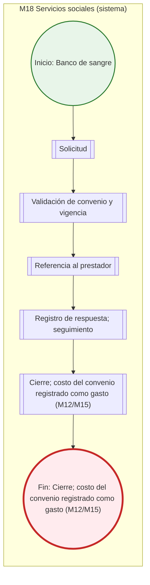

**Pasos del proceso** (actividad tomada del anexo; la columna RF/RN distingue lo citado en el paso de lo asociado por parámetro, permiso, evento o tema compartido).

| Paso | Carril | Actividad | RF/RN que aplican | EVT / JOB / PAN |
|---|---|---|---|---|
| 1 | M18 Servicios sociales | Solicitud | — | — |
| 2 | M18 Servicios sociales | validación de convenio y vigencia | — | — |
| 3 | M18 Servicios sociales | referencia al prestador | — | — |
| 4 | M18 Servicios sociales | registro de respuesta; seguimiento | — | — |
| 5 | M18 Servicios sociales | cierre; costo del convenio registrado como gasto (M12/M15) | — | — |

**Situación actual en ProCoop (nota de cambio).** Sin contraste específico para este proceso en el anexo (filas `CTR-` con ProCoop) ni en el análisis de brechas. El contraste del dominio está en `15-analisis-brechas-procoop.md` §3.17.

**Excepciones**

| Excepción | Tratamiento |
|---|---|
| Falla técnica en un paso automático, un job o una integración | Reintento idempotente y reanudable; lo no reparable pasa a la bandeja técnica con responsable (política de recuperación de T11 P-WFL-01 y T01 §9.12; AGR-016). |

---

## 12. PRC-SOC-06 Traslados y ambulancias

| Campo | Contenido |
|---|---|
| Fuente | M18 §9.6, `M18-SOC-servicios-sociales-flota.md` (línea 1476) |
| Macroproceso | MP-17 Institucional y servicios sociales |
| Disparador | Traslados y ambulancias |
| Resultado | Cierre: cálculo de importe (cubierto o facturable), uso de… |
| Carriles | M18 Servicios sociales (sistema) |
| Roles de T02 | Solo actores del sistema (sin rol humano) |
| Módulos involucrados | M18 Servicios sociales |
| Eventos (T11 §12) | — |
| Jobs | — |
| Relación con 04-procesos-bpmn.md | P9 Servicio social de sepelio: alta, carencia y prestación ([§13](04-procesos-bpmn.md#13-p9--servicio-social-de-sepelio-alta-carencia-y-prestación)) |

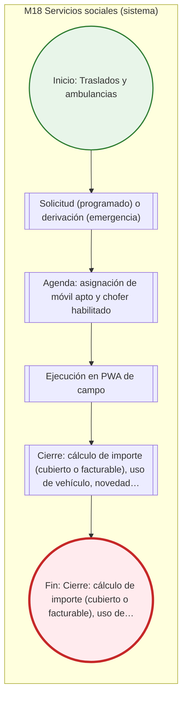

**Pasos del proceso** (actividad tomada del anexo; la columna RF/RN distingue lo citado en el paso de lo asociado por parámetro, permiso, evento o tema compartido).

| Paso | Carril | Actividad | RF/RN que aplican | EVT / JOB / PAN |
|---|---|---|---|---|
| 1 | M18 Servicios sociales | Solicitud (programado) o derivación (emergencia: se informa el prestador, estado `derived`). | — | — |
| 2 | M18 Servicios sociales | Agenda: asignación de móvil apto y chofer habilitado; control de superposición. | — | — |
| 3 | M18 Servicios sociales | Ejecución en PWA de campo: km inicial/final, tramos. | — | — |
| 4 | M18 Servicios sociales | Cierre: cálculo de importe (cubierto o facturable), uso de vehículo, novedad de horas al chofer. | — | — |

**Situación actual en ProCoop (nota de cambio).** Sin contraste específico para este proceso en el anexo (filas `CTR-` con ProCoop) ni en el análisis de brechas. El contraste del dominio está en `15-analisis-brechas-procoop.md` §3.17.

**Excepciones**

| Excepción | Tratamiento |
|---|---|
| Falla técnica en un paso automático, un job o una integración | Reintento idempotente y reanudable; lo no reparable pasa a la bandeja técnica con responsable (política de recuperación de T11 P-WFL-01 y T01 §9.12; AGR-016). |

---

## 13. PRC-SOC-07 Plan de vivienda

| Campo | Contenido |
|---|---|
| Fuente | M18 §9.7, `M18-SOC-servicios-sociales-flota.md` (línea 1483) |
| Macroproceso | MP-17 Institucional y servicios sociales |
| Disparador | Plan de vivienda |
| Resultado | JOB-SOC-05 soc:actualizar-precios-vivienda |
| Carriles | M18 Servicios sociales (sistema) |
| Roles de T02 | Solo actores del sistema (sin rol humano) |
| Módulos involucrados | M05 Facturación, M07 Cuenta corriente y cobranza, M18 Servicios sociales |
| Eventos (T11 §12) | EVT-FAC-07 `fac.invoice.issued`; EVT-COB-04 `cob.payment.confirmed` |
| Jobs | JOB-SOC-05 `soc:actualizar-precios-vivienda` |
| Relación con 04-procesos-bpmn.md | P9 Servicio social de sepelio: alta, carencia y prestación ([§13](04-procesos-bpmn.md#13-p9--servicio-social-de-sepelio-alta-carencia-y-prestación)) |

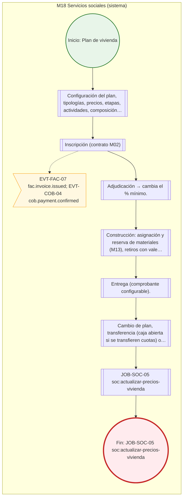

**Pasos del proceso** (actividad tomada del anexo; la columna RF/RN distingue lo citado en el paso de lo asociado por parámetro, permiso, evento o tema compartido).

| Paso | Carril | Actividad | RF/RN que aplican | EVT / JOB / PAN |
|---|---|---|---|---|
| 1 | M18 Servicios sociales | Configuración del plan, tipologías, precios, etapas, actividades, composición de materiales; validación de configuración (RN-SOC-041). | RN-SOC-041 | — |
| 2 | M18 Servicios sociales | Inscripción (contrato M02; HUECO-TRV-06, antes "contrato M01") → aportes mensuales: M04 consulta `billing-inputs` (% y precio) y M05 emite en comprobante exclusivo; `fac.invoice.issued` actualiza `pctBilled`; `cob.payment.confirmed` actualiza `pctPaid`; anulación revierte. | asoc.: RF-SOC-088 | EVT-FAC-07, EVT-COB-04 |
| 3 | M18 Servicios sociales | Adjudicación → cambia el % mínimo. | — | — |
| 4 | M18 Servicios sociales | Construcción: asignación y reserva de materiales (M13), retiros con vale, progreso por actividad, certificados por período, aprobación y liquidación al constructor (M12/M14). | asoc.: RF-SOC-104, RF-SOC-103 | — |
| 5 | M18 Servicios sociales | Entrega (comprobante configurable). | — | — |
| 6 | M18 Servicios sociales | Cambio de plan, transferencia (caja abierta si se transfieren cuotas) o rescisión (comisión, diferencia, devolución o compensación). | asoc.: RN-SOC-040, RF-SOC-108 | — |
| 7 | M18 Servicios sociales | JOB-SOC-05 `soc:actualizar-precios-vivienda`: actualización masiva con aprobación. | asoc.: RF-SOC-087 | JOB-SOC-05 |

**Situación actual en ProCoop (nota de cambio).** Sin contraste específico para este proceso en el anexo (filas `CTR-` con ProCoop) ni en el análisis de brechas. El contraste del dominio está en `15-analisis-brechas-procoop.md` §3.17.

**Excepciones**

| Excepción | Tratamiento |
|---|---|
| Cancelación, anulación o reversión | `cob.payment.confirmed` actualiza `pctPaid`; anulación revierte |
| Falla técnica en un paso automático, un job o una integración | Reintento idempotente y reanudable; lo no reparable pasa a la bandeja técnica con responsable (política de recuperación de T11 P-WFL-01 y T01 §9.12; AGR-016). |

---

## 14. PRC-SOC-08 Flota

| Campo | Contenido |
|---|---|
| Fuente | M18 §9.8, `M18-SOC-servicios-sociales-flota.md` (línea 1493) |
| Macroproceso | MP-17 Institucional y servicios sociales |
| Disparador | Flota |
| Resultado | JOB-SOC-07 soc:mantenimiento-preventivo (diario) |
| Carriles | M18 Servicios sociales (sistema); Operador de servicios sociales y salud (T-SOC) |
| Roles de T02 | T-SOC Operador de servicios sociales y salud |
| Módulos involucrados | M12 Compras, M18 Servicios sociales |
| Eventos (T11 §12) | EVT-CMP-08 `cmp.supplierInvoice.registered` |
| Jobs | JOB-SOC-06 `soc:vencimientos-flota`; JOB-SOC-07 `soc:mantenimiento-preventivo` |
| Relación con 04-procesos-bpmn.md | P9 Servicio social de sepelio: alta, carencia y prestación ([§13](04-procesos-bpmn.md#13-p9--servicio-social-de-sepelio-alta-carencia-y-prestación)) |

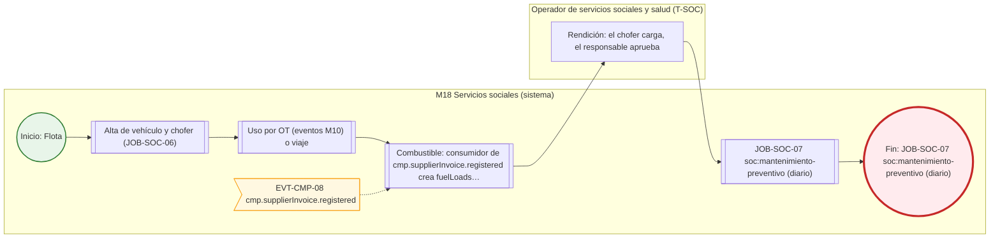

**Pasos del proceso** (actividad tomada del anexo; la columna RF/RN distingue lo citado en el paso de lo asociado por parámetro, permiso, evento o tema compartido).

| Paso | Carril | Actividad | RF/RN que aplican | EVT / JOB / PAN |
|---|---|---|---|---|
| 1 | M18 Servicios sociales | Alta de vehículo y chofer; documentos con vencimiento; JOB-SOC-06 `soc:vencimientos-flota` (diario) alerta y marca `unfit`. | — | JOB-SOC-06 |
| 2 | M18 Servicios sociales | Uso por OT (eventos M10) o viaje; costo por km a M15. | — | — |
| 3 | M18 Servicios sociales | Combustible: consumidor de `cmp.supplierInvoice.registered` crea `fuelLoads` desde líneas de combustible con móvil; carga manual o desde PWA de campo; anulación libera. | — | EVT-CMP-08 |
| 4 | Operador de servicios sociales y salud | Rendición: el chofer carga, el responsable aprueba; viáticos → M16; costos → M15. | — | — |
| 5 | M18 Servicios sociales | JOB-SOC-07 `soc:mantenimiento-preventivo` (diario): alerta por km o fecha. | — | JOB-SOC-07 |

**Situación actual en ProCoop (nota de cambio).** Sin contraste específico para este proceso en el anexo (filas `CTR-` con ProCoop) ni en el análisis de brechas. El contraste del dominio está en `15-analisis-brechas-procoop.md` §3.17.

**Excepciones**

| Excepción | Tratamiento |
|---|---|
| Vencimiento | Alta de vehículo y chofer; documentos con vencimiento |
| Vencimiento | JOB-SOC-06 `soc:vencimientos-flota` (diario) alerta y marca `unfit` |
| Cancelación, anulación o reversión | Combustible: consumidor de `cmp.supplierInvoice.registered` crea `fuelLoads` desde líneas de combustible con móvil; carga manual o desde PWA de campo; anulación libera |
| Falla técnica en un paso automático, un job o una integración | Reintento idempotente y reanudable; lo no reparable pasa a la bandeja técnica con responsable (política de recuperación de T11 P-WFL-01 y T01 §9.12; AGR-016). |

---

## 15. PRC-SOC-09 GPS/AVL

| Campo | Contenido |
|---|---|
| Fuente | M18 §9.9, `M18-SOC-servicios-sociales-flota.md` (línea 1501) |
| Macroproceso | MP-17 Institucional y servicios sociales |
| Disparador | GPS/AVL |
| Resultado | Recuperación: el adaptador de T06 reanuda desde la última marca… |
| Carriles | M18 Servicios sociales (sistema) |
| Roles de T02 | Solo actores del sistema (sin rol humano) |
| Módulos involucrados | M18 Servicios sociales, T06 Integraciones |
| Eventos (T11 §12) | EVT-INT-17 `int.fleet.positionsReceived`, `int.fleet.positions-received`; EVT-SOC-17 `soc.vehicle.usageVoided` |
| Jobs | JOB-SOC-08 `soc:ingestar-gps`; JOB-SOC-09 `soc:resumir-recorridos` |
| Relación con 04-procesos-bpmn.md | P9 Servicio social de sepelio: alta, carencia y prestación ([§13](04-procesos-bpmn.md#13-p9--servicio-social-de-sepelio-alta-carencia-y-prestación)) |

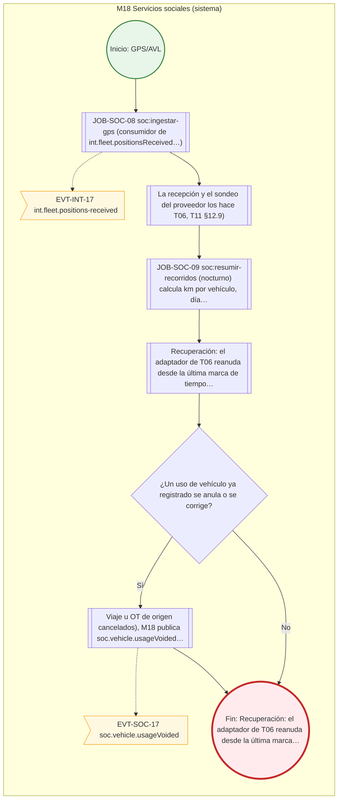

**Pasos del proceso** (actividad tomada del anexo; la columna RF/RN distingue lo citado en el paso de lo asociado por parámetro, permiso, evento o tema compartido).

| Paso | Carril | Actividad | RF/RN que aplican | EVT / JOB / PAN |
|---|---|---|---|---|
| 1 | M18 Servicios sociales | JOB-SOC-08 `soc:ingestar-gps` (consumidor de `int.fleet.positionsReceived` (antes `int.fleet.positions-received`), EVT-INT-17 | — | JOB-SOC-08, EVT-INT-17 |
| 2 | M18 Servicios sociales | la recepción y el sondeo del proveedor los hace T06, T11 §12.9): toma el lote de posiciones, normaliza, deduplica por unidad y hora, guarda en serie temporal | — | — |
| 3 | M18 Servicios sociales | JOB-SOC-09 `soc:resumir-recorridos` (nocturno) calcula km por vehículo, día, viaje y OT y compara con km declarados | — | JOB-SOC-09 |
| 4 | M18 Servicios sociales | Recuperación: el adaptador de T06 reanuda desde la última marca de tiempo recibida | — | — |
| 5 | M18 Servicios sociales | Si un uso de vehículo ya registrado se anula o se corrige (carga errónea, viaje u OT de origen cancelados), M18 publica `soc.vehicle.usageVoided` (EVT-SOC-17) para que M15 revierta el costo y M16 retire la novedad propuesta | — | EVT-SOC-17 |

**Situación actual en ProCoop (nota de cambio).** Sin contraste específico para este proceso en el anexo (filas `CTR-` con ProCoop) ni en el análisis de brechas. El contraste del dominio está en `15-analisis-brechas-procoop.md` §3.17.

**Excepciones**

| Excepción | Tratamiento |
|---|---|
| Duplicado | JOB-SOC-08 `soc:ingestar-gps` (consumidor de `int.fleet.positionsReceived` (antes `int.fleet.positions-received`), EVT-INT-17 la recepción y el sondeo del proveedor los hace T06, T11 §12.9): toma el lote de posiciones, normaliza, deduplica por unidad y hora, guarda en serie temporal JOB-SOC-09 `soc:resumir-recorridos` (nocturno) calcula km por vehículo, día, viaje y OT y compara con km declarados  |
| Falla técnica en un paso automático, un job o una integración | Reintento idempotente y reanudable; lo no reparable pasa a la bandeja técnica con responsable (política de recuperación de T11 P-WFL-01 y T01 §9.12; AGR-016). |

---

## 16. PRC-SOC-10 Otros servicios

| Campo | Contenido |
|---|---|
| Fuente | M18 §9.10, `M18-SOC-servicios-sociales-flota.md` (línea 1505) |
| Macroproceso | MP-17 Institucional y servicios sociales |
| Disparador | Otros servicios |
| Resultado | Retiros de dispenser validados en línea (límite diario, litros…) |
| Carriles | M18 Servicios sociales (sistema) |
| Roles de T02 | Solo actores del sistema (sin rol humano) |
| Módulos involucrados | M18 Servicios sociales |
| Eventos (T11 §12) | — |
| Jobs | JOB-SOC-10 `soc:vencimiento-prestamos` |
| Relación con 04-procesos-bpmn.md | P9 Servicio social de sepelio: alta, carencia y prestación ([§13](04-procesos-bpmn.md#13-p9--servicio-social-de-sepelio-alta-carencia-y-prestación)) |

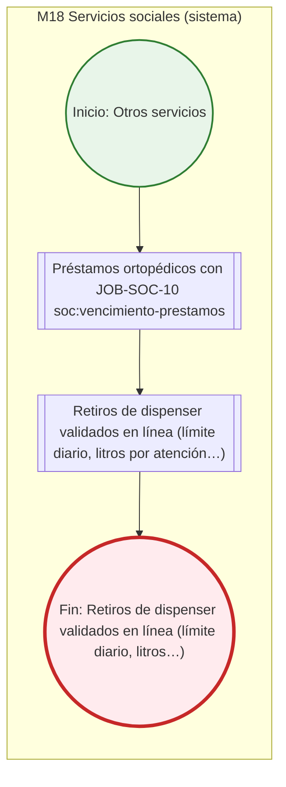

**Pasos del proceso** (actividad tomada del anexo; la columna RF/RN distingue lo citado en el paso de lo asociado por parámetro, permiso, evento o tema compartido).

| Paso | Carril | Actividad | RF/RN que aplican | EVT / JOB / PAN |
|---|---|---|---|---|
| 1 | M18 Servicios sociales | Préstamos ortopédicos con JOB-SOC-10 `soc:vencimiento-prestamos` | — | JOB-SOC-10 |
| 2 | M18 Servicios sociales | retiros de dispenser validados en línea (límite diario, litros por atención, deuda a N días consultada a M08) | — | — |

**Situación actual en ProCoop (nota de cambio).** Sin contraste específico para este proceso en el anexo (filas `CTR-` con ProCoop) ni en el análisis de brechas. El contraste del dominio está en `15-analisis-brechas-procoop.md` §3.17.

**Excepciones**

| Excepción | Tratamiento |
|---|---|
| Vencimiento | Préstamos ortopédicos con JOB-SOC-10 `soc:vencimiento-prestamos` retiros de dispenser validados en línea (límite diario, litros por atención, deuda a N días consultada a M08) |
| Falla técnica en un paso automático, un job o una integración | Reintento idempotente y reanudable; lo no reparable pasa a la bandeja técnica con responsable (política de recuperación de T11 P-WFL-01 y T01 §9.12; AGR-016). |

---

## 17. PRC-PLA-01 Alta asistida de una cooperativa (CU-PLA-01)

| Campo | Contenido |
|---|---|
| Fuente | T01 §9.1, `T01-PLA-plataforma-saas.md` (línea 1686) |
| Macroproceso | MP-18 Plataforma, configuración, experiencia e integraciones |
| Disparador | Alta asistida de una cooperativa |
| Resultado | Opcional: crear sandbox (§9.6). |
| Carriles | Administrador de operaciones de tenants (P-ADM); T01 Plataforma (sistema); Administrador de la cooperativa (T-ADM) |
| Roles de T02 | P-ADM Administrador de operaciones de tenants, T-ADM Administrador de la cooperativa |
| Módulos involucrados | T01 Plataforma |
| Eventos (T11 §12) | EVT-PLA-01 `pla.tenant.created` |
| Jobs | JOB-PLA-16 `pla:propuesta-ia-alta`; JOB-PLA-02 `pla:evaluar-checklist`; JOB-PLA-17 `pla:limpiar-borradores-y-temporales` |
| Relación con 04-procesos-bpmn.md | — |

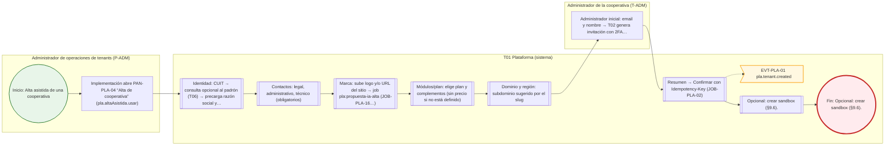

**Pasos del proceso** (actividad tomada del anexo; la columna RF/RN distingue lo citado en el paso de lo asociado por parámetro, permiso, evento o tema compartido).

| Paso | Carril | Actividad | RF/RN que aplican | EVT / JOB / PAN |
|---|---|---|---|---|
| 1 | Administrador de operaciones de tenants | Implementación abre PAN-PLA-04 “Alta de cooperativa” (`pla.altaAsistida.usar`); se crea `onboardingDrafts` (`step: identity`). | asoc.: RF-PLA-056 | PAN-PLA-04 |
| 2 | T01 Plataforma | Identidad: CUIT → consulta opcional al padrón (T06) → precarga razón social y domicilio; la persona confirma; validación de duplicado (RN-PLA-007). | RN-PLA-007 | — |
| 3 | T01 Plataforma | Contactos: legal, administrativo, técnico (obligatorios); facturación, seguridad, soporte (opcionales). | — | — |
| 4 | T01 Plataforma | Marca: sube logo y/o URL del sitio → job `pla:propuesta-ia-alta` (JOB-PLA-16, cola `interactive`) → la IA devuelve paleta, nombre corto, slugs, splash, íconos y sugerencias de diccionario → validación de contraste (RF-PLA-058) → preview celular de PWA y landing (patrón CNX §4.2) → la persona acepta, edita o descarta cada propuesta. | RF-PLA-058 | JOB-PLA-16 |
| 5 | T01 Plataforma | Módulos/plan: elige plan y complementos (sin precio si no está definido); se calculan dependencias. | — | — |
| 6 | T01 Plataforma | Dominio y región: subdominio sugerido por el slug; dominio propio opcional; región (PA-PLA-01); zona horaria; anillo. | — | — |
| 7 | Administrador de la cooperativa | Administrador inicial: email y nombre → T02 genera invitación con 2FA obligatorio. | — | — |
| 8 | T01 Plataforma | Resumen → Confirmar con `Idempotency-Key`: transacción que crea `tenants` (`preparing`), `tenantLicenses`, `tenantModuleActivations` (`off`), `tenantChecklists` (`tenant.base`), aplica branding y diccionario (T03, comando `uxd.applyBrandingProposal` en la misma sesión), registra `aiUsage.outcome`, publica `pla.tenant.created`. Consumidores: T02 envía la invitación; T09 notifica a contactos; JOB-PLA-02 evalúa el checklist. | asoc.: RF-PLA-073, RF-PLA-060 | JOB-PLA-02, EVT-PLA-01 |
| 9 | T01 Plataforma | Opcional: crear sandbox (§9.6). | — | — |

**Situación actual en ProCoop (nota de cambio).** Sin contraste específico para este proceso en el anexo (filas `CTR-` con ProCoop) ni en el análisis de brechas. El contraste del dominio está en `15-analisis-brechas-procoop.md` §3.1.

**Excepciones**

| Excepción | Tratamiento |
|---|---|
| Duplicado | Identidad: CUIT → consulta opcional al padrón (T06) → precarga razón social y domicilio; la persona confirma; validación de duplicado (RN-PLA-007) |
| Duplicado | CUIT duplicado → bloqueo con enlace al tenant existente (si el usuario tiene permiso); reintento del paso 8 → misma respuesta (idempotencia); borrador sin actividad `PRM-PLA-039` días → `expired` y limpieza (JOB-PLA-17) |
| Falla técnica en un paso automático, un job o una integración | Reintento idempotente y reanudable; lo no reparable pasa a la bandeja técnica con responsable (política de recuperación de T11 P-WFL-01 y T01 §9.12; AGR-016). |

---

## 18. PRC-PLA-02 Activación de un módulo en producción (CU-PLA-03)

| Campo | Contenido |
|---|---|
| Fuente | T01 §9.3, `T01-PLA-plataforma-saas.md` (línea 1754) |
| Macroproceso | MP-18 Plataforma, configuración, experiencia e integraciones |
| Disparador | Activación de un módulo en producción |
| Resultado | Consumidores: el módulo activado programa sus jobs (fan-out)… |
| Carriles | Administrador de operaciones de tenants (P-ADM); T01 Plataforma (sistema) |
| Roles de T02 | P-ADM Administrador de operaciones de tenants |
| Módulos involucrados | T01 Plataforma |
| Eventos (T11 §12) | EVT-PLA-06 `pla.capability.activated` |
| Jobs | — |
| Relación con 04-procesos-bpmn.md | — |

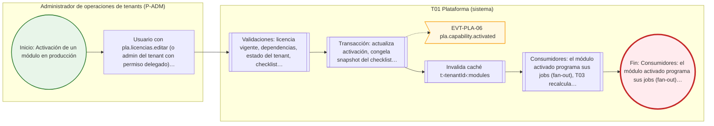

**Pasos del proceso** (actividad tomada del anexo; la columna RF/RN distingue lo citado en el paso de lo asociado por parámetro, permiso, evento o tema compartido).

| Paso | Carril | Actividad | RF/RN que aplican | EVT / JOB / PAN |
|---|---|---|---|---|
| 1 | Administrador de operaciones de tenants | Usuario con `pla.licencias.editar` (o admin del tenant con permiso delegado) pide `POST /api/platform/tenants/:id/modules/:code/activate { mode: 'production' }` con `Idempotency-Key`. | — | — |
| 2 | T01 Plataforma | Validaciones: licencia vigente, dependencias, estado del tenant, checklist completo → si falla, 409 con lista de ítems faltantes (enlaces a la pantalla del módulo que los resuelve). | — | — |
| 3 | T01 Plataforma | Transacción: actualiza activación, congela snapshot del checklist, `tenants.modulesVersion++`, outbox `pla.capability.activated`. | — | EVT-PLA-06 |
| 4 | T01 Plataforma | Invalida caché `t:<tenantId>:modules`; los tokens con `mv` anterior se refrescan al siguiente request. | — | — |
| 5 | T01 Plataforma | Consumidores: el módulo activado programa sus jobs (fan-out), T03 recalcula menú, T09 avisa al administrador. | — | — |

**Situación actual en ProCoop (nota de cambio).** Análisis de brechas (`15-analisis-brechas-procoop.md` §3.1, Plataforma): hoy Cada cooperativa es una instalación separada, administrada por el proveedor; en GoodApps, consola de plataforma: ciclo de vida de la cooperativa, licencias por módulo, alta asistida, salud y capacidad (brecha "Nuevo"; fuente T01; maestra §6).

**Excepciones**

| Excepción | Tratamiento |
|---|---|
| Falla o error | Validaciones: licencia vigente, dependencias, estado del tenant, checklist completo → si falla, 409 con lista de ítems faltantes (enlaces a la pantalla del módulo que los resuelve) |
| Falla o error | Invalida caché `t:<tenantId>:modules`; los tokens con `mv` anterior se refrescan al siguiente request |
| Falla técnica en un paso automático, un job o una integración | Reintento idempotente y reanudable; lo no reparable pasa a la bandeja técnica con responsable (política de recuperación de T11 P-WFL-01 y T01 §9.12; AGR-016). |

---

## 19. PRC-PLA-03 Suspensión y reactivación (CU-PLA-05)

| Campo | Contenido |
|---|---|
| Fuente | T01 §9.4, `T01-PLA-plataforma-saas.md` (línea 1762) |
| Macroproceso | MP-18 Plataforma, configuración, experiencia e integraciones |
| Disparador | Suspensión y reactivación |
| Resultado | Nunca: bajas de servicios, cambios de contratos, anulaciones… |
| Carriles | Aprobador según política (T11 aprobaciones); T01 Plataforma (sistema) |
| Roles de T02 | Solo actores del sistema (sin rol humano) |
| Módulos involucrados | T01 Plataforma, T11 Workflow, eventos y documentos |
| Eventos (T11 §12) | EVT-PLA-03 `pla.tenant.suspended`; EVT-PLA-04 `pla.tenant.reactivated` |
| Jobs | — |
| Relación con 04-procesos-bpmn.md | — |

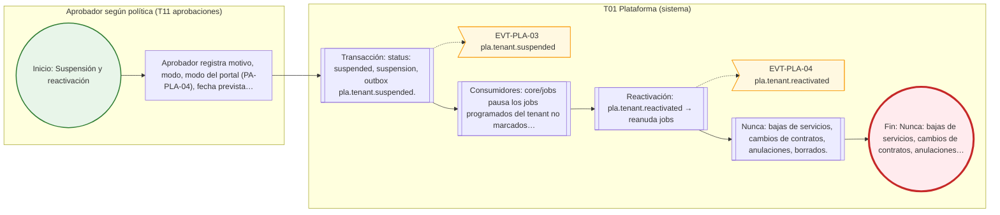

**Pasos del proceso** (actividad tomada del anexo; la columna RF/RN distingue lo citado en el paso de lo asociado por parámetro, permiso, evento o tema compartido).

| Paso | Carril | Actividad | RF/RN que aplican | EVT / JOB / PAN |
|---|---|---|---|---|
| 1 | Aprobador según política | Aprobador registra motivo, modo, modo del portal (PA-PLA-04), fecha prevista de fin y comunicación. | — | — |
| 2 | T01 Plataforma | Transacción: `status: suspended`, `suspension`, outbox `pla.tenant.suspended`. | asoc.: RF-PLA-052 | EVT-PLA-03 |
| 3 | T01 Plataforma | Consumidores: `core/jobs` pausa los jobs programados del tenant no marcados `legalObligation` (`jobRuns.status: paused`); `core/http` aplica el modo (middleware `tenantStatusGuard`: en `readOnlyStaff` rechaza métodos no GET con 423 `tenant-suspended`, salvo exportaciones y soporte); T09 notifica contactos; banner en admin. | asoc.: RN-PLA-012 | — |
| 4 | T01 Plataforma | Reactivación: `pla.tenant.reactivated` → reanuda jobs; los programados durante la suspensión se listan para decisión (RN-PLA-013). | RN-PLA-013; asoc.: RF-PLA-050 | EVT-PLA-04 |
| 5 | T01 Plataforma | Nunca: bajas de servicios, cambios de contratos, anulaciones, borrados. | — | — |

**Situación actual en ProCoop (nota de cambio).** Sin contraste específico para este proceso en el anexo (filas `CTR-` con ProCoop) ni en el análisis de brechas. El contraste del dominio está en `15-analisis-brechas-procoop.md` §3.1.

**Excepciones**

| Excepción | Tratamiento |
|---|---|
| Rechazo | `core/http` aplica el modo (middleware `tenantStatusGuard`: en `readOnlyStaff` rechaza métodos no GET con 423 `tenant-suspended`, salvo exportaciones y soporte) |
| Cancelación, anulación o reversión | Nunca: bajas de servicios, cambios de contratos, anulaciones, borrados |
| Falla técnica en un paso automático, un job o una integración | Reintento idempotente y reanudable; lo no reparable pasa a la bandeja técnica con responsable (política de recuperación de T11 P-WFL-01 y T01 §9.12; AGR-016). |

---

## 20. PRC-PLA-04 Soporte con acceso temporal (CU-PLA-06)

| Campo | Contenido |
|---|---|
| Fuente | T01 §9.5, `T01-PLA-plataforma-saas.md` (línea 1770) |
| Macroproceso | MP-18 Plataforma, configuración, experiencia e integraciones |
| Disparador | Soporte con acceso temporal |
| Resultado | Break-glass: solicitud con breakGlass: true (solo P1), dos… |
| Carriles | T01 Plataforma (sistema); Aprobador según política (T11 aprobaciones); Soporte plataforma nivel 2 / ingeniería (P-SOP2) |
| Roles de T02 | P-SOP2 Soporte plataforma nivel 2 / ingeniería |
| Módulos involucrados | T01 Plataforma, T11 Workflow, eventos y documentos |
| Eventos (T11 §12) | — |
| Jobs | — |
| Relación con 04-procesos-bpmn.md | — |

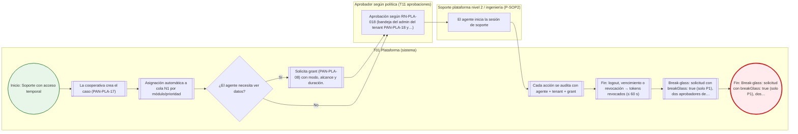

**Pasos del proceso** (actividad tomada del anexo; la columna RF/RN distingue lo citado en el paso de lo asociado por parámetro, permiso, evento o tema compartido).

| Paso | Carril | Actividad | RF/RN que aplican | EVT / JOB / PAN |
|---|---|---|---|---|
| 1 | T01 Plataforma | La cooperativa crea el caso (PAN-PLA-17): título, módulo, impacto, descripción, evidencias; el sistema adjunta contexto técnico; detector de secretos en texto y adjuntos de texto. | asoc.: RF-PLA-097 | PAN-PLA-17 |
| 2 | T01 Plataforma | Asignación automática a cola N1 por módulo/prioridad; SLA calculado. | — | — |
| 3 | T01 Plataforma | Si el agente necesita ver datos: solicita grant (PAN-PLA-08) con modo, alcance y duración. | — | PAN-PLA-08 |
| 4 | Aprobador según política | Aprobación según RN-PLA-018 (bandeja del admin del tenant PAN-PLA-18 y notificación). | RN-PLA-018 | PAN-PLA-18 |
| 5 | Soporte plataforma nivel 2 / ingeniería | El agente inicia la sesión de soporte: `POST /api/platform/support/grants/:id/sessions` → token de soporte (`tid` = tenant asistido, `act: support`, `sgid`, capabilities = intersección); el admin muestra banda “Sesión de soporte en <Cooperativa> — vence hh:mm”. | — | — |
| 6 | T01 Plataforma | Cada acción se audita con agente + tenant + grant; en `observe` los serializadores enmascaran PII si `piiAccess: false`. | — | — |
| 7 | T01 Plataforma | Fin: logout, vencimiento o revocación → tokens revocados (≤ 60 s); el caso registra la actuación; al resolver se notifica al tenant y se pide encuesta. | — | — |
| 8 | T01 Plataforma | Break-glass: solicitud con `breakGlass: true` (solo P1), dos aprobadores de plataforma, notificación inmediata al tenant, duración ≤ `PRM-PLA-011`, revisión posterior obligatoria en ≤ 5 días hábiles. | asoc.: RN-PLA-021, RN-PLA-018 | — |

**Situación actual en ProCoop (nota de cambio).** Sin contraste específico para este proceso en el anexo (filas `CTR-` con ProCoop) ni en el análisis de brechas. El contraste del dominio está en `15-analisis-brechas-procoop.md` §3.1.

**Excepciones**

| Excepción | Tratamiento |
|---|---|
| Si el agente necesita ver datos | solicita grant (PAN-PLA-08) con modo, alcance y duración |
| Vencimiento | El agente inicia la sesión de soporte: `POST /api/platform/support/grants/:id/sessions` → token de soporte (`tid` = tenant asistido, `act: support`, `sgid`, capabilities = intersección); el admin muestra banda “Sesión de soporte en <Cooperativa> — vence hh:mm” |
| Vencimiento | Fin: logout, vencimiento o revocación → tokens revocados (≤ 60 s); el caso registra la actuación; al resolver se notifica al tenant y se pide encuesta |
| Falla técnica en un paso automático, un job o una integración | Reintento idempotente y reanudable; lo no reparable pasa a la bandeja técnica con responsable (política de recuperación de T11 P-WFL-01 y T01 §9.12; AGR-016). |

---

## 21. PRC-PLA-05 Sandbox de cooperativa y prueba de configuración (CU-PLA-07)

| Campo | Contenido |
|---|---|
| Fuente | T01 §9.6, `T01-PLA-plataforma-saas.md` (línea 1781) |
| Macroproceso | MP-18 Plataforma, configuración, experiencia e integraciones |
| Disparador | Sandbox de cooperativa y prueba de configuración |
| Resultado | La simulación sin sandbox (in situ, sobre la configuración en…) |
| Carriles | Administrador de operaciones de tenants (P-ADM); T01 Plataforma (sistema) |
| Roles de T02 | P-ADM Administrador de operaciones de tenants |
| Módulos involucrados | T01 Plataforma |
| Eventos (T11 §12) | — |
| Jobs | JOB-PLA-15 `pla:crear-sandbox`; JOB-PLA-18 `pla:sincronizar-config-sandbox`; JOB-PLA-19 `pla:copia-anonimizada` |
| Relación con 04-procesos-bpmn.md | — |

```mermaid
flowchart LR
  subgraph L_LPADM["Administrador de operaciones de tenants (P-ADM)"]
    ni(("Inicio: Sandbox de cooperativa y prueba de configuración"))
    ns1["Implementación o admin del tenant solicita sandbox (PAN-PLA-14) → JOB-PLA-15…"]
  end
  subgraph L_LSIS["T01 Plataforma (sistema)"]
    ns2[["Datos: juego canónico ficticio por defecto (JOB-PLA-19)"]]
    ns3[["Configuración: el tenant exporta un paquete de configuración de producción…"]]
    ns4[["Banda “PRUEBA” permanente"]]
    ns5[["La simulación sin sandbox (in situ, sobre la configuración en borrador) la…"]]
    nf(("Fin: La simulación sin sandbox (in situ, sobre la configuración en…)"))
  end
  ni --> ns1
  ns1 --> ns2
  ns2 --> ns3
  ns3 --> ns4
  ns4 --> ns5
  ns5 --> nf
  classDef inicio fill:#e8f5e9,stroke:#2e7d32,stroke-width:2px
  classDef fin fill:#ffebee,stroke:#c62828,stroke-width:4px
  classDef evento fill:#fff8e1,stroke:#f9a825
  classDef temporizador fill:#e3f2fd,stroke:#1565c0
  class ni inicio
  class nf fin
```

**Pasos del proceso** (actividad tomada del anexo; la columna RF/RN distingue lo citado en el paso de lo asociado por parámetro, permiso, evento o tema compartido).

| Paso | Carril | Actividad | RF/RN que aplican | EVT / JOB / PAN |
|---|---|---|---|---|
| 1 | Administrador de operaciones de tenants | Implementación o admin del tenant solicita sandbox (PAN-PLA-14) → JOB-PLA-15 `pla:crear-sandbox` crea en el ambiente `sandbox` un tenant `kind: sandbox` con el mismo `code` + sufijo `-sbx`, branding y diccionario copiados, usuarios invitados (mismos emails, cuentas separadas por ambiente), integraciones forzadas a homologación, email con lista blanca. | asoc.: RF-PLA-112 | PAN-PLA-14, JOB-PLA-15 |
| 2 | T01 Plataforma | Datos: juego canónico ficticio por defecto; copia anonimizada solo con aprobación (PA-PLA-07; JOB-PLA-19). | asoc.: RF-PLA-116 | JOB-PLA-19 |
| 3 | T01 Plataforma | Configuración: el tenant exporta un paquete de configuración de producción (T04) → se transfiere firmado al sandbox (JOB-PLA-18 `pla:sincronizar-config-sandbox`) → se modifica y simula en sandbox (p. ej. tarifa nueva + facturación de prueba) → se exporta el paquete resultante → se importa en producción como borrador → circuito de publicación de T04 (aprobación, vigencia) (RN-PLA-035). | RN-PLA-035; asoc.: RF-PLA-111, RF-PLA-115 | JOB-PLA-18 |
| 4 | T01 Plataforma | Banda “PRUEBA” permanente; ninguna credencial productiva (RF-PLA-112). | RF-PLA-112 | — |
| 5 | T01 Plataforma | La simulación sin sandbox (in situ, sobre la configuración en borrador) la provee T04 para cambios menores. | — | — |

**Situación actual en ProCoop (nota de cambio).** Sin contraste específico para este proceso en el anexo (filas `CTR-` con ProCoop) ni en el análisis de brechas. El contraste del dominio está en `15-analisis-brechas-procoop.md` §3.1.

**Excepciones**

| Excepción | Tratamiento |
|---|---|
| Falla técnica en un paso automático, un job o una integración | Reintento idempotente y reanudable; lo no reparable pasa a la bandeja técnica con responsable (política de recuperación de T11 P-WFL-01 y T01 §9.12; AGR-016). |

---

## Inconsistencias detectadas en la especificación (esta parte)

No se detectaron inconsistencias en los procesos de esta parte.

## Cobertura de esta parte

| Universo de la parte | Diagramados | Con nota ProCoop específica | Pendientes |
|---|---|---|---|
| 21 (PRC-INS-07 a PRC-PLA-05) | 21 | 1 | 0 |
