# GoodApps Cooperativas

## Procesos de negocio — Plataforma, configuración, experiencia e integraciones (T01, T03, T04)

**Entregable de Análisis y Diseño Detallado — Artefacto 2.1 (Procesos de negocio BPMN). Parte de [`04-procesos-bpmn.md`](04-procesos-bpmn.md).**

| Dato | Valor |
|---|---|
| Documento | Diagramas BPMN, pasos, situación actual en ProCoop y excepciones de los procesos PRC-PLA-06 a PRC-CFG-06, derivados de la sección 9 de T01, T03, T04 |
| Carácter | Derivado de la especificación vigente; no la reemplaza. Ante diferencias prevalecen la maestra `00`, los anexos, T05, T11 y el registro de decisiones `01` |
| Generación | Script `_trabajo/generar_bpmn.py` con la ampliación `_trabajo/generar_prc.py` (derivación automática desde el texto de la sección 9 de cada anexo, `_trabajo/prc_auto.py`) |
| Versión | 1.1 (regenerada contra la especificación corregida) |
| Fecha | 05-11-2026 |

**Cómo leer cada proceso.** La notación es la de [`04-procesos-bpmn.md` §3](04-procesos-bpmn.md#3-notación-equivalencia-mermaid--bpmn) (carriles, eventos de inicio y fin, tareas de usuario y de servicio, compuertas XOR y AND, eventos de dominio como banderas, temporizadores y jobs como estadios). La tabla de pasos reproduce la actividad del anexo; en la columna RF/RN, los identificadores sin prefijo son los que el anexo cita en el paso y los marcados "asoc." son reglas o requisitos del mismo anexo que comparten parámetro, permiso, evento o tema con el paso (asociación generada por el script y revisada). Los eventos se nombran con su ID del catálogo de T11 §12.

**Derivación automática (v1.2).** Los procesos `PRC-<MOD>-nn` de esta parte se generaron con `_trabajo/generar_prc.py` y `_trabajo/prc_auto.py` a partir del texto de cada subsección §9.n del anexo, sin curaduría paso a paso (a diferencia de los 94 procesos `P-XXX-nn` de las partes 04b a 04i). Reglas: (1) los pasos son los numerados o viñetas del anexo; si la subsección es prosa, se parte por flechas o por oraciones; si es una tabla de pasos o de jobs, cada fila es un paso; (2) el carril de cada paso es el primer actor nombrado al comienzo del paso (rol de T02 §4, otro módulo, sistema externo, dispositivo o job); si no se nombra ninguno, el paso es del sistema del módulo dueño; (3) los pasos que empiezan con "Si …" se dibujan como compuerta XOR; (4) los eventos son los nombres del catálogo de T11 §12 citados en el paso (bandera entrante si el paso los consume, saliente si los publica); el temporizador aparece cuando el título nombra un job periódico; (5) las excepciones son las oraciones del anexo con condición o con palabras de falla, rechazo, vencimiento, duplicado o umbral, más la política de recuperación del anexo; (6) la nota ProCoop combina lo que dice el propio anexo, la fila `CTR-` del anexo que contrasta con ProCoop y la fila de `15-analisis-brechas-procoop.md` §3 de mayor afinidad; si ninguna alcanza el umbral, la nota lo dice y remite al contraste del dominio en esa sección. La revisión manual de una muestra está en `_trabajo/prc_revision.md`; ante diferencias, prevalece el texto del anexo citado en la ficha.

## Índice de procesos de esta parte

1. [PRC-PLA-06 Backups y restauración por tenant (CU-PLA-08, AGR-019, ESC-04)](#1-prc-pla-06-backups-y-restauración-por-tenant-cu-pla-08-agr-019-esc-04)
2. [PRC-PLA-07 Salida del tenant (CU-PLA-09)](#2-prc-pla-07-salida-del-tenant-cu-pla-09)
3. [PRC-PLA-08 Medición de uso y cupos](#3-prc-pla-08-medición-de-uso-y-cupos)
4. [PRC-PLA-09 Alertas](#4-prc-pla-09-alertas)
5. [PRC-PLA-10 Despliegue y actualización (CU-PLA-10)](#5-prc-pla-10-despliegue-y-actualización-cu-pla-10)
6. [PRC-PLA-11 Bandeja técnica y reprocesamiento](#6-prc-pla-11-bandeja-técnica-y-reprocesamiento)
7. [PRC-UXD-01 Arranque de cualquier app (branding runtime)](#7-prc-uxd-01-arranque-de-cualquier-app-branding-runtime)
8. [PRC-UXD-02 Resolución de un recurso de marca](#8-prc-uxd-02-resolución-de-un-recurso-de-marca)
9. [PRC-UXD-03 Edición y publicación de marca (CU-MAR-01, CU-UXD-01)](#9-prc-uxd-03-edición-y-publicación-de-marca-cu-mar-01-cu-uxd-01)
10. [PRC-UXD-04 Resolución de texto del diccionario (runtime)](#10-prc-uxd-04-resolución-de-texto-del-diccionario-runtime)
11. [PRC-UXD-05 Edición y publicación del diccionario (CU-DIC-01)](#11-prc-uxd-05-edición-y-publicación-del-diccionario-cu-dic-01)
12. [PRC-UXD-06 Alta de tenant (paso de experiencia, coordinado con T01)](#12-prc-uxd-06-alta-de-tenant-paso-de-experiencia-coordinado-con-t01)
13. [PRC-UXD-07 Importación de Excel genérica (`ExcelImportWizard`)](#13-prc-uxd-07-importación-de-excel-genérica-excelimportwizard)
14. [PRC-UXD-08 Cola offline (PWA campo y encuestas)](#14-prc-uxd-08-cola-offline-pwa-campo-y-encuestas)
15. [PRC-UXD-09 Mapa del sitio filtrado](#15-prc-uxd-09-mapa-del-sitio-filtrado)
16. [PRC-CFG-01 Sincronización del registro de parámetros (JOB-CFG-01 `cfg:sincronizar-registro`)](#16-prc-cfg-01-sincronización-del-registro-de-parámetros-job-cfg-01-cfgsincronizar-registro)
17. [PRC-CFG-02 Lectura de configuración](#17-prc-cfg-02-lectura-de-configuración)
18. [PRC-CFG-03 Publicación de una versión (CU-CFG-01)](#18-prc-cfg-03-publicación-de-una-versión-cu-cfg-01)
19. [PRC-CFG-04 Cambio retroactivo (AGR-010)](#19-prc-cfg-04-cambio-retroactivo-agr-010)
20. [PRC-CFG-05 Copia de configuración desde otro tenant (consumido por M02, BASE §81)](#20-prc-cfg-05-copia-de-configuración-desde-otro-tenant-consumido-por-m02-base-81)
21. [PRC-CFG-06 Edición de tabla maestra e importación (CU-CFG-03, CU-CFG-04)](#21-prc-cfg-06-edición-de-tabla-maestra-e-importación-cu-cfg-03-cu-cfg-04)

---

## 1. PRC-PLA-06 Backups y restauración por tenant (CU-PLA-08, AGR-019, ESC-04)

| Campo | Contenido |
|---|---|
| Fuente | T01 §9.7, `T01-PLA-plataforma-saas.md` (línea 1789) |
| Macroproceso | MP-18 Plataforma, configuración, experiencia e integraciones |
| Disparador | Backups y restauración por tenant |
| Resultado | Informe de restauración (RTO real, diferencias, conciliación…) |
| Carriles | T01 Plataforma (sistema) |
| Roles de T02 | Solo actores del sistema (sin rol humano) |
| Módulos involucrados | T01 Plataforma |
| Eventos (T11 §12) | — |
| Jobs | JOB-PLA-09 `pla:backup-logico-tenant`; JOB-PLA-10 `pla:verificar-backups`; JOB-PLA-11 `pla:restaurar-tenant`; JOB-PLA-12 `pla:conciliar-post-restauracion`; JOB-PLA-13 `pla:ensayo-restauracion` |
| Relación con 04-procesos-bpmn.md | — |

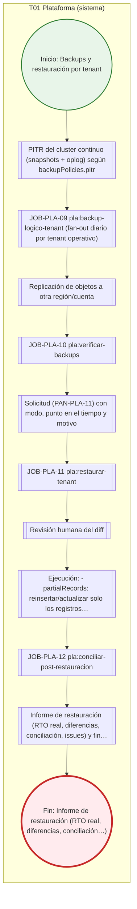

**Pasos del proceso** (actividad tomada del anexo; la columna RF/RN distingue lo citado en el paso de lo asociado por parámetro, permiso, evento o tema compartido).

| Paso | Carril | Actividad | RF/RN que aplican | EVT / JOB / PAN |
|---|---|---|---|---|
| 1 | T01 Plataforma | PITR del cluster continuo (snapshots + oplog) según `backupPolicies.pitr`; verificación diaria del último snapshot. | asoc.: RF-PLA-118 | — |
| 2 | T01 Plataforma | JOB-PLA-09 `pla:backup-logico-tenant` (fan-out diario por tenant operativo): exporta todas las colecciones con `tenantId` (modo snapshot con `readConcern: majority` y marca de tiempo de clúster), manifiesto de objetos (claves + versión + sha256), cifra con KMS, guarda en `ga-<env>-backups`, registra `backupRuns`. | asoc.: RF-PLA-119, RF-PLA-159 | JOB-PLA-09 |
| 3 | T01 Plataforma | Replicación de objetos a otra región/cuenta; Object Lock para `fiscal` y `backup`. | — | — |
| 4 | T01 Plataforma | JOB-PLA-10 `pla:verificar-backups`: verifica checksums, alerta PLA-ALR-01. | — | JOB-PLA-10 |
| 5 | T01 Plataforma | Solicitud (PAN-PLA-11) con modo, punto en el tiempo y motivo; aprobaciones. | — | PAN-PLA-11 |
| 6 | T01 Plataforma | JOB-PLA-11 `pla:restaurar-tenant`: restaura el snapshot PITR al punto en un cluster aislado; extrae los documentos del tenant (todas las colecciones de tenant) y el manifiesto de objetos a esa fecha; calcula `diffSummary` contra producción. | asoc.: RF-PLA-118, RF-PLA-122 | JOB-PLA-11 |
| 7 | T01 Plataforma | Revisión humana del diff; confirmación. | — | — |
| 8 | T01 Plataforma | Ejecución: - `partialRecords`: reinsertar/actualizar solo los registros seleccionados, como operación nueva auditada (con `version` incrementada), respetando invariantes del módulo dueño (se aplica mediante comandos del módulo, no escritura directa, cuando el módulo lo expone). - `fullTenant`: tenant en mantenimiento; backup lógico “previo” del estado actual; reemplazo de colecciones del tenant excepto `auditLogs`, `outboxEvents` publicados, `supportCases`, `restoreRequests`, `backupRuns`; objetos restaurados a su versión del punto (sin borrar versiones posteriores). - `sandboxCopy`: los datos se cargan en el sandbox del tenant para inspección. | asoc.: RF-PLA-164, RF-PLA-128 | — |
| 9 | T01 Plataforma | JOB-PLA-12 `pla:conciliar-post-restauracion`: para cada módulo con `restoreHooks`, `reconcileAfterRestore(tenantId, since=targetPointInTime)`: M05/M06 consultan ARCA por comprobantes autorizados posteriores (CAE/CAEA) y los reconstituyen desde `integrationOperations` (T06) (antes `externalOperations`) y evidencias guardadas; M07 consulta pasarelas/redes por pagos confirmados posteriores y los registra como “recuperados” sin volver a cobrar; T09 marca mensajes ya enviados para no reenviarlos; los jobs y eventos pendientes se reanudan con sus claves de idempotencia. | asoc.: RN-PLA-022, RF-PLA-123 | JOB-PLA-12 |
| 10 | T01 Plataforma | Informe de restauración (RTO real, diferencias, conciliación, issues) y fin del mantenimiento. | — | — |

**Situación actual en ProCoop (nota de cambio).** Sin contraste específico para este proceso en el anexo (filas `CTR-` con ProCoop) ni en el análisis de brechas. El contraste del dominio está en `15-analisis-brechas-procoop.md` §3.1.

**Excepciones**

| Excepción | Tratamiento |
|---|---|
| Falla técnica en un paso automático, un job o una integración | Reintento idempotente y reanudable; lo no reparable pasa a la bandeja técnica con responsable (política de recuperación de T11 P-WFL-01 y T01 §9.12; AGR-016). |

---

## 2. PRC-PLA-07 Salida del tenant (CU-PLA-09)

| Campo | Contenido |
|---|---|
| Fuente | T01 §9.8, `T01-PLA-plataforma-saas.md` (línea 1810) |
| Macroproceso | MP-18 Plataforma, configuración, experiencia e integraciones |
| Disparador | Salida del tenant |
| Resultado | JOB-PLA-14 pla:cerrar-y-purgar-tenant parte 2 llama purgeHooks… |
| Carriles | T01 Plataforma (sistema) |
| Roles de T02 | Solo actores del sistema (sin rol humano) |
| Módulos involucrados | T01 Plataforma |
| Eventos (T11 §12) | — |
| Jobs | JOB-PLA-20 `pla:exportar-tenant`; JOB-PLA-14 `pla:cerrar-y-purgar-tenant` |
| Relación con 04-procesos-bpmn.md | — |

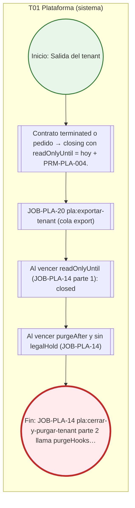

**Pasos del proceso** (actividad tomada del anexo; la columna RF/RN distingue lo citado en el paso de lo asociado por parámetro, permiso, evento o tema compartido).

| Paso | Carril | Actividad | RF/RN que aplican | EVT / JOB / PAN |
|---|---|---|---|---|
| 1 | T01 Plataforma | Contrato `terminated` o pedido → `closing` con `readOnlyUntil = hoy + PRM-PLA-004`. | asoc.: RF-PLA-158 | — |
| 2 | T01 Plataforma | JOB-PLA-20 `pla:exportar-tenant` (cola `export`): llama `exportHooks` de cada módulo → JSONL por colección + CSV legibles + documentos (PDF/XML) + auditoría + manifiesto con sha256 → `tenantExports.ready` → notificación al administrador y contacto legal → descarga por URL firmada (registrada). | asoc.: RF-PLA-156 | JOB-PLA-20 |
| 3 | T01 Plataforma | Al vencer `readOnlyUntil` (JOB-PLA-14 parte 1): `closed`; revoca accesos y API keys; desactiva dominios y landing (página de aviso). | — | JOB-PLA-14 |
| 4 | T01 Plataforma | Al vencer `purgeAfter` y sin `legalHold`: JOB-PLA-14 `pla:cerrar-y-purgar-tenant` parte 2 (antes se nombraba `pla:purgar-tenant`, que no existe en 12.3) llama `purgeHooks`, borra colecciones, objetos, claves Redis, backups lógicos fuera de retención; verificación final (0 documentos) y certificado PDF de purga. | asoc.: RF-PLA-159 | JOB-PLA-14 |

**Situación actual en ProCoop (nota de cambio).** Sin contraste específico para este proceso en el anexo (filas `CTR-` con ProCoop) ni en el análisis de brechas. El contraste del dominio está en `15-analisis-brechas-procoop.md` §3.1.

**Excepciones**

| Excepción | Tratamiento |
|---|---|
| Vencimiento | Al vencer `readOnlyUntil` (JOB-PLA-14 parte 1): `closed`; revoca accesos y API keys; desactiva dominios y landing (página de aviso) |
| Vencimiento | Al vencer `purgeAfter` y sin `legalHold`: JOB-PLA-14 `pla:cerrar-y-purgar-tenant` parte 2 (antes se nombraba `pla:purgar-tenant`, que no existe en 12.3) llama `purgeHooks`, borra colecciones, objetos, claves Redis, backups lógicos fuera de retención; verificación final (0 documentos) y certificado PDF de purga |
| Falla técnica en un paso automático, un job o una integración | Reintento idempotente y reanudable; lo no reparable pasa a la bandeja técnica con responsable (política de recuperación de T11 P-WFL-01 y T01 §9.12; AGR-016). |

---

## 3. PRC-PLA-08 Medición de uso y cupos

| Campo | Contenido |
|---|---|
| Fuente | T01 §9.9, `T01-PLA-plataforma-saas.md` (línea 1817) |
| Macroproceso | MP-18 Plataforma, configuración, experiencia e integraciones |
| Disparador | Medición de uso y cupos |
| Resultado | Alertas PLA-ALR-08 y aplicación de política (PA-PLA-10)… |
| Carriles | T01 Plataforma (sistema) |
| Roles de T02 | Solo actores del sistema (sin rol humano) |
| Módulos involucrados | T01 Plataforma |
| Eventos (T11 §12) | — |
| Jobs | JOB-PLA-05 `pla:medir-uso`; JOB-PLA-06 `pla:evaluar-cupos` |
| Relación con 04-procesos-bpmn.md | — |

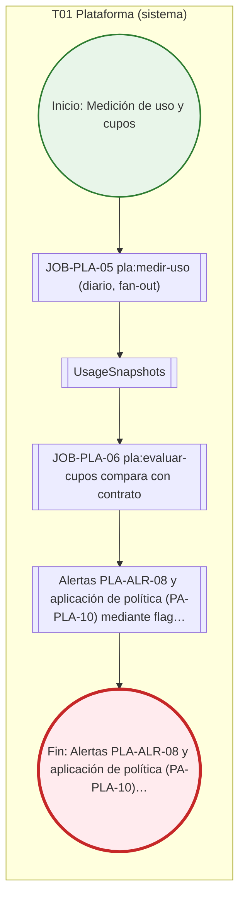

**Pasos del proceso** (actividad tomada del anexo; la columna RF/RN distingue lo citado en el paso de lo asociado por parámetro, permiso, evento o tema compartido).

| Paso | Carril | Actividad | RF/RN que aplican | EVT / JOB / PAN |
|---|---|---|---|---|
| 1 | T01 Plataforma | JOB-PLA-05 `pla:medir-uso` (diario, fan-out): llama `usageMeters` de cada módulo (contratos activos de `cat`/`per`, usuarios internos de `iam`, almacenamiento sumando `storedFiles`, mensajes de `com`, llamadas API de `bia`, tokens IA de `aiUsage`, sandboxes) | asoc.: RF-PLA-078, RF-PLA-025 | JOB-PLA-05 |
| 2 | T01 Plataforma | `usageSnapshots` | asoc.: RF-PLA-079 | — |
| 3 | T01 Plataforma | JOB-PLA-06 `pla:evaluar-cupos` compara con contrato | — | JOB-PLA-06 |
| 4 | T01 Plataforma | alertas PLA-ALR-08 y aplicación de política (PA-PLA-10) mediante flag `quotaBlocked.<dimension>` consultado por los módulos al crear (nunca en operaciones en curso, RN-PLA-016) | RN-PLA-016; asoc.: RF-PLA-078 | — |

**Situación actual en ProCoop (nota de cambio).** Sin contraste específico para este proceso en el anexo (filas `CTR-` con ProCoop) ni en el análisis de brechas. El contraste del dominio está en `15-analisis-brechas-procoop.md` §3.1.

**Excepciones**

| Excepción | Tratamiento |
|---|---|
| Falla técnica en un paso automático, un job o una integración | Reintento idempotente y reanudable; lo no reparable pasa a la bandeja técnica con responsable (política de recuperación de T11 P-WFL-01 y T01 §9.12; AGR-016). |

---

## 4. PRC-PLA-09 Alertas

| Campo | Contenido |
|---|---|
| Fuente | T01 §9.10, `T01-PLA-plataforma-saas.md` (línea 1821) |
| Macroproceso | MP-18 Plataforma, configuración, experiencia e integraciones |
| Disparador | Alertas |
| Resultado | Escalamiento por tiempo sin reconocimiento |
| Carriles | T01 Plataforma (sistema); T09 Comunicaciones |
| Roles de T02 | Solo actores del sistema (sin rol humano) |
| Módulos involucrados | T01 Plataforma, T09 Comunicaciones |
| Eventos (T11 §12) | — |
| Jobs | JOB-PLA-07 `pla:evaluar-alertas` |
| Relación con 04-procesos-bpmn.md | — |

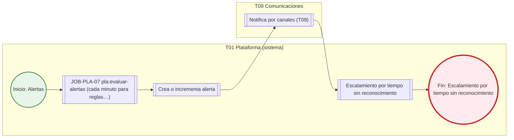

**Pasos del proceso** (actividad tomada del anexo; la columna RF/RN distingue lo citado en el paso de lo asociado por parámetro, permiso, evento o tema compartido).

| Paso | Carril | Actividad | RF/RN que aplican | EVT / JOB / PAN |
|---|---|---|---|---|
| 1 | T01 Plataforma | JOB-PLA-07 `pla:evaluar-alertas` (cada minuto para reglas `metricThreshold`/`heartbeat`/`expiry`; las `eventMatch`/`jobFailure` se evalúan en el consumidor del evento): calcula `dedupeKey` | — | JOB-PLA-07 |
| 2 | T01 Plataforma | crea o incrementa alerta | — | — |
| 3 | T09 Comunicaciones | notifica por canales (T09) | — | — |
| 4 | T01 Plataforma | escalamiento por tiempo sin reconocimiento | — | — |

**Situación actual en ProCoop (nota de cambio).** Sin contraste específico para este proceso en el anexo (filas `CTR-` con ProCoop) ni en el análisis de brechas. El contraste del dominio está en `15-analisis-brechas-procoop.md` §3.1.

**Excepciones**

| Excepción | Tratamiento |
|---|---|
| Falla técnica en un paso automático, un job o una integración | Reintento idempotente y reanudable; lo no reparable pasa a la bandeja técnica con responsable (política de recuperación de T11 P-WFL-01 y T01 §9.12; AGR-016). |

---

## 5. PRC-PLA-10 Despliegue y actualización (CU-PLA-10)

| Campo | Contenido |
|---|---|
| Fuente | T01 §9.11, `T01-PLA-plataforma-saas.md` (línea 1825) |
| Macroproceso | MP-18 Plataforma, configuración, experiencia e integraciones |
| Disparador | Despliegue y actualización |
| Resultado | Publicación de notas de versión (PAN-PLA-19) y aviso “Nueva… |
| Carriles | T01 Plataforma (sistema); Aprobador según política (T11 aprobaciones) |
| Roles de T02 | Solo actores del sistema (sin rol humano) |
| Módulos involucrados | T01 Plataforma, T11 Workflow, eventos y documentos |
| Eventos (T11 §12) | — |
| Jobs | — |
| Relación con 04-procesos-bpmn.md | — |

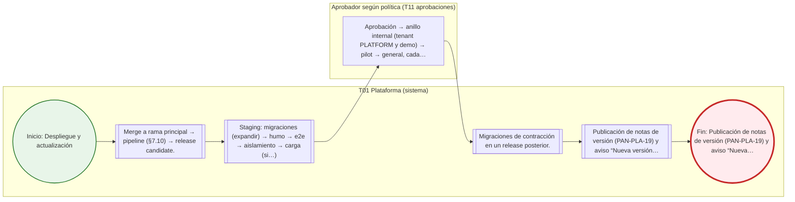

**Pasos del proceso** (actividad tomada del anexo; la columna RF/RN distingue lo citado en el paso de lo asociado por parámetro, permiso, evento o tema compartido).

| Paso | Carril | Actividad | RF/RN que aplican | EVT / JOB / PAN |
|---|---|---|---|---|
| 1 | T01 Plataforma | Merge a rama principal → pipeline (§7.10) → release `candidate`. | — | — |
| 2 | T01 Plataforma | Staging: migraciones (expandir) → humo → e2e → aislamiento → carga (si release mayor) → evidencia de la matriz (RF-PLA-114). | RF-PLA-114 | — |
| 3 | Aprobador según política | Aprobación → anillo `internal` (tenant `PLATFORM` y demo) → `pilot` → `general`, cada uno con humo y ventana de observación `PRM-PLA-048` minutos; rollback automático si la tasa de errores supera el umbral. | — | — |
| 4 | T01 Plataforma | Migraciones de contracción en un release posterior. | — | — |
| 5 | T01 Plataforma | Publicación de notas de versión (PAN-PLA-19) y aviso “Nueva versión disponible” en PWA (RF-PLA-150). | RF-PLA-150; asoc.: RF-PLA-152, RF-PLA-108 | PAN-PLA-19 |

**Situación actual en ProCoop (nota de cambio).** Sin contraste específico para este proceso en el anexo (filas `CTR-` con ProCoop) ni en el análisis de brechas. El contraste del dominio está en `15-analisis-brechas-procoop.md` §3.1.

**Excepciones**

| Excepción | Tratamiento |
|---|---|
| Falla o error | Aprobación → anillo `internal` (tenant `PLATFORM` y demo) → `pilot` → `general`, cada uno con humo y ventana de observación `PRM-PLA-048` minutos; rollback automático si la tasa de errores supera el umbral |
| Falla técnica en un paso automático, un job o una integración | Reintento idempotente y reanudable; lo no reparable pasa a la bandeja técnica con responsable (política de recuperación de T11 P-WFL-01 y T01 §9.12; AGR-016). |

---

## 6. PRC-PLA-11 Bandeja técnica y reprocesamiento

| Campo | Contenido |
|---|---|
| Fuente | T01 §9.12, `T01-PLA-plataforma-saas.md` (línea 1833) |
| Macroproceso | MP-18 Plataforma, configuración, experiencia e integraciones |
| Disparador | Bandeja técnica y reprocesamiento |
| Resultado | Reprocesar (reencola con la misma clave de idempotencia) o… |
| Carriles | Soporte plataforma nivel 2 / ingeniería (P-SOP2); T01 Plataforma (sistema) |
| Roles de T02 | P-SOP2 Soporte plataforma nivel 2 / ingeniería |
| Módulos involucrados | T01 Plataforma |
| Eventos (T11 §12) | — |
| Jobs | — |
| Relación con 04-procesos-bpmn.md | — |

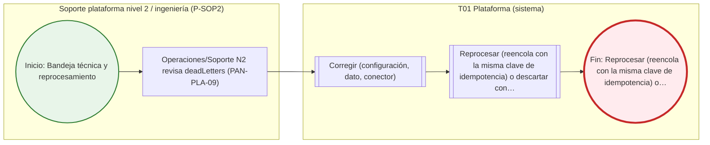

**Pasos del proceso** (actividad tomada del anexo; la columna RF/RN distingue lo citado en el paso de lo asociado por parámetro, permiso, evento o tema compartido).

| Paso | Carril | Actividad | RF/RN que aplican | EVT / JOB / PAN |
|---|---|---|---|---|
| 1 | Soporte plataforma nivel 2 / ingeniería | Operaciones/Soporte N2 revisa `deadLetters` (PAN-PLA-09): ver causa | asoc.: RF-PLA-141, RN-PLA-027 | PAN-PLA-09 |
| 2 | T01 Plataforma | corregir (configuración, dato, conector) | — | — |
| 3 | T01 Plataforma | reprocesar (reencola con la misma clave de idempotencia) o descartar con justificación; si `businessImpact`, el tenant ve el caso en su bandeja operativa (T11) con explicación funcional, no técnica (AGR §5.5) | — | — |

**Situación actual en ProCoop (nota de cambio).** Sin contraste específico para este proceso en el anexo (filas `CTR-` con ProCoop) ni en el análisis de brechas. El contraste del dominio está en `15-analisis-brechas-procoop.md` §3.1.

**Excepciones**

| Excepción | Tratamiento |
|---|---|
| Si `businessImpact` | el tenant ve el caso en su bandeja operativa (T11) con explicación funcional, no técnica (AGR §5.5) |
| Falla técnica en un paso automático, un job o una integración | Reintento idempotente y reanudable; lo no reparable pasa a la bandeja técnica con responsable (política de recuperación de T11 P-WFL-01 y T01 §9.12; AGR-016). |

---

## 7. PRC-UXD-01 Arranque de cualquier app (branding runtime)

| Campo | Contenido |
|---|---|
| Fuente | T03 §9.1, `T03-UXD-experiencia-marca-diccionario.md` (línea 910) |
| Macroproceso | MP-18 Plataforma, configuración, experiencia e integraciones |
| Disparador | Arranque de cualquier app |
| Resultado | Tras el login, se carga el paquete completo del canal y se… |
| Carriles | T03 Experiencia (sistema) |
| Roles de T02 | Solo actores del sistema (sin rol humano) |
| Módulos involucrados | T03 Experiencia |
| Eventos (T11 §12) | — |
| Jobs | — |
| Relación con 04-procesos-bpmn.md | — |

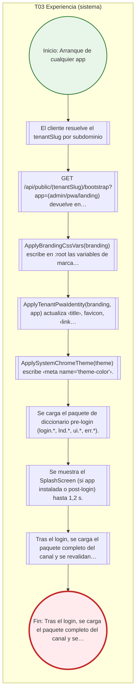

**Pasos del proceso** (actividad tomada del anexo; la columna RF/RN distingue lo citado en el paso de lo asociado por parámetro, permiso, evento o tema compartido).

| Paso | Carril | Actividad | RF/RN que aplican | EVT / JOB / PAN |
|---|---|---|---|---|
| 1 | T03 Experiencia | El cliente resuelve el `tenantSlug` por subdominio; si no hay, muestra el campo de código de cooperativa (login) o la landing genérica del producto. | — | — |
| 2 | T03 Experiencia | `GET /api/public/{tenantSlug}/bootstrap?app={admin\|pwa\|landing}` (antes `{slug}`; API-POR-01 de M19, dueño del endpoint, que unifica API-UXD-01 y API-PLA-64; el parámetro `app` queda pendiente de alta en API-POR-01) devuelve en una sola respuesta, en el bloque que aporta UXD: `brandingRelease`, colores y derivados, URLs de recursos públicos, `themePolicy`, `dictRelease` y URL del paquete `login`/`landing`, métodos de login habilitados (de T02), flags públicos. Sin datos personales. | asoc.: RN-UXD-021 | — |
| 3 | T03 Experiencia | `applyBrandingCssVars(branding)` escribe en `:root` las variables de marca (RF-UXD-025). | RF-UXD-025 | — |
| 4 | T03 Experiencia | `applyTenantPwaIdentity(branding, app)` actualiza `<title>`, favicon, `<link rel="manifest">` y `<link rel="apple-touch-icon">`. | asoc.: RF-UXD-026 | — |
| 5 | T03 Experiencia | `applySystemChromeTheme(theme)` escribe `<meta name="theme-color">`. | — | — |
| 6 | T03 Experiencia | Se carga el paquete de diccionario pre-login (`login.*`, `lnd.*`, `ui.*`, `err.*`). | asoc.: RF-UXD-169 | — |
| 7 | T03 Experiencia | Se muestra el `SplashScreen` (si app instalada o post-login) hasta 1,2 s. | asoc.: RF-UXD-081 | — |
| 8 | T03 Experiencia | Tras el login, se carga el paquete completo del canal y se revalidan versiones (`ETag`); si cambian, se reaplica sin recargar. | — | — |

**Situación actual en ProCoop (nota de cambio).** Sin contraste específico para este proceso en el anexo (filas `CTR-` con ProCoop) ni en el análisis de brechas. El contraste del dominio está en `15-analisis-brechas-procoop.md` §3.3.

**Excepciones**

| Excepción | Tratamiento |
|---|---|
| Si no hay | muestra el campo de código de cooperativa (login) o la landing genérica del producto |
| Si cambian | se reaplica sin recargar |
| Falla técnica en un paso automático, un job o una integración | Reintento idempotente y reanudable; lo no reparable pasa a la bandeja técnica con responsable (política de recuperación de T11 P-WFL-01 y T01 §9.12; AGR-016). |

---

## 8. PRC-UXD-02 Resolución de un recurso de marca

| Campo | Contenido |
|---|---|
| Fuente | T03 §9.2, `T03-UXD-experiencia-marca-diccionario.md` (línea 921) |
| Macroproceso | MP-18 Plataforma, configuración, experiencia e integraciones |
| Disparador | Resolución de un recurso de marca |
| Resultado | Recurso del producto. Siempre devuelve una URL válida |
| Carriles | T03 Experiencia (sistema) |
| Roles de T02 | Solo actores del sistema (sin rol humano) |
| Módulos involucrados | T03 Experiencia |
| Eventos (T11 §12) | — |
| Jobs | — |
| Relación con 04-procesos-bpmn.md | — |

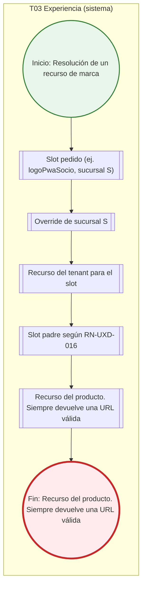

**Pasos del proceso** (actividad tomada del anexo; la columna RF/RN distingue lo citado en el paso de lo asociado por parámetro, permiso, evento o tema compartido).

| Paso | Carril | Actividad | RF/RN que aplican | EVT / JOB / PAN |
|---|---|---|---|---|
| 1 | T03 Experiencia | `slot pedido (ej. logoPwaSocio, sucursal S)` | — | — |
| 2 | T03 Experiencia | override de sucursal S | — | — |
| 3 | T03 Experiencia | recurso del tenant para el slot | — | — |
| 4 | T03 Experiencia | slot padre según RN-UXD-016 | RN-UXD-016 | — |
| 5 | T03 Experiencia | recurso del producto. Siempre devuelve una URL válida | — | — |

**Situación actual en ProCoop (nota de cambio).** Sin contraste específico para este proceso en el anexo (filas `CTR-` con ProCoop) ni en el análisis de brechas. El contraste del dominio está en `15-analisis-brechas-procoop.md` §3.3.

**Excepciones**

| Excepción | Tratamiento |
|---|---|
| Falla técnica en un paso automático, un job o una integración | Reintento idempotente y reanudable; lo no reparable pasa a la bandeja técnica con responsable (política de recuperación de T11 P-WFL-01 y T01 §9.12; AGR-016). |

---

## 9. PRC-UXD-03 Edición y publicación de marca (CU-MAR-01, CU-UXD-01)

| Campo | Contenido |
|---|---|
| Fuente | T03 §9.3, `T03-UXD-experiencia-marca-diccionario.md` (línea 925) |
| Macroproceso | MP-18 Plataforma, configuración, experiencia e integraciones |
| Disparador | Edición y publicación de marca |
| Resultado | Los clientes abiertos aplican la nueva marca en el siguiente… |
| Carriles | Administrador de la cooperativa (T-ADM); T03 Experiencia (sistema) |
| Roles de T02 | T-ADM Administrador de la cooperativa |
| Módulos involucrados | T03 Experiencia |
| Eventos (T11 §12) | — |
| Jobs | JOB-UXD-01 `uxd:procesar-recurso`; JOB-UXD-02 `uxd:compilar-marca` |
| Relación con 04-procesos-bpmn.md | — |

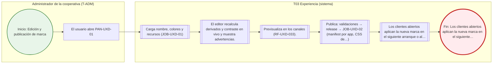

**Pasos del proceso** (actividad tomada del anexo; la columna RF/RN distingue lo citado en el paso de lo asociado por parámetro, permiso, evento o tema compartido).

| Paso | Carril | Actividad | RF/RN que aplican | EVT / JOB / PAN |
|---|---|---|---|---|
| 1 | Administrador de la cooperativa | El usuario abre PAN-UXD-01; si no hay borrador, se crea copiando el publicado. | — | PAN-UXD-01 |
| 2 | T03 Experiencia | Carga nombre, colores y recursos; cada subida crea `brandAssets` en `processing` y encola JOB-UXD-01. | — | JOB-UXD-01 |
| 3 | T03 Experiencia | El editor recalcula derivados y contraste en vivo y muestra advertencias. | — | — |
| 4 | T03 Experiencia | Previsualiza en los canales (RF-UXD-033). | RF-UXD-033 | — |
| 5 | T03 Experiencia | Publica: validaciones → release → JOB-UXD-02 (manifest por app, CSS de variables, invalidación de caché CDN) → evento. | — | JOB-UXD-02 |
| 6 | T03 Experiencia | Los clientes abiertos aplican la nueva marca en el siguiente arranque o al detectar la versión (≤ 5 min, PRM-UXD-012). | asoc.: RF-UXD-040 | — |

**Situación actual en ProCoop (nota de cambio).** Sin contraste específico para este proceso en el anexo (filas `CTR-` con ProCoop) ni en el análisis de brechas. El contraste del dominio está en `15-analisis-brechas-procoop.md` §3.3.

**Excepciones**

| Excepción | Tratamiento |
|---|---|
| Si no hay borrador | se crea copiando el publicado |
| Falla o error | Publica: validaciones → release → JOB-UXD-02 (manifest por app, CSS de variables, invalidación de caché CDN) → evento |
| Falla técnica en un paso automático, un job o una integración | Reintento idempotente y reanudable; lo no reparable pasa a la bandeja técnica con responsable (política de recuperación de T11 P-WFL-01 y T01 §9.12; AGR-016). |

---

## 10. PRC-UXD-04 Resolución de texto del diccionario (runtime)

| Campo | Contenido |
|---|---|
| Fuente | T03 §9.4, `T03-UXD-experiencia-marca-diccionario.md` (línea 934) |
| Macroproceso | MP-18 Plataforma, configuración, experiencia e integraciones |
| Disparador | Resolución de texto del diccionario |
| Resultado | En runtime, dict(key, vars, ( channel )) busca en el paquete… |
| Carriles | T03 Experiencia (sistema) |
| Roles de T02 | Solo actores del sistema (sin rol humano) |
| Módulos involucrados | T03 Experiencia |
| Eventos (T11 §12) | — |
| Jobs | — |
| Relación con 04-procesos-bpmn.md | — |

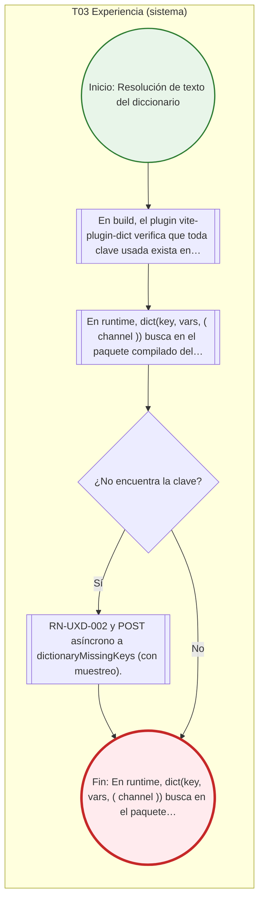

**Pasos del proceso** (actividad tomada del anexo; la columna RF/RN distingue lo citado en el paso de lo asociado por parámetro, permiso, evento o tema compartido).

| Paso | Carril | Actividad | RF/RN que aplican | EVT / JOB / PAN |
|---|---|---|---|---|
| 1 | T03 Experiencia | En build, el plugin `vite-plugin-dict` verifica que toda clave usada exista en `packages/dictionary/base` (RF-UXD-158) y extrae el subconjunto por app. | RF-UXD-158 | — |
| 2 | T03 Experiencia | En runtime, `dict(key, vars, { channel })` busca en el paquete compilado del tenant (que ya fusionó base + entradas publicadas del tenant + variantes del canal); aplica plural, género y variables con el formateador ICU subset; formatea `money`/`date` con los helpers centrales. | — | — |
| 3 | T03 Experiencia | Si no encuentra la clave: RN-UXD-002 y POST asíncrono a `dictionaryMissingKeys` (con muestreo). | RN-UXD-002; asoc.: RF-UXD-158 | — |

**Situación actual en ProCoop (nota de cambio).** Sin contraste específico para este proceso en el anexo (filas `CTR-` con ProCoop) ni en el análisis de brechas. El contraste del dominio está en `15-analisis-brechas-procoop.md` §3.3.

**Excepciones**

| Excepción | Tratamiento |
|---|---|
| Si no encuentra la clave | RN-UXD-002 y POST asíncrono a `dictionaryMissingKeys` (con muestreo) |
| Falla técnica en un paso automático, un job o una integración | Reintento idempotente y reanudable; lo no reparable pasa a la bandeja técnica con responsable (política de recuperación de T11 P-WFL-01 y T01 §9.12; AGR-016). |

---

## 11. PRC-UXD-05 Edición y publicación del diccionario (CU-DIC-01)

| Campo | Contenido |
|---|---|
| Fuente | T03 §9.5, `T03-UXD-experiencia-marca-diccionario.md` (línea 940) |
| Macroproceso | MP-18 Plataforma, configuración, experiencia e integraciones |
| Disparador | Edición y publicación del diccionario |
| Resultado | Revertir: elige release k → release nuevo. |
| Carriles | Administrador de la cooperativa (T-ADM); T03 Experiencia (sistema) |
| Roles de T02 | T-ADM Administrador de la cooperativa |
| Módulos involucrados | T03 Experiencia |
| Eventos (T11 §12) | — |
| Jobs | JOB-UXD-03 `uxd:compilar-diccionario` |
| Relación con 04-procesos-bpmn.md | — |

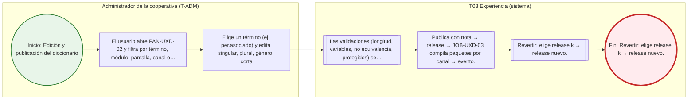

**Pasos del proceso** (actividad tomada del anexo; la columna RF/RN distingue lo citado en el paso de lo asociado por parámetro, permiso, evento o tema compartido).

| Paso | Carril | Actividad | RF/RN que aplican | EVT / JOB / PAN |
|---|---|---|---|---|
| 1 | Administrador de la cooperativa | El usuario abre PAN-UXD-02 y filtra por término, módulo, pantalla, canal o "solo personalizadas". | — | PAN-UXD-02 |
| 2 | Administrador de la cooperativa | Elige un término (ej. `per.asociado`) y edita singular, plural, género, corta; el editor muestra dónde se usa (claves que lo referencian y pantallas) y la previsualización. | — | — |
| 3 | T03 Experiencia | Las validaciones (longitud, variables, no equivalencia, protegidos) se ejecutan en vivo. | — | — |
| 4 | T03 Experiencia | Publica con nota → release → JOB-UXD-03 compila paquetes por canal → evento. | — | JOB-UXD-03 |
| 5 | T03 Experiencia | Revertir: elige release `k` → release nuevo. | — | — |

**Situación actual en ProCoop (nota de cambio).** Sin contraste específico para este proceso en el anexo (filas `CTR-` con ProCoop) ni en el análisis de brechas. El contraste del dominio está en `15-analisis-brechas-procoop.md` §3.3.

**Excepciones**

| Excepción | Tratamiento |
|---|---|
| Falla técnica en un paso automático, un job o una integración | Reintento idempotente y reanudable; lo no reparable pasa a la bandeja técnica con responsable (política de recuperación de T11 P-WFL-01 y T01 §9.12; AGR-016). |

---

## 12. PRC-UXD-06 Alta de tenant (paso de experiencia, coordinado con T01)

| Campo | Contenido |
|---|---|
| Fuente | T03 §9.6, `T03-UXD-experiencia-marca-diccionario.md` (línea 948) |
| Macroproceso | MP-18 Plataforma, configuración, experiencia e integraciones |
| Disparador | Alta de tenant |
| Resultado | Opcional: aplicar diccionario plantilla elegido en el alta… |
| Carriles | T01 Plataforma; T03 Experiencia (sistema) |
| Roles de T02 | Solo actores del sistema (sin rol humano) |
| Módulos involucrados | T01 Plataforma, T03 Experiencia |
| Eventos (T11 §12) | EVT-PLA-01 `pla.tenant.created` |
| Jobs | JOB-UXD-04 `uxd:sembrar-tenant` |
| Relación con 04-procesos-bpmn.md | — |

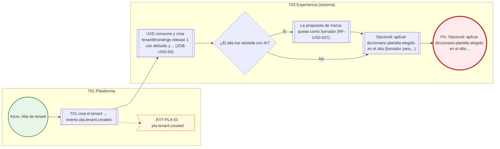

**Pasos del proceso** (actividad tomada del anexo; la columna RF/RN distingue lo citado en el paso de lo asociado por parámetro, permiso, evento o tema compartido).

| Paso | Carril | Actividad | RF/RN que aplican | EVT / JOB / PAN |
|---|---|---|---|---|
| 1 | T01 Plataforma | T01 crea el tenant → evento `pla.tenant.created`. | — | EVT-PLA-01 |
| 2 | T03 Experiencia | UXD consume y crea `tenantBrandings` release 1 con defaults y `dictionaryReleases` release 0 (vacío = base) → JOB-UXD-04 (siembra). | — | JOB-UXD-04 |
| 3 | T03 Experiencia | Si el alta fue asistida con IA, la propuesta de marca queda como borrador (RF-UXD-037). | RF-UXD-037 | — |
| 4 | T03 Experiencia | Opcional: aplicar diccionario plantilla elegido en el alta (borrador para revisión). | — | — |

**Situación actual en ProCoop (nota de cambio).** Sin contraste específico para este proceso en el anexo (filas `CTR-` con ProCoop) ni en el análisis de brechas. El contraste del dominio está en `15-analisis-brechas-procoop.md` §3.3.

**Excepciones**

| Excepción | Tratamiento |
|---|---|
| Si el alta fue asistida con IA | la propuesta de marca queda como borrador (RF-UXD-037) |
| Falla técnica en un paso automático, un job o una integración | Reintento idempotente y reanudable; lo no reparable pasa a la bandeja técnica con responsable (política de recuperación de T11 P-WFL-01 y T01 §9.12; AGR-016). |

---

## 13. PRC-UXD-07 Importación de Excel genérica (`ExcelImportWizard`)

| Campo | Contenido |
|---|---|
| Fuente | T03 §9.8, `T03-UXD-experiencia-marca-diccionario.md` (línea 959) |
| Macroproceso | MP-18 Plataforma, configuración, experiencia e integraciones |
| Disparador | Importación de Excel genérica |
| Resultado | Confirmar: importa las válidas (o todo-o-nada si el recurso lo…) |
| Carriles | T03 Experiencia (sistema) |
| Roles de T02 | Solo actores del sistema (sin rol humano) |
| Módulos involucrados | T03 Experiencia |
| Eventos (T11 §12) | — |
| Jobs | — |
| Relación con 04-procesos-bpmn.md | — |

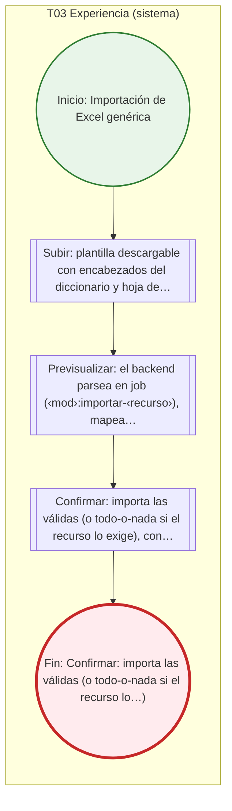

**Pasos del proceso** (actividad tomada del anexo; la columna RF/RN distingue lo citado en el paso de lo asociado por parámetro, permiso, evento o tema compartido).

| Paso | Carril | Actividad | RF/RN que aplican | EVT / JOB / PAN |
|---|---|---|---|---|
| 1 | T03 Experiencia | Subir: plantilla descargable con encabezados del diccionario y hoja de instrucciones; arrastre o selector; validación de tamaño (PRM-UXD-013) y tipo. | — | — |
| 2 | T03 Experiencia | Previsualizar: el backend parsea en job (`<mod>:importar-<recurso>`), mapea columnas (sugerencia automática por similitud con labels y claves), valida con el esquema Zod del recurso y devuelve errores por fila/columna; la UI muestra totales (válidas / con error / duplicadas) y permite descargar el detalle. | asoc.: RF-UXD-083, RF-UXD-082 | — |
| 3 | T03 Experiencia | Confirmar: importa las válidas (o todo-o-nada si el recurso lo exige), con `Idempotency-Key` = hash del archivo + mapeo; progreso y resultado por fila descargable; auditoría. | asoc.: RF-UXD-083 | — |

**Situación actual en ProCoop (nota de cambio).** Sin contraste específico para este proceso en el anexo (filas `CTR-` con ProCoop) ni en el análisis de brechas. El contraste del dominio está en `15-analisis-brechas-procoop.md` §3.3.

**Excepciones**

| Excepción | Tratamiento |
|---|---|
| Falla o error | Previsualizar: el backend parsea en job (`<mod>:importar-<recurso>`), mapea columnas (sugerencia automática por similitud con labels y claves), valida con el esquema Zod del recurso y devuelve errores por fila/columna; la UI muestra totales (válidas / con error / duplicadas) y permite descargar el detalle |
| Falla técnica en un paso automático, un job o una integración | Reintento idempotente y reanudable; lo no reparable pasa a la bandeja técnica con responsable (política de recuperación de T11 P-WFL-01 y T01 §9.12; AGR-016). |

---

## 14. PRC-UXD-08 Cola offline (PWA campo y encuestas)

| Campo | Contenido |
|---|---|
| Fuente | T03 §9.9, `T03-UXD-experiencia-marca-diccionario.md` (línea 965) |
| Macroproceso | MP-18 Plataforma, configuración, experiencia e integraciones |
| Disparador | Cola offline |
| Resultado | Banner único con 'Reintentar' y detalle |
| Carriles | T03 Experiencia (sistema) |
| Roles de T02 | Solo actores del sistema (sin rol humano) |
| Módulos involucrados | T03 Experiencia |
| Eventos (T11 §12) | — |
| Jobs | — |
| Relación con 04-procesos-bpmn.md | — |

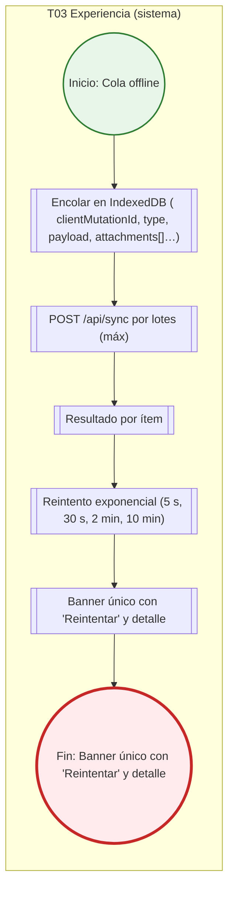

**Pasos del proceso** (actividad tomada del anexo; la columna RF/RN distingue lo citado en el paso de lo asociado por parámetro, permiso, evento o tema compartido).

| Paso | Carril | Actividad | RF/RN que aplican | EVT / JOB / PAN |
|---|---|---|---|---|
| 1 | T03 Experiencia | Encolar en IndexedDB `{ clientMutationId, type, payload, attachments[], createdAt, attempts }` | — | — |
| 2 | T03 Experiencia | `POST /api/sync` por lotes (máx. 50) | — | — |
| 3 | T03 Experiencia | resultado por ítem | — | — |
| 4 | T03 Experiencia | reintento exponencial (5 s, 30 s, 2 min, 10 min) | — | — |
| 5 | T03 Experiencia | banner único con "Reintentar" y detalle. Fotos y firmas en IndexedDB hasta su confirmación | asoc.: RF-UXD-095 | — |

**Situación actual en ProCoop (nota de cambio).** Sin contraste específico para este proceso en el anexo (filas `CTR-` con ProCoop) ni en el análisis de brechas. El contraste del dominio está en `15-analisis-brechas-procoop.md` §3.3.

**Excepciones**

| Excepción | Tratamiento |
|---|---|
| Reintento | Encolar en IndexedDB `( clientMutationId, type, payload, attachments[], createdAt, attempts )` `POST /api/sync` por lotes (máx. 50) resultado por ítem reintento exponencial (5 s, 30 s, 2 min, 10 min) banner único con "Reintentar" y detalle |
| Falla técnica en un paso automático, un job o una integración | Reintento idempotente y reanudable; lo no reparable pasa a la bandeja técnica con responsable (política de recuperación de T11 P-WFL-01 y T01 §9.12; AGR-016). |

---

## 15. PRC-UXD-09 Mapa del sitio filtrado

| Campo | Contenido |
|---|---|
| Fuente | T03 §9.10, `T03-UXD-experiencia-marca-diccionario.md` (línea 969) |
| Macroproceso | MP-18 Plataforma, configuración, experiencia e integraciones |
| Disparador | Mapa del sitio filtrado |
| Resultado | El cliente lo cachea por sesión y lo invalida al cambiar… |
| Carriles | T03 Experiencia (sistema) |
| Roles de T02 | Solo actores del sistema (sin rol humano) |
| Módulos involucrados | T03 Experiencia |
| Eventos (T11 §12) | — |
| Jobs | — |
| Relación con 04-procesos-bpmn.md | — |

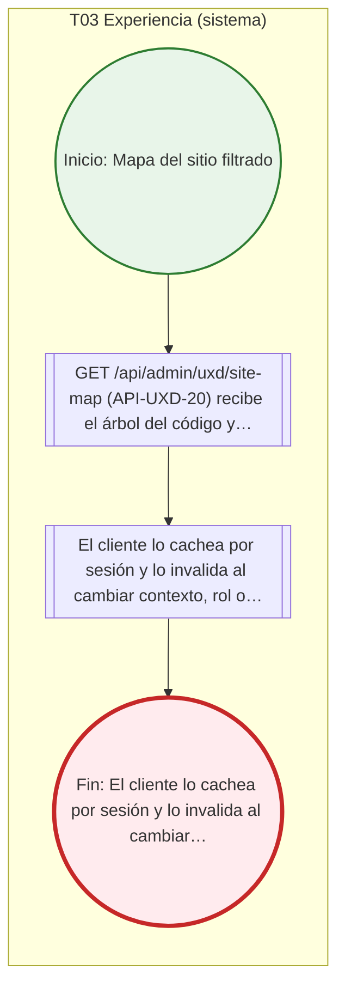

**Pasos del proceso** (actividad tomada del anexo; la columna RF/RN distingue lo citado en el paso de lo asociado por parámetro, permiso, evento o tema compartido).

| Paso | Carril | Actividad | RF/RN que aplican | EVT / JOB / PAN |
|---|---|---|---|---|
| 1 | T03 Experiencia | `GET /api/admin/uxd/site-map` (API-UXD-20) recibe el árbol del código y devuelve solo los ítems visibles para el usuario (RN-UXD-022) con labels ya resueltos y badges | RN-UXD-022 | — |
| 2 | T03 Experiencia | el cliente lo cachea por sesión y lo invalida al cambiar contexto, rol o release del diccionario | — | — |

**Situación actual en ProCoop (nota de cambio).** Sin contraste específico para este proceso en el anexo (filas `CTR-` con ProCoop) ni en el análisis de brechas. El contraste del dominio está en `15-analisis-brechas-procoop.md` §3.3.

**Excepciones**

| Excepción | Tratamiento |
|---|---|
| Falla o error | `GET /api/admin/uxd/site-map` (API-UXD-20) recibe el árbol del código y devuelve solo los ítems visibles para el usuario (RN-UXD-022) con labels ya resueltos y badges el cliente lo cachea por sesión y lo invalida al cambiar contexto, rol o release del diccionario |
| Falla técnica en un paso automático, un job o una integración | Reintento idempotente y reanudable; lo no reparable pasa a la bandeja técnica con responsable (política de recuperación de T11 P-WFL-01 y T01 §9.12; AGR-016). |

---

## 16. PRC-CFG-01 Sincronización del registro de parámetros (JOB-CFG-01 `cfg:sincronizar-registro`)

| Campo | Contenido |
|---|---|
| Fuente | T04 §9.1, `T04-CFG-configuracion-parametros-maestros.md` (línea 1348) |
| Macroproceso | MP-18 Plataforma, configuración, experiencia e integraciones |
| Disparador | Sincronización del registro de parámetros |
| Resultado | Idempotente; registra resumen (altas, cambios, deprecaciones)… |
| Carriles | T04 Configuración (sistema) |
| Roles de T02 | Solo actores del sistema (sin rol humano) |
| Módulos involucrados | T04 Configuración |
| Eventos (T11 §12) | — |
| Jobs | — |
| Relación con 04-procesos-bpmn.md | — |

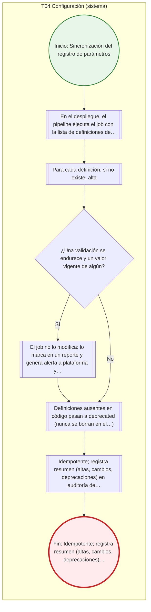

**Pasos del proceso** (actividad tomada del anexo; la columna RF/RN distingue lo citado en el paso de lo asociado por parámetro, permiso, evento o tema compartido).

| Paso | Carril | Actividad | RF/RN que aplican | EVT / JOB / PAN |
|---|---|---|---|---|
| 1 | T04 Configuración | En el despliegue, el pipeline ejecuta el job con la lista de definiciones de todos los paquetes de dominio. | — | — |
| 2 | T04 Configuración | Para cada definición: si no existe, alta; si existe, actualiza metadatos (etiquetas, validaciones, dependencias, estado) sin tocar `parameterValues`. | — | — |
| 3 | T04 Configuración | Si una validación se endurece y un valor vigente de algún tenant queda inválido, el job no lo modifica: lo marca en un reporte y genera alerta a plataforma y aviso al tenant (borrador sugerido de corrección). | — | — |
| 4 | T04 Configuración | Definiciones ausentes en código pasan a `deprecated` (nunca se borran en el mismo despliegue). | — | — |
| 5 | T04 Configuración | Idempotente; registra resumen (altas, cambios, deprecaciones) en auditoría de plataforma. | — | — |

**Situación actual en ProCoop (nota de cambio).** Sin contraste específico para este proceso en el anexo (filas `CTR-` con ProCoop) ni en el análisis de brechas. El contraste del dominio está en `15-analisis-brechas-procoop.md` §3.3.

**Excepciones**

| Excepción | Tratamiento |
|---|---|
| Si no existe | alta; si existe, actualiza metadatos (etiquetas, validaciones, dependencias, estado) sin tocar `parameterValues` |
| Si una validación se endurece y un valor vigente de algún tenant queda inválido | el job no lo modifica: lo marca en un reporte y genera alerta a plataforma y aviso al tenant (borrador sugerido de corrección) |
| Falla técnica en un paso automático, un job o una integración | Reintento idempotente y reanudable; lo no reparable pasa a la bandeja técnica con responsable (política de recuperación de T11 P-WFL-01 y T01 §9.12; AGR-016). |

---

## 17. PRC-CFG-02 Lectura de configuración

| Campo | Contenido |
|---|---|
| Fuente | T04 §9.2, `T04-CFG-configuracion-parametros-maestros.md` (línea 1356) |
| Macroproceso | MP-18 Plataforma, configuración, experiencia e integraciones |
| Disparador | Lectura de configuración |
| Resultado | La caché se invalida por cfg.configVersion.published y por… |
| Carriles | T04 Configuración (sistema) |
| Roles de T02 | Solo actores del sistema (sin rol humano) |
| Módulos involucrados | T04 Configuración |
| Eventos (T11 §12) | EVT-CFG-05 `cfg.configVersion.published` |
| Jobs | — |
| Relación con 04-procesos-bpmn.md | — |

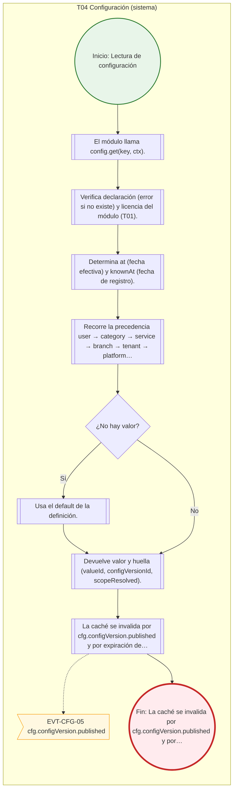

**Pasos del proceso** (actividad tomada del anexo; la columna RF/RN distingue lo citado en el paso de lo asociado por parámetro, permiso, evento o tema compartido).

| Paso | Carril | Actividad | RF/RN que aplican | EVT / JOB / PAN |
|---|---|---|---|---|
| 1 | T04 Configuración | El módulo llama `config.get(key, ctx)`. | — | — |
| 2 | T04 Configuración | Verifica declaración (error si no existe) y licencia del módulo (T01). | — | — |
| 3 | T04 Configuración | Determina `at` (fecha efectiva) y `knownAt` (fecha de registro). | asoc.: RF-CFG-037, RF-CFG-020 | — |
| 4 | T04 Configuración | Recorre la precedencia `user → category → service → branch → tenant → platform` filtrando por `allowedScopes` y por vigencia a `at` y `recordedAt ≤ knownAt < supersededAt`. | asoc.: RF-CFG-019, RF-CFG-036 | — |
| 5 | T04 Configuración | Si no hay valor, usa el default de la definición. | — | — |
| 6 | T04 Configuración | Devuelve valor y huella (`valueId`, `configVersionId`, `scopeResolved`). | asoc.: RF-CFG-021, RN-CFG-012 | — |
| 7 | T04 Configuración | La caché se invalida por `cfg.configVersion.published` y por expiración de vigencia programada. | asoc.: RF-CFG-022 | EVT-CFG-05 |

**Situación actual en ProCoop (nota de cambio).** Sin contraste específico para este proceso en el anexo (filas `CTR-` con ProCoop) ni en el análisis de brechas. El contraste del dominio está en `15-analisis-brechas-procoop.md` §3.3.

**Excepciones**

| Excepción | Tratamiento |
|---|---|
| Falla o error | Verifica declaración (error si no existe) y licencia del módulo (T01) |
| Si no hay valor | usa el default de la definición |
| Falla o error | La caché se invalida por `cfg.configVersion.published` y por expiración de vigencia programada |
| Falla técnica en un paso automático, un job o una integración | Reintento idempotente y reanudable; lo no reparable pasa a la bandeja técnica con responsable (política de recuperación de T11 P-WFL-01 y T01 §9.12; AGR-016). |

---

## 18. PRC-CFG-03 Publicación de una versión (CU-CFG-01)

| Campo | Contenido |
|---|---|
| Fuente | T04 §9.3, `T04-CFG-configuracion-parametros-maestros.md` (línea 1366) |
| Macroproceso | MP-18 Plataforma, configuración, experiencia e integraciones |
| Disparador | Publicación de una versión |
| Resultado | Eventos: cfg.configVersion.published, cfg.parameter.changed por… |
| Carriles | Administrador de la cooperativa (T-ADM); T04 Configuración (sistema) |
| Roles de T02 | T-ADM Administrador de la cooperativa |
| Módulos involucrados | T04 Configuración |
| Eventos (T11 §12) | EVT-CFG-05 `cfg.configVersion.published`; EVT-CFG-07 `cfg.parameter.changed`; EVT-CFG-08 `cfg.masterRecord.changed` |
| Jobs | JOB-CFG-02 `cfg:publicar-version-programada` |
| Relación con 04-procesos-bpmn.md | — |

```mermaid
flowchart LR
  subgraph L_LTADM["Administrador de la cooperativa (T-ADM)"]
    ni(("Inicio: Publicación de una versión"))
    ns1["El configurador abre un borrador (o lo recibe de…)"]
    ns2["Edita ítems: parámetros por ámbito, registros maestros, enumeraciones, campos…"]
    ns3["Elige fecha efectiva (y por ítem si corresponde) y, si afecta contratos, la…"]
  end
  subgraph L_LSIS["T04 Configuración (sistema)"]
    ns4[["Validar: tipos, rangos, dependencias, referencias del tenant, secretos…"]]
    ns5[["Simular (si hay clases commercial/fiscal)"]]
    ns6[["Revisar: si la política lo exige, workflow T11 con revisor distinto del autor"]]
    ns7[["Programar o publicar: si effectiveAt es futura, queda scheduled (JOB-CFG-02)"]]
    ns8[["Publicación en una transacción"]]
    ns9[["Eventos: cfg.configVersion.published, cfg.parameter.changed por clave…"]]
    ne9>"EVT-CFG-05 cfg.configVersion.published; EVT-CFG-07 cfg.parameter.changed y 1 más"]
    nx10{"¿Fallo en cualquier paso de 8?"}
    ns10[["Rollback completo, versión failed, alerta."]]
    nf(("Fin: Eventos: cfg.configVersion.published, cfg.parameter.changed por…"))
  end
  ni --> ns1
  ns1 --> ns2
  ns2 --> ns3
  ns3 --> ns4
  ns4 --> ns5
  ns5 --> ns6
  ns6 --> ns7
  ns7 --> ns8
  ns8 --> ns9
  ns9 -.-> ne9
  ns9 --> nx10
  nx10 -->|"Sí"| ns10
  ns10 --> nf
  nx10 -->|"No"| nf
  classDef inicio fill:#e8f5e9,stroke:#2e7d32,stroke-width:2px
  classDef fin fill:#ffebee,stroke:#c62828,stroke-width:4px
  classDef evento fill:#fff8e1,stroke:#f9a825
  classDef temporizador fill:#e3f2fd,stroke:#1565c0
  class ni inicio
  class nf fin
  class ne9 evento
```

**Pasos del proceso** (actividad tomada del anexo; la columna RF/RN distingue lo citado en el paso de lo asociado por parámetro, permiso, evento o tema compartido).

| Paso | Carril | Actividad | RF/RN que aplican | EVT / JOB / PAN |
|---|---|---|---|---|
| 1 | Administrador de la cooperativa | El configurador abre un borrador (o lo recibe de copia/importación/semilla/migración/plataforma). | asoc.: RF-CFG-041 | — |
| 2 | Administrador de la cooperativa | Edita ítems: parámetros por ámbito, registros maestros, enumeraciones, campos extra, personalizaciones o configuración de módulo vía contributors. | asoc.: RF-CFG-026 | — |
| 3 | Administrador de la cooperativa | Elige fecha efectiva (y por ítem si corresponde) y, si afecta contratos, la política (`newOnly`, `allFromEffectiveDate`, `requireAction`). | — | — |
| 4 | T04 Configuración | Validar: tipos, rangos, dependencias, referencias del tenant, secretos requeridos, validadores cruzados, completitud de perfiles de servicio (§9.12). | asoc.: RF-CFG-028 | — |
| 5 | T04 Configuración | Simular (si hay clases `commercial`/`fiscal`): cada contributor ejecuta su simulador; el reporte queda en la versión. | — | — |
| 6 | T04 Configuración | Revisar: si la política lo exige, workflow T11 con revisor distinto del autor; el revisor ve diff, reportes y simulación. | asoc.: RF-CFG-031 | — |
| 7 | T04 Configuración | Programar o publicar: si `effectiveAt` es futura, queda `scheduled`; al momento JOB-CFG-02 revalida y publica. | — | JOB-CFG-02 |
| 8 | T04 Configuración | Publicación en una transacción: escribe valores, aplica ítems de contributors, cierra vigencias anteriores (`validTo`), registra outbox. | asoc.: RF-CFG-047, RF-CFG-036 | — |
| 9 | T04 Configuración | Eventos: `cfg.configVersion.published`, `cfg.parameter.changed` por clave, `cfg.masterRecord.changed` por tabla; los módulos reaccionan (ej. M05 recalcula proyecciones no emitidas). | asoc.: RF-CFG-022 | EVT-CFG-05, EVT-CFG-07, EVT-CFG-08 |
| 10 | T04 Configuración | Fallo en cualquier paso de 8: rollback completo, versión `failed`, alerta. | — | — |

**Situación actual en ProCoop (nota de cambio).** Análisis de brechas (`15-analisis-brechas-procoop.md` §3.3, Configuración): hoy 1.536 parámetros numéricos en una tabla clave/valor sin semántica; en GoodApps, parámetros tipados, con nombre, vigencia, versión y publicación (brecha "Cambia"; fuente CTR-GLB-10; T04; T04b).

**Excepciones**

| Excepción | Tratamiento |
|---|---|
| Si afecta contratos | la política (`newOnly`, `allFromEffectiveDate`, `requireAction`) |
| Si la política lo exige | workflow T11 con revisor distinto del autor; el revisor ve diff, reportes y simulación |
| Si `effectiveAt` es futura | queda `scheduled`; al momento JOB-CFG-02 revalida y publica |
| Falla o error | Fallo en cualquier paso de 8: rollback completo, versión `failed`, alerta |
| Falla técnica en un paso automático, un job o una integración | Reintento idempotente y reanudable; lo no reparable pasa a la bandeja técnica con responsable (política de recuperación de T11 P-WFL-01 y T01 §9.12; AGR-016). |

---

## 19. PRC-CFG-04 Cambio retroactivo (AGR-010)

| Campo | Contenido |
|---|---|
| Fuente | T04 §9.4, `T04-CFG-configuracion-parametros-maestros.md` (línea 1379) |
| Macroproceso | MP-18 Plataforma, configuración, experiencia e integraciones |
| Disparador | Cambio retroactivo |
| Resultado | Las consultas config.get con knownAt anterior siguen… |
| Carriles | T04 Configuración (sistema) |
| Roles de T02 | Solo actores del sistema (sin rol humano) |
| Módulos involucrados | T04 Configuración |
| Eventos (T11 §12) | EVT-CFG-07 `cfg.parameter.changed` |
| Jobs | — |
| Relación con 04-procesos-bpmn.md | — |

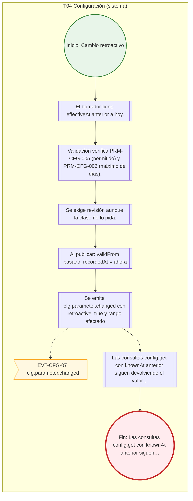

**Pasos del proceso** (actividad tomada del anexo; la columna RF/RN distingue lo citado en el paso de lo asociado por parámetro, permiso, evento o tema compartido).

| Paso | Carril | Actividad | RF/RN que aplican | EVT / JOB / PAN |
|---|---|---|---|---|
| 1 | T04 Configuración | El borrador tiene `effectiveAt` anterior a hoy. | — | — |
| 2 | T04 Configuración | Validación verifica PRM-CFG-005 (permitido) y PRM-CFG-006 (máximo de días). | asoc.: RN-CFG-010 | — |
| 3 | T04 Configuración | Se exige revisión aunque la clase no lo pida. | — | — |
| 4 | T04 Configuración | Al publicar: `validFrom` pasado, `recordedAt` = ahora. No se reescribe ningún documento. | asoc.: RF-CFG-036, RF-CFG-021 | — |
| 5 | T04 Configuración | Se emite `cfg.parameter.changed` con `retroactive: true` y rango afectado; el módulo dueño decide ajustes (ej.: M05 genera ND/NC por diferencia, con su propio circuito de aprobación). | — | EVT-CFG-07 |
| 6 | T04 Configuración | Las consultas `config.get` con `knownAt` anterior siguen devolviendo el valor viejo (explicabilidad del documento emitido). | asoc.: RF-CFG-020, RF-CFG-037 | — |

**Situación actual en ProCoop (nota de cambio).** Sin contraste específico para este proceso en el anexo (filas `CTR-` con ProCoop) ni en el análisis de brechas. El contraste del dominio está en `15-analisis-brechas-procoop.md` §3.3.

**Excepciones**

| Excepción | Tratamiento |
|---|---|
| Falla técnica en un paso automático, un job o una integración | Reintento idempotente y reanudable; lo no reparable pasa a la bandeja técnica con responsable (política de recuperación de T11 P-WFL-01 y T01 §9.12; AGR-016). |

---

## 20. PRC-CFG-05 Copia de configuración desde otro tenant (consumido por M02, BASE §81)

| Campo | Contenido |
|---|---|
| Fuente | T04 §9.5, `T04-CFG-configuracion-parametros-maestros.md` (línea 1388) |
| Macroproceso | MP-18 Plataforma, configuración, experiencia e integraciones |
| Disparador | Copia de configuración desde otro tenant |
| Resultado | La copia es idempotente por copyRunId. |
| Carriles | M02 Catálogo y contratos; T04 Configuración (sistema) |
| Roles de T02 | Solo actores del sistema (sin rol humano) |
| Módulos involucrados | M02 Catálogo y contratos, T04 Configuración |
| Eventos (T11 §12) | — |
| Jobs | — |
| Relación con 04-procesos-bpmn.md | — |

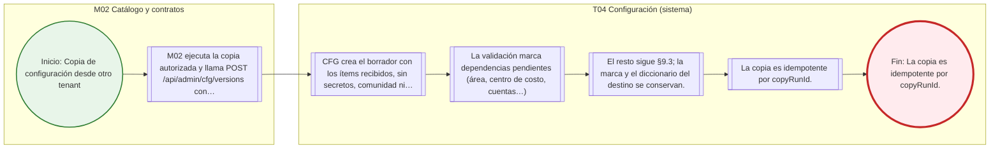

**Pasos del proceso** (actividad tomada del anexo; la columna RF/RN distingue lo citado en el paso de lo asociado por parámetro, permiso, evento o tema compartido).

| Paso | Carril | Actividad | RF/RN que aplican | EVT / JOB / PAN |
|---|---|---|---|---|
| 1 | M02 Catálogo y contratos | M02 ejecuta la copia autorizada y llama `POST /api/admin/cfg/versions` con `origin = copy` en el tenant destino. | — | — |
| 2 | T04 Configuración | CFG crea el borrador con los ítems recibidos, sin secretos, comunidad ni datos operativos. | asoc.: RN-CFG-015 | — |
| 3 | T04 Configuración | La validación marca dependencias pendientes (área, centro de costo, cuentas, depósito, tributos, calendario) como errores bloqueantes hasta que el destino los mapee. | — | — |
| 4 | T04 Configuración | El resto sigue §9.3; la marca y el diccionario del destino se conservan. | — | — |
| 5 | T04 Configuración | La copia es idempotente por `copyRunId`. | — | — |

**Situación actual en ProCoop (nota de cambio).** Sin contraste específico para este proceso en el anexo (filas `CTR-` con ProCoop) ni en el análisis de brechas. El contraste del dominio está en `15-analisis-brechas-procoop.md` §3.3.

**Excepciones**

| Excepción | Tratamiento |
|---|---|
| Falla o error | La validación marca dependencias pendientes (área, centro de costo, cuentas, depósito, tributos, calendario) como errores bloqueantes hasta que el destino los mapee |
| Falla técnica en un paso automático, un job o una integración | Reintento idempotente y reanudable; lo no reparable pasa a la bandeja técnica con responsable (política de recuperación de T11 P-WFL-01 y T01 §9.12; AGR-016). |

---

## 21. PRC-CFG-06 Edición de tabla maestra e importación (CU-CFG-03, CU-CFG-04)

| Campo | Contenido |
|---|---|
| Fuente | T04 §9.6, `T04-CFG-configuracion-parametros-maestros.md` (línea 1396) |
| Macroproceso | MP-18 Plataforma, configuración, experiencia e integraciones |
| Disparador | Edición de tabla maestra e importación |
| Resultado | Reintento idempotente por idempotencyKey |
| Carriles | Administrador de la cooperativa (T-ADM); T04 Configuración (sistema) |
| Roles de T02 | T-ADM Administrador de la cooperativa |
| Módulos involucrados | T04 Configuración |
| Eventos (T11 §12) | — |
| Jobs | JOB-CFG-03 `cfg:importar-maestro` |
| Relación con 04-procesos-bpmn.md | — |

```mermaid
flowchart LR
  subgraph L_LTADM["Administrador de la cooperativa (T-ADM)"]
    ni(("Inicio: Edición de tabla maestra e importación"))
    ns1["El operador abre la tabla en PAN-CFG-08"]
  end
  subgraph L_LSIS["T04 Configuración (sistema)"]
    nx2{"¿La tabla es versioned?"}
    ns2[["Los cambios se agregan a un borrador"]]
    ns3[["Importación: PAN-CFG-09 → sube archivo → mapea columnas (o usa plantilla…)"]]
    ns4[["Reintento idempotente por idempotencyKey"]]
    nf(("Fin: Reintento idempotente por idempotencyKey"))
  end
  ni --> ns1
  ns1 --> nx2
  nx2 -->|"Sí"| ns2
  ns2 --> ns3
  nx2 -->|"No"| ns3
  ns3 --> ns4
  ns4 --> nf
  classDef inicio fill:#e8f5e9,stroke:#2e7d32,stroke-width:2px
  classDef fin fill:#ffebee,stroke:#c62828,stroke-width:4px
  classDef evento fill:#fff8e1,stroke:#f9a825
  classDef temporizador fill:#e3f2fd,stroke:#1565c0
  class ni inicio
  class nf fin
```

**Pasos del proceso** (actividad tomada del anexo; la columna RF/RN distingue lo citado en el paso de lo asociado por parámetro, permiso, evento o tema compartido).

| Paso | Carril | Actividad | RF/RN que aplican | EVT / JOB / PAN |
|---|---|---|---|---|
| 1 | Administrador de la cooperativa | El operador abre la tabla en PAN-CFG-08; busca, filtra, edita en modal. | — | PAN-CFG-08 |
| 2 | T04 Configuración | Si la tabla es `versioned`, los cambios se agregan a un borrador; si no, se publican con auditoría inmediata. | asoc.: RF-CFG-053 | — |
| 3 | T04 Configuración | Importación: PAN-CFG-09 → sube archivo → mapea columnas (o usa plantilla exportada) → JOB-CFG-03 valida y produce vista previa con errores por fila → confirma → JOB-CFG-03 procesa por lotes con transacción por lote → resultado con archivo de errores. | asoc.: RF-CFG-054 | PAN-CFG-09, JOB-CFG-03 |
| 4 | T04 Configuración | Reintento idempotente por `idempotencyKey`; cancelación devuelve el estado previo. | — | — |

**Situación actual en ProCoop (nota de cambio).** Sin contraste específico para este proceso en el anexo (filas `CTR-` con ProCoop) ni en el análisis de brechas. El contraste del dominio está en `15-analisis-brechas-procoop.md` §3.3.

**Excepciones**

| Excepción | Tratamiento |
|---|---|
| Si la tabla es `versioned` | los cambios se agregan a un borrador; si no, se publican con auditoría inmediata |
| Falla o error | Importación: PAN-CFG-09 → sube archivo → mapea columnas (o usa plantilla exportada) → JOB-CFG-03 valida y produce vista previa con errores por fila → confirma → JOB-CFG-03 procesa por lotes con transacción por lote → resultado con archivo de errores |
| Cancelación, anulación o reversión | Reintento idempotente por `idempotencyKey`; cancelación devuelve el estado previo |
| Falla técnica en un paso automático, un job o una integración | Reintento idempotente y reanudable; lo no reparable pasa a la bandeja técnica con responsable (política de recuperación de T11 P-WFL-01 y T01 §9.12; AGR-016). |

---

## Inconsistencias detectadas en la especificación (esta parte)

No se detectaron inconsistencias en los procesos de esta parte.

**Resueltas en la especificación vigente.** Observaciones de la versión anterior de esta parte que la corrección de la especificación (05-11-2026) ya resolvió; se conservan como registro y el diagrama sigue el texto corregido.

| Proceso | Observación anterior | Resolución en la especificación |
|---|---|---|
| PRC-PLA-07 | Nombra el job `pla:purgar-tenant`, que no tiene JOB-ID en las tablas de jobs de los anexos ni en T11 §12.7 y §12.8. | T01 §9.8 paso 4 usa ahora JOB-PLA-14 `pla:cerrar-y-purgar-tenant` y cita `pla:purgar-tenant` solo como nombre anterior. |

## Cobertura de esta parte

| Universo de la parte | Diagramados | Con nota ProCoop específica | Pendientes |
|---|---|---|---|
| 21 (PRC-PLA-06 a PRC-CFG-06) | 21 | 1 | 0 |
