# GoodApps Cooperativas

## Procesos de negocio — Plataforma, configuración, experiencia e integraciones (T04, T06)

**Entregable de Análisis y Diseño Detallado — Artefacto 2.1 (Procesos de negocio BPMN). Parte de [`04-procesos-bpmn.md`](04-procesos-bpmn.md).**

| Dato | Valor |
|---|---|
| Documento | Diagramas BPMN, pasos, situación actual en ProCoop y excepciones de los procesos PRC-CFG-07 a PRC-INT-10, derivados de la sección 9 de T04, T06 |
| Carácter | Derivado de la especificación vigente; no la reemplaza. Ante diferencias prevalecen la maestra `00`, los anexos, T05, T11 y el registro de decisiones `01` |
| Generación | Script `_trabajo/generar_bpmn.py` con la ampliación `_trabajo/generar_prc.py` (derivación automática desde el texto de la sección 9 de cada anexo, `_trabajo/prc_auto.py`) |
| Versión | 1.1 (regenerada contra la especificación corregida) |
| Fecha | 05-11-2026 |

**Cómo leer cada proceso.** La notación es la de [`04-procesos-bpmn.md` §3](04-procesos-bpmn.md#3-notación-equivalencia-mermaid--bpmn) (carriles, eventos de inicio y fin, tareas de usuario y de servicio, compuertas XOR y AND, eventos de dominio como banderas, temporizadores y jobs como estadios). La tabla de pasos reproduce la actividad del anexo; en la columna RF/RN, los identificadores sin prefijo son los que el anexo cita en el paso y los marcados "asoc." son reglas o requisitos del mismo anexo que comparten parámetro, permiso, evento o tema con el paso (asociación generada por el script y revisada). Los eventos se nombran con su ID del catálogo de T11 §12.

**Derivación automática (v1.2).** Los procesos `PRC-<MOD>-nn` de esta parte se generaron con `_trabajo/generar_prc.py` y `_trabajo/prc_auto.py` a partir del texto de cada subsección §9.n del anexo, sin curaduría paso a paso (a diferencia de los 94 procesos `P-XXX-nn` de las partes 04b a 04i). Reglas: (1) los pasos son los numerados o viñetas del anexo; si la subsección es prosa, se parte por flechas o por oraciones; si es una tabla de pasos o de jobs, cada fila es un paso; (2) el carril de cada paso es el primer actor nombrado al comienzo del paso (rol de T02 §4, otro módulo, sistema externo, dispositivo o job); si no se nombra ninguno, el paso es del sistema del módulo dueño; (3) los pasos que empiezan con "Si …" se dibujan como compuerta XOR; (4) los eventos son los nombres del catálogo de T11 §12 citados en el paso (bandera entrante si el paso los consume, saliente si los publica); el temporizador aparece cuando el título nombra un job periódico; (5) las excepciones son las oraciones del anexo con condición o con palabras de falla, rechazo, vencimiento, duplicado o umbral, más la política de recuperación del anexo; (6) la nota ProCoop combina lo que dice el propio anexo, la fila `CTR-` del anexo que contrasta con ProCoop y la fila de `15-analisis-brechas-procoop.md` §3 de mayor afinidad; si ninguna alcanza el umbral, la nota lo dice y remite al contraste del dominio en esa sección. La revisión manual de una muestra está en `_trabajo/prc_revision.md`; ante diferencias, prevalece el texto del anexo citado en la ficha.

## Índice de procesos de esta parte

1. [PRC-CFG-07 Unificación de duplicados (CU-CFG-05)](#1-prc-cfg-07-unificación-de-duplicados-cu-cfg-05)
2. [PRC-CFG-08 Actualización y adopción de tablas de plataforma (CU-CFG-06)](#2-prc-cfg-08-actualización-y-adopción-de-tablas-de-plataforma-cu-cfg-06)
3. [PRC-CFG-09 Geocodificación de una dirección (CU-GEO-01)](#3-prc-cfg-09-geocodificación-de-una-dirección-cu-geo-01)
4. [PRC-CFG-10 Ingesta de calendarios, índices y padrones](#4-prc-cfg-10-ingesta-de-calendarios-índices-y-padrones)
5. [PRC-CFG-11 Migración del catálogo `VARIABLE` (JOB-CFG-10 `cfg:migrar-variables`)](#5-prc-cfg-11-migración-del-catálogo-variable-job-cfg-10-cfgmigrar-variables)
6. [PRC-CFG-12 Completitud del perfil de servicio (BASE §84, §93)](#6-prc-cfg-12-completitud-del-perfil-de-servicio-base-84-93)
7. [PRC-CFG-13 Aplicación de semilla demo (JOB-CFG-11 `cfg:aplicar-semilla`)](#7-prc-cfg-13-aplicación-de-semilla-demo-job-cfg-11-cfgaplicar-semilla)
8. [PRC-CFG-14 Invalidación de caché y vigencias programadas (JOB-CFG-12 `cfg:activar-vigencias`)](#8-prc-cfg-14-invalidación-de-caché-y-vigencias-programadas-job-cfg-12-cfgactivar-vigencias)
9. [PRC-CFG-15 Control nocturno de integridad (JOB-CFG-13 `cfg:verificar-integridad`)](#9-prc-cfg-15-control-nocturno-de-integridad-job-cfg-13-cfgverificar-integridad)
10. [PRC-CFG-16 Alta de la entidad jurídica por defecto (consumo de `pla.tenant.created`)](#10-prc-cfg-16-alta-de-la-entidad-jurídica-por-defecto-consumo-de-platenantcreated)
11. [PRC-CFG-17 Resolución de la entidad jurídica de un documento (RF-CFG-137)](#11-prc-cfg-17-resolución-de-la-entidad-jurídica-de-un-documento-rf-cfg-137)
12. [PRC-INT-01 Llamada saliente estándar (JOB-INT-01 `int:ejecutar-operacion`)](#12-prc-int-01-llamada-saliente-estándar-job-int-01-intejecutar-operacion)
13. [PRC-INT-02 Resolución de resultado incierto (JOB-INT-02 `int:resolver-incierto`)](#13-prc-int-02-resolución-de-resultado-incierto-job-int-02-intresolver-incierto)
14. [PRC-INT-03 Webhook entrante (JOB-INT-03 `int:procesar-webhook`)](#14-prc-int-03-webhook-entrante-job-int-03-intprocesar-webhook)
15. [PRC-INT-04 Publicación de deuda y rendición por archivo (JOB-INT-04 `int:generar-archivo`, JOB-INT-05 `int:procesar-archivo-entrante`)](#15-prc-int-04-publicación-de-deuda-y-rendición-por-archivo-job-int-04-intgenerar-archivo-job-int-05-intprocesar-archivo-entrante)
16. [PRC-INT-05 Conciliación (JOB-INT-06 `int:conciliar`)](#16-prc-int-05-conciliación-job-int-06-intconciliar)
17. [PRC-INT-06 Recuperación de pendientes (JOB-INT-07 `int:recuperar-pendientes`)](#17-prc-int-06-recuperación-de-pendientes-job-int-07-intrecuperar-pendientes)
18. [PRC-INT-07 Salud y monitoreo (JOB-INT-08 `int:health-check`)](#18-prc-int-07-salud-y-monitoreo-job-int-08-inthealth-check)
19. [PRC-INT-08 Vencimientos (JOB-INT-09 `int:alertar-vencimientos`)](#19-prc-int-08-vencimientos-job-int-09-intalertar-vencimientos)
20. [PRC-INT-09 Rotación de credenciales (JOB-INT-10 `int:rotar-credencial`)](#20-prc-int-09-rotación-de-credenciales-job-int-10-introtar-credencial)
21. [PRC-INT-10 Renovación de tokens (JOB-INT-11 `int:refrescar-tokens`)](#21-prc-int-10-renovación-de-tokens-job-int-11-intrefrescar-tokens)

---

## 1. PRC-CFG-07 Unificación de duplicados (CU-CFG-05)

| Campo | Contenido |
|---|---|
| Fuente | T04 §9.7, `T04-CFG-configuracion-parametros-maestros.md` (línea 1403) |
| Macroproceso | MP-18 Plataforma, configuración, experiencia e integraciones |
| Disparador | Unificación de duplicados |
| Resultado | Auditoría con conteo por colección |
| Carriles | Administrador de la cooperativa (T-ADM); T04 Configuración (sistema) |
| Roles de T02 | T-ADM Administrador de la cooperativa |
| Módulos involucrados | T04 Configuración |
| Eventos (T11 §12) | — |
| Jobs | JOB-CFG-04 `cfg:unificar-maestro` |
| Relación con 04-procesos-bpmn.md | — |

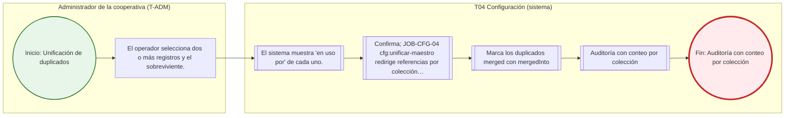

**Pasos del proceso** (actividad tomada del anexo; la columna RF/RN distingue lo citado en el paso de lo asociado por parámetro, permiso, evento o tema compartido).

| Paso | Carril | Actividad | RF/RN que aplican | EVT / JOB / PAN |
|---|---|---|---|---|
| 1 | Administrador de la cooperativa | El operador selecciona dos o más registros y el sobreviviente. | — | — |
| 2 | T04 Configuración | El sistema muestra "en uso por" de cada uno. | — | — |
| 3 | T04 Configuración | Confirma; JOB-CFG-04 `cfg:unificar-maestro` redirige referencias por colección (usando `referencedBy` de la definición de tabla) en lotes reanudables. | — | JOB-CFG-04 |
| 4 | T04 Configuración | Marca los duplicados `merged` con `mergedInto`; agrega alias si es calle. | — | — |
| 5 | T04 Configuración | Auditoría con conteo por colección. Reversión: no automática; se crea registro nuevo si fue error (documentado en el motivo). | — | — |

**Situación actual en ProCoop (nota de cambio).** Sin contraste específico para este proceso en el anexo (filas `CTR-` con ProCoop) ni en el análisis de brechas. El contraste del dominio está en `15-analisis-brechas-procoop.md` §3.3.

**Excepciones**

| Excepción | Tratamiento |
|---|---|
| Duplicado | Marca los duplicados `merged` con `mergedInto`; agrega alias si es calle |
| Falla o error | Reversión: no automática; se crea registro nuevo si fue error (documentado en el motivo) |
| Falla técnica en un paso automático, un job o una integración | Reintento idempotente y reanudable; lo no reparable pasa a la bandeja técnica con responsable (política de recuperación de T11 P-WFL-01 y T01 §9.12; AGR-016). |

---

## 2. PRC-CFG-08 Actualización y adopción de tablas de plataforma (CU-CFG-06)

| Campo | Contenido |
|---|---|
| Fuente | T04 §9.8, `T04-CFG-configuracion-parametros-maestros.md` (línea 1411) |
| Macroproceso | MP-18 Plataforma, configuración, experiencia e integraciones |
| Disparador | Actualización y adopción de tablas de plataforma |
| Resultado | Evento cfg.platformTable.updated. |
| Carriles | Administrador de la cooperativa (T-ADM); T04 Configuración (sistema) |
| Roles de T02 | T-ADM Administrador de la cooperativa |
| Módulos involucrados | T04 Configuración |
| Eventos (T11 §12) | EVT-CFG-10 `cfg.platformTable.updated` |
| Jobs | JOB-CFG-05 `cfg:ingesta-georef` |
| Relación con 04-procesos-bpmn.md | — |

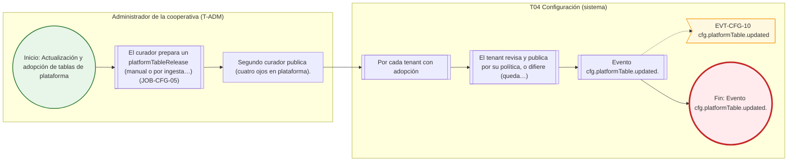

**Pasos del proceso** (actividad tomada del anexo; la columna RF/RN distingue lo citado en el paso de lo asociado por parámetro, permiso, evento o tema compartido).

| Paso | Carril | Actividad | RF/RN que aplican | EVT / JOB / PAN |
|---|---|---|---|---|
| 1 | Administrador de la cooperativa | El curador prepara un `platformTableRelease` (manual o por ingesta JOB-CFG-05..08) con fuente y vigencia. | asoc.: RF-CFG-143, RF-CFG-101 | JOB-CFG-05 |
| 2 | Administrador de la cooperativa | Segundo curador publica (cuatro ojos en plataforma). | — | — |
| 3 | T04 Configuración | Por cada tenant con adopción: si `follow` y `affectsCalculation = false`, se aplica (lectura por unión); si afecta cálculo o `pinned`, se genera aviso y borrador `origin = platform` en el tenant. | — | — |
| 4 | T04 Configuración | El tenant revisa y publica por su política, o difiere (queda `pendingAcknowledgement` con alerta). | — | — |
| 5 | T04 Configuración | Evento `cfg.platformTable.updated`. | — | EVT-CFG-10 |

**Situación actual en ProCoop (nota de cambio).** Sin contraste específico para este proceso en el anexo (filas `CTR-` con ProCoop) ni en el análisis de brechas. El contraste del dominio está en `15-analisis-brechas-procoop.md` §3.3.

**Excepciones**

| Excepción | Tratamiento |
|---|---|
| Si `follow` y `affectsCalculation = false` | se aplica (lectura por unión); si afecta cálculo o `pinned`, se genera aviso y borrador `origin = platform` en el tenant |
| Falla técnica en un paso automático, un job o una integración | Reintento idempotente y reanudable; lo no reparable pasa a la bandeja técnica con responsable (política de recuperación de T11 P-WFL-01 y T01 §9.12; AGR-016). |

---

## 3. PRC-CFG-09 Geocodificación de una dirección (CU-GEO-01)

| Campo | Contenido |
|---|---|
| Fuente | T04 §9.9, `T04-CFG-configuracion-parametros-maestros.md` (línea 1419) |
| Macroproceso | MP-18 Plataforma, configuración, experiencia e integraciones |
| Disparador | Geocodificación de una dirección |
| Resultado | M01 guarda la dirección con geoReference |
| Carriles | Administrador de la cooperativa (T-ADM); T04 Configuración (sistema); M01 Personas |
| Roles de T02 | T-ADM Administrador de la cooperativa |
| Módulos involucrados | M01 Personas, T04 Configuración |
| Eventos (T11 §12) | — |
| Jobs | JOB-CFG-09 `cfg:geocodificar-pendientes` |
| Relación con 04-procesos-bpmn.md | — |

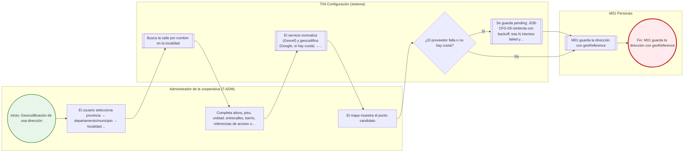

**Pasos del proceso** (actividad tomada del anexo; la columna RF/RN distingue lo citado en el paso de lo asociado por parámetro, permiso, evento o tema compartido).

| Paso | Carril | Actividad | RF/RN que aplican | EVT / JOB / PAN |
|---|---|---|---|---|
| 1 | Administrador de la cooperativa | El usuario selecciona provincia → departamento/municipio → localidad (selectores con catálogo de plataforma). | — | — |
| 2 | T04 Configuración | Busca la calle por nombre en la localidad; elige entre homónimos por contexto; si no aparece, elige "calle no encontrada" y la carga como local (`pendingValidation`) o deja texto y referencias. | asoc.: RF-CFG-069 | — |
| 3 | Administrador de la cooperativa | Completa altura, piso, unidad, entrecalles, barrio, referencias de acceso o datos rurales; puede marcar "sin numeración". | asoc.: RF-CFG-072 | — |
| 4 | T04 Configuración | El servicio normaliza (Georef) y geocodifica (Google, si hay cuota) → `candidate` con precisión. | asoc.: RF-CFG-073 | — |
| 5 | Administrador de la cooperativa | El mapa muestra el punto candidato; el usuario autorizado confirma o arrastra el marcador (motivo) → `confirmed`; sin coincidencia → `manualPoint`/`inReview`. | asoc.: RF-CFG-072, RN-CFG-026 | — |
| 6 | T04 Configuración | Si el proveedor falla o no hay cuota: se guarda `pending`; JOB-CFG-09 reintenta con backoff; tras N intentos `failed` y aparece en la cola de revisión (PAN-CFG-15). | asoc.: RF-CFG-075 | JOB-CFG-09, PAN-CFG-15 |
| 7 | M01 Personas | M01 guarda la dirección con `geoReference`; el contrato y la visita la usan; el domicilio fiscal permanece separado. | asoc.: RF-CFG-072 | — |

**Situación actual en ProCoop (nota de cambio).** Sin contraste específico para este proceso en el anexo (filas `CTR-` con ProCoop) ni en el análisis de brechas. El contraste del dominio está en `15-analisis-brechas-procoop.md` §3.3.

**Excepciones**

| Excepción | Tratamiento |
|---|---|
| Si no aparece | elige "calle no encontrada" y la carga como local (`pendingValidation`) o deja texto y referencias |
| Si hay cuota) | `candidate` con precisión |
| Si el proveedor falla o no hay cuota | se guarda `pending` |
| Reintento | JOB-CFG-09 reintenta con backoff; tras N intentos `failed` y aparece en la cola de revisión (PAN-CFG-15) |
| Falla técnica en un paso automático, un job o una integración | Reintento idempotente y reanudable; lo no reparable pasa a la bandeja técnica con responsable (política de recuperación de T11 P-WFL-01 y T01 §9.12; AGR-016). |

---

## 4. PRC-CFG-10 Ingesta de calendarios, índices y padrones

| Campo | Contenido |
|---|---|
| Fuente | T04 §9.10, `T04-CFG-configuracion-parametros-maestros.md` (línea 1429) |
| Macroproceso | MP-18 Plataforma, configuración, experiencia e integraciones |
| Disparador | Ingesta de calendarios, índices y padrones |
| Resultado | JOB-CFG-08 cfg:ingesta-padron:‹registro› |
| Carriles | T04 Configuración (sistema) |
| Roles de T02 | Solo actores del sistema (sin rol humano) |
| Módulos involucrados | T04 Configuración |
| Eventos (T11 §12) | — |
| Jobs | JOB-CFG-05 `cfg:ingesta-georef`; JOB-CFG-06 `cfg:ingesta-feriados`; JOB-CFG-07 `cfg:ingesta-indices`; JOB-CFG-08 `cfg:ingesta-padron:<registro>` |
| Relación con 04-procesos-bpmn.md | — |

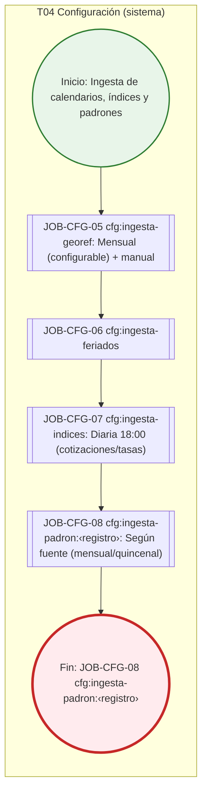

**Pasos del proceso** (actividad tomada del anexo; la columna RF/RN distingue lo citado en el paso de lo asociado por parámetro, permiso, evento o tema compartido).

| Paso | Carril | Actividad | RF/RN que aplican | EVT / JOB / PAN |
|---|---|---|---|---|
| 1 | T04 Configuración | JOB-CFG-05 `cfg:ingesta-georef`: Mensual (configurable) + manual; Pasos: Descarga por provincia de unidades territoriales y calles; diff contra vigente; release en borrador para curador; Reintento / recuperación: Reanudable por provincia; no publica si la variación supera umbral sin revisión | asoc.: RF-CFG-093 | JOB-CFG-05 |
| 2 | T04 Configuración | JOB-CFG-06 `cfg:ingesta-feriados`: Anual (noviembre/diciembre) + manual ante decreto; Pasos: Carga calendario nacional del año siguiente desde fuente oficial o carga asistida; release; Reintento / recuperación: Manual si la fuente no es legible por máquina | — | JOB-CFG-06 |
| 3 | T04 Configuración | JOB-CFG-07 `cfg:ingesta-indices`: Diaria 18:00 (cotizaciones/tasas); mensual (IPC); Pasos: Consulta integración (T06), inserta valores `provisional`/`definitive`; detecta revisiones; Reintento / recuperación: Reintento cada hora hasta 23:00; alerta si falta | asoc.: RF-CFG-092, RF-CFG-093 | JOB-CFG-07 |
| 4 | T04 Configuración | JOB-CFG-08 `cfg:ingesta-padron:<registro>`: Según fuente (mensual/quincenal); Pasos: Descarga o recibe archivo; valida; carga por lotes con vigencia; cierra entradas anteriores; Reintento / recuperación: Reanudable por lote; idempotente por (registro, período) | — | JOB-CFG-08 |

**Situación actual en ProCoop (nota de cambio).** Sin contraste específico para este proceso en el anexo (filas `CTR-` con ProCoop) ni en el análisis de brechas. El contraste del dominio está en `15-analisis-brechas-procoop.md` §3.3.

**Excepciones**

| Excepción | Tratamiento |
|---|---|
| Reintento | Reintento / recuperación: Reanudable por provincia; no publica si la variación supera umbral sin revisión JOB-CFG-06 `cfg:ingesta-feriados`: Anual (noviembre/diciembre) + manual ante decreto |
| Reintento | Reintento / recuperación: Manual si la fuente no es legible por máquina JOB-CFG-07 `cfg:ingesta-indices`: Diaria 18:00 (cotizaciones/tasas); mensual (IPC) |
| Reintento | Reintento / recuperación: Reintento cada hora hasta 23:00; alerta si falta JOB-CFG-08 `cfg:ingesta-padron:<registro>`: Según fuente (mensual/quincenal) |
| Reintento | Reintento / recuperación: Reanudable por lote; idempotente por (registro, período) |
| Falla técnica en un paso automático, un job o una integración | Reintento idempotente y reanudable; lo no reparable pasa a la bandeja técnica con responsable (política de recuperación de T11 P-WFL-01 y T01 §9.12; AGR-016). |

---

## 5. PRC-CFG-11 Migración del catálogo `VARIABLE` (JOB-CFG-10 `cfg:migrar-variables`)

| Campo | Contenido |
|---|---|
| Fuente | T04 §9.11, `T04-CFG-configuracion-parametros-maestros.md` (línea 1438) |
| Macroproceso | MP-18 Plataforma, configuración, experiencia e integraciones |
| Disparador | Migración del catálogo VARIABLE |
| Resultado | Resultado: configVersion origin = migration en borrador +… |
| Carriles | T07 Migración; T04 Configuración (sistema) |
| Roles de T02 | Solo actores del sistema (sin rol humano) |
| Módulos involucrados | T04 Configuración, T07 Migración |
| Eventos (T11 §12) | — |
| Jobs | — |
| Relación con 04-procesos-bpmn.md | — |

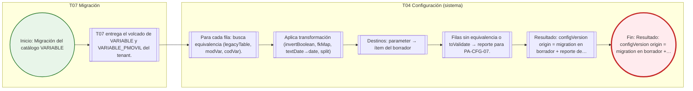

**Pasos del proceso** (actividad tomada del anexo; la columna RF/RN distingue lo citado en el paso de lo asociado por parámetro, permiso, evento o tema compartido).

| Paso | Carril | Actividad | RF/RN que aplican | EVT / JOB / PAN |
|---|---|---|---|---|
| 1 | T07 Migración | T07 entrega el volcado de `VARIABLE` y `VARIABLE_PMOVIL` del tenant. | — | — |
| 2 | T04 Configuración | Para cada fila: busca equivalencia (`legacyTable`, `modVar`, `codVar`). | — | — |
| 3 | T04 Configuración | Aplica transformación (`invertBoolean`, `fkMap`, `textDate→date`, `split`); valida contra la definición. | — | — |
| 4 | T04 Configuración | Destinos: `parameter` → ítem del borrador; `dictionary` → T03; `tenantProfile` → T01; `secret` → solicitud de carga en bóveda (no se migra el valor si estaba en claro: se pide recargar); `env`/`discarded` → reporte. | asoc.: RF-CFG-130 | — |
| 5 | T04 Configuración | Filas sin equivalencia o `toValidate` → reporte para PA-CFG-07. | — | — |
| 6 | T04 Configuración | Resultado: `configVersion` `origin = migration` en borrador + reporte de conciliación (conteos por destino que suman el total de filas). | asoc.: RF-CFG-132 | — |

**Situación actual en ProCoop (nota de cambio).** El anexo indica: Para cada fila: busca equivalencia (`legacyTable`, `modVar`, `codVar`). CTR-CFG-06: en ProCoop, RN-09 propone migrar solo los parámetros con uso comprobado; DEC-007 deja todo ProCoop en alcance. Cambio adoptado: Los 1.536 tienen destino en T04b; los 622 sin uso directo quedan "A validar" con equivalencia (RF-CFG-133, PA-CFG-07).

**Excepciones**

| Excepción | Tratamiento |
|---|---|
| Falla técnica en un paso automático, un job o una integración | Reintento idempotente y reanudable; lo no reparable pasa a la bandeja técnica con responsable (política de recuperación de T11 P-WFL-01 y T01 §9.12; AGR-016). |

---

## 6. PRC-CFG-12 Completitud del perfil de servicio (BASE §84, §93)

| Campo | Contenido |
|---|---|
| Fuente | T04 §9.12, `T04-CFG-configuracion-parametros-maestros.md` (línea 1447) |
| Macroproceso | MP-18 Plataforma, configuración, experiencia e integraciones |
| Disparador | Completitud del perfil de servicio |
| Resultado | PAN-CFG-29 muestra la ficha por servicio (Internet…) |
| Carriles | T04 Configuración (sistema) |
| Roles de T02 | Solo actores del sistema (sin rol humano) |
| Módulos involucrados | T04 Configuración |
| Eventos (T11 §12) | — |
| Jobs | — |
| Relación con 04-procesos-bpmn.md | — |

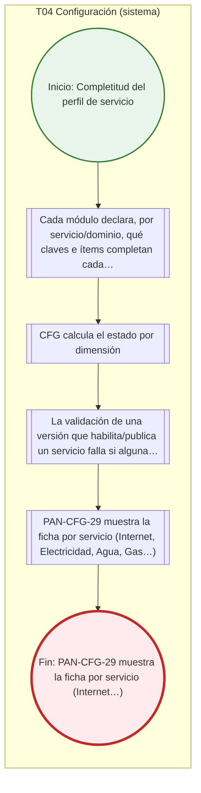

**Pasos del proceso** (actividad tomada del anexo; la columna RF/RN distingue lo citado en el paso de lo asociado por parámetro, permiso, evento o tema compartido).

| Paso | Carril | Actividad | RF/RN que aplican | EVT / JOB / PAN |
|---|---|---|---|---|
| 1 | T04 Configuración | Cada módulo declara, por servicio/dominio, qué claves e ítems completan cada una de las 15 dimensiones de §84 y cuáles son obligatorias para publicar la oferta. | asoc.: RF-CFG-127, RF-CFG-125 | — |
| 2 | T04 Configuración | CFG calcula el estado por dimensión: completo, incompleto, No aplica (con motivo) — nunca se fuerza un cargo ficticio. | — | — |
| 3 | T04 Configuración | La validación de una versión que habilita/publica un servicio falla si alguna dimensión obligatoria está incompleta. | — | — |
| 4 | T04 Configuración | PAN-CFG-29 muestra la ficha por servicio (Internet, Electricidad, Agua, Gas, Cementerio parque, Banco de sangre y los que se agreguen). | asoc.: RF-CFG-125, RF-CFG-127 | PAN-CFG-29 |

**Situación actual en ProCoop (nota de cambio).** Sin contraste específico para este proceso en el anexo (filas `CTR-` con ProCoop) ni en el análisis de brechas. El contraste del dominio está en `15-analisis-brechas-procoop.md` §3.3.

**Excepciones**

| Excepción | Tratamiento |
|---|---|
| Falla o error | La validación de una versión que habilita/publica un servicio falla si alguna dimensión obligatoria está incompleta |
| Falla técnica en un paso automático, un job o una integración | Reintento idempotente y reanudable; lo no reparable pasa a la bandeja técnica con responsable (política de recuperación de T11 P-WFL-01 y T01 §9.12; AGR-016). |

---

## 7. PRC-CFG-13 Aplicación de semilla demo (JOB-CFG-11 `cfg:aplicar-semilla`)

| Campo | Contenido |
|---|---|
| Fuente | T04 §9.13, `T04-CFG-configuracion-parametros-maestros.md` (línea 1454) |
| Macroproceso | MP-18 Plataforma, configuración, experiencia e integraciones |
| Disparador | Aplicación de semilla demo |
| Resultado | Registro en seedApplications para retiro en bloque. |
| Carriles | T04 Configuración (sistema) |
| Roles de T02 | Solo actores del sistema (sin rol humano) |
| Módulos involucrados | T04 Configuración |
| Eventos (T11 §12) | — |
| Jobs | — |
| Relación con 04-procesos-bpmn.md | — |

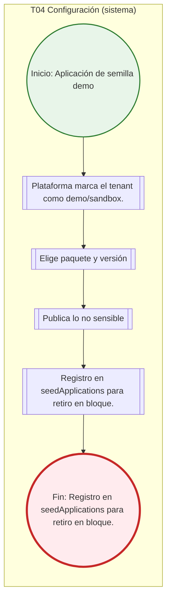

**Pasos del proceso** (actividad tomada del anexo; la columna RF/RN distingue lo citado en el paso de lo asociado por parámetro, permiso, evento o tema compartido).

| Paso | Carril | Actividad | RF/RN que aplican | EVT / JOB / PAN |
|---|---|---|---|---|
| 1 | T04 Configuración | Plataforma marca el tenant como demo/sandbox. | — | — |
| 2 | T04 Configuración | Elige paquete y versión; el job crea registros marcados `demoData` y un borrador de `configVersion` para la configuración sensible (tarifas, recargos). | asoc.: RF-CFG-061, RF-CFG-026 | — |
| 3 | T04 Configuración | Publica lo no sensible; lo sensible queda para aprobación (BASE §39.1). | — | — |
| 4 | T04 Configuración | Registro en `seedApplications` para retiro en bloque. | — | — |

**Situación actual en ProCoop (nota de cambio).** CTR-CFG-11: en ProCoop, En ProCoop el valor se guarda y rige al instante; BASE exige aprobación para la configuración sensible. Cambio adoptado: Todo cambio por versión; revisión obligatoria según clase (RF-CFG-031, RN-CFG-005/008, PA-CFG-01).

**Excepciones**

| Excepción | Tratamiento |
|---|---|
| Falla técnica en un paso automático, un job o una integración | Reintento idempotente y reanudable; lo no reparable pasa a la bandeja técnica con responsable (política de recuperación de T11 P-WFL-01 y T01 §9.12; AGR-016). |

---

## 8. PRC-CFG-14 Invalidación de caché y vigencias programadas (JOB-CFG-12 `cfg:activar-vigencias`)

| Campo | Contenido |
|---|---|
| Fuente | T04 §9.14, `T04-CFG-configuracion-parametros-maestros.md` (línea 1461) |
| Macroproceso | MP-18 Plataforma, configuración, experiencia e integraciones |
| Disparador | Invalidación de caché y vigencias programadas |
| Resultado | Cada minuto: detecta valores cuyo validFrom/validTo cruza el… |
| Carriles | T04 Configuración (sistema) |
| Roles de T02 | Solo actores del sistema (sin rol humano) |
| Módulos involucrados | T04 Configuración |
| Eventos (T11 §12) | EVT-CFG-07 `cfg.parameter.changed` |
| Jobs | JOB-CFG-12 `cfg:activar-vigencias` |
| Relación con 04-procesos-bpmn.md | — |

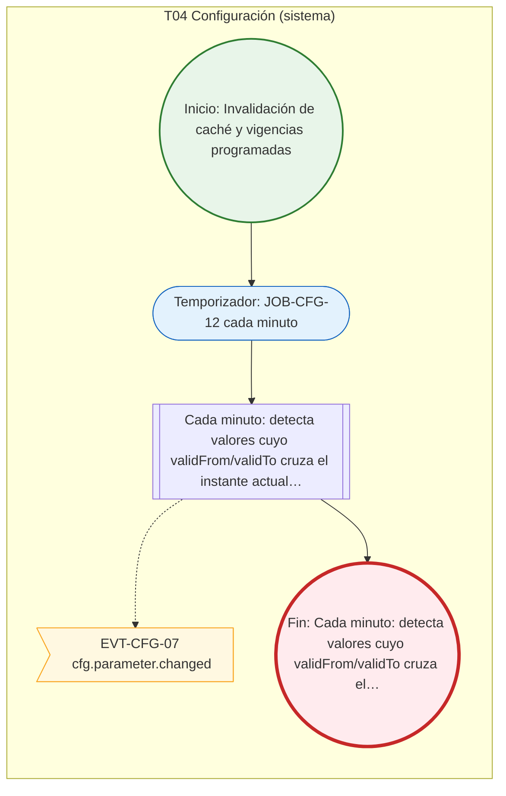

**Pasos del proceso** (actividad tomada del anexo; la columna RF/RN distingue lo citado en el paso de lo asociado por parámetro, permiso, evento o tema compartido).

| Paso | Carril | Actividad | RF/RN que aplican | EVT / JOB / PAN |
|---|---|---|---|---|
| 1 | T04 Configuración | Cada minuto: detecta valores cuyo `validFrom`/`validTo` cruza el instante actual en algún tenant y emite invalidación de caché y `cfg.parameter.changed` (efectivo) para que los consumidores reaccionen | asoc.: RF-CFG-047, RF-CFG-036 | EVT-CFG-07 |

**Situación actual en ProCoop (nota de cambio).** Sin contraste específico para este proceso en el anexo (filas `CTR-` con ProCoop) ni en el análisis de brechas. El contraste del dominio está en `15-analisis-brechas-procoop.md` §3.3.

**Excepciones**

| Excepción | Tratamiento |
|---|---|
| Falla o error | Cada minuto: detecta valores cuyo `validFrom`/`validTo` cruza el instante actual en algún tenant y emite invalidación de caché y `cfg.parameter.changed` (efectivo) para que los consumidores reaccionen |
| Falla técnica en un paso automático, un job o una integración | Reintento idempotente y reanudable; lo no reparable pasa a la bandeja técnica con responsable (política de recuperación de T11 P-WFL-01 y T01 §9.12; AGR-016). |

---

## 9. PRC-CFG-15 Control nocturno de integridad (JOB-CFG-13 `cfg:verificar-integridad`)

| Campo | Contenido |
|---|---|
| Fuente | T04 §9.15, `T04-CFG-configuracion-parametros-maestros.md` (línea 1465) |
| Macroproceso | MP-18 Plataforma, configuración, experiencia e integraciones |
| Disparador | Control nocturno de integridad |
| Resultado | Produce reporte por tenant y alertas |
| Carriles | T04 Configuración (sistema) |
| Roles de T02 | Solo actores del sistema (sin rol humano) |
| Módulos involucrados | T04 Configuración |
| Eventos (T11 §12) | — |
| Jobs | JOB-CFG-13 `cfg:verificar-integridad` |
| Relación con 04-procesos-bpmn.md | — |

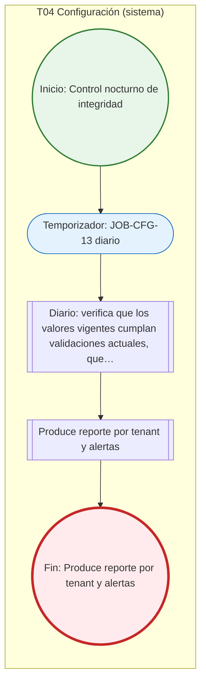

**Pasos del proceso** (actividad tomada del anexo; la columna RF/RN distingue lo citado en el paso de lo asociado por parámetro, permiso, evento o tema compartido).

| Paso | Carril | Actividad | RF/RN que aplican | EVT / JOB / PAN |
|---|---|---|---|---|
| 1 | T04 Configuración | Diario: verifica que los valores vigentes cumplan validaciones actuales, que las referencias existan y estén activas, que los `secretRef` requeridos existan y no venzan en 30 días | asoc.: RF-CFG-121 | — |
| 2 | T04 Configuración | produce reporte por tenant y alertas | — | — |

**Situación actual en ProCoop (nota de cambio).** Sin contraste específico para este proceso en el anexo (filas `CTR-` con ProCoop) ni en el análisis de brechas. El contraste del dominio está en `15-analisis-brechas-procoop.md` §3.3.

**Excepciones**

| Excepción | Tratamiento |
|---|---|
| Falla técnica en un paso automático, un job o una integración | Reintento idempotente y reanudable; lo no reparable pasa a la bandeja técnica con responsable (política de recuperación de T11 P-WFL-01 y T01 §9.12; AGR-016). |

---

## 10. PRC-CFG-16 Alta de la entidad jurídica por defecto (consumo de `pla.tenant.created`)

| Campo | Contenido |
|---|---|
| Fuente | T04 §9.16, `T04-CFG-configuracion-parametros-maestros.md` (línea 1469) |
| Macroproceso | MP-18 Plataforma, configuración, experiencia e integraciones |
| Disparador | Alta de la entidad jurídica por defecto |
| Resultado | Reprocesar el evento no duplica |
| Carriles | T04 Configuración (sistema) |
| Roles de T02 | Solo actores del sistema (sin rol humano) |
| Módulos involucrados | T01 Plataforma, T04 Configuración |
| Eventos (T11 §12) | EVT-PLA-01 `pla.tenant.created`; EVT-CFG-19 `cfg.legalEntity.created`; EVT-CFG-20 `cfg.branch.created` |
| Jobs | — |
| Relación con 04-procesos-bpmn.md | — |

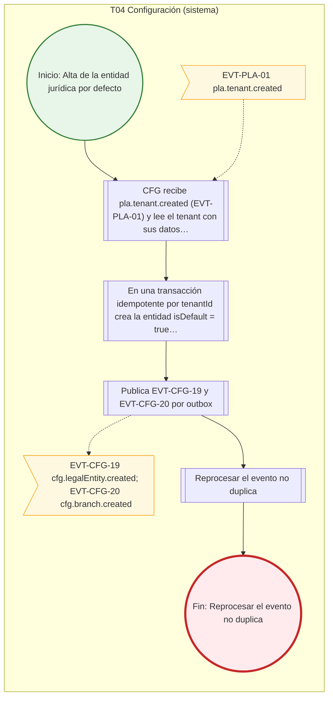

**Pasos del proceso** (actividad tomada del anexo; la columna RF/RN distingue lo citado en el paso de lo asociado por parámetro, permiso, evento o tema compartido).

| Paso | Carril | Actividad | RF/RN que aplican | EVT / JOB / PAN |
|---|---|---|---|---|
| 1 | T04 Configuración | CFG recibe `pla.tenant.created` (EVT-PLA-01) y lee el tenant con sus datos fiscales (`legalName`, `cuit`, `legalForm`, `inaesRegistration`, `fiscalAddress`). | asoc.: RF-CFG-135 | EVT-PLA-01 |
| 2 | T04 Configuración | En una transacción idempotente por `tenantId` crea la entidad `isDefault = true`, `status = active`, `validFrom` = fecha de alta, y la sucursal `SUC-01` "Casa central" (`isHeadquarters = true`, usos `attention` y `cashier`). | asoc.: RF-CFG-135, RN-CFG-051 | — |
| 3 | T04 Configuración | Publica EVT-CFG-19 y EVT-CFG-20 por outbox. Si el tenant es `platform`, no crea entidad. Si falta el CUIT (tenant `demo`), usa los datos ficticios de la semilla (§18.7). | — | EVT-CFG-19, EVT-CFG-20 |
| 4 | T04 Configuración | Reprocesar el evento no duplica: la clave natural es `{ tenantId, isDefault: true }`. | — | — |

**Situación actual en ProCoop (nota de cambio).** Sin contraste específico para este proceso en el anexo (filas `CTR-` con ProCoop) ni en el análisis de brechas. El contraste del dominio está en `15-analisis-brechas-procoop.md` §3.3.

**Excepciones**

| Excepción | Tratamiento |
|---|---|
| Si el tenant es `platform` | no crea entidad |
| Si falta el CUIT (tenant `demo`) | usa los datos ficticios de la semilla (§18.7) |
| Duplicado | Reprocesar el evento no duplica: la clave natural es `( tenantId, isDefault: true )` |
| Falla técnica en un paso automático, un job o una integración | Reintento idempotente y reanudable; lo no reparable pasa a la bandeja técnica con responsable (política de recuperación de T11 P-WFL-01 y T01 §9.12; AGR-016). |

---

## 11. PRC-CFG-17 Resolución de la entidad jurídica de un documento (RF-CFG-137)

| Campo | Contenido |
|---|---|
| Fuente | T04 §9.17, `T04-CFG-configuracion-parametros-maestros.md` (línea 1476) |
| Macroproceso | MP-18 Plataforma, configuración, experiencia e integraciones |
| Disparador | Resolución de la entidad jurídica de un documento |
| Resultado | El validador del esquema base (RF-CFG-136) rechaza el documento… |
| Carriles | T04 Configuración (sistema) |
| Roles de T02 | Solo actores del sistema (sin rol humano) |
| Módulos involucrados | T04 Configuración |
| Eventos (T11 §12) | — |
| Jobs | — |
| Relación con 04-procesos-bpmn.md | — |

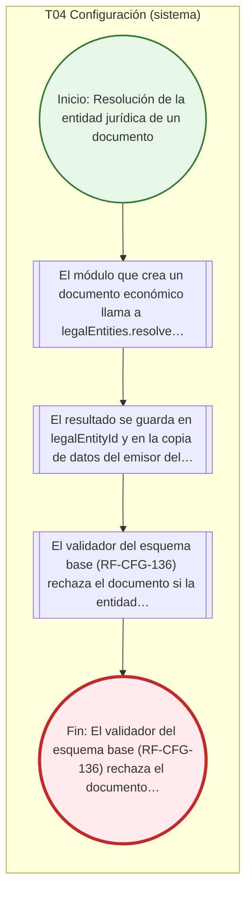

**Pasos del proceso** (actividad tomada del anexo; la columna RF/RN distingue lo citado en el paso de lo asociado por parámetro, permiso, evento o tema compartido).

| Paso | Carril | Actividad | RF/RN que aplican | EVT / JOB / PAN |
|---|---|---|---|---|
| 1 | T04 Configuración | El módulo que crea un documento económico llama a `legalEntities.resolve({ branchId, serviceId, at })` | asoc.: RF-CFG-137 | — |
| 2 | T04 Configuración | el resultado se guarda en `legalEntityId` y en la copia de datos del emisor del documento | asoc.: RF-CFG-136, RF-CFG-139 | — |
| 3 | T04 Configuración | El validador del esquema base (RF-CFG-136) rechaza el documento si la entidad falta, es de otro tenant o está inactiva a la fecha `at` | RF-CFG-136 | — |

**Situación actual en ProCoop (nota de cambio).** Sin contraste específico para este proceso en el anexo (filas `CTR-` con ProCoop) ni en el análisis de brechas. El contraste del dominio está en `15-analisis-brechas-procoop.md` §3.3.

**Excepciones**

| Excepción | Tratamiento |
|---|---|
| Rechazo | El módulo que crea un documento económico llama a `legalEntities.resolve(( branchId, serviceId, at ))` el resultado se guarda en `legalEntityId` y en la copia de datos del emisor del documento El validador del esquema base (RF-CFG-136) rechaza el documento si la entidad falta, es de otro tenant o está inactiva a la fecha `at` |
| Falla técnica en un paso automático, un job o una integración | Reintento idempotente y reanudable; lo no reparable pasa a la bandeja técnica con responsable (política de recuperación de T11 P-WFL-01 y T01 §9.12; AGR-016). |

---

## 12. PRC-INT-01 Llamada saliente estándar (JOB-INT-01 `int:ejecutar-operacion`)

| Campo | Contenido |
|---|---|
| Fuente | T06 §9.1, `T06-INT-integraciones.md` (línea 943) |
| Macroproceso | MP-18 Plataforma, configuración, experiencia e integraciones |
| Disparador | Llamada saliente estándar |
| Resultado | Actualiza métricas, health y circuito. |
| Carriles | T06 Integraciones (sistema) |
| Roles de T02 | Solo actores del sistema (sin rol humano) |
| Módulos involucrados | T06 Integraciones |
| Eventos (T11 §12) | EVT-INT-03 `int.operation.succeeded`; EVT-INT-06 `int.arca.caeObtained`, `caeObtained` |
| Jobs | — |
| Relación con 04-procesos-bpmn.md | — |

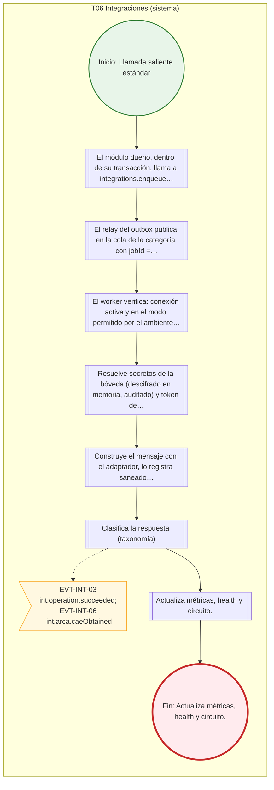

**Pasos del proceso** (actividad tomada del anexo; la columna RF/RN distingue lo citado en el paso de lo asociado por parámetro, permiso, evento o tema compartido).

| Paso | Carril | Actividad | RF/RN que aplican | EVT / JOB / PAN |
|---|---|---|---|---|
| 1 | T06 Integraciones | El módulo dueño, dentro de su transacción, llama a `integrations.enqueue({ connectionPurpose\|connectionId, operationType, businessRef, payload, idempotencyKey, priority })`. Se crea la `integrationOperation` (`queued`) y el registro outbox. | asoc.: RF-INT-032 | — |
| 2 | T06 Integraciones | El relay del outbox publica en la cola de la categoría con `jobId = operationId` (BullMQ descarta duplicados). | — | — |
| 3 | T06 Integraciones | El worker verifica: conexión activa y en el modo permitido por el ambiente (RF-INT-030), circuito, tasa, credenciales vigentes. Si algo bloquea ⇒ `blocked`. | RF-INT-030 | — |
| 4 | T06 Integraciones | Resuelve secretos de la bóveda (descifrado en memoria, auditado) y token de sesión (caché con lock). | — | — |
| 5 | T06 Integraciones | Construye el mensaje con el adaptador, lo registra saneado (`integrationMessages`), lo envía con timeout. | asoc.: RN-INT-039 | — |
| 6 | T06 Integraciones | Clasifica la respuesta (taxonomía). Éxito ⇒ `succeeded`, guarda `result` y `externalReferences`, publica `int.operation.succeeded` + evento del conector (ej. `int.arca.caeObtained`). Reintentable ⇒ `retry_scheduled`. Sin respuesta ⇒ `uncertain` (9.2). Permanente ⇒ `failed` + bandeja. | asoc.: RN-INT-003, RF-INT-078 | EVT-INT-03, EVT-INT-06 |
| 7 | T06 Integraciones | Actualiza métricas, `health` y circuito. | — | — |

**Situación actual en ProCoop (nota de cambio).** Sin contraste específico para este proceso en el anexo (filas `CTR-` con ProCoop) ni en el análisis de brechas. El contraste del dominio está en `15-analisis-brechas-procoop.md` §3.18.

**Excepciones**

| Excepción | Tratamiento |
|---|---|
| Duplicado | El relay del outbox publica en la cola de la categoría con `jobId = operationId` (BullMQ descarta duplicados) |
| Si algo bloquea | `blocked` |
| Resultado incierto o sin respuesta | Construye el mensaje con el adaptador, lo registra saneado (`integrationMessages`), lo envía con timeout |
| Reintento | Reintentable ⇒ `retry_scheduled` |
| Falla técnica en un paso automático, un job o una integración | Reintento idempotente y reanudable; lo no reparable pasa a la bandeja técnica con responsable (política de recuperación de T11 P-WFL-01 y T01 §9.12; AGR-016). |

---

## 13. PRC-INT-02 Resolución de resultado incierto (JOB-INT-02 `int:resolver-incierto`)

| Campo | Contenido |
|---|---|
| Fuente | T06 §9.2, `T06-INT-integraciones.md` (línea 953) |
| Macroproceso | MP-18 Plataforma, configuración, experiencia e integraciones |
| Disparador | Resolución de resultado incierto |
| Resultado | Se ejecuta la capacidad de consulta declarada por el conector… |
| Carriles | T06 Integraciones (sistema) |
| Roles de T02 | Solo actores del sistema (sin rol humano) |
| Módulos involucrados | T06 Integraciones |
| Eventos (T11 §12) | — |
| Jobs | — |
| Relación con 04-procesos-bpmn.md | — |

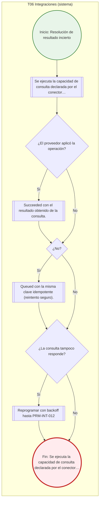

**Pasos del proceso** (actividad tomada del anexo; la columna RF/RN distingue lo citado en el paso de lo asociado por parámetro, permiso, evento o tema compartido).

| Paso | Carril | Actividad | RF/RN que aplican | EVT / JOB / PAN |
|---|---|---|---|---|
| 1 | T06 Integraciones | Se ejecuta la capacidad de consulta declarada por el conector (`lastAuthorized`/`getVoucher` en ARCA; `getPayment` en pasarelas; `getStatus` en equipos de red/medidores; `getDebtPublicationStatus` en SIRO). | asoc.: RN-INT-065 | — |
| 2 | T06 Integraciones | Si el proveedor aplicó la operación ⇒ `succeeded` con el resultado obtenido de la consulta. | — | — |
| 3 | T06 Integraciones | Si no ⇒ `queued` con la misma clave idempotente (reintento seguro). | — | — |
| 4 | T06 Integraciones | Si la consulta tampoco responde ⇒ reprogramar con backoff hasta PRM-INT-012; vencido ⇒ `failed` con categoría `uncertain` y alerta `uncertain_operations` (no se reintenta sin humano). | — | — |

**Situación actual en ProCoop (nota de cambio).** Sin contraste específico para este proceso en el anexo (filas `CTR-` con ProCoop) ni en el análisis de brechas. El contraste del dominio está en `15-analisis-brechas-procoop.md` §3.18.

**Excepciones**

| Excepción | Tratamiento |
|---|---|
| Si el proveedor aplicó la operación | `succeeded` con el resultado obtenido de la consulta |
| Reintento | Si no ⇒ `queued` con la misma clave idempotente (reintento seguro) |
| Si la consulta tampoco responde | reprogramar con backoff hasta PRM-INT-012; vencido ⇒ `failed` con categoría `uncertain` y alerta `uncertain_operations` (no se reintenta sin humano) |
| Falla técnica en un paso automático, un job o una integración | Reintento idempotente y reanudable; lo no reparable pasa a la bandeja técnica con responsable (política de recuperación de T11 P-WFL-01 y T01 §9.12; AGR-016). |

---

## 14. PRC-INT-03 Webhook entrante (JOB-INT-03 `int:procesar-webhook`)

| Campo | Contenido |
|---|---|
| Fuente | T06 §9.3, `T06-INT-integraciones.md` (línea 960) |
| Macroproceso | MP-18 Plataforma, configuración, experiencia e integraciones |
| Disparador | Webhook entrante |
| Resultado | Errores ⇒ failed con reintento |
| Carriles | T06 Integraciones (sistema) |
| Roles de T02 | Solo actores del sistema (sin rol humano) |
| Módulos involucrados | T06 Integraciones |
| Eventos (T11 §12) | EVT-INT-08 `int.payment.confirmed`; EVT-INT-13 `int.message.delivered`; EVT-INT-18 `int.signature.completed` |
| Jobs | — |
| Relación con 04-procesos-bpmn.md | — |

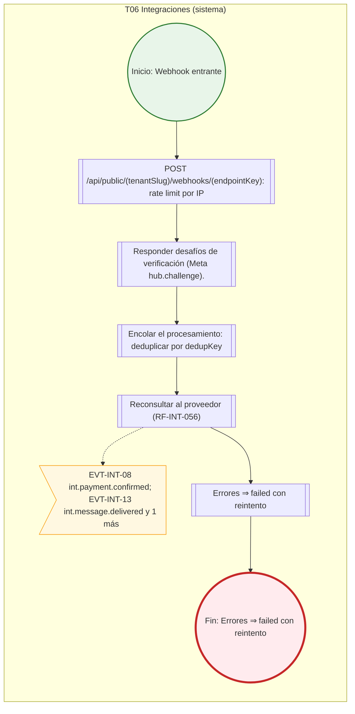

**Pasos del proceso** (actividad tomada del anexo; la columna RF/RN distingue lo citado en el paso de lo asociado por parámetro, permiso, evento o tema compartido).

| Paso | Carril | Actividad | RF/RN que aplican | EVT / JOB / PAN |
|---|---|---|---|---|
| 1 | T06 Integraciones | `POST /api/public/{tenantSlug}/webhooks/{endpointKey}`: rate limit por IP; resolver endpoint; validar IP (si aplica), firma y timestamp; persistir en `webhookInbox` (`received`/`verified`/`rejected`) y bitácora; responder 2xx (o 401 si firma inválida). | asoc.: RF-INT-053 | — |
| 2 | T06 Integraciones | Responder desafíos de verificación (Meta `hub.challenge`). | asoc.: RF-INT-058 | — |
| 3 | T06 Integraciones | Encolar el procesamiento: deduplicar por `dedupKey`; mapear a la operación/intención (`external_reference`, `CodPag` equivalente). | — | — |
| 4 | T06 Integraciones | Reconsultar al proveedor (RF-INT-056); con el estado confirmado publicar el evento de dominio (`int.payment.confirmed`, `int.message.delivered`, `int.signature.completed`…). | RF-INT-056 | EVT-INT-08, EVT-INT-13, EVT-INT-18 |
| 5 | T06 Integraciones | Errores ⇒ `failed` con reintento; excedidos ⇒ bandeja. | — | — |

**Situación actual en ProCoop (nota de cambio).** Sin contraste específico para este proceso en el anexo (filas `CTR-` con ProCoop) ni en el análisis de brechas. El contraste del dominio está en `15-analisis-brechas-procoop.md` §3.18.

**Excepciones**

| Excepción | Tratamiento |
|---|---|
| Falla o error | `POST /api/public/(tenantSlug)/webhooks/(endpointKey)`: rate limit por IP; resolver endpoint; validar IP (si aplica), firma y timestamp; persistir en `webhookInbox` (`received`/`verified`/`rejected`) y bitácora; responder 2xx (o 401 si firma inválida) |
| Duplicado | Encolar el procesamiento: deduplicar por `dedupKey`; mapear a la operación/intención (`external_reference`, `CodPag` equivalente) |
| Falla o error | Errores ⇒ `failed` con reintento; excedidos ⇒ bandeja |
| Falla técnica en un paso automático, un job o una integración | Reintento idempotente y reanudable; lo no reparable pasa a la bandeja técnica con responsable (política de recuperación de T11 P-WFL-01 y T01 §9.12; AGR-016). |

---

## 15. PRC-INT-04 Publicación de deuda y rendición por archivo (JOB-INT-04 `int:generar-archivo`, JOB-INT-05 `int:procesar-archivo-entrante`)

| Campo | Contenido |
|---|---|
| Fuente | T06 §9.4, `T06-INT-integraciones.md` (línea 968) |
| Macroproceso | MP-18 Plataforma, configuración, experiencia e integraciones |
| Disparador | Publicación de deuda y rendición por archivo |
| Resultado | Conciliación automática del lote |
| Carriles | M07 Cuenta corriente y cobranza; T06 Integraciones (sistema) |
| Roles de T02 | Solo actores del sistema (sin rol humano) |
| Módulos involucrados | M07 Cuenta corriente y cobranza, T06 Integraciones |
| Eventos (T11 §12) | EVT-INT-09 `int.debtPublication.acknowledged`; EVT-INT-10 `int.remittance.lineReceived` |
| Jobs | — |
| Relación con 04-procesos-bpmn.md | — |

```mermaid
flowchart LR
  subgraph L_LM07["M07 Cuenta corriente y cobranza"]
    ni(("Inicio: Publicación de deuda y rendición por archivo"))
    ns1[["Saliente: M07 entrega el universo (deuda cobrable por ente)"]]
    ns14[["M07 imputa y devuelve resultado por línea"]]
  end
  subgraph L_LSIS["T06 Integraciones (sistema)"]
    ns2[["T06 aplica el layout (registros, DV, totales, archivo de control)"]]
    ns3[["Previsualización y aprobación (si aplica)"]]
    ns4[["Entrega (descarga firmada/SFTP/API)"]]
    ns5[["Espera acuse (SIRO Get_BaseInfo)"]]
    ns6[["Acknowledged/rejected_by_provider"]]
    ns7[["Evento int.debtPublication.acknowledged"]]
    ne7>"EVT-INT-09 int.debtPublication.acknowledged"]
    ns8[["Entrante: archivo recibido (manual/SFTP/API)"]]
    ns9[["Hash y duplicado"]]
    ns10[["Parseo por layout"]]
    ns11[["Validación por línea (RF-INT-066)"]]
    ns12[["Preview con errores; confirmación"]]
    ns13[["Por cada línea válida evento int.remittance.lineReceived con id externo…"]]
    ne13>"EVT-INT-10 int.remittance.lineReceived"]
    ns15[["Estado del archivo applied/partially_applied"]]
    ns16[["Conciliación automática del lote"]]
    nf(("Fin: Conciliación automática del lote"))
  end
  ni --> ns1
  ns1 --> ns2
  ns2 --> ns3
  ns3 --> ns4
  ns4 --> ns5
  ns5 --> ns6
  ns6 --> ns7
  ns7 -.-> ne7
  ns7 --> ns8
  ns8 --> ns9
  ns9 --> ns10
  ns10 --> ns11
  ns11 --> ns12
  ns12 --> ns13
  ns13 -.-> ne13
  ns13 --> ns14
  ns14 --> ns15
  ns15 --> ns16
  ns16 --> nf
  classDef inicio fill:#e8f5e9,stroke:#2e7d32,stroke-width:2px
  classDef fin fill:#ffebee,stroke:#c62828,stroke-width:4px
  classDef evento fill:#fff8e1,stroke:#f9a825
  classDef temporizador fill:#e3f2fd,stroke:#1565c0
  class ni inicio
  class nf fin
  class ne7,ne13 evento
```

**Pasos del proceso** (actividad tomada del anexo; la columna RF/RN distingue lo citado en el paso de lo asociado por parámetro, permiso, evento o tema compartido).

| Paso | Carril | Actividad | RF/RN que aplican | EVT / JOB / PAN |
|---|---|---|---|---|
| 1 | M07 Cuenta corriente y cobranza | Saliente: M07 entrega el universo (deuda cobrable por ente) | — | — |
| 2 | T06 Integraciones | T06 aplica el layout (registros, DV, totales, archivo de control) | — | — |
| 3 | T06 Integraciones | previsualización y aprobación (si aplica) | — | — |
| 4 | T06 Integraciones | entrega (descarga firmada/SFTP/API) | asoc.: RF-INT-062 | — |
| 5 | T06 Integraciones | espera acuse (SIRO `Get_BaseInfo`) | — | — |
| 6 | T06 Integraciones | `acknowledged`/`rejected_by_provider` | — | — |
| 7 | T06 Integraciones | evento `int.debtPublication.acknowledged` | — | EVT-INT-09 |
| 8 | T06 Integraciones | Entrante: archivo recibido (manual/SFTP/API) | — | — |
| 9 | T06 Integraciones | hash y duplicado | — | — |
| 10 | T06 Integraciones | parseo por layout | — | — |
| 11 | T06 Integraciones | validación por línea (RF-INT-066) | RF-INT-066 | — |
| 12 | T06 Integraciones | preview con errores; confirmación | — | — |
| 13 | T06 Integraciones | por cada línea válida evento `int.remittance.lineReceived` con id externo, importe, fecha de pago y de acreditación, canal | — | EVT-INT-10 |
| 14 | M07 Cuenta corriente y cobranza | M07 imputa y devuelve resultado por línea | — | — |
| 15 | T06 Integraciones | estado del archivo `applied`/`partially_applied` | — | — |
| 16 | T06 Integraciones | conciliación automática del lote | — | — |

**Situación actual en ProCoop (nota de cambio).** Sin contraste específico para este proceso en el anexo (filas `CTR-` con ProCoop) ni en el análisis de brechas. El contraste del dominio está en `15-analisis-brechas-procoop.md` §3.18.

**Excepciones**

| Excepción | Tratamiento |
|---|---|
| Falla o error | Saliente: M07 entrega el universo (deuda cobrable por ente) T06 aplica el layout (registros, DV, totales, archivo de control) previsualización y aprobación (si aplica) entrega (descarga firmada/SFTP/API) espera acuse (SIRO `Get_BaseInfo`) `acknowledged`/`rejected_by_provider` evento `int.debtPublication.acknowledged` Entrante: archivo recibido (manual/SFTP/API) hash y duplicado parseo por layout v |
| Falla técnica en un paso automático, un job o una integración | Reintento idempotente y reanudable; lo no reparable pasa a la bandeja técnica con responsable (política de recuperación de T11 P-WFL-01 y T01 §9.12; AGR-016). |

---

## 16. PRC-INT-05 Conciliación (JOB-INT-06 `int:conciliar`)

| Campo | Contenido |
|---|---|
| Fuente | T06 §9.5, `T06-INT-integraciones.md` (línea 974) |
| Macroproceso | MP-18 Plataforma, configuración, experiencia e integraciones |
| Disparador | Conciliación |
| Resultado | Cierre con aprobación |
| Carriles | T06 Integraciones (sistema) |
| Roles de T02 | Solo actores del sistema (sin rol humano) |
| Módulos involucrados | T06 Integraciones |
| Eventos (T11 §12) | — |
| Jobs | JOB-INT-06 `int:conciliar` |
| Relación con 04-procesos-bpmn.md | — |

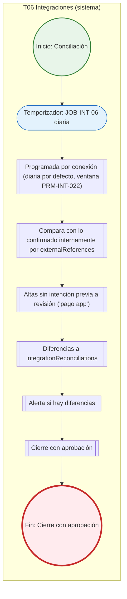

**Pasos del proceso** (actividad tomada del anexo; la columna RF/RN distingue lo citado en el paso de lo asociado por parámetro, permiso, evento o tema compartido).

| Paso | Carril | Actividad | RF/RN que aplican | EVT / JOB / PAN |
|---|---|---|---|---|
| 1 | T06 Integraciones | Programada por conexión (diaria por defecto, ventana PRM-INT-022): obtiene el listado externo (`listCollections`, reporte de cobranza, `Listados/Proceso`, extracto) | asoc.: RN-INT-006 | — |
| 2 | T06 Integraciones | compara con lo confirmado internamente por `externalReferences` | asoc.: RN-INT-003, RF-INT-078 | — |
| 3 | T06 Integraciones | altas sin intención previa a revisión ("pago app") | — | — |
| 4 | T06 Integraciones | diferencias a `integrationReconciliations` | — | — |
| 5 | T06 Integraciones | alerta si hay diferencias | — | — |
| 6 | T06 Integraciones | cierre con aprobación | — | — |

**Situación actual en ProCoop (nota de cambio).** Sin contraste específico para este proceso en el anexo (filas `CTR-` con ProCoop) ni en el análisis de brechas. El contraste del dominio está en `15-analisis-brechas-procoop.md` §3.18.

**Excepciones**

| Excepción | Tratamiento |
|---|---|
| Falla técnica en un paso automático, un job o una integración | Reintento idempotente y reanudable; lo no reparable pasa a la bandeja técnica con responsable (política de recuperación de T11 P-WFL-01 y T01 §9.12; AGR-016). |

---

## 17. PRC-INT-06 Recuperación de pendientes (JOB-INT-07 `int:recuperar-pendientes`)

| Campo | Contenido |
|---|---|
| Fuente | T06 §9.6, `T06-INT-integraciones.md` (línea 978) |
| Macroproceso | MP-18 Plataforma, configuración, experiencia e integraciones |
| Disparador | Recuperación de pendientes |
| Resultado | Con barridos amplios en horarios configurables (reemplaza la…) |
| Carriles | T06 Integraciones (sistema) |
| Roles de T02 | Solo actores del sistema (sin rol humano) |
| Módulos involucrados | T06 Integraciones |
| Eventos (T11 §12) | — |
| Jobs | — |
| Relación con 04-procesos-bpmn.md | — |

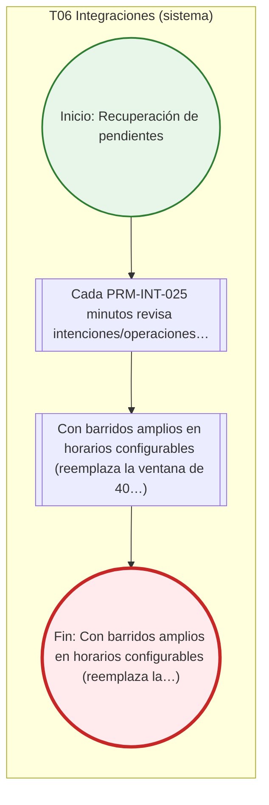

**Pasos del proceso** (actividad tomada del anexo; la columna RF/RN distingue lo citado en el paso de lo asociado por parámetro, permiso, evento o tema compartido).

| Paso | Carril | Actividad | RF/RN que aplican | EVT / JOB / PAN |
|---|---|---|---|---|
| 1 | T06 Integraciones | Cada PRM-INT-025 minutos revisa intenciones/operaciones `queued`/`retry_scheduled` vencidas, `uncertain` y webhooks `failed` | — | — |
| 2 | T06 Integraciones | con barridos amplios en horarios configurables (reemplaza la ventana de 40 min y los barridos de 4, 11, 16 y 23 h de ProCoop) | asoc.: RN-INT-036 | — |

**Situación actual en ProCoop (nota de cambio).** El anexo indica: Cada PRM-INT-025 minutos revisa intenciones/operaciones `queued`/`retry_scheduled` vencidas, `uncertain` y webhooks `failed` con barridos amplios en horarios configurables (reemplaza la ventana de 40 min y los barridos de 4, 11, 16 y 23 h de ProCoop) Cada PRM-INT-025 minutos revisa intenciones/operaciones `queued`/`retry_scheduled` vencidas, `uncertain` y webhooks `failed`; con barridos amplios en horarios configurables (reemplaza la ventana de 40 min y los barridos de 4, 11, 16 y 23 h de ProCoop).

**Excepciones**

| Excepción | Tratamiento |
|---|---|
| Vencimiento | Cada PRM-INT-025 minutos revisa intenciones/operaciones `queued`/`retry_scheduled` vencidas, `uncertain` y webhooks `failed` con barridos amplios en horarios configurables (reemplaza la ventana de 40 min y los barridos de 4, 11, 16 y 23 h de ProCoop) |
| Falla técnica en un paso automático, un job o una integración | Reintento idempotente y reanudable; lo no reparable pasa a la bandeja técnica con responsable (política de recuperación de T11 P-WFL-01 y T01 §9.12; AGR-016). |

---

## 18. PRC-INT-07 Salud y monitoreo (JOB-INT-08 `int:health-check`)

| Campo | Contenido |
|---|---|
| Fuente | T06 §9.7, `T06-INT-integraciones.md` (línea 982) |
| Macroproceso | MP-18 Plataforma, configuración, experiencia e integraciones |
| Disparador | Salud y monitoreo |
| Resultado | Abre/cierra alertas error_rate, backlog, schedule_missed… |
| Carriles | T06 Integraciones (sistema) |
| Roles de T02 | Solo actores del sistema (sin rol humano) |
| Módulos involucrados | T06 Integraciones |
| Eventos (T11 §12) | — |
| Jobs | — |
| Relación con 04-procesos-bpmn.md | — |

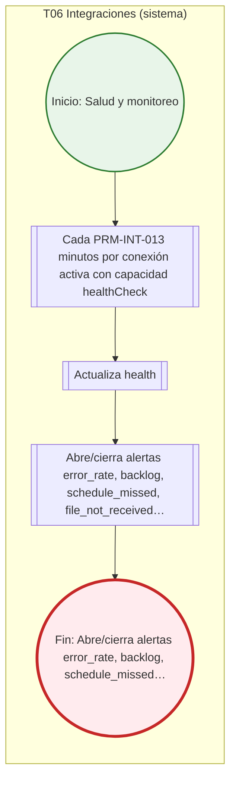

**Pasos del proceso** (actividad tomada del anexo; la columna RF/RN distingue lo citado en el paso de lo asociado por parámetro, permiso, evento o tema compartido).

| Paso | Carril | Actividad | RF/RN que aplican | EVT / JOB / PAN |
|---|---|---|---|---|
| 1 | T06 Integraciones | Cada PRM-INT-013 minutos por conexión activa con capacidad `healthCheck` | — | — |
| 2 | T06 Integraciones | actualiza `health` | — | — |
| 3 | T06 Integraciones | abre/cierra alertas `error_rate`, `backlog`, `schedule_missed`, `file_not_received` (archivo de rendición esperado que no llegó a la hora configurada) | — | — |

**Situación actual en ProCoop (nota de cambio).** Sin contraste específico para este proceso en el anexo (filas `CTR-` con ProCoop) ni en el análisis de brechas. El contraste del dominio está en `15-analisis-brechas-procoop.md` §3.18.

**Excepciones**

| Excepción | Tratamiento |
|---|---|
| Falla o error | Cada PRM-INT-013 minutos por conexión activa con capacidad `healthCheck` actualiza `health` abre/cierra alertas `error_rate`, `backlog`, `schedule_missed`, `file_not_received` (archivo de rendición esperado que no llegó a la hora configurada) |
| Falla técnica en un paso automático, un job o una integración | Reintento idempotente y reanudable; lo no reparable pasa a la bandeja técnica con responsable (política de recuperación de T11 P-WFL-01 y T01 §9.12; AGR-016). |

---

## 19. PRC-INT-08 Vencimientos (JOB-INT-09 `int:alertar-vencimientos`)

| Campo | Contenido |
|---|---|
| Fuente | T06 §9.8, `T06-INT-integraciones.md` (línea 986) |
| Macroproceso | MP-18 Plataforma, configuración, experiencia e integraciones |
| Disparador | Vencimientos |
| Resultado | Al vencer, conexión blocked_credential (si no hay versión…) |
| Carriles | T06 Integraciones (sistema) |
| Roles de T02 | Solo actores del sistema (sin rol humano) |
| Módulos involucrados | T06 Integraciones |
| Eventos (T11 §12) | — |
| Jobs | JOB-INT-09 `int:alertar-vencimientos` |
| Relación con 04-procesos-bpmn.md | — |

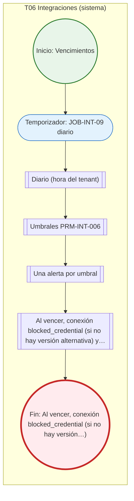

**Pasos del proceso** (actividad tomada del anexo; la columna RF/RN distingue lo citado en el paso de lo asociado por parámetro, permiso, evento o tema compartido).

| Paso | Carril | Actividad | RF/RN que aplican | EVT / JOB / PAN |
|---|---|---|---|---|
| 1 | T06 Integraciones | Diario (hora del tenant): certificados y credenciales con `notAfter`/`expiresAt` | — | — |
| 2 | T06 Integraciones | umbrales PRM-INT-006 | — | — |
| 3 | T06 Integraciones | una alerta por umbral | — | — |
| 4 | T06 Integraciones | al vencer, conexión `blocked_credential` (si no hay versión alternativa) y alerta `critical` a tenant y plataforma | — | — |

**Situación actual en ProCoop (nota de cambio).** Sin contraste específico para este proceso en el anexo (filas `CTR-` con ProCoop) ni en el análisis de brechas. El contraste del dominio está en `15-analisis-brechas-procoop.md` §3.18.

**Excepciones**

| Excepción | Tratamiento |
|---|---|
| Vencimiento | Diario (hora del tenant): certificados y credenciales con `notAfter`/`expiresAt` umbrales PRM-INT-006 una alerta por umbral al vencer, conexión `blocked_credential` (si no hay versión alternativa) y alerta `critical` a tenant y plataforma |
| Falla técnica en un paso automático, un job o una integración | Reintento idempotente y reanudable; lo no reparable pasa a la bandeja técnica con responsable (política de recuperación de T11 P-WFL-01 y T01 §9.12; AGR-016). |

---

## 20. PRC-INT-09 Rotación de credenciales (JOB-INT-10 `int:rotar-credencial`)

| Campo | Contenido |
|---|---|
| Fuente | T06 §9.9, `T06-INT-integraciones.md` (línea 990) |
| Macroproceso | MP-18 Plataforma, configuración, experiencia e integraciones |
| Disparador | Rotación de credenciales |
| Resultado | Auditoría. Para proveedores con API de rotación (tokens OAuth…) |
| Carriles | T06 Integraciones (sistema) |
| Roles de T02 | Solo actores del sistema (sin rol humano) |
| Módulos involucrados | T06 Integraciones |
| Eventos (T11 §12) | — |
| Jobs | — |
| Relación con 04-procesos-bpmn.md | — |

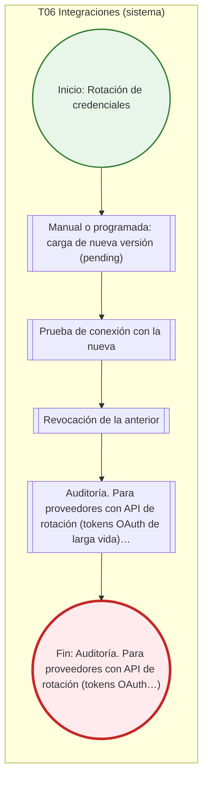

**Pasos del proceso** (actividad tomada del anexo; la columna RF/RN distingue lo citado en el paso de lo asociado por parámetro, permiso, evento o tema compartido).

| Paso | Carril | Actividad | RF/RN que aplican | EVT / JOB / PAN |
|---|---|---|---|---|
| 1 | T06 Integraciones | Manual o programada: carga de nueva versión (`pending`) | — | — |
| 2 | T06 Integraciones | prueba de conexión con la nueva; activación; gracia | — | — |
| 3 | T06 Integraciones | revocación de la anterior | — | — |
| 4 | T06 Integraciones | auditoría. Para proveedores con API de rotación (tokens OAuth de larga vida), el job pide el nuevo token automáticamente | — | — |

**Situación actual en ProCoop (nota de cambio).** Sin contraste específico para este proceso en el anexo (filas `CTR-` con ProCoop) ni en el análisis de brechas. El contraste del dominio está en `15-analisis-brechas-procoop.md` §3.18.

**Excepciones**

| Excepción | Tratamiento |
|---|---|
| Falla técnica en un paso automático, un job o una integración | Reintento idempotente y reanudable; lo no reparable pasa a la bandeja técnica con responsable (política de recuperación de T11 P-WFL-01 y T01 §9.12; AGR-016). |

---

## 21. PRC-INT-10 Renovación de tokens (JOB-INT-11 `int:refrescar-tokens`)

| Campo | Contenido |
|---|---|
| Fuente | T06 §9.10, `T06-INT-integraciones.md` (línea 994) |
| Macroproceso | MP-18 Plataforma, configuración, experiencia e integraciones |
| Disparador | Renovación de tokens |
| Resultado | Antes de expiresAt − margen renueva TA de WSAA por… |
| Carriles | T06 Integraciones (sistema) |
| Roles de T02 | Solo actores del sistema (sin rol humano) |
| Módulos involucrados | T06 Integraciones |
| Eventos (T11 §12) | — |
| Jobs | — |
| Relación con 04-procesos-bpmn.md | — |

```mermaid
flowchart LR
  subgraph L_LSIS["T06 Integraciones (sistema)"]
    ni(("Inicio: Renovación de tokens"))
    ns1[["Antes de expiresAt − margen renueva TA de WSAA por servicio/CUIT y tokens…"]]
    nf(("Fin: Antes de expiresAt − margen renueva TA de WSAA por…"))
  end
  ni --> ns1
  ns1 --> nf
  classDef inicio fill:#e8f5e9,stroke:#2e7d32,stroke-width:2px
  classDef fin fill:#ffebee,stroke:#c62828,stroke-width:4px
  classDef evento fill:#fff8e1,stroke:#f9a825
  classDef temporizador fill:#e3f2fd,stroke:#1565c0
  class ni inicio
  class nf fin
```

**Pasos del proceso** (actividad tomada del anexo; la columna RF/RN distingue lo citado en el paso de lo asociado por parámetro, permiso, evento o tema compartido).

| Paso | Carril | Actividad | RF/RN que aplican | EVT / JOB / PAN |
|---|---|---|---|---|
| 1 | T06 Integraciones | Antes de `expiresAt − margen` renueva TA de WSAA por servicio/CUIT y tokens OAuth (Interbanking, NaranjaX, SiPago, Pagos TIC), tomando lock distribuido | — | — |

**Situación actual en ProCoop (nota de cambio).** Sin contraste específico para este proceso en el anexo (filas `CTR-` con ProCoop) ni en el análisis de brechas. El contraste del dominio está en `15-analisis-brechas-procoop.md` §3.18.

**Excepciones**

| Excepción | Tratamiento |
|---|---|
| Falla técnica en un paso automático, un job o una integración | Reintento idempotente y reanudable; lo no reparable pasa a la bandeja técnica con responsable (política de recuperación de T11 P-WFL-01 y T01 §9.12; AGR-016). |

---

## Inconsistencias detectadas en la especificación (esta parte)

No se detectaron inconsistencias en los procesos de esta parte.

## Cobertura de esta parte

| Universo de la parte | Diagramados | Con nota ProCoop específica | Pendientes |
|---|---|---|---|
| 21 (PRC-CFG-07 a PRC-INT-10) | 21 | 3 | 0 |
