# GoodApps Cooperativas

## Procesos de negocio — Plataforma, configuración, experiencia e integraciones y Reportes, BI y API externa y Migración desde ProCoop (T06, T07, T10)

**Entregable de Análisis y Diseño Detallado — Artefacto 2.1 (Procesos de negocio BPMN). Parte de [`04-procesos-bpmn.md`](04-procesos-bpmn.md).**

| Dato | Valor |
|---|---|
| Documento | Diagramas BPMN, pasos, situación actual en ProCoop y excepciones de los procesos PRC-INT-11 a PRC-MIG-02, derivados de la sección 9 de T06, T07, T10 |
| Carácter | Derivado de la especificación vigente; no la reemplaza. Ante diferencias prevalecen la maestra `00`, los anexos, T05, T11 y el registro de decisiones `01` |
| Generación | Script `_trabajo/generar_bpmn.py` con la ampliación `_trabajo/generar_prc.py` (derivación automática desde el texto de la sección 9 de cada anexo, `_trabajo/prc_auto.py`) |
| Versión | 1.1 (regenerada contra la especificación corregida) |
| Fecha | 05-11-2026 |

**Cómo leer cada proceso.** La notación es la de [`04-procesos-bpmn.md` §3](04-procesos-bpmn.md#3-notación-equivalencia-mermaid--bpmn) (carriles, eventos de inicio y fin, tareas de usuario y de servicio, compuertas XOR y AND, eventos de dominio como banderas, temporizadores y jobs como estadios). La tabla de pasos reproduce la actividad del anexo; en la columna RF/RN, los identificadores sin prefijo son los que el anexo cita en el paso y los marcados "asoc." son reglas o requisitos del mismo anexo que comparten parámetro, permiso, evento o tema con el paso (asociación generada por el script y revisada). Los eventos se nombran con su ID del catálogo de T11 §12.

**Derivación automática (v1.2).** Los procesos `PRC-<MOD>-nn` de esta parte se generaron con `_trabajo/generar_prc.py` y `_trabajo/prc_auto.py` a partir del texto de cada subsección §9.n del anexo, sin curaduría paso a paso (a diferencia de los 94 procesos `P-XXX-nn` de las partes 04b a 04i). Reglas: (1) los pasos son los numerados o viñetas del anexo; si la subsección es prosa, se parte por flechas o por oraciones; si es una tabla de pasos o de jobs, cada fila es un paso; (2) el carril de cada paso es el primer actor nombrado al comienzo del paso (rol de T02 §4, otro módulo, sistema externo, dispositivo o job); si no se nombra ninguno, el paso es del sistema del módulo dueño; (3) los pasos que empiezan con "Si …" se dibujan como compuerta XOR; (4) los eventos son los nombres del catálogo de T11 §12 citados en el paso (bandera entrante si el paso los consume, saliente si los publica); el temporizador aparece cuando el título nombra un job periódico; (5) las excepciones son las oraciones del anexo con condición o con palabras de falla, rechazo, vencimiento, duplicado o umbral, más la política de recuperación del anexo; (6) la nota ProCoop combina lo que dice el propio anexo, la fila `CTR-` del anexo que contrasta con ProCoop y la fila de `15-analisis-brechas-procoop.md` §3 de mayor afinidad; si ninguna alcanza el umbral, la nota lo dice y remite al contraste del dominio en esa sección. La revisión manual de una muestra está en `_trabajo/prc_revision.md`; ante diferencias, prevalece el texto del anexo citado en la ficha.

## Índice de procesos de esta parte

1. [PRC-INT-11 Contingencia (JOB-INT-12 `int:cerrar-contingencia`)](#1-prc-int-11-contingencia-job-int-12-intcerrar-contingencia)
2. [PRC-INT-12 Reemplazo manual](#2-prc-int-12-reemplazo-manual)
3. [PRC-INT-13 Mensajería saliente (JOB-INT-13 `int:entregar-mensaje`)](#3-prc-int-13-mensajería-saliente-job-int-13-intentregar-mensaje)
4. [PRC-INT-14 Agente local (JOB-INT-14 `int:despachar-comando-agente`)](#4-prc-int-14-agente-local-job-int-14-intdespachar-comando-agente)
5. [PRC-INT-15 Purga y archivo de bitácora (JOB-INT-15 `int:purgar-bitacora`)](#5-prc-int-15-purga-y-archivo-de-bitácora-job-int-15-intpurgar-bitacora)
6. [PRC-INT-16 Buzón SFTP (JOB-INT-16 `int:leer-buzon-sftp`) y entrega SFTP (JOB-INT-17 `int:entregar-sftp`)](#6-prc-int-16-buzón-sftp-job-int-16-intleer-buzon-sftp-y-entrega-sftp-job-int-17-intentregar-sftp)
7. [PRC-INT-17 Sincronización de parámetros ARCA (JOB-INT-18 `int:sincronizar-parametros-arca`)](#7-prc-int-17-sincronización-de-parámetros-arca-job-int-18-intsincronizar-parametros-arca)
8. [PRC-BIA-01 Ejecución de un reporte (interactivo)](#8-prc-bia-01-ejecución-de-un-reporte-interactivo)
9. [PRC-BIA-02 Exportación](#9-prc-bia-02-exportación)
10. [PRC-BIA-03 Programación y entrega](#10-prc-bia-03-programación-y-entrega)
11. [PRC-BIA-04 Indicadores, snapshots y alertas](#11-prc-bia-04-indicadores-snapshots-y-alertas)
12. [PRC-BIA-05 Almacén analítico (O11)](#12-prc-bia-05-almacén-analítico-o11)
13. [PRC-BIA-06 IA analítica (O11)](#13-prc-bia-06-ia-analítica-o11)
14. [PRC-BIA-07 API externa: alta de cliente y llamada](#14-prc-bia-07-api-externa-alta-de-cliente-y-llamada)
15. [PRC-BIA-08 Extracción incremental](#15-prc-bia-08-extracción-incremental)
16. [PRC-BIA-09 Webhooks salientes (O11)](#16-prc-bia-09-webhooks-salientes-o11)
17. [PRC-BIA-10 Benchmark (O11, si PA-BIA-05 = A)](#17-prc-bia-10-benchmark-o11-si-pa-bia-05--a)
18. [PRC-BIA-11 Datos abiertos (O11)](#18-prc-bia-11-datos-abiertos-o11)
19. [PRC-BIA-12 Salida del tenant (MER-020)](#19-prc-bia-12-salida-del-tenant-mer-020)
20. [PRC-MIG-01 Herramienta de migración (pipeline ETL)](#20-prc-mig-01-herramienta-de-migración-pipeline-etl)
21. [PRC-MIG-02 Corrida paralela y facturación comparada (BASE FAC-012, DFA §33)](#21-prc-mig-02-corrida-paralela-y-facturación-comparada-base-fac-012-dfa-33)

---

## 1. PRC-INT-11 Contingencia (JOB-INT-12 `int:cerrar-contingencia`)

| Campo | Contenido |
|---|---|
| Fuente | T06 §9.11, `T06-INT-integraciones.md` (línea 998) |
| Macroproceso | MP-18 Plataforma, configuración, experiencia e integraciones |
| Disparador | Contingencia |
| Resultado | Al recuperar, closing: reproceso de diferidos, informe de CAEA… |
| Carriles | T06 Integraciones (sistema) |
| Roles de T02 | Solo actores del sistema (sin rol humano) |
| Módulos involucrados | T06 Integraciones |
| Eventos (T11 §12) | — |
| Jobs | — |
| Relación con 04-procesos-bpmn.md | — |

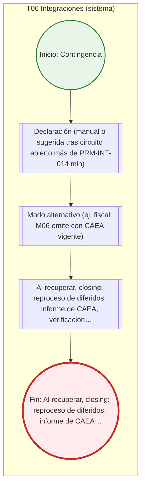

**Pasos del proceso** (actividad tomada del anexo; la columna RF/RN distingue lo citado en el paso de lo asociado por parámetro, permiso, evento o tema compartido).

| Paso | Carril | Actividad | RF/RN que aplican | EVT / JOB / PAN |
|---|---|---|---|---|
| 1 | T06 Integraciones | Declaración (manual o sugerida tras circuito abierto más de PRM-INT-014 min); aprobación | asoc.: RF-INT-074 | — |
| 2 | T06 Integraciones | modo alternativo (ej. fiscal: M06 emite con CAEA vigente; redes: exportación manual del archivo; mensajería: cola diferida o conexión alternativa) | asoc.: RF-INT-074 | — |
| 3 | T06 Integraciones | al recuperar, `closing`: reproceso de diferidos, informe de CAEA, verificación de inciertos; conciliación; `closed` | — | — |

**Situación actual en ProCoop (nota de cambio).** Sin contraste específico para este proceso en el anexo (filas `CTR-` con ProCoop) ni en el análisis de brechas. El contraste del dominio está en `15-analisis-brechas-procoop.md` §3.18.

**Excepciones**

| Excepción | Tratamiento |
|---|---|
| Resultado incierto o sin respuesta | Declaración (manual o sugerida tras circuito abierto más de PRM-INT-014 min); aprobación modo alternativo (ej. fiscal: M06 emite con CAEA vigente; redes: exportación manual del archivo; mensajería: cola diferida o conexión alternativa) al recuperar, `closing`: reproceso de diferidos, informe de CAEA, verificación de inciertos; conciliación |
| Falla técnica en un paso automático, un job o una integración | Reintento idempotente y reanudable; lo no reparable pasa a la bandeja técnica con responsable (política de recuperación de T11 P-WFL-01 y T01 §9.12; AGR-016). |

---

## 2. PRC-INT-12 Reemplazo manual

| Campo | Contenido |
|---|---|
| Fuente | T06 §9.12, `T06-INT-integraciones.md` (línea 1002) |
| Macroproceso | MP-18 Plataforma, configuración, experiencia e integraciones |
| Disparador | Reemplazo manual |
| Resultado | La próxima conciliación lo verifica |
| Carriles | Administrador de la cooperativa (T-ADM); Aprobador según política (T11 aprobaciones); T06 Integraciones (sistema) |
| Roles de T02 | T-ADM Administrador de la cooperativa |
| Módulos involucrados | T06 Integraciones, T11 Workflow, eventos y documentos |
| Eventos (T11 §12) | — |
| Jobs | — |
| Relación con 04-procesos-bpmn.md | — |

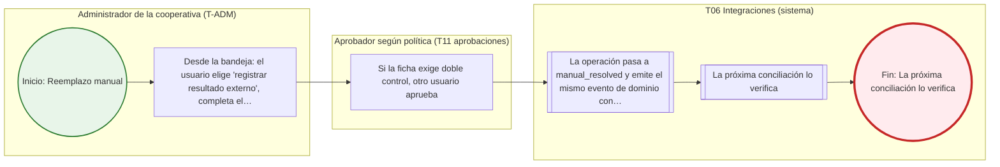

**Pasos del proceso** (actividad tomada del anexo; la columna RF/RN distingue lo citado en el paso de lo asociado por parámetro, permiso, evento o tema compartido).

| Paso | Carril | Actividad | RF/RN que aplican | EVT / JOB / PAN |
|---|---|---|---|---|
| 1 | Administrador de la cooperativa | Desde la bandeja: el usuario elige "registrar resultado externo", completa el resultado (ej. id de pago, importe, fecha), adjunta evidencia (captura del panel del proveedor, acuse), indica motivo | asoc.: RF-INT-075 | — |
| 2 | Aprobador según política | si la ficha exige doble control, otro usuario aprueba | — | — |
| 3 | T06 Integraciones | la operación pasa a `manual_resolved` y emite el mismo evento de dominio con marca `manual: true` | — | — |
| 4 | T06 Integraciones | la próxima conciliación lo verifica | — | — |

**Situación actual en ProCoop (nota de cambio).** Sin contraste específico para este proceso en el anexo (filas `CTR-` con ProCoop) ni en el análisis de brechas. El contraste del dominio está en `15-analisis-brechas-procoop.md` §3.18.

**Excepciones**

| Excepción | Tratamiento |
|---|---|
| Falla técnica en un paso automático, un job o una integración | Reintento idempotente y reanudable; lo no reparable pasa a la bandeja técnica con responsable (política de recuperación de T11 P-WFL-01 y T01 §9.12; AGR-016). |

---

## 3. PRC-INT-13 Mensajería saliente (JOB-INT-13 `int:entregar-mensaje`)

| Campo | Contenido |
|---|---|
| Fuente | T06 §9.13, `T06-INT-integraciones.md` (línea 1006) |
| Macroproceso | MP-18 Plataforma, configuración, experiencia e integraciones |
| Disparador | Mensajería saliente |
| Resultado | Failover a conexión alternativa si la primaria está caída… |
| Carriles | T09 Comunicaciones; T06 Integraciones (sistema) |
| Roles de T02 | Solo actores del sistema (sin rol humano) |
| Módulos involucrados | T06 Integraciones, T09 Comunicaciones |
| Eventos (T11 §12) | — |
| Jobs | — |
| Relación con 04-procesos-bpmn.md | — |

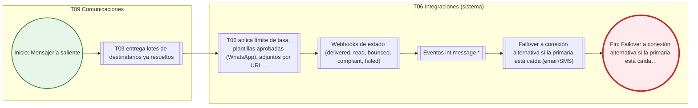

**Pasos del proceso** (actividad tomada del anexo; la columna RF/RN distingue lo citado en el paso de lo asociado por parámetro, permiso, evento o tema compartido).

| Paso | Carril | Actividad | RF/RN que aplican | EVT / JOB / PAN |
|---|---|---|---|---|
| 1 | T09 Comunicaciones | T09 entrega lotes de destinatarios ya resueltos | — | — |
| 2 | T06 Integraciones | T06 aplica límite de tasa, plantillas aprobadas (WhatsApp), adjuntos por URL firmada; envío; estado `sent` | — | — |
| 3 | T06 Integraciones | webhooks de estado (`delivered`, `read`, `bounced`, `complaint`, `failed`) | — | — |
| 4 | T06 Integraciones | eventos `int.message.*` | — | — |
| 5 | T06 Integraciones | failover a conexión alternativa si la primaria está caída (email/SMS) | — | — |

**Situación actual en ProCoop (nota de cambio).** Sin contraste específico para este proceso en el anexo (filas `CTR-` con ProCoop) ni en el análisis de brechas. El contraste del dominio está en `15-analisis-brechas-procoop.md` §3.18.

**Excepciones**

| Excepción | Tratamiento |
|---|---|
| Falla o error | T09 entrega lotes de destinatarios ya resueltos T06 aplica límite de tasa, plantillas aprobadas (WhatsApp), adjuntos por URL firmada; envío; estado `sent` webhooks de estado (`delivered`, `read`, `bounced`, `complaint`, `failed`) eventos `int.message.*` failover a conexión alternativa si la primaria está caída (email/SMS) |
| Falla técnica en un paso automático, un job o una integración | Reintento idempotente y reanudable; lo no reparable pasa a la bandeja técnica con responsable (política de recuperación de T11 P-WFL-01 y T01 §9.12; AGR-016). |

---

## 4. PRC-INT-14 Agente local (JOB-INT-14 `int:despachar-comando-agente`)

| Campo | Contenido |
|---|---|
| Fuente | T06 §9.14, `T06-INT-integraciones.md` (línea 1010) |
| Macroproceso | MP-18 Plataforma, configuración, experiencia e integraciones |
| Disparador | Agente local |
| Resultado | Si el agente está offline, el comando espera hasta expirar y… |
| Carriles | T06 Integraciones (sistema); Administrador de la cooperativa (T-ADM) |
| Roles de T02 | T-ADM Administrador de la cooperativa |
| Módulos involucrados | T06 Integraciones |
| Eventos (T11 §12) | — |
| Jobs | — |
| Relación con 04-procesos-bpmn.md | — |

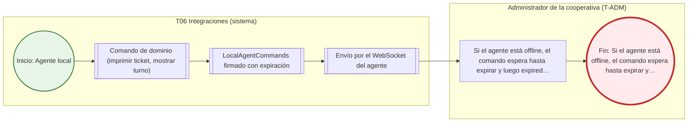

**Pasos del proceso** (actividad tomada del anexo; la columna RF/RN distingue lo citado en el paso de lo asociado por parámetro, permiso, evento o tema compartido).

| Paso | Carril | Actividad | RF/RN que aplican | EVT / JOB / PAN |
|---|---|---|---|---|
| 1 | T06 Integraciones | Comando de dominio (imprimir ticket, mostrar turno) | — | — |
| 2 | T06 Integraciones | `localAgentCommands` firmado con expiración | — | — |
| 3 | T06 Integraciones | envío por el WebSocket del agente; acuse; resultado | — | — |
| 4 | Administrador de la cooperativa | si el agente está `offline`, el comando espera hasta expirar y luego `expired` con alerta; el dominio decide alternativa (ej. imprimir PDF en navegador) | — | — |

**Situación actual en ProCoop (nota de cambio).** Sin contraste específico para este proceso en el anexo (filas `CTR-` con ProCoop) ni en el análisis de brechas. El contraste del dominio está en `15-analisis-brechas-procoop.md` §3.18.

**Excepciones**

| Excepción | Tratamiento |
|---|---|
| Falla técnica en un paso automático, un job o una integración | Reintento idempotente y reanudable; lo no reparable pasa a la bandeja técnica con responsable (política de recuperación de T11 P-WFL-01 y T01 §9.12; AGR-016). |

---

## 5. PRC-INT-15 Purga y archivo de bitácora (JOB-INT-15 `int:purgar-bitacora`)

| Campo | Contenido |
|---|---|
| Fuente | T06 §9.15, `T06-INT-integraciones.md` (línea 1014) |
| Macroproceso | MP-18 Plataforma, configuración, experiencia e integraciones |
| Disparador | Purga y archivo de bitácora |
| Resultado | Nunca borra operaciones vinculadas a documentos económicos… |
| Carriles | T06 Integraciones (sistema) |
| Roles de T02 | Solo actores del sistema (sin rol humano) |
| Módulos involucrados | T06 Integraciones |
| Eventos (T11 §12) | — |
| Jobs | JOB-INT-15 `int:purgar-bitacora` |
| Relación con 04-procesos-bpmn.md | — |

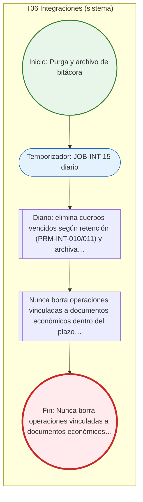

**Pasos del proceso** (actividad tomada del anexo; la columna RF/RN distingue lo citado en el paso de lo asociado por parámetro, permiso, evento o tema compartido).

| Paso | Carril | Actividad | RF/RN que aplican | EVT / JOB / PAN |
|---|---|---|---|---|
| 1 | T06 Integraciones | Diario: elimina cuerpos vencidos según retención (PRM-INT-010/011) y archiva metadatos antiguos en almacenamiento frío | asoc.: RF-INT-049 | — |
| 2 | T06 Integraciones | nunca borra operaciones vinculadas a documentos económicos dentro del plazo legal | — | — |

**Situación actual en ProCoop (nota de cambio).** Sin contraste específico para este proceso en el anexo (filas `CTR-` con ProCoop) ni en el análisis de brechas. El contraste del dominio está en `15-analisis-brechas-procoop.md` §3.18.

**Excepciones**

| Excepción | Tratamiento |
|---|---|
| Vencimiento | Diario: elimina cuerpos vencidos según retención (PRM-INT-010/011) y archiva metadatos antiguos en almacenamiento frío nunca borra operaciones vinculadas a documentos económicos dentro del plazo legal |
| Falla técnica en un paso automático, un job o una integración | Reintento idempotente y reanudable; lo no reparable pasa a la bandeja técnica con responsable (política de recuperación de T11 P-WFL-01 y T01 §9.12; AGR-016). |

---

## 6. PRC-INT-16 Buzón SFTP (JOB-INT-16 `int:leer-buzon-sftp`) y entrega SFTP (JOB-INT-17 `int:entregar-sftp`)

| Campo | Contenido |
|---|---|
| Fuente | T06 §9.16, `T06-INT-integraciones.md` (línea 1018) |
| Macroproceso | MP-18 Plataforma, configuración, experiencia e integraciones |
| Disparador | Buzón SFTP (JOB-INT-16 int:leer-buzon-sftp) y entrega SFTP |
| Resultado | Entrega con reintento y verificación de tamaño/hash |
| Carriles | T06 Integraciones (sistema) |
| Roles de T02 | Solo actores del sistema (sin rol humano) |
| Módulos involucrados | T06 Integraciones |
| Eventos (T11 §12) | — |
| Jobs | JOB-INT-16 `int:leer-buzon-sftp` |
| Relación con 04-procesos-bpmn.md | — |

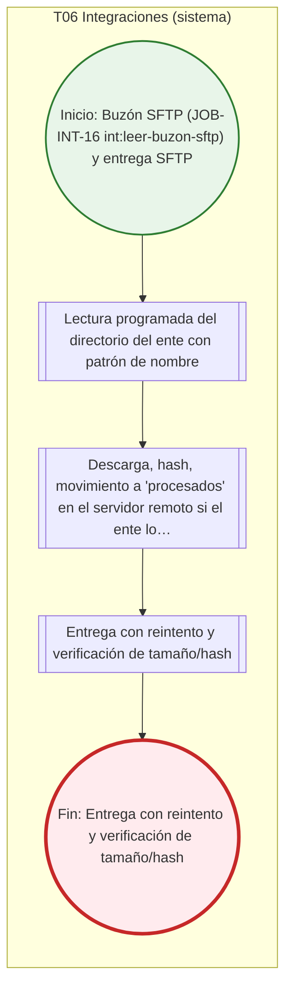

**Pasos del proceso** (actividad tomada del anexo; la columna RF/RN distingue lo citado en el paso de lo asociado por parámetro, permiso, evento o tema compartido).

| Paso | Carril | Actividad | RF/RN que aplican | EVT / JOB / PAN |
|---|---|---|---|---|
| 1 | T06 Integraciones | Lectura programada del directorio del ente con patrón de nombre | — | — |
| 2 | T06 Integraciones | descarga, hash, movimiento a "procesados" en el servidor remoto si el ente lo permite | — | — |
| 3 | T06 Integraciones | entrega con reintento y verificación de tamaño/hash | — | — |

**Situación actual en ProCoop (nota de cambio).** Sin contraste específico para este proceso en el anexo (filas `CTR-` con ProCoop) ni en el análisis de brechas. El contraste del dominio está en `15-analisis-brechas-procoop.md` §3.18.

**Excepciones**

| Excepción | Tratamiento |
|---|---|
| Reintento | Lectura programada del directorio del ente con patrón de nombre descarga, hash, movimiento a "procesados" en el servidor remoto si el ente lo permite entrega con reintento y verificación de tamaño/hash |
| Falla técnica en un paso automático, un job o una integración | Reintento idempotente y reanudable; lo no reparable pasa a la bandeja técnica con responsable (política de recuperación de T11 P-WFL-01 y T01 §9.12; AGR-016). |

---

## 7. PRC-INT-17 Sincronización de parámetros ARCA (JOB-INT-18 `int:sincronizar-parametros-arca`)

| Campo | Contenido |
|---|---|
| Fuente | T06 §9.17, `T06-INT-integraciones.md` (línea 1022) |
| Macroproceso | MP-18 Plataforma, configuración, experiencia e integraciones |
| Disparador | Sincronización de parámetros ARCA |
| Resultado | M06/T04 actualizan tablas maestras con vigencia |
| Carriles | T06 Integraciones (sistema); ARCA (externo, vía T06); M06 Fiscal |
| Roles de T02 | Solo actores del sistema (sin rol humano) |
| Módulos involucrados | M06 Fiscal, T06 Integraciones |
| Eventos (T11 §12) | EVT-INT-06 `int.arca.paramsSynced` |
| Jobs | JOB-INT-18 `int:sincronizar-parametros-arca` |
| Relación con 04-procesos-bpmn.md | — |

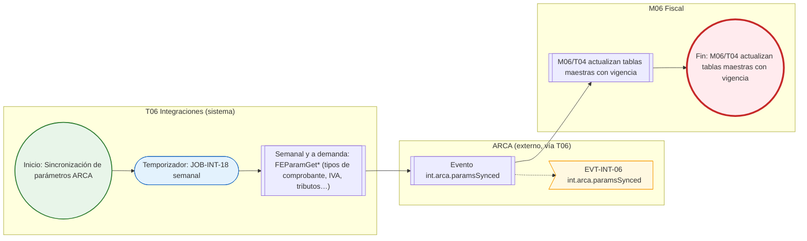

**Pasos del proceso** (actividad tomada del anexo; la columna RF/RN distingue lo citado en el paso de lo asociado por parámetro, permiso, evento o tema compartido).

| Paso | Carril | Actividad | RF/RN que aplican | EVT / JOB / PAN |
|---|---|---|---|---|
| 1 | T06 Integraciones | Semanal y a demanda: `FEParamGet*` (tipos de comprobante, IVA, tributos, monedas, puntos de venta, condición IVA del receptor, actividades, cotizaciones) | — | — |
| 2 | ARCA | evento `int.arca.paramsSynced` | — | EVT-INT-06 |
| 3 | M06 Fiscal | M06/T04 actualizan tablas maestras con vigencia | — | — |

**Situación actual en ProCoop (nota de cambio).** Sin contraste específico para este proceso en el anexo (filas `CTR-` con ProCoop) ni en el análisis de brechas. El contraste del dominio está en `15-analisis-brechas-procoop.md` §3.18.

**Excepciones**

| Excepción | Tratamiento |
|---|---|
| Falla técnica en un paso automático, un job o una integración | Reintento idempotente y reanudable; lo no reparable pasa a la bandeja técnica con responsable (política de recuperación de T11 P-WFL-01 y T01 §9.12; AGR-016). |

---

## 8. PRC-BIA-01 Ejecución de un reporte (interactivo)

| Campo | Contenido |
|---|---|
| Fuente | T10 §9.1, `T10-BIA-reportes-bi-apis.md` (línea 1597) |
| Macroproceso | MP-19 Reportes, BI y API externa |
| Disparador | Ejecución de un reporte |
| Resultado | Cancelación: POST /runs/:id/cancel marca bandera |
| Carriles | Gerente (T-GER); T10 Reportes y API (sistema) |
| Roles de T02 | T-GER Gerente |
| Módulos involucrados | T10 Reportes y API |
| Eventos (T11 §12) | — |
| Jobs | JOB-BIA-01 `bia:ejecutar-reporte` |
| Relación con 04-procesos-bpmn.md | — |

```mermaid
flowchart LR
  subgraph L_LTGER["Gerente (T-GER)"]
    ni(("Inicio: Ejecución de un reporte"))
    ns1["El usuario abre el reporte desde el catálogo (PAN-BIA-01) o desde la pantalla…"]
  end
  subgraph L_LSIS["T10 Reportes y API (sistema)"]
    ns2[["El frontend arma el formulario de parámetros desde parameters[] (mismo…)"]]
    ns3[["POST /api/admin/bia/reports/:code/runs"]]
    ns4[["Estima costo (estimatedCostFn del provider)"]]
    ns5[["El worker ejecuta el provider en streaming por lotes de PRM-BIA-018 filas…"]]
    ns6[["Aplica enmascarado según sensitive de columnas y capability del solicitante"]]
    ns7[["Al terminar: succeeded, notificación in-app ('tu reporte está listo')"]]
    ns8[["Cancelación: POST /runs/:id/cancel marca bandera"]]
    nf(("Fin: Cancelación: POST /runs/:id/cancel marca bandera"))
  end
  ni --> ns1
  ns1 --> ns2
  ns2 --> ns3
  ns3 --> ns4
  ns4 --> ns5
  ns5 --> ns6
  ns6 --> ns7
  ns7 --> ns8
  ns8 --> nf
  classDef inicio fill:#e8f5e9,stroke:#2e7d32,stroke-width:2px
  classDef fin fill:#ffebee,stroke:#c62828,stroke-width:4px
  classDef evento fill:#fff8e1,stroke:#f9a825
  classDef temporizador fill:#e3f2fd,stroke:#1565c0
  class ni inicio
  class nf fin
```

**Pasos del proceso** (actividad tomada del anexo; la columna RF/RN distingue lo citado en el paso de lo asociado por parámetro, permiso, evento o tema compartido).

| Paso | Carril | Actividad | RF/RN que aplican | EVT / JOB / PAN |
|---|---|---|---|---|
| 1 | Gerente | El usuario abre el reporte desde el catálogo (PAN-BIA-01) o desde la pantalla del módulo (botón "Reportes" contextual). | — | PAN-BIA-01 |
| 2 | T10 Reportes y API | El frontend arma el formulario de parámetros desde `parameters[]` (mismo esquema Zod en backend). | — | — |
| 3 | T10 Reportes y API | `POST /api/admin/bia/reports/:code/runs`: el backend valida capability, licencia, parámetros; resuelve relativos en la zona del tenant; congela `effectiveScope`. | — | — |
| 4 | T10 Reportes y API | Estima costo (`estimatedCostFn` del provider: cantidad de documentos del universo). Si ≤ umbrales → `mode=sync`: llama al provider con `readPreference` según RN-BIA-050 y devuelve la primera página + totales. Si no → `mode=async`: crea `reportRuns` `queued`, encola `bia:ejecutar-reporte` y devuelve 202 con `runId`. | RN-BIA-050; asoc.: RF-BIA-005 | JOB-BIA-01 |
| 5 | T10 Reportes y API | El worker ejecuta el provider en streaming por lotes de `PRM-BIA-018` filas, guarda el resultado en la colección temporal del run y actualiza progreso. | — | — |
| 6 | T10 Reportes y API | Aplica enmascarado según `sensitive` de columnas y capability del solicitante; registra `reportAccessLogs` si `sensitivity ≠ none`. | asoc.: RN-BIA-016, RF-BIA-034 | — |
| 7 | T10 Reportes y API | Al terminar: `succeeded`, notificación in-app ("tu reporte está listo"). Fallo: `failed` con `error.retriable`; reintentos automáticos del job: 3 con backoff 30 s/2 min/10 min sólo si `retriable`. | — | — |
| 8 | T10 Reportes y API | Cancelación: `POST /runs/:id/cancel` marca bandera; el worker la verifica entre lotes. | — | — |

**Situación actual en ProCoop (nota de cambio).** Sin contraste específico para este proceso en el anexo (filas `CTR-` con ProCoop) ni en el análisis de brechas. El contraste del dominio está en `15-analisis-brechas-procoop.md` §3.18.

**Excepciones**

| Excepción | Tratamiento |
|---|---|
| Si ≤ umbrales | `mode=sync`: llama al provider con `readPreference` según RN-BIA-050 y devuelve la primera página + totales |
| Si no → `mode=async` | crea `reportRuns` `queued`, encola `bia:ejecutar-reporte` y devuelve 202 con `runId` |
| Falla o error | Fallo: `failed` con `error.retriable`; reintentos automáticos del job: 3 con backoff 30 s/2 min/10 min sólo si `retriable` |
| Cancelación, anulación o reversión | Cancelación: `POST /runs/:id/cancel` marca bandera; el worker la verifica entre lotes |
| Falla técnica en un paso automático, un job o una integración | Reintento idempotente y reanudable; lo no reparable pasa a la bandeja técnica con responsable (política de recuperación de T11 P-WFL-01 y T01 §9.12; AGR-016). |

---

## 9. PRC-BIA-02 Exportación

| Campo | Contenido |
|---|---|
| Fuente | T10 §9.2, `T10-BIA-reportes-bi-apis.md` (línea 1608) |
| Macroproceso | MP-19 Reportes, BI y API externa |
| Disparador | Exportación |
| Resultado | Job diario bia:purgar-exportaciones borra objetos vencidos y… |
| Carriles | T10 Reportes y API (sistema) |
| Roles de T02 | Solo actores del sistema (sin rol humano) |
| Módulos involucrados | T10 Reportes y API |
| Eventos (T11 §12) | — |
| Jobs | JOB-BIA-02 `bia:generar-exportacion`; JOB-BIA-05 `bia:purgar-exportaciones` |
| Relación con 04-procesos-bpmn.md | — |

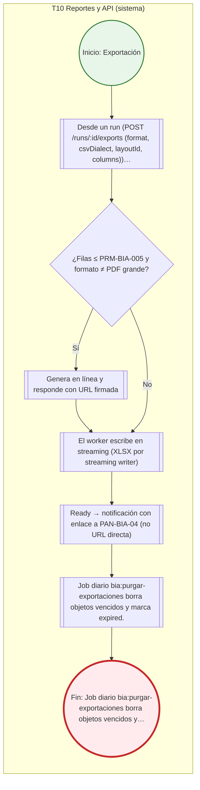

**Pasos del proceso** (actividad tomada del anexo; la columna RF/RN distingue lo citado en el paso de lo asociado por parámetro, permiso, evento o tema compartido).

| Paso | Carril | Actividad | RF/RN que aplican | EVT / JOB / PAN |
|---|---|---|---|---|
| 1 | T10 Reportes y API | Desde un run (`POST /runs/:id/exports {format, csvDialect, layoutId, columns}`) o desde una grilla (`POST /table-exports {screenKey, filters, columns, format}` — el backend vuelve a ejecutar la consulta del provider de la grilla, nunca confía en filas enviadas por el cliente). | — | — |
| 2 | T10 Reportes y API | Si filas ≤ `PRM-BIA-005` y formato ≠ PDF grande → genera en línea y responde con URL firmada. Si no → `bia:generar-exportacion`. | asoc.: RF-BIA-022 | JOB-BIA-02 |
| 3 | T10 Reportes y API | El worker escribe en streaming (XLSX por streaming writer; CSV; PDF por motor HTML→PDF por páginas de `PRM-BIA-006` filas; layouts fijos), agrega hoja/bloque de metadatos, protege fórmulas, calcula SHA-256, sube a `tenants/<tenantId>/bia/exports/...` con cifrado del lado servidor. | — | — |
| 4 | T10 Reportes y API | `ready` → notificación con enlace a PAN-BIA-04 (no URL directa). La descarga (`GET /exports/:id/download`) revalida permiso y emite URL firmada de `PRM-BIA-007` minutos (redirect 302). | asoc.: RN-BIA-017, RF-BIA-022 | PAN-BIA-04 |
| 5 | T10 Reportes y API | Job diario `bia:purgar-exportaciones` borra objetos vencidos y marca `expired`. | — | JOB-BIA-05 |

**Situación actual en ProCoop (nota de cambio).** Sin contraste específico para este proceso en el anexo (filas `CTR-` con ProCoop) ni en el análisis de brechas. El contraste del dominio está en `15-analisis-brechas-procoop.md` §3.18.

**Excepciones**

| Excepción | Tratamiento |
|---|---|
| Si filas ≤ `PRM-BIA-005` y formato ≠ PDF grande | genera en línea y responde con URL firmada |
| Vencimiento | Job diario `bia:purgar-exportaciones` borra objetos vencidos y marca `expired` |
| Falla técnica en un paso automático, un job o una integración | Reintento idempotente y reanudable; lo no reparable pasa a la bandeja técnica con responsable (política de recuperación de T11 P-WFL-01 y T01 §9.12; AGR-016). |

---

## 10. PRC-BIA-03 Programación y entrega

| Campo | Contenido |
|---|---|
| Fuente | T10 §9.3, `T10-BIA-reportes-bi-apis.md` (línea 1616) |
| Macroproceso | MP-19 Reportes, BI y API externa |
| Disparador | Programación y entrega |
| Resultado | Calcula siguiente nextRunAt con calendario de días hábiles del… |
| Carriles | T10 Reportes y API (sistema) |
| Roles de T02 | Solo actores del sistema (sin rol humano) |
| Módulos involucrados | M05 Facturación, M07 Cuenta corriente y cobranza, M08 Mora, M15 Contabilidad, T10 Reportes y API |
| Eventos (T11 §12) | EVT-FAC-06 `fac.billingRun.closed`; EVT-COB-12 `cob.cashSession.closed`; EVT-CON-07 `con.period.closed`; EVT-MOR-07 `mor.batch.generated` |
| Jobs | JOB-BIA-03 `bia:programador` |
| Relación con 04-procesos-bpmn.md | — |

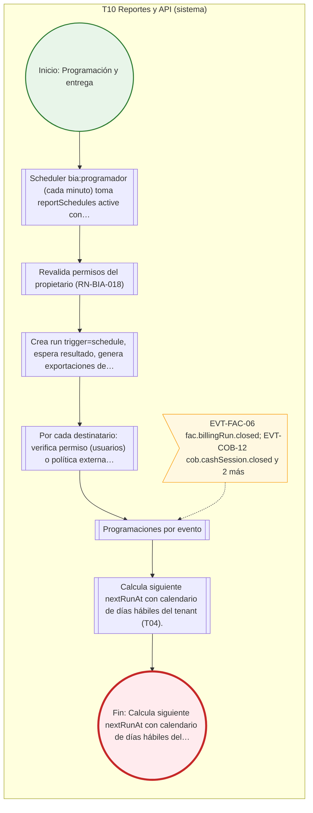

**Pasos del proceso** (actividad tomada del anexo; la columna RF/RN distingue lo citado en el paso de lo asociado por parámetro, permiso, evento o tema compartido).

| Paso | Carril | Actividad | RF/RN que aplican | EVT / JOB / PAN |
|---|---|---|---|---|
| 1 | T10 Reportes y API | Scheduler `bia:programador` (cada minuto) toma `reportSchedules` `active` con `nextRunAt` ≤ ahora (lock por documento, idempotencia `scheduleId+fechaPrevista`). | — | JOB-BIA-03 |
| 2 | T10 Reportes y API | Revalida permisos del propietario (RN-BIA-018); si fallan → `suspended`. | RN-BIA-018 | — |
| 3 | T10 Reportes y API | Crea run `trigger=schedule`, espera resultado, genera exportaciones de `formats[]`. | — | — |
| 4 | T10 Reportes y API | Por cada destinatario: verifica permiso (usuarios) o política externa (PA-BIA-04); envía email vía T09 con plantilla `bia.report.delivery` (enlace o adjunto según RN-BIA-019); registra `reportDeliveries`. | RN-BIA-019; asoc.: RF-BIA-036 | — |
| 5 | T10 Reportes y API | Programaciones por evento: consumidor de `fac.billingRun.closed` (EVT-FAC-06), `cob.cashSession.closed` (EVT-COB-12), `con.period.closed` (EVT-CON-07), `mor.batch.generated` (EVT-MOR-07) dispara las programaciones suscriptas. | — | EVT-FAC-06, EVT-COB-12, EVT-CON-07, EVT-MOR-07 |
| 6 | T10 Reportes y API | Calcula siguiente `nextRunAt` con calendario de días hábiles del tenant (T04). | — | — |

**Situación actual en ProCoop (nota de cambio).** Sin contraste específico para este proceso en el anexo (filas `CTR-` con ProCoop) ni en el análisis de brechas. El contraste del dominio está en `15-analisis-brechas-procoop.md` §3.18.

**Excepciones**

| Excepción | Tratamiento |
|---|---|
| Si fallan | `suspended` |
| Falla técnica en un paso automático, un job o una integración | Reintento idempotente y reanudable; lo no reparable pasa a la bandeja técnica con responsable (política de recuperación de T11 P-WFL-01 y T01 §9.12; AGR-016). |

---

## 11. PRC-BIA-04 Indicadores, snapshots y alertas

| Campo | Contenido |
|---|---|
| Fuente | T10 §9.4, `T10-BIA-reportes-bi-apis.md` (línea 1625) |
| Macroproceso | MP-19 Reportes, BI y API externa |
| Disparador | Indicadores, snapshots y alertas |
| Resultado | Bia:evaluar-alertas tras cada snapshot y cada 15 minutos para… |
| Carriles | T10 Reportes y API (sistema) |
| Roles de T02 | Solo actores del sistema (sin rol humano) |
| Módulos involucrados | T10 Reportes y API |
| Eventos (T11 §12) | — |
| Jobs | JOB-BIA-06 `bia:snapshot-indicadores`; JOB-BIA-07 `bia:cierre-mensual-indicadores`; JOB-BIA-08 `bia:evaluar-alertas` |
| Relación con 04-procesos-bpmn.md | — |

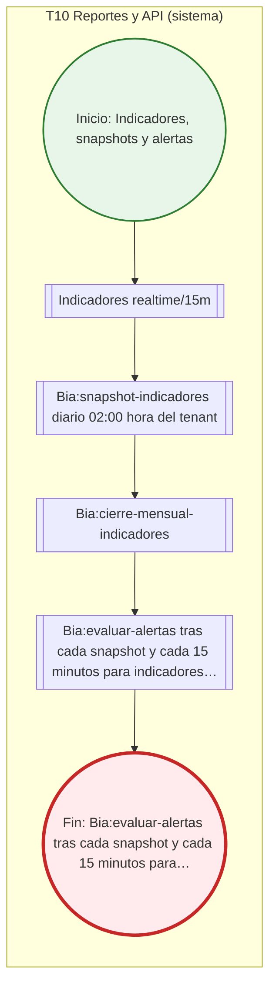

**Pasos del proceso** (actividad tomada del anexo; la columna RF/RN distingue lo citado en el paso de lo asociado por parámetro, permiso, evento o tema compartido).

| Paso | Carril | Actividad | RF/RN que aplican | EVT / JOB / PAN |
|---|---|---|---|---|
| 1 | T10 Reportes y API | Indicadores `realtime`/`15m`: se calculan bajo demanda sobre el almacén analítico (O11) o, antes de O11, sobre el provider operativo del módulo con caché `PRM-BIA-019` minutos por tenant+indicador+dimensiones. | — | — |
| 2 | T10 Reportes y API | `bia:snapshot-indicadores` diario 02:00 hora del tenant: calcula todos los indicadores certificados con `refresh` ≥ `daily` para el día anterior y guarda `indicatorSnapshots`. | — | JOB-BIA-06 |
| 3 | T10 Reportes y API | `bia:cierre-mensual-indicadores`: el día hábil `PRM-BIA-028` del mes congela (`isClosed=true`) los snapshots del mes anterior; correcciones posteriores generan un snapshot "ajustado" con referencia, sin modificar el cerrado. | — | JOB-BIA-07 |
| 4 | T10 Reportes y API | `bia:evaluar-alertas` tras cada snapshot y cada 15 minutos para indicadores realtime: evalúa reglas, deduplica por `kpiAlertRuleId+dimensionKey` (antes `ruleId+dimensionKey`) en la ventana, abre/actualiza `kpiAlerts`, notifica, escala según `escalation[]`. | — | JOB-BIA-08 |

**Situación actual en ProCoop (nota de cambio).** Sin contraste específico para este proceso en el anexo (filas `CTR-` con ProCoop) ni en el análisis de brechas. El contraste del dominio está en `15-analisis-brechas-procoop.md` §3.18.

**Excepciones**

| Excepción | Tratamiento |
|---|---|
| Duplicado | `bia:evaluar-alertas` tras cada snapshot y cada 15 minutos para indicadores realtime: evalúa reglas, deduplica por `kpiAlertRuleId+dimensionKey` (antes `ruleId+dimensionKey`) en la ventana, abre/actualiza `kpiAlerts`, notifica, escala según `escalation[]` |
| Falla técnica en un paso automático, un job o una integración | Reintento idempotente y reanudable; lo no reparable pasa a la bandeja técnica con responsable (política de recuperación de T11 P-WFL-01 y T01 §9.12; AGR-016). |

---

## 12. PRC-BIA-05 Almacén analítico (O11)

| Campo | Contenido |
|---|---|
| Fuente | T10 §9.5, `T10-BIA-reportes-bi-apis.md` (línea 1632); ola O11 |
| Macroproceso | MP-19 Reportes, BI y API externa |
| Disparador | Almacén analítico |
| Resultado | Aislamiento de carga: lecturas analíticas en miembro analytics… |
| Carriles | T10 Reportes y API (sistema) |
| Roles de T02 | Solo actores del sistema (sin rol humano) |
| Módulos involucrados | T10 Reportes y API |
| Eventos (T11 §12) | — |
| Jobs | JOB-BIA-09 `bia:proyectar-<dominio>`; JOB-BIA-10 `bia:snapshot-saldos`; JOB-BIA-11 `bia:reconciliar-bi`; JOB-BIA-12 `bia:reconstruir-proyeccion` |
| Relación con 04-procesos-bpmn.md | — |

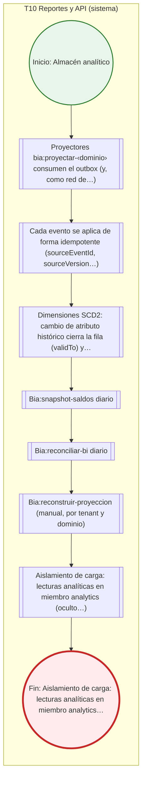

**Pasos del proceso** (actividad tomada del anexo; la columna RF/RN distingue lo citado en el paso de lo asociado por parámetro, permiso, evento o tema compartido).

| Paso | Carril | Actividad | RF/RN que aplican | EVT / JOB / PAN |
|---|---|---|---|---|
| 1 | T10 Reportes y API | Proyectores `bia:proyectar-<dominio>` consumen el outbox (y, como red de seguridad, change streams con resume token persistido por tenant/colección). | — | JOB-BIA-09 |
| 2 | T10 Reportes y API | Cada evento se aplica de forma idempotente (`sourceEventId`, `sourceVersion` creciente; versión menor se ignora). | — | — |
| 3 | T10 Reportes y API | Dimensiones SCD2: cambio de atributo histórico cierra la fila (`validTo`) y abre otra. | — | — |
| 4 | T10 Reportes y API | `bia:snapshot-saldos` diario: saldo, vencido y aging por cuenta×servicio al cierre del día (fuente: servicio de saldos de M07, no recalculado por BIA). | — | JOB-BIA-10 |
| 5 | T10 Reportes y API | `bia:reconciliar-bi` diario: para cada indicador certificado y tenant, compara valor operativo vs analítico del día anterior; diferencia > `PRM-BIA-029` → alerta técnica a plataforma y marca el dataset "en revisión". | — | JOB-BIA-11 |
| 6 | T10 Reportes y API | `bia:reconstruir-proyeccion` (manual, por tenant y dominio): reconstruye en colección sombra y conmuta atómicamente. | asoc.: RF-BIA-062 | JOB-BIA-12 |
| 7 | T10 Reportes y API | Aislamiento de carga: lecturas analíticas en miembro `analytics` (oculto, prioridad 0) o base analítica separada; cuotas por tenant en el pool de workers `bi`. | — | — |

**Situación actual en ProCoop (nota de cambio).** Sin contraste específico para este proceso en el anexo (filas `CTR-` con ProCoop) ni en el análisis de brechas. El contraste del dominio está en `15-analisis-brechas-procoop.md` §3.18.

**Excepciones**

| Excepción | Tratamiento |
|---|---|
| Vencimiento | `bia:snapshot-saldos` diario: saldo, vencido y aging por cuenta×servicio al cierre del día (fuente: servicio de saldos de M07, no recalculado por BIA) |
| Falla técnica en un paso automático, un job o una integración | Reintento idempotente y reanudable; lo no reparable pasa a la bandeja técnica con responsable (política de recuperación de T11 P-WFL-01 y T01 §9.12; AGR-016). |

---

## 13. PRC-BIA-06 IA analítica (O11)

| Campo | Contenido |
|---|---|
| Fuente | T10 §9.6, `T10-BIA-reportes-bi-apis.md` (línea 1642); ola O11 |
| Macroproceso | MP-19 Reportes, BI y API externa |
| Disparador | IA analítica |
| Resultado | Rechazos: fuera de alcance, sin datos, pide datos personales… |
| Carriles | Gerente (T-GER); T10 Reportes y API (sistema) |
| Roles de T02 | T-GER Gerente |
| Módulos involucrados | T10 Reportes y API |
| Eventos (T11 §12) | — |
| Jobs | — |
| Relación con 04-procesos-bpmn.md | — |

```mermaid
flowchart LR
  subgraph L_LTGER["Gerente (T-GER)"]
    ni(("Inicio: IA analítica"))
    ns1["Usuario pregunta en una sala (PAN-BIA-12) o en el cajón IA."]
  end
  subgraph L_LSIS["T10 Reportes y API (sistema)"]
    ns2[["Pre-procesamiento: se eliminan datos personales detectados (números de…)"]]
    ns3[["El modelo recibe: catálogo de datasets/indicadores permitidos al usuario (sin…)"]]
    ns4[["Backend valida la consulta (Zod), aplica alcance, ejecuta sobre la capa…"]]
    ns5[["Segundo paso: el modelo redacta la respuesta usando sólo los valores devueltos"]]
    ns6[["Respuesta con citas (KPI/dataset, universo, corte) y botón 'ver detalle'…"]]
    ns7[["Rechazos: fuera de alcance, sin datos, pide datos personales individuales…"]]
    nf(("Fin: Rechazos: fuera de alcance, sin datos, pide datos personales…"))
  end
  ni --> ns1
  ns1 --> ns2
  ns2 --> ns3
  ns3 --> ns4
  ns4 --> ns5
  ns5 --> ns6
  ns6 --> ns7
  ns7 --> nf
  classDef inicio fill:#e8f5e9,stroke:#2e7d32,stroke-width:2px
  classDef fin fill:#ffebee,stroke:#c62828,stroke-width:4px
  classDef evento fill:#fff8e1,stroke:#f9a825
  classDef temporizador fill:#e3f2fd,stroke:#1565c0
  class ni inicio
  class nf fin
```

**Pasos del proceso** (actividad tomada del anexo; la columna RF/RN distingue lo citado en el paso de lo asociado por parámetro, permiso, evento o tema compartido).

| Paso | Carril | Actividad | RF/RN que aplican | EVT / JOB / PAN |
|---|---|---|---|---|
| 1 | Gerente | Usuario pregunta en una sala (PAN-BIA-12) o en el cajón IA. | — | PAN-BIA-12 |
| 2 | T10 Reportes y API | Pre-procesamiento: se eliminan datos personales detectados (números de documento, emails, nombres de socios reconocidos) y se reemplazan por marcadores. | — | — |
| 3 | T10 Reportes y API | El modelo recibe: catálogo de datasets/indicadores permitidos al usuario (sin datos), la pregunta y el contexto de sala; devuelve una consulta semántica JSON (no SQL). | — | — |
| 4 | T10 Reportes y API | Backend valida la consulta (Zod), aplica alcance, ejecuta sobre la capa semántica, obtiene resultados agregados. | — | — |
| 5 | T10 Reportes y API | Segundo paso: el modelo redacta la respuesta usando sólo los valores devueltos; el backend verifica que cada número del texto exista en el resultado (si no, rechaza y devuelve respuesta determinística con tabla). | — | — |
| 6 | T10 Reportes y API | Respuesta con citas (KPI/dataset, universo, corte) y botón "ver detalle" (drill al reporte). Registro en `aiQuestions`. | — | — |
| 7 | T10 Reportes y API | Rechazos: fuera de alcance, sin datos, pide datos personales individuales ("¿cuánto debe Juan Pérez?") → se deriva a la ficha del socio con permisos normales, la IA no responde el dato. | — | — |

**Situación actual en ProCoop (nota de cambio).** Sin contraste específico para este proceso en el anexo (filas `CTR-` con ProCoop) ni en el análisis de brechas. El contraste del dominio está en `15-analisis-brechas-procoop.md` §3.18.

**Excepciones**

| Excepción | Tratamiento |
|---|---|
| Rechazo | Segundo paso: el modelo redacta la respuesta usando sólo los valores devueltos; el backend verifica que cada número del texto exista en el resultado (si no, rechaza y devuelve respuesta determinística con tabla) |
| Rechazo | Rechazos: fuera de alcance, sin datos, pide datos personales individuales ("¿cuánto debe Juan Pérez?") → se deriva a la ficha del socio con permisos normales, la IA no responde el dato |
| Falla técnica en un paso automático, un job o una integración | Reintento idempotente y reanudable; lo no reparable pasa a la bandeja técnica con responsable (política de recuperación de T11 P-WFL-01 y T01 §9.12; AGR-016). |

---

## 14. PRC-BIA-07 API externa: alta de cliente y llamada

| Campo | Contenido |
|---|---|
| Fuente | T10 §9.7, `T10-BIA-reportes-bi-apis.md` (línea 1652) |
| Macroproceso | MP-19 Reportes, BI y API externa |
| Disparador | API externa: alta de cliente y llamada |
| Resultado | Respuestas con asOf, source, paginación o cursor |
| Carriles | Administrador de la cooperativa (T-ADM); Aprobador según política (T11 aprobaciones); Cliente API (integración externa) (S-API); T10 Reportes y API (sistema) |
| Roles de T02 | S-API Cliente API (integración externa), T-ADM Administrador de la cooperativa |
| Módulos involucrados | T10 Reportes y API, T11 Workflow, eventos y documentos |
| Eventos (T11 §12) | — |
| Jobs | — |
| Relación con 04-procesos-bpmn.md | — |

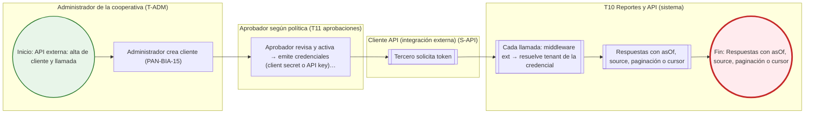

**Pasos del proceso** (actividad tomada del anexo; la columna RF/RN distingue lo citado en el paso de lo asociado por parámetro, permiso, evento o tema compartido).

| Paso | Carril | Actividad | RF/RN que aplican | EVT / JOB / PAN |
|---|---|---|---|---|
| 1 | Administrador de la cooperativa | Administrador crea cliente (PAN-BIA-15): finalidad, responsable, scopes, restricciones → `pending`. | asoc.: RF-BIA-070 | PAN-BIA-15 |
| 2 | Aprobador según política | Aprobador revisa y activa → emite credenciales (client secret o API key) mostradas una vez; descarga de archivo `.json` con `client_id` y secreto, opcional. | — | — |
| 3 | Cliente API | Tercero solicita token: `POST /api/v1/ext/oauth/token` (`grant_type=client_credentials`, `client_id`, `client_secret`, `scope` opcional ⊆ scopes del cliente). Respuesta `access_token` (JWT firmado con clave rotada del entorno, claims `tid`, `cid`, `scp`, `exp` 15 min, `jti`) o token opaco (PA-BIA-02). API key: cabecera `Authorization: ApiKey <key>`. | asoc.: RF-BIA-071 | — |
| 4 | T10 Reportes y API | Cada llamada: middleware ext → resuelve tenant de la credencial; verifica estado tenant/cliente/credencial (caché ≤ 60 s); IP allowlist; scopes; rate limit (Redis token bucket por cliente y tenant); aplica `dataScope` y `fieldRestrictions`; ejecuta en pool `ext`; registra `apiUsageLogs`. | — | — |
| 5 | T10 Reportes y API | Respuestas con `asOf`, `source`, paginación o cursor; errores RFC 9457 (`type` URIs documentadas: `invalid-token`, `insufficient-scope`, `rate-limited`, `tenant-suspended`, `client-suspended`, `not-found`, `validation-error`, `conflict`, `deprecated`). | — | — |

**Situación actual en ProCoop (nota de cambio).** Sin contraste específico para este proceso en el anexo (filas `CTR-` con ProCoop) ni en el análisis de brechas. El contraste del dominio está en `15-analisis-brechas-procoop.md` §3.18.

**Excepciones**

| Excepción | Tratamiento |
|---|---|
| Falla o error | Respuestas con `asOf`, `source`, paginación o cursor; errores RFC 9457 (`type` URIs documentadas: `invalid-token`, `insufficient-scope`, `rate-limited`, `tenant-suspended`, `client-suspended`, `not-found`, `validation-error`, `conflict`, `deprecated`) |
| Falla técnica en un paso automático, un job o una integración | Reintento idempotente y reanudable; lo no reparable pasa a la bandeja técnica con responsable (política de recuperación de T11 P-WFL-01 y T01 §9.12; AGR-016). |

---

## 15. PRC-BIA-08 Extracción incremental

| Campo | Contenido |
|---|---|
| Fuente | T10 §9.8, `T10-BIA-reportes-bi-apis.md` (línea 1660) |
| Macroproceso | MP-19 Reportes, BI y API externa |
| Disparador | Extracción incremental |
| Resultado | Las anulaciones/bajas aparecen como cambios de status |
| Carriles | T10 Reportes y API (sistema) |
| Roles de T02 | Solo actores del sistema (sin rol humano) |
| Módulos involucrados | T10 Reportes y API |
| Eventos (T11 §12) | — |
| Jobs | — |
| Relación con 04-procesos-bpmn.md | — |

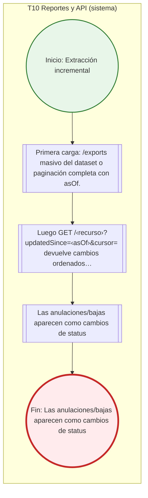

**Pasos del proceso** (actividad tomada del anexo; la columna RF/RN distingue lo citado en el paso de lo asociado por parámetro, permiso, evento o tema compartido).

| Paso | Carril | Actividad | RF/RN que aplican | EVT / JOB / PAN |
|---|---|---|---|---|
| 1 | T10 Reportes y API | Primera carga: `/exports` masivo del dataset o paginación completa con `asOf`. | — | — |
| 2 | T10 Reportes y API | Luego `GET /<recurso>?updatedSince=<asOf>&cursor=` devuelve cambios ordenados por (`updatedAt`, `_id`) hasta `ahora − PRM-BIA-046` s; incluye `nextCursor` y `asOf` nuevo. | asoc.: RN-BIA-033 | — |
| 3 | T10 Reportes y API | Las anulaciones/bajas aparecen como cambios de `status`; los borrados lógicos como `{ id, deleted: true, deletedAt }`. | — | — |

**Situación actual en ProCoop (nota de cambio).** Sin contraste específico para este proceso en el anexo (filas `CTR-` con ProCoop) ni en el análisis de brechas. El contraste del dominio está en `15-analisis-brechas-procoop.md` §3.18.

**Excepciones**

| Excepción | Tratamiento |
|---|---|
| Cancelación, anulación o reversión | Las anulaciones/bajas aparecen como cambios de `status`; los borrados lógicos como `( id, deleted: true, deletedAt )` |
| Falla técnica en un paso automático, un job o una integración | Reintento idempotente y reanudable; lo no reparable pasa a la bandeja técnica con responsable (política de recuperación de T11 P-WFL-01 y T01 §9.12; AGR-016). |

---

## 16. PRC-BIA-09 Webhooks salientes (O11)

| Campo | Contenido |
|---|---|
| Fuente | T10 §9.9, `T10-BIA-reportes-bi-apis.md` (línea 1666); ola O11 |
| Macroproceso | MP-19 Reportes, BI y API externa |
| Disparador | Webhooks salientes |
| Resultado | Bandeja de entregas fallidas por cliente con reenvío manual… |
| Carriles | T10 Reportes y API (sistema) |
| Roles de T02 | Solo actores del sistema (sin rol humano) |
| Módulos involucrados | T10 Reportes y API |
| Eventos (T11 §12) | — |
| Jobs | JOB-BIA-14 `bia:despachar-eventos-publicos`; JOB-BIA-15 `bia:entregar-webhook` |
| Relación con 04-procesos-bpmn.md | — |

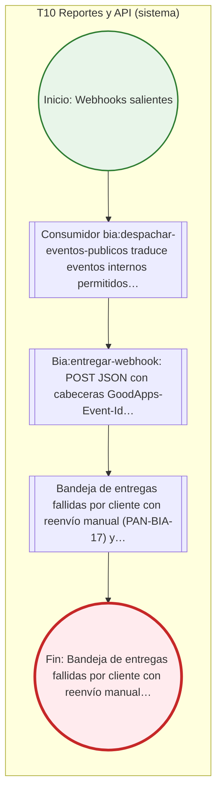

**Pasos del proceso** (actividad tomada del anexo; la columna RF/RN distingue lo citado en el paso de lo asociado por parámetro, permiso, evento o tema compartido).

| Paso | Carril | Actividad | RF/RN que aplican | EVT / JOB / PAN |
|---|---|---|---|---|
| 1 | T10 Reportes y API | Consumidor `bia:despachar-eventos-publicos` traduce eventos internos permitidos a eventos públicos (tabla §12.3) y crea `extWebhookDeliveries` por suscripción. | — | JOB-BIA-14 |
| 2 | T10 Reportes y API | `bia:entregar-webhook`: POST JSON con cabeceras `GoodApps-Event-Id`, `GoodApps-Event-Type`, `GoodApps-Signature`, `GoodApps-Timestamp`; timeout `PRM-BIA-052` s; reintentos 1 min, 5 min, 30 min, 2 h, 6 h, 12 h, luego cada 12 h hasta `PRM-BIA-048` h → `dead`. | asoc.: RN-BIA-034 | JOB-BIA-15 |
| 3 | T10 Reportes y API | Bandeja de entregas fallidas por cliente con reenvío manual (PAN-BIA-17) y endpoint `POST /webhooks/:id/test`. | — | PAN-BIA-17 |

**Situación actual en ProCoop (nota de cambio).** Sin contraste específico para este proceso en el anexo (filas `CTR-` con ProCoop) ni en el análisis de brechas. El contraste del dominio está en `15-analisis-brechas-procoop.md` §3.18.

**Excepciones**

| Excepción | Tratamiento |
|---|---|
| Resultado incierto o sin respuesta | `bia:entregar-webhook`: POST JSON con cabeceras `GoodApps-Event-Id`, `GoodApps-Event-Type`, `GoodApps-Signature`, `GoodApps-Timestamp`; timeout `PRM-BIA-052` s; reintentos 1 min, 5 min, 30 min, 2 h, 6 h, 12 h, luego cada 12 h hasta `PRM-BIA-048` h → `dead` |
| Falla técnica en un paso automático, un job o una integración | Reintento idempotente y reanudable; lo no reparable pasa a la bandeja técnica con responsable (política de recuperación de T11 P-WFL-01 y T01 §9.12; AGR-016). |

---

## 17. PRC-BIA-10 Benchmark (O11, si PA-BIA-05 = A)

| Campo | Contenido |
|---|---|
| Fuente | T10 §9.10, `T10-BIA-reportes-bi-apis.md` (línea 1672); ola O11 |
| Macroproceso | MP-19 Reportes, BI y API externa |
| Disparador | Benchmark |
| Resultado | Publica en benchmarkAggregates y calcula el percentil de cada… |
| Carriles | T10 Reportes y API (sistema) |
| Roles de T02 | Solo actores del sistema (sin rol humano) |
| Módulos involucrados | T10 Reportes y API |
| Eventos (T11 §12) | — |
| Jobs | JOB-BIA-18 `bia:benchmark-agregar` |
| Relación con 04-procesos-bpmn.md | — |

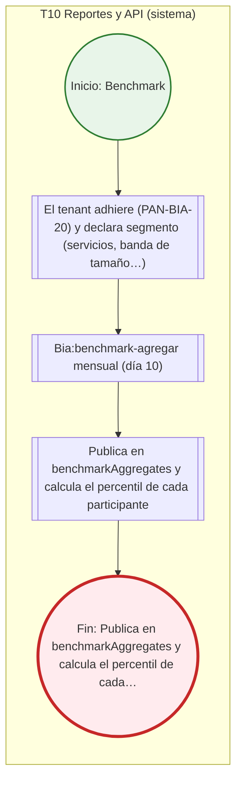

**Pasos del proceso** (actividad tomada del anexo; la columna RF/RN distingue lo citado en el paso de lo asociado por parámetro, permiso, evento o tema compartido).

| Paso | Carril | Actividad | RF/RN que aplican | EVT / JOB / PAN |
|---|---|---|---|---|
| 1 | T10 Reportes y API | El tenant adhiere (PAN-BIA-20) y declara segmento (servicios, banda de tamaño por cantidad de contratos: < 2.000 / 2.000–10.000 / 10.000–50.000 / > 50.000, provincia). | — | PAN-BIA-20 |
| 2 | T10 Reportes y API | `bia:benchmark-agregar` mensual (día 10): toma snapshots cerrados de indicadores marcados `benchmarkable` (ratios), por segmento; descarta celdas con n < `PRM-BIA-051` o dominancia > 40 %; calcula p25/mediana/p75/media. | asoc.: RN-BIA-027 | JOB-BIA-18 |
| 3 | T10 Reportes y API | Publica en `benchmarkAggregates` y calcula el percentil de cada participante; los no participantes no ven el benchmark. | asoc.: RN-BIA-027 | — |

**Situación actual en ProCoop (nota de cambio).** Sin contraste específico para este proceso en el anexo (filas `CTR-` con ProCoop) ni en el análisis de brechas. El contraste del dominio está en `15-analisis-brechas-procoop.md` §3.18.

**Excepciones**

| Excepción | Tratamiento |
|---|---|
| Falla técnica en un paso automático, un job o una integración | Reintento idempotente y reanudable; lo no reparable pasa a la bandeja técnica con responsable (política de recuperación de T11 P-WFL-01 y T01 §9.12; AGR-016). |

---

## 18. PRC-BIA-11 Datos abiertos (O11)

| Campo | Contenido |
|---|---|
| Fuente | T10 §9.11, `T10-BIA-reportes-bi-apis.md` (línea 1678); ola O11 |
| Macroproceso | MP-19 Reportes, BI y API externa |
| Disparador | Datos abiertos |
| Resultado | Aprobación → bia:publicar-datos-abiertos genera CSV/JSON… |
| Carriles | T10 Reportes y API (sistema); Aprobador según política (T11 aprobaciones) |
| Roles de T02 | Solo actores del sistema (sin rol humano) |
| Módulos involucrados | T10 Reportes y API, T11 Workflow, eventos y documentos |
| Eventos (T11 §12) | — |
| Jobs | JOB-BIA-19 `bia:publicar-datos-abiertos` |
| Relación con 04-procesos-bpmn.md | — |

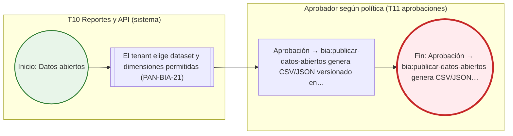

**Pasos del proceso** (actividad tomada del anexo; la columna RF/RN distingue lo citado en el paso de lo asociado por parámetro, permiso, evento o tema compartido).

| Paso | Carril | Actividad | RF/RN que aplican | EVT / JOB / PAN |
|---|---|---|---|---|
| 1 | T10 Reportes y API | El tenant elige dataset y dimensiones permitidas (PAN-BIA-21); el sistema previsualiza y marca celdas con n < mínimo (se suprimen o agregan en "Otros"). | — | PAN-BIA-21 |
| 2 | Aprobador según política | Aprobación → `bia:publicar-datos-abiertos` genera CSV/JSON versionado en almacenamiento público del tenant (sólo este prefijo es público) y lo lista en la landing (`/api/public/<slug>/open-data`). | — | JOB-BIA-19 |

**Situación actual en ProCoop (nota de cambio).** Sin contraste específico para este proceso en el anexo (filas `CTR-` con ProCoop) ni en el análisis de brechas. El contraste del dominio está en `15-analisis-brechas-procoop.md` §3.18.

**Excepciones**

| Excepción | Tratamiento |
|---|---|
| Falla técnica en un paso automático, un job o una integración | Reintento idempotente y reanudable; lo no reparable pasa a la bandeja técnica con responsable (política de recuperación de T11 P-WFL-01 y T01 §9.12; AGR-016). |

---

## 19. PRC-BIA-12 Salida del tenant (MER-020)

| Campo | Contenido |
|---|---|
| Fuente | T10 §9.12, `T10-BIA-reportes-bi-apis.md` (línea 1683) |
| Macroproceso | MP-19 Reportes, BI y API externa |
| Disparador | Salida del tenant |
| Resultado | BIA ejecuta bia:exportacion-salida |
| Carriles | T01 Plataforma; T10 Reportes y API (sistema) |
| Roles de T02 | Solo actores del sistema (sin rol humano) |
| Módulos involucrados | T01 Plataforma, T10 Reportes y API |
| Eventos (T11 §12) | — |
| Jobs | JOB-BIA-21 `bia:exportacion-salida` |
| Relación con 04-procesos-bpmn.md | — |

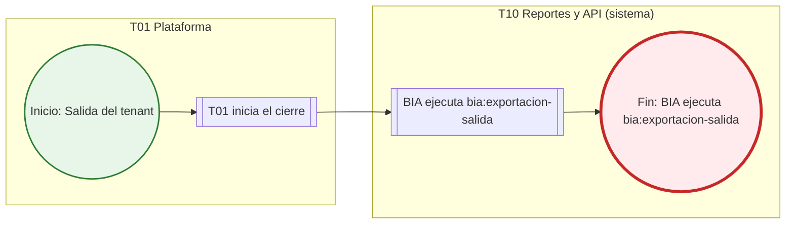

**Pasos del proceso** (actividad tomada del anexo; la columna RF/RN distingue lo citado en el paso de lo asociado por parámetro, permiso, evento o tema compartido).

| Paso | Carril | Actividad | RF/RN que aplican | EVT / JOB / PAN |
|---|---|---|---|---|
| 1 | T01 Plataforma | T01 inicia el cierre | — | — |
| 2 | T10 Reportes y API | BIA ejecuta `bia:exportacion-salida`: un `extBulkExports` por dataset canónico (todas las colecciones de negocio vía providers de exportación de cada módulo), NDJSON + CSV + diccionario de datos + checksums, con vencimiento acordado y registro de entrega | — | JOB-BIA-21 |

**Situación actual en ProCoop (nota de cambio).** Sin contraste específico para este proceso en el anexo (filas `CTR-` con ProCoop) ni en el análisis de brechas. El contraste del dominio está en `15-analisis-brechas-procoop.md` §3.18.

**Excepciones**

| Excepción | Tratamiento |
|---|---|
| Vencimiento | T01 inicia el cierre BIA ejecuta `bia:exportacion-salida`: un `extBulkExports` por dataset canónico (todas las colecciones de negocio vía providers de exportación de cada módulo), NDJSON + CSV + diccionario de datos + checksums, con vencimiento acordado y registro de entrega |
| Falla técnica en un paso automático, un job o una integración | Reintento idempotente y reanudable; lo no reparable pasa a la bandeja técnica con responsable (política de recuperación de T11 P-WFL-01 y T01 §9.12; AGR-016). |

---

## 20. PRC-MIG-01 Herramienta de migración (pipeline ETL)

| Campo | Contenido |
|---|---|
| Fuente | T07 §9.3, `T07-MIG-migracion-procoop.md` (línea 812) |
| Macroproceso | MP-20 Migración desde ProCoop |
| Disparador | Herramienta de migración |
| Resultado | Observabilidad: métricas por tenant y corrida (filas/s…) |
| Carriles | T07 Migración (sistema) |
| Roles de T02 | Solo actores del sistema (sin rol humano) |
| Módulos involucrados | T07 Migración |
| Eventos (T11 §12) | — |
| Jobs | — |
| Relación con 04-procesos-bpmn.md | P10 Migración y corte por etapas desde ProCoop ([§14](04-procesos-bpmn.md#14-p10--migración-y-corte-por-etapas-desde-procoop)) |

```mermaid
flowchart LR
  subgraph L_LSIS["T07 Migración (sistema)"]
    ni(("Inicio: Herramienta de migración"))
    ns1[["Conectores de extracción (worker mig-extractor)"]]
    ns2[["Snapshot (JSON Lines comprimido por tabla) en almacenamiento privado cifrado…"]]
    ns3[["Staging (migStagingRecords)"]]
    ns4[["Motor de reglas declarativo (DSL seguro con funciones de la librería…)"]]
    ns5[["Validadores: esquema Zod del documento destino (compartido con la API del…)"]]
    ns6[["Cargadores por dominio"]]
    ns7[["Mapa de IDs y alias (§7.6) actualizados en la misma transacción del lote."]]
    ns8[["Informes: perfilado, rechazos, advertencias, conciliación, paralelo, delta…"]]
    ns9[["Reprocesos idempotentes"]]
    ns10[["Orquestación: jobs BullMQ (mig:*, §12), un job padre por corrida y jobs hijos…"]]
    ns11[["Observabilidad: métricas por tenant y corrida (filas/s, errores, duración)…"]]
    nf(("Fin: Observabilidad: métricas por tenant y corrida (filas/s…)"))
  end
  ni --> ns1
  ns1 --> ns2
  ns2 --> ns3
  ns3 --> ns4
  ns4 --> ns5
  ns5 --> ns6
  ns6 --> ns7
  ns7 --> ns8
  ns8 --> ns9
  ns9 --> ns10
  ns10 --> ns11
  ns11 --> nf
  classDef inicio fill:#e8f5e9,stroke:#2e7d32,stroke-width:2px
  classDef fin fill:#ffebee,stroke:#c62828,stroke-width:4px
  classDef evento fill:#fff8e1,stroke:#f9a825
  classDef temporizador fill:#e3f2fd,stroke:#1565c0
  class ni inicio
  class nf fin
```

**Pasos del proceso** (actividad tomada del anexo; la columna RF/RN distingue lo citado en el paso de lo asociado por parámetro, permiso, evento o tema compartido).

| Paso | Carril | Actividad | RF/RN que aplican | EVT / JOB / PAN |
|---|---|---|---|---|
| 1 | T07 Migración | Conectores de extracción (worker `mig-extractor`): SQL Server (TDS, usuario de solo lectura, `READ COMMITTED SNAPSHOT` o backup restaurado en un SQL Server de la plataforma), MySQL (portal/PMovil), sistema de archivos/S3 (adjuntos), DBF/Access/Excel. Paginación por clave primaria; columnas suprimidas por regla en el propio extractor (las credenciales nunca salen del origen). | — | — |
| 2 | T07 Migración | Snapshot (JSON Lines comprimido por tabla) en almacenamiento privado cifrado (KMS por tenant), con manifiesto y hash. | asoc.: RF-MIG-011 | — |
| 3 | T07 Migración | Staging (`migStagingRecords`): registro crudo + transformado + estado + issues. | — | — |
| 4 | T07 Migración | Motor de reglas declarativo (DSL seguro con funciones de la librería `packages/shared`: `decimal`, `date`, `taxId`, `address`, `lookup`, `valueMap`, `version`, `split`, `merge`), versionado por conjunto. | — | — |
| 5 | T07 Migración | Validadores: esquema Zod del documento destino (compartido con la API del módulo) + validaciones de migración. | — | — |
| 6 | T07 Migración | Cargadores por dominio: cada módulo expone `importFromMigration(batch, { runId, mode })` en su servicio (contrato T05), transaccional por lote, que devuelve `_id` creados/actualizados/sin cambio/conflictos. | — | — |
| 7 | T07 Migración | Mapa de IDs y alias (§7.6) actualizados en la misma transacción del lote. | — | — |
| 8 | T07 Migración | Informes: perfilado, rechazos, advertencias, conciliación, paralelo, delta (exportables XLSX/CSV/PDF desde DataTable). | — | — |
| 9 | T07 Migración | Reprocesos idempotentes: `idempotencyKey` por corrida, `sourceHash` por registro, conflicto si el documento fue modificado operativamente (`version` > `targetVersionAtLoad`). | asoc.: RN-MIG-042, RF-MIG-043 | — |
| 10 | T07 Migración | Orquestación: jobs BullMQ (`mig:*`, §12), un job padre por corrida y jobs hijos por tabla/lote, con progreso, cancelación y reanudación. | — | — |
| 11 | T07 Migración | Observabilidad: métricas por tenant y corrida (filas/s, errores, duración), alertas (T08). | — | — |

**Situación actual en ProCoop (nota de cambio).** Sin contraste específico para este proceso en el anexo (filas `CTR-` con ProCoop) ni en el análisis de brechas. El contraste del dominio está en `15-analisis-brechas-procoop.md` §3.19.

**Excepciones**

| Excepción | Tratamiento |
|---|---|
| Conflicto | Cargadores por dominio: cada módulo expone `importFromMigration(batch, ( runId, mode ))` en su servicio (contrato T05), transaccional por lote, que devuelve `_id` creados/actualizados/sin cambio/conflictos |
| Rechazo | Informes: perfilado, rechazos, advertencias, conciliación, paralelo, delta (exportables XLSX/CSV/PDF desde DataTable) |
| Conflicto | Reprocesos idempotentes: `idempotencyKey` por corrida, `sourceHash` por registro, conflicto si el documento fue modificado operativamente (`version` > `targetVersionAtLoad`) |
| Cancelación, anulación o reversión | Orquestación: jobs BullMQ (`mig:*`, §12), un job padre por corrida y jobs hijos por tabla/lote, con progreso, cancelación y reanudación |
| Falla técnica en un paso automático, un job o una integración | Reintento idempotente y reanudable; lo no reparable pasa a la bandeja técnica con responsable (política de recuperación de T11 P-WFL-01 y T01 §9.12; AGR-016). |

---

## 21. PRC-MIG-02 Corrida paralela y facturación comparada (BASE FAC-012, DFA §33)

| Campo | Contenido |
|---|---|
| Fuente | T07 §9.6, `T07-MIG-migracion-procoop.md` (línea 860) |
| Macroproceso | MP-20 Migración desde ProCoop |
| Disparador | Corrida paralela y facturación comparada |
| Resultado | Repetir por los ciclos definidos (PA-MIG-02) |
| Carriles | T07 Migración (sistema); Aprobador según política (T11 aprobaciones) |
| Roles de T02 | Solo actores del sistema (sin rol humano) |
| Módulos involucrados | M05 Facturación, T07 Migración, T11 Workflow, eventos y documentos |
| Eventos (T11 §12) | — |
| Jobs | JOB-FAC-03 `fac:emitir-lote` |
| Relación con 04-procesos-bpmn.md | P10 Migración y corte por etapas desde ProCoop ([§14](04-procesos-bpmn.md#14-p10--migración-y-corte-por-etapas-desde-procoop)) |

```mermaid
flowchart LR
  subgraph L_LSIS["T07 Migración (sistema)"]
    ni(("Inicio: Corrida paralela y facturación comparada"))
    ns1[["Preparación: dominio PER, SUM, MED, TAR, FIS, FAC (configuración) conciliados"]]
    ns2[["Delta de entrada del período"]]
    ns3[["Simulación en GoodApps del ciclo (fac:emitir-lote en modo simulation)"]]
    ns4[["Importación de lo que ProCoop emitió (FACTURAS, ITEMSFAC, ITEMSFAC_EXTRAS…)"]]
    ns5[["Emparejamiento por cuenta + servicio + período (+ grupo)"]]
    ns6[["Comparación factura por factura en las dimensiones de RF-MIG-072"]]
    ns7[["Clasificación de cada diferencia (§8.6) con responsable"]]
    ns8[["Comparación complementaria"]]
    ns10[["Repetir por los ciclos definidos (PA-MIG-02)"]]
    nf(("Fin: Repetir por los ciclos definidos (PA-MIG-02)"))
  end
  subgraph L_LAPR["Aprobador según política (T11 aprobaciones)"]
    ns9["Aprobación por servicio y ciclo con los criterios del §17.6."]
  end
  ni --> ns1
  ns1 --> ns2
  ns2 --> ns3
  ns3 --> ns4
  ns4 --> ns5
  ns5 --> ns6
  ns6 --> ns7
  ns7 --> ns8
  ns8 --> ns9
  ns9 --> ns10
  ns10 --> nf
  classDef inicio fill:#e8f5e9,stroke:#2e7d32,stroke-width:2px
  classDef fin fill:#ffebee,stroke:#c62828,stroke-width:4px
  classDef evento fill:#fff8e1,stroke:#f9a825
  classDef temporizador fill:#e3f2fd,stroke:#1565c0
  class ni inicio
  class nf fin
```

**Pasos del proceso** (actividad tomada del anexo; la columna RF/RN distingue lo citado en el paso de lo asociado por parámetro, permiso, evento o tema compartido).

| Paso | Carril | Actividad | RF/RN que aplican | EVT / JOB / PAN |
|---|---|---|---|---|
| 1 | T07 Migración | Preparación: dominio PER, SUM, MED, TAR, FIS, FAC (configuración) conciliados; grupos de facturación migrados (FAC-012); cuadros vigentes del período. | — | — |
| 2 | T07 Migración | Delta de entrada del período: novedades de padrón, lecturas cargadas en ProCoop (`CONS_SER`, `IMP_WORK` si la lectura se hace en ProCoop) o lecturas tomadas con la app GoodApps e importadas a ProCoop (según PA-MIG-03). | asoc.: RF-MIG-081, RF-MIG-005 | — |
| 3 | T07 Migración | Simulación en GoodApps del ciclo (`fac:emitir-lote` en modo `simulation`): sin CAE, sin numeración fiscal, sin publicación. | — | JOB-FAC-03 |
| 4 | T07 Migración | Importación de lo que ProCoop emitió (`FACTURAS`, `ITEMSFAC`, `ITEMSFAC_EXTRAS`, `FAC_EXTRAS`, `TALONFAC`, `FACTMES*`, `SFACTME`). | — | — |
| 5 | T07 Migración | Emparejamiento por cuenta + servicio + período (+ grupo); los comprobantes de ProCoop fuera de lote (manuales) se comparan solo si tienen equivalente. | asoc.: RF-MIG-071 | — |
| 6 | T07 Migración | Comparación factura por factura en las dimensiones de RF-MIG-072. Para comprobantes agrupados, se compara además el subtotal por servicio (FAC-007) y la reconstrucción "como si se hubiera emitido solo". | RF-MIG-072 | — |
| 7 | T07 Migración | Clasificación de cada diferencia (§8.6) con responsable. Diferencias "intencionales" (errores de ProCoop que GoodApps corrige a propósito, ej. RN-11 Implicancias 8) se documentan una vez como regla y se aplican automáticamente. | RN-11; asoc.: RF-MIG-073 | — |
| 8 | T07 Migración | Comparación complementaria: intereses de mora en cobros del período, imputación de cobranzas, asientos (simulados) vs asientos ProCoop. | asoc.: RF-MIG-074 | — |
| 9 | Aprobador según política | Aprobación por servicio y ciclo con los criterios del §17.6. | — | — |
| 10 | T07 Migración | Repetir por los ciclos definidos (PA-MIG-02). El paralelo puede abarcar varios servicios con calendarios distintos; el by-pass de facturación es por servicio. | asoc.: RF-MIG-076 | — |

**Situación actual en ProCoop (nota de cambio).** El anexo indica: Delta de entrada del período: novedades de padrón, lecturas cargadas en ProCoop (`CONS_SER`, `IMP_WORK` si la lectura se hace en ProCoop) o lecturas tomadas con la app GoodApps e importadas a ProCoop (según PA-MIG-03). Importación de lo que ProCoop emitió (`FACTURAS`, `ITEMSFAC`, `ITEMSFAC_EXTRAS`, `FAC_EXTRAS`, `TALONFAC`, `FACTMES*`, `SFACTME`). CTR-MIG-13: en ProCoop, RN-11 (`USUARIO = COD_SUM` en factura) vs `legacyIdMap`. Cambio adoptado: Tabla de alias `legacyKeyAliases` resuelve cobros con códigos viejos durante PRM de vigencia (PA-MIG-16).

**Excepciones**

| Excepción | Tratamiento |
|---|---|
| Falla o error | Diferencias "intencionales" (errores de ProCoop que GoodApps corrige a propósito, ej. RN-11 Implicancias 8) se documentan una vez como regla y se aplican automáticamente |
| Falla técnica en un paso automático, un job o una integración | Reintento idempotente y reanudable; lo no reparable pasa a la bandeja técnica con responsable (política de recuperación de T11 P-WFL-01 y T01 §9.12; AGR-016). |

---

## Inconsistencias detectadas en la especificación (esta parte)

No se detectaron inconsistencias en los procesos de esta parte.

## Cobertura de esta parte

| Universo de la parte | Diagramados | Con nota ProCoop específica | Pendientes |
|---|---|---|---|
| 21 (PRC-INT-11 a PRC-MIG-02) | 21 | 1 | 0 |
