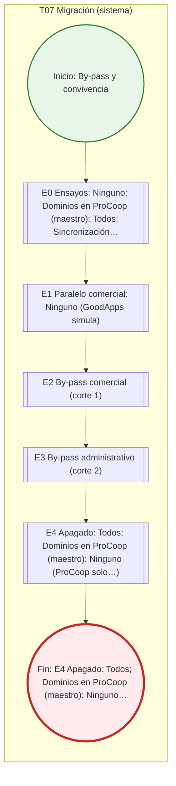
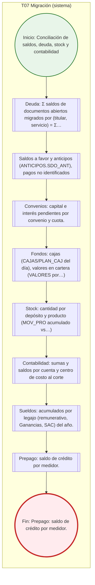
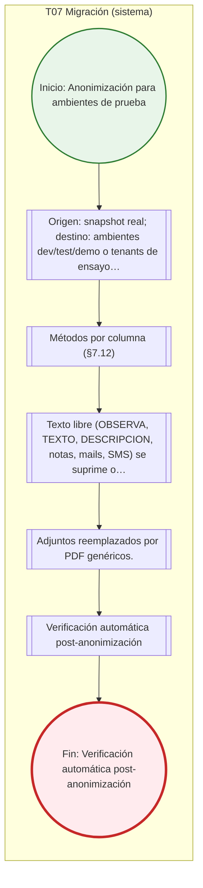
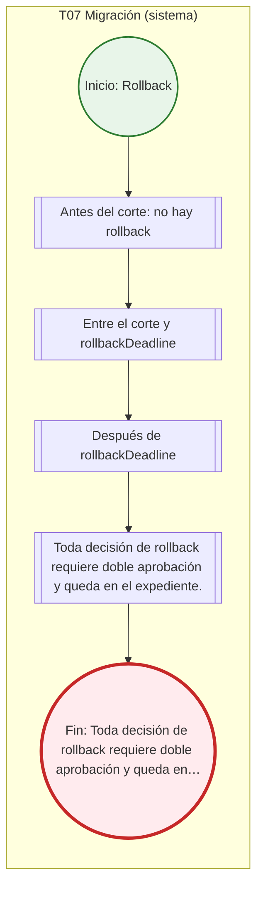

```mermaid
flowchart LR
  subgraph L_LSIS["T07 Migración (sistema)"]
    ni(("Inicio: Corte definitivo"))
    ns1[["Runbook (pasos mínimos)"]]
    ns2[["Comunicación a socios y entes"]]
    ns3[["Verificar 0 comprobantes pendientes de CAE en ProCoop (RN-MIG-029)"]]
    ns4[["Cierre de cajas en ProCoop"]]
    ns5[["Snapshot final"]]
    ns6[["Delta final y carga"]]
    ns7[["Conciliaciones finales aprobadas"]]
    ns8[["Último número autorizado en ARCA por punto de venta (RN-MIG-028)"]]
    ns9[["Go/no-go con doble aprobación"]]
    ns10[["Activar emisión fiscal, publicación de deuda a entes, débitos, pasarelas…"]]
    ns11[["Activar resolutor y alias"]]
    ns12[["Habilitar portal y enviar invitaciones"]]
    ns13[["Acta de aceptación"]]
    ns14[["Monitoreo reforzado y soporte de arranque (AGR §7 F)"]]
    ns15[["Criterios go: conciliaciones aprobadas de todos los dominios del alcance"]]
    ns16[["Paralelo aprobado"]]
    ns17[["Usuarios y permisos cargados"]]
    ns18[["Credenciales de integraciones en bóveda y probadas"]]
    ns19[["Plan de rollback revisado"]]
  end
  subgraph L_LPSOP2["Soporte plataforma nivel 2 / ingeniería (P-SOP2)"]
    ns20["Soporte disponible"]
    nf(("Fin: Soporte disponible"))
  end
  ni --> ns1
  ns1 --> ns2
  ns2 --> ns3
  ns3 --> ns4
  ns4 --> ns5
  ns5 --> ns6
  ns6 --> ns7
  ns7 --> ns8
  ns8 --> ns9
  ns9 --> ns10
  ns10 --> ns11
  ns11 --> ns12
  ns12 --> ns13
  ns13 --> ns14
  ns14 --> ns15
  ns15 --> ns16
  ns16 --> ns17
  ns17 --> ns18
  ns18 --> ns19
  ns19 --> ns20
  ns20 --> nf
  classDef inicio fill:#e8f5e9,stroke:#2e7d32,stroke-width:2px
  classDef fin fill:#ffebee,stroke:#c62828,stroke-width:4px
  classDef evento fill:#fff8e1,stroke:#f9a825
  classDef temporizador fill:#e3f2fd,stroke:#1565c0
  class ni inicio
  class nf fin
```

# GoodApps Cooperativas

## Procesos de negocio — Migración desde ProCoop (T07)

**Entregable de Análisis y Diseño Detallado — Artefacto 2.1 (Procesos de negocio BPMN). Parte de [`04-procesos-bpmn.md`](04-procesos-bpmn.md).**

| Dato | Valor |
|---|---|
| Documento | Diagramas BPMN, pasos, situación actual en ProCoop y excepciones de los procesos PRC-MIG-03 a PRC-MIG-07, derivados de la sección 9 de T07 |
| Carácter | Derivado de la especificación vigente; no la reemplaza. Ante diferencias prevalecen la maestra `00`, los anexos, T05, T11 y el registro de decisiones `01` |
| Generación | Script `_trabajo/generar_bpmn.py` con la ampliación `_trabajo/generar_prc.py` (derivación automática desde el texto de la sección 9 de cada anexo, `_trabajo/prc_auto.py`) |
| Versión | 1.1 (regenerada contra la especificación corregida) |
| Fecha | 05-11-2026 |

**Cómo leer cada proceso.** La notación es la de [`04-procesos-bpmn.md` §3](04-procesos-bpmn.md#3-notación-equivalencia-mermaid--bpmn) (carriles, eventos de inicio y fin, tareas de usuario y de servicio, compuertas XOR y AND, eventos de dominio como banderas, temporizadores y jobs como estadios). La tabla de pasos reproduce la actividad del anexo; en la columna RF/RN, los identificadores sin prefijo son los que el anexo cita en el paso y los marcados "asoc." son reglas o requisitos del mismo anexo que comparten parámetro, permiso, evento o tema con el paso (asociación generada por el script y revisada). Los eventos se nombran con su ID del catálogo de T11 §12.

**Derivación automática (v1.2).** Los procesos `PRC-<MOD>-nn` de esta parte se generaron con `_trabajo/generar_prc.py` y `_trabajo/prc_auto.py` a partir del texto de cada subsección §9.n del anexo, sin curaduría paso a paso (a diferencia de los 94 procesos `P-XXX-nn` de las partes 04b a 04i). Reglas: (1) los pasos son los numerados o viñetas del anexo; si la subsección es prosa, se parte por flechas o por oraciones; si es una tabla de pasos o de jobs, cada fila es un paso; (2) el carril de cada paso es el primer actor nombrado al comienzo del paso (rol de T02 §4, otro módulo, sistema externo, dispositivo o job); si no se nombra ninguno, el paso es del sistema del módulo dueño; (3) los pasos que empiezan con "Si …" se dibujan como compuerta XOR; (4) los eventos son los nombres del catálogo de T11 §12 citados en el paso (bandera entrante si el paso los consume, saliente si los publica); el temporizador aparece cuando el título nombra un job periódico; (5) las excepciones son las oraciones del anexo con condición o con palabras de falla, rechazo, vencimiento, duplicado o umbral, más la política de recuperación del anexo; (6) la nota ProCoop combina lo que dice el propio anexo, la fila `CTR-` del anexo que contrasta con ProCoop y la fila de `15-analisis-brechas-procoop.md` §3 de mayor afinidad; si ninguna alcanza el umbral, la nota lo dice y remite al contraste del dominio en esa sección. La revisión manual de una muestra está en `_trabajo/prc_revision.md`; ante diferencias, prevalece el texto del anexo citado en la ficha.

## Índice de procesos de esta parte

1. [PRC-MIG-03 By-pass y convivencia](#1-prc-mig-03-by-pass-y-convivencia)
2. [PRC-MIG-04 Conciliación de saldos, deuda, stock y contabilidad](#2-prc-mig-04-conciliación-de-saldos-deuda-stock-y-contabilidad)
3. [PRC-MIG-05 Corte definitivo](#3-prc-mig-05-corte-definitivo)
4. [PRC-MIG-06 Anonimización para ambientes de prueba](#4-prc-mig-06-anonimización-para-ambientes-de-prueba)
5. [PRC-MIG-07 Rollback (plan de retorno)](#5-prc-mig-07-rollback-plan-de-retorno)

---

## 1. PRC-MIG-03 By-pass y convivencia

| Campo | Contenido |
|---|---|
| Fuente | T07 §9.7, `T07-MIG-migracion-procoop.md` (línea 873) |
| Macroproceso | MP-20 Migración desde ProCoop |
| Disparador | By-pass y convivencia |
| Resultado | E4 Apagado: Todos; Dominios en ProCoop (maestro): Ninguno… |
| Carriles | T07 Migración (sistema) |
| Roles de T02 | Solo actores del sistema (sin rol humano) |
| Módulos involucrados | T07 Migración |
| Eventos (T11 §12) | — |
| Jobs | — |
| Relación con 04-procesos-bpmn.md | P10 Migración y corte por etapas desde ProCoop ([§14](04-procesos-bpmn.md#14-p10--migración-y-corte-por-etapas-desde-procoop)) |

**Pasos del proceso** (actividad tomada del anexo; la columna RF/RN distingue lo citado en el paso de lo asociado por parámetro, permiso, evento o tema compartido).

| Paso | Carril | Actividad | RF/RN que aplican | EVT / JOB / PAN |
|---|---|---|---|---|
| 1 | T07 Migración | E0 Ensayos: Ninguno; Dominios en ProCoop (maestro): Todos; Sincronización: Snapshots `full` a tenant de ensayo | asoc.: RF-MIG-081 | — |
| 2 | T07 Migración | E1 Paralelo comercial: Ninguno (GoodApps simula); Dominios en ProCoop (maestro): Todos; Sincronización: Delta ProCoop → GoodApps diario; comparación | asoc.: RF-MIG-081 | — |
| 3 | T07 Migración | E2 By-pass comercial (corte 1): Personas, cuentas, contratos, catálogo, tarifas, medición, facturación, fiscal ventas, cuenta corriente, cobranza, entes, mora, financiación, CRM, técnica, portal, comunicaciones; Dominios en ProCoop (maestro): Compras, stock no serializado, tesorería, contabilidad oficial, sueldos, institucional, social (si no fueron cortados); Sincronización: GoodApps → ProCoop: asientos resumidos diarios (formato importable `ImportarAsientos`/`ImportarAsientosConSeccion`), cobranzas para tesorería, retiros de materiales para stock, descuentos de empleados (`SU_EMPLEADOS_SUMSOC`) | asoc.: RF-MIG-082, RN-MIG-004 | — |
| 4 | T07 Migración | E3 By-pass administrativo (corte 2): + compras, stock, tesorería, contabilidad, retenciones; Dominios en ProCoop (maestro): Sueldos, institucional, social (si no fueron cortados); Sincronización: GoodApps → ProCoop: asientos de sueldos se importan en GoodApps desde ProCoop (sentido inverso) | — | — |
| 5 | T07 Migración | E4 Apagado: Todos; Dominios en ProCoop (maestro): Ninguno (ProCoop solo consulta hasta el cierre del ejercicio, luego archivo) | asoc.: RF-MIG-080 | — |

**Situación actual en ProCoop (nota de cambio).** El anexo indica: Dominios en ProCoop (maestro): Todos; Análisis de brechas (`15-analisis-brechas-procoop.md` §3.19, Transición): hoy Reemplazo de sistema sin herramientas de convivencia; en GoodApps, corrida paralela con facturación comparada, by-pass, corte por etapas y plan de retorno (brecha "Nuevo"; fuente T07 §9.6–§9.11; DEC-068).

**Excepciones**

| Excepción | Tratamiento |
|---|---|
| Vencimiento | Los cobros que entran por entes con claves ProCoop se resuelven con el resolutor de claves heredadas (RF-MIG-083) hasta el vencimiento del último comprobante ProCoop (PA-MIG-16) |
| Falla técnica en un paso automático, un job o una integración | Reintento idempotente y reanudable; lo no reparable pasa a la bandeja técnica con responsable (política de recuperación de T11 P-WFL-01 y T01 §9.12; AGR-016). |

---

## 2. PRC-MIG-04 Conciliación de saldos, deuda, stock y contabilidad

| Campo | Contenido |
|---|---|
| Fuente | T07 §9.8, `T07-MIG-migracion-procoop.md` (línea 894) |
| Macroproceso | MP-20 Migración desde ProCoop |
| Disparador | Conciliación de saldos, deuda, stock y contabilidad |
| Resultado | Prepago: saldo de crédito por medidor. |
| Carriles | T07 Migración (sistema) |
| Roles de T02 | Solo actores del sistema (sin rol humano) |
| Módulos involucrados | T07 Migración |
| Eventos (T11 §12) | — |
| Jobs | — |
| Relación con 04-procesos-bpmn.md | P10 Migración y corte por etapas desde ProCoop ([§14](04-procesos-bpmn.md#14-p10--migración-y-corte-por-etapas-desde-procoop)) |

**Pasos del proceso** (actividad tomada del anexo; la columna RF/RN distingue lo citado en el paso de lo asociado por parámetro, permiso, evento o tema compartido).

| Paso | Carril | Actividad | RF/RN que aplican | EVT / JOB / PAN |
|---|---|---|---|---|
| 1 | T07 Migración | Deuda: Σ saldos de documentos abiertos migrados por (titular, servicio) = Σ saldos ProCoop; total = cuenta contable de deudores por servicios a la fecha de corte; diferencias explicadas (pagos en tránsito, entes rendidos no importados). | asoc.: RF-MIG-054 | — |
| 2 | T07 Migración | Saldos a favor y anticipos (`ANTICIPOS.SDO_ANT`), pagos no identificados: conciliados contra pasivo contable. | — | — |
| 3 | T07 Migración | Convenios: capital e interés pendientes por convenio y cuota. | — | — |
| 4 | T07 Migración | Fondos: cajas (`CAJAS`/`PLAN_CAJ` del día), valores en cartera (`VALORES` por estado), cupones de tarjeta no acreditados (`CUPONTAR`), saldos bancarios (`BANKOS.SALDO` vs `RESBAN`), cheques propios no debitados (`CHEQUERAS`). | — | — |
| 5 | T07 Migración | Stock: cantidad por depósito y producto (`MOV_PRO` acumulado vs `PROD_SER.STO_ACT`), unidades serializadas por estado/ubicación (`PROD_TRH`, `MOV_TRH`), comodatos (`SERSOC_PRODUCTOS`); valorización contra cuenta de bienes de cambio. | — | — |
| 6 | T07 Migración | Contabilidad: sumas y saldos por cuenta y centro de costo al corte; asientos del ejercicio en curso balanceados; saldo de apertura = cierre ProCoop. | asoc.: RN-MIG-036 | — |
| 7 | T07 Migración | Sueldos: acumulados por legajo (remunerativo, Ganancias, SAC) del año. | asoc.: RN-MIG-037 | — |
| 8 | T07 Migración | Prepago: saldo de crédito por medidor. | asoc.: RN-MIG-022 | — |

**Situación actual en ProCoop (nota de cambio).** El anexo indica: Deuda: Σ saldos de documentos abiertos migrados por (titular, servicio) = Σ saldos ProCoop; saldo de apertura = cierre ProCoop.

**Excepciones**

| Excepción | Tratamiento |
|---|---|
| Falla técnica en un paso automático, un job o una integración | Reintento idempotente y reanudable; lo no reparable pasa a la bandeja técnica con responsable (política de recuperación de T11 P-WFL-01 y T01 §9.12; AGR-016). |

---

## 3. PRC-MIG-05 Corte definitivo

| Campo | Contenido |
|---|---|
| Fuente | T07 §9.9, `T07-MIG-migracion-procoop.md` (línea 905) |
| Macroproceso | MP-20 Migración desde ProCoop |
| Disparador | Corte definitivo |
| Resultado | Soporte disponible |
| Carriles | T07 Migración (sistema); Soporte plataforma nivel 2 / ingeniería (P-SOP2) |
| Roles de T02 | P-SOP2 Soporte plataforma nivel 2 / ingeniería |
| Módulos involucrados | T07 Migración |
| Eventos (T11 §12) | — |
| Jobs | — |
| Relación con 04-procesos-bpmn.md | P10 Migración y corte por etapas desde ProCoop ([§14](04-procesos-bpmn.md#14-p10--migración-y-corte-por-etapas-desde-procoop)) |

**Pasos del proceso** (actividad tomada del anexo; la columna RF/RN distingue lo citado en el paso de lo asociado por parámetro, permiso, evento o tema compartido).

| Paso | Carril | Actividad | RF/RN que aplican | EVT / JOB / PAN |
|---|---|---|---|---|
| 1 | T07 Migración | Runbook (pasos mínimos) | — | — |
| 2 | T07 Migración | comunicación a socios y entes | — | — |
| 3 | T07 Migración | verificar 0 comprobantes pendientes de CAE en ProCoop (RN-MIG-029) | RN-MIG-029 | — |
| 4 | T07 Migración | cierre de cajas en ProCoop; congelamiento | — | — |
| 5 | T07 Migración | snapshot `final` | — | — |
| 6 | T07 Migración | delta final y carga | — | — |
| 7 | T07 Migración | conciliaciones finales aprobadas | — | — |
| 8 | T07 Migración | último número autorizado en ARCA por punto de venta (RN-MIG-028) | RN-MIG-028 | — |
| 9 | T07 Migración | go/no-go con doble aprobación | — | — |
| 10 | T07 Migración | activar emisión fiscal, publicación de deuda a entes, débitos, pasarelas, notificaciones | — | — |
| 11 | T07 Migración | activar resolutor y alias | — | — |
| 12 | T07 Migración | habilitar portal y enviar invitaciones | — | — |
| 13 | T07 Migración | acta de aceptación | — | — |
| 14 | T07 Migración | monitoreo reforzado y soporte de arranque (AGR §7 F) | — | — |
| 15 | T07 Migración | Criterios go: conciliaciones aprobadas de todos los dominios del alcance | — | — |
| 16 | T07 Migración | paralelo aprobado | — | — |
| 17 | T07 Migración | usuarios y permisos cargados | — | — |
| 18 | T07 Migración | credenciales de integraciones en bóveda y probadas | — | — |
| 19 | T07 Migración | plan de rollback revisado | — | — |
| 20 | Soporte plataforma nivel 2 / ingeniería | soporte disponible | — | — |

**Situación actual en ProCoop (nota de cambio).** El anexo indica: Runbook (pasos mínimos) comunicación a socios y entes verificar 0 comprobantes pendientes de CAE en ProCoop (RN-MIG-029) cierre de cajas en ProCoop; (2) verificar 0 comprobantes pendientes de CAE en ProCoop (RN-MIG-029);

**Excepciones**

| Excepción | Tratamiento |
|---|---|
| Falla técnica en un paso automático, un job o una integración | Reintento idempotente y reanudable; lo no reparable pasa a la bandeja técnica con responsable (política de recuperación de T11 P-WFL-01 y T01 §9.12; AGR-016). |

---

## 4. PRC-MIG-06 Anonimización para ambientes de prueba

| Campo | Contenido |
|---|---|
| Fuente | T07 §9.10, `T07-MIG-migracion-procoop.md` (línea 911) |
| Macroproceso | MP-20 Migración desde ProCoop |
| Disparador | Anonimización para ambientes de prueba |
| Resultado | Verificación automática post-anonimización |
| Carriles | T07 Migración (sistema) |
| Roles de T02 | Solo actores del sistema (sin rol humano) |
| Módulos involucrados | T07 Migración |
| Eventos (T11 §12) | — |
| Jobs | — |
| Relación con 04-procesos-bpmn.md | P10 Migración y corte por etapas desde ProCoop ([§14](04-procesos-bpmn.md#14-p10--migración-y-corte-por-etapas-desde-procoop)) |

**Pasos del proceso** (actividad tomada del anexo; la columna RF/RN distingue lo citado en el paso de lo asociado por parámetro, permiso, evento o tema compartido).

| Paso | Carril | Actividad | RF/RN que aplican | EVT / JOB / PAN |
|---|---|---|---|---|
| 1 | T07 Migración | Origen: snapshot real; destino: ambientes `dev`/`test`/`demo` o tenants de ensayo de otras cooperativas. Nunca datos reales fuera de producción y del tenant de ensayo propio (BASE §97.9, REL README). | asoc.: RF-MIG-096 | — |
| 2 | T07 Migración | Métodos por columna (§7.12). Determinismo por proyecto (mismo DNI → mismo DNI ficticio en todas las tablas) para preservar duplicados y relaciones; CUIT ficticios con DV válido; nombres/calles de diccionarios ficticios; fechas de nacimiento generalizadas; importes no se alteran (son necesarios para el paralelo) salvo en ambientes `demo`, donde se escalan por un factor. | — | — |
| 3 | T07 Migración | Texto libre (`OBSERVA`, `TEXTO`, `DESCRIPCION`, notas, mails, SMS) se suprime o reemplaza por texto genérico. | — | — |
| 4 | T07 Migración | Adjuntos reemplazados por PDF genéricos. | — | — |
| 5 | T07 Migración | Verificación automática post-anonimización: búsqueda de patrones de DNI/CUIT/correo/teléfono reales del origen en el destino → 0 coincidencias. | — | — |

**Situación actual en ProCoop (nota de cambio).** Sin contraste específico para este proceso en el anexo (filas `CTR-` con ProCoop) ni en el análisis de brechas. El contraste del dominio está en `15-analisis-brechas-procoop.md` §3.19.

**Excepciones**

| Excepción | Tratamiento |
|---|---|
| Duplicado | Determinismo por proyecto (mismo DNI → mismo DNI ficticio en todas las tablas) para preservar duplicados y relaciones |
| Falla técnica en un paso automático, un job o una integración | Reintento idempotente y reanudable; lo no reparable pasa a la bandeja técnica con responsable (política de recuperación de T11 P-WFL-01 y T01 §9.12; AGR-016). |

---

## 5. PRC-MIG-07 Rollback (plan de retorno)

| Campo | Contenido |
|---|---|
| Fuente | T07 §9.11, `T07-MIG-migracion-procoop.md` (línea 919) |
| Macroproceso | MP-20 Migración desde ProCoop |
| Disparador | Rollback |
| Resultado | Toda decisión de rollback requiere doble aprobación y queda en… |
| Carriles | T07 Migración (sistema) |
| Roles de T02 | Solo actores del sistema (sin rol humano) |
| Módulos involucrados | T07 Migración |
| Eventos (T11 §12) | — |
| Jobs | — |
| Relación con 04-procesos-bpmn.md | P10 Migración y corte por etapas desde ProCoop ([§14](04-procesos-bpmn.md#14-p10--migración-y-corte-por-etapas-desde-procoop)) |

**Pasos del proceso** (actividad tomada del anexo; la columna RF/RN distingue lo citado en el paso de lo asociado por parámetro, permiso, evento o tema compartido).

| Paso | Carril | Actividad | RF/RN que aplican | EVT / JOB / PAN |
|---|---|---|---|---|
| 1 | T07 Migración | Antes del corte: no hay rollback; un dominio en paralelo simplemente no se corta. | — | — |
| 2 | T07 Migración | Entre el corte y `rollbackDeadline` (antes de la primera emisión fiscal real o el primer cobro por entes en GoodApps): se reabre ProCoop para el alcance, se exporta `rollbackJournal` (altas, modificaciones, cobros en caja, lecturas) en formatos importables en ProCoop (planillas para carga y archivos de cobranza) y se reprocesa en ProCoop; GoodApps vuelve a `procoopMaster` para el alcance. | asoc.: RF-MIG-088 | — |
| 3 | T07 Migración | Después de `rollbackDeadline`: solo "rollback hacia adelante": se corrige en GoodApps; si se decide volver a ProCoop, los comprobantes autorizados y cobros confirmados en GoodApps se exportan a ProCoop como comprobantes de terceros/recibos manuales; nunca se restaura una copia que deshaga hechos fiscales o cobros externos (AGR-019). | asoc.: RF-MIG-089, RF-MIG-088 | — |
| 4 | T07 Migración | Toda decisión de rollback requiere doble aprobación y queda en el expediente. | — | — |

**Situación actual en ProCoop (nota de cambio).** El anexo indica: Entre el corte y `rollbackDeadline` (antes de la primera emisión fiscal real o el primer cobro por entes en GoodApps): se reabre ProCoop para el alcance, se exporta `rollbackJournal` (altas, modificaciones, cobros en caja, lecturas) en formatos importables en ProCoop (planillas para carga y archivos de cobranza) y se reprocesa en ProCoop; si se decide volver a ProCoop, los comprobantes autorizados y cobros confirmados en GoodApps se exportan a ProCoop como comprobantes de terceros/recibos manuales;

**Excepciones**

| Excepción | Tratamiento |
|---|---|
| Si se decide volver a ProCoop | los comprobantes autorizados y cobros confirmados en GoodApps se exportan a ProCoop como comprobantes de terceros/recibos manuales; nunca se restaura una copia que deshaga hechos fiscales o cobros externos (AGR-019) |
| Falla técnica en un paso automático, un job o una integración | Reintento idempotente y reanudable; lo no reparable pasa a la bandeja técnica con responsable (política de recuperación de T11 P-WFL-01 y T01 §9.12; AGR-016). |

---

## Inconsistencias detectadas en la especificación (esta parte)

No se detectaron inconsistencias en los procesos de esta parte.

## Cobertura de esta parte

| Universo de la parte | Diagramados | Con nota ProCoop específica | Pendientes |
|---|---|---|---|
| 5 (PRC-MIG-03 a PRC-MIG-07) | 5 | 4 | 0 |
