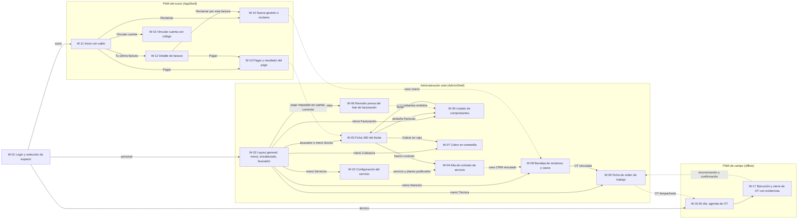

# GoodApps Cooperativas

## Wireframes de pantallas clave de la cooperativa piloto

**Entregable de Análisis y Diseño Detallado — Artefacto 4.2 (Wireframes de pantallas clave)**

| Dato | Valor |
|---|---|
| Producto | GoodApps Cooperativas: plataforma de gestión en la nube (SaaS multi-tenant) para cooperativas de servicios públicos y sociales |
| Documento | Wireframes de baja fidelidad de las pantallas clave del piloto (primer servicio: Internet; olas O0 a O5) |
| Destinatarios | Responsables de área de la cooperativa piloto, equipo de producto, diseño UX y desarrollo |
| Carácter | Documento derivado de la especificación vigente; no la reemplaza. Ante cualquier diferencia prevalecen la especificación maestra (`00`), sus anexos (en particular T03 §10.9 para rutas y capabilities) y el registro de decisiones (`01`) |
| Naturaleza | **Wireframes de baja fidelidad. No constituyen diseño visual final**: no fijan colores, tipografías, iconografía, espaciados ni textos definitivos. El aspecto final surge del design system (maestra §11, T03 §7.A) y de la marca de cada cooperativa aplicada en tiempo de ejecución |
| Versión | 1.2 |
| Fecha | 05-11-2026 |

### Control de versiones

| Versión | Fecha | Descripción del cambio | Autor |
|---|---|---|---|
| 1.0 | 05-11-2026 | Versión inicial: mapa de navegación, 17 wireframes (10 del admin, 5 de la PWA socio y 2 de la PWA campo) y trazabilidad pantalla → PAN/RF | |
| 1.1 | 05-11-2026 | Alineación con DEC-088 (la cooperativa piloto es Laguna Larga, `LAG`; reemplaza DEC-081): sección 1, W-13 (SIRO como pasarela de la piloto), puntos a definir AD-09 a AD-11 y AD-14, nueva subsección 9.1 con la configuración relevada de LAG aprovechable, y fuentes | |
| 1.2 | 05-11-2026 | Ampliación a toda la especificación: nueva sección 11 (índice del artefacto 4.2) con 12 patrones de UI (parte 05a), un wireframe por cada una de las 202 familias de pantallas (partes 05b a 05h), tabla de cobertura; la correspondencia de W-01 a W-17 con patrones y familias y las inconsistencias quedan en 05a. Las secciones 1 a 10 no cambian | |
| 1.3 | 05-11-2026 | Regeneración tras la corrección de la especificación: 1.051 PAN (nuevas PAN-POR-105 Comunidad y PAN-UXD-15 a 17) en 204 familias; tabbars por espacio según M19 §10.1 (socio: Inicio · Cuentas y servicios · `( + )` · Gestiones · Comunidad) en la sección 5, en W-11, W-12 y W-16 y en los wireframes generados; capabilities canónicas de T02 en W-09, W-16 y W-17 | |

### Aprobaciones

| Rol | Nombre | Firma | Fecha |
|---|---|---|---|
| Elaboró | | | |
| Revisó | | | |
| Aprobó | | | |

---

## Índice

1. Propósito y alcance
2. Convenciones de lectura
3. Mapa de navegación entre pantallas
4. Administración web (admin)
5. PWA del socio
6. PWA de campo
7. Patrones transversales de estados
8. Trazabilidad pantalla → PAN / RF
9. Puntos a definir (incluye 9.1, configuración relevada de LAG)
10. Fuentes consultadas
11. Ampliación: patrones de UI y wireframes por familia (índice de las partes 05a a 05h, cobertura)

---

## 1. Propósito y alcance

Este documento presenta, en baja fidelidad, las pantallas que la cooperativa piloto utilizará para recorrer el flujo del servicio **Internet** definido en la maestra §1.4 (DEC-005): contratación, factibilidad, visita e instalación, equipo en comodato, activación, facturación, pago y reclamo. El recorte por olas sigue `03-plan-de-olas-y-prompts.md`:

| Ola | Qué aporta a estas pantallas |
|---|---|
| O0 | Shells (`AdminShell`, `AppShell`), design system, login básico, diccionario y marca base |
| O1 | IAM completo (roles, alcance, 2FA), configuración versionada, buscador global (RF-UXD-057) |
| O2 | Personas y cuentas (M01), catálogo y contrato (M02), CRM de solicitudes (M09), portal del socio y vinculación (M19) |
| O3 | Técnica del piloto: agenda, órdenes de trabajo, instalación, comodato, PWA de campo offline (M10) |
| O4 | Facturación, ARCA e impuestos básicos (M05, M06): lotes, prefacturación, comprobantes, factura en la PWA |
| O5 | Cuenta corriente, caja y pasarelas (M07): cobro en ventanilla y pago online |

Mora, suspensión y reconexión (O6) quedan fuera de este documento; cuando una pantalla tiene una variante de O6 (por ejemplo, el inicio del socio moroso) se menciona sin dibujarla.

La cooperativa piloto es **Laguna Larga** (`LAG`), que además es la base de ProCoop relevada como referencia (DEC-088, que reemplaza a DEC-081; T06 §12.3). De esa base solo se toma configuración, nunca datos personales (DEC-088). Internet sigue siendo el primer servicio construido (DEC-005), mientras que LAG opera electricidad, gas y prepago; por eso las pantallas de Internet de este documento se validan con datos sintéticos y la primera migración real de LAG ocurre después de O7, con prepago disponible (CTR-MIG-07, CTR-COB-21, PA-COB-15). La configuración relevada de LAG que ya puede reflejarse en las pantallas se resume en la subsección 9.1. La marca, los logos y los textos personalizados de LAG no se reproducen: los wireframes usan marcadores genéricos y todos los datos de ejemplo son ficticios.

---

## 2. Convenciones de lectura

### 2.1 Símbolos de los wireframes

| Símbolo | Significado |
|---|---|
| `+---+`, `\|` | Límite de una zona, panel, tarjeta o modal |
| `[Botón]` | Botón o acción; `[Botón*]` indica la acción primaria de la pantalla |
| `[____]` | Campo de texto editable |
| `[____ ▼]` o `▼` | Lista desplegable o combo |
| `( )` / `(o)` | Opción de radio sin seleccionar / seleccionada |
| `[ ]` / `[x]` | Casilla de verificación sin marcar / marcada |
| `[Activo]` | Insignia de estado (`StatusBadge`): siempre ícono + texto, nunca solo color (RF-UXD-091) |
| `Pestaña1 \| Pestaña2` con `====` debajo | Pestañas de texto con línea inferior en la pestaña activa (RF-UXD-105) |
| `>` / `v` | Nodo de árbol colapsado / expandido |
| `( + )` | Botón flotante (FAB) de la PWA |
| `###` | Zona de carga (skeleton) |
| `...` | Contenido que continúa o se omite por brevedad |

### 2.2 Rutas, capabilities y textos

- **Rutas**: se usan las rutas canónicas de T03 §10.9. Las rutas de los anexos que no empiezan con `/admin/` se normalizan anteponiendo `/admin` (regla AL-02); la PWA del socio usa la base `/app/` (AL-04) y la PWA de campo la base `/app/campo/` (AL-05). Cuando una pantalla no tiene ruta en la especificación se indica **a definir**.
- **Capabilities**: formato `modulo.recurso.accion` (maestra §7.1). Se cita la capability de acceso a la pantalla y, cuando el anexo las define, las de las acciones. Si la especificación no la fija se indica **a definir**.
- **Textos**: todos los textos visibles salen del diccionario (`dict:<clave>`, RF-UXD-141); los de estos wireframes son ilustrativos y usan el texto base en español rioplatense (T03 §10.3.2, "Microcopy").
- **Datos de ejemplo**: 100 % ficticios. Persona "Socio Ejemplo", DNI 00000000, CUIT 20-00000000-0, cooperativa "Cooperativa Ejemplo", cuentas y contratos con numeración ficticia, importes redondos en pesos (formato `es-AR`, fechas `dd-mm-yyyy`, RF-UXD-101).
- **Accesibilidad**: objetivo WCAG 2.2 AA en todas las apps (AGR-032, RF-UXD-123). Cada ficha agrega solo las notas específicas de la pantalla; las reglas generales están en la sección 7.

### 2.3 Estructura de cada ficha

Cada pantalla incluye: wireframe; tabla de identificación (propósito, ruta, capability, PAN de origen, ítem del mapa del sitio, ola, roles típicos); campos y acciones; validaciones; estados (vacío, carga, error y otros relevantes); notas de accesibilidad.

---

## 3. Mapa de navegación entre pantallas

El diagrama enlaza los 17 wireframes. Las flechas continuas son navegación directa del usuario; las punteadas indican que la acción en una pantalla genera trabajo que aparece en otra (por ejemplo, un reclamo del socio llega a la bandeja de atención).



---

## 4. Administración web (admin)

Todas las pantallas del admin se renderizan dentro de `AdminShell` (W-02) y siguen la página estándar de T03 §10.1.2: `AdminStickyHeader` (breadcrumb, título, subtítulo, una acción primaria y hasta tres secundarias), `ScreenHelp` (botón `?`), pestañas, barra de filtros y contenido. Las altas y ediciones puntuales se hacen en modales `sm 480 / md 720 / lg 960 / xl 1180 px` (RF-UXD-050).

### W-01 — Login y selección de espacio

```text
Paso 1: credenciales
+--------------------------------------------------------------------+
|  (fondo de login del tenant bajo velo oscuro, T03 §10.4)           |
|                                                                    |
|        [logo de la cooperativa]   Cooperativa Ejemplo              |
|                                                                    |
|   Ingresar                                                         |
|                                                                    |
|   Email, DNI o CUIT                                                |
|   [______________________________________]                         |
|   DNI sin puntos                                                   |
|                                                                    |
|   Contraseña                                                       |
|   [______________________________________] [Mostrar]               |
|                                                                    |
|   [x] Recordarme                     ¿Olvidaste tu contraseña?     |
|                                                                    |
|   [              Ingresar*              ]                          |
|   ------------------------ o ------------------------              |
|   [Ingresar con Google]      [Ingresar con CiDi]  (si se habilita) |
|                                                                    |
|   ¿Necesitás ayuda?  ·  Sitio de la cooperativa  ·  Accesibilidad  |
+--------------------------------------------------------------------+

Paso 2: verificación en dos pasos (obligatoria para el personal)
+--------------------------------------------------------------------+
|   Verificación en dos pasos                                        |
|   Ingresá el código que enviamos a ****0000                        |
|                                                                    |
|   [_] [_] [_] [_] [_] [_]                                          |
|                                                                    |
|   [ ] No volver a pedir en este dispositivo por 30 días            |
|   Reenviar código (disponible en 60 s)                             |
|                                                                    |
|   [Volver]                                      [Verificar*]       |
+--------------------------------------------------------------------+

Paso 3: selección de cooperativa y espacio (solo si corresponde)
+--------------------------------------------------------------------+
|   ¿Dónde querés ingresar?                                          |
|                                                                    |
|   (o) Cooperativa Ejemplo · Administración · Sucursal Centro       |
|   ( ) Cooperativa Ejemplo · Mi cooperativa (como socio)            |
|   ( ) Cooperativa Ejemplo Dos · Administración                     |
|                                                                    |
|                                               [Continuar*]         |
+--------------------------------------------------------------------+
```

| Dato | Valor |
|---|---|
| Propósito | Autenticar al usuario con la marca del tenant y, si pertenece a varias cooperativas o tiene más de un espacio (personal y socio), elegir dónde ingresar |
| Ruta | `/login` y subrutas (PAN-UXD-13; SM-LND-007). Selector de espacio de la PWA: `/app` (PAN-POR-23). Ruta del selector de tenant/espacio en el admin: **a definir** |
| Capability | Público (login); sesión autenticada para el selector |
| PAN de origen | PAN-UXD-13 (login); PAN-POR-23 (splash y selector de espacio en la PWA) |
| Ola | O0 (login, 2FA, selector); O1 (SSO y CiDi, RF-UXD-118) |
| Roles típicos | Todo el personal (T-*), socios (C-SOC), técnicos de campo (T-TEC) |

**Campos y acciones**

- Código de cooperativa: solo aparece si se ingresa por un dominio genérico; en el subdominio del tenant no se pide (RF-UXD-112).
- Usuario (email, DNI o CUIT para socios; legajo o usuario para el personal), contraseña con mostrar/ocultar, "Recordarme" (RF-UXD-113, RF-UXD-114).
- 2FA con código de 6 dígitos, reenvío con cuenta regresiva y "no volver a pedir en este dispositivo por 30 días" (RF-UXD-113).
- Selector de tenant y de espacio (RF-UXD-115). Tras elegir: splash, oferta de instalación (solo PWA) y aterrizaje por rol: técnico en Mi día (W-16), socio en Inicio (W-11), personal en el tablero del admin (RF-UXD-116).
- Enlaces: recuperar acceso (respuesta siempre genérica), ayuda configurable, sitio de la cooperativa (RF-UXD-117, RF-UXD-119).

**Validaciones**

- Formato del usuario inline ("DNI sin puntos"); error de credenciales sin habilitar enumeración de usuarios (RF-UXD-117; el texto exacto está pendiente en PA-UXD-14).
- Bloqueo por intentos fallidos según política de T02 (T03 §10.4: 5 intentos en 15 minutos).
- Términos y condiciones pendientes: el guard exige aceptarlos antes de continuar (RF-UXD-122).

**Estados**

- Carga: botón "Ingresar" en estado ocupado; la marca del tenant se carga antes del primer render (RF-UXD-169).
- Error: mensaje inline junto al campo y resumen arriba del formulario; nunca `alert()` (RF-UXD-102).
- Sin espacios disponibles (usuario sin membresía vigente): vista "Sin acceso" (PAN-UXD-12).

**Accesibilidad**

- El campo del código acepta pegado y autocompletado `one-time-code`; se permiten gestores de contraseñas (RF-UXD-130, WCAG 3.3.8).
- Login siempre en tema oscuro con velo para garantizar contraste sobre el fondo del tenant (T03 §10.4).
- `autocomplete` en usuario y contraseña (WCAG 1.3.5); foco inicial en el primer campo; los radios del selector son navegables con flechas.

---

### W-02 — Layout general del admin (barra lateral por clusters, encabezado y buscador global)

```text
+------------------------------------------------------------------------------------------+
| [=] [GoodApps] | [logo coop] [Cooperativa Ejemplo · Sucursal Centro ▼]                   |
|     [Buscar pantallas, titulares, comprobantes, OT (Ctrl+K)_________] [Mapa del sitio]   |
|     [* Cobranza en caja] [* Comprobantes] [* Bandeja]   [Alertas 2] [Avisos 5] [?] [UE ▼]|
+------------------+-----------------------------------------------------------------------+
| v Inicio         | Socios y cuentas / Personas y titulares / Titulares                   |
|   Tablero        | Titulares                                  [Nuevo titular*] [Exportar]|
|   Mi bandeja     | Búsqueda de titulares y cuentas            [Más ▼]                    |
| v Socios y       +-----------------------------------------------------------------------+
|   cuentas        | ¿Qué es esta pantalla?                                                |
|   > Titulares (*)| [Buscar por nombre, DNI, CUIT, cuenta, domicilio_________] [Buscar]   |
|     Personas     | Estado [Activos ▼]  Servicio [Todos ▼]  Localidad [Todas ▼]  [Más]    |
|     Cuentas      +-----------------------------------------------------------------------+
| > Servicios      |  N.º    | Nombre          | Documento  | Cuenta | Estado   | Saldo    |
| > Facturación    |  000123 | Socio Ejemplo   | ****0000   | 0001   | [Activo] | 0,00     |
| > Cobranza       |  ...                                                                  |
| > Atención   (3) |                                            25 por página ▼  1 2 3 >   |
| > Técnica        |                                                                       |
| > Configuración  |                                                                       |
| [<< Colapsar]    |                                                                       |
+------------------+-----------------------------------------------------------------------+

Buscador global abierto (Ctrl+K)
+--------------------------------------------------------------------+
| [socio ejemplo______________________________________]   [Esc]      |
| Pantallas                                                          |
|   Socios y cuentas / Titulares                                     |
| Titulares                                                          |
|   Socio Ejemplo · Titular 000123 · DNI ****0000                    |
| Comprobantes                                                       |
|   FC B 0001-00000001 · Socio Ejemplo · ARS 35.000,00               |
| Órdenes de trabajo                                                 |
|   OT 0000001 · Instalación Internet · [Asignada]                   |
+--------------------------------------------------------------------+
```

| Dato | Valor |
|---|---|
| Propósito | Marco común de todas las pantallas del admin: identidad, contexto (tenant y sucursal), navegación por clusters, búsqueda y avisos |
| Ruta | No es una ruta: envuelve todas las rutas `meta.tenantOnly` del admin (RF-UXD-041). Página de inicio: `/admin/inicio` redirige al tablero del rol (SM-ADM-001) |
| Capability | Sesión autenticada del personal. Cada ítem del menú se muestra solo si el usuario tiene su capability, el módulo está activo y el tenant tiene la licencia (maestra §7.1; RF-UXD-173). Capabilities del buscador por tipo de entidad: **a definir** (se aplican las de cada módulo dueño) |
| PAN de origen | No tiene PAN propio (componente `AdminShell`, T03 §10.1.1). Mapa del sitio: PAN-UXD-04 |
| Ola | O0 (shell, menú, mapa del sitio, alertas); O1 (buscador global de entidades, RF-UXD-057) |
| Roles típicos | Todo el personal de la cooperativa |

**Campos y acciones**

- Topbar: logo del producto (enlaza a Inicio), logo del tenant, selector de contexto (tenant si hay varios, sucursal, y servicio o período cuando el módulo lo use; RF-UXD-042), buscador, botón "Mapa del sitio" (modal de pantalla completa con buscador por etiqueta, sinónimos y código ProCoop equivalente; RF-UXD-043), hasta 12 accesos fijados (RF-UXD-045), centro de alertas (RF-UXD-055), avisos, ayuda `?` y menú del usuario (perfil, preferencias, cambiar de espacio, cerrar sesión).
- Menú lateral colapsable generado desde `siteMapGroups`, con los clusters de la maestra §9.1; recuerda grupos abiertos y muestra contadores de pendientes (RF-UXD-044, RF-UXD-047). En el piloto se usan, como mínimo, Inicio, Socios y cuentas, Servicios, Facturación, Cobranza, Atención, Técnica, Administración (stock serializado) y Configuración.
- Encabezado de página (`AdminStickyHeader`): breadcrumb `cluster / grupo / ítem / detalle`, título, subtítulo y acciones (1 primaria, hasta 3 secundarias, menú "Más"); permanece visible al hacer scroll (RF-UXD-048, RF-UXD-056).
- Buscador global: pantallas del mapa y entidades permitidas (titular por nombre, DNI, CUIT o cuenta; comprobante por número; OT por número), agrupadas por tipo y filtradas por alcance (RF-UXD-057).

**Validaciones**

- Cambiar de sucursal recarga los datos con el nuevo alcance sin cerrar sesión (RF-UXD-042).
- Una ruta sin permiso muestra "Sin acceso" (PAN-UXD-12) en la interfaz y 403 en la API.

**Estados**

- Carga: skeleton de 8 filas en tablas; nunca spinner centrado (T03 §10.3.2).
- Error de API: toast o error inline con `requestId` visible en "Detalles" (RF-UXD-053).
- Buscador sin resultados: "No encontramos coincidencias" con sugerencia de buscar por documento.
- Pantallas de 768 a 1023 px: menú colapsado; menos de 768 px: aviso de usar la PWA de empleado (RF-UXD-058, pendiente PA-UXD-13).

**Accesibilidad**

- Enlace "Saltar al contenido" como primer elemento enfocable (T03 §10.5, WCAG 2.4.1).
- Menú lateral operable con flechas, Inicio/Fin y Enter; accesos fijados reordenables con teclado (RF-UXD-045, RF-UXD-128).
- El botón `?` está siempre en la misma ubicación (RF-UXD-131); el foco nunca queda oculto bajo la cabecera fija (RF-UXD-133).

---

### W-03 — Ficha 360 del titular con cuentas y contratos

```text
+------------------------------------------------------------------------------------------+
| Socios y cuentas / Titulares / Socio Ejemplo                                       [?]   |
| Socio Ejemplo    Titular N.º 000123    [Activo]    Asociado: Sí                          |
| DNI 00000000 [Verificado] · CUIT 20-00000000-0 [Verificado] · Consumidor final           |
| Alertas: [Sin bloqueos] [Documentación al día] [Contacto verificado]                     |
|                     [Nueva cuenta*] [Editar] [Nueva nota] [Más ▼]                        |
+------------------------------------------------------------------------------------------+
| Resumen | Cuentas y contratos | Relaciones | Cuenta corriente | Facturas | Reclamos y OT |  |
|           ===================                                               Historia     |
+-----------------------------------------------------------------+------------------------+
| v Cta. 0001 (principal) · Calle Ejemplo 100, Localidad Ejemplo  | Actividad reciente     |
|   Entrega de facturas: electrónica                               | 05-11-2026 09:30       |
|   v Grupo de facturación: General                                | Contrato INT-0001      |
|     +---------------------------------------------------------+  | creado (Solicitud      |
|     | INT-0001 · Internet · Fibra 100      [Pendiente de      |  | web)                   |
|     |                                       instalación]      |  |                        |
|     | Domicilio del servicio: Calle Ejemplo 100               |  | 04-11-2026 18:00       |
|     | Categoría: Residencial · Equipo: ONT (a asignar)        |  | Cuenta vinculada en    |
|     | Caso: 2026-000045 · OT: 0000001                         |  | la app                 |
|     | [Ver contrato] [Acciones ▼]                             |  |                        |
|     +---------------------------------------------------------+  | [Ver historia]         |
|   [+ Nuevo contrato]                                             |                        |
| > Cta. 0002 · Sin contratos activos                              |                        |
+-----------------------------------------------------------------+------------------------+
| Saldo total (solo lectura, M07): ARS 0,00 · [Cobrar en caja]                             |
+------------------------------------------------------------------------------------------+
```

| Dato | Valor |
|---|---|
| Propósito | Ver en un solo lugar a la persona titular, sus cuentas, grupos de facturación y contratos de servicio, con accesos a las acciones de cada módulo |
| Ruta | `/admin/per/titulares/:holderId` (PAN-PER-02); listado previo `/admin/per/titulares` (PAN-PER-01, SM-ADM-007) |
| Capability | `per.titulares.ver`. Cada pestaña aparece solo con el permiso del módulo dueño (por ejemplo, Cuenta corriente con los permisos de M07) |
| PAN de origen | PAN-PER-02 (M01 §10.3); asociadas: PAN-PER-04 (alta/edición de persona), PAN-PER-05 (cuenta), PAN-PER-11 (notas), PAN-PER-12 (bloqueos), PAN-PER-19 (historia), PAN-CAT-14 (ficha del contrato), PAN-CRM-05 (vista 360 de atención) |
| Ola | O2 (persona, cuentas, contratos); O3 (reclamos y OT); O4 (facturas); O5 (cuenta corriente) |
| Roles típicos | T-ATE (atención), T-SAT, T-FAC, T-CAJ (lectura), T-GER |

**Campos y acciones**

- Encabezado fijo: nombre, número de titular, documento y CUIT con estado de verificación, condición de asociado, estado y chips de alertas (bloqueos, juicio, fallecido, documentación vencida, presupuestos pendientes, sin contacto verificado).
- Acciones del encabezado: editar, nueva cuenta, nueva nota, aplicar bloqueo, transferir, registrar fallecimiento, dar de baja o reactivar, y "Más" (operaciones especiales).
- Pestaña "Cuentas y contratos": árbol cuenta → grupo de facturación → contrato (servicio, plan, estado, categoría, domicilio del servicio); cuenta principal destacada; acciones por contrato que abren M02 (PAN-CAT-16).
- Otras pestañas (carga bajo demanda): Resumen, Inmuebles y puntos, Relaciones, Adherentes (solo lectura, enlace a M18), Cuenta corriente, Facturas, Consumos (O7), Reclamos y OT, Trámites y documentación, Notas y bloqueos, Comunicaciones, Asociado y capital, Adjuntos, Historia.
- Panel lateral de actividad (`Timeline` de auditoría: quién, cuándo, qué cambió; RF-UXD-092).

**Validaciones**

- Sin permiso de edición, la ficha se muestra en modo "Solo lectura" con banda visible (RF-UXD-060).
- Edición concurrente: si otro usuario guardó antes, diálogo de conflicto con diferencias (RF-UXD-061).
- Documento y CUIT se muestran enmascarados si el usuario no tiene `per.personas.ver` (M01 §10.2).

**Estados**

- Carga: cabecera con skeleton y pestaña activa con 8 filas skeleton.
- Cuenta sin contratos: "Esta cuenta no tiene contratos" con acción "Nuevo contrato".
- Pestaña sin permiso: no se muestra (no se ofrece una pestaña vacía).
- Error al cargar una pestaña: `ErrorState` con "Reintentar" y `requestId`, sin afectar al resto de la ficha.

**Accesibilidad**

- Encabezado con un único H1 (nombre del titular); pestañas con `role="tablist"` y navegación por flechas.
- El árbol de cuentas es operable con teclado (flechas para expandir/colapsar, Enter para abrir).
- Los estados de contrato usan `StatusBadge` con ícono y texto; los importes, fuente monoespaciada alineada a la derecha.

---

### W-04 — Alta de contrato de servicio (asistente)

```text
+----------------------------------------------------------------------------------------+
| Nuevo contrato de servicio                                                        [X]  |
| (1) Titular y cuenta > (2) Servicio y plan > (3) Domicilio > (4) Requisitos >          |
| (5) Condiciones > (6) Resumen                                                          |
|                        ==================                                              |
+----------------------------------------------------------------------------------------+
| Paso 2 de 6: Servicio y plan                                                           |
|                                                                                        |
| Titular: Socio Ejemplo · Cuenta 0001                        [Cambiar]                  |
|                                                                                        |
| Servicio *                                                                             |
| [Internet                                    ▼]   (solo servicios con oferta abierta)  |
|                                                                                        |
| Plan *                                                                                 |
| +-----------------------------------+  +-----------------------------------+           |
| | (o) Fibra 100                     |  | ( ) Fibra 300                     |           |
| |     100/50 Mbps                   |  |     300/100 Mbps                  |           |
| |     Abono ARS 15.000,00 / mes     |  |     Abono ARS 22.000,00 / mes     |           |
| |     Instalación ARS 20.000,00     |  |     Instalación ARS 20.000,00     |           |
| |     Equipo ONT en comodato        |  |     Equipo ONT en comodato        |           |
| +-----------------------------------+  +-----------------------------------+           |
|                                                                                        |
| Categoría *  [Residencial            ▼]                                                |
| Origen       [Ventanilla             ▼]   Caso CRM vinculado: [2026-000045 ▼]          |
|                                                                                        |
| Advertencias (1)                                                                       |
| ! Existen otras cuentas con el mismo domicilio. Revisá antes de continuar.             |
|                                                                                        |
| [Cancelar]                     [Guardar borrador]   [Anterior]   [Siguiente*]          |
+----------------------------------------------------------------------------------------+

Paso 6 de 6: Resumen (extracto)
+----------------------------------------------------------------------------------------+
| Titular: Socio Ejemplo · Cuenta 0001 · Grupo de facturación: General                   |
| Servicio: Internet · Plan Fibra 100 · Categoría Residencial                            |
| Domicilio del servicio: Calle Ejemplo 100, Localidad Ejemplo (ubicación confirmada)    |
| Conceptos por evento: Instalación ARS 20.000,00                                        |
| Requisitos: 3 cumplidos · 0 pendientes                                                 |
| Estado resultante: [Pendiente de instalación]                                          |
| [x] El titular aceptó las condiciones (canal: ventanilla, fecha 05-11-2026)            |
|                                                         [Anterior]   [Crear contrato*] |
+----------------------------------------------------------------------------------------+
```

| Dato | Valor |
|---|---|
| Propósito | Dar de alta un contrato de servicio para un titular y una cuenta, validando requisitos y congelando las condiciones contratadas |
| Ruta | `/admin/cat/contracts/new` (asistente en modal `xl`) |
| Capability | `cat.contratos.crear` |
| PAN de origen | PAN-CAT-15 (M02 §10); se abre desde PAN-PER-02 (W-03) o desde el expediente del caso CRM (PAN-CAT-13 es el listado de contratos, SM-ADM-024) |
| Ola | O2 (contrato `requested`); O3 (asignación de equipo en comodato en la instalación) |
| Roles típicos | T-ATE (atención comercial), T-SAT |

**Campos y acciones**

1. Titular y cuenta: búsqueda en M01 (`EntityPicker` por nombre, DNI, CUIT o cuenta); alta rápida de persona si tiene permiso (PAN-PER-04).
2. Servicio y plan: solo servicios con oferta abierta y planes publicados; categoría; origen del contrato y caso CRM vinculado (RF-CAT-072).
3. Domicilio del servicio: `AddressPicker` con calle normalizada, altura, piso/depto, mapa opcional y catastro; ofrece reutilizar el domicilio del titular (RF-UXD-089, RF-UXD-132).
4. Requisitos del perfil del servicio: se muestran todos los errores y advertencias juntos (RF-CAT-073).
5. Condiciones y aceptación: versión del plan, promociones con su duración, aceptación con fecha, canal y evidencia (RF-CAT-070).
6. Resumen: incluye la advertencia de deuda en el domicilio y los conceptos por evento. "Crear contrato" deja el contrato en `requested` y vinculado al caso CRM.

**Validaciones**

- Titular identificado por DNI o CUIT y cuenta obligatoria; la dirección no es clave del contrato (RF-CAT-067).
- Deuda en otras cuentas con el mismo domicilio o parcela: advertencia (o autorización, según configuración) con registro de quién continuó (RF-CAT-076).
- Titular inactivo o dado de baja: según parámetro del tenant (RF-CAT-077). Matrícula única por servicio cuando el servicio lo exige (RF-CAT-074).
- No existe edición libre del estado: el contrato nace en `requested` y solo cambia por transiciones (RF-CAT-061).

**Estados**

- Carga del catálogo de planes: 3 tarjetas skeleton.
- Sin servicios con oferta abierta: "La cooperativa no tiene servicios publicados" con enlace a Configuración del servicio (W-10) si el usuario tiene permiso.
- Error de validación del servidor: resumen de errores arriba con enlaces a cada campo; se conservan los datos (RF-UXD-102).
- Interrupción: borrador recuperable (formulario de más de 5 campos, RF-UXD-107).

**Accesibilidad**

- El indicador de pasos anuncia "Paso 2 de 6: Servicio y plan"; el foco se mueve al título del paso al avanzar.
- Las tarjetas de plan son un grupo de radios accesible (`role="radiogroup"`); el mapa del domicilio tiene alternativa textual completa (RF-UXD-128).
- El modal atrapa el foco y Esc pide confirmación si hay cambios sin guardar (RF-UXD-050).

---

### W-05 — Listado de comprobantes (facturas) con filtros

```text
+------------------------------------------------------------------------------------------+
| Facturación / Comprobantes / Comprobantes emitidos                                 [?]   |
| Comprobantes                                          [Factura manual] [Exportar ▼]      |
| Facturas, notas de crédito y débito emitidas          [Más ▼]                            |
+------------------------------------------------------------------------------------------+
| [Número, cuenta, titular, CUIT o código de barras__________________________] [Buscar]    |
| Período [10-2026 ▼]  Lote [Todos ▼]  Estado comercial [Todos ▼]  Estado fiscal [Todos ▼] |
| Vencimiento [01-11-2026] a [30-11-2026]  [ ] Solo bloqueados    Vista: [Mi vista ▼]      |
| Filtros activos: (Período 10-2026 x) (Estado fiscal: Autorizado x)   [Limpiar filtros]   |
+------------------------------------------------------------------------------------------+
| [ ] | Tipo | Letra | Número        | Fecha      | Cuenta | Titular       | Total     |   |
|     |      |       |               |            |        |               | (ARS)     |   |
|-----+------+-------+---------------+------------+--------+---------------+-----------+   |
| [ ] | FC   | B     | 0001-00000001 | 01-11-2026 | 0001   | Socio Ejemplo | 35.000,00 |   |
| [ ] | FC   | B     | 0001-00000002 | 01-11-2026 | 0002   | Socio Ejemplo | 15.000,00 |   |
| ...                                                                                      |
|     columnas a la derecha: Vto. 1 · Estado fiscal [Autorizado] · Estado comercial        |
|     [Impaga] · Bloqueo                                                                   |
+------------------------------------------------------------------------------------------+
| 2 seleccionados: [Reimprimir] [Reenviar] [Bloquear] [Anular / NC]                        |
| Total de la página: ARS 50.000,00                       25 por página ▼   < 1 2 3 >      |
+------------------------------------------------------------------------------------------+
```

| Dato | Valor |
|---|---|
| Propósito | Buscar y consultar comprobantes emitidos, con filtros por estado comercial y fiscal, y ejecutar acciones individuales o masivas |
| Ruta | `/admin/fac/comprobantes` (SM-ADM-045); detalle `/admin/fac/comprobantes/:id` (PAN-FAC-10) |
| Capability | `fac.comprobantes.ver`; factura manual `fac.comprobantes.crear`; anulación `fac.comprobantes.anular`; bloqueo `fac.bloqueos.bloquear` |
| PAN de origen | PAN-FAC-09 (M05 §10); asociadas: PAN-FAC-10, PAN-FAC-11, PAN-FAC-14, PAN-FAC-16 |
| Ola | O4 |
| Roles típicos | T-FAC, T-ATE (consulta), T-GER |

**Campos y acciones**

- Búsqueda por número completo, cuenta, titular, CUIT, código de barras, período, lote, estado comercial y fiscal.
- Columnas: tipo, letra, número, fecha, cuenta, titular, total, primer vencimiento, estado fiscal, estado comercial, bloqueo. Columnas configurables, orden, vistas guardadas, totales por columna numérica y exportación XLSX/CSV/PDF respetando filtros y alcance (RF-UXD-082, RF-UXD-178).
- Acciones masivas: reimprimir, reenviar, bloquear, anular o emitir nota de crédito, con resumen previo y resultado por ítem (RF-UXD-108).
- Clic en la fila: detalle del comprobante (PAN-FAC-10); clic en el titular: ficha 360 (W-03).

**Validaciones**

- Anular o emitir nota de crédito exige confirmación con el efecto descrito; en operaciones económicas críticas se pide tipear el identificador (RF-UXD-085).
- Los comprobantes nunca se borran: solo se anulan o revierten (maestra §1.3, P5).

**Estados**

- Vacío inicial (sin filtros): muestra los del último período; sin resultados: "No hay comprobantes con estos filtros" y "Limpiar filtros".
- Carga: 8 filas skeleton; al refrescar, la tabla baja su opacidad sin vaciarse.
- Estado fiscal "Resultado incierto" o "Pendiente" claramente distinto de "Autorizado" (RF-UXD-110).
- Error: `ErrorState` con "Reintentar" y `requestId`.

**Accesibilidad**

- Tabla con encabezados `th` y `scope`; la casilla de selección de cada fila tiene etiqueta "Seleccionar comprobante 0001-00000001".
- Los chips de filtros activos se pueden quitar con teclado; el contador de seleccionados se anuncia por `aria-live`.
- Importes en fuente monoespaciada y alineados a la derecha; signo explícito en negativos.

---

### W-06 — Revisión previa del lote de facturación (prefacturación y aprobación)

```text
+------------------------------------------------------------------------------------------+
| Facturación / Emisión / Lotes de facturación / LOT-2026-11-INT                     [?]   |
| Lote LOT-2026-11-INT · Internet · Período 11-2026     [Prefacturado]                     |
| Ciclo INT-MENSUAL · Preparó: Usuario Ejemplo A        [Aprobar*] [Re-prefacturar]        |
|                                                       [Cancelar lote] [Más ▼]            |
+------------------------------------------------------------------------------------------+
| Resumen | Casos | Excepciones (2) | Universo | Numeración | Autorización | Auditoría       |
| =======                                                                                  |
+------------------------------------------------------------------------------------------+
| +----------------+ +----------------+ +----------------+ +----------------+              |
| | Universo       | | Aptos          | | Excepciones    | | Total a emitir |              |
| | 100 casos      | | 98             | | 2              | | ARS 1.500.000  |              |
| +----------------+ +----------------+ +----------------+ +----------------+              |
|                                                                                          |
| Totales por concepto                    Período anterior   Este período   Variación      |
|   Abono Internet                        1.470.000,00       1.470.000,00   0 %            |
|   Instalación                                   0,00          30.000,00   (nuevo)        |
|                                                                                          |
| Muestra de control (8 cuentas)                          [Marcar muestra como revisada]   |
|   [x] Cta. 0001 · Residencial · Consumidor final   ARS 35.000,00   [Ver cálculo]         |
|   [ ] Cta. 0007 · Comercial · Resp. inscripto      ARS 15.000,00   [Ver cálculo]         |
|   ...                                                                                    |
| Advertencias de variación (1)                                                            |
|   ! Cta. 0001 supera el umbral de variación respecto del período anterior                |
+------------------------------------------------------------------------------------------+

Modal de aprobación (md)
+--------------------------------------------------------------+
| Aprobar emisión del lote LOT-2026-11-INT                     |
| Universo 100 · Aptos 98 · Excepciones 2 (siguen pendientes)  |
| Total ARS 1.500.000,00 · Muestra revisada: Sí                |
| Comentario [__________________________________________]      |
| [Cancelar]                                    [Aprobar*]     |
+--------------------------------------------------------------+
```

| Dato | Valor |
|---|---|
| Propósito | Revisar el resultado de la prefacturación de un lote (totales, variaciones, muestra de control y excepciones) antes de aprobar su emisión |
| Ruta | `/admin/fac/lotes/:id` (PAN-FAC-07); listado `/admin/fac/lotes` (SM-ADM-043) |
| Capability | `fac.lotes.ver`; prefacturar `fac.lotes.prefacturar`; aprobar y marcar muestra revisada `fac.lotes.aprobar`; emitir `fac.lotes.emitir` (M05 §8 y API-FAC-047, 051, 053, 055) |
| PAN de origen | PAN-FAC-07 (pestañas Resumen, Casos y Excepciones); asociadas: PAN-FAC-05 (lotes), PAN-FAC-06 (nuevo lote), PAN-FAC-08 (bandeja de excepciones). La cola de revisión previa por categorías especiales (PAN-FAC-47, RF-FAC-174) es de O7 y no forma parte del piloto |
| Ola | O4 |
| Roles típicos | T-FAC (preparador), aprobador de facturación (jefe comercial, M05 §4), T-GER |

**Campos y acciones**

- Encabezado con estado del lote (`draft`, `preparing`, `prepared`, `prebilling`, `prebilled`, `approved`, `issuing`, `issued`, `issuedWithPending`, `paused`, `failed`, `cancelled`, `closed`; M05 §8) y acciones habilitadas según el estado.
- Resumen: universo, aptos, excepciones por motivo, totales por servicio y concepto, comparación con el período anterior y advertencias de variación (RF-FAC-027, RF-FAC-043).
- Muestra de control: cuentas seleccionadas automáticamente (por categoría, condición fiscal, grandes y pequeños consumos) más las que agregue el usuario; "Ver cálculo" abre el detalle del candidato (RF-FAC-023).
- Aprobación con resumen obligatorio; aprobación parcial: se aprueban los aptos y las excepciones siguen en la bandeja (RF-FAC-043, RF-FAC-044).
- Barra de progreso del job con estimación al prefacturar o emitir; el proceso sigue en segundo plano si se cierra la pantalla (RF-UXD-109).

**Validaciones**

- Prefacturar no numera, no consume ítems y no afecta saldos (RF-FAC-025).
- La muestra debe estar revisada antes de aprobar lotes de más de `PRM-FAC-034` casos (RF-FAC-046, a validar en PA-FAC-11).
- El aprobador no puede ser quien preparó el lote (segregación de funciones, M05 §8); por encima del umbral `PRM-FAC-072` se requieren dos aprobaciones (RF-FAC-043).
- Un cambio en una versión congelada invalida la aprobación de los casos afectados (RF-FAC-045).

**Estados**

- Prefacturación en curso: `JobProgress` con porcentaje y casos procesados; acciones deshabilitadas.
- Lote sin excepciones: pestaña "Excepciones" con "No hay excepciones en este lote".
- Lote pausado por fallo sistémico (por ejemplo, credencial fiscal inválida): banda de advertencia con la causa; los casos no se marcan como erróneos (RF-FAC-037).
- Conteos separados de prevalidación bloqueada, rechazo fiscal, emitido con observaciones, incierto, excluido y pendiente (RF-FAC-041).

**Accesibilidad**

- Las tarjetas de indicadores tienen texto completo legible por lector ("Excepciones: 2").
- La tabla de comparación tiene alternativa textual de la variación (no solo color).
- El progreso del job se anuncia por `aria-live` a intervalos razonables (RF-UXD-134).

---

### W-07 — Cobro en ventanilla (caja)

```text
+------------------------------------------------------------------------------------------+
| Cobranza / Caja / Cobranza en caja                                                 [?]   |
| Caja 01 · Cajero: Usuario Ejemplo B · Fecha 05-11-2026 · Cobrado en la sesión ARS 0,00   |
+------------------------------------------------------------------------------------------+
| [Cuenta, documento, nombre, código de barras o identificador de pago_______] [Buscar]    |
+------------------------------------------------------------------------------------------+
| Avisos: (i) Sin notas ni bloqueos · (i) Sin deuda en otras cuentas                       |
+--------------------------------------------------------------+---------------------------+
| Socio Ejemplo · Cta. 0001                                    | Resumen                   |
| [ ] Comprobante      Servicio   Vto.        Saldo (ARS)      | Capital       35.000,00   |
| [x] FC B 0001-01     Internet   10-11-2026  35.000,00        | Recargos           0,00   |
| [ ] ...                                                      | Intereses          0,00   |
|                                                              | Descuentos         0,00   |
| Vencimiento a aplicar: [1er vencimiento ▼]                   | Total         35.000,00   |
+--------------------------------------------------------------+---------------------------+
| Medios de pago                                                                           |
|  Medio [Efectivo            ▼]   Importe [  40.000,00]   [Quitar]                        |
|  [+ Agregar medio]                                                                       |
+------------------------------------------------------------------------------------------+
| Total ARS 35.000,00 · Entregado ARS 40.000,00 · Vuelto ARS 5.000,00                      |
|                                            [Entrega parcial] [Confirmar (F10)*]          |
+------------------------------------------------------------------------------------------+
```

| Dato | Valor |
|---|---|
| Propósito | Cobrar en ventanilla obligaciones, cupones y conceptos de conexión de una o varias cuentas, con medios de pago combinados, en la sesión de caja abierta |
| Ruta | `/admin/cob/caja/cobro` (SM-ADM-062; PAN-COB-10 la declara como `/cob/caja/cobro`, normalizada por AL-02) |
| Capability | `cob.caja.cobrar` (más `cobrarParcial`, `cambiarRecargo`, `desmarcarNota`, `cobrarBloqueado` y `donacion` para acciones específicas, según M07 §10) |
| PAN de origen | PAN-COB-10; asociadas: PAN-COB-09 (apertura de caja, requisito previo), PAN-COB-11 (anulación), PAN-COB-12 (cierre y arqueo), PAN-COB-01 (cuenta corriente) |
| Ola | O5 |
| Roles típicos | T-CAJ (cajero), T-TES (supervisión) |

**Campos y acciones**

- Barra de sesión: caja, cajero, fecha de negocio y totales de la sesión.
- Buscador universal: cuenta, documento, nombre, código de barras (lector como teclado), identificador de pago, cupón o QR del socio (RF-COB-058, RF-COB-085).
- Panel de avisos: notas, bloqueos, deuda en otras cuentas, servicio desconectado, notificaciones, saldo a favor.
- Grilla de obligaciones con selección y vencimiento a aplicar; panel de resumen (capital, recargos, intereses, descuentos, total) con detalle del recargo.
- Medios de pago en filas (efectivo, cheque, transferencia, tarjeta con plan y cuotas, retención con certificado, QR del puesto); pie con total, entregado, vuelto y "Confirmar" (atajo F10). Cálculo de vuelto según la configuración del tenant (RF-COB-066).
- Si la deuda pertenece a varias entidades jurídicas, una sola operación emite un recibo por entidad (RF-COB-193).
- Modales: entrega parcial, selección de vencimiento, carga de medio, validaciones, confirmación, resumen e impresión del recibo.

**Validaciones**

- Requiere sesión de caja abierta (RF-COB-056, PAN-COB-09); si no la hay, se ofrece abrirla.
- La suma de medios debe cubrir el total o registrarse como entrega parcial con motivo y permiso.
- Cuentas con bloqueo de caja: requieren `cobrarBloqueado` o autorización de supervisor.
- Errores bloqueantes y advertencias en el modal de validaciones antes de confirmar.

**Estados**

- Vacío: "Buscá una cuenta o leé un código de barras" (M07 §10).
- Cuenta sin deuda: "La cuenta no tiene obligaciones pendientes" con opción de cobrar conceptos o anticipos.
- Pago con QR del puesto: espera de confirmación con estado visible ("Pendiente", "Confirmado", "Fallido", "Resultado incierto"; RF-UXD-110).
- Error de impresión por el agente local: el cobro queda confirmado y se ofrece reimprimir.

**Accesibilidad**

- Operación completa por teclado; foco inicial en el buscador; atajo F10 para confirmar (M07 §10), documentado en la ayuda. Otros atajos: **a definir**.
- Los importes se anuncian con moneda ("35.000 pesos"); el vuelto se anuncia por `aria-live` al cambiar el entregado.
- Un cobro estándar se completa en no más de 4 pasos con teclado (RF-COB-085).

---

### W-08 — Bandeja de reclamos y casos

```text
+------------------------------------------------------------------------------------------+
| Atención / Casos / Reclamos                                                        [?]   |
| Bandeja de atención                                     [Nuevo caso*] [Exportar]         |
| Casos de mi área y asignados a mí                       [Más ▼]                          |
+------------------------------------------------------------------------------------------+
| Mis casos (4) | Mi área (12) | Tomados | En espera del socio | Vencidos (1)              |
| ============                                                                             |
| Clase [Reclamo ▼]  Servicio [Internet ▼]  Prioridad [Todas ▼]  SLA [Todos ▼]  [Más]      |
+------------------------------------------------------------------------------------------+
| Vencidos                                                                                 |
| ! 2026-000040 · [Alta] · Sin servicio de Internet · Socio Ejemplo · Cta. 0001            |
|   [En curso] · Responsable: Usuario Ejemplo C · Vence SLA: 04-11-2026 18:00              |
|   Sin intervención: 8+ días                         [Tomar] [Responder] [Avanzar ▼]      |
| Hoy                                                                                      |
|   2026-000045 · [Normal] · Lentitud intermitente · Socio Ejemplo · Cta. 0001             |
|   [Recibido] · Canal: app · Vence SLA: 05-11-2026 17:00                                  |
|                                                     [Tomar] [Responder] [Avanzar ▼]      |
| Mañana                                                                                   |
|   ...                                                                                    |
+------------------------------------------------------------------------------------------+

Expediente del caso (al abrir 2026-000045)
+------------------------------+-----------------------------------+-----------------------+
| Contexto                     | Línea de tiempo                   | Vínculos              |
| Socio Ejemplo                | 05-11-2026 09:00 Socio (app):     | OT 0000001 [Asignada] |
| Cta. 0001 · INT-0001         | "La conexión se corta..." [foto]  | Contrato INT-0001     |
| Deuda: ARS 0,00 (lectura)    | 05-11-2026 09:05 Nota interna     | [Vincular]            |
|                              | [Responder al socio] [Nota int.]  | Propuesta de IA       |
|                              |                                   | (borrador) [Aceptar]  |
+------------------------------+-----------------------------------+-----------------------+
```

| Dato | Valor |
|---|---|
| Propósito | Atender los casos (reclamos, solicitudes, consultas) del área y propios, ordenados por vencimiento de SLA, y operar sobre ellos |
| Ruta | `/admin/crm/bandeja` (PAN-CRM-02, normalizada por AL-02); filtro de reclamos `/admin/crm/bandeja?clase=reclamo` (SM-ADM-088); expediente `/admin/crm/casos/:id` (PAN-CRM-03, normalizada) |
| Capability | `crm.casos.ver`; tomar, pausar, soltar `crm.casos.tomar`; responder `crm.casos.responder`; resolver `crm.casos.resolver`; derivar `crm.casos.derivar`; asignar `crm.casos.asignar` (M09 §4) |
| PAN de origen | PAN-CRM-02; asociadas: PAN-CRM-03 (expediente), PAN-CRM-04 (nuevo caso y carga rápida), PAN-CRM-01 (bandeja de supervisión) |
| Ola | O2 (solicitudes comerciales y expediente); O3 (reclamos técnicos con OT); la IA de atención es de O6 (DEC-056) |
| Roles típicos | T-ATE, T-SAT (supervisor), empleados de área resolutores |

**Campos y acciones**

- Pestañas: Mis casos (cola ordenable), Mi área, Tomados, En espera del socio, Vencidos. Agrupación por vencimiento: Vencidos, Hoy, Mañana, 7 días, Futuro, Sin fecha.
- Cada tarjeta: número, prioridad, asunto, socio, cuenta, estado, responsable, canal, vencimiento de SLA e indicador "sin intervención 7 / 8+ días".
- Acciones: tomar, pausar, soltar, pasar a espera del socio, avanzar estado, responder; nuevo caso en modal `lg` (PAN-CRM-04).
- Expediente: contexto (persona, cuenta, contrato, deuda de solo lectura), línea de tiempo con mensajes visibles y notas internas diferenciadas, vínculos (OT, contratos, incidentes) y propuestas de IA siempre como borrador a confirmar (RF-UXD-052).

**Validaciones**

- Un empleado solo ve casos de sus áreas o asignados; abrir otro devuelve 404 (RF-CRM-011).
- Las notas internas nunca llegan al socio por ningún canal (RF-CRM-007).
- Derivar requiere área y motivo; el expediente y su historial se conservan (RF-CRM-009).
- Cancelar exige motivo (RF-CRM-034).

**Estados**

- Vacío: "No tenés casos asignados" con acceso a "Mi área".
- Carga: 3 tarjetas skeleton por grupo.
- Caso modificado por otro usuario mientras se respondía: diálogo de conflicto (RF-UXD-061).
- Comunicación al socio con estado de entrega visible (enviado, entregado, fallido).

**Accesibilidad**

- El orden de la cola puede cambiarse con botones subir/bajar además de arrastrar (RF-UXD-128).
- La prioridad y el SLA vencido se indican con texto e ícono, no solo con color (RF-UXD-091).
- Las notas internas se distinguen con etiqueta textual "Nota interna", no solo con color de fondo.

---

### W-09 — Ficha de orden de trabajo (OT)

```text
+------------------------------------------------------------------------------------------+
| Técnica / Operación / Órdenes de trabajo / OT 0000001                              [?]   |
| OT 0000001 · Instalación Internet · [Asignada]   Prioridad: Normal                       |
| Socio Ejemplo · Cta. 0001 · INT-0001 · Calle Ejemplo 100                                 |
| Cuadrilla: Cuadrilla Ejemplo 1 · Visita: 06-11-2026 09:00-12:00                          |
|                         [Despachar*] [Reprogramar] [Poner en espera] [Más ▼]             |
+------------------------------------------------------------------------------------------+
| Datos | Tareas | Materiales | Visitas | Evidencias | Conformidad | Notas | Efectos |       |
| =====                                                                        Auditoría   |
+-----------------------------------------------------------+------------------------------+
| Operación: Instalación de servicio                        | Estado de la OT              |
| Tipo de trabajo: Instalación FTTH                         | (o) Pendiente   04-11 10:00  |
| Origen: Caso 2026-000045 (CRM)                            | (o) Agendada    04-11 10:05  |
| Vía de ingreso: app del socio                             | (o) Asignada    05-11 08:00  |
| Factibilidad: Favorable                                   | ( ) Despachada               |
| Equipo previsto: ONT (serie a escanear en campo)          | ( ) En curso                 |
| Requisitos de cierre: fotos (2), serie de equipo,         | ( ) Ejecutada                |
|   prueba de servicio, conformidad del socio               | ( ) Cerrada                  |
| Efectos al confirmar: conectar servicio, aplicar          |                              |
|   comodato, solicitar aprovisionamiento                   |                              |
+-----------------------------------------------------------+------------------------------+
```

| Dato | Valor |
|---|---|
| Propósito | Consultar y gestionar una orden de trabajo de punta a punta: datos, tareas, materiales, visitas, evidencias, conformidad y efectos sobre el contrato |
| Ruta | `/admin/tec/work-orders/:id` (PAN-TEC-05); tablero `/admin/tec/work-orders` (PAN-TEC-04, SM-ADM-103) |
| Capability | `tec.ordenes.ver` (ver), `tec.ordenes.editar` (editar), `tec.ordenes.cerrar` (confirmar y cerrar); nombres canónicos de T02 §4.4.1 (antes `tec.workOrder.read`, `tec.workOrder.update` y `tec.workOrder.close`) |
| PAN de origen | PAN-TEC-05; asociadas: PAN-TEC-04 (tablero de OT), PAN-TEC-10 (despacho), PAN-TEC-11 (agenda), PAN-TEC-24 (conflictos de sincronización), PAN-TEC-25 (bandeja de instalaciones), PAN-TEC-37 (datos técnicos del servicio, sin secretos) |
| Ola | O3 |
| Roles típicos | T-STE (supervisor técnico), despachante, T-ATE (consulta) |

**Campos y acciones**

- Encabezado con número, operación, estado, prioridad, titular, contrato, domicilio, cuadrilla y visita.
- Pestañas: datos, tareas, materiales, visitas, evidencias, conformidad, notas, datos extra, efectos (pasos de aplicación) y auditoría.
- Acciones según el estado (M10 §8.4): agendar, asignar, despachar al dispositivo, recuperar (desbloquear), poner en espera con motivo, confirmar ejecución, cancelar con motivo, reabrir.
- Pestaña Efectos: lista de pasos (conectar servicio, comodato, aprovisionamiento) con estado de cada uno y reintento si alguno falló.

**Validaciones**

- Creación con validaciones RF-TEC-027/028; requisitos de cierre definidos por operación (RF-TEC-024).
- Doble paso opcional "Ejecutada" (campo) y "Cerrada/Confirmada" (supervisión); los efectos contractuales se aplican solo al confirmar (RF-TEC-037, a validar en PA-TEC-01; RF-TEC-038).
- Cancelar una OT con evidencia de ejecución en campo exige resolver antes el conflicto (M10 §8.4).
- Verificación de pagos pendientes al confirmar, según parámetro (RF-TEC-043).

**Estados**

- OT en `closing` con un paso fallido: banda de advertencia "Hay un paso pendiente de aplicar" con "Reintentar" (RF-TEC-038).
- OT despachada: indicador "En el dispositivo del técnico" y edición bloqueada salvo "Recuperar".
- Conflicto de sincronización abierto: enlace a la bandeja de conflictos (PAN-TEC-24).
- Pestaña Evidencias vacía: "Todavía no hay evidencias. Se cargan desde la app de campo".

**Accesibilidad**

- La línea de estados es una lista ordenada con el estado actual marcado con texto ("actual"), no solo con el radio relleno.
- Las fotos de evidencia tienen texto alternativo con tipo, fecha y hora de captura.
- Los datos técnicos sensibles no se muestran (credenciales siempre en bóveda, PAN-TEC-35/37).

---

### W-10 — Configuración del servicio (Internet)

```text
+------------------------------------------------------------------------------------------+
| Servicios / Catálogo / Catálogo de servicios / Internet                            [?]   |
| Internet · Código INT · Dominio: Internet         Oferta: [Abierta]  Operación: [Activa] |
| ! Versión borrador v2 en edición (vigente: v1)    [Guardar borrador] [Enviar a revisión*]|
|                                                   [Simular primera factura] [Más ▼]      |
+---------------------+--------------------------------------------------------------------+
| General             | Requisitos de alta                                                 |
| Prestador y         |                                                                    |
|  jurisdicción       | Requisito                         No exigir   Advertir   Exigir    |
| Titularidad         | Factibilidad técnica favorable       ( )        ( )       (o)      |
| Unidad y cantidad   | Documento del titular verificado     ( )        (o)       ( )      |
| Registración y      | Sin deuda en el domicilio            ( )        (o)       ( )      |
|  cálculo            | Aceptación de condiciones            ( )        ( )       (o)      |
| > Requisitos de alta|                                                                    |
| Operación           | Operación técnica                                                  |
| Estados por defecto | [x] Requiere OT de instalación   Operación [Instalación ▼]         |
| Cambios y salida    | [x] Genera aprovisionamiento     Sistema [A definir por tenant ▼]  |
| Facturación         | [x] Requiere equipo serializado  Artículo [ONT ▼]                  |
| Canales             |                                                                    |
| Atención            | Canales de contratación                                            |
| Mapeos contables    | [x] Landing   [x] App del socio   [x] Ventanilla                   |
| Integraciones       |                                                                    |
| Control             | [Cancelar cambios]                         [Guardar borrador]      |
+---------------------+--------------------------------------------------------------------+
```

| Dato | Valor |
|---|---|
| Propósito | Configurar el perfil del servicio del tenant (dimensiones de BASE §84) en versiones con borrador, revisión y publicación, antes de ofrecerlo y contratarlo |
| Ruta | `/admin/cat/services/:id` (PAN-CAT-04); listado `/admin/cat/services` (PAN-CAT-03, SM-ADM-017); versiones `/admin/cat/services/:id/versions` (PAN-CAT-05) |
| Capability | `cat.servicios.configurar` (ficha); `cat.servicios.ver` (listado); `cat.versiones.crear` y `cat.versiones.aprobar` (versiones) |
| PAN de origen | PAN-CAT-04; asociadas: PAN-CAT-03, PAN-CAT-05, PAN-CAT-06 (productos y conceptos), PAN-CAT-07 (planes), PAN-CAT-08 (categorías), PAN-CAT-26 (concesiones) |
| Ola | O2 (catálogo y publicación); O3 (operación técnica y aprovisionamiento); O4 (facturación y simulación de primera factura) |
| Roles típicos | T-ADM (administrador de la cooperativa), T-FAC (pestaña Facturación) |

**Campos y acciones**

- Pestañas de la ficha (M02 §10): General, Prestador y jurisdicción, Titularidad, Unidad y cantidad, Registración y cálculo, Requisitos de alta (cada uno No exigir / Advertir / Exigir), Operación, Estados por defecto, Miembros, Cambios y salida, Transferencias, Unicidad y controles, Facturación, Documentos y plantillas, Canales, Atención, Mapeos contables, Integraciones y Control.
- Banda de "versión borrador en edición"; acciones guardar borrador, enviar a revisión, aprobar o rechazar con comentario y programar publicación (PAN-CAT-05).
- "Simular primera factura": resultado de M04 y M05 en modo simulación, sin efectos (PAN-CAT-05).
- Cada dimensión admite "No aplica" (RF-CAT-013).

**Validaciones**

- No se publica un servicio regulado sin autoridad y título habilitante (RF-CAT-014).
- Oferta (`offerStatus`) y operación (`operationStatus`) se gestionan por separado; retirar una oferta exige declarar el alcance y no borra contratos (RF-CAT-004, RF-CAT-005).
- Validaciones bloqueantes y advertencias se listan antes de enviar a revisión; toda publicación queda auditada (RF-CAT-006).

**Estados**

- Sin versión borrador: ficha en lectura con "Crear nueva versión".
- Versión en revisión: campos de solo lectura y banda "En revisión por …".
- Error de simulación: mensaje con el dato faltante y enlace a la pestaña que lo corrige.
- Carga de pestaña: skeleton del formulario.

**Accesibilidad**

- Navegación vertical de pestañas con `role="tablist"` y `aria-orientation="vertical"`.
- La matriz de requisitos es una tabla con radios agrupados por fila; cada grupo tiene etiqueta con el nombre del requisito.
- Los cambios sin guardar se anuncian al intentar salir (diálogo de confirmación).

---

## 5. PWA del socio

Todas las pantallas se renderizan dentro de `AppShell` (T03 §10.1.4): topbar con marca del tenant, banners (máximo 2 visibles), contenido con scroll único y tabbar de cinco posiciones (Inicio · Cuentas y servicios · `( + )` · Gestiones · Comunidad; Perfil desde el avatar de la topbar; FAB = Pagar por defecto; Comunidad abre PAN-POR-105 `/app/comunidad`, que agrega muro, encuestas y novedades; M19 §10.1, PA-POR-20, RF-POR-180). Facturas se abre desde Cuentas y servicios y desde el FAB Pagar. Las tabbars de los otros espacios son las de M19 §10.1: empleado, Inicio · Recibos · `( + )` · Solicitudes · Perfil; registrado sin cuenta, Inicio · Contratar · `( + )` · Gestiones · Perfil. En escritorio se muestra centrada en un contenedor de 430 px (RF-UXD-069, pendiente PA-UXD-11). Cada vista tiene una sola acción primaria (RF-UXD-072) y las altas se hacen en modal desde el FAB (RF-UXD-099).

### W-11 — Inicio con saldo

```text
+------------------------------------------+
| [=] [logo coop]        [Avisos 2] [SE]   |
+------------------------------------------+
| (i) Instalá la app para entrar más       |
|     rápido.             [Instalar] [x]   |
+------------------------------------------+
| Hola, Socio                              |
| Cuenta 0001 ▼                            |
|                                          |
| +--------------------------------------+ |
| | Saldo a pagar                        | |
| | ARS 35.000,00                        | |
| | Vence el 10-11-2026                  | |
| | [          Pagar*          ]         | |
| +--------------------------------------+ |
|                                          |
| Acciones rápidas                         |
| [Reclamar] [Contratar] [Coordinar visita]|
|                                          |
| Trámites en curso                        |
| +--------------------------------------+ |
| | | Alta de Internet · Fibra 100     > | |
| | | [Solicitud recibida]             | | |
| | | N.º 2026-000045 · 04-11-2026     | | |
| +--------------------------------------+ |
| Próxima visita                           |
| | 06-11-2026 · 09:00 a 12:00         >   |
| Tu última factura                        |
| | Período 11-2026 · ARS 35.000,00    >   |
| Novedades                                |
| | ...                                    |
+------------------------------------------+
| Inicio Cuentas y (+) Gestiones Comunidad |
|        servicios                         |
+------------------------------------------+
```

| Dato | Valor |
|---|---|
| Propósito | Dar al socio, de un vistazo, su saldo y próximo vencimiento, sus trámites y visitas, y accesos directos a pagar, reclamar y contratar |
| Ruta | `/app/inicio` (SM-PWS-001) |
| Capability | `por.portal.ver` |
| PAN de origen | PAN-POR-25 (M19 §10.8, variantes por rol); asociadas: PAN-POR-23 (splash y selector de espacio), PAN-POR-24 (términos pendientes) |
| Ola | O2 (inicio, trámites y novedades); O4 (última factura); O5 (saldo y Pagar). La variante "socio moroso" es de O6 (RF-POR-049) |
| Roles típicos | C-SOC (socio titular), C-REP (representante o autorizado) |

**Campos y acciones**

- Selector de cuenta si el socio tiene varias vinculadas.
- Tarjeta de saldo y próximo vencimiento con la acción primaria "Pagar" (si hay saldo) que abre W-13 (RF-POR-048).
- Acciones rápidas: Reclamar (W-14), Contratar (PAN-POR-31), Coordinar visita (PAN-POR-34).
- Tiras: trámites en curso, próxima visita, tu última factura (W-12), avisos, encuestas pendientes y novedades (RF-UXD-074).
- Variantes por rol (M19 §10.8): registrado sin cuenta ("Contratá tu primer servicio o vinculá tu cuenta", con acceso a W-15), socio activo, representante (banda persistente "Estás gestionando la cuenta de …").

**Validaciones**

- Estados del trámite y del servicio con textos distintos: una solicitud nunca se muestra como servicio activo (RF-UXD-075).
- Un autorizado con acción "consultar" no ve el botón Pagar (RF-POR-042).

**Estados**

- Carga: 3 tarjetas skeleton con el mismo formato (RF-UXD-100).
- Sin saldo: la tarjeta muestra "Estás al día" y la acción primaria pasa a "Reclamar" (M19 §10.8).
- Sin cuentas vinculadas: estado vacío "Contratá tu primer servicio o vinculá tu cuenta" con dos acciones.
- Sin conexión: banner offline con datos de la última sincronización y fecha.

**Accesibilidad**

- El saldo se lee completo ("Saldo a pagar: 35.000 pesos, vence el 10 de noviembre de 2026").
- Objetivos táctiles de 44 × 44 px (RF-UXD-129); "Actualizar" como alternativa al gesto de deslizar para refrescar.
- Las tiras horizontales tienen alternativa de lista con "Ver todo".

---

### W-12 — Detalle de factura

```text
+------------------------------------------+
| [<] Factura                    [Avisos]  |
+------------------------------------------+
| Factura B 0001-00000001                  |
| Período 11-2026 · Emitida 01-11-2026     |
| [Impaga]                                 |
|                                          |
| Vencimientos                             |
|  1er vto. 10-11-2026   ARS 35.000,00     |
|  2do vto. 20-11-2026   ARS 35.000,00 (*) |
|                                          |
| Internet · INT-0001 · Fibra 100          |
| +--------------------------------------+ |
| | Abono mensual         15.000,00  (?) | |
| | Instalación           20.000,00  (?) | |
| | Subtotal              35.000,00      | |
| +--------------------------------------+ |
| Total                   ARS 35.000,00    |
| Pagado                  ARS      0,00    |
| Saldo                   ARS 35.000,00    |
|                                          |
| (?) = ¿Por qué pago esto?                |
|                                          |
| [          Pagar*          ]             |
| [Descargar PDF]  [Reclamar por esta      |
|                   factura]               |
+------------------------------------------+
| Inicio Cuentas y (+) Gestiones Comunidad |
|        servicios                         |
+------------------------------------------+
(*) Importes ilustrativos; el recargo por segundo vencimiento y el desglose de
    tributos los resuelven M04, M06 y M08 según la configuración de la cooperativa.
```

| Dato | Valor |
|---|---|
| Propósito | Mostrar una factura con apertura por servicio y concepto, explicación comprensible de cada importe, pagos aplicados y acceso a pagar, descargar o reclamar |
| Ruta | `/app/facturas/:invoiceId` (SM-PWS-008); listado `/app/facturas` (PAN-POR-38, SM-PWS-007) |
| Capability | `por.facturas.ver` |
| PAN de origen | PAN-POR-39 (con el componente embebido PAN-FAC-44 de M05); asociada: PAN-POR-38 (con PAN-FAC-43) |
| Ola | O4 |
| Roles típicos | C-SOC, C-REP |

**Campos y acciones**

- Encabezado fiscal (tipo, letra, número, período, fecha), estado de pago, vencimientos.
- Apertura por servicio: renglones, conceptos, tributos, subtotal, pagado y saldo; "¿Por qué pago esto?" por concepto con texto del diccionario (RF-POR-080, RF-UXD-111).
- Acciones: Pagar (primaria, abre W-13), Descargar PDF con URL firmada de corta vida (RF-POR-081), Reclamar por esta factura (abre W-14 con la factura precargada).

**Validaciones**

- Comprobante bloqueado: aparece sin PDF y con "Consultá en la cooperativa" (RF-POR-085).
- Si la factura está paga, la acción primaria pasa a "Descargar PDF" y "Pagar" no se muestra.

**Estados**

- Carga: skeleton de encabezado y de 3 renglones.
- PDF no disponible: aviso con el canal alternativo.
- Sin conexión: se muestra la versión guardada de la factura (últimas 12 disponibles offline según PAN-FAC-43) con fecha de actualización.

**Accesibilidad**

- La apertura es una tabla con encabezados (concepto, importe) y no una imagen.
- El botón "(?)" tiene nombre accesible "Explicación de Abono mensual" y abre un diálogo que devuelve el foco al cerrar.
- La información del PDF también está disponible como texto en la propia pantalla, de modo que el socio no depende del PDF para conocer sus importes.

---

### W-13 — Pagar y resultado del pago

```text
Pagar                                          Resultado del pago
+------------------------------------------+   +------------------------------------------+
| [<] Pagar                                |   | [<] Estado del pago                      |
+------------------------------------------+   +------------------------------------------+
| Facturas a pagar                         |   | Pago N.º CHK-0001                        |
| [x] FC B 0001-00000001                   |   | ARS 35.000,00 · SIRO                     |
|     Internet · Vence 10-11-2026          |   |                                          |
|     ARS 35.000,00            [Quitar]    |   | (o) Generado            05-11 10:00      |
|                                          |   | (o) Pendiente de        05-11 10:01      |
| Recargos                ARS      0,00    |   |     confirmación                         |
| Total                   ARS 35.000,00    |   | ( ) Confirmado                           |
|                                          |   | ( ) Imputado                             |
| Medio de pago                            |   | ( ) Comprobante enviado                  |
| (o) Pagar online con SIRO                |   |                                          |
|     (botón de pago o QR)                 |   | Estamos esperando la confirmación del    |
| ( ) Cupón para pagar en efectivo         |   | medio de pago. Te avisaremos cuando      |
|                                          |   | se acredite.                             |
| También podés pagar con el código de tu  |   |                                          |
| factura en home banking o en redes de    |   | [  Volver al inicio*  ]                  |
| cobranza.                                |   | [Descargar recibo] (al confirmarse)      |
|                                          |   |                                          |
| Se imputa primero a la deuda más         |   |                                          |
| antigua.                                 |   |                                          |
|                                          |   |                                          |
| [      Pagar ARS 35.000,00*      ]       |   |                                          |
+------------------------------------------+   +------------------------------------------+
Configuración de la piloto (LAG): una sola pasarela online, SIRO. Con otra
cooperativa, la lista de medios se arma con sus pasarelas habilitadas (DEC-015).
```

| Dato | Valor |
|---|---|
| Propósito | Pagar una o varias facturas con los medios habilitados y seguir el estado real del pago hasta su imputación |
| Ruta | `/app/pagar` (SM-PWS-009) y `/app/pagos/:checkoutId` (SM-PWS-010) |
| Capability | `por.pagos.crear` (ambas, según T03 §10.9.4) |
| PAN de origen | PAN-POR-40 (pagar) y PAN-POR-41 (resultado); asociada: PAN-POR-42 (historial de pagos) |
| Ola | O5 |
| Roles típicos | C-SOC, C-REP con acción "pagar" |

**Campos y acciones**

- Facturas seleccionadas (carro) con opción de quitar; recargos al día o diferidos; percepciones; total; regla de imputación visible; vista previa.
- Medios según las pasarelas habilitadas por la cooperativa (RF-POR-091). En la cooperativa piloto (LAG) la configuración relevada tiene **SIRO como único botón de pago** (RN-11, "Confirmado en la base demo"; matriz de trazabilidad B-26), por lo que la pantalla muestra una sola opción online, "Pagar online con SIRO" (botón o QR por la API de SIRO, FI-INT-37), más el cupón en efectivo con código de barras, que también es la contingencia si SIRO no responde (FI-INT-55). Pagos360 y Mercado Pago, también de O5 (DEC-015), solo aparecen si la cooperativa los habilita.
- Texto informativo sobre otros canales: la deuda publicada en Red Link (home banking y cajeros, FI-INT-35) y en las redes de SIRO por archivo (FI-INT-36) se paga fuera de la app con el código de la factura; esos pagos llegan por rendición y se ven en el historial (PAN-POR-42).
- "Pagar" crea un checkout en M07 con `Idempotency-Key` (RF-POR-089).
- Resultado: stepper generado → pendiente de confirmación → confirmado → imputado → comprobante enviado; "Descargar recibo" al confirmarse; "Reintentar" si fue rechazado.

**Validaciones**

- Importe mínimo y facturas o cuentas bloqueadas para la web: se explica el motivo y el canal alternativo (RF-POR-092).
- El retorno de la pasarela nunca confirma el pago por sí solo: si el socio vuelve antes de la notificación, ve "Pendiente de confirmación" (RF-POR-094, RF-UXD-110).
- Repetir el envío no genera un segundo cobro (idempotencia).

**Estados**

- Carga del checkout: botón en estado ocupado y bloqueo de doble envío.
- Pago rechazado: estado "Rechazado" con causa comprensible y "Reintentar".
- Resultado incierto: texto explicativo ("No pudimos confirmar el resultado; no vuelvas a pagar, lo estamos verificando").
- Sin conexión: "Pagar" deshabilitado con explicación (el pago requiere conexión).
- SIRO no disponible: se oculta "Pagar online con SIRO" y se ofrece el cupón en efectivo con un aviso (FI-INT-37, FI-INT-55).

**Accesibilidad**

- El total se repite en el texto del botón primario para evitar ambigüedad.
- Los cambios de estado del pago se anuncian por `aria-live` (RF-UXD-134).
- Los medios de pago son un grupo de radios con etiqueta; la redirección a la pasarela se avisa antes de salir de la app.

---

### W-14 — Nueva gestión o reclamo

```text
+------------------------------------------+
| Nueva gestión                       [X]  |
+------------------------------------------+
| ¿Qué querés hacer? *                     |
| (o) Reclamo   ( ) Consulta   ( ) Trámite |
|                                          |
| Servicio *                               |
| [Internet · INT-0001 · Calle Ejemplo ▼]  |
|                                          |
| Motivo *                                 |
| [Sin servicio de Internet           ▼]   |
|                                          |
| Contanos qué pasa *                      |
| [______________________________________] |
| [______________________________________] |
| [Dictar]                    0/1000       |
|                                          |
| Fotos o archivos (opcional)              |
| [+ Agregar foto]  [foto_router.jpg  x]   |
|                                          |
| Ubicación (opcional)                     |
| (o) Domicilio del servicio               |
| ( ) Otra ubicación [Escribir dirección]  |
|                                          |
| [Cancelar]               [Enviar*]       |
+------------------------------------------+

Confirmación
+------------------------------------------+
| Recibimos tu reclamo                     |
| N.º 2026-000046 · [Recibido]             |
| Te avisaremos cada cambio de estado.     |
| [Ver seguimiento*]   [Volver al inicio]  |
+------------------------------------------+
```

| Dato | Valor |
|---|---|
| Propósito | Iniciar un reclamo, consulta o trámite sobre un servicio contratado, con descripción, fotos y ubicación opcional, y obtener un número de seguimiento |
| Ruta | `/app/gestiones/nueva` (modal abierto desde el FAB; SM-PWS-018); listado `/app/gestiones` (PAN-POR-50); seguimiento `/app/gestiones/:caseId` (PAN-POR-33) |
| Capability | `por.gestiones.crear` |
| PAN de origen | PAN-POR-51; asociadas: PAN-POR-50, PAN-POR-33, PAN-POR-32 (trámite con formulario), PAN-POR-63 (borradores) |
| Ola | O2 (gestión y caso CRM); O3 (reclamo técnico que puede generar OT automáticamente, RF-POR-113) |
| Roles típicos | C-SOC, C-REP con acción "gestionar" |

**Campos y acciones**

- Tipo (Reclamo, Consulta, Trámite; el trámite deriva al formulario configurable PAN-POR-32), servicio o contrato afectado, motivo según la tipología de M09 para el servicio, descripción con dictado, fotos (`PwaFilePicker`) y ubicación opcional con alternativa textual (RF-POR-109).
- "Enviar" crea el caso en M09 con número de seguimiento (RF-CRM-001) y muestra la confirmación con acceso al seguimiento.

**Validaciones**

- Campos obligatorios marcados con texto ("obligatorio") además del asterisco; errores inline.
- Solo se ofrecen contratos de cuentas a las que el socio tiene acceso (RF-CRM-003); si no sabe identificar la cuenta, el caso se crea "a identificar" (RF-CRM-038).
- Tipos y tamaños de archivo permitidos según T08; almacenamiento privado con URL firmada (RF-UXD-093).

**Estados**

- Sin conexión: el reclamo se guarda como borrador local con sus fotos y se envía una sola vez al volver la señal (RF-POR-117), con banner de pendientes.
- Envío en curso: botón ocupado; subida de fotos con barra de progreso.
- Error del servidor: el formulario conserva lo cargado y ofrece reintentar.
- Sin servicios contratados: se ofrece "Consulta" sin contrato o "Contratar".

**Accesibilidad**

- El dictado es opcional; el campo de texto siempre está disponible (RF-UXD-128).
- El contador de caracteres se anuncia solo al acercarse al límite.
- Al abrir el modal el foco va al título; al cerrar vuelve al FAB (RF-UXD-050).

---

### W-15 — Vincular cuenta con código

```text
Paso 1: indicar la cuenta y el método
+------------------------------------------+
| Vincular cuenta                     [X]  |
+------------------------------------------+
| Elegí cómo querés vincular tu cuenta     |
|                                          |
| Código al contacto | Datos de factura | ...
| ==================                       |
|                                          |
| Número de cuenta o de suministro *       |
| [0001_______________________________]    |
| ¿Dónde lo encuentro? (ver imagen)        |
|                                          |
| DNI o CUIT del titular *                 |
| [20-00000000-0______________________]    |
| CUIT con guiones                         |
|                                          |
| [        Enviar código*        ]         |
| ¿No podés? Solicitar vinculación         |
| asistida                                 |
+------------------------------------------+

Paso 2: ingresar el código
+------------------------------------------+
| Ingresá el código                        |
| Si los datos son correctos, enviamos un  |
| código de 6 dígitos al contacto          |
| verificado del titular: s****@****.com   |
|                                          |
| [_] [_] [_] [_] [_] [_]                  |
| El código vence en 10 minutos.           |
|                                          |
| [Reenviar código]        [Vincular*]     |
+------------------------------------------+
```

| Dato | Valor |
|---|---|
| Propósito | Vincular el usuario de la app con una cuenta existente de la cooperativa de forma segura, sin revelar si la cuenta existe |
| Ruta | `/app/cuentas/vincular` (modal; SM-PWS-004). M01 declara para PAN-PER-26 la ruta `/app/vincular`; prevalece la de M19 según T03 AL-04 |
| Capability | `por.cuentas.vincular` (M01 usa `per.me.vincular` para su flujo; la de la pantalla es la de T03 §10.9.4) |
| PAN de origen | PAN-POR-27; asociadas: PAN-PER-26 (flujo de vinculación de M01, dueño del vínculo), PAN-POR-26 (Mis cuentas), PAN-POR-89 (bandeja de vinculaciones asistidas del admin) |
| Ola | O2 (código al contacto, suministro y documento, invitación del operador); O4 (vinculación con datos de factura, RF-POR-035) |
| Roles típicos | C-VIS (visitante registrado), C-SOC |

**Campos y acciones**

- Métodos en pestañas según los habilitados por la cooperativa (DEC-043): código al contacto del titular (RF-POR-179), suministro y documento (RF-POR-034), datos de factura (RF-POR-035), código de socio y clave (RF-POR-033), identidad verificada (RF-POR-036), código de invitación del operador (RF-POR-037).
- Ayuda con imagen de dónde está cada dato en la factura; textos configurables por diccionario (`dict:por.vincular.*`).
- "Solicitar vinculación asistida" cuando el socio no puede completar ningún método (RF-POR-038).
- Al vincular, el titular recibe aviso con opción "No fui yo / Revocar" (RF-POR-040).

**Validaciones**

- Respuesta y tiempo idénticos si la cuenta no existe, no tiene contacto verificado o los datos no coinciden (anti-enumeración, RF-POR-039, RN-POR-003).
- Código de 6 dígitos de un solo uso, vigente 10 minutos; el sexto intento fallido bloquea la vinculación 15 minutos (RF-POR-179, RF-POR-039).
- Formato de documento con ayuda visible ("CUIT con guiones", RF-UXD-062) y validación de dígito verificador.

**Estados**

- Envío del código: confirmación genérica ("Si los datos son correctos, enviamos un código…").
- Bloqueo temporal: "Superaste los intentos. Probá de nuevo en 15 minutos" con acceso a vinculación asistida.
- Vinculación exitosa: la cuenta aparece en "Mis cuentas" (PAN-POR-26) y en el selector de Inicio.
- Vinculación que requiere validación del operador: estado "Pendiente de verificación".

**Accesibilidad**

- El código admite pegado y `autocomplete="one-time-code"` (RF-UXD-130).
- El contacto enmascarado se lee de forma comprensible ("correo que empieza con s").
- La imagen de ayuda tiene descripción textual de la ubicación de cada dato.

---

## 6. PWA de campo

La PWA de campo es la misma aplicación con landing por rol y funcionamiento sin conexión (AGR-025). Tabbar del técnico: Hoy · Órdenes · `( + )` · Stock en vehículo · Sincronización (T03 §10.1.4). Toda mutación se encola en IndexedDB con `clientMutationId` y se envía por lotes con resultado por ítem (RF-TEC-114).

### W-16 — Mi día: agenda de órdenes de trabajo

```text
+------------------------------------------+
| [=] [logo coop]   [Pendientes 1] [TE]    |
+------------------------------------------+
| ! Sin conexión. 1 cambio pendiente de    |
|   enviar.                  [Reintentar]  |
+------------------------------------------+
| Hoy, 06-11-2026                          |
| 3 visitas · Última descarga 07:45        |
| [Actualizar]                             |
|                                          |
| Pendientes | Hechas | Todas              |
| ==========                               |
| +--------------------------------------+ |
| | | 09:00-12:00 · OT 0000001         > | |
| | | Instalación Internet             | | |
| | | [En camino]                      | | |
| | | Calle Ejemplo 100 · Socio Ejemplo| | |
| | | Equipo: ONT · Prioridad Normal   | | |
| | | [Navegar]  [Llamar]              | | |
| +--------------------------------------+ |
| +--------------------------------------+ |
| | | 13:00-15:00 · OT 0000002         > | |
| | | Reclamo técnico                  | | |
| | | [Despachada]                     | | |
| | | Calle Ejemplo 200 · Socio Ejemplo| | |
| +--------------------------------------+ |
+------------------------------------------+
| Hoy  Órdenes  (+)  Stock en  Sincroni-   |
|                    vehículo  zación      |
+------------------------------------------+
```

| Dato | Valor |
|---|---|
| Propósito | Mostrar al técnico la lista ordenada de visitas y OT del día, con franja, dirección, estado y acceso a navegar, disponible sin conexión |
| Ruta | `/app/campo/today` (SM-PWC-001); lista de OT `/app/campo/today?vista=ordenes` (SM-PWC-002). M10 la declara como `/field/today`, normalizada por AL-05 |
| Capability | Cualquiera de las capabilities de campo (T03 §10.9.6); la lista de OT requiere `tec.ordenes.ver` (antes `tec.workOrder.read`, T02 §4.4.1) |
| PAN de origen | PAN-TEC-50; asociadas: PAN-TEC-60 (shell de campo), PAN-TEC-53 (cola de sincronización), PAN-POR-77 (redirección a la landing de campo) |
| Ola | O3 |
| Roles típicos | T-TEC (técnico de campo) |

**Campos y acciones**

- Encabezado con fecha, cantidad de visitas y hora de la última descarga; "Actualizar" como alternativa al gesto de deslizar.
- Pestañas Pendientes, Hechas, Todas.
- Tarjeta por OT (anatomía fija de `ListCard`, T03 §10.3.1): franja, número, operación, estado, dirección, titular, equipo previsto y prioridad; acciones Navegar (abre la app de mapas del dispositivo) y Llamar.
- FAB contextual: reclamo en campo, foto o material usado (T03 §10.1.4).

**Validaciones**

- El paquete descargado lleva versión de cada tarea (`serverVersion`) para detectar conflictos (RF-TEC-113, RF-TEC-124).
- Solo se ven las OT asignadas al técnico o a su cuadrilla.

**Estados**

- Carga inicial: 3 tarjetas skeleton.
- Sin trabajo asignado: "No tenés visitas para hoy" con "Actualizar".
- Sin conexión: banner único con contador de pendientes y "Reintentar" (RF-UXD-095); la lista sigue operable con los datos descargados.
- OT cancelada o reasignada desde el admin: al sincronizar, la tarjeta muestra el cambio y, si había evidencia cargada, se genera un conflicto (RF-TEC-124).

**Accesibilidad**

- Toda la tarjeta es el objetivo táctil (44 × 44 px mínimo); "Navegar" y "Llamar" son botones con nombre que incluye la OT ("Navegar a OT 0000001").
- El banner de conexión se anuncia por `aria-live` al cambiar de estado.
- Texto legible a pleno sol: contraste AA verificado también en tema claro.

---

### W-17 — Ejecución y cierre de OT con evidencias

```text
+------------------------------------------+
| [<] OT 0000001 · Instalación     [TE]    |
+------------------------------------------+
| [En curso]  Paso 5 de 8                  |
| En camino > Llegué > Checklist > Equipo  |
| > Fotos > Prueba > Conformidad > Cerrar  |
|              ======                      |
+------------------------------------------+
| Fotos (mínimo 2)                         |
| +----------+ +----------+ +----------+   |
| | foto 1   | | foto 2   | |  [+]     |   |
| | 09:40    | | 09:42    | | Agregar  |   |
| | GPS ok   | | GPS ok   | |          |   |
| +----------+ +----------+ +----------+   |
|                                          |
| Equipo instalado                         |
| ONT serie: ONT-EJEMPLO-0001 [Escanear]   |
| [Ingresar serie a mano]                  |
|                                          |
| Materiales usados                        |
| Cable de acometida  [  30] m   [Quitar]  |
| [+ Agregar material]                     |
|                                          |
| Observaciones                            |
| [______________________________] [Dictar]|
|                                          |
| [Anterior]              [Siguiente*]     |
+------------------------------------------+

Paso 7: conformidad del socio
+------------------------------------------+
| Conformidad del socio                    |
| Tareas: instalación y prueba de servicio |
| Equipo en comodato: ONT-EJEMPLO-0001     |
| Nombre y DNI de quien firma *            |
| [Socio Ejemplo] [00000000]               |
| +--------------------------------------+ |
| |        (área de firma)               | |
| +--------------------------------------+ |
| [Borrar firma]  [Firmar con código]      |
| [No está conforme]      [Confirmar*]     |
+------------------------------------------+

Paso 8: cerrar
+------------------------------------------+
| Resumen de cierre                        |
| [x] 2 fotos  [x] Serie de equipo         |
| [x] Prueba OK [x] Conformidad firmada    |
| Se enviará al volver la conexión.        |
| [      Marcar como ejecutada*      ]     |
+------------------------------------------+
```

| Dato | Valor |
|---|---|
| Propósito | Guiar al técnico paso a paso en la ejecución de la OT, capturar evidencias (fotos con hora y GPS, serie del equipo, materiales, prueba, conformidad firmada) y marcarla como ejecutada, aun sin conexión |
| Ruta | `/app/campo/work-orders/:id` (SM-PWC-003); variante de instalación `/app/campo/work-orders/:id?tipo=instalacion` (SM-PWC-004). M10 la declara como `/field/work-orders/:id`, normalizada por AL-05 |
| Capability | `tec.ordenes.editar` (T03 §10.9.6; antes `tec.workOrder.update`, T02 §4.4.1). M10 declara para PAN-TEC-51 las acciones de campo `tec.campo.ejecutar`, `tec.campo.evidencia` y `tec.campo.cerrar` |
| PAN de origen | PAN-TEC-51; asociadas: PAN-TEC-25 (bandeja de instalaciones), PAN-STK-38 (equipos y materiales en la OT), PAN-WFL-28 (acta de conformidad), PAN-TEC-53 (cola de sincronización); del lado del socio, PAN-POR-36 (conformidad desde la app del socio) |
| Ola | O3 |
| Roles típicos | T-TEC |

**Campos y acciones**

- Pasos (M10 §10.2): En camino → Llegué → checklist o formulario → escaneo de equipo → materiales → fotos → prueba → conformidad/firma → cerrar.
- Fotos con hora y GPS (`CameraCapture`); escaneo de la serie del equipo con alternativa de ingreso manual; materiales usados con cantidad y unidad; observaciones con dictado opcional.
- Conformidad: resumen de tareas y equipo en comodato, nombre y DNI de quien firma, firma por trazo o alternativa por código (OTP), y "No está conforme" (RF-UXD-094, RF-TEC-118).
- "Marcar como ejecutada" pasa la OT a `executed`; la confirmación y la aplicación de efectos (conectar servicio, comodato, aprovisionamiento) las hace el supervisor o el sistema en el admin (W-09; RF-TEC-037, RF-TEC-038).

**Validaciones**

- No se habilita el cierre sin los requisitos de la operación (fotos mínimas, serie, prueba, conformidad; RF-TEC-024).
- La serie escaneada debe corresponder a un equipo en custodia del técnico (M13); si no coincide, advertencia y registro.
- La firma queda asociada a la versión del detalle presentado (hash; RF-TEC-118).
- La evidencia nunca se descarta sin supervisor (PAN-TEC-53).

**Estados**

- Sin conexión: todos los pasos se completan; las mutaciones y fotos quedan en cola y se envían solas al volver la red, sin duplicar (RF-TEC-114).
- Prueba fallida: opción de volver a "instalando" o registrar visita fallida (M10 §8.5).
- Socio disconforme: se registra la disconformidad y decide el supervisor (M10 §8.5).
- Conflicto al sincronizar (OT cancelada o reasignada mientras se trabajaba): se conservan ambas evidencias y se crea un conflicto para el supervisor (RF-TEC-124).

**Accesibilidad**

- La firma tiene alternativa sin trazo (código OTP) para quien no puede firmar con el dedo (RF-UXD-094, RF-UXD-128).
- El indicador de pasos anuncia "Paso 5 de 8: Fotos"; los requisitos cumplidos se leen como texto ("2 fotos: cumplido").
- El escaneo tiene alternativa de ingreso manual; el dictado es opcional.

---

## 7. Patrones transversales de estados

Estos patrones aplican a todas las pantallas y no se repiten en cada ficha salvo que la pantalla tenga una particularidad.

| Situación | Admin | PWA (socio y campo) | Fuente |
|---|---|---|---|
| Carga inicial | 8 filas skeleton en tablas; skeleton de formulario en fichas | 3 tarjetas skeleton del mismo formato | RF-UXD-100; T03 §10.3.2 |
| Refresco | La tabla baja la opacidad (0,6) sin vaciarse | La lista baja la opacidad sin vaciarse | T03 §10.3.2 |
| Vacío | Ilustración, título comercial y acción primaria; nunca solo "Sin datos" | Ídem con `PwaEmptyState` | RF-UXD-106 |
| Error de servidor | `ErrorState` o toast con "Reintentar" y `requestId` en "Detalles" | Ídem; los toasts de error no se cierran solos | RF-UXD-053; RF-UXD-084 |
| Error de formulario | Inline y resumen arriba con enlaces; se conservan los datos | Ídem | RF-UXD-102 |
| Sin permiso | Ítem oculto; ruta directa muestra "Sin acceso" | Ídem | RF-UXD-173; PAN-UXD-12 |
| Sin conexión | — | Banner único con pendientes y "Reintentar"; cola idempotente | RF-UXD-095 |
| Integraciones | Pendiente / Confirmado / Fallido / Resultado incierto con explicación | Ídem | RF-UXD-110 |
| Procesos largos | Barra de progreso del job, abandonable y con aviso al terminar | — | RF-UXD-109 |
| Edición concurrente | Diálogo de conflicto con diferencias | — | RF-UXD-061 |

Reglas de accesibilidad comunes (WCAG 2.2 AA, T03 §10.5): operación completa por teclado con foco visible; contraste mínimo 4,5:1 (texto) y 3:1 (componentes) con cualquier color de tenant; etiquetas programáticas en todos los campos; estados con ícono y texto; reflow a 320 px; regiones `aria-live` para toasts, progreso y estado offline; idioma `es-AR` declarado; verificación con axe en CI y prueba manual con NVDA, TalkBack y VoiceOver por ola (RF-UXD-139).

---

## 8. Trazabilidad pantalla → PAN / RF

| Wireframe | Pantalla | App | PAN principal | PAN asociadas | Ítem del mapa | RF principales | Ola |
|---|---|---|---|---|---|---|---|
| W-01 | Login y selección de espacio | Todas | PAN-UXD-13 | PAN-POR-23, PAN-POR-24, PAN-UXD-12 | SM-LND-007 | RF-UXD-112 a 118, RF-UXD-122, RF-UXD-130 | O0–O1 |
| W-02 | Layout general del admin | Admin | — (`AdminShell`) | PAN-UXD-04 | SM-ADM-001 | RF-UXD-041 a 045, 047, 048, 055 a 058 | O0–O1 |
| W-03 | Ficha 360 del titular | Admin | PAN-PER-02 | PAN-PER-01, 04, 05, 11, 12, 19; PAN-CAT-14; PAN-CRM-05 | SM-ADM-007 | RF-UXD-059 a 061, RF-UXD-092, RF-PER-015, RF-CRM-035 | O2–O5 |
| W-04 | Alta de contrato de servicio | Admin | PAN-CAT-15 | PAN-CAT-13, PAN-CAT-16, PAN-PER-04 | SM-ADM-024 | RF-CAT-061, 067, 070, 072 a 074, 076, 077; RF-UXD-089, 107 | O2–O3 |
| W-05 | Listado de comprobantes | Admin | PAN-FAC-09 | PAN-FAC-10, 11, 14, 16 | SM-ADM-045 | RF-UXD-082, 085, 108, 110 | O4 |
| W-06 | Revisión previa del lote | Admin | PAN-FAC-07 | PAN-FAC-05, 06, 08 (PAN-FAC-47 en O7) | SM-ADM-043 | RF-FAC-023, 025, 027, 037, 041, 043 a 046 | O4 |
| W-07 | Cobro en ventanilla | Admin | PAN-COB-10 | PAN-COB-09, 11, 12, 01 | SM-ADM-062 | RF-COB-056, 058, 066, 085, 193 | O5 |
| W-08 | Bandeja de reclamos y casos | Admin | PAN-CRM-02 | PAN-CRM-01, 03, 04 | SM-ADM-085, SM-ADM-088 | RF-CRM-001, 007, 009, 011, 034; RF-UXD-052 | O2–O3 |
| W-09 | Ficha de orden de trabajo | Admin | PAN-TEC-05 | PAN-TEC-04, 10, 11, 24, 25, 37 | SM-ADM-103 | RF-TEC-024, 037, 038, 043 | O3 |
| W-10 | Configuración del servicio | Admin | PAN-CAT-04 | PAN-CAT-03, 05, 06, 07, 08, 26 | SM-ADM-017 | RF-CAT-004 a 006, 013, 014 | O2–O4 |
| W-11 | Inicio con saldo | PWA socio | PAN-POR-25 | PAN-POR-23, PAN-POR-24 | SM-PWS-001 | RF-POR-048, 042; RF-UXD-072, 074, 075 | O2–O5 |
| W-12 | Detalle de factura | PWA socio | PAN-POR-39 | PAN-FAC-44, PAN-POR-38, PAN-FAC-43 | SM-PWS-008 | RF-POR-080, 081, 085; RF-UXD-111 | O4 |
| W-13 | Pagar y resultado del pago | PWA socio | PAN-POR-40 | PAN-POR-41, PAN-POR-42 | SM-PWS-009, SM-PWS-010 | RF-POR-089, 091, 092, 094; RF-UXD-110 | O5 |
| W-14 | Nueva gestión o reclamo | PWA socio | PAN-POR-51 | PAN-POR-50, 33, 32, 63 | SM-PWS-018 | RF-POR-109, 113, 117; RF-CRM-001, 003, 038 | O2–O3 |
| W-15 | Vincular cuenta con código | PWA socio | PAN-POR-27 | PAN-PER-26, PAN-POR-26, PAN-POR-89 | SM-PWS-004 | RF-POR-033 a 040, RF-POR-179 | O2, O4 |
| W-16 | Mi día: agenda de OT | PWA campo | PAN-TEC-50 | PAN-TEC-60, PAN-TEC-53, PAN-POR-77 | SM-PWC-001, SM-PWC-002 | RF-TEC-113, 114, 124; RF-UXD-095 | O3 |
| W-17 | Ejecución y cierre de OT | PWA campo | PAN-TEC-51 | PAN-TEC-25, PAN-TEC-53, PAN-STK-38, PAN-WFL-28, PAN-POR-36 | SM-PWC-003, SM-PWC-004 | RF-TEC-024, 037, 038, 114, 118, 124; RF-UXD-094 | O3 |

Notas de la tabla: los rangos ("RF-UXD-112 a 118") abarcan todos los IDs consecutivos del rango; los números sin prefijo repiten el prefijo del ID anterior de la misma celda.

---

## 9. Puntos a definir

| N.º | Tema | Situación en la especificación | Pantalla |
|---|---|---|---|
| AD-01 | Ruta del selector de tenant y espacio en el admin | T03 §10.4 lo define como paso del login, pero solo la PWA tiene ruta propia (`/app`, PAN-POR-23) | W-01 |
| AD-02 | Texto del error de credenciales | Pendiente en PA-UXD-14 (anti-enumeración) | W-01 |
| AD-03 | PAN-ID del layout general | `AdminShell` es un componente (T03 §10.1.1) sin PAN propio | W-02 |
| AD-04 | Capabilities del buscador global por tipo de entidad | RF-UXD-057 indica "si el usuario tiene permiso" sin fijar capability por tipo; se asumen las de cada módulo dueño | W-02 |
| AD-05 | Admin en pantallas chicas y PWA en escritorio | A validar en PA-UXD-13 y PA-UXD-11 | W-02, sección 5 |
| AD-06 | Cola de revisión previa por categorías especiales | PAN-FAC-47 y RF-FAC-174 son de O7; en el piloto la revisión se hace en PAN-FAC-07 (muestra de control y variaciones). Umbral de muestra obligatoria a validar en PA-FAC-11 | W-06 |
| AD-07 | Atajos de teclado de la caja | M07 solo fija F10 (confirmar); el resto de los atajos (buscar, agregar medio, entrega parcial) queda por definir | W-07 |
| AD-08 | Doble paso de cierre de OT (ejecutada / confirmada) | RF-TEC-037 está "A validar" (PA-TEC-01) | W-09, W-17 |
| AD-09 | Sistema de aprovisionamiento de Internet | Configurable por tenant (PAN-TEC-36). La piloto es LAG (DEC-088), pero LAG no opera Internet: la configuración relevada no aporta un sistema de aprovisionamiento y el piloto de Internet se valida con datos sintéticos (DEC-005, CTR-MIG-07). Sigue a definir | W-10 |
| AD-10 | Pasarelas y medios de pago habilitados en la piloto | Se toma de la configuración relevada de LAG: SIRO como único botón de pago, Red Link y SIRO por archivo como entes, y cupón con código de barras (ver 9.1). A definir con LAG: si SIRO se usa por archivo, por API o por ambos (PA-INT-11, abierta) y el formato y canal de entrega de Red Link (FI-INT-35) | W-07, W-13 |
| AD-11 | Métodos de vinculación habilitados en la piloto | DEC-043 fija los admitidos; la configuración relevada de LAG no los resuelve. A definir con LAG cuáles habilita y qué clave imprime en la factura (`[VERIFICAR]` en RN-POR-003) | W-15 |
| AD-12 | Diferencias de ruta y capability entre anexos | M01 (PAN-PER-26: `/app/vincular`, `per.me.vincular`) frente a T03/M19 (`/app/cuentas/vincular`, `por.cuentas.vincular`); M10 usa `/field/...` frente a `/app/campo/...`. Se adoptan las canónicas de T03 §10.9 (AL-04, AL-05) | W-15, W-16, W-17 |
| AD-13 | Capability de acceso al listado de gestiones | T03 §10.9.4 asigna `por.gestiones.crear` también a la vista de listado y seguimiento (SM-PWS-017 y 019), mientras que 10.8.2 usaba `por.gestiones.ver`; conviene confirmarlo | W-14 |
| AD-14 | Marca, logos y textos personalizados | La piloto es LAG (DEC-088), pero su marca, sus logos, sus colores y sus textos personalizados (bienvenida, avisos, leyendas de factura) siguen a definir con LAG. Mientras tanto, los wireframes usan marcadores genéricos y datos de ejemplo ficticios | Todas |
| AD-15 | Diseño visual final | Fuera del alcance de este artefacto; corresponde a la guía de estilo (artefacto 4.4) y al prototipo navegable (artefacto 4.3) | Todas |

### 9.1 Configuración relevada de LAG aplicable a las pantallas

Con DEC-088, la configuración de LAG marcada como "Confirmado en LAG" (T06 §12.3) o "Confirmado en la base demo" (RN-11, matriz de trazabilidad B-26) puede reflejarse ya en las pantallas del piloto. Es configuración del tenant y no cambia la estructura de los wireframes: con otra cooperativa se reemplaza por la suya.

**Se puede tomar ya**

| Tema | Configuración de LAG | Fuente | Pantalla |
|---|---|---|---|
| Botón de pago online | SIRO es la única pasarela con botón; Pagos360 y Mercado Pago no se muestran salvo que se habiliten | RN-11 (B-26); FI-INT-37; DEC-015 | W-13 |
| Contingencia de pago | Si SIRO no responde, se oculta el botón y se ofrece el cupón con código de barras | FI-INT-37, FI-INT-55 | W-13 |
| Entes de cobranza | Red Link (publicación en home banking y cajeros, rendición propia) y SIRO por archivo (Rapipago, Pago Fácil, Link, Banelco y otros canales) | FI-INT-35, FI-INT-36 (Confirmado en LAG); RN-COB-149 | W-13 (texto informativo), historial de pagos |
| Formatos de envío | Red Link 19 con identificador de 10 y SIRO con "0" antepuesto al convenio | RF-COB-186; FI-INT-34 | Sin pantalla propia en el piloto (proceso de M07) |
| Reglas de los entes | Sin pagos parciales; aceptan pagos fuera de término sin tope, con el recargo que corresponda | RN-11 (B-26); RF-COB-113 | W-07, W-13 |
| Cajas por ente | Red Link, SIRO y "Documentos a cobrar" funcionan como cajas propias | RN-COB-149; RN-11 (B-26) | W-07 (selector de caja) |
| Código de barras de la factura | Tope de ARS 99.999,99 por vencimiento en el formato SIRO de 56 dígitos; si se supera, formato extendido o excepción de impresión, nunca un código inválido | RN-11 (B-26); RF-FAC-144 | W-05, W-12 |
| Prepago | Alrededor del 70 % de las solicitudes online de LAG son recargas prepagas; la recarga debe estar disponible al migrar LAG (después de O7), por lo que no forma parte de estas pantallas de O0–O5 | FI-INT-36; CTR-COB-21; PA-COB-15 | Fuera del piloto de Internet |

**Sigue a definir con LAG**

| Tema | Motivo | Punto |
|---|---|---|
| Marca, logos, colores y textos personalizados | No surgen de la configuración relevada | AD-14 |
| Métodos de vinculación y clave impresa en la factura | DEC-043 fija los admitidos; RN-POR-003 tiene un `[VERIFICAR]` | AD-11 |
| Canal de SIRO (archivo, API o ambos) | PA-INT-11 abierta; el uso de la API en LAG está "a confirmar" en FI-INT-37 | AD-10 |
| Formato y canal de entrega de Red Link | Pregunta abierta de FI-INT-35 | AD-10 |
| Aprovisionamiento de Internet | LAG no opera Internet | AD-09 |

---

## 10. Fuentes consultadas

| Fuente | Uso en este documento |
|---|---|
| `docs/especificacion/00-ESPECIFICACION-MAESTRA.md` §1.4, §7, §8, §9, §10, §11, §15 | Piloto Internet, roles, aplicaciones, mapa del sitio resumido, MainLayouts, design system y olas |
| `anexos/T03-UXD-experiencia-marca-diccionario.md` §5.4 a §5.12, §10.1 a §10.6, §10.8, §10.9 | Layouts, componentes, reglas UX, login, accesibilidad, mapa del sitio, rutas y capabilities canónicas |
| `anexos/M19-POR-portal-socio-landing.md` §5.3, §10 (PAN-POR-23 a 51, §10.8) | Portal y PWA del socio, vinculación, facturas, pagos y gestiones |
| `anexos/M01-PER-personas-titulares-cuentas.md` §10 (PAN-PER-01 a 28) | Búsqueda y ficha 360 del titular, vinculación |
| `anexos/M02-CAT-catalogo-servicios.md` §5, §10 (PAN-CAT-03 a 27) | Configuración del servicio, alta y ficha de contrato |
| `anexos/M05-FAC-facturacion.md` §5, §8, §10 (PAN-FAC-05 a 47) | Lotes, prefacturación, aprobación y comprobantes |
| `anexos/M07-COB-cuenta-corriente-cobranza.md` §5, §10 (PAN-COB-01 a 12) | Caja y cobro en ventanilla; configuración de LAG (RF-COB-113, RF-COB-186, RN-COB-149, CTR-COB-21, PA-COB-15) |
| `anexos/M09-CRM-atencion.md` §4, §5, §10 (PAN-CRM-01 a 07) | Bandeja, expediente y alta de casos |
| `anexos/M10-TEC-tecnica-campo-redes.md` §5, §8.4, §8.5, §10 (PAN-TEC-01 a 64) | OT, instalación y PWA de campo |
| `anexos/M03-MED-medicion-consumos.md` | Consultado para la PWA de campo: las pantallas de lectura (PAN-MED-28, PAN-MED-29) son de O7 y quedan fuera del piloto |
| `01-registro-decisiones.md` (DEC-088) | La cooperativa piloto es LAG; de su base solo se toma configuración |
| `anexos/T06-INT-integraciones.md` §12.3, §12.7 (FI-INT-34 a 37), FI-INT-55, PA-INT-11 | Alcance de "Confirmado en LAG", Red Link, SIRO por archivo y por API, cupón de contingencia |
| `anexos/T07-MIG-migracion-procoop.md` (CTR-MIG-07) | Primera migración real de LAG después de O7 y piloto de Internet con datos sintéticos |
| `04-matriz-trazabilidad.md` (B-20, B-26) | Configuración de LAG "Confirmado en la base demo" (RN-11): SIRO como único botón, entes, cajas y tope del código de barras |
| `anexos/T12-SRV-fichas-verticales-servicios-parte1.md` §1 | Recorrido del servicio Internet por ola y planes de referencia |
| `03-plan-de-olas-y-prompts.md` §4 a §9 | Alcance de O0 a O5 |

---

## 11. Ampliación: patrones de UI y wireframes por familia

A partir de la versión 1.2 este documento es el índice del artefacto 4.2. Las secciones 1 a 10 conservan los 17 wireframes detallados del piloto (en la versión 1.3 se alinearon las tabbars y las capabilities con la especificación corregida). La ampliación cubre todas las pantallas de la especificación mediante patrones y familias:

| Parte | Contenido | Familias | PAN | Líneas |
|---|---|---|---|---|
| [05a-wireframes-patrones.md](05a-wireframes-patrones.md) | 12 patrones base con wireframe, reglas de layout y componentes de T03 | — | 1051 | 478 |
| [05b-wireframes-familias-M01-M05.md](05b-wireframes-familias-M01-M05.md) | Wireframes por familia: PER, CAT, MED, TAR, FAC | 32 | 166 | 1330 |
| [05c-wireframes-familias-M06-M09.md](05c-wireframes-familias-M06-M09.md) | Wireframes por familia: FIS, COB, MOR, CRM | 31 | 155 | 1246 |
| [05d-wireframes-familias-M10-M13.md](05d-wireframes-familias-M10-M13.md) | Wireframes por familia: TEC, VEN, CMP, STK | 32 | 155 | 1302 |
| [05e-wireframes-familias-M14-M17.md](05e-wireframes-familias-M14-M17.md) | Wireframes por familia: TES, CON, SUE, INS | 31 | 162 | 1257 |
| [05f-wireframes-familias-M18-T02.md](05f-wireframes-familias-M18-T02.md) | Wireframes por familia: SOC, POR, PLA, IAM | 31 | 197 | 1307 |
| [05g-wireframes-familias-T03-T09.md](05g-wireframes-familias-T03-T09.md) | Wireframes por familia: UXD, CFG, INT, MIG, NFR, COM | 35 | 161 | 1395 |
| [05h-wireframes-familias-T10-T11.md](05h-wireframes-familias-T10-T11.md) | Wireframes por familia: BIA, WFL | 12 | 55 | 488 |

El catálogo completo de pantallas (artefacto 4.5) está en [17-catalogo-pantallas/17-catalogo-pantallas.md](17-catalogo-pantallas/17-catalogo-pantallas.md). La correspondencia de W-01 a W-17 con patrones y familias y las inconsistencias detectadas en la especificación están al final de 05a.

### 11.1 Tabla de cobertura del artefacto 4.2

Universo de pantallas: 1.051 PAN definidas en la §10 de 29 anexos (conteo del script `pan_extraer.py`; detalle en la sección 7 del índice del catálogo). Universo de familias: 204 familias `FAM-<COD>-NN` definidas en `_trabajo/pan_familias.py` (cada PAN pertenece a una sola familia; el script lo verifica).

| Indicador | Incluidos | Total | Cobertura | Excluidos y motivo |
|---|---|---|---|---|
| PAN con patrón y familia asignados | 1.051 | 1.051 | 100,0 % | — |
| Familias con wireframe | 204 | 204 | 100,0 % | — |
| Patrones base con wireframe, reglas y componentes | 12 | 12 | 100,0 % | — |
| Wireframes detallados del piloto conservados (W-01 a W-17) | 17 | 17 | 100,0 % | — |
