# GoodApps Cooperativas — Diagramas de secuencia y de estados

**Entregable de análisis y diseño — Artefactos 7.3 (diagramas de secuencia) y 7.4 (diagramas de estados)**

| Campo | Valor |
|---|---|
| Documento | `06-secuencias-y-estados.md` |
| Proyecto | GoodApps Cooperativas (GACAC) |
| Artefactos del índice | 7.3 Diagramas de secuencia · 7.4 Diagramas de estados (`00-INDICE.md`) |
| Versión | 1.0 |
| Fecha | 05-11-2026 |
| Estado | Borrador para revisión |
| Fuentes | Anexos de módulo y transversales en `docs/especificacion/anexos/` (secciones 8 Estados, 9 Flujos, 11 APIs y servicios internos, 12 Eventos), T11-WFL, T06-INT (fichas FI-INT), T01 (outbox, inbox y colas) y especificación maestra §5 |
| Clasificación | Uso interno del proyecto |

## Control de versiones

| Versión | Fecha | Autor | Descripción del cambio |
|---|---|---|---|
| 1.0 | 05-11-2026 | Equipo de análisis y diseño | Versión inicial: 10 diagramas de secuencia y 12 diagramas de estados con sus tablas de transiciones y la lista de puntos a confirmar. |
| 1.1 | 05-11-2026 | Equipo de análisis y diseño | Ampliación a cobertura completa en las partes `06a-` a `06z-` (sección 7). Este documento se conserva sin cambios de contenido. |

## Aprobaciones

| Rol | Nombre | Fecha | Firma |
|---|---|---|---|
| Responsable de arquitectura | a completar | a completar | a completar |
| Responsable funcional | a completar | a completar | a completar |
| Responsable de calidad | a completar | a completar | a completar |

---

## 1. Propósito y alcance

Este documento representa, en notación Mermaid, los flujos más críticos entre módulos (Parte A, artefacto 7.3) y el ciclo de vida de las entidades con estados de negocio relevantes (Parte B, artefacto 7.4). No agrega requisitos: cada mensaje, estado, transición, evento o servicio se toma de los anexos citados. Cuando un anexo no define un dato o dos anexos se contradicen, el punto se marca **a confirmar** y se consolida en la sección 5.

Quedan fuera de alcance los diagramas de clases y de componentes (otros artefactos del índice) y la implementación de los conectores externos más allá de lo descripto en las fichas FI-INT de T06.

## 2. Convenciones

### 2.1 Notación

| Elemento | Significado |
|---|---|
| `actor` | Persona usuaria (socio, cajero, técnico, responsable). |
| `participant` | Aplicación cliente (PWA o app admin), API de un módulo, worker o cola BullMQ, otro módulo o sistema externo. |
| `->>` | Llamada síncrona o publicación. |
| `-->>` | Respuesta. |
| `alt` / `else` | Caminos alternativos (errores, idempotencia, contingencias). |
| `opt` | Paso opcional. |
| `loop` | Repetición (bloques, lotes, reintentos). |
| `par` | Pasos en paralelo (consumidores independientes de un mismo evento). |
| `Note` | Regla o aclaración relevante. |
| En los diagramas de estados, `[*]` | Estado inicial o final. |

Los nombres de colas y jobs se escriben con el identificador del anexo (por ejemplo, JOB-FAC-03) y, cuando se agrega el nombre técnico, se reemplaza el carácter `:` por un espacio para mantener la validez de Mermaid (por ejemplo, `fac emitir-lote` equivale a `fac:emitir-lote`).

### 2.2 Patrón transversal de mensajería (T01 y maestra §5.3)

Todos los diagramas suponen el patrón común de la plataforma, que no se repite en cada secuencia salvo cuando es decisivo:

1. **Escritura con outbox (ARQ-02).** Toda operación que cambia estado se ejecuta en una transacción MongoDB que incluye el documento de negocio, la auditoría y el registro en `outboxEvents` (`status`: `pending` → `published` | `failed`). Las operaciones de escritura expuestas por API exigen `Idempotency-Key`.
2. **Dueño único (ARQ-01).** Un módulo solo escribe sus colecciones; los demás reaccionan a sus eventos o invocan sus servicios internos publicados (§11 de cada anexo).
3. **Relay.** El proceso `outbox-relay` lee los pendientes por change stream con sondeo de respaldo (PRM-PLA-029) y encola un job por consumidor con `jobId = <eventId>:<consumer>`.
4. **Inbox.** Cada consumidor registra `inboxReceipts {consumer, eventId}` en la misma transacción de su efecto (RF-PLA-009, RN-PLA-026); un evento repetido se reconoce y no produce un segundo efecto.
5. **Reintentos y cola de errores.** Backoff exponencial con jitter (PRM-PLA-027); agotados los intentos, el mensaje pasa a `deadLetters` (`open` → `reprocessed` | `discarded`) con alerta PLA-ALR-06 (RF-PLA-141, RN-PLA-027).
6. **Trabajo masivo en jobs (ARQ-03)** e **integraciones externas a través de T06 (ARQ-06).**
7. **Sobre del evento** (T11 §12.1): `eventId` (UUIDv7), `type` `<mod>.<entidad>.<hecho>`, `correlationId`, `causationId`, `idempotencyKey`.
8. **Errores de API** en formato RFC 9457 (problem details).

---

## 3. Parte A — Diagramas de secuencia (artefacto 7.3)

| N.º | Flujo | Módulos principales |
|---|---|---|
| A1 | Emisión de factura con autorización fiscal | M05, M06, T06, ARCA, M07 |
| A2 | Pago por pasarela desde la PWA del socio y conciliación | M19, M07, T06, M08, M14 |
| A3 | Cobro en caja con un recibo por entidad jurídica | M07, M08, M05, M06 |
| A4 | Corte o restricción por mora y rehabilitación | M08, T11, M10, T06, M02, M07 |
| A5 | Reclamo del socio, orden de trabajo y cierre con cargo | M19, M09, M10, M05 |
| A6 | Lectura de medidores desde la PWA de campo sin conexión | M03, M05 |
| A7 | Vinculación de cuenta con código al contacto del titular | M19, M01, T09 |
| A8 | Contabilización por eventos y cierre contable | M05, M07, M14, M15, T11 |
| A9 | Importación de migración por lote | T07, ProCoop, módulos dueños |
| A10 | Entrega de gas envasado | Venta (a confirmar), M05, M10, M13 |

### 3.1 A1 — Emisión de factura con autorización fiscal

**Fuentes:** M05 §9.1 (paso 7), §9.6, §11 (API-FAC-055, API-FAC-057), §12 (EVT-FAC-04, EVT-FAC-05, EVT-FAC-07), jobs JOB-FAC-03, JOB-FAC-04, JOB-FAC-06, JOB-FAC-18; M06 §8.1, §9.2, §9.3 (JOB-FIS-01, JOB-FIS-02, JOB-FIS-04, PRM-FIS-027), EVT-FIS-01 a EVT-FIS-04; T06 FI-INT-01 (WSAA), FI-INT-02 (WSFEv1 CAE); M07 §9.1 (P-COB-01, EVT-COB-01).

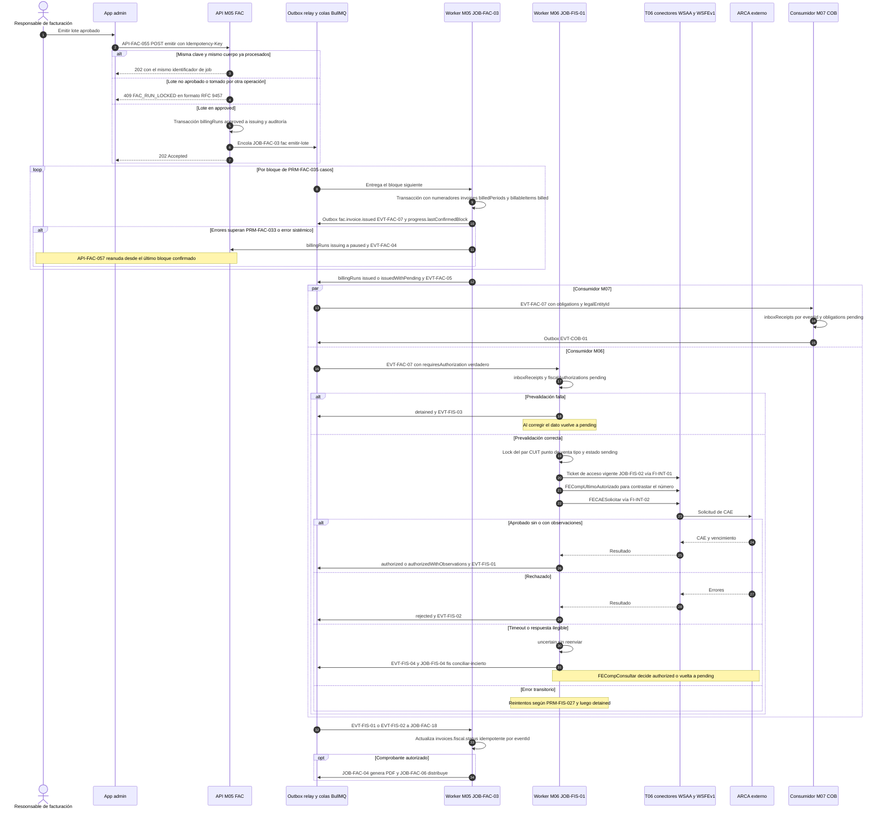

**Puntos de control:** la numeración y la obligación se generan al emitir; la autorización fiscal es asíncrona y no bloquea la emisión del lote. Un `uncertain` nunca se reenvía: solo se concilia (M06 §9.2). A confirmar: si M06 invoca los conectores de T06 o habla directo con ARCA (ver sección 5, punto C-02).

### 3.2 A2 — Pago por pasarela desde la PWA del socio y conciliación

**Fuentes:** M19 §9.7 (API-POR-64, API-POR-65, API-POR-67, RN-POR-026 a RN-POR-028); M07 §8.4, §9.9 (P-COB-09), §9.10 (P-COB-10), §9.14 (P-COB-14), API-COB-79, API-COB-89, JOB-COB-04, JOB-COB-05, JOB-COB-06, JOB-COB-12, PRM-COB-112, EVT-COB-04, EVT-COB-11, EVT-COB-20; T06 §9.3 (JOB-INT-03, RF-INT-056), EVT-INT-08, FI-INT-43 (Pagos360), FI-INT-44 (Mercado Pago); M08 EVT-MOR-02, JOB-MOR-07; M14 JOB-TES-02, JOB-TES-03, EVT-TES-07.

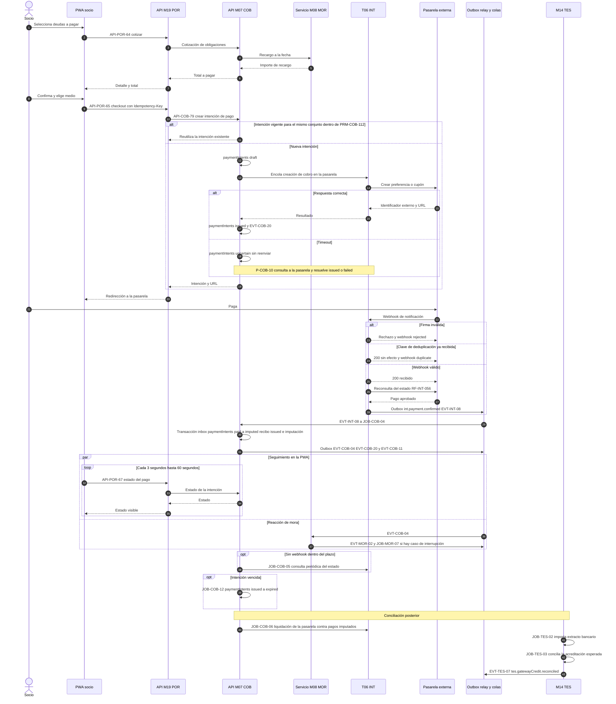

**Puntos de control:** la imputación solo ocurre con confirmación del proveedor (webhook verificado más reconsulta, o consulta periódica). Según T11 §12.9 la responsabilidad es en capas: T06 valida firma y deduplica; M07 aplica. A confirmar: la ruta pública del webhook (API-COB-89 frente a la ruta de T06) y la correspondencia de estados entre M19 y M07 (sección 5, puntos C-05 y C-06).

### 3.3 A3 — Cobro en caja con un recibo por entidad jurídica

**Fuentes:** M07 §8.3, §9.3 (P-COB-03), API-COB-33, API-COB-34, RF-COB-087, RF-COB-193, RN-COB-152, PRM-COB-065, PRM-COB-066, JOB-COB-15, EVT-COB-04; M05 §11.7 `fac.service.nextNumber` (RF-FAC-179, RN-FAC-161); M08 EVT-MOR-02; M06 PRM-FIS-010.

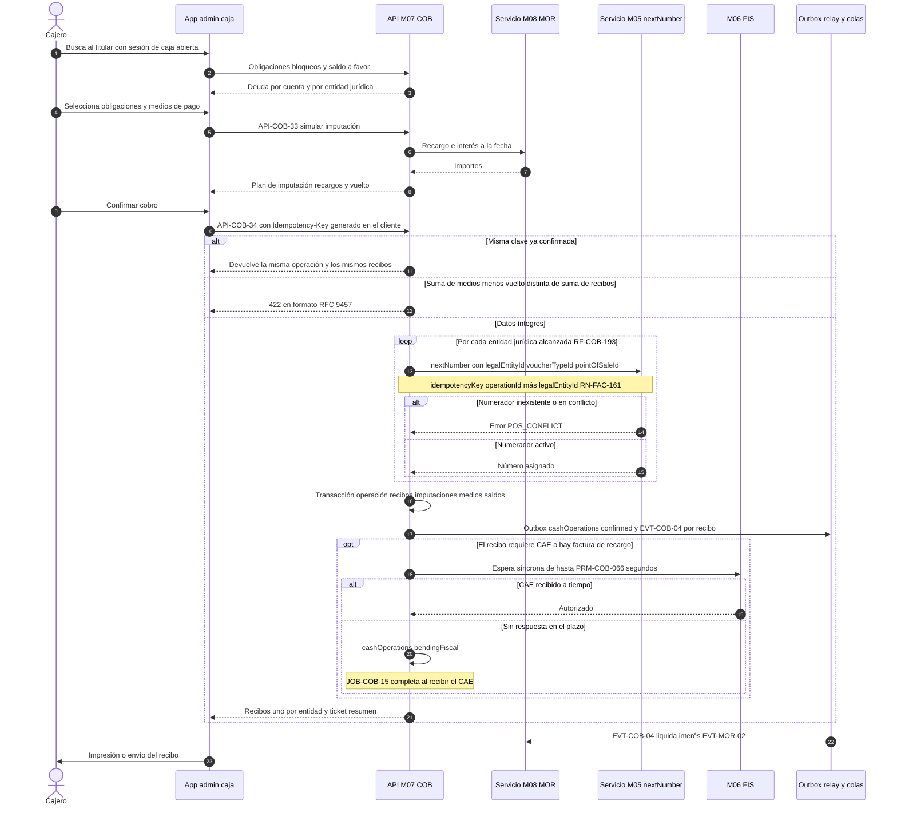

**Puntos de control:** una operación con un único `operationId` puede generar varios recibos, uno por entidad jurídica, cada uno con su numeración (RN-COB-152); anular la operación anula todos sus recibos. A confirmar: si la llamada a `nextNumber` participa de la transacción de M07 o es previa e idempotente, y el canal de envío del recibo (sección 5, punto C-08).

### 3.4 A4 — Corte o restricción por mora y rehabilitación

**Fuentes:** M08 §8.7, §9.4 (JOB-MOR-02), §9.7, §9.8 (JOB-MOR-07, RN-MOR-091, RN-MOR-092, RN-MOR-094), JOB-MOR-18, RN-MOR-137 a RN-MOR-139, EVT-MOR-12, EVT-MOR-13; T11 (aprobaciones); M10 §9.5, RF-TEC-238, EVT-TEC-07, EVT-TEC-18, EVT-TEC-19, EVT-TEC-21, EVT-TEC-33; T06 EVT-INT-15, FI-INT-79 (MikroTik), FI-INT-81 (SmartOLT); M02 §8.2 (T08 a T11), EVT-CAT-10, EVT-CAT-11, EVT-CAT-12; M07 EVT-COB-04.

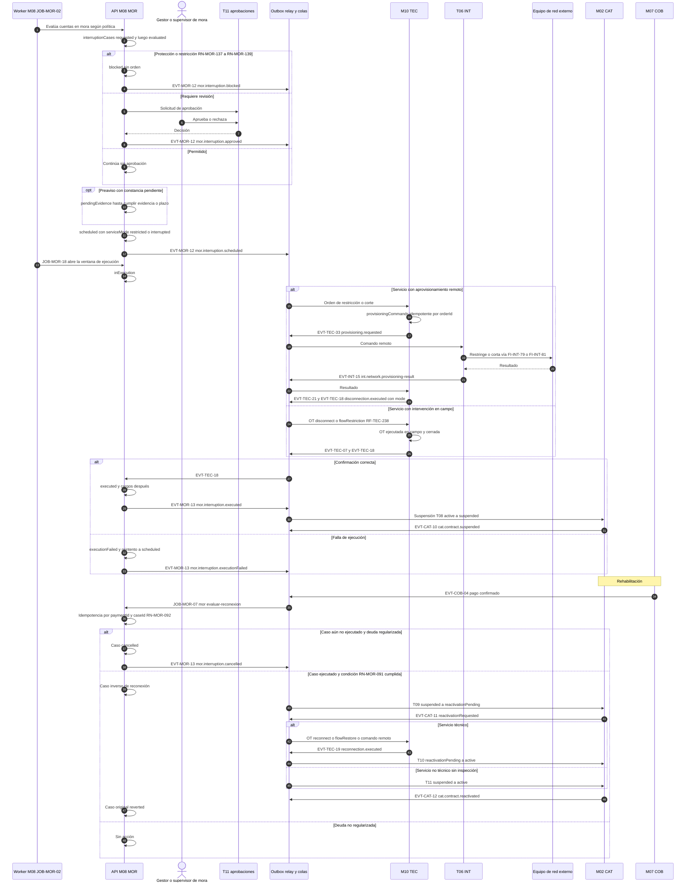

**Puntos de control:** la ejecución real la confirma M10 o T06; el plazo de reconexión responde a RN-MOR-094. A confirmar: qué evento dispara la suspensión en M02 (M02 T08 cita `mor.interruption.approved`, mientras M08 actualiza el estado del servicio al recibir la confirmación) y qué evento ordena la reconexión (sección 5, puntos C-09 y C-10).

### 3.5 A5 — Reclamo del socio, orden de trabajo y cierre con cargo

**Fuentes:** M19 §9.11 (API-POR-83, API-POR-88, PRM-POR-074); M09 §8.1, §8.2, §9.1, API-CRM-80, EVT-CRM-01, EVT-CRM-03, EVT-CRM-04, EVT-CRM-08, EVT-CRM-09, EVT-CRM-13, JOB-CRM-03; M10 §8.4, §9.2 (RF-TEC-062), API-TEC-43, EVT-TEC-04, EVT-TEC-06, EVT-TEC-07, EVT-TEC-10; M05 §11.7 `fac.service.upsertBillableItem`, EVT-FAC-20.

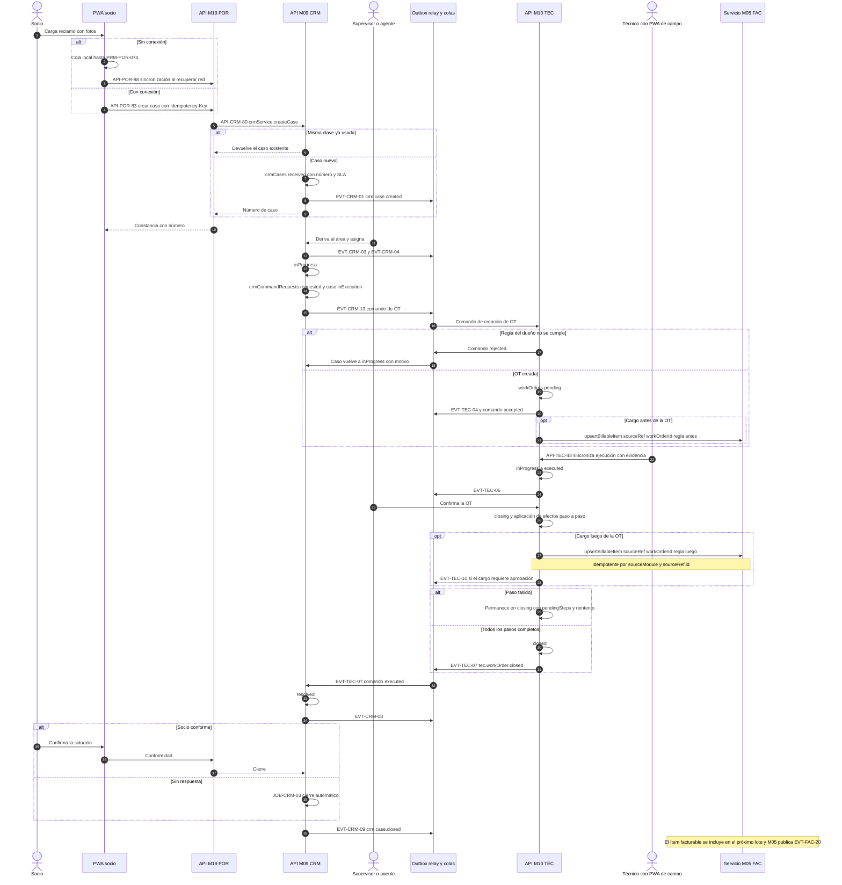

**Puntos de control:** los cargos se registran como ítems facturables idempotentes (`'<workOrderId>:<regla>:<antes|luego>'`, RF-TEC-062); la factura no se emite en este flujo. A confirmar: el nombre del comando de OT y la declaración de consumo de EVT-TEC-07 por M09 (sección 5, punto C-11).

### 3.6 A6 — Lectura de medidores desde la PWA de campo sin conexión

**Fuentes:** M03 §8.3, §8.5, §9.3, §9.4 (JOB-MED-03, RN-MED-035), RN-MED-125, API-MED-19, API-MED-21, API-MED-24, API-MED-29, API-MED-30, API-MED-31, API-MED-32, API-MED-60, JOB-MED-01, EVT-MED-05, EVT-MED-06, EVT-MED-08, EVT-MED-10, EVT-MED-11, EVT-MED-28, PAN-MED-28, PAN-MED-29, PAN-MED-34.

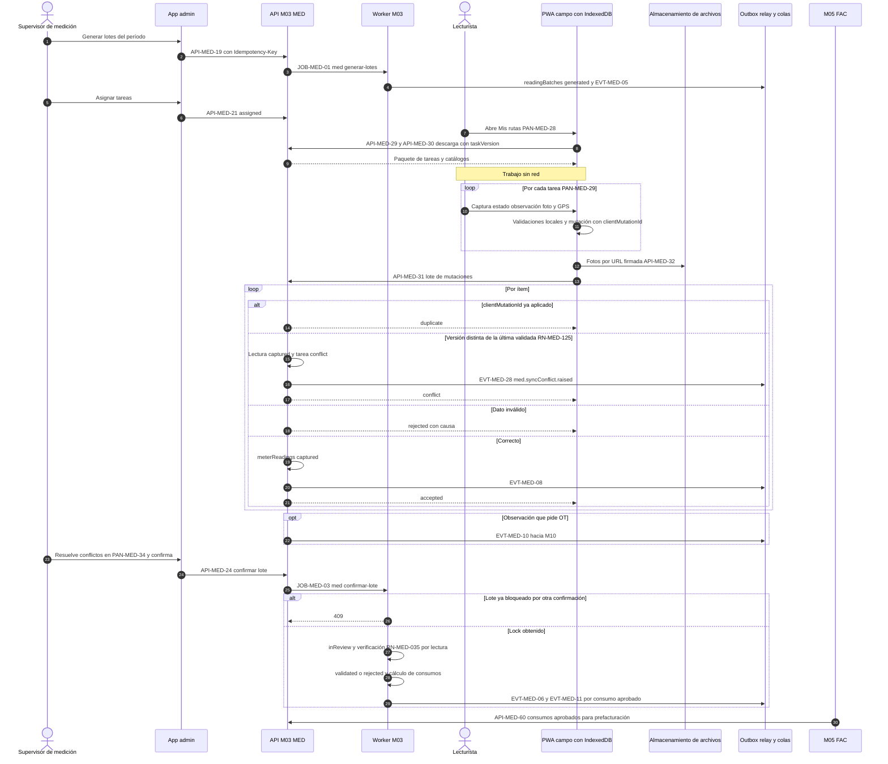

**Puntos de control:** la PWA nunca encola login ni operaciones administrativas; cada mutación es idempotente por `clientMutationId`. A confirmar: la nomenclatura del resultado por ítem, que difiere de la de M10 (sección 5, punto C-16).

### 3.7 A7 — Vinculación de cuenta con código al contacto del titular

**Fuentes:** M19 §5.3 (RF-POR-179, RF-POR-039), §8.1, §9.3 (API-POR-31, RN-POR-005, RN-POR-006, PRM-POR-010), PAN-POR-27, EVT-POR-01, EVT-POR-05; M01 RF-PER-173, API-PER-76, PRM-PER-102, §8.13, EVT-PER-24; DEC-043.

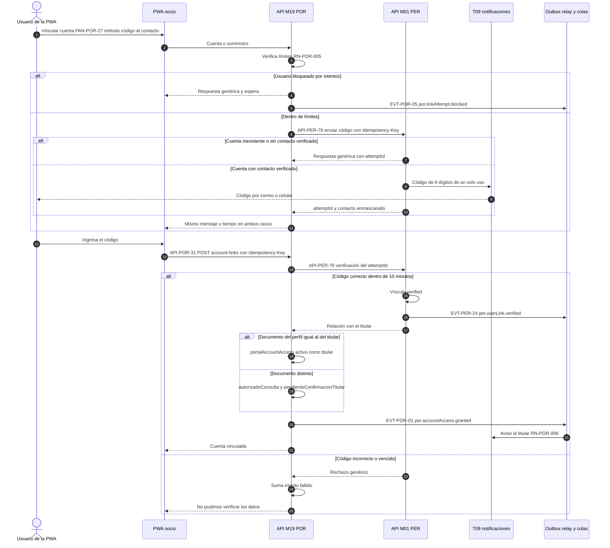

**Puntos de control:** anti-enumeración (misma respuesta y tiempo) y límite de intentos. A confirmar: si el bloqueo ocurre en el quinto o en el sexto intento fallido, quién es dueño del vínculo y si la PWA invoca API-PER-76 directamente o siempre a través de M19 (sección 5, puntos C-13 a C-15).

### 3.8 A8 — Contabilización por eventos y cierre contable

**Fuentes:** M15 §8.3, §8.5, §8.6, §9.2 (P-CON-01, JOB-CON-01, RN-CON-011, PRM-CON-008), §9.3 (P-CON-02, JOB-CON-02, PAN-CON-17), §9.4 (P-CON-03, JOB-CON-03), §9.5 (P-CON-04), EVT-CON-01, EVT-CON-04, EVT-CON-05, EVT-CON-06, EVT-CON-07, EVT-CON-08, EVT-CON-11; matriz M-01, M-20, M-84; T11 (aprobación de reapertura).

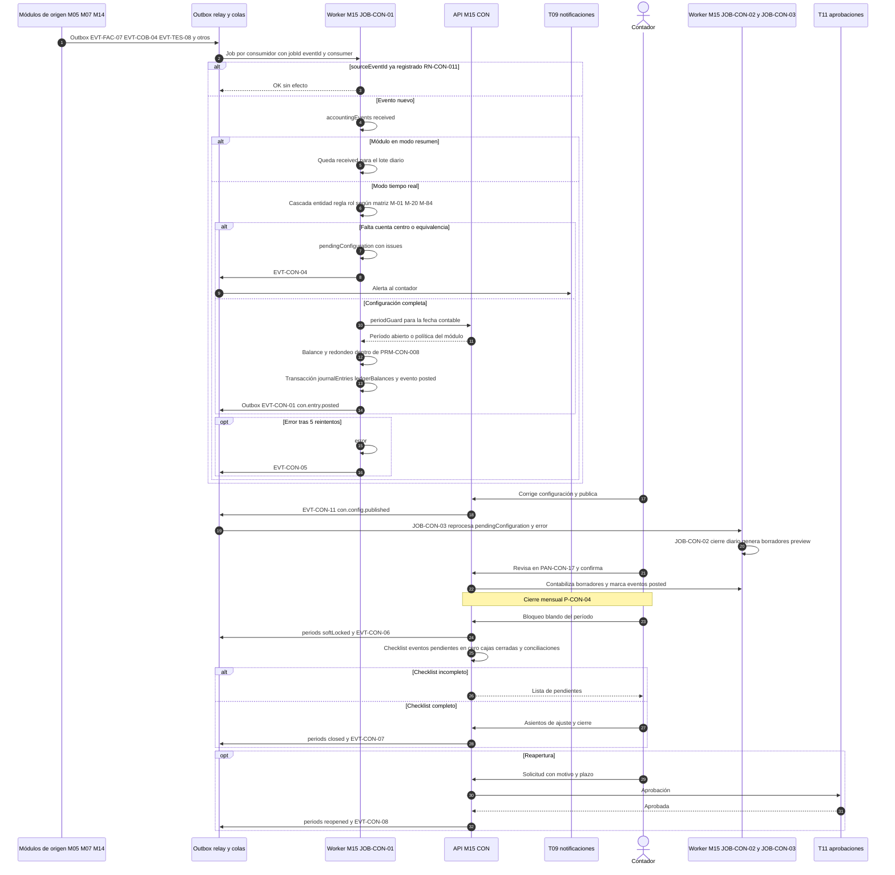

**Puntos de control:** la idempotencia por `sourceEventId` garantiza que el cierre diario y la contabilización en tiempo real no dupliquen asientos.

### 3.9 A9 — Importación de migración por lote

**Fuentes:** T07 §8.2, §8.3, §9.3, RN-MIG-043, RF-MIG-046, API-MIG-05, API-MIG-11, API-MIG-12, API-MIG-15, API-MIG-21, JOB-MIG-01, JOB-MIG-03, JOB-MIG-04, JOB-MIG-05, JOB-MIG-06, EVT-MIG-01, EVT-MIG-02, EVT-MIG-04; T06 FI-INT-97.

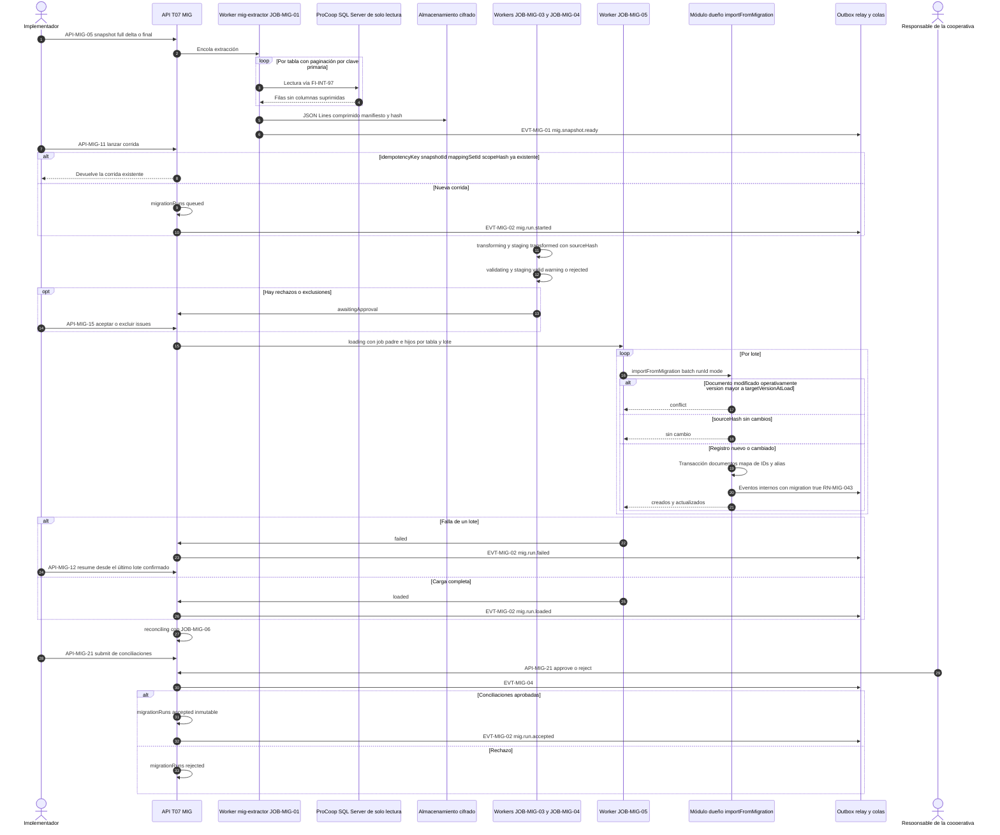

**Puntos de control:** las cargas en modo `migration` no disparan eventos externos ni notificaciones (RN-MIG-043). A confirmar: estados del lote (`migrationBatches`) y el mecanismo que libera `awaitingApproval` (sección 5, puntos C-20 y C-21).

### 3.10 A10 — Entrega de gas envasado

**Fuentes:** M10 RF-TEC-239 (DEC-082, PRM-CAT-112), §8.4, §9.4, API-TEC-42, API-TEC-43, EVT-TEC-04, EVT-TEC-07 (bloque `bottledGas`); M13 RF-STK-139, §8.1, §8.2; M05 EVT-FAC-07.

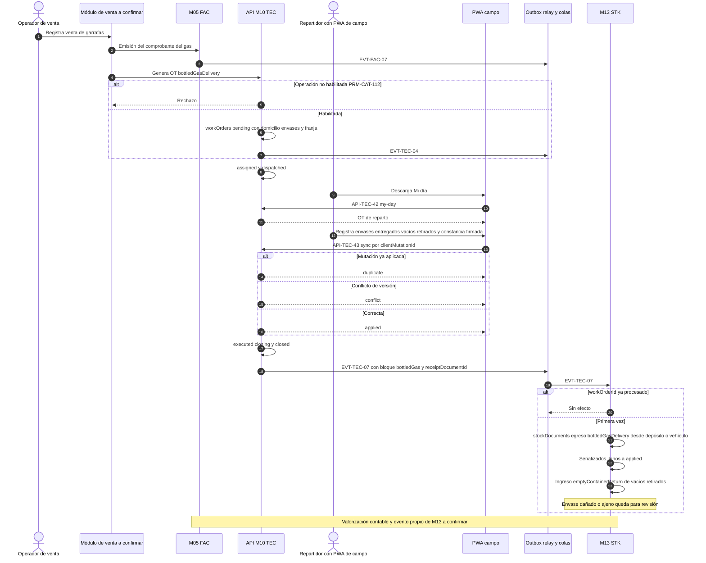

**Puntos de control:** idempotencia por `workOrderId` en M13; el gas lo factura M05 desde la venta. A confirmar: el módulo que registra la venta, el momento de la facturación, el estado del envase vacío serializado y el evento de M13 (sección 5, puntos C-17 y C-18).

---

## 4. Parte B — Diagramas de estados (artefacto 7.4)

| N.º | Entidad | Colección y campo | Anexo |
|---|---|---|---|
| B1 | Contrato de servicio | `serviceContracts.lifecycleStatus` | M02 §8.2 |
| B2 | Factura o comprobante | `invoices.commercialStatus` e `invoices.fiscal.status` | M05 §8.5 y §8.6 (M06 §8.1) |
| B3 | Obligación | `obligations.balanceStatus` | M07 §8.1 |
| B4 | Recibo y operación de caja | `cashOperations.status` y `receipts.status` | M07 §8.3 |
| B5 | Caso de mora (interrupción) | `interruptionCases.status` | M08 §8.7 |
| B6 | Orden de trabajo | `workOrders.status` | M10 §8.4 |
| B7 | Caso CRM | `crmCases.baseStatus` | M09 §8.1 |
| B8 | Plan de financiación (convenio) | `agreements.status` | M08 §8.8 |
| B9 | Rendición de caja | `cashRemittances.status` (y `cashSessions.status`) | M14 §8.8 y M07 §8.2 |
| B10 | Solicitud de aprovisionamiento y orden de pago | `supplyRequests` y `paymentOrders` | M12 §8.1 y §8.6 |
| B11 | Contrato social de sepelio | `serviceContracts.lifecycleStatus` más condición de cobertura | M02 §8.2, M18, M08 |
| B12 | Corrida de migración | `migrationRuns.status` | T07 §8.2 |

### 4.1 B1 — Contrato de servicio (`serviceContracts.lifecycleStatus`)

**Fuente:** M02 §8.2 (transiciones T01 a T17), §12 (EVT-CAT-06 a EVT-CAT-17). Estados terminales: `terminated`, `cancelled`, `superseded`.

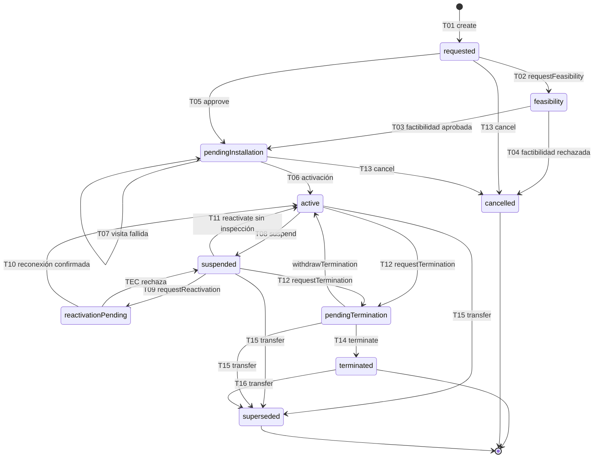

| Desde | Hasta | Disparador | Regla | Evento emitido |
|---|---|---|---|---|
| (nuevo) | `requested` | T01 `cat.contract.create` desde EVT-CRM-13 o mostrador | Oferta abierta, titular identificado, plan publicado | EVT-CAT-06 `cat.contract.requested` |
| `requested` | `feasibility` | T02 `requestFeasibility` | El servicio exige factibilidad | EVT-CAT-07 `cat.contract.feasibilityRequested` |
| `feasibility` | `pendingInstallation` | T03 `tec.feasibility.verdictIssued` aprobada | Factibilidad aprobada | EVT-CAT-08 (si es técnico) |
| `feasibility` | `cancelled` | T04 `tec.feasibility.verdictIssued` rechazada | — | EVT-CAT-16 `cat.contract.cancelled` |
| `requested` | `pendingInstallation` | T05 `approve` | Servicio sin factibilidad, requisitos cumplidos | EVT-CAT-08 (si es técnico) |
| `pendingInstallation` | `pendingInstallation` | T07 `tec.visit.failed` | Registra intento | Ninguno |
| `pendingInstallation` | `active` | T06 EVT-TEC-16 o EVT-TEC-07 (activación), o `activate` | RN-CAT-064, equipos asignados, provisión confirmada | EVT-CAT-09 `cat.contract.activated` |
| `active` | `suspended` | T08 `suspend{reason, mode}` (mora, voluntaria, técnica, regulatoria) | Perfil y límites normativos | EVT-CAT-10 `cat.contract.suspended` |
| `suspended` | `reactivationPending` | T09 `requestReactivation` | Causa de suspensión levantada | EVT-CAT-11 `cat.contract.reactivationRequested` |
| `reactivationPending` | `suspended` | Rechazo de TEC (por ejemplo, inspección de gas fallida) | — | a confirmar |
| `reactivationPending` | `active` | T10 `tec.workOrder.closed(reconnection)` o `tec.provisioning.confirmed` | RN-CAT-043 | EVT-CAT-12 `cat.contract.reactivated` |
| `suspended` | `active` | T11 `reactivate` | Servicio no técnico sin inspección | EVT-CAT-12 |
| `active` / `suspended` | `pendingTermination` | T12 `requestTermination` | Sin bloqueo por deuda para baja solicitada | EVT-CAT-13 `cat.contract.terminationRequested` |
| `pendingTermination` | estado previo | `withdrawTermination` | Antes de la baja efectiva | EVT-CAT-14 `cat.contract.terminationWithdrawn` |
| `requested` / `feasibility` / `pendingInstallation` | `cancelled` | T13 `cancel{reason}` | Sin activación | EVT-CAT-16 |
| `pendingTermination` | `terminated` | T14 `tec.workOrder.closed(disconnection)` o `terminate` | Lectura y factura final; no reversible salvo `reopenTermination` (PRM-CAT-047) | EVT-CAT-15 `cat.contract.terminated` |
| `active` / `suspended` / `pendingTermination` | `superseded` | T15 `transfer` | RN-CAT-051 a RN-CAT-054 | EVT-CAT-17 `cat.contract.transferred` |
| `terminated` | `superseded` | T16 `transfer` | V2 2599 activo | EVT-CAT-17 |
| cualquier no terminal | mismo estado | T17 cambios de plan, categoría, régimen, etc. | RN-CAT-078 | EVT-CAT-28 (solo `changeMeteringRegime`) |

El diagrama representa `withdrawTermination` con destino `active`; el destino real es el estado previo (`active` o `suspended`).

### 4.2 B2 — Factura o comprobante (`invoices.commercialStatus` e `invoices.fiscal.status`)

**Fuente:** M05 §8.5 (estado comercial) y §8.6 (estado fiscal, escrito solo desde eventos de M06); M06 §8.1 (`fiscalAuthorizations.status`). Las dos dimensiones son independientes y se representan como regiones concurrentes.

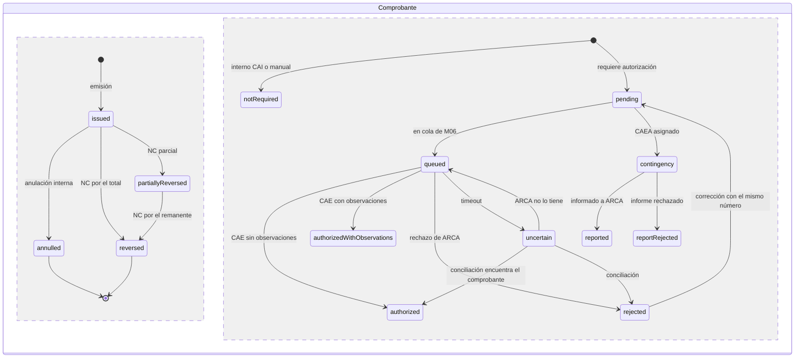

| Desde | Hasta | Disparador | Regla | Evento emitido |
|---|---|---|---|---|
| (borrador) | `issued` | JOB-FAC-03 o emisión individual | Validaciones y numeración | EVT-FAC-07 `fac.invoice.issued` |
| `issued` | `annulled` | Operador más aprobador | No autorizado ni en proceso fiscal, sin pagos ni financiaciones (RN-FAC-084) | EVT-FAC-08 `fac.invoice.annulled` |
| `issued` | `reversed` | NC por el total | Autorizado o con pagos | EVT-FAC-10 `fac.creditNote.issued` y EVT-FAC-09 `fac.invoice.reversed` |
| `issued` | `partiallyReversed` | NC parcial | Saldo revertible reducido | EVT-FAC-10 y EVT-FAC-09 (revertido total o parcial) |
| `partiallyReversed` | `reversed` | NC por el remanente | — | EVT-FAC-10 y EVT-FAC-09 |
| — | `notRequired` | Emisión interna, CAI o manual | No requiere CAE | Ninguno |
| — | `pending` | Emisión con `requiresAuthorization` | — | EVT-FAC-07 |
| `pending` | `queued` | Toma por M06 | M05 §8.6 (M06 usa `sending`) | a confirmar |
| `queued` | `authorized` / `authorizedWithObservations` | EVT-FIS-01 vía JOB-FAC-18 | Resultado aprobado | EVT-FIS-01 `fis.invoice.authorized` (emitido por M06) |
| `queued` | `rejected` | EVT-FIS-02 | Resultado rechazado | EVT-FIS-02 (M06) |
| `queued` | `uncertain` | EVT-FIS-04 | Timeout o respuesta ilegible; no se reenvía | EVT-FIS-04 (M06) |
| `uncertain` | `authorized` / `rejected` / `queued` | JOB-FIS-04 o JOB-FAC-08 | FECompConsultar | EVT-FIS-05 `reconciled` (M06) |
| `rejected` | `pending` | Corrección del dato | Mismo número si M06 lo admite (PA-FAC-04) | a confirmar |
| `pending` | `contingency` | CAEA asignado durante una contingencia (EVT-FIS-07 `fis.contingency.activated`) | FI-INT-03 | EVT-FIS-06 `fis.caea.obtained` (M06) |
| `contingency` | `reported` | Informe a ARCA | — | EVT-FIS-06 `fis.caea.reported` (M06) |
| `contingency` | `reportRejected` | Informe rechazado | — | a confirmar |

**Estados de M06 sin correspondencia en M05:** `detained` (prevalidación fallida, EVT-FIS-03), `sending`, `toReconcile` y `cancelled`. Ver sección 5, punto C-01.

### 4.3 B3 — Obligación (`obligations.balanceStatus`)

**Fuente:** M07 §8.1. Estado derivado del saldo; las marcas de ciclo de vida (en convenio, incobrable, prescripta, en reclamo) no cambian el saldo.

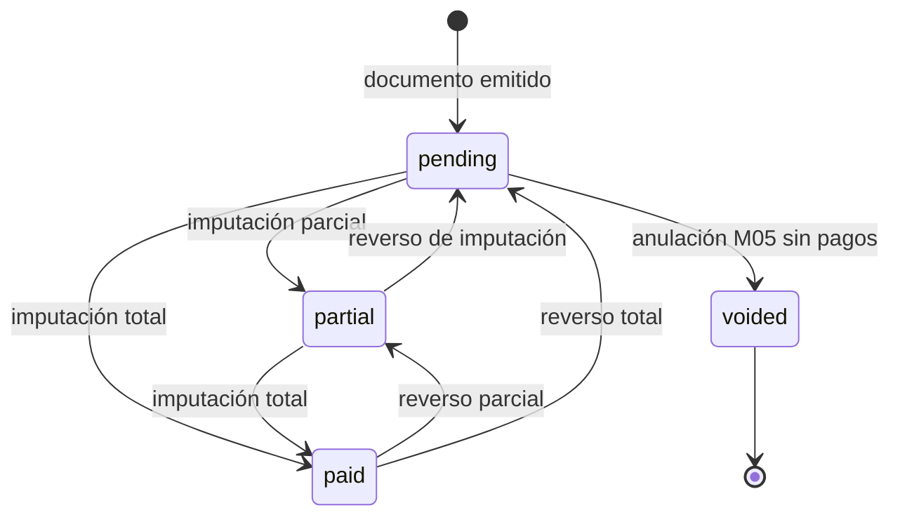

| Desde | Hasta | Disparador | Regla | Evento emitido |
|---|---|---|---|---|
| (nuevo) | `pending` | Consumo de EVT-FAC-07 o de documentos de M08 | Idempotencia por `eventId` (P-COB-01) | EVT-COB-01 `cob.obligation.registered` |
| `pending` | `partial` | Motor de imputación | Imputación activa menor al importe | Ninguno |
| `partial` | `pending` | Reverso de imputación | — | EVT-COB-03 `cob.obligation.reopened` |
| `pending` / `partial` | `paid` | Motor de imputación | Suma de imputaciones igual al importe | EVT-COB-02 `cob.obligation.settled` |
| `paid` | `partial` / `pending` | Anulación de cobro, contracargo o rechazo | — | EVT-COB-03 |
| `pending` | `voided` | Anulación de M05 (EVT-FAC-08) | Sin imputaciones activas; no reversible | a confirmar |

### 4.4 B4 — Recibo y operación de caja (`cashOperations.status` y `receipts.status`)

**Fuente:** M07 §8.3, RN-COB-073, RN-COB-074, RN-COB-075, RN-COB-152.

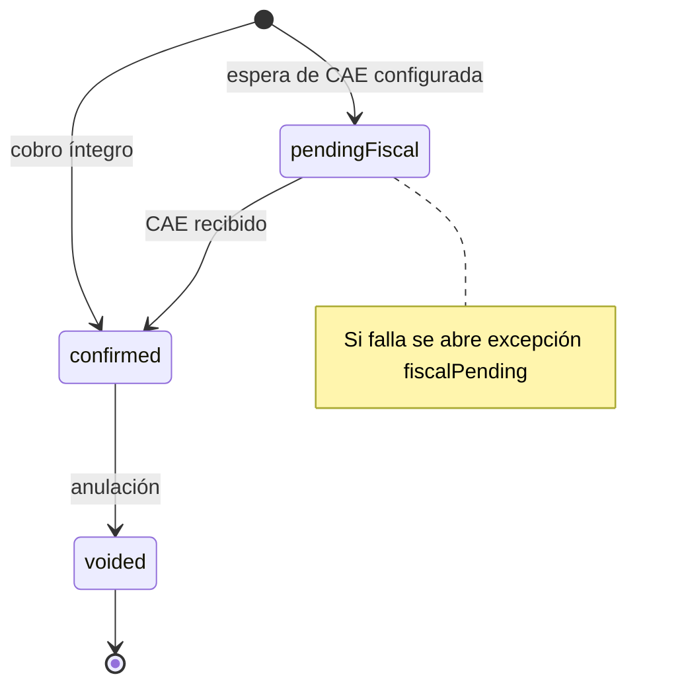

| Desde | Hasta | Disparador | Regla | Evento emitido |
|---|---|---|---|---|
| (nuevo) | `confirmed` | Cajero o sistema (ente, pasarela, débito, cobrador) | Integridad exacta; un recibo por entidad jurídica (RF-COB-193); recibos en `issued` | EVT-COB-04 `cob.payment.confirmed` |
| (nuevo) | `pendingFiscal` | Sistema | Espera de CAE vencida (PRM-COB-066, RN-COB-062) | a confirmar |
| `pendingFiscal` | `confirmed` | JOB-COB-15 al recibir el CAE | Si falla, excepción `fiscalPending` (EVT-COB-22) | EVT-COB-04 (a confirmar momento de emisión) |
| `confirmed` | `voided` | Cajero con permiso o supervisor | RN-COB-073, RN-COB-074; reversos completos (RN-COB-075); anula todos los recibos de la operación | EVT-COB-05 `cob.receipt.voided` |

El recibo individual usa los valores `issued` y `voided`; anular un solo recibo exige anular la operación (RN-COB-152).

### 4.5 B5 — Caso de mora: caso de interrupción (`interruptionCases.status`)

**Fuente:** M08 §8.7, EVT-MOR-12, EVT-MOR-13. El anexo indica en §7 que el estado se describe en "§8.6", pero la máquina de estados está en §8.7 (ver sección 5, punto C-12).

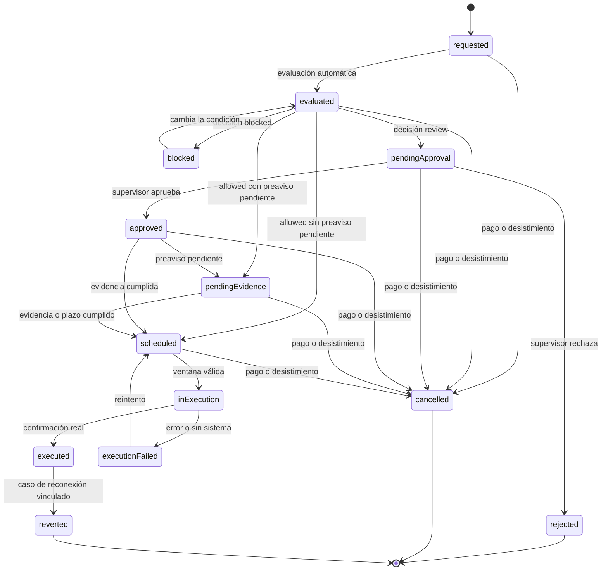

| Desde | Hasta | Disparador | Regla | Evento emitido |
|---|---|---|---|---|
| — | `requested` | JOB-MOR-02, gestor, socio, CRM | Servicio en estado compatible | EVT-MOR-12 `mor.interruption.requested` |
| `requested` | `evaluated` | Sistema | Decisión `allowed`, `review` o `blocked` | Ninguno |
| `evaluated` | `blocked` | Sistema | Restricción o protección (RN-MOR-137 a RN-MOR-139) | EVT-MOR-12 `mor.interruption.blocked` |
| `blocked` | `evaluated` | Cambio de condición | Reevaluación | a confirmar |
| `evaluated` | `pendingApproval` | Sistema | Requiere aprobación T11 | a confirmar |
| `pendingApproval` | `approved` / `rejected` | Supervisor (aprobación sensible para protecciones) | No reversible | EVT-MOR-12 `mor.interruption.approved` (solo aprobación) |
| `evaluated` (`allowed`) / `approved` | `pendingEvidence` | Sistema | Preaviso con constancia no satisfecho | Ninguno |
| `evaluated` / `approved` / `pendingEvidence` | `scheduled` | Sistema | Evidencia y cargos "antes" cumplidos | EVT-MOR-12 `mor.interruption.scheduled` |
| `scheduled` | `inExecution` | JOB-MOR-18 (M10 o T06) | Ventana válida | Ninguno |
| `inExecution` | `executed` | EVT-TEC-18 o respuesta OK de T06 | Confirmación real; cargos "después" | EVT-MOR-13 `mor.interruption.executed` |
| `inExecution` | `executionFailed` | M10 o T06 | Error o sin sistema | EVT-MOR-13 `mor.interruption.executionFailed` |
| `executionFailed` | `scheduled` | Reintento | — | EVT-MOR-12 `scheduled` (a confirmar) |
| `requested` … `scheduled` | `cancelled` | Pago confirmado (JOB-MOR-07), gestor o socio | Deuda regularizada o desistimiento | EVT-MOR-13 `mor.interruption.cancelled` |
| `executed` | `reverted` | Caso `reconnection` o `reactivation` vinculado | RN-MOR-091, RN-MOR-092 | a confirmar |

### 4.6 B6 — Orden de trabajo (`workOrders.status`)

**Fuente:** M10 §8.4, RF-TEC-036, RF-TEC-038, RF-TEC-045, RN-TEC-036, AGR-016.

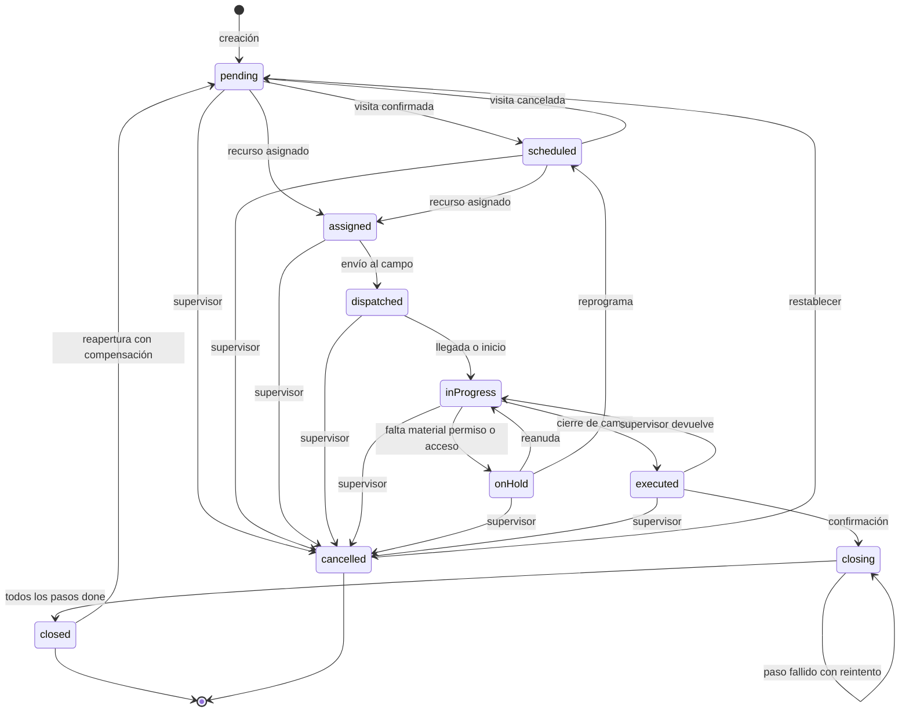

| Desde | Hasta | Disparador | Regla | Evento emitido |
|---|---|---|---|---|
| — | `pending` | Admin, CRM, mora, campo, regla o plan | RF-TEC-027, RF-TEC-028; cargos "antes" propuestos | EVT-TEC-04 `tec.workOrder.created` |
| `pending` | `scheduled` | Despachante o socio | Visita confirmada | EVT-TEC-05 `statusChanged` |
| `pending` / `scheduled` | `assigned` | Despachante | Recurso o cuadrilla | EVT-TEC-05 |
| `assigned` | `dispatched` | Sistema, impresión (RN-TEC-011) o envío automático (PRM-TEC-079) | Bloqueo de campo | EVT-TEC-05 |
| `dispatched` | `inProgress` | Técnico | — | EVT-TEC-05 |
| `inProgress` | `onHold` | Técnico o supervisor | Motivo obligatorio | EVT-TEC-05 |
| `onHold` | `inProgress` / `scheduled` | Técnico o supervisor | — | EVT-TEC-05 |
| `inProgress` | `executed` | Técnico o administrativo | Requisitos de cierre de campo; si `twoStepClose=false` pasa a `closing` | EVT-TEC-06 `tec.workOrder.executed` |
| `executed` | `closing` | Supervisor o automático | RF-TEC-036; sin conflicto abierto | Ninguno |
| `closing` | `closing` | Error en un efecto | `pendingSteps`, bandeja operativa (AGR-016) | Ninguno |
| `closing` | `closed` | Sistema | Todos los pasos `done`; cargos "luego" | EVT-TEC-07 `tec.workOrder.closed` |
| `pending` … `executed` | `cancelled` | Supervisor | Motivo; compensación (RN-TEC-036) | EVT-TEC-08 `tec.workOrder.cancelled` |
| `cancelled` | `pending` | Restablecer | — | a confirmar |
| `closed` | `pending` | Supervisor con capability (RF-TEC-045) | Compensa efectos | a confirmar |

### 4.7 B7 — Caso CRM (`crmCases.baseStatus`)

**Fuente:** M09 §8.1. Los estados visibles configurables mapean a estos estados base.

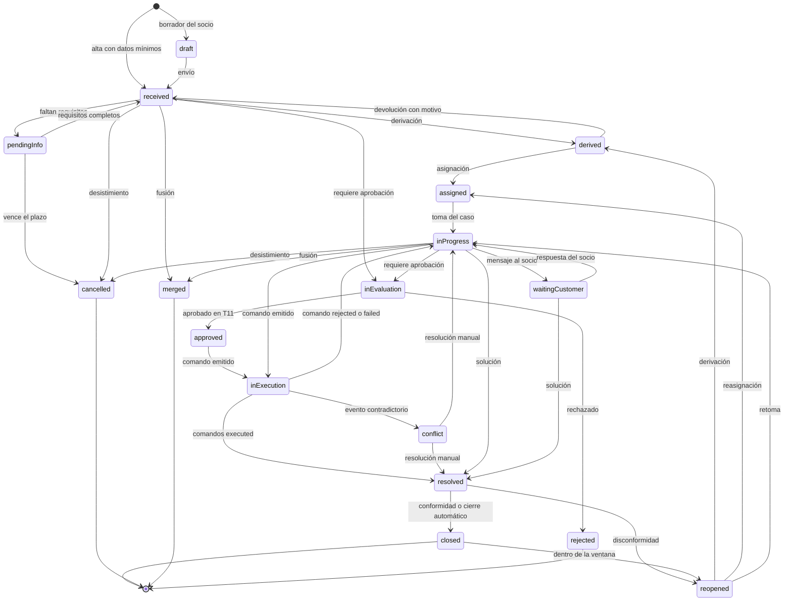

El diagrama muestra solo algunos orígenes de "cualquiera no final" hacia `cancelled` y `merged`; la tabla los resume completos.

| Desde | Hasta | Disparador | Regla | Evento emitido |
|---|---|---|---|---|
| — | `draft` | Socio o bot | Borrador por 7 días (PRM-CRM-016) | Ninguno |
| — / `draft` | `received` | Socio, agente, bot, sistema o público (API-CRM-80) | Datos mínimos, pertenencia | EVT-CRM-01 `crm.case.created` |
| `received` | `pendingInfo` | Supervisor o empleado | Al menos un requisito pendiente | EVT-CRM-05 `statusChanged` |
| `pendingInfo` | `received` / estado previo | Sistema o empleado | Requisitos completos | EVT-CRM-05 |
| `pendingInfo` | `cancelled` | Sistema | Vence plazo (PRM-CRM-015) | EVT-CRM-11 `crm.case.cancelled` |
| `received` / `reopened` | `derived` | Supervisor o regla `autoDerive` | Tipo y área elegidos | EVT-CRM-03 `crm.case.derived` |
| `derived` | `received` | Empleado del área | Motivo obligatorio | EVT-CRM-05 |
| `derived` | `assigned` | Supervisor, responsable o autoasignación | Miembro del área | EVT-CRM-04 `crm.case.assigned` |
| `assigned` | `inProgress` | Asignado | — | EVT-CRM-05 |
| `inProgress` | `waitingCustomer` | Empleado | Mensaje visible enviado | EVT-CRM-05 |
| `waitingCustomer` | `inProgress` | Respuesta del socio | — | EVT-CRM-05 |
| `inProgress` / `received` | `inEvaluation` | Supervisor o empleado | Tipo con aprobación T11 | EVT-CRM-05 |
| `inEvaluation` | `approved` / `rejected` | Aprobador | Motivo en rechazo | EVT-CRM-05 |
| `approved` / `inProgress` | `inExecution` | Sistema | Al menos un comando emitido | EVT-CRM-13 `crm.commandRequest.requested` |
| `inExecution` | `inProgress` | Sistema | Comando `rejected` o `failed` | EVT-CRM-05 |
| `inExecution` | `resolved` | Sistema o empleado | Todos los comandos `executed` | EVT-CRM-08 `crm.case.resolved` |
| `inProgress` / `waitingCustomer` | `resolved` | Empleado | Solución y código de resolución | EVT-CRM-08 |
| `resolved` | `closed` | Socio, empleado o JOB-CRM-03 | Sin comandos pendientes | EVT-CRM-09 `crm.case.closed` |
| `resolved` / `closed` | `reopened` | Socio o supervisor | Dentro de `reopenWindowDays` | EVT-CRM-10 `crm.case.reopened` |
| `reopened` | `derived` / `assigned` / `inProgress` | Supervisor o empleado | — | EVT-CRM-05 |
| cualquiera no final | `cancelled` | Socio o supervisor | No permitido con comandos ejecutados | EVT-CRM-11 |
| cualquiera no final | `merged` | Supervisor | Caso principal abierto | a confirmar |
| `inExecution` | `conflict` | Sistema | Evento contradictorio de M10 o M02 (ESC-03) | a confirmar |
| `conflict` | `inProgress` / `resolved` | Resolución manual | — | EVT-CRM-05 |
| `closed` / `cancelled` | estado previo no final | Supervisor (`crm.casos.reabrir`) | Sin horas facturadas | `recovered` (ID a confirmar) |

### 4.8 B8 — Plan de financiación: convenio (`agreements.status`)

**Fuente:** M08 §8.8, RN-MOR-114, RN-MOR-121, JOB-MOR-09, JOB-MOR-11, EVT-MOR-14, EVT-MOR-15.

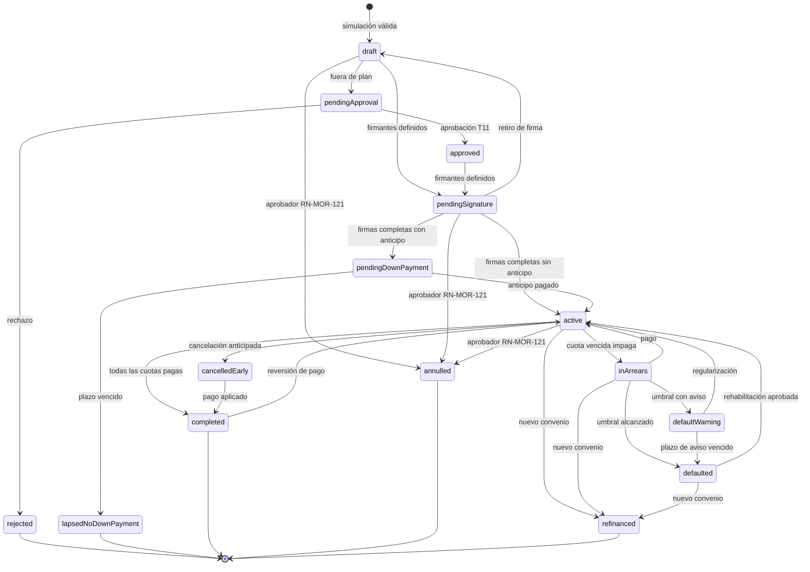

| Desde | Hasta | Disparador | Regla | Evento emitido |
|---|---|---|---|---|
| — | `draft` | Gestor o socio | Simulación válida | a confirmar |
| `draft` | `pendingApproval` | Sistema | Condiciones fuera de plan; aprobación T11 | EVT-MOR-14 (a confirmar subtipo) |
| `pendingApproval` | `approved` / `rejected` | Aprobador | — | EVT-MOR-14 (a confirmar subtipo) |
| `draft` / `approved` | `pendingSignature` | Gestor | Firmantes definidos | a confirmar |
| `pendingSignature` | `pendingDownPayment` | Sistema | Todas las firmas; registro transaccional (RN-MOR-114) | EVT-MOR-14 (a confirmar subtipo) |
| `pendingSignature` | `active` | Sistema | Plan sin anticipo | `mor.agreement.activated` (EVT-MOR-14) |
| `pendingDownPayment` | `active` | Pago confirmado | Anticipo pagado; reconexión si la política lo prevé | `mor.agreement.activated` (EVT-MOR-14) |
| `pendingDownPayment` | `lapsedNoDownPayment` | JOB-MOR-09 | Plazo vencido; obligaciones restituidas | EVT-MOR-14 (a confirmar subtipo) |
| `active` | `inArrears` | JOB-MOR-11 | Cuota vencida impaga | EVT-MOR-15 (cuota, a confirmar) |
| `inArrears` | `defaultWarning` | JOB-MOR-11 | Umbral menos uno o con aviso previo | a confirmar |
| `inArrears` / `defaultWarning` | `active` | Pago o regularización | — | a confirmar |
| `inArrears` / `defaultWarning` | `defaulted` | Job o aprobador | Umbral y plazo de aviso vencidos | EVT-MOR-14 (a confirmar subtipo) |
| `defaulted` | `active` | `rehabilitated` con aprobación | Dentro del plazo | a confirmar |
| `active` / `inArrears` / `defaulted` | `refinanced` | Gestor | Nuevo convenio que incluye sus cuotas | a confirmar |
| `active` | `completed` | Sistema | Todas las cuotas pagas | `mor.agreement.completed` (EVT-MOR-14) |
| `active` | `cancelledEarly` → `completed` | Socio o gestor | Pago de cancelación anticipada | `mor.agreement.completed` (a confirmar) |
| `draft` … `active` | `annulled` | Aprobador | RN-MOR-121; restituye obligaciones | EVT-MOR-14 (a confirmar subtipo) |

El anexo indica "`rehabilitated` → `active`" como reversión de `defaulted`; no queda claro si `rehabilitated` es un estado intermedio o el nombre de la acción (sección 5, punto C-19).

### 4.9 B9 — Rendición de caja (`cashRemittances.status`)

**Fuente:** M14 §8.8, RF-TES-128, EVT-TES-08; M07 §8.2 (`cashSessions.status`), §8.14 (`treasuryHandovers.status`), EVT-COB-12, EVT-COB-25.

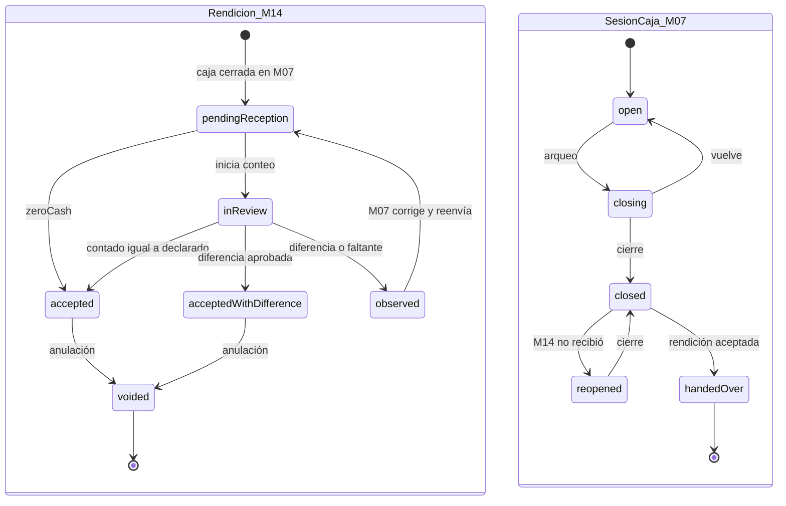

| Desde | Hasta | Disparador | Regla | Evento emitido |
|---|---|---|---|---|
| — | `pendingReception` | Consumo de EVT-COB-12 `cob.cashSession.closed` | Idempotente por `cashSessionId` | a confirmar |
| `pendingReception` | `inReview` | Auxiliar o tesorero | No puede ser el cajero | Ninguno |
| `inReview` | `accepted` | Tesorero | Contado igual a declarado (RF-TES-128) | EVT-TES-08 `tes.cashRemittance.accepted` |
| `inReview` | `acceptedWithDifference` | Tesorero más aprobación | Diferencia dentro del tope o aprobada; quebranto | EVT-TES-08 (a confirmar subtipo) |
| `inReview` | `observed` | Tesorero | Diferencia o faltante | EVT-TES-08 `tes.cashRemittance.observed` |
| `observed` | `pendingReception` | M07 corrige y reenvía | — | a confirmar |
| `pendingReception` | `accepted` | Sistema | `zeroCash`; movimiento de caja en cero | EVT-TES-08 |
| `accepted` / `acceptedWithDifference` | `voided` | Supervisor | Período abierto, sin movimientos posteriores; M07 reabre la caja | EVT-TES-08 `voided` |
| `cashSessions` `closing` | `closed` | Cajero (supervisor si hay diferencia) | Integridad sin diferencias | EVT-COB-12 `cob.cashSession.closed` |
| `cashSessions` `closed` | `reopened` | Supervisor | M14 no recibió la rendición | EVT-COB-25 `cob.cashSession.reopened` |
| `cashSessions` `closed` | `handedOver` | Consumo de EVT-TES-08 aceptada | No reversible | Ninguno |

En M07, la entrega a tesorería (`treasuryHandovers`) usa `prepared` → `delivered` → `received` | `rejected` (EVT-COB-13), mientras que M14 usa `observed` (sección 5, punto C-07).

### 4.10 B10 — Solicitud de aprovisionamiento y orden de pago (M12)

**Fuente:** M12 §8.1 (`supplyRequests`), §8.6 (`paymentOrders`), EVT-CMP-03, EVT-CMP-11, EVT-CMP-12, EVT-CMP-13; M14 EVT-TES-15. El anexo denomina "solicitud de aprovisionamiento" (SA) a la solicitud de compra.

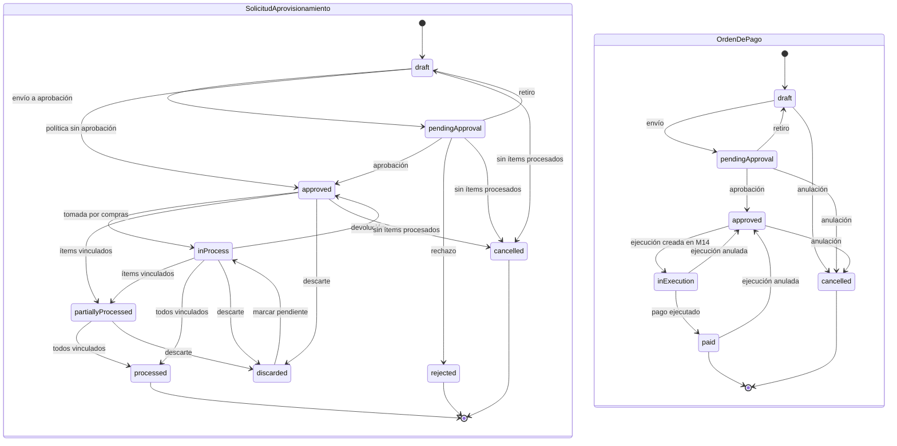

| Desde | Hasta | Disparador | Regla | Evento emitido |
|---|---|---|---|---|
| SA — | `draft` | Solicitante | — | Ninguno |
| SA `draft` | `pendingApproval` | Solicitante | Ítems válidos; tarea T11 | Ninguno |
| SA `pendingApproval` | `approved` | Aprobadores | Banda, doble aprobación si aplica, aprobador distinto del solicitante | EVT-CMP-03 `cmp.supplyRequest.approved` |
| SA `pendingApproval` | `rejected` | Aprobador | Motivo | a confirmar |
| SA `draft` | `approved` | Sistema | Política "sin aprobación" | EVT-CMP-03 (a confirmar) |
| SA `approved` | `inProcess` | Comprador | `takenByPurchasingAt` | Ninguno |
| SA `approved` / `inProcess` | `partiallyProcessed` / `processed` | Sistema | Ítems vinculados a cotización, OC o recepción | Ninguno |
| SA `approved` / `inProcess` / `partiallyProcessed` | `discarded` | Comprador | Motivo; reversible a `inProcess` | Ninguno |
| SA cualquiera sin ítems procesados | `cancelled` | Solicitante o aprobador | Motivo; no reversible | EVT-CMP-03 `cmp.supplyRequest.cancelled` |
| OP — | `draft` | Responsable de pagos | Comprobantes habilitados; retenciones propuestas por M06 | Ninguno |
| OP `draft` | `pendingApproval` | Responsable | Neto mayor a cero o anticipo; tarea T11 | Ninguno |
| OP `pendingApproval` | `approved` | Aprobador | Banda, segregación, CBU aprobado | EVT-CMP-11 `cmp.paymentOrder.approved` |
| OP `approved` | `inExecution` | M14 | Ejecución creada (`paymentExecutions`) | Ninguno |
| OP `inExecution` | `paid` | Consumo de EVT-TES-15 `tes.paymentExecution.executed` | Saldos cancelados | EVT-CMP-13 `cmp.paymentOrder.paid` |
| OP `inExecution` / `paid` | `approved` | Consumo de EVT-TES-15 `tes.paymentExecution.voided` | Reinstrumentación | a confirmar |
| OP `draft` / `pendingApproval` / `approved` | `cancelled` | Supervisor (`cmp.ordenesPago.anular`) | Sin ejecución vigente; períodos abiertos | EVT-CMP-12 `cmp.paymentOrder.cancelled` |

### 4.11 B11 — Contrato social de sepelio

**Fuente:** M02 §8.2 (el contrato de servicio social es un `serviceContracts` de M02, HUECO-TRV-06); M18 RF-SOC-032, RN-SOC-054, PRM-SOC-052; M08 RN-MOR-143, PRM-MOR-204, EVT-MOR-21. M18 no define una máquina de estados propia del contrato ni de la condición de cobertura: la región "Cobertura" se modela con nombres descriptivos **a confirmar**.

```mermaid
stateDiagram-v2
    state ContratoSepelio {
        [*] --> requested : alta del servicio social
        requested --> active : activate no técnico
        requested --> cancelled : desistimiento
        active --> suspended : suspensión
        suspended --> active : reactivate
        active --> pendingTermination : solicitud de baja
        suspended --> pendingTermination : solicitud de baja
        pendingTermination --> terminated : terminate
        terminated --> [*]
        cancelled --> [*]
        --
        state "vigente a confirmar" as cobVigente
        state "suspendida por mora a confirmar" as cobSuspendida
        state "carencia de rehabilitación a confirmar" as cobCarencia
        [*] --> cobVigente
        cobVigente --> cobSuspendida : mor.socialCoverage.suspended
        cobSuspendida --> cobCarencia : mor.socialCoverage.restored
        cobCarencia --> cobVigente : vence PRM-SOC-052
    }
```

| Desde | Hasta | Disparador | Regla | Evento emitido |
|---|---|---|---|---|
| (nuevo) | `requested` | T01 o alta automática (RF-SOC-029) | Plan de cobertura vigente | EVT-CAT-06 |
| `requested` | `active` | T05 más T06 `activate` (servicio no técnico) | Sin factibilidad ni instalación | EVT-CAT-09 |
| `requested` | `cancelled` | T13 `cancel` | Sin activación | EVT-CAT-16 |
| `active` | `suspended` | T08 `suspend` | a confirmar si la mora suspende el contrato o solo la cobertura | EVT-CAT-10 |
| `suspended` | `active` | T11 `reactivate` | Sin inspección | EVT-CAT-12 |
| `active` / `suspended` | `pendingTermination` | T12 | — | EVT-CAT-13 |
| `pendingTermination` | `terminated` | T14 `terminate` | Cascada a adherentes la aplica M18 (HUECO-TRV-01) | EVT-CAT-15 |
| Cobertura vigente (a confirmar) | Suspendida por mora (a confirmar) | EVT-MOR-21 `mor.socialCoverage.suspended` | Meses impagos según PRM-MOR-204 (RN-MOR-143) | Emitido por M08 |
| Suspendida por mora (a confirmar) | Carencia de rehabilitación (a confirmar) | EVT-MOR-21 `mor.socialCoverage.restored` | M18 registra la fecha de rehabilitación | Emitido por M08 |
| Carencia de rehabilitación (a confirmar) | Vigente (a confirmar) | Vencimiento de PRM-SOC-052 | RN-SOC-054; no aplica a urgencias (RN-SOC-022) | Ninguno (se evalúa en RF-SOC-032) |

### 4.12 B12 — Corrida de migración (`migrationRuns.status`)

**Fuente:** T07 §8.2, RF-MIG-046, API-MIG-12, EVT-MIG-02. El "lote de migración" se representa con la corrida, porque `migrationBatches` no tiene máquina de estados definida.

```mermaid
stateDiagram-v2
    [*] --> queued : API-MIG-11
    queued --> extracting : extracción
    queued --> reading : lectura de snapshot
    extracting --> transforming
    reading --> transforming
    transforming --> validating
    validating --> awaitingApproval : rechazos o exclusiones
    validating --> loading : sin rechazos
    awaitingApproval --> loading : aprobación
    loading --> loaded
    loaded --> reconciling
    reconciling --> accepted : conciliaciones aprobadas
    reconciling --> rejected : conciliación rechazada
    loading --> failed : error de lote
    failed --> loading : resume
    queued --> cancelled
    extracting --> cancelled
    reading --> cancelled
    transforming --> cancelled
    validating --> cancelled
    awaitingApproval --> cancelled
    loading --> cancelled
    accepted --> purged : corrida dryRun
    rejected --> purged : corrida dryRun
    accepted --> [*]
    rejected --> [*]
    cancelled --> [*]
    purged --> [*]
```

| Desde | Hasta | Disparador | Regla | Evento emitido |
|---|---|---|---|---|
| — | `queued` | API-MIG-11 | `idempotencyKey` = `snapshotId` + `mappingSetId` + `scopeHash` | EVT-MIG-02 `mig.run.started` (a confirmar momento) |
| `queued` | `extracting` / `reading` | Job padre | a confirmar criterio entre ambos | Ninguno |
| `extracting` / `reading` | `transforming` | JOB-MIG-03 | Conjunto de mapeo publicado | Ninguno |
| `transforming` | `validating` | JOB-MIG-04 | Esquema Zod y validaciones de migración | Ninguno |
| `validating` | `awaitingApproval` | Sistema | Hay rechazos o exclusiones | Ninguno |
| `awaitingApproval` | `loading` | a confirmar (API-MIG-15 trata issues) | — | Ninguno |
| `validating` | `loading` | Sistema | Sin rechazos (a confirmar) | Ninguno |
| `loading` | `loaded` | JOB-MIG-05 | Todos los lotes confirmados | EVT-MIG-02 `mig.run.loaded` |
| `loading` | `failed` | JOB-MIG-05 | Error de lote | EVT-MIG-02 `mig.run.failed` |
| `failed` | `loading` | API-MIG-12 `resume` | Desde el último lote confirmado | a confirmar |
| `loaded` | `reconciling` | JOB-MIG-06 | — | Ninguno |
| `reconciling` | `accepted` / `rejected` | API-MIG-21 | Aprobación por persona distinta del ejecutor | EVT-MIG-04 y EVT-MIG-02 `mig.run.accepted` |
| cualquier estado previo a `loaded` | `cancelled` | API-MIG-12 `cancel` | — | a confirmar |
| corrida `dryRun` | `purged` | API-MIG-12 `purge` | Solo en ambiente de ensayo (RF-MIG-046) | a confirmar |

---

## 5. Puntos a confirmar

Los puntos se agrupan por tema. Cada uno describe la inconsistencia o el dato faltante y los diagramas que afecta.

### 5.1 Inconsistencias de estados entre anexos

| ID | Tema | Detalle | Afecta |
|---|---|---|---|
| C-01 | Estado fiscal del comprobante | M05 §8.6 usa `queued`, `contingency`, `reported` y `reportRejected`; M06 §8.1 usa `detained`, `sending`, `toReconcile` y `cancelled`. Falta la tabla de correspondencia entre `fiscalAuthorizations.status` y `invoices.fiscal.status`. | A1, B2 |
| C-05 | Estados de pago en el portal | M19 §8.9 usa estados en español (`generado`, `pendienteConfirmacion`, `confirmado`, `imputado`, `comprobanteEnviado`, `rechazado`, `vencido`) que no coinciden con `paymentIntents.status` de M07 (`draft`, `issued`, `uncertain`, `paid`, `imputed`, `rejected`, `expired`, `cancelled`, `failed`, `reversed`, `refunded`). | A2 |
| C-06 | Estados de servicio en el portal | M19 §8.9 muestra estados en español (`pendienteAlta`, `activo`, `suspendidoPorSocio`, `suspendidoPorMora`, etc.) frente a los canónicos de M02 §8. Falta el mapeo. | B1 |
| C-07 | Rendición observada | M07 `treasuryHandovers.status` termina en `received` o `rejected`; M14 `cashRemittances.status` usa `observed` y no tiene `rejected`. | B9 |
| C-16 | Resultado de sincronización offline | M03 responde `accepted`, `duplicate`, `conflict`, `rejected`; M10 responde `applied`, `duplicate`, `conflict`, `rejected`, `deferred`. Conviene unificar el contrato de la PWA de campo. | A6, A10 |
| C-17 | Envase vacío serializado | RF-STK-139 indica que el vacío retirado "vuelve a `available`"; M13 §8.2 `serialUnits` prevé `applied` → `retrievedPendingReview`. | A10 |
| C-19 | Rehabilitación del convenio | M08 §8.8 menciona `rehabilitated` como reversión de `defaulted` sin definirlo como estado. | B8 |
| C-20 | Lote de migración | `migrationBatches.status` no tiene máquina de estados; T07 solo menciona `committed`. `failed` y `purged` aparecen fuera de la secuencia lineal de la corrida y no se indica desde qué estados se llega a `failed`. | A9, B12 |
| C-22 | Cobertura de sepelio | M18 no define estados de la condición de cobertura ni del contrato social; se usaron nombres descriptivos. No está definido si la mora suspende el contrato de M02 o solo la cobertura. | B11 |

### 5.2 Orquestación, eventos y servicios

| ID | Tema | Detalle | Afecta |
|---|---|---|---|
| C-02 | Quién pide el CAE | T06 declara consumir EVT-FAC-03 y EVT-FAC-07 para CAE y CAEA; M06 JOB-FIS-01 también consume EVT-FAC-07. M05 §13 dice "ARCA vía cola de M06". Definir si M06 invoca los conectores de T06 (como se dibujó) o si T06 orquesta. | A1 |
| C-03 | Rechazo del informe CAEA | Falta el evento que lleva el comprobante a `reportRejected`; EVT-FIS-06 solo cubre `fis.caea.obtained` y `fis.caea.reported`. | B2 |
| C-04 | Ruta del webhook de pagos | M07 define API-COB-89 `/api/v1/ext/cob/webhooks/{connector}/{tenantSlug}`; T06 §9.3 define `/api/public/{tenantSlug}/webhooks/{endpointKey}`. | A2 |
| C-08 | Canal de envío del recibo | M07 §9.3 y API-COB-40 citan "M10" para el envío por correo o WhatsApp; el envío corresponde a T09. También falta definir si `fac.service.nextNumber` se ejecuta dentro de la transacción de M07. | A3 |
| C-09 | Disparador de la suspensión | M02 T08 suspende al recibir `mor.interruption.approved` (EVT-MOR-12); M08 §8.7 actualiza el estado del servicio en M01 y M02 al confirmarse la ejecución (EVT-MOR-13 `executed`). El diagrama A4 sigue a M08. | A4, B1, B5 |
| C-10 | Orden de reconexión | No está identificado el evento con que M08 ordena la reconexión ni el que pasa el caso a `reverted`. | A4, B5 |
| C-11 | Comando de OT desde CRM | M09 §9.1 usa `tec.workOrder.request`; M10 consume `tec.workOrder.create` (EVT-CRM-13). M09 §12.2 no declara el consumo de EVT-TEC-07, necesario para pasar el comando a `executed`. Además, M09 §9.3 cierra la baja con `cat.contract.cancelled` (EVT-CAT-16) cuando la baja efectiva es EVT-CAT-15 `terminated`. | A5, B7 |
| C-12 | Referencias internas de M08 | `interruptionCases.status` remite a "§8.6" pero la máquina está en §8.7. Los servicios de recargo se nombran distinto: `mor.surcharge.quote` (M07) frente a quote y settle (M08); `mor.interestEngine.dueDateSchedule` frente a `mor.service.computeDueDateSurcharge`. | A2, A3, B5 |
| C-18 | Gas envasado | No está definido qué módulo registra la venta (se presume M11), cuándo se factura respecto de la entrega, ni si M13 emite un evento propio de la entrega para M15. M13 §13 menciona además ítems facturables por venta de envases. | A10 |
| C-21 | Aprobación de la corrida | No se indica qué API o decisión libera `awaitingApproval` hacia `loading`, ni si `validating` puede pasar a `loading` sin esa espera. | A9, B12 |
| C-23 | Eventos de transiciones intermedias | Varias transiciones (convenio, caso de interrupción, rendición, SA) no tienen un evento identificado o se agrupan en un ID con subtipos no enumerados (EVT-MOR-14, EVT-TES-08). | B5, B8, B9, B10 |

### 5.3 Vinculación de cuentas

| ID | Tema | Detalle | Afecta |
|---|---|---|---|
| C-13 | Límite de intentos | PRM-PER-102 (`{5,15,10}`) indica bloqueo tras el quinto fallo; RF-POR-179 y RF-POR-039 indican que el sexto intento fallido bloquea por 15 minutos. | A7 |
| C-14 | Dueño del vínculo | M19 §5.3 dice "M01 es dueño del vínculo; M19 solo lo origina", pero M19 mantiene `portalAccountAccess`. M01 §8.13 define `personUserLinks.status` y M01 §7.17 indica que esa colección se reemplaza por `memberships.personId` de T02. | A7 |
| C-15 | Camino de la llamada | No queda claro si la PWA invoca API-PER-76 directamente o siempre a través de M19 (API-POR-31). El diagrama A7 dibuja el camino a través de M19. | A7 |

### 5.4 Erratas de referencia

| ID | Tema | Detalle |
|---|---|---|
| C-24 | M05 §13 | Cita el portal como "M15" y la contabilidad como "M17" (corresponden a M19 y M15). |
| C-25 | M07 §9 | La cabecera cita RN-COB-004 para la atomicidad, pero esa regla trata otro tema. |
| C-26 | M18 §12 | El evento de cobertura social figura "con nombre e ID a cargo de M08", pero M08 ya lo define como EVT-MOR-21. |

---

## 6. Trazabilidad con el índice

| Artefacto del índice | Sección de este documento |
|---|---|
| 7.3 Diagramas de secuencia | Sección 3 (A1 a A10) |
| 7.4 Diagramas de estados | Sección 4 (B1 a B12) |
| Puntos abiertos | Sección 5 (C-01 a C-26) |
| Ampliación a cobertura completa | Sección 7 y partes `06a-` a `06z-` |

---

## 7. Partes de la ampliación y cobertura

La ampliación agrega un diagrama de estados por cada colección con campo de estado (T05, §7 y §8 de los anexos y §15.1 y §15.2 de T08), un diagrama de secuencia por flujo de negocio hasta cubrir todos los eventos de T11 con consumidor en otro módulo, los servicios internos síncronos y las 115 fichas FI-INT de T06. Los diagramas A1 a A10 y B1 a B12 de este documento siguen vigentes; las partes nuevas los citan cuando coinciden. El índice, la tabla de cobertura completa y las inconsistencias detectadas (INC-06-01 a INC-06-12) están en [`06a-indice-cobertura-secuencias-estados.md`](06a-indice-cobertura-secuencias-estados.md).

| Parte | Contenido |
|---|---|
| [`06a-indice-cobertura-secuencias-estados.md`](06a-indice-cobertura-secuencias-estados.md) | Índice, cobertura, exclusiones e inconsistencias |
| [`06b-estados-m01-m03.md`](06b-estados-m01-m03.md) a [`06o-estados-t11.md`](06o-estados-t11.md) | Diagramas de estados por módulo (artefacto 7.4) |
| [`06p-secuencias-eventos-m01-m03.md`](06p-secuencias-eventos-m01-m03.md) a [`06w-secuencias-eventos-t11.md`](06w-secuencias-eventos-t11.md) | Secuencias por flujos de eventos (artefacto 7.3) |
| [`06x-secuencias-servicios.md`](06x-secuencias-servicios.md) | Servicios internos síncronos |
| [`06y-secuencias-integraciones-fi-int.md`](06y-secuencias-integraciones-fi-int.md) y [`06z-secuencias-integraciones-fi-int-2.md`](06z-secuencias-integraciones-fi-int-2.md) | Integraciones externas (fichas FI-INT) |

| Universo | Total | Incluidos | Excluidos con motivo |
|---|---|---|---|
| Colecciones con estado | 631 | 615 diagramadas | 16 sin valores ni máquina en el anexo |
| Eventos con consumidor externo | 653 | 653 en 115 flujos | 0 |
| Fichas FI-INT | 115 | 115 | 0 |
| Servicios internos síncronos | 53 | 53 | 0 |
