# GoodApps Cooperativas — Diagramas de estados, parte B (M01-M03)

**Entregable de análisis y diseño — Artefacto 7.4 (diagramas de estados), ampliación a cobertura completa**

| Campo | Valor |
|---|---|
| Documento | `06b-estados-m01-m03.md` |
| Índice del entregable | [`06-secuencias-y-estados.md`](06-secuencias-y-estados.md) (sección 7) y [`06a-indice-cobertura-secuencias-estados.md`](06a-indice-cobertura-secuencias-estados.md) |
| Versión | 1.0 |
| Fecha | 05-11-2026 |
| Estado | Borrador para revisión |
| Fuentes | §7 (modelo de datos) y §8 (estados y transiciones) de los anexos M01, M02, M03; T05 §7 (catálogo de colecciones); T11 §12 (eventos) |
| Generación | Script `_trabajo/gen06_build.py` (extrae de los anexos; revisión manual posterior) |

## 1. Cómo leer esta parte

Cada entidad tiene un identificador propio `EST-<prefijo>-NN`, el nombre de la colección y del campo de estado según T05 y el §7 del anexo dueño, y el ID de colección (`COL-`). Debajo del diagrama, la tabla de transiciones indica:

- **Desde / Hasta:** estados de origen y destino; `(nuevo)` es el alta y `cualquiera` una transición válida desde todo estado no terminal que el anexo habilita.
- **Disparador:** texto del anexo (actor, comando, API, job o evento consumido). **Tipo:** clasificación derivada del texto: `usuario`, `API/integración`, `evento`, `job`, `sistema`.
- **Guardas:** precondición y reglas `RN-` citadas en la fila del §8.
- **Evento emitido:** `EVT-` citado en los efectos; "(inferido por nombre)" cuando el §8 no lo nombra y el catálogo de T11 tiene un evento del mismo agregado cuyo hecho coincide con el estado de destino.

En el diagrama, la etiqueta de cada flecha lleva el número de transición (`T01`…), el disparador principal (API, job, evento o comando) y el evento emitido. "alta (estado inicial no explícito)" marca que el anexo no dice cuál es el estado inicial y se toma el primero del §7 o de la máquina. Clasificación de cobertura: **transiciones del §8**, **máquina compartida** (el §8 define una máquina para un grupo de colecciones), **patrón general** (T05 §7.1.5 o T04 §8.3 aplicados a los valores del §7), **registro inmutable** (el §8 declara que el documento se escribe con su estado final y no cambia), **solo estados** (el §7 enumera valores y el §8 no define transiciones) y **excluida** (campo de estado sin valores ni máquina; figura solo en la tabla de cobertura).

## M01 — PER Personas, titulares y cuentas

### EST-PER-01 — `persons.status` (COL-PER-01)

**Colección:** Persona humana o jurídica (datos de identidad y contacto). **Campos de estado en el §7:** `status` (línea 655; valores: `active`, `deceased`, `merged`, `archived`).

**Fuente:** M01 §8.1.

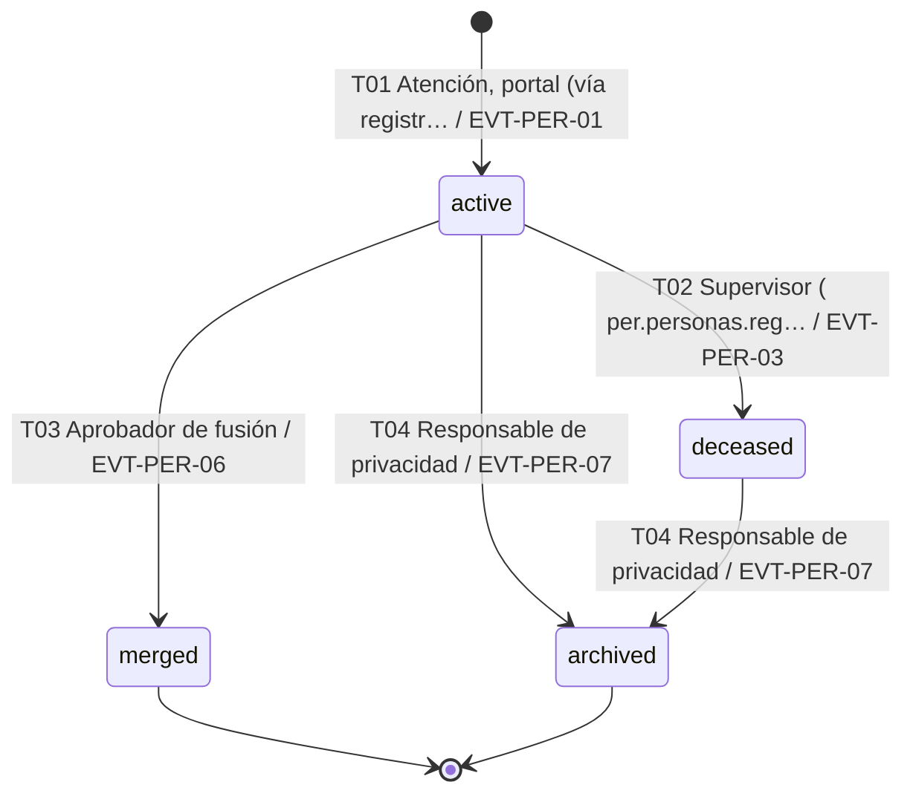

| # | Desde | Hasta | Disparador | Tipo | Guardas | Evento emitido |
|---|---|---|---|---|---|---|
| T01 | (nuevo) | `active` | Atención, portal (vía registro y vinculación), importación | no especificado | Búsqueda de coincidencias ejecutada; obligatorios por tipo | EVT-PER-01 `per.person.created` |
| T02 | `active` | `deceased` | Supervisor (`per.personas.registrarFallecimiento`) | usuario | Fecha de fallecimiento ≤ hoy; evidencia según política | EVT-PER-03 `per.person.deceased` |
| T03 | `active` | `merged` | Aprobador de fusión | usuario | Caso `confirmedSame` aprobado | EVT-PER-06 `per.person.merged` |
| T04 | `active`, `deceased` | `archived` | Responsable de privacidad | usuario | Sin obligaciones ni relaciones vigentes; plazo de conservación cumplido o solicitud de supresión procedente | EVT-PER-07 `per.person.anonymized` |

### EST-PER-02 — `holders.status` (COL-PER-04)

**Colección:** Titular (rol comercial de la persona). **Campos de estado en el §7:** `status` (línea 730; valores: `applicant`, `active`, `closed`).

**Fuente:** M01 §8.2.

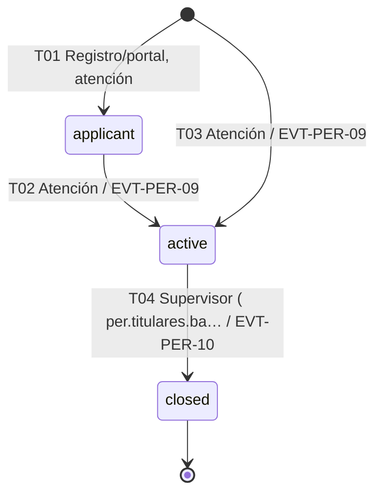

| # | Desde | Hasta | Disparador | Tipo | Guardas | Evento emitido |
|---|---|---|---|---|---|---|
| T01 | (nuevo) | `applicant` | Registro/portal, atención | no especificado | Persona existente | — |
| T02 | `applicant` | `active` | Atención | no especificado | Identificación requerida completa (RN-PER-008, RN-PER-121); al menos una cuenta (PRM-PER-008) | EVT-PER-09 `per.holder.created` |
| T03 | (nuevo) | `active` | Atención | no especificado | Ídem | EVT-PER-09 `per.holder.created` |
| T04 | `active` | `closed` | Supervisor (`per.titulares.baja`) | usuario | Sin contratos activos (PRM-PER-031), sin capital si la política lo exige (PRM-PER-032), relaciones informadas (PRM-PER-034), sin bloqueo `cancellatio`… | EVT-PER-10 `per.holder.closed` |

### EST-PER-03 — `accounts.status` (COL-PER-05)

**Colección:** Cuenta de servicios (agrupa contratos y domicilio postal). **Campos de estado en el §7:** `status` (línea 757; valores: `active`, `closed`).

**Fuente:** M01 §8.3.

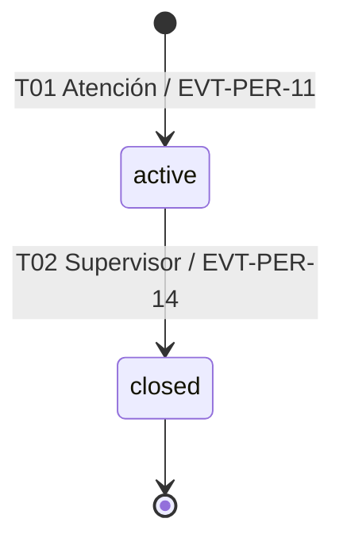

| # | Desde | Hasta | Disparador | Tipo | Guardas | Evento emitido |
|---|---|---|---|---|---|---|
| T01 | (nuevo) | `active` | Atención | no especificado | Titular `active` o `applicant`; validaciones RF-PER-072 | EVT-PER-11 `per.account.created` |
| T02 | `active` | `closed` | Supervisor | usuario | Sin contratos vigentes; sin transferencia en curso; no es la única principal de un titular activo con otras cuentas (se debe reasignar) | EVT-PER-14 `per.account.closed` |

### EST-PER-04 — `addresses.geo.status` (COL-PER-06)

**Colección:** Domicilios normalizados con `geoReference`. **Campos de estado en el §7:** —.

**Fuente:** M01 §8.4.

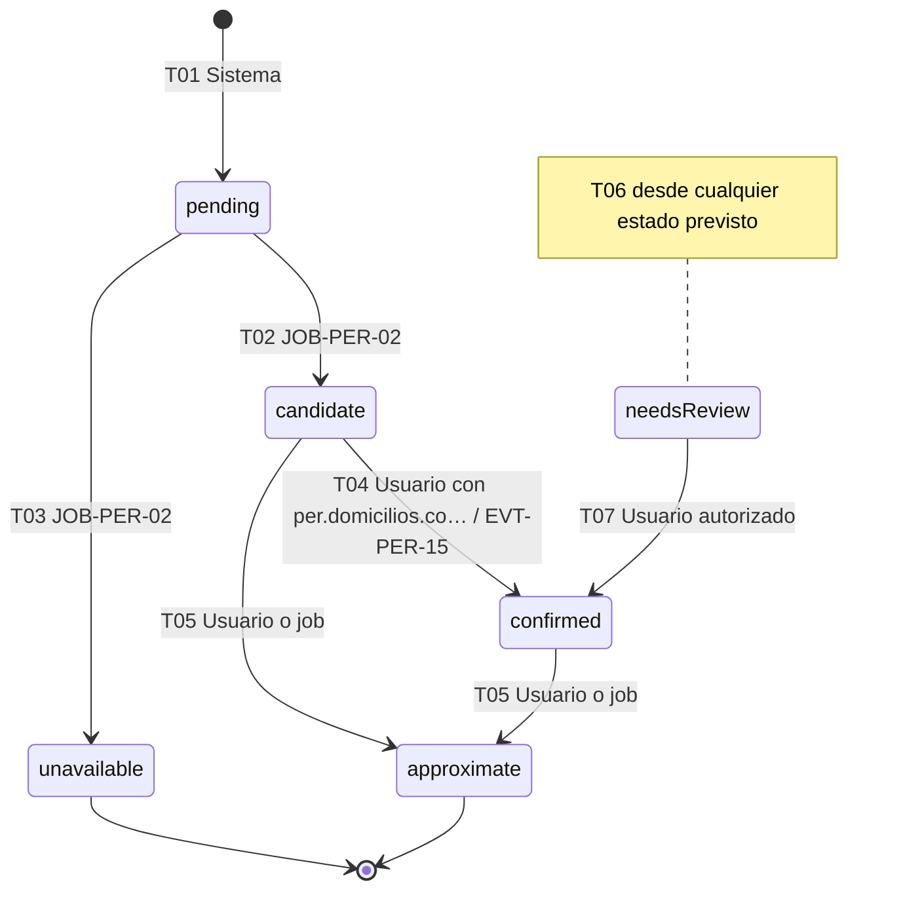

| # | Desde | Hasta | Disparador | Tipo | Guardas | Evento emitido |
|---|---|---|---|---|---|---|
| T01 | (nuevo) | `pending` | Sistema | sistema | Alta de domicilio | — |
| T02 | `pending` | `candidate` | JOB-PER-02 | job | Proveedor devuelve candidato | — |
| T03 | `pending` | `unavailable` | JOB-PER-02 | job | Proveedor sin resultado o fuera de servicio tras reintentos | — |
| T04 | `candidate` | `confirmed` | Usuario con `per.domicilios.confirmarUbicacion`, socio en su solicitud | usuario | Revisión visual | EVT-PER-15 `per.address.geoConfirmed` |
| T05 | `candidate`, `confirmed` | `approximate` | Usuario o job | job, usuario | Precisión centroide o calle | — |
| T06 | cualquiera | `needsReview` | Técnico (`proponerUbicacion`), operador | usuario | Discrepancia en campo o calle no encontrada | — |
| T07 | `needsReview` | `confirmed` | Usuario autorizado | usuario | Punto corregido con motivo | — |

### EST-PER-05 — `premises.status` (COL-PER-08)

**Colección:** Inmuebles (canónica para `properties`). **Campos de estado en el §7:** `status` (línea 849; valores: `active`, `merged`, `archived`).

**Fuente:** M01 §8.14.

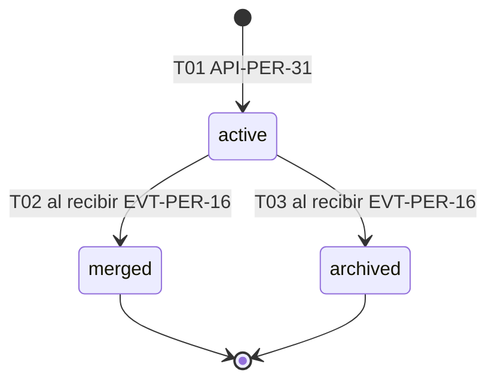

| # | Desde | Hasta | Disparador | Tipo | Guardas | Evento emitido |
|---|---|---|---|---|---|---|
| T01 | (nuevo) | `active` | Alta de inmueble (API-PER-31) / `per.premises.created` (EVT-PER-16) | evento, API/integración | RN-PER-072, RN-PER-073 | — |
| T02 | `active` | `merged` | Fusión de inmuebles duplicados / `per.premises.updated` (EVT-PER-16) | evento | RN-PER-073 (clave catastral única) | — |
| T03 | `active` | `archived` | Baja lógica sin puntos de prestación activos / `per.premises.updated` (EVT-PER-16) | evento | Sin puntos de prestación activos (confirmada en PA-PER-18, DEC-072; antes [VERIFICAR] RN no explícita) | — |

### EST-PER-06 — `servicePoints.status` (COL-PER-09)

**Colección:** Punto de suministro en un inmueble (domicilio de servicio). **Campos de estado en el §7:** `status` (línea 869; valores: `active`, `inactive`).

**Fuente:** M01 §8.5.

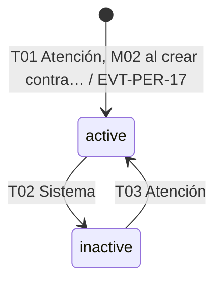

| # | Desde | Hasta | Disparador | Tipo | Guardas | Evento emitido |
|---|---|---|---|---|---|---|
| T01 | (nuevo) | `active` | Atención, M02 al crear contrato | no especificado | Domicilio válido | EVT-PER-17 `per.servicePoint.created` |
| T02 | `active` | `inactive` | Sistema | sistema | Sin contratos vigentes durante el plazo configurado o retiro | — |
| T03 | `inactive` | `active` | Atención | no especificado | Nuevo contrato | — |

### EST-PER-07 — `relationships.status` (COL-PER-10)

**Colección:** Vínculos entre personas. **Campos de estado en el §7:** `status` (línea 888; valores: `pending`, `active`, `expired`, `revoked`, `rejected`).

**Fuente:** M01 §8.6.

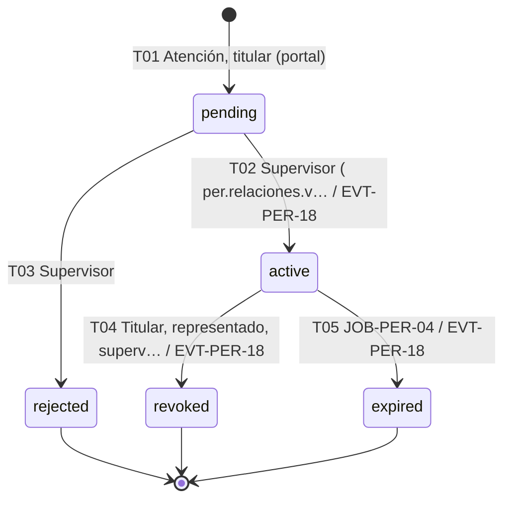

| # | Desde | Hasta | Disparador | Tipo | Guardas | Evento emitido |
|---|---|---|---|---|---|---|
| T01 | (nuevo) | `pending` | Atención, titular (portal) | no especificado | Tipo y alcance definidos | — |
| T02 | `pending` | `active` | Supervisor (`per.relaciones.verificar`) | usuario | Evidencia válida | EVT-PER-18 `per.relationship.granted` |
| T03 | `pending` | `rejected` | Supervisor | usuario | Evidencia insuficiente | — |
| T04 | `active` | `revoked` | Titular, representado, supervisor | usuario | — | EVT-PER-18 `per.relationship.granted` |
| T05 | `active` | `expired` | JOB-PER-04 | job | `validTo` < hoy | EVT-PER-18 `per.relationship.granted` |

### EST-PER-08 — `blocks.status` (COL-PER-13)

**Colección:** Bloqueos de cuenta, titular o contrato con efectos (no facturar, no cobrar, no operar); absorbe `billingHolds` de M05. **Campos de estado en el §7:** `status` (línea 957; valores: `active`, `lifted`, `expired`).

**Fuente:** M01 §8.8.

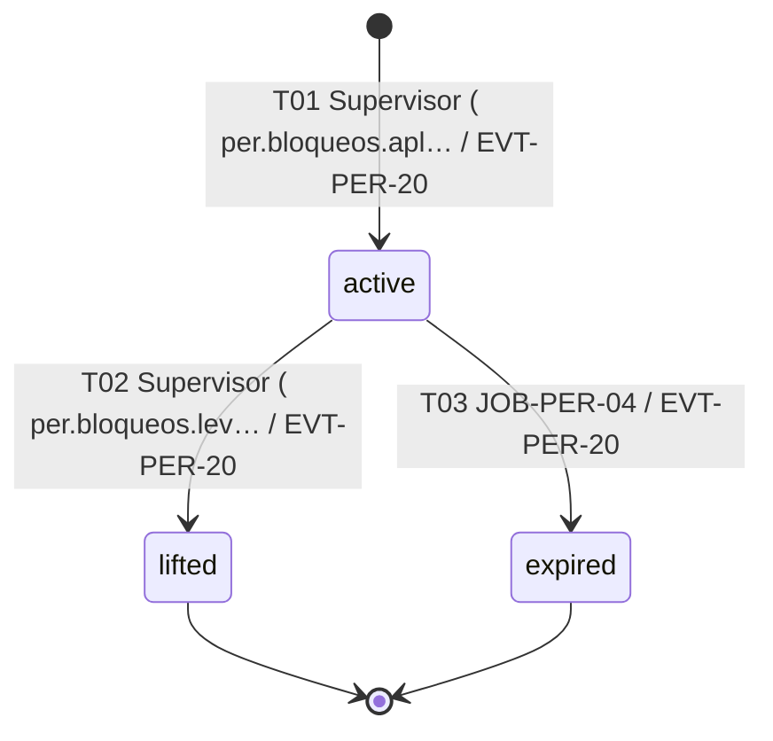

| # | Desde | Hasta | Disparador | Tipo | Guardas | Evento emitido |
|---|---|---|---|---|---|---|
| T01 | (nuevo) | `active` | Supervisor (`per.bloqueos.aplicar`), acción documental, módulo autorizado | usuario | Al menos un efecto; causa | EVT-PER-20 `per.block.applied` |
| T02 | `active` | `lifted` | Supervisor (`per.bloqueos.levantar`) | usuario | Motivo | EVT-PER-20 `per.block.applied` |
| T03 | `active` | `expired` | JOB-PER-04 | job | `validTo` < ahora | EVT-PER-20 `per.block.applied` |

### EST-PER-09 — `documentRequirementTypes.status` (COL-PER-14)

**Colección:** Requisitos documentales por trámite. **Campos de estado en el §7:** `status` (línea 979; valores: `active`, `inactive`).

**Fuente:** M01 §8.14.

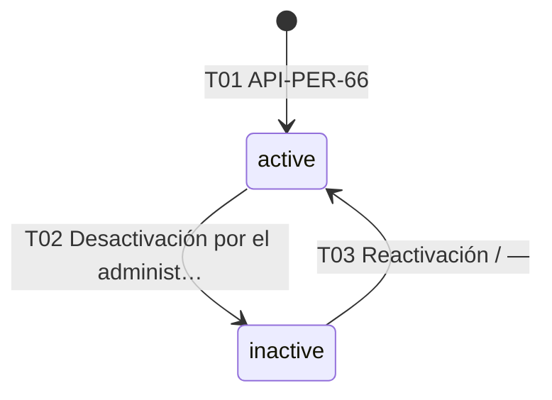

| # | Desde | Hasta | Disparador | Tipo | Guardas | Evento emitido |
|---|---|---|---|---|---|---|
| T01 | (nuevo) | `active` | Alta del tipo de requisito (API-PER-66) / — | API/integración | — | — |
| T02 | `active` | `inactive` | Desactivación por el administrador (`per.documentacion.configurar`) / — | usuario | No se exige en trámites nuevos; los presentados conservan su estado | — |
| T03 | `inactive` | `active` | Reactivación / — | no especificado | — | — |

### EST-PER-10 — `documentSubmissions.status` (COL-PER-15)

**Colección:** Documentos presentados por persona. **Campos de estado en el §7:** `status` (línea 992; valores: `pending`, `presented`, `validated`, `rejected`, `expired`, `superseded`).

**Fuente:** M01 §8.9.

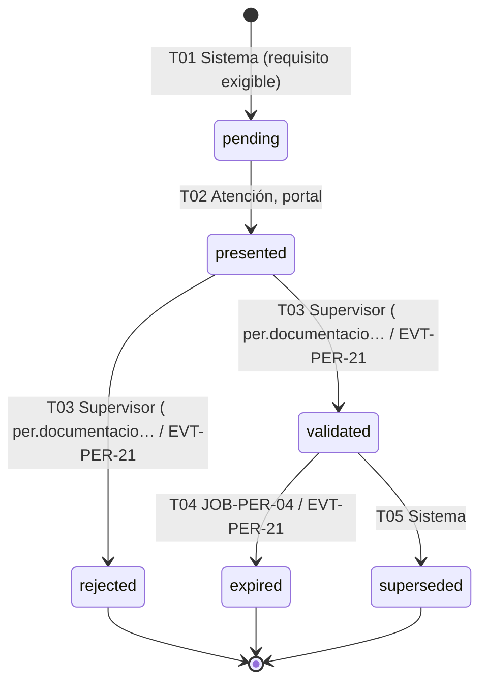

| # | Desde | Hasta | Disparador | Tipo | Guardas | Evento emitido |
|---|---|---|---|---|---|---|
| T01 | (nuevo) | `pending` | Sistema (requisito exigible) | sistema | Evento que lo exige | — |
| T02 | `pending` | `presented` | Atención, portal | no especificado | Archivo o constancia | — |
| T03 | `presented` | `rejected`, `validated` | Supervisor (`per.documentacion.validar`) | usuario | Revisión | EVT-PER-21 `per.document.presented` |
| T04 | `validated` | `expired` | JOB-PER-04 | job | Regla RN-PER-097 | EVT-PER-21 `per.document.presented` |
| T05 | `validated` | `superseded` | Sistema | sistema | Nueva presentación validada del mismo tipo | — |

### EST-PER-11 — `transfers.status` (COL-PER-16)

**Colección:** Transferencias de titularidad (no confundir con transferencias de stock). **Campos de estado en el §7:** `status` (línea 1012; valores: `draft`, `pendingApproval`, `approved`, `executing`, `executed`, `failed`, `cancelled`, `reverted`).

**Fuente:** M01 §8.10.

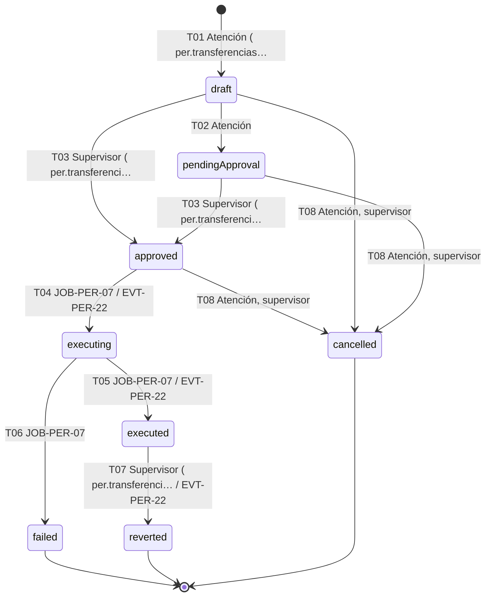

| # | Desde | Hasta | Disparador | Tipo | Guardas | Evento emitido |
|---|---|---|---|---|---|---|
| T01 | (nuevo) | `draft` | Atención (`per.transferencias.crear`) | usuario | Origen y destino | — |
| T02 | `draft` | `pendingApproval` | Atención | no especificado | Simulación vigente (menos de 24 h o sin cambios de origen) | — |
| T03 | `draft`, `pendingApproval` | `approved` | Supervisor (`per.transferencias.aprobar`) | usuario | Sin bloqueos `transfer`; validaciones RN-PER-103 | — |
| T04 | `approved` | `executing` | Supervisor (`per.transferencias.ejecutar`), JOB-PER-07 | job, usuario | `Idempotency-Key` | EVT-PER-22 `per.transfer.executed` |
| T05 | `executing` | `executed` | Supervisor (`per.transferencias.ejecutar`), JOB-PER-07 | job, usuario | `Idempotency-Key` | EVT-PER-22 `per.transfer.executed` |
| T06 | `executing` | `failed` | JOB-PER-07 | job | Paso fallido tras reintentos | — |
| T07 | `executed` | `reverted` | Supervisor (`per.transferencias.revertir`) | usuario | Transferencia ejecutada; RF-PER-136 | EVT-PER-22 `per.transfer.executed` |
| T08 | `approved`, `draft`, `pendingApproval` | `cancelled` | Atención, supervisor | usuario | — | — |

### EST-PER-12 — `duplicateCases.status` (COL-PER-17)

**Colección:** Casos de posibles duplicados. **Campos de estado en el §7:** `status` (línea 1032; valores: `open`, `dismissed`, `confirmedSame`, `mergeRequested`, `merged`, `mergeRejected`, `mergeReverted`).

**Fuente:** M01 §8.11.

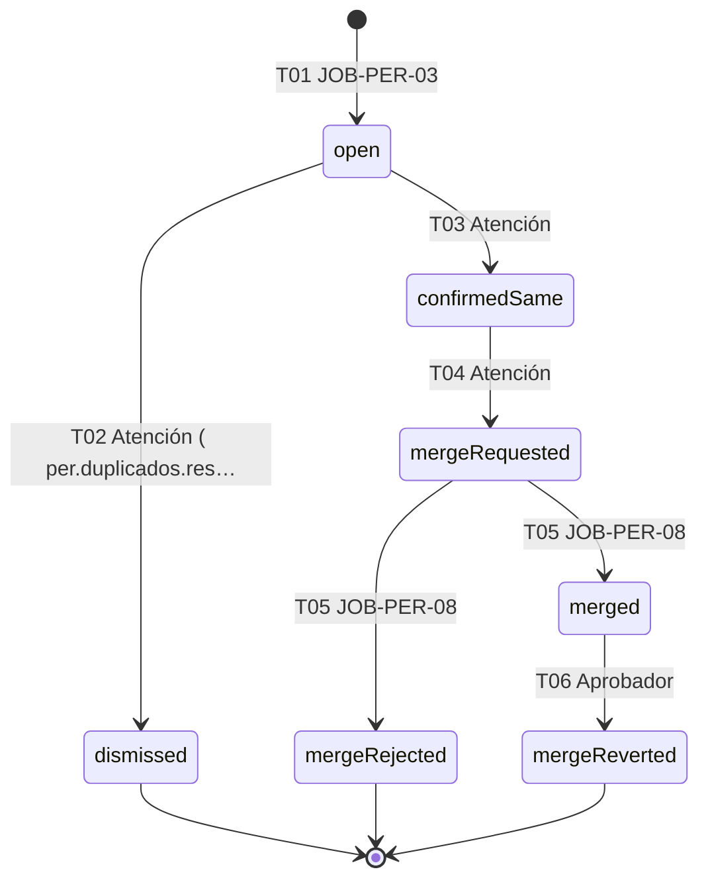

| # | Desde | Hasta | Disparador | Tipo | Guardas | Evento emitido |
|---|---|---|---|---|---|---|
| T01 | (nuevo) | `open` | JOB-PER-03, alta, importación | job | Puntaje ≥ umbral (PRM-PER-082) | — |
| T02 | `open` | `dismissed` | Atención (`per.duplicados.resolver`) | usuario | Motivo | — |
| T03 | `open` | `confirmedSame` | Atención | no especificado | — | — |
| T04 | `confirmedSame` | `mergeRequested` | Atención | no especificado | Elección de valores por campo | — |
| T05 | `mergeRequested` | `mergeRejected`, `merged` | Aprobador (`per.personas.unificar`; antes `per.personas.fusionar`) | usuario | Distinto de quien solicitó | — |
| T06 | `merged` | `mergeReverted` | Aprobador | usuario | Dentro del plazo | — |

### EST-PER-13 — `adherents.status` (colección de otro dueño o absorbida)

**Fuente:** M01 §8.7. La colección figura en T05 como COL-PER-11 A→COL-SOC-01 / COL-SOC-02 (dueño M01); no se crea con este dueño, se conserva el diagrama del §8 de este anexo.

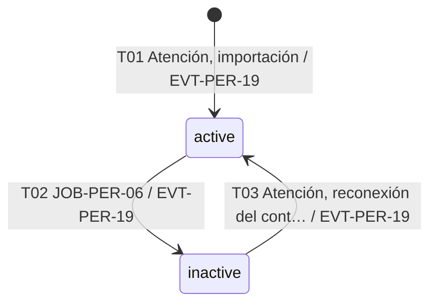

| # | Desde | Hasta | Disparador | Tipo | Guardas | Evento emitido |
|---|---|---|---|---|---|---|
| T01 | (nuevo) | `active` | Atención, importación | no especificado | Contrato del servicio que admite adherentes; regla de unicidad (PRM-PER-064) | EVT-PER-19 `per.adherent.added` |
| T02 | `active` | `inactive` | Atención, JOB-PER-06 (condición), fallecimiento, desconexión del contrato, transferencia | job | Motivo | EVT-PER-19 `per.adherent.added` |
| T03 | `inactive` | `active` | Atención, reconexión del contrato (no si fallecido) | no especificado | Condición vigente | EVT-PER-19 `per.adherent.added` |

### EST-PER-14 — `dataSubjectRequests.status` (colección de otro dueño o absorbida)

**Fuente:** M01 §8.12. La colección figura en T05 como COL-NFR-05 C (dueño T08); COL-PER-20 A→COL-NFR-05 (dueño M01); no se crea con este dueño, se conserva el diagrama del §8 de este anexo.

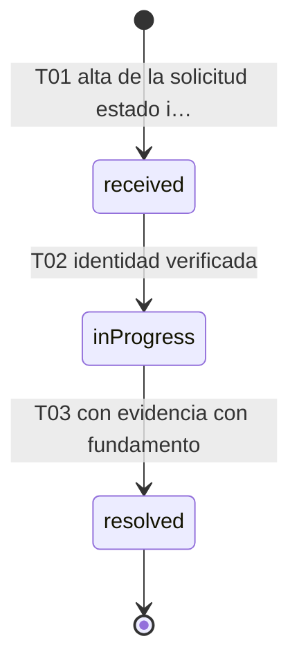

| # | Desde | Hasta | Disparador | Tipo | Guardas | Evento emitido |
|---|---|---|---|---|---|---|
| T01 | (nuevo) | `received` | alta de la solicitud estado inicial | no especificado | — | — |
| T02 | `received` | `inProgress` | identidad verificada | no especificado | — | — |
| T03 | `inProgress` | `resolved` | con evidencia con fundamento | no especificado | — | — |

### EST-PER-15 — `personUserLinks.status` (colección de otro dueño o absorbida)

**Fuente:** M01 §8.13. La colección figura en T05 como COL-PER-21 A→COL-IAM-04 (dueño M01); no se crea con este dueño, se conserva el diagrama del §8 de este anexo.

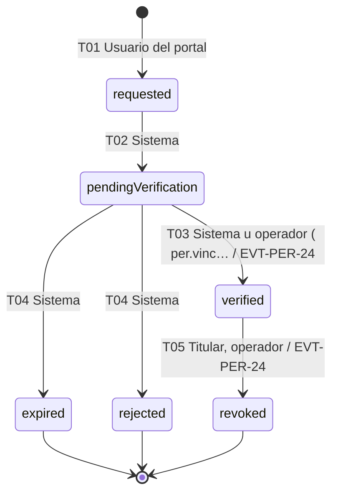

| # | Desde | Hasta | Disparador | Tipo | Guardas | Evento emitido |
|---|---|---|---|---|---|---|
| T01 | (nuevo) | `requested` | Usuario del portal | usuario | Sesión válida en el tenant | — |
| T02 | `requested` | `pendingVerification` | Sistema | sistema | Método elegido iniciado (código enviado al contacto registrado, código de factura solicitado) | — |
| T03 | `pendingVerification` | `verified` | Sistema u operador (`per.vinculosUsuario.verificar`) | sistema, usuario | Prueba superada | EVT-PER-24 `per.userLink.verified` |
| T04 | `pendingVerification` | `expired`, `rejected` | Sistema | sistema | Intentos agotados / plazo vencido | — |
| T05 | `verified` | `revoked` | Titular, operador | usuario | — | EVT-PER-24 `per.userLink.verified` |

## M02 — CAT Catálogo de servicios y contratos

### EST-CAT-01 — `serviceCapabilities.status` (COL-CAT-01)

**Colección:** Capacidades de servicio de plataforma (INT, ELE, AG…). **Campos de estado en el §7:** `status` (línea 677; valores: `draft`, `available`, `deprecated`).

**Fuente:** M02 §8.3, M02 §8.5.

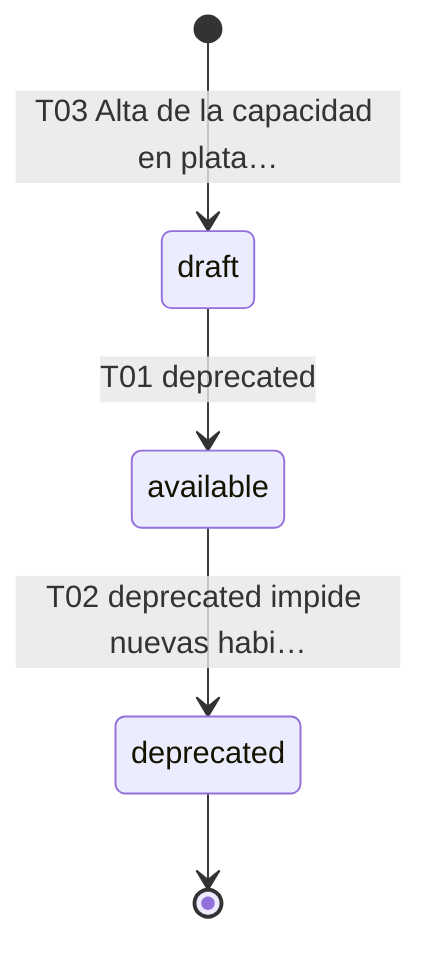

| # | Desde | Hasta | Disparador | Tipo | Guardas | Evento emitido |
|---|---|---|---|---|---|---|
| T01 | `draft` | `available` | `deprecated` impide nuevas habilitaciones; tenants existentes siguen operando. | no especificado | — | — |
| T02 | `available` | `deprecated` | `deprecated` impide nuevas habilitaciones; tenants existentes siguen operando. | no especificado | — | — |
| T03 | (nuevo) | `draft` | Alta de la capacidad en plataforma / — | no especificado | — | — |

### EST-CAT-02 — `tenantServices.enablement` (COL-CAT-02)

**Colección:** Servicio habilitado por el tenant y su perfil; `legalEntityId` obligatorio (entidad que presta y factura, DEC-064, CTR-DAT-79). **Campos de estado en el §7:** `defaultOperationalStatus`, `offerStatus`, `operationStatus` (línea 716, 702, 703; valores: `notPublished`, `open`, `closed`, `operating`, `windingDown`, `autoSelectPrincipal`).

**Máquina 1: `enablement`.** Fuente: M02 §8.3, M02 §8.5.

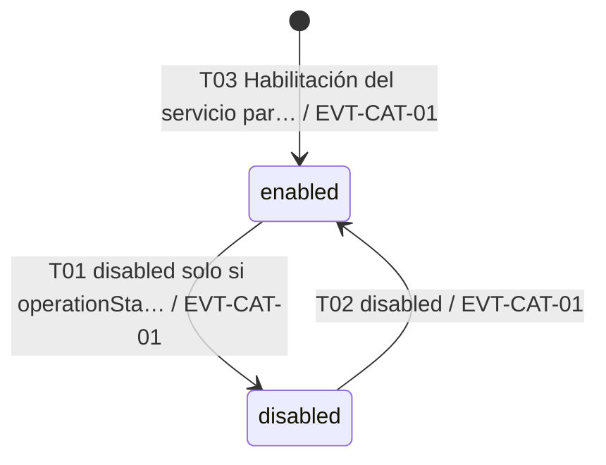

| # | Desde | Hasta | Disparador | Tipo | Guardas | Evento emitido |
|---|---|---|---|---|---|---|
| T01 | `enabled` | `disabled` | `disabled` solo si `operationStatus=closed` o con plan de salida (RN-CAT-003). | no especificado | RN-CAT-003 | EVT-CAT-01 `cat.tenantService.disabled` (inferido por nombre) |
| T02 | `disabled` | `enabled` | `disabled` solo si `operationStatus=closed` o con plan de salida (RN-CAT-003). | no especificado | RN-CAT-003 | EVT-CAT-01 `cat.tenantService.enabled` (inferido por nombre) |
| T03 | (nuevo) | `enabled` | Habilitación del servicio para el tenant / — | no especificado | Licencia vigente (RN-CAT-003) | EVT-CAT-01 `cat.tenantService.enabled` (inferido por nombre) |

**Máquina 2: `offerStatus`.** Fuente: M02 §8.3, M02 §8.5.

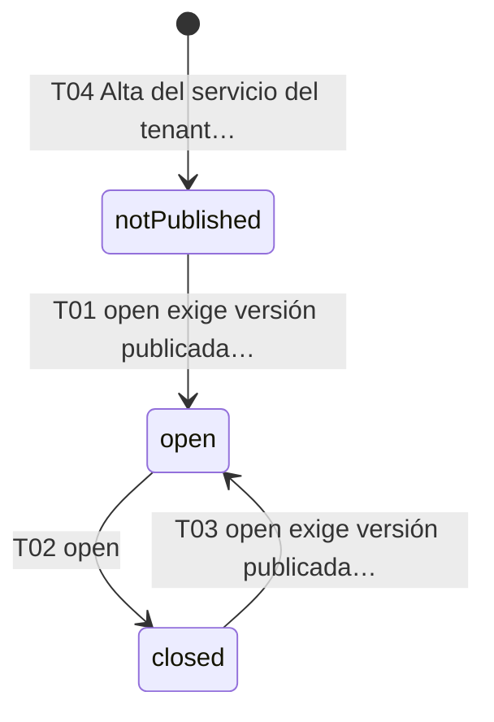

| # | Desde | Hasta | Disparador | Tipo | Guardas | Evento emitido |
|---|---|---|---|---|---|---|
| T01 | `notPublished` | `open` | `open` exige versión publicada sin bloqueos. | no especificado | — | — |
| T02 | `open` | `closed` | `open` exige versión publicada sin bloqueos. | no especificado | — | — |
| T03 | `closed` | `open` | `open` exige versión publicada sin bloqueos. | no especificado | — | — |
| T04 | (nuevo) | `notPublished` | Alta del servicio del tenant / — | no especificado | — | — |

### EST-CAT-03 — `serviceConfigVersions.status` (COL-CAT-03)

**Colección:** Paquete versionado publicable del servicio. **Campos de estado en el §7:** `status` (línea 741; valores: `draft`, `inReview`, `approved`, `scheduled`, `published`, `superseded`, `rejected`, `discarded`).

**Fuente:** M02 §8.3, M02 §8.5.

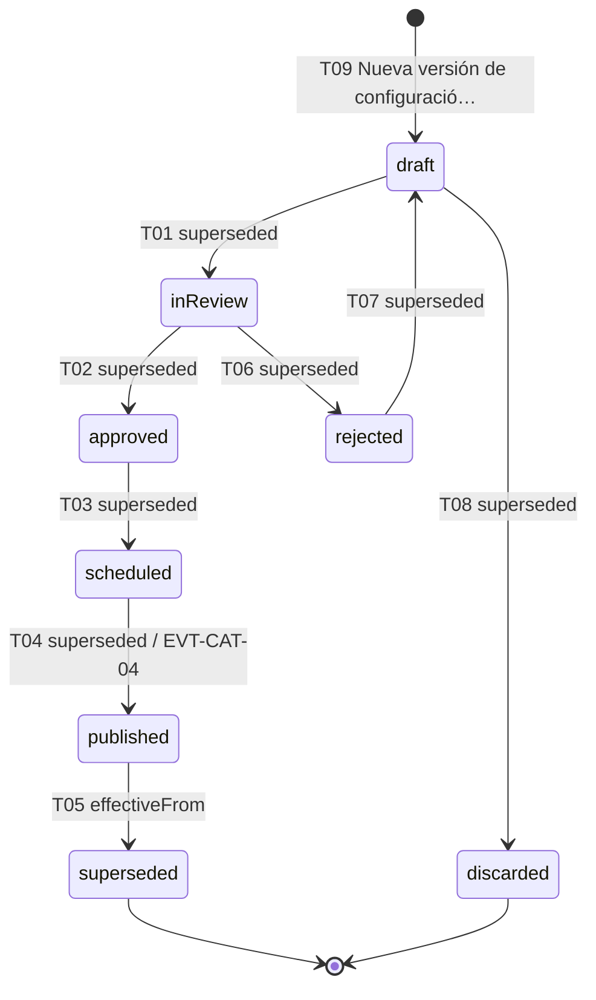

| # | Desde | Hasta | Disparador | Tipo | Guardas | Evento emitido |
|---|---|---|---|---|---|---|
| T01 | `draft` | `inReview` | Publicar exige validaciones sin bloqueos; la anterior pasa a `superseded` en `effectiveFrom`. | no especificado | — | — |
| T02 | `inReview` | `approved` | Publicar exige validaciones sin bloqueos; la anterior pasa a `superseded` en `effectiveFrom`. | no especificado | — | — |
| T03 | `approved` | `scheduled` | Publicar exige validaciones sin bloqueos; la anterior pasa a `superseded` en `effectiveFrom`. | no especificado | — | — |
| T04 | `scheduled` | `published` | Publicar exige validaciones sin bloqueos; la anterior pasa a `superseded` en `effectiveFrom`. | no especificado | — | EVT-CAT-04 `cat.configVersion.published` (inferido por nombre) |
| T05 | `published` | `superseded` | Publicar exige validaciones sin bloqueos; la anterior pasa a `superseded` en `effectiveFrom`. | no especificado | — | — |
| T06 | `inReview` | `rejected` | Publicar exige validaciones sin bloqueos; la anterior pasa a `superseded` en `effectiveFrom`. | no especificado | — | — |
| T07 | `rejected` | `draft` | Publicar exige validaciones sin bloqueos; la anterior pasa a `superseded` en `effectiveFrom`. | no especificado | — | — |
| T08 | `draft` | `discarded` | Publicar exige validaciones sin bloqueos; la anterior pasa a `superseded` en `effectiveFrom`. | no especificado | — | — |
| T09 | (nuevo) | `draft` | Nueva versión de configuración / — | no especificado | — | — |

### EST-CAT-04 — `serviceProducts.status` (COL-CAT-05)

**Colección:** Productos y subservicios (faceta comercial). **Campos de estado en el §7:** `status` (línea 786; valores: `active`, `discontinued`).

**Fuente:** M02 §8.4.

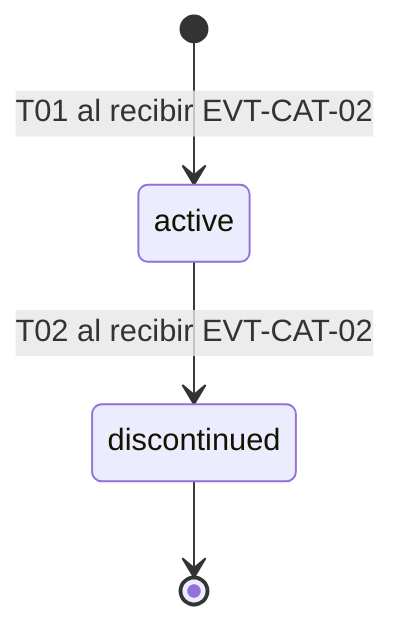

| # | Desde | Hasta | Disparador | Tipo | Guardas | Evento emitido |
|---|---|---|---|---|---|---|
| T01 | (nuevo) | `active` | Alta en la versión de configuración / `cat.tenantService.published` | evento | RN-CAT-005 (validaciones de publicación) | — |
| T02 | `active` | `discontinued` | Versión de configuración publicada que lo discontinúa / `cat.tenantService.published` | evento | Sin planes publicados que lo exijan | — |

### EST-CAT-05 — `billableConcepts.status` (COL-CAT-06)

**Colección:** Conceptos facturables (sin precio). **Campos de estado en el §7:** `status` (línea 809; valores declarados en el §8, línea 1300; valores: `active`, `inactive`).

**Fuente:** el §8 del anexo no detalla esta colección; se aplica el patrón general de T05 §7.1.5 (estados, baja lógica) y T04 §8.3 (registros maestros) sobre los valores del §7.

```mermaid
stateDiagram-v2
    [*] --> active : P01 alta
    active --> inactive : P02 desactivar
    inactive --> active : P03 reactivar
```

| # | Desde | Hasta | Disparador | Tipo | Guardas | Evento emitido |
|---|---|---|---|---|---|---|
| P01 | (nuevo) | `active` | Alta del registro (operador, importación o plataforma) | usuario, sistema | Validación del esquema (T04 §8.3) | — |
| P02 | `active` | `inactive` | Operador | usuario | Si está referenciado se informa el conteo; no se borra (T05 §7.1.5) | — |
| P03 | `inactive` | `active` | Operador | usuario | — | — |

### EST-CAT-06 — `servicePlans.status` (COL-CAT-07)

**Colección:** Planes comerciales. **Campos de estado en el §7:** `status` (línea 815; valores: `draft`, `published`, `discontinued`, `retired`).

**Fuente:** M02 §8.3, M02 §8.5.

```mermaid
stateDiagram-v2
    draft --> published : T01 retired
    published --> discontinued : T02 retired
    discontinued --> retired : T03 retired solo sin contratos no…
    [*] --> draft : T04 Alta del plan / —
    retired --> [*]
```

| # | Desde | Hasta | Disparador | Tipo | Guardas | Evento emitido |
|---|---|---|---|---|---|---|
| T01 | `draft` | `published` | `retired` solo sin contratos no terminales. | no especificado | — | — |
| T02 | `published` | `discontinued` | `retired` solo sin contratos no terminales. | no especificado | — | — |
| T03 | `discontinued` | `retired` | `retired` solo sin contratos no terminales. | no especificado | — | — |
| T04 | (nuevo) | `draft` | Alta del plan / — | no especificado | — | — |

### EST-CAT-07 — `serviceBundles.status` (COL-CAT-09)

**Colección:** Paquetes multiservicio. **Campos de estado en el §7:** `status` (línea 852; valores declarados en el §8, línea 1301; valores: `draft`, `published`, `discontinued`, `retired`).

**Fuente:** el §8 del anexo no detalla esta colección; se aplica el patrón general de T05 §7.1.5 (versiones publicadas) sobre los valores del §7.

```mermaid
stateDiagram-v2
    [*] --> draft : P01 nueva versión
    draft --> published : P02 publicar
    published --> discontinued : P03 reemplazo o fin de vigencia
    discontinued --> [*]
    published --> retired : P03 reemplazo o fin de vigencia
    retired --> [*]
```

| # | Desde | Hasta | Disparador | Tipo | Guardas | Evento emitido |
|---|---|---|---|---|---|---|
| P01 | (nuevo) | `draft` | Configurador | usuario | — | — |
| P02 | `draft` | `published` | Configurador o aprobador | usuario | Versión validada; publicada queda inmutable (T05 §7.1.5) | — |
| P03 | `published` | `discontinued` | Sistema al publicar la sucesora o configurador | sistema, usuario | Existe versión sucesora o fin de vigencia | — |
| P03 | `published` | `retired` | Sistema al publicar la sucesora o configurador | sistema, usuario | Existe versión sucesora o fin de vigencia | — |

### EST-CAT-08 — `serviceCategories.status` (COL-CAT-10)

**Colección:** Categorías estructurales. **Campos de estado en el §7:** `status` (línea 886; valores declarados en el §8, línea 1300; valores: `active`, `inactive`).

**Fuente:** el §8 del anexo no detalla esta colección; se aplica el patrón general de T05 §7.1.5 (estados, baja lógica) y T04 §8.3 (registros maestros) sobre los valores del §7.

```mermaid
stateDiagram-v2
    [*] --> active : P01 alta
    active --> inactive : P02 desactivar
    inactive --> active : P03 reactivar
```

| # | Desde | Hasta | Disparador | Tipo | Guardas | Evento emitido |
|---|---|---|---|---|---|---|
| P01 | (nuevo) | `active` | Alta del registro (operador, importación o plataforma) | usuario, sistema | Validación del esquema (T04 §8.3) | — |
| P02 | `active` | `inactive` | Operador | usuario | Si está referenciado se informa el conteo; no se borra (T05 §7.1.5) | — |
| P03 | `inactive` | `active` | Operador | usuario | — | — |

### EST-CAT-09 — `autoServiceRules.status` (COL-CAT-17)

**Colección:** Altas automáticas de servicios (DEC-023). **Campos de estado en el §7:** `status` (línea 971; valores declarados en el §8, línea 1300; valores: `active`, `inactive`).

**Fuente:** el §8 del anexo no detalla esta colección; se aplica el patrón general de T05 §7.1.5 (estados, baja lógica) y T04 §8.3 (registros maestros) sobre los valores del §7.

```mermaid
stateDiagram-v2
    [*] --> active : P01 alta
    active --> inactive : P02 desactivar
    inactive --> active : P03 reactivar
```

| # | Desde | Hasta | Disparador | Tipo | Guardas | Evento emitido |
|---|---|---|---|---|---|---|
| P01 | (nuevo) | `active` | Alta del registro (operador, importación o plataforma) | usuario, sistema | Validación del esquema (T04 §8.3) | — |
| P02 | `active` | `inactive` | Operador | usuario | Si está referenciado se informa el conteo; no se borra (T05 §7.1.5) | — |
| P03 | `inactive` | `active` | Operador | usuario | — | — |

### EST-CAT-10 — `serviceContracts.lifecycleStatus` (COL-CAT-18)

**Colección:** Contrato de servicio (DEC-011). `domainAttributes` tipados incluyen AG `meteringRegime[]` con vigencia (HUE-AG-03), ALU `agreement{municipalityRef, claimHandler}` (HUE-ALU-03) y OBR `workRef`/`levyRe`…. **Campos de estado en el §7:** `lifecycleStatus` (línea 1008; sin valores en el §7).

Ver también el diagrama curado B1 y B11 en `06-secuencias-y-estados.md` §4.

**Fuente:** M02 §8.2.

```mermaid
stateDiagram-v2
    [*] --> requested : T01 al recibir EVT-CRM-13 / EVT-CAT-06
    requested --> feasibility : T02 requestFeasibility / EVT-CAT-07
    feasibility --> pendingInstallation : T03 al recibir EVT-TEC-02
    feasibility --> cancelled : T04 al recibir EVT-TEC-02 / EVT-CAT-16 +1
    requested --> pendingInstallation : T05 approve
    pendingInstallation --> active : T06 al recibir EVT-TEC-16 / EVT-CAT-09
    pendingInstallation --> pendingInstallation : T07 al recibir EVT-TEC-14
    active --> suspended : T08 al recibir EVT-MOR-12 / EVT-CAT-10
    suspended --> reactivationPending : T09 requestReactivation
    reactivationPending --> active : T10 al recibir EVT-TEC-07 / EVT-CAT-12
    suspended --> active : T11 reactivate / EVT-CAT-09
    active --> pendingTermination : T12 requestTermination
    suspended --> pendingTermination : T12 requestTermination
    pendingInstallation --> cancelled : T13 cancel / EVT-CAT-16
    requested --> cancelled : T13 cancel / EVT-CAT-16
    pendingTermination --> terminated : T14 al recibir EVT-TEC-07 / EVT-CAT-15
    active --> superseded : T15 transfer
    pendingTermination --> superseded : T15 transfer
    suspended --> superseded : T15 transfer
    terminated --> superseded : T16 transfer
    cancelled --> [*]
    superseded --> [*]
```

| # | Desde | Hasta | Disparador | Tipo | Guardas | Evento emitido |
|---|---|---|---|---|---|---|
| T01 | (nuevo) | `requested` | `cat.contract.create` desde `crm.commandRequest.requested` (EVT-CRM-13) o mostrador / CRM / operador | evento, usuario | Servicio con oferta abierta; titular identificado; plan publicado; canal habilitado | EVT-CAT-06 `cat.contract.requested` |
| T02 | `requested` | `feasibility` | `requestFeasibility` / Sistema/operador | sistema, usuario | Servicio exige factibilidad | EVT-CAT-07 `cat.contract.feasibilityRequested` (inferido por nombre) |
| T03 | `feasibility` | `pendingInstallation` | `tec.feasibility.verdictIssued` (EVT-TEC-02, aprobada) / TEC | evento | Factibilidad aprobada | — |
| T04 | `feasibility` | `cancelled` | `tec.feasibility.verdictIssued` (EVT-TEC-02, rechazada) / TEC | evento | — | EVT-CAT-16 `cat.contract.cancelled` (inferido por nombre) |
| T05 | `requested` | `pendingInstallation` | `approve` / Supervisor | usuario | Servicio sin factibilidad; requisitos cumplidos | — |
| T06 | `pendingInstallation` | `active` | `tec.installation.activationConfirmed` (EVT-TEC-16) / `tec.workOrder.closed(activation)` (EVT-TEC-07) (técnico) o `activate` (no técnico) / TEC / sup… | evento, usuario | RN-CAT-064; equipos obligatorios asignados; provisión confirmada (INT) | EVT-CAT-09 `cat.contract.activated` |
| T07 | `pendingInstallation` | `pendingInstallation` | `tec.visit.failed` / TEC | evento | Visita fallida | — |
| T08 | `active` | `suspended` | `suspend{reason, mode}` desde `mor.interruption.approved` (EVT-MOR-12, tipo suspensión), solicitud voluntaria ejecutada, orden técnica/regulatoria /… | evento, usuario | Operación permitida en el perfil; para mora: política MOR y límites normativos (electrodependencia, etc.) | EVT-CAT-10 `cat.contract.suspended` |
| T09 | `suspended` | `reactivationPending` | `requestReactivation` (pago confirmado por MOR, fin de suspensión voluntaria, solicitud) / MOR / CRM / sistema | sistema | Causa de suspensión levantada | — |
| T10 | `reactivationPending` | `active` | `tec.workOrder.closed(reconnection)` / `tec.provisioning.confirmed` o `reactivate` directo en no técnico / TEC / sistema | evento, sistema, usuario | Confirmación técnica (RN-CAT-043) | EVT-CAT-12 `cat.contract.reactivated` |
| T11 | `suspended` | `active` | `reactivate` / Sistema / supervisor | sistema, usuario | Servicio no técnico sin inspección (reconexión automática por pago, V2 3112 en MOR) | EVT-CAT-09 `cat.contract.activated` (inferido por nombre) |
| T12 | `active`, `suspended` | `pendingTermination` | `requestTermination` (solicitud CRM ejecutable, decisión de la cooperativa con causa, orden de MOR para baja definitiva) / CRM / supervisor / MOR | usuario | Ninguna para baja solicitada por el socio (sin cargo, sin bloqueo por deuda) (RN-CAT-039) | — |
| T13 | `feasibility`, `pendingInstallation`, `requested` | `cancelled` | `cancel{reason}` / Socio (desistimiento) vía CRM / supervisor / TEC (OT de alta eliminada) | usuario | Sin activación; si hay equipo entregado → `returnPending` | EVT-CAT-16 `cat.contract.cancelled` (inferido por nombre) |
| T14 | `pendingTermination` | `terminated` | `tec.workOrder.closed(disconnection)` o `terminate` (no técnico) / TEC / supervisor | evento, usuario | — (RN-CAT-041) | EVT-CAT-15 `cat.contract.terminated` |
| T15 | `active`, `pendingTermination`, `suspended` | `superseded` | `transfer` / Supervisor | usuario | Reglas de transferencia (RN-CAT-051..054) | — |
| T16 | `terminated` | `superseded` | `transfer` de contrato dado de baja / Supervisor | usuario | V2 2599 activo | — |

### EST-CAT-11 — `contractEquipmentAssignments.status` (COL-CAT-20)

**Colección:** Equipos asignados al contrato (canónica; absorbe `equipmentAssignments` de M13). **Campos de estado en el §7:** `status` (línea 1058; valores: `assigned`, `delivered`, `returnPending`, `returned`, `lost`, `chargeProposed`, `chargedAsLost`, `replaced`, `convertedToSale`).

**Fuente:** M02 §8.3, M02 §8.4.

```mermaid
stateDiagram-v2
    assigned --> delivered : T01 lost
    delivered --> returnPending : T02 lost
    returnPending --> lost : T03 lost dispara concepto de equi…
    returnPending --> returned : T03 lost dispara concepto de equi…
    lost --> chargedAsLost : T04 lost
    returned --> chargedAsLost : T04 lost
    delivered --> replaced : T05 lost
    returnPending --> chargeProposed : T06 lost
    chargeProposed --> chargedAsLost : T07 lost
    chargedAsLost --> returnPending : T08 lost
    chargedAsLost --> returned : T09 lost
    delivered --> convertedToSale : T10 lost
    [*] --> assigned : T11 Asignación de equipo al contr…
    replaced --> [*]
    convertedToSale --> [*]
```

| # | Desde | Hasta | Disparador | Tipo | Guardas | Evento emitido |
|---|---|---|---|---|---|---|
| T01 | `assigned` | `delivered` | `lost` dispara concepto de equipo no devuelto solo si está configurado y aceptado en condiciones. Las transiciones que nacen de hechos de stock (reti… | no especificado | — | — |
| T02 | `delivered` | `returnPending` | `lost` dispara concepto de equipo no devuelto solo si está configurado y aceptado en condiciones. Las transiciones que nacen de hechos de stock (reti… | no especificado | — | — |
| T03 | `returnPending` | `lost`, `returned` | `lost` dispara concepto de equipo no devuelto solo si está configurado y aceptado en condiciones. Las transiciones que nacen de hechos de stock (reti… | no especificado | — | — |
| T04 | `lost`, `returned` | `chargedAsLost` | `lost` dispara concepto de equipo no devuelto solo si está configurado y aceptado en condiciones. Las transiciones que nacen de hechos de stock (reti… | no especificado | — | — |
| T05 | `delivered` | `replaced` | `lost` dispara concepto de equipo no devuelto solo si está configurado y aceptado en condiciones. Las transiciones que nacen de hechos de stock (reti… | no especificado | — | — |
| T06 | `returnPending` | `chargeProposed` | `lost` dispara concepto de equipo no devuelto solo si está configurado y aceptado en condiciones. Las transiciones que nacen de hechos de stock (reti… | no especificado | — | — |
| T07 | `chargeProposed` | `chargedAsLost` | `lost` dispara concepto de equipo no devuelto solo si está configurado y aceptado en condiciones. Las transiciones que nacen de hechos de stock (reti… | no especificado | — | — |
| T08 | `chargedAsLost` | `returnPending` | `lost` dispara concepto de equipo no devuelto solo si está configurado y aceptado en condiciones. Las transiciones que nacen de hechos de stock (reti… | no especificado | — | — |
| T09 | `chargedAsLost` | `returned` | `lost` dispara concepto de equipo no devuelto solo si está configurado y aceptado en condiciones. Las transiciones que nacen de hechos de stock (reti… | no especificado | — | — |
| T10 | `delivered` | `convertedToSale` | `lost` dispara concepto de equipo no devuelto solo si está configurado y aceptado en condiciones. Las transiciones que nacen de hechos de stock (reti… | no especificado | — | — |
| T11 | (nuevo) | `assigned` | Asignación de equipo al contrato / — | no especificado | Equipos obligatorios del plan | — |

### EST-CAT-12 — `contractDeclaredAppliances.status` (COL-CAT-22)

**Colección:** Artefactos declarados por contrato (DDJJ): `templateRef` de la plantilla del servicio, `power` + `powerUnit` obligatorios en GAS y ELE, `vehicle{plate, model}` solo para `electricVehicle` (HUE-GAS-01…. **Campos de estado en el §7:** `status` (línea 1090; valores: `active`, `removed`).

**Fuente:** M02 §8.4, M02 §8.5.

```mermaid
stateDiagram-v2
    [*] --> active : T01 Declaración del artefacto en…
    active --> removed : T02 Retiro o reemplazo del artefa…
    removed --> [*]
```

| # | Desde | Hasta | Disparador | Tipo | Guardas | Evento emitido |
|---|---|---|---|---|---|---|
| T01 | (nuevo) | `active` | Declaración del artefacto en el contrato (DDJJ) / — | no especificado | Potencia y unidad obligatorias en GAS y ELE (HUE-GAS-01) | — |
| T02 | `active` | `removed` | Retiro o reemplazo del artefacto declarado / — | job | Queda en `history[]` | — |

### EST-CAT-13 — `contractSpecialConditions.status` (COL-CAT-25)

**Colección:** Condiciones especiales de grandes usuarios (MER-003). **Campos de estado en el §7:** `status` (línea 1145; valores: `draft`, `approved`, `expired`, `cancelled`).

**Fuente:** M02 §8.4, M02 §8.5.

```mermaid
stateDiagram-v2
    [*] --> draft : T01 Alta de condiciones especiale…
    draft --> approved : T02 approvedBy
    approved --> expired : T03 validTo
    approved --> cancelled : T04 Anulación con motivo / —
    draft --> cancelled : T04 Anulación con motivo / —
    expired --> [*]
    cancelled --> [*]
```

| # | Desde | Hasta | Disparador | Tipo | Guardas | Evento emitido |
|---|---|---|---|---|---|---|
| T01 | (nuevo) | `draft` | Alta de condiciones especiales (MER-003) / — | no especificado | — | — |
| T02 | `draft` | `approved` | Aprobación (`approvedBy`, `approvedAt`) / — | no especificado | Exige aprobación para aplicarse | — |
| T03 | `approved` | `expired` | Vence `validTo` / — | no especificado | — | — |
| T04 | `approved`, `draft` | `cancelled` | Anulación con motivo / — | no especificado | — | — |

### EST-CAT-14 — `serviceCopyRuns.status` (COL-CAT-26)

**Colección:** Copia de servicios entre tenants. **Campos de estado en el §7:** `status` (línea 1174; valores: `requested`, `authorized`, `running`, `completedWithPending`, `completed`, `failed`, `cancelled`).

**Fuente:** M02 §8.3, M02 §8.5.

```mermaid
stateDiagram-v2
    requested --> authorized : T01 failed
    authorized --> running : T02 failed
    running --> completed : T03 Reintento idempotente desde f…
    running --> completedWithPending : T03 Reintento idempotente desde f…
    running --> failed : T03 Reintento idempotente desde f…
    requested --> cancelled : T04 failed
    [*] --> requested : T05 Solicitud de copia entre tena…
    completed --> [*]
    completedWithPending --> [*]
    failed --> [*]
    cancelled --> [*]
```

| # | Desde | Hasta | Disparador | Tipo | Guardas | Evento emitido |
|---|---|---|---|---|---|---|
| T01 | `requested` | `authorized` | Reintento idempotente desde `failed`. | no especificado | — | — |
| T02 | `authorized` | `running` | Reintento idempotente desde `failed`. | no especificado | — | — |
| T03 | `running` | `completed`, `completedWithPending`, `failed` | Reintento idempotente desde `failed`. | no especificado | — | — |
| T04 | `requested` | `cancelled` | Reintento idempotente desde `failed`. | no especificado | — | — |
| T05 | (nuevo) | `requested` | Solicitud de copia entre tenants / — | no especificado | — | — |

### EST-CAT-15 — `bulkContractOperations.status` (COL-CAT-27)

**Colección:** Operaciones masivas sobre contratos. **Campos de estado en el §7:** `status` (línea 1183; valores: `draft`, `simulated`, `approved`, `running`, `completed`, `partiallyFailed`, `reverted`).

**Fuente:** M02 §8.3, M02 §8.5.

```mermaid
stateDiagram-v2
    draft --> simulated : T01 revertibleUntil
    simulated --> approved : T02 revertibleUntil
    approved --> running : T03 revertibleUntil
    running --> completed : T04 revertibleUntil
    running --> partiallyFailed : T04 revertibleUntil
    completed --> reverted : T05 revertibleUntil
    partiallyFailed --> reverted : T05 revertibleUntil
    [*] --> draft : T06 Alta de la operación masiva /…
    reverted --> [*]
```

| # | Desde | Hasta | Disparador | Tipo | Guardas | Evento emitido |
|---|---|---|---|---|---|---|
| T01 | `draft` | `simulated` | Reversión mientras `revertibleUntil` y sin facturación con el cambio. | no especificado | — | — |
| T02 | `simulated` | `approved` | Reversión mientras `revertibleUntil` y sin facturación con el cambio. | no especificado | — | — |
| T03 | `approved` | `running` | Reversión mientras `revertibleUntil` y sin facturación con el cambio. | no especificado | — | — |
| T04 | `running` | `completed`, `partiallyFailed` | Reversión mientras `revertibleUntil` y sin facturación con el cambio. | no especificado | — | — |
| T05 | `completed`, `partiallyFailed` | `reverted` | Reversión mientras `revertibleUntil` y sin facturación con el cambio. | no especificado | — | — |
| T06 | (nuevo) | `draft` | Alta de la operación masiva / — | no especificado | — | — |

### EST-CAT-16 — `serviceTemplates.status` (COL-CAT-28)

**Colección:** Plantillas de servicio de plataforma. **Campos de estado en el §7:** `status` (línea 1201; valores declarados en el §8, línea 1305; valores: `draft`, `published`, `deprecated`).

**Fuente:** el §8 del anexo no detalla esta colección; se aplica el patrón general de T05 §7.1.5 (versiones publicadas) sobre los valores del §7.

```mermaid
stateDiagram-v2
    [*] --> draft : P01 nueva versión
    draft --> published : P02 publicar
    published --> deprecated : P03 reemplazo o fin de vigencia
    deprecated --> [*]
```

| # | Desde | Hasta | Disparador | Tipo | Guardas | Evento emitido |
|---|---|---|---|---|---|---|
| P01 | (nuevo) | `draft` | Configurador | usuario | — | — |
| P02 | `draft` | `published` | Configurador o aprobador | usuario | Versión validada; publicada queda inmutable (T05 §7.1.5) | — |
| P03 | `published` | `deprecated` | Sistema al publicar la sucesora o configurador | sistema, usuario | Existe versión sucesora o fin de vigencia | — |

### EST-CAT-17 — `bundleSubscriptions.status` (COL-CAT-29)

**Colección:** Suscripciones a combos: agrupa los contratos de un paquete (RF-CAT-044; agregada el 5-11-2026 por PA-CAT-22, M02 §7.29). **Campos de estado en el §7:** `status` (línea 1230; valores: `active`, `partial`, `terminated`).

**Fuente:** M02 §8.3, M02 §8.5.

```mermaid
stateDiagram-v2
    active --> partial : T01 terminated
    partial --> terminated : T02 partial
    active --> terminated : T03 partial
    [*] --> active : T04 Alta del combo con sus contra…
    terminated --> [*]
```

| # | Desde | Hasta | Disparador | Tipo | Guardas | Evento emitido |
|---|---|---|---|---|---|---|
| T01 | `active` | `partial` | `partial` cuando se da de baja un contrato del combo y la regla del paquete conserva los demás (RF-CAT-044); `terminated` cuando no queda contrato vi… | no especificado | — | — |
| T02 | `partial` | `terminated` | `partial` cuando se da de baja un contrato del combo y la regla del paquete conserva los demás (RF-CAT-044); `terminated` cuando no queda contrato vi… | no especificado | — | — |
| T03 | `active` | `terminated` | `partial` cuando se da de baja un contrato del combo y la regla del paquete conserva los demás (RF-CAT-044); `terminated` cuando no queda contrato vi… | no especificado | — | — |
| T04 | (nuevo) | `active` | Alta del combo con sus contratos / — | no especificado | — | — |

### EST-CAT-18 — `generationAgreements.status` (colección de otro dueño o absorbida)

**Fuente:** M02 §8.3. La colección figura en T05 como COL-CAT-24 A→COL-MED-35 (dueño M02); no se crea con este dueño, se conserva el diagrama del §8 de este anexo.

```mermaid
stateDiagram-v2
    requested --> active : T01 distributedGenerationContracts
    active --> terminated : T02 distributedGenerationContracts
    [*] --> requested : alta (estado inicial no explícito)
    terminated --> [*]
```

| # | Desde | Hasta | Disparador | Tipo | Guardas | Evento emitido |
|---|---|---|---|---|---|---|
| T01 | `requested` | `active` | Termina con el suministro. Reemplazada por `distributedGenerationContracts` de M03 (CTR-DAT-59); el ciclo lo define M03. | no especificado | — | — |
| T02 | `active` | `terminated` | Termina con el suministro. Reemplazada por `distributedGenerationContracts` de M03 (CTR-DAT-59); el ciclo lo define M03. | no especificado | — | — |

## M03 — MED Medición y consumos

### EST-MED-01 — `meterBrands.status` (COL-MED-01)

**Colección:** Marcas de medidor. **Campos de estado en el §7:** `status` (línea 535; valores: `active`, `inactive`).

**Fuente:** el §8 del anexo no detalla esta colección; se aplica el patrón general de T05 §7.1.5 (estados, baja lógica) y T04 §8.3 (registros maestros) sobre los valores del §7.

```mermaid
stateDiagram-v2
    [*] --> active : P01 alta
    active --> inactive : P02 desactivar
    inactive --> active : P03 reactivar
```

| # | Desde | Hasta | Disparador | Tipo | Guardas | Evento emitido |
|---|---|---|---|---|---|---|
| P01 | (nuevo) | `active` | Alta del registro (operador, importación o plataforma) | usuario, sistema | Validación del esquema (T04 §8.3) | — |
| P02 | `active` | `inactive` | Operador | usuario | Si está referenciado se informa el conteo; no se borra (T05 §7.1.5) | — |
| P03 | `inactive` | `active` | Operador | usuario | — | — |

### EST-MED-02 — `meterTypes.status` (COL-MED-02)

**Colección:** Tipos/modelos con registros. **Campos de estado en el §7:** `status` (línea 563; valores: `active`, `inactive`).

**Fuente:** el §8 del anexo no detalla esta colección; se aplica el patrón general de T05 §7.1.5 (estados, baja lógica) y T04 §8.3 (registros maestros) sobre los valores del §7.

```mermaid
stateDiagram-v2
    [*] --> active : P01 alta
    active --> inactive : P02 desactivar
    inactive --> active : P03 reactivar
```

| # | Desde | Hasta | Disparador | Tipo | Guardas | Evento emitido |
|---|---|---|---|---|---|---|
| P01 | (nuevo) | `active` | Alta del registro (operador, importación o plataforma) | usuario, sistema | Validación del esquema (T04 §8.3) | — |
| P02 | `active` | `inactive` | Operador | usuario | Si está referenciado se informa el conteo; no se borra (T05 §7.1.5) | — |
| P03 | `inactive` | `active` | Operador | usuario | — | — |

### EST-MED-03 — `readingObservationCodes.status` (COL-MED-03)

**Colección:** Observaciones de lectura. **Campos de estado en el §7:** `status` (línea 580; valores declarados en el §8, línea 1222; valores: `active`, `inactive`).

**Fuente:** el §8 del anexo no detalla esta colección; se aplica el patrón general de T05 §7.1.5 (estados, baja lógica) y T04 §8.3 (registros maestros) sobre los valores del §7.

```mermaid
stateDiagram-v2
    [*] --> active : P01 alta
    active --> inactive : P02 desactivar
    inactive --> active : P03 reactivar
```

| # | Desde | Hasta | Disparador | Tipo | Guardas | Evento emitido |
|---|---|---|---|---|---|---|
| P01 | (nuevo) | `active` | Alta del registro (operador, importación o plataforma) | usuario, sistema | Validación del esquema (T04 §8.3) | — |
| P02 | `active` | `inactive` | Operador | usuario | Si está referenciado se informa el conteo; no se borra (T05 §7.1.5) | — |
| P03 | `inactive` | `active` | Operador | usuario | — | — |

### EST-MED-04 — `readingResultCodes.status` (COL-MED-04)

**Colección:** Resultados de lectura. **Campos de estado en el §7:** `status` (línea 582; valores declarados en el §8, línea 1222; valores: `active`, `inactive`).

**Fuente:** el §8 del anexo no detalla esta colección; se aplica el patrón general de T05 §7.1.5 (estados, baja lógica) y T04 §8.3 (registros maestros) sobre los valores del §7.

```mermaid
stateDiagram-v2
    [*] --> active : P01 alta
    active --> inactive : P02 desactivar
    inactive --> active : P03 reactivar
```

| # | Desde | Hasta | Disparador | Tipo | Guardas | Evento emitido |
|---|---|---|---|---|---|---|
| P01 | (nuevo) | `active` | Alta del registro (operador, importación o plataforma) | usuario, sistema | Validación del esquema (T04 §8.3) | — |
| P02 | `active` | `inactive` | Operador | usuario | Si está referenciado se informa el conteo; no se borra (T05 §7.1.5) | — |
| P03 | `inactive` | `active` | Operador | usuario | — | — |

### EST-MED-05 — `readingConditionCodes.status` (COL-MED-05)

**Colección:** Condiciones de lectura. **Campos de estado en el §7:** `status` (línea 593; valores declarados en el §8, línea 1222; valores: `active`, `inactive`).

**Fuente:** el §8 del anexo no detalla esta colección; se aplica el patrón general de T05 §7.1.5 (estados, baja lógica) y T04 §8.3 (registros maestros) sobre los valores del §7.

```mermaid
stateDiagram-v2
    [*] --> active : P01 alta
    active --> inactive : P02 desactivar
    inactive --> active : P03 reactivar
```

| # | Desde | Hasta | Disparador | Tipo | Guardas | Evento emitido |
|---|---|---|---|---|---|---|
| P01 | (nuevo) | `active` | Alta del registro (operador, importación o plataforma) | usuario, sistema | Validación del esquema (T04 §8.3) | — |
| P02 | `active` | `inactive` | Operador | usuario | Si está referenciado se informa el conteo; no se borra (T05 §7.1.5) | — |
| P03 | `inactive` | `active` | Operador | usuario | — | — |

### EST-MED-06 — `meterObservationCodes.status` (COL-MED-06)

**Colección:** Observaciones de medidor. **Campos de estado en el §7:** `status` (línea 603; valores declarados en el §8, línea 1222; valores: `active`, `inactive`).

**Fuente:** el §8 del anexo no detalla esta colección; se aplica el patrón general de T05 §7.1.5 (estados, baja lógica) y T04 §8.3 (registros maestros) sobre los valores del §7.

```mermaid
stateDiagram-v2
    [*] --> active : P01 alta
    active --> inactive : P02 desactivar
    inactive --> active : P03 reactivar
```

| # | Desde | Hasta | Disparador | Tipo | Guardas | Evento emitido |
|---|---|---|---|---|---|---|
| P01 | (nuevo) | `active` | Alta del registro (operador, importación o plataforma) | usuario, sistema | Validación del esquema (T04 §8.3) | — |
| P02 | `active` | `inactive` | Operador | usuario | Si está referenciado se informa el conteo; no se borra (T05 §7.1.5) | — |
| P03 | `inactive` | `active` | Operador | usuario | — | — |

### EST-MED-07 — `meters.assetStatus` (COL-MED-07)

**Colección:** Ficha metrológica. **Campos de estado en el §7:** `assetStatus` (línea 639; valores: `available`, `installed`, `removed`, `inRepair`, `discarded`).

**Fuente:** M03 §8.1.

```mermaid
stateDiagram-v2
    [*] --> available : T01 M13 (alta de ítem) / encargado
    available --> installed : T02 Encargado / cierre OT M10 / EVT-MED-01
    installed --> removed : T03 Encargado / cierre OT / EVT-MED-02
    removed --> available : T04 M13
    available --> inRepair : T05 M13
    removed --> inRepair : T05 M13
    note left of discarded : T06 desde cualquier estado previsto
    inRepair --> [*]
    discarded --> [*]
```

| # | Desde | Hasta | Disparador | Tipo | Guardas | Evento emitido |
|---|---|---|---|---|---|---|
| T01 | (nuevo) | `available` | M13 (alta de ítem) / encargado | no especificado | Ítem serializado disponible | — |
| T02 | `available` | `installed` | Encargado / cierre OT M10 | no especificado | Sin instalación activa, sin ensayo rechazado, tipo compatible | EVT-MED-01 `med.meter.installed` |
| T03 | `installed` | `removed` | Encargado / cierre OT | no especificado | Lecturas finales registradas | EVT-MED-02 `med.meter.removed` |
| T04 | `removed` | `available` | M13 | no especificado | Revisión/ensayo aprobado | — |
| T05 | `available`, `removed` | `inRepair` | M13 | no especificado | — | — |
| T06 | cualquiera | `discarded` | M13 | no especificado | — | — |

### EST-MED-08 — `meteringPoints.status` (COL-MED-08)

**Colección:** Punto de medición. **Campos de estado en el §7:** `status` (línea 667; valores: `pending`, `active`, `withoutMeter`, `suspended`, `closed`).

**Fuente:** M03 §8.12.

```mermaid
stateDiagram-v2
    [*] --> pending : T01 Alta del punto (contrato en a…
    pending --> active : T02 al recibir EVT-MED-01
    active --> withoutMeter : T03 al recibir EVT-MED-02
    pending --> withoutMeter : T03 al recibir EVT-MED-02
    withoutMeter --> active : T04 al recibir EVT-MED-01
    active --> suspended : T05 Suspensión del contrato (M02)…
    suspended --> active : T06 Reactivación del contrato / —
    note left of closed : T07 desde cualquier estado previsto
    closed --> [*]
```

| # | Desde | Hasta | Disparador | Tipo | Guardas | Evento emitido |
|---|---|---|---|---|---|---|
| T01 | (nuevo) | `pending` | Alta del punto (contrato en alta) / — | no especificado | — | — |
| T02 | `pending` | `active` | Instalación activa (§8.2) / `med.meter.installed` | evento | RN-MED-001 | — |
| T03 | `active`, `pending` | `withoutMeter` | Retiro sin reemplazo o servicio no medido / `med.meter.removed` | job, evento | — | — |
| T04 | `withoutMeter` | `active` | Nueva instalación / `med.meter.installed` | evento | RN-MED-001 | — |
| T05 | `active` | `suspended` | Suspensión del contrato (M02) / — | no especificado | — | — |
| T06 | `suspended` | `active` | Reactivación del contrato / — | no especificado | — | — |
| T07 | cualquiera | `closed` | Baja del contrato con lectura final / — | no especificado | Sin tareas de lectura abiertas | — |

### EST-MED-09 — `meteringChannels.status` (COL-MED-09)

**Colección:** Canales del punto. **Campos de estado en el §7:** `status` (línea 687; valores: `active`, `closed`).

**Fuente:** M03 §8.12.

```mermaid
stateDiagram-v2
    [*] --> active : T01 Alta del canal con la instala…
    active --> closed : T02 Retiro del medidor o cambio d…
    closed --> [*]
```

| # | Desde | Hasta | Disparador | Tipo | Guardas | Evento emitido |
|---|---|---|---|---|---|---|
| T01 | (nuevo) | `active` | Alta del canal con la instalación / — | no especificado | — | — |
| T02 | `active` | `closed` | Retiro del medidor o cambio de mapeo / — | no especificado | Lectura final del canal | — |

### EST-MED-10 — `meterInstallations.status` (COL-MED-10)

**Colección:** Colocación y retiro. **Campos de estado en el §7:** `status` (línea 707; valores: `active`, `closed`, `voided`).

**Fuente:** M03 §8.2.

```mermaid
stateDiagram-v2
    [*] --> active : T01 Encargado / M10
    active --> closed : T02 Encargado / M10
    active --> voided : T03 Supervisor de consumos / EVT-MED-03
    closed --> voided : T03 Supervisor de consumos / EVT-MED-03
    voided --> [*]
```

| # | Desde | Hasta | Disparador | Tipo | Guardas | Evento emitido |
|---|---|---|---|---|---|---|
| T01 | (nuevo) | `active` | Encargado / M10 | no especificado | RN-MED-001, 017, 018 | — |
| T02 | `active` | `closed` | Encargado / M10 | no especificado | Lectura final o motivo de retiro sin lectura (robo) con estimación aprobada | — |
| T03 | `active`, `closed` | `voided` | Supervisor de consumos | usuario | Ningún consumo dependiente facturado | EVT-MED-03 `med.installation.voided` (inferido por nombre) |

### EST-MED-11 — `readingRoutes.status` (COL-MED-13)

**Colección:** Rutas de lectura. **Campos de estado en el §7:** `status` (línea 757; valores declarados en el §8, línea 1223; valores: `active`, `inactive`).

**Fuente:** el §8 del anexo no detalla esta colección; se aplica el patrón general de T05 §7.1.5 (estados, baja lógica) y T04 §8.3 (registros maestros) sobre los valores del §7.

```mermaid
stateDiagram-v2
    [*] --> active : P01 alta
    active --> inactive : P02 desactivar
    inactive --> active : P03 reactivar
```

| # | Desde | Hasta | Disparador | Tipo | Guardas | Evento emitido |
|---|---|---|---|---|---|---|
| P01 | (nuevo) | `active` | Alta del registro (operador, importación o plataforma) | usuario, sistema | Validación del esquema (T04 §8.3) | — |
| P02 | `active` | `inactive` | Operador | usuario | Si está referenciado se informa el conteo; no se borra (T05 §7.1.5) | — |
| P03 | `inactive` | `active` | Operador | usuario | — | — |

### EST-MED-12 — `readingCalendars.status` (COL-MED-14)

**Colección:** Cronograma de lectura. **Campos de estado en el §7:** `status` (línea 768; valores: `draft`, `published`, `closed`).

**Fuente:** M03 §8.12.

```mermaid
stateDiagram-v2
    [*] --> draft : T01 Generación del cronograma / —
    draft --> published : T02 Publicación por el supervisor…
    published --> closed : T03 Fin del período / —
    closed --> [*]
```

| # | Desde | Hasta | Disparador | Tipo | Guardas | Evento emitido |
|---|---|---|---|---|---|---|
| T01 | (nuevo) | `draft` | Generación del cronograma / — | no especificado | — | — |
| T02 | `draft` | `published` | Publicación por el supervisor / — | usuario | Sin solapamiento de ventanas | — |
| T03 | `published` | `closed` | Fin del período / — | no especificado | Lotes del período cerrados | — |

### EST-MED-13 — `readingBatches.status` (COL-MED-15)

**Colección:** Lotes de lectura. **Campos de estado en el §7:** `status` (línea 780; valores: `generated`, `assigned`, `downloaded`, `inProgress`, `received`, `inReview`, `confirmed`, `closed`, `cancelled`).

**Fuente:** M03 §8.3.

```mermaid
stateDiagram-v2
    [*] --> generated : T01 JOB-MED-01
    generated --> assigned : T02 Supervisor
    assigned --> downloaded : T03 Dispositivo / exportación
    downloaded --> inProgress : T04 Primera sincronización con ca…
    inProgress --> received : T05 Todas las tareas capturadas/n…
    received --> inReview : T06 Sistema
    inReview --> confirmed : T07 JOB-MED-03
    confirmed --> closed : T08 Supervisor / EVT-MED-07
    assigned --> cancelled : T09 Supervisor
    downloaded --> cancelled : T09 Supervisor
    generated --> cancelled : T09 Supervisor
    closed --> [*]
    cancelled --> [*]
```

| # | Desde | Hasta | Disparador | Tipo | Guardas | Evento emitido |
|---|---|---|---|---|---|---|
| T01 | (nuevo) | `generated` | Supervisor / JOB-MED-01 | job, usuario | Ruta activa; punto no está en otro lote abierto | — |
| T02 | `generated` | `assigned` | Supervisor | usuario | Lecturista(s) asignado(s) | — |
| T03 | `assigned` | `downloaded` | Dispositivo / exportación | no especificado | — | — |
| T04 | `downloaded` | `inProgress` | Primera sincronización con capturas | no especificado | — | — |
| T05 | `inProgress` | `received` | Todas las tareas capturadas/no leídas o cierre de campo | no especificado | — | — |
| T06 | `received` | `inReview` | Sistema | sistema | Validaciones ejecutadas | — |
| T07 | `inReview` | `confirmed` | Supervisor / JOB-MED-03 | job, usuario | Sin tareas en `captured` sin decidir | — |
| T08 | `confirmed` | `closed` | Supervisor | usuario | Pendientes decididos (estimar, releer, no leído) | EVT-MED-07 `med.readingBatch.closed` |
| T09 | `assigned`, `downloaded`, `generated` | `cancelled` | Supervisor | usuario | Sin lecturas sin procesar o confirmación expresa | — |

### EST-MED-14 — `readingTasks.status` (COL-MED-16)

**Colección:** Tareas de lectura. **Campos de estado en el §7:** `status` (línea 799; valores: `pending`, `assigned`, `downloaded`, `captured`, `notRead`, `estimated`, `confirmed`, `rejected`, `conflict`, `cancelled`).

**Fuente:** M03 §8.4, M03 §8.13.

```mermaid
stateDiagram-v2
    pending --> assigned : T01
    assigned --> downloaded : T02
    downloaded --> captured : T03
    downloaded --> estimated : T03
    downloaded --> notRead : T03
    captured --> confirmed : T04
    captured --> rejected : T04
    estimated --> confirmed : T04
    estimated --> rejected : T04
    notRead --> confirmed : T04
    notRead --> rejected : T04
    assigned --> cancelled : T06
    downloaded --> cancelled : T06
    pending --> cancelled : T06
    [*] --> pending : T07 Generación del lote de lectur…
    note left of conflict : T05 desde cualquier estado previsto
    confirmed --> [*]
    rejected --> [*]
    conflict --> [*]
    cancelled --> [*]
```

| # | Desde | Hasta | Disparador | Tipo | Guardas | Evento emitido |
|---|---|---|---|---|---|---|
| T01 | `pending` | `assigned` | — | no especificado | — | — |
| T02 | `assigned` | `downloaded` | — | no especificado | — | — |
| T03 | `downloaded` | `captured`, `estimated`, `notRead` | — | no especificado | — | — |
| T04 | `captured`, `estimated`, `notRead` | `confirmed`, `rejected` | — | no especificado | — | — |
| T05 | cualquiera | `conflict` | al sincronizar con versión distinta | no especificado | — | — |
| T06 | `assigned`, `downloaded`, `pending` | `cancelled` | — | no especificado | — | — |
| T07 | (nuevo) | `pending` | Generación del lote de lectura (§8.3) / — | no especificado | — | — |

### EST-MED-15 — `meterReadings.status` (COL-MED-18)

**Colección:** Lecturas (alto volumen). **Campos de estado en el §7:** `status` (línea 840; valores: `captured`, `validated`, `rejected`, `superseded`, `redundant`, `voided`).

**Fuente:** M03 §8.5.

```mermaid
stateDiagram-v2
    [*] --> captured : T01 Lecturista / operador / conec… / EVT-MED-08
    captured --> validated : T02 Confirmación de lote / operad…
    captured --> rejected : T03 Sistema / supervisor
    captured --> redundant : T04 Sistema
    validated --> redundant : T04 Sistema
    validated --> superseded : T05 Operador con med.lecturas.cor…
    captured --> voided : T06 Supervisor
    validated --> voided : T06 Supervisor
    rejected --> [*]
    redundant --> [*]
    superseded --> [*]
    voided --> [*]
```

| # | Desde | Hasta | Disparador | Tipo | Guardas | Evento emitido |
|---|---|---|---|---|---|---|
| T01 | (nuevo) | `captured` | Lecturista / operador / conector / socio | API/integración, usuario | Validación de forma (RN-MED-047 a 050) | EVT-MED-08 `med.reading.captured` (inferido por nombre) |
| T02 | `captured` | `validated` | Confirmación de lote / operador | usuario | RN-MED-035 | — |
| T03 | `captured` | `rejected` | Sistema / supervisor | sistema, usuario | Falla validación | — |
| T04 | `captured`, `validated` | `redundant` | Sistema | sistema | Duplicada de otra fuente de mayor prioridad | — |
| T05 | `validated` | `superseded` | Operador con `med.lecturas.corregir` | usuario | Consumo dependiente no facturado | — |
| T06 | `captured`, `validated` | `voided` | Supervisor | usuario | Consumo dependiente no facturado | — |

### EST-MED-16 — `consumptions.status` (COL-MED-19)

**Colección:** Consumos por canal e intervalo (alto volumen). **Campos de estado en el §7:** `status` (línea 871; valores: `calculated`, `inReview`, `blocked`, `approved`, `billed`, `adjusted`, `voided`).

**Fuente:** M03 §8.6, M03 §8.12.

```mermaid
stateDiagram-v2
    [*] --> calculated : T01 Sistema
    calculated --> inReview : T02 Sistema
    calculated --> blocked : T03 Sistema / supervisor / EVT-MED-12
    inReview --> blocked : T03 Sistema / supervisor / EVT-MED-12
    calculated --> approved : T04 Sistema (auto) / supervisor / EVT-MED-11
    inReview --> approved : T04 Sistema (auto) / supervisor / EVT-MED-11
    approved --> billed : T05 al recibir EVT-FAC-07
    billed --> adjusted : T06 Supervisor
    approved --> voided : T07 Anulación por el supervisor (… / EVT-MED-13
    blocked --> voided : T07 Anulación por el supervisor (… / EVT-MED-13
    calculated --> voided : T07 Anulación por el supervisor (… / EVT-MED-13
    inReview --> voided : T07 Anulación por el supervisor (… / EVT-MED-13
    adjusted --> [*]
    voided --> [*]
```

| # | Desde | Hasta | Disparador | Tipo | Guardas | Evento emitido |
|---|---|---|---|---|---|---|
| T01 | (nuevo) | `calculated` | Sistema | sistema | Lecturas validadas o estimación | — |
| T02 | `calculated` | `inReview` | Sistema | sistema | Excepción de severidad `review` | — |
| T03 | `calculated`, `inReview` | `blocked` | Sistema / supervisor | sistema, usuario | Excepción `blocking` | EVT-MED-12 `med.consumption.blocked` (inferido por nombre) |
| T04 | `calculated`, `inReview` | `approved` | Sistema (auto) / supervisor | sistema, usuario | Sin excepciones abiertas bloqueantes | EVT-MED-11 `med.consumption.approved` |
| T05 | `approved` | `billed` | M05 (`fac.invoice.issued`) | evento | — | — |
| T06 | `billed` | `adjusted` | Supervisor | usuario | Ajuste aprobado | — |
| T07 | `approved`, `blocked`, `calculated`, `inReview` | `voided` | Anulación por el supervisor (fila "no facturado" de §8.6) / — | usuario | Consumo no facturado | EVT-MED-13 `med.consumption.voided` (inferido por nombre) |

### EST-MED-17 — `consumptionExceptions.status` (COL-MED-20)

**Colección:** Excepciones de consumo. **Campos de estado en el §7:** `status` (línea 886; valores: `open`, `resolved`, `dismissed`).

**Fuente:** M03 §8.7, M03 §8.13.

```mermaid
stateDiagram-v2
    open --> resolved : T01 con acción y justificación
    open --> dismissed : T02 solo severidad info review, c…
    [*] --> open : T03 Regla de validación de consum…
    resolved --> [*]
    dismissed --> [*]
```

| # | Desde | Hasta | Disparador | Tipo | Guardas | Evento emitido |
|---|---|---|---|---|---|---|
| T01 | `open` | `resolved` | con acción y justificación | no especificado | — | — |
| T02 | `open` | `dismissed` | solo severidad info review, con motivo | no especificado | — | — |
| T03 | (nuevo) | `open` | Regla de validación de consumo con hallazgo / — | no especificado | — | — |

### EST-MED-18 — `consumptionAdjustments.status` (COL-MED-21)

**Colección:** Ajustes y regularizaciones. **Campos de estado en el §7:** `status` (línea 902; valores: `proposed`, `approved`, `applied`, `rejected`, `voided`).

**Fuente:** M03 §8.8, M03 §8.13.

```mermaid
stateDiagram-v2
    proposed --> approved : T01 EVT-MED-15
    approved --> applied : T02 M05 lo incluyó
    proposed --> rejected : T03
    approved --> voided : T04 antes de aplicarse
    [*] --> proposed : T05 Propuesta de ajuste o regular…
    applied --> [*]
    rejected --> [*]
    voided --> [*]
```

| # | Desde | Hasta | Disparador | Tipo | Guardas | Evento emitido |
|---|---|---|---|---|---|---|
| T01 | `proposed` | `approved` | — | no especificado | — | EVT-MED-15 `med.consumptionAdjustment.approved` (inferido por nombre) |
| T02 | `approved` | `applied` | M05 lo incluyó | no especificado | — | — |
| T03 | `proposed` | `rejected` | — | no especificado | — | — |
| T04 | `approved` | `voided` | antes de aplicarse | no especificado | — | — |
| T05 | (nuevo) | `proposed` | Propuesta de ajuste o regularización / — | no especificado | — | — |

### EST-MED-19 — `demandTransgressions.status` (COL-MED-24)

**Colección:** Transgresiones de demanda. **Campos de estado en el §7:** `status` (línea 939; valores: `detected`, `notified`, `resolved`, `reset`).

**Fuente:** M03 §8.12.

```mermaid
stateDiagram-v2
    [*] --> detected : T01 al recibir EVT-MED-18
    detected --> notified : T02 Aviso al socio (T09) / —
    detected --> resolved : T03 Nueva declaración o recargo a…
    notified --> resolved : T03 Nueva declaración o recargo a…
    resolved --> reset : T04 Inicio de un período sin tran…
    reset --> [*]
```

| # | Desde | Hasta | Disparador | Tipo | Guardas | Evento emitido |
|---|---|---|---|---|---|---|
| T01 | (nuevo) | `detected` | Aprobación de consumo de demanda (§9) / `med.demand.transgressionDetected` | evento | Registrada mayor que contratada | — |
| T02 | `detected` | `notified` | Aviso al socio (T09) / — | usuario | — | — |
| T03 | `detected`, `notified` | `resolved` | Nueva declaración o recargo aplicado / — | no especificado | — | — |
| T04 | `resolved` | `reset` | Inicio de un período sin transgresión / — | no especificado | — | — |

### EST-MED-20 — `readingImportProfiles.status` (COL-MED-26)

**Colección:** Perfiles de importación (referencian `fileLayouts`). **Campos de estado en el §7:** `status` (línea 975; valores declarados en el §8, línea 1223; valores: `active`, `inactive`).

**Fuente:** el §8 del anexo no detalla esta colección; se aplica el patrón general de T05 §7.1.5 (estados, baja lógica) y T04 §8.3 (registros maestros) sobre los valores del §7.

```mermaid
stateDiagram-v2
    [*] --> active : P01 alta
    active --> inactive : P02 desactivar
    inactive --> active : P03 reactivar
```

| # | Desde | Hasta | Disparador | Tipo | Guardas | Evento emitido |
|---|---|---|---|---|---|---|
| P01 | (nuevo) | `active` | Alta del registro (operador, importación o plataforma) | usuario, sistema | Validación del esquema (T04 §8.3) | — |
| P02 | `active` | `inactive` | Operador | usuario | Si está referenciado se informa el conteo; no se borra (T05 §7.1.5) | — |
| P03 | `inactive` | `active` | Operador | usuario | — | — |

## Cobertura de la parte B

| Módulo | Colección | ID propio | Clasificación | Fuente o motivo |
|---|---|---|---|---|
| M01 | COL-PER-01 `persons` | EST-PER-01 | Diagramada (transiciones del §8) | M01 §8.1 |
| M01 | COL-PER-04 `holders` | EST-PER-02 | Diagramada (transiciones del §8) | M01 §8.2 |
| M01 | COL-PER-05 `accounts` | EST-PER-03 | Diagramada (transiciones del §8) | M01 §8.3 |
| M01 | COL-PER-06 `addresses` | EST-PER-04 | Diagramada (transiciones del §8) | M01 §8.4 |
| M01 | COL-PER-08 `premises` | EST-PER-05 | Diagramada (transiciones del §8) | M01 §8.14 |
| M01 | COL-PER-09 `servicePoints` | EST-PER-06 | Diagramada (transiciones del §8) | M01 §8.5 |
| M01 | COL-PER-10 `relationships` | EST-PER-07 | Diagramada (transiciones del §8) | M01 §8.6 |
| M01 | COL-PER-13 `blocks` | EST-PER-08 | Diagramada (transiciones del §8) | M01 §8.8 |
| M01 | COL-PER-14 `documentRequirementTypes` | EST-PER-09 | Diagramada (transiciones del §8) | M01 §8.14 |
| M01 | COL-PER-15 `documentSubmissions` | EST-PER-10 | Diagramada (transiciones del §8) | M01 §8.9 |
| M01 | COL-PER-16 `transfers` | EST-PER-11 | Diagramada (transiciones del §8) | M01 §8.10 |
| M01 | COL-PER-17 `duplicateCases` | EST-PER-12 | Diagramada (transiciones del §8) | M01 §8.11 |
| M02 | COL-CAT-01 `serviceCapabilities` | EST-CAT-01 | Diagramada (transiciones del §8) | M02 §8.3, M02 §8.5 |
| M02 | COL-CAT-02 `tenantServices` | EST-CAT-02 | Diagramada (transiciones del §8) | M02 §8.3, M02 §8.5 |
| M02 | COL-CAT-03 `serviceConfigVersions` | EST-CAT-03 | Diagramada (transiciones del §8) | M02 §8.3, M02 §8.5 |
| M02 | COL-CAT-05 `serviceProducts` | EST-CAT-04 | Diagramada (transiciones del §8) | M02 §8.4 |
| M02 | COL-CAT-06 `billableConcepts` | EST-CAT-05 | Diagramada (patrón general) | T05 §7.1.5 (estados, baja lógica) y T04 §8.3 (registros maestros) |
| M02 | COL-CAT-07 `servicePlans` | EST-CAT-06 | Diagramada (transiciones del §8) | M02 §8.3, M02 §8.5 |
| M02 | COL-CAT-09 `serviceBundles` | EST-CAT-07 | Diagramada (patrón general) | T05 §7.1.5 (versiones publicadas) |
| M02 | COL-CAT-10 `serviceCategories` | EST-CAT-08 | Diagramada (patrón general) | T05 §7.1.5 (estados, baja lógica) y T04 §8.3 (registros maestros) |
| M02 | COL-CAT-14 `serviceStatuses` | — | Excluida | El §7 declara `canonicalStatus` sin valores y el §8 no define su máquina de estados. |
| M02 | COL-CAT-17 `autoServiceRules` | EST-CAT-09 | Diagramada (patrón general) | T05 §7.1.5 (estados, baja lógica) y T04 §8.3 (registros maestros) |
| M02 | COL-CAT-18 `serviceContracts` | EST-CAT-10 | Diagramada (transiciones del §8) | M02 §8.2 |
| M02 | COL-CAT-20 `contractEquipmentAssignments` | EST-CAT-11 | Diagramada (transiciones del §8) | M02 §8.3, M02 §8.4 |
| M02 | COL-CAT-22 `contractDeclaredAppliances` | EST-CAT-12 | Diagramada (transiciones del §8) | M02 §8.4, M02 §8.5 |
| M02 | COL-CAT-25 `contractSpecialConditions` | EST-CAT-13 | Diagramada (transiciones del §8) | M02 §8.4, M02 §8.5 |
| M02 | COL-CAT-26 `serviceCopyRuns` | EST-CAT-14 | Diagramada (transiciones del §8) | M02 §8.3, M02 §8.5 |
| M02 | COL-CAT-27 `bulkContractOperations` | EST-CAT-15 | Diagramada (transiciones del §8) | M02 §8.3, M02 §8.5 |
| M02 | COL-CAT-28 `serviceTemplates` | EST-CAT-16 | Diagramada (patrón general) | T05 §7.1.5 (versiones publicadas) |
| M02 | COL-CAT-29 `bundleSubscriptions` | EST-CAT-17 | Diagramada (transiciones del §8) | M02 §8.3, M02 §8.5 |
| M03 | COL-MED-01 `meterBrands` | EST-MED-01 | Diagramada (patrón general) | T05 §7.1.5 (estados, baja lógica) y T04 §8.3 (registros maestros) |
| M03 | COL-MED-02 `meterTypes` | EST-MED-02 | Diagramada (patrón general) | T05 §7.1.5 (estados, baja lógica) y T04 §8.3 (registros maestros) |
| M03 | COL-MED-03 `readingObservationCodes` | EST-MED-03 | Diagramada (patrón general) | T05 §7.1.5 (estados, baja lógica) y T04 §8.3 (registros maestros) |
| M03 | COL-MED-04 `readingResultCodes` | EST-MED-04 | Diagramada (patrón general) | T05 §7.1.5 (estados, baja lógica) y T04 §8.3 (registros maestros) |
| M03 | COL-MED-05 `readingConditionCodes` | EST-MED-05 | Diagramada (patrón general) | T05 §7.1.5 (estados, baja lógica) y T04 §8.3 (registros maestros) |
| M03 | COL-MED-06 `meterObservationCodes` | EST-MED-06 | Diagramada (patrón general) | T05 §7.1.5 (estados, baja lógica) y T04 §8.3 (registros maestros) |
| M03 | COL-MED-07 `meters` | EST-MED-07 | Diagramada (transiciones del §8) | M03 §8.1 |
| M03 | COL-MED-08 `meteringPoints` | EST-MED-08 | Diagramada (transiciones del §8) | M03 §8.12 |
| M03 | COL-MED-09 `meteringChannels` | EST-MED-09 | Diagramada (transiciones del §8) | M03 §8.12 |
| M03 | COL-MED-10 `meterInstallations` | EST-MED-10 | Diagramada (transiciones del §8) | M03 §8.2 |
| M03 | COL-MED-13 `readingRoutes` | EST-MED-11 | Diagramada (patrón general) | T05 §7.1.5 (estados, baja lógica) y T04 §8.3 (registros maestros) |
| M03 | COL-MED-14 `readingCalendars` | EST-MED-12 | Diagramada (transiciones del §8) | M03 §8.12 |
| M03 | COL-MED-15 `readingBatches` | EST-MED-13 | Diagramada (transiciones del §8) | M03 §8.3 |
| M03 | COL-MED-16 `readingTasks` | EST-MED-14 | Diagramada (transiciones del §8) | M03 §8.13, M03 §8.4 |
| M03 | COL-MED-18 `meterReadings` | EST-MED-15 | Diagramada (transiciones del §8) | M03 §8.5 |
| M03 | COL-MED-19 `consumptions` | EST-MED-16 | Diagramada (transiciones del §8) | M03 §8.12, M03 §8.6 |
| M03 | COL-MED-20 `consumptionExceptions` | EST-MED-17 | Diagramada (transiciones del §8) | M03 §8.13, M03 §8.7 |
| M03 | COL-MED-21 `consumptionAdjustments` | EST-MED-18 | Diagramada (transiciones del §8) | M03 §8.13, M03 §8.8 |
| M03 | COL-MED-24 `demandTransgressions` | EST-MED-19 | Diagramada (transiciones del §8) | M03 §8.12 |
| M03 | COL-MED-26 `readingImportProfiles` | EST-MED-20 | Diagramada (patrón general) | T05 §7.1.5 (estados, baja lógica) y T04 §8.3 (registros maestros) |
