# GoodApps Cooperativas — Diagramas de estados, parte C (M03-M05)

**Entregable de análisis y diseño — Artefacto 7.4 (diagramas de estados), ampliación a cobertura completa**

| Campo | Valor |
|---|---|
| Documento | `06c-estados-m03-m05.md` |
| Índice del entregable | [`06-secuencias-y-estados.md`](06-secuencias-y-estados.md) (sección 7) y [`06a-indice-cobertura-secuencias-estados.md`](06a-indice-cobertura-secuencias-estados.md) |
| Versión | 1.0 |
| Fecha | 05-11-2026 |
| Estado | Borrador para revisión |
| Fuentes | §7 (modelo de datos) y §8 (estados y transiciones) de los anexos M03, M04, M05; T05 §7 (catálogo de colecciones); T11 §12 (eventos) |
| Generación | Script `_trabajo/gen06_build.py` (extrae de los anexos; revisión manual posterior) |

## 1. Cómo leer esta parte

Cada entidad tiene un identificador propio `EST-<prefijo>-NN`, el nombre de la colección y del campo de estado según T05 y el §7 del anexo dueño, y el ID de colección (`COL-`). Debajo del diagrama, la tabla de transiciones indica:

- **Desde / Hasta:** estados de origen y destino; `(nuevo)` es el alta y `cualquiera` una transición válida desde todo estado no terminal que el anexo habilita.
- **Disparador:** texto del anexo (actor, comando, API, job o evento consumido). **Tipo:** clasificación derivada del texto: `usuario`, `API/integración`, `evento`, `job`, `sistema`.
- **Guardas:** precondición y reglas `RN-` citadas en la fila del §8.
- **Evento emitido:** `EVT-` citado en los efectos; "(inferido por nombre)" cuando el §8 no lo nombra y el catálogo de T11 tiene un evento del mismo agregado cuyo hecho coincide con el estado de destino.

En el diagrama, la etiqueta de cada flecha lleva el número de transición (`T01`…), el disparador principal (API, job, evento o comando) y el evento emitido. "alta (estado inicial no explícito)" marca que el anexo no dice cuál es el estado inicial y se toma el primero del §7 o de la máquina. Clasificación de cobertura: **transiciones del §8**, **máquina compartida** (el §8 define una máquina para un grupo de colecciones), **patrón general** (T05 §7.1.5 o T04 §8.3 aplicados a los valores del §7), **registro inmutable** (el §8 declara que el documento se escribe con su estado final y no cambia), **solo estados** (el §7 enumera valores y el §8 no define transiciones) y **excluida** (campo de estado sin valores ni máquina; figura solo en la tabla de cobertura).

## M03 — MED Medición y consumos (continuación)

### EST-MED-21 — `readingImportJobs.status` (COL-MED-27)

**Colección:** Archivos de lecturas importados. **Campos de estado en el §7:** `status` (línea 977; valores: `uploaded`, `previewed`, `confirmed`, `processed`, `failed`, `cancelled`).

**Fuente:** M03 §8.13.

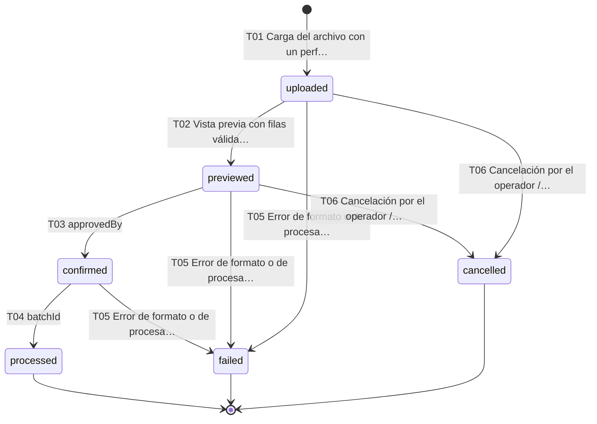

| # | Desde | Hasta | Disparador | Tipo | Guardas | Evento emitido |
|---|---|---|---|---|---|---|
| T01 | (nuevo) | `uploaded` | Carga del archivo con un perfil de importación / — | no especificado | Perfil `active`; `fileHash` no repetido para el perfil | — |
| T02 | `uploaded` | `previewed` | Vista previa con filas válidas, con error y duplicadas / — | no especificado | — | — |
| T03 | `previewed` | `confirmed` | Confirmación del operador (`approvedBy` en importación directa de consumos) / — | usuario | — | — |
| T04 | `confirmed` | `processed` | Lecturas o consumos registrados en el lote (`batchId`) / — | no especificado | — | — |
| T05 | `confirmed`, `previewed`, `uploaded` | `failed` | Error de formato o de procesamiento / — | no especificado | — | — |
| T06 | `previewed`, `uploaded` | `cancelled` | Cancelación por el operador / — | usuario | — | — |

### EST-MED-22 — `meteringSystems.status` (COL-MED-28)

**Colección:** Sistemas de telemedición/prepago (dominio sobre `integrationConnections`). **Campos de estado en el §7:** `status` (línea 1007; valores declarados en el §8, línea 1224; valores: `active`, `inactive`).

**Fuente:** el §8 del anexo no detalla esta colección; se aplica el patrón general de T05 §7.1.5 (estados, baja lógica) y T04 §8.3 (registros maestros) sobre los valores del §7.

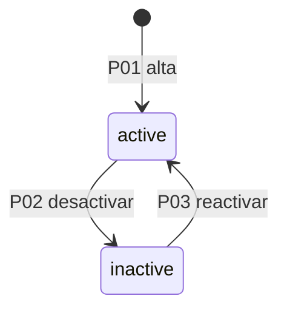

| # | Desde | Hasta | Disparador | Tipo | Guardas | Evento emitido |
|---|---|---|---|---|---|---|
| P01 | (nuevo) | `active` | Alta del registro (operador, importación o plataforma) | usuario, sistema | Validación del esquema (T04 §8.3) | — |
| P02 | `active` | `inactive` | Operador | usuario | Si está referenciado se informa el conteo; no se borra (T05 §7.1.5) | — |
| P03 | `inactive` | `active` | Operador | usuario | — | — |

### EST-MED-23 — `remoteMeterOperations.status` (COL-MED-30)

**Colección:** Comandos remotos a medidores. **Campos de estado en el §7:** `status` (línea 1034; valores: `queued`, `sent`, `pendingProvider`, `succeeded`, `failed`, `rejected`, `cancelled`, `unknown`).

**Fuente:** M03 §8.9, M03 §8.12.

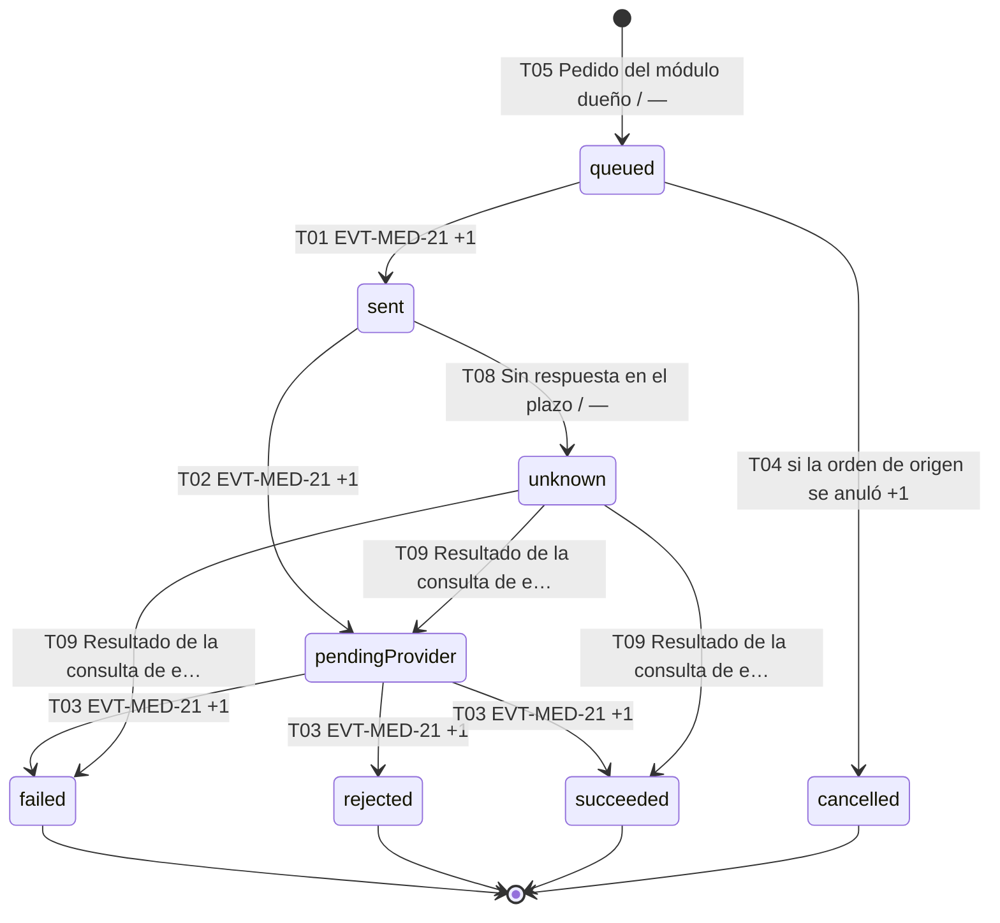

| # | Desde | Hasta | Disparador | Tipo | Guardas | Evento emitido |
|---|---|---|---|---|---|---|
| T01 | `queued` | `sent` | — | no especificado | — | EVT-MED-21 `med.remoteOperation.succeeded` |
| T02 | `sent` | `pendingProvider` | — | no especificado | — | EVT-MED-21 `med.remoteOperation.succeeded` |
| T03 | `pendingProvider` | `failed`, `rejected`, `succeeded` | — | no especificado | — | EVT-MED-21 `med.remoteOperation.succeeded` |
| T04 | `queued` | `cancelled` | si la orden de origen se anuló | no especificado | — | — |
| T05 | (nuevo) | `queued` | Pedido del módulo dueño / — | no especificado | `idempotencyKey` | — |
| T06 | `queued` | `sent` | Envío al proveedor / — | API/integración | — | — |
| T07 | `sent` | `pendingProvider` | Acuse del proveedor / — | API/integración | — | — |
| T08 | `sent` | `unknown` | Sin respuesta en el plazo / — | job | Consultar estado antes de reintentar | — |
| T09 | `unknown` | `failed`, `pendingProvider`, `succeeded` | Resultado de la consulta de estado / — | no especificado | — | — |
| T10 | `pendingProvider` | `failed`, `rejected`, `succeeded` | Respuesta del proveedor / `med.remoteOperation.succeeded` (solo `succeeded`) | evento, API/integración | — | — |
| T11 | `queued` | `cancelled` | Orden de origen anulada / — | no especificado | — | — |

### EST-MED-24 — `prepaidAccounts.status` (COL-MED-33)

**Colección:** Cuenta prepaga técnica del punto. **Campos de estado en el §7:** `status` (línea 1066; valores: `active`, `suspended`, `closed`).

**Fuente:** M03 §8.12.

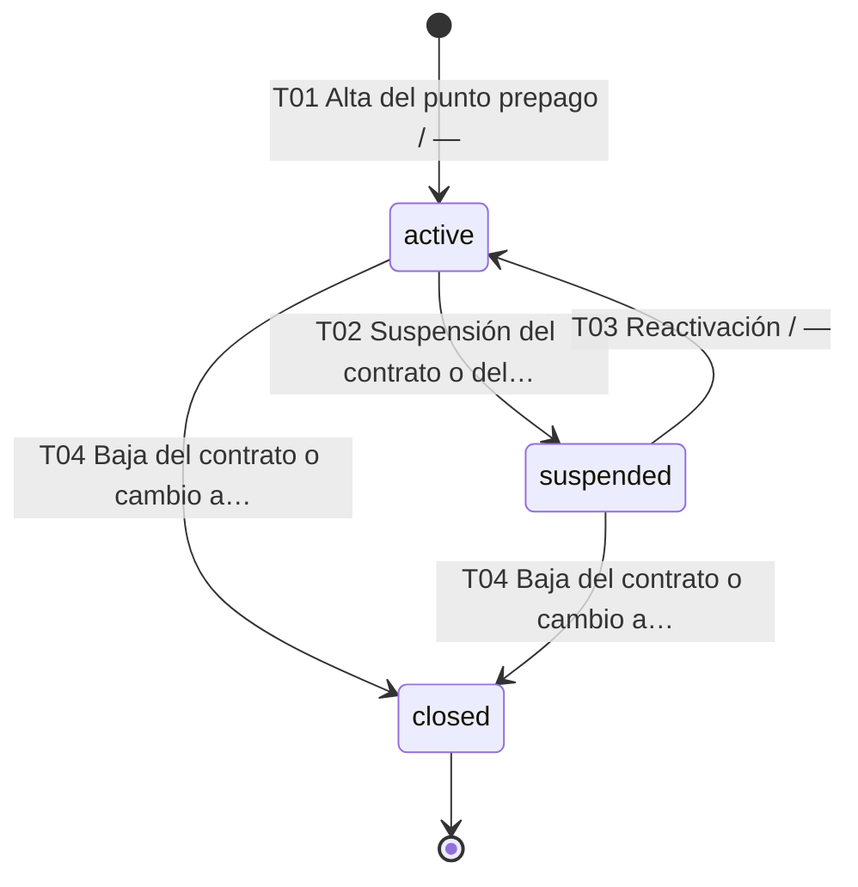

| # | Desde | Hasta | Disparador | Tipo | Guardas | Evento emitido |
|---|---|---|---|---|---|---|
| T01 | (nuevo) | `active` | Alta del punto prepago / — | no especificado | — | — |
| T02 | `active` | `suspended` | Suspensión del contrato o del sistema de prepago / — | sistema | — | — |
| T03 | `suspended` | `active` | Reactivación / — | no especificado | — | — |
| T04 | `active`, `suspended` | `closed` | Baja del contrato o cambio a pospago / — | no especificado | Saldo informado conciliado | — |

### EST-MED-25 — `prepaidTopUps.status` (COL-MED-34)

**Colección:** Recargas prepagas (token cifrado). **Campos de estado en el §7:** `status` (línea 1082; valores: `preSaleOk`, `preSaleRejected`, `paid`, `requested`, `tokenIssued`, `delivered`, `applied`, `failed`, `refundRequested`, `voided`).

**Fuente:** M03 §8.10, M03 §8.12.

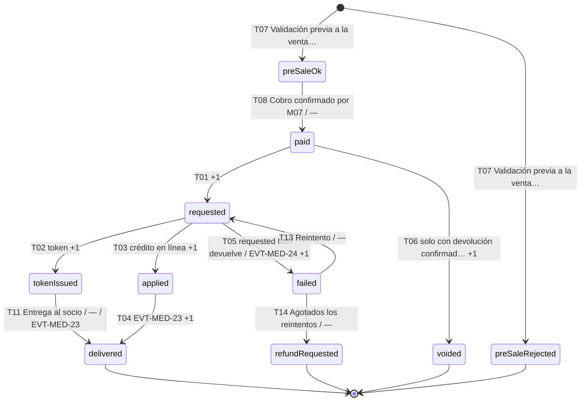

| # | Desde | Hasta | Disparador | Tipo | Guardas | Evento emitido |
|---|---|---|---|---|---|---|
| T01 | `paid` | `requested` | — | no especificado | — | — |
| T02 | `requested` | `tokenIssued` | token | no especificado | — | — |
| T03 | `requested` | `applied` | crédito en línea | no especificado | — | — |
| T04 | `applied` | `delivered` | — | no especificado | — | EVT-MED-23 `med.prepaidTopUp.delivered` (inferido por nombre) |
| T05 | `requested` | `failed` | requested M07 devuelve | no especificado | — | EVT-MED-24 `med.prepaidTopUp.failed` (inferido por nombre) |
| T06 | `paid` | `voided` | solo con devolución confirmada por M07 | no especificado | — | — |
| T07 | (nuevo) | `preSaleOk`, `preSaleRejected` | Validación previa a la venta / — | no especificado | — | — |
| T08 | `preSaleOk` | `paid` | Cobro confirmado por M07 / — | no especificado | — | — |
| T09 | `paid` | `requested` | Pedido al proveedor / — | API/integración | `idempotencyKey` | — |
| T10 | `requested` | `applied`, `tokenIssued` | Token emitido o crédito en línea / — | no especificado | — | — |
| T11 | `applied`, `tokenIssued` | `delivered` | Entrega al socio / — | usuario | — | EVT-MED-23 `med.prepaidTopUp.delivered` (inferido por nombre) |
| T12 | `requested` | `failed` | Error del proveedor / — | API/integración | — | EVT-MED-24 `med.prepaidTopUp.failed` (inferido por nombre) |
| T13 | `failed` | `requested` | Reintento / — | no especificado | — | — |
| T14 | `failed` | `refundRequested` | Agotados los reintentos / — | no especificado | M07 devuelve el pago | — |
| T15 | `paid` | `voided` | Devolución confirmada por M07 / — | no especificado | — | — |

### EST-MED-26 — `distributedGenerationContracts.status` (COL-MED-35)

**Colección:** Contrato técnico del usuario-generador (canónica; absorbe `generationAgreements` de M02). **Campos de estado en el §7:** `status` (línea 1098; valores: `requested`, `underReview`, `approved`, `connected`, `suspended`, `terminated`).

**Fuente:** M03 §8.11, M03 §8.13.

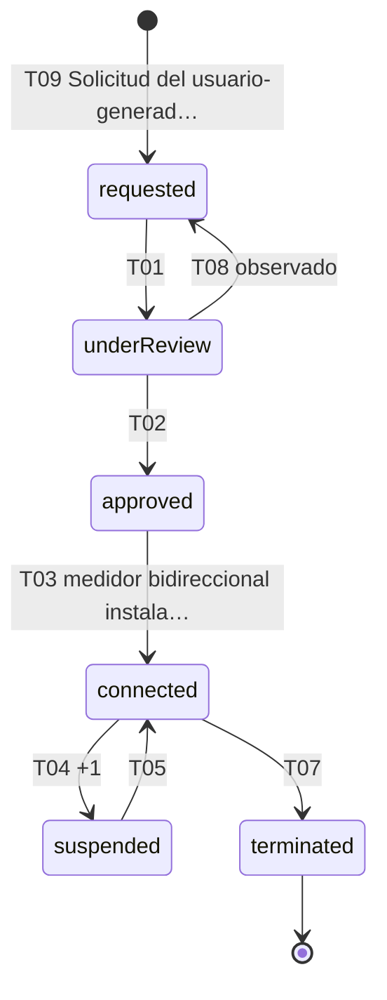

| # | Desde | Hasta | Disparador | Tipo | Guardas | Evento emitido |
|---|---|---|---|---|---|---|
| T01 | `requested` | `underReview` | — | no especificado | — | — |
| T02 | `underReview` | `approved` | — | no especificado | — | — |
| T03 | `approved` | `connected` | medidor bidireccional instalado | no especificado | — | — |
| T04 | `connected` | `suspended` | — | no especificado | — | — |
| T05 | `suspended` | `connected` | — | no especificado | — | — |
| T06 | `connected` | `suspended` | — | no especificado | — | — |
| T07 | `connected` | `terminated` | — | no especificado | — | — |
| T08 | `underReview` | `requested` | observado | no especificado | — | — |
| T09 | (nuevo) | `requested` | Solicitud del usuario-generador (MER-001) / — | usuario | — | — |

### EST-MED-27 — `injectionBalances.status` (COL-MED-36)

**Colección:** Balance de energía inyectada por período. **Campos de estado en el §7:** `status` (línea 1111; valores: `calculated`, `approved`, `billed`).

**Fuente:** M03 §8.12.

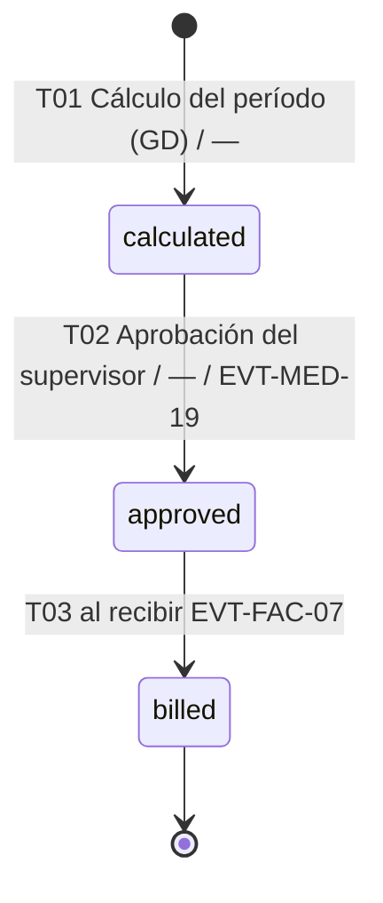

| # | Desde | Hasta | Disparador | Tipo | Guardas | Evento emitido |
|---|---|---|---|---|---|---|
| T01 | (nuevo) | `calculated` | Cálculo del período (GD) / — | no especificado | — | — |
| T02 | `calculated` | `approved` | Aprobación del supervisor / — | usuario | — | EVT-MED-19 `med.injectionBalance.approved` (inferido por nombre) |
| T03 | `approved` | `billed` | Comprobante emitido por M05 / `fac.invoice.issued` | evento | — | — |

### EST-MED-28 — `consumptionClassReviews.status` (COL-MED-37)

**Colección:** Propuestas de cambio de clase por consumo. **Campos de estado en el §7:** `status` (línea 1116; valores: `draft`, `approved`, `applied`, `discarded`).

**Fuente:** M03 §8.13.

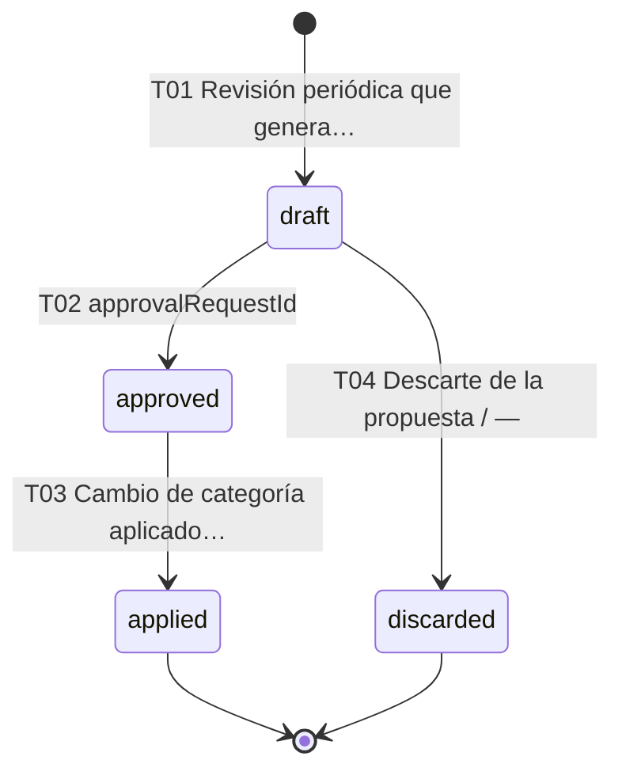

| # | Desde | Hasta | Disparador | Tipo | Guardas | Evento emitido |
|---|---|---|---|---|---|---|
| T01 | (nuevo) | `draft` | Revisión periódica que genera candidatos (PA-MED-10) / — | no especificado | — | — |
| T02 | `draft` | `approved` | Aprobación (`approvalRequestId`, T11) / — | no especificado | — | — |
| T03 | `approved` | `applied` | Cambio de categoría aplicado en los contratos (M02) / — | no especificado | — | — |
| T04 | `draft` | `discarded` | Descarte de la propuesta / — | no especificado | — | — |

## M04 — TAR Tarifas y motor de cálculo

### EST-TAR-01 — `tariffSchedules.status` (COL-TAR-01)

**Colección:** Versión de cuadro tarifario. **Campos de estado en el §7:** `status` (línea 670; valores: `draft`, `submitted`, `approved`, `rejected`, `scheduled`, `active`, `superseded`, `closed`, `voided`).

**Fuente:** M04 §8.1.

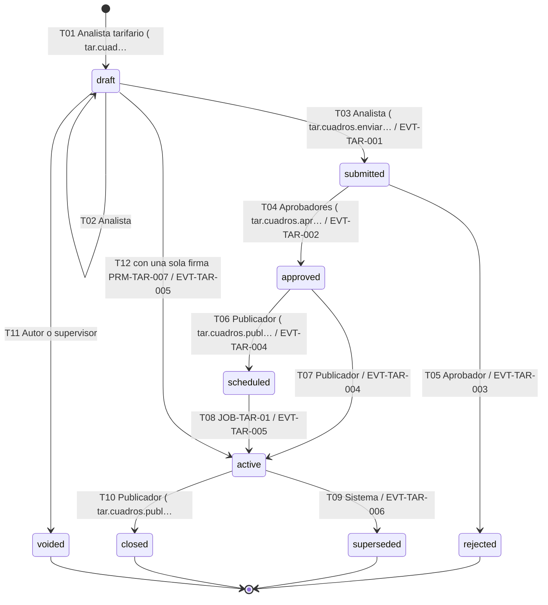

| # | Desde | Hasta | Disparador | Tipo | Guardas | Evento emitido |
|---|---|---|---|---|---|---|
| T01 | (nuevo) | `draft` | Analista tarifario (`tar.cuadros.editar` / `tar.reglas.editar` / equivalente) | usuario | Copia de una versión, alta en blanco, importación o actualización masiva. | — |
| T02 | `draft` | `draft` | Analista | usuario | — | — |
| T03 | `draft` | `submitted` | Analista (`tar.cuadros.enviar`) | usuario | Validaciones completas sin errores (escalones sin solapamiento, fórmulas compiladas, referencias vigentes, conceptos y tributos existentes, origen de… | EVT-TAR-001 `tar.schedule.submitted` |
| T04 | `submitted` | `approved` | Aprobadores (`tar.cuadros.aprobar`) | usuario | Dos firmas de usuarios distintos y distintos del autor (tercera si PRM-TAR-004 o importe/universo sobre umbral). | EVT-TAR-002 `tar.schedule.approved` |
| T05 | `submitted` | `rejected` | Aprobador | usuario | Motivo obligatorio. | EVT-TAR-003 `tar.schedule.rejected` |
| T06 | `approved` | `scheduled` | Publicador (`tar.cuadros.publicar`) | usuario | `validFrom` futura respecto de la fecha de referencia actual. | EVT-TAR-004 `tar.schedule.published` |
| T07 | `approved` | `active` | Publicador | no especificado | `validFrom` ≤ hoy (en la zona del tenant). | EVT-TAR-004 `tar.schedule.published`, EVT-TAR-005 `tar.schedule.activated` |
| T08 | `scheduled` | `active` | Sistema (JOB-TAR-01 `tar:activar-versiones`) | job | Llega `validFrom`. | EVT-TAR-005 `tar.schedule.activated` (inferido por nombre) |
| T09 | `active` | `superseded` | Sistema | sistema | Activación de una versión posterior del mismo ámbito. | EVT-TAR-006 `tar.schedule.superseded` |
| T10 | `active` | `closed` | Publicador (`tar.cuadros.publicar`) | usuario | Cierre sin reemplazo (servicio discontinuado). Exige que no queden contratos activos del ámbito o confirmación explícita. | — |
| T11 | `draft` | `voided` | Autor o supervisor | usuario | — | — |
| T12 | `draft` | `active` | con una sola firma PRM-TAR-007 | no especificado | RN-TAR-153 | EVT-TAR-005 `tar.schedule.activated` (inferido por nombre) |

### EST-TAR-02 — `tariffServiceSettings.status` (COL-TAR-02)

**Colección:** Configuración tarifaria del servicio. **Campos de estado en el §7:** `status` (línea 692; valores declarados en el §8, línea 1465; valores: `draft`, `submitted`, `approved`, `rejected`, `scheduled`, `active`, `superseded`, `closed`, `voided`).

**Fuente:** el §8 del anexo no detalla esta colección; se aplica el patrón general de T05 §7.1.5 (versiones publicadas) sobre los valores del §7.

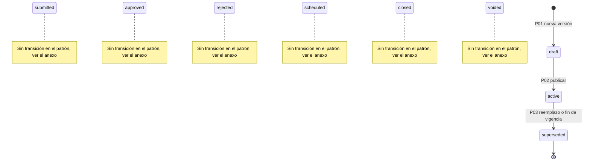

| # | Desde | Hasta | Disparador | Tipo | Guardas | Evento emitido |
|---|---|---|---|---|---|---|
| P01 | (nuevo) | `draft` | Configurador | usuario | — | — |
| P02 | `draft` | `active` | Configurador o aprobador | usuario | Versión validada; publicada queda inmutable (T05 §7.1.5) | — |
| P03 | `active` | `superseded` | Sistema al publicar la sucesora o configurador | sistema, usuario | Existe versión sucesora o fin de vigencia | — |

### EST-TAR-03 — `productPrices.status` (COL-TAR-06)

**Colección:** Precios por versión; `kind` incluye los precios de cementerio. Los precios de vivienda son COL-SOC-30 `housingPrices` de M18 (HUECO-VIV-02). **Reemplaza** el texto anterior: "(incluye vivienda; absor…. **Campos de estado en el §7:** `status` (línea 783; valores declarados en el §8, línea 1465; valores: `draft`, `submitted`, `approved`, `rejected`, `scheduled`, `active`, `superseded`, `closed`, `voided`).

**Fuente:** el §8 del anexo no detalla esta colección; se aplica el patrón general de T05 §7.1.5 (versiones publicadas) sobre los valores del §7.


| # | Desde | Hasta | Disparador | Tipo | Guardas | Evento emitido |
|---|---|---|---|---|---|---|
| P01 | (nuevo) | `draft` | Configurador | usuario | — | — |
| P02 | `draft` | `active` | Configurador o aprobador | usuario | Versión validada; publicada queda inmutable (T05 §7.1.5) | — |
| P03 | `active` | `superseded` | Sistema al publicar la sucesora o configurador | sistema, usuario | Existe versión sucesora o fin de vigencia | — |

### EST-TAR-04 — `eventCharges.status` (COL-TAR-07)

**Colección:** Cargos por evento con filtros (canónica; absorbe `eventChargeRules` de M02). Disparadores `equipment_not_returned` (con `equipmentKinds` y `returnGraceDays`, deshabilitado por PRM-TAR-169), `social_a`…. **Campos de estado en el §7:** `status` (línea 824; valores declarados en el §8, línea 1465; valores: `draft`, `submitted`, `approved`, `rejected`, `scheduled`, `active`, `superseded`, `closed`, `voided`).

**Fuente:** el §8 del anexo no detalla esta colección; se aplica el patrón general de T05 §7.1.5 (versiones publicadas) sobre los valores del §7.


| # | Desde | Hasta | Disparador | Tipo | Guardas | Evento emitido |
|---|---|---|---|---|---|---|
| P01 | (nuevo) | `draft` | Configurador | usuario | — | — |
| P02 | `draft` | `active` | Configurador o aprobador | usuario | Versión validada; publicada queda inmutable (T05 §7.1.5) | — |
| P03 | `active` | `superseded` | Sistema al publicar la sucesora o configurador | sistema, usuario | Existe versión sucesora o fin de vigencia | — |

### EST-TAR-05 — `chargeRules.status` (COL-TAR-11)

**Colección:** Reglas declarativas (cargos, beneficios, tributos). **Campos de estado en el §7:** `status` (línea 907; valores declarados en el §8, línea 1465; valores: `draft`, `submitted`, `approved`, `rejected`, `scheduled`, `active`, `superseded`, `closed`, `voided`).

**Fuente:** el §8 del anexo no detalla esta colección; se aplica el patrón general de T05 §7.1.5 (versiones publicadas) sobre los valores del §7.


| # | Desde | Hasta | Disparador | Tipo | Guardas | Evento emitido |
|---|---|---|---|---|---|---|
| P01 | (nuevo) | `draft` | Configurador | usuario | — | — |
| P02 | `draft` | `active` | Configurador o aprobador | usuario | Versión validada; publicada queda inmutable (T05 §7.1.5) | — |
| P03 | `active` | `superseded` | Sistema al publicar la sucesora o configurador | sistema, usuario | Existe versión sucesora o fin de vigencia | — |

### EST-TAR-06 — `benefitGroups.status` (COL-TAR-13)

**Colección:** Grupos de beneficio tarifario. **Campos de estado en el §7:** `status` (línea 933; valores declarados en el §8, línea 1465; valores: `active`, `inactive`).

**Fuente:** el §8 del anexo no detalla esta colección; se aplica el patrón general de T05 §7.1.5 (estados, baja lógica) y T04 §8.3 (registros maestros) sobre los valores del §7.


| # | Desde | Hasta | Disparador | Tipo | Guardas | Evento emitido |
|---|---|---|---|---|---|---|
| P01 | (nuevo) | `active` | Alta del registro (operador, importación o plataforma) | usuario, sistema | Validación del esquema (T04 §8.3) | — |
| P02 | `active` | `inactive` | Operador | usuario | Si está referenciado se informa el conteo; no se borra (T05 §7.1.5) | — |
| P03 | `inactive` | `active` | Operador | usuario | — | — |

### EST-TAR-07 — `subsidyRegimes.status` (COL-TAR-15)

**Colección:** Regímenes de subsidio. **Campos de estado en el §7:** `status` (línea 968; valores declarados en el §8, línea 1465; valores: `draft`, `submitted`, `approved`, `rejected`, `scheduled`, `active`, `superseded`, `closed`, `voided`).

**Fuente:** el §8 del anexo no detalla esta colección; se aplica el patrón general de T05 §7.1.5 (versiones publicadas) sobre los valores del §7.


| # | Desde | Hasta | Disparador | Tipo | Guardas | Evento emitido |
|---|---|---|---|---|---|---|
| P01 | (nuevo) | `draft` | Configurador | usuario | — | — |
| P02 | `draft` | `active` | Configurador o aprobador | usuario | Versión validada; publicada queda inmutable (T05 §7.1.5) | — |
| P03 | `active` | `superseded` | Sistema al publicar la sucesora o configurador | sistema, usuario | Existe versión sucesora o fin de vigencia | — |

### EST-TAR-08 — `subsidyRollImports.status` (COL-TAR-16)

**Colección:** Padrones de subsidio importados. **Campos de estado en el §7:** `status` (línea 989; valores: `uploaded`, `validating`, `validated`, `confirmed`, `rejected`, `failed`).

**Fuente:** M04 §8.2.

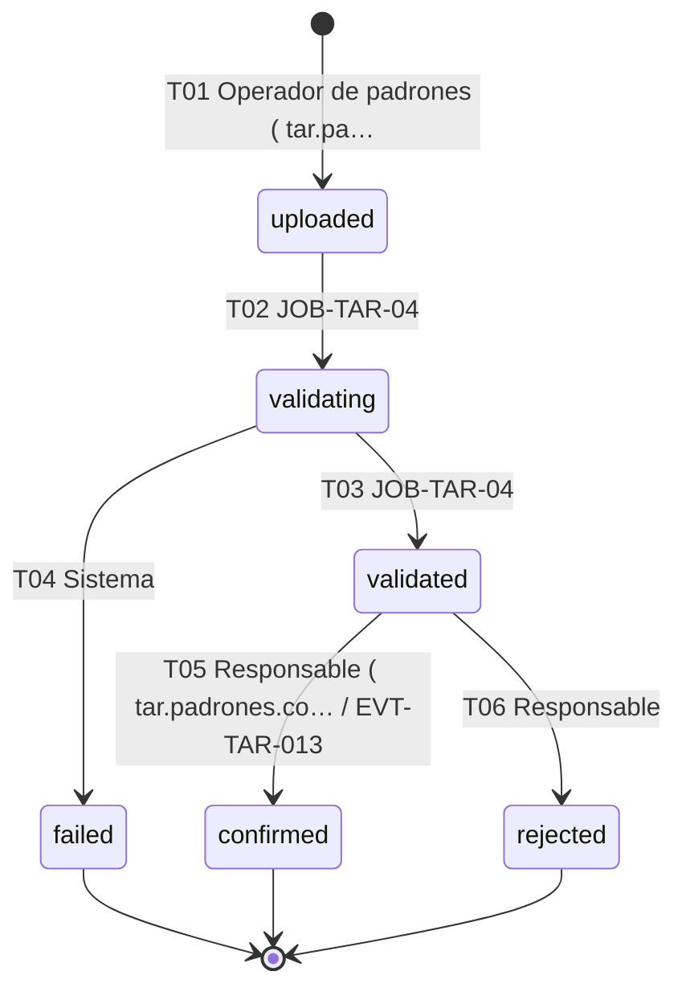

| # | Desde | Hasta | Disparador | Tipo | Guardas | Evento emitido |
|---|---|---|---|---|---|---|
| T01 | (nuevo) | `uploaded` | Operador de padrones (`tar.padrones.importar`) | usuario | Archivo con formato del régimen (ExcelImportWizard). | — |
| T02 | `uploaded` | `validating` | Sistema (JOB-TAR-04 `tar:importar-padron`) | job | — | — |
| T03 | `validating` | `validated` | Sistema (JOB-TAR-04 `tar:importar-padron`) | job | — | — |
| T04 | `validating` | `failed` | Sistema | sistema | Error de formato o de cruce masivo. | — |
| T05 | `validated` | `confirmed` | Responsable (`tar.padrones.confirmar`) | usuario | Revisión del resumen; conflictos resueltos o excluidos. | EVT-TAR-013 `tar.subsidyRoll.imported`, EVT-TAR-014 `tar.enrollment.changed` |
| T06 | `validated` | `rejected` | Responsable | usuario | Motivo. | — |

### EST-TAR-09 — `subsidyEnrollments.status` (COL-TAR-17)

**Colección:** Inscripciones a subsidio. **Campos de estado en el §7:** `status` (línea 1011; valores: `active`, `suspended`, `ended`).

**Fuente:** M04 §8.3, M04 §8.8.

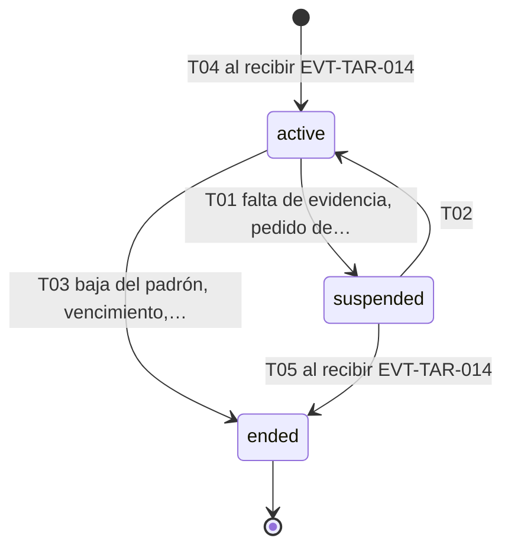

| # | Desde | Hasta | Disparador | Tipo | Guardas | Evento emitido |
|---|---|---|---|---|---|---|
| T01 | `active` | `suspended` | falta de evidencia, pedido del regulador | no especificado | — | — |
| T02 | `suspended` | `active` | — | no especificado | — | — |
| T03 | `active` | `ended` | baja del padrón, vencimiento, baja del contrato | job | — | — |
| T04 | (nuevo) | `active` | Confirmación de padrón (§8.2), alta manual o pedido del socio (`source`) / `tar.enrollment.changed` | evento, usuario | Fecha efectiva; la retroactiva exige `tar.excepciones.aprobar` | — |
| T05 | `suspended` | `ended` | Baja del padrón, vencimiento o baja del contrato durante la suspensión / `tar.enrollment.changed` | job, evento | — | — |

### EST-TAR-10 — `promotions.status` (COL-TAR-18)

**Colección:** Promociones. **Campos de estado en el §7:** `status` (línea 1033; valores declarados en el §8, línea 1465; valores: `draft`, `submitted`, `approved`, `rejected`, `scheduled`, `active`, `superseded`, `closed`, `voided`).

**Fuente:** el §8 del anexo no detalla esta colección; se aplica el patrón general de T05 §7.1.5 (versiones publicadas) sobre los valores del §7.


| # | Desde | Hasta | Disparador | Tipo | Guardas | Evento emitido |
|---|---|---|---|---|---|---|
| P01 | (nuevo) | `draft` | Configurador | usuario | — | — |
| P02 | `draft` | `active` | Configurador o aprobador | usuario | Versión validada; publicada queda inmutable (T05 §7.1.5) | — |
| P03 | `active` | `superseded` | Sistema al publicar la sucesora o configurador | sistema, usuario | Existe versión sucesora o fin de vigencia | — |

### EST-TAR-11 — `promotionAssignments.status` (COL-TAR-19)

**Colección:** Promociones asignadas a contratos. **Campos de estado en el §7:** `status` (línea 1058; valores: `pending`, `active`, `exhausted`, `ended`, `cancelled`).

**Fuente:** M04 §8.4.

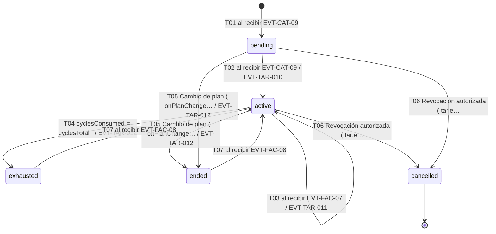

| # | Desde | Hasta | Disparador | Tipo | Guardas | Evento emitido |
|---|---|---|---|---|---|---|
| T01 | (nuevo) | `pending` | Contratación con promoción elegible (`cat.contract.activated` aún no recibido) o asignación manual (`tar.promociones.asignar`). | evento | — | — |
| T02 | `pending` | `active` | `cat.contract.activated` / `tec.installation.activationConfirmed` según `promotions.startTrigger`. | evento | — | EVT-TAR-010 `tar.promotion.assigned` |
| T03 | `active` | `active` | `fac.invoice.issued` con efecto `promotion_consume`. | evento | — | EVT-TAR-011 `tar.promotion.consumed` |
| T04 | `active` | `exhausted` | `cyclesConsumed = cyclesTotal`. | no especificado | — | EVT-TAR-012 `tar.promotion.ended` |
| T05 | `active`, `pending` | `ended` | Cambio de plan (`onPlanChange = end`), baja, fin de ventana. | no especificado | — | EVT-TAR-012 `tar.promotion.ended` |
| T06 | `active`, `pending` | `cancelled` | Revocación autorizada (`tar.excepciones.aprobar`). | usuario | — | — |
| T07 | `ended`, `exhausted` | `active` | Solo si se anula el comprobante que consumió el último ciclo (`fac.invoice.annulled`). | evento | — | — |

### EST-TAR-12 — `worksInstallmentPlans.status` (COL-TAR-20)

**Colección:** Cuotas de obra (tipo 17; HUECO-OBR-05); se crea por obra + inmueble aunque el contrato de obra de M02 esté pendiente (HUECO-OBR-01). **Campos de estado en el §7:** `status` (línea 1080; sin valores en el §7).

**Fuente:** M04 §8.7.

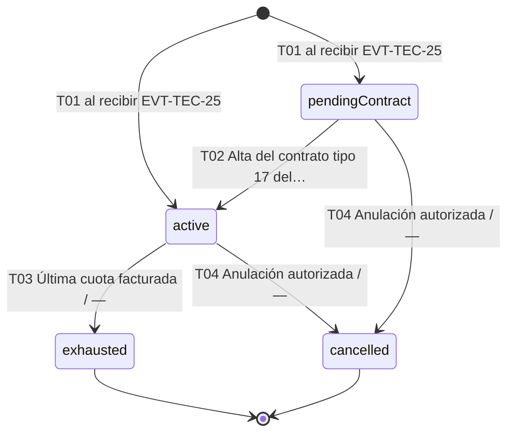

| # | Desde | Hasta | Disparador | Tipo | Guardas | Evento emitido |
|---|---|---|---|---|---|---|
| T01 | (nuevo) | `active`, `pendingContract` | Evento EVT-TEC-25 (RF-TAR-116) / — | evento | Idempotencia `{workId, premiseId}` | — |
| T02 | `pendingContract` | `active` | Alta del contrato tipo 17 del beneficiario / — | no especificado | — | — |
| T03 | `active` | `exhausted` | Última cuota facturada / — | no especificado | `billedInstallments = installments` | — |
| T04 | `active`, `pendingContract` | `cancelled` | Anulación autorizada / — | usuario | — | — |

### EST-TAR-13 — `roundingPolicies.status` (COL-TAR-21)

**Colección:** Políticas de redondeo. **Campos de estado en el §7:** `status` (línea 1101; valores declarados en el §8, línea 1465; valores: `draft`, `submitted`, `approved`, `rejected`, `scheduled`, `active`, `superseded`, `closed`, `voided`).

**Fuente:** el §8 del anexo no detalla esta colección; se aplica el patrón general de T05 §7.1.5 (versiones publicadas) sobre los valores del §7.

```mermaid
stateDiagram-v2
    [*] --> draft : P01 nueva versión
    draft --> active : P02 publicar
    active --> superseded : P03 reemplazo o fin de vigencia
    superseded --> [*]
    submitted
    note right of submitted : Sin transición en el patrón, ver el anexo
    approved
    note right of approved : Sin transición en el patrón, ver el anexo
    rejected
    note right of rejected : Sin transición en el patrón, ver el anexo
    scheduled
    note right of scheduled : Sin transición en el patrón, ver el anexo
    closed
    note right of closed : Sin transición en el patrón, ver el anexo
    voided
    note right of voided : Sin transición en el patrón, ver el anexo
```

| # | Desde | Hasta | Disparador | Tipo | Guardas | Evento emitido |
|---|---|---|---|---|---|---|
| P01 | (nuevo) | `draft` | Configurador | usuario | — | — |
| P02 | `draft` | `active` | Configurador o aprobador | usuario | Versión validada; publicada queda inmutable (T05 §7.1.5) | — |
| P03 | `active` | `superseded` | Sistema al publicar la sucesora o configurador | sistema, usuario | Existe versión sucesora o fin de vigencia | — |

### EST-TAR-14 — `roundingCarryEntries.status` (COL-TAR-22)

**Colección:** Proyección de arrastre de redondeo (saldo fuente en M07). **Campos de estado en el §7:** `status` (línea 1120; valores: `proposed`, `confirmed`, `reversed`).

**Fuente:** M04 §8.7.

```mermaid
stateDiagram-v2
    [*] --> proposed : T01 Cálculo con redondeo con arra…
    proposed --> confirmed : T02 al recibir EVT-FAC-07
    confirmed --> reversed : T03 al recibir EVT-FAC-08
    reversed --> [*]
```

| # | Desde | Hasta | Disparador | Tipo | Guardas | Evento emitido |
|---|---|---|---|---|---|---|
| T01 | (nuevo) | `proposed` | Cálculo con redondeo con arrastre / — | no especificado | RN-TAR (política de `roundingPolicies`) | — |
| T02 | `proposed` | `confirmed` | Comprobante emitido (`fac.invoice.issued`) / — | evento | — | — |
| T03 | `confirmed` | `reversed` | Comprobante anulado (`fac.invoice.annulled`) / — | evento | — | — |

### EST-TAR-15 — `phoneRatePlans.status` (COL-TAR-23)

**Colección:** Planes de tasación telefónica. **Campos de estado en el §7:** `status` (línea 1138; valores declarados en el §8, línea 1465; valores: `draft`, `submitted`, `approved`, `rejected`, `scheduled`, `active`, `superseded`, `closed`, `voided`).

**Fuente:** el §8 del anexo no detalla esta colección; se aplica el patrón general de T05 §7.1.5 (versiones publicadas) sobre los valores del §7.

```mermaid
stateDiagram-v2
    [*] --> draft : P01 nueva versión
    draft --> active : P02 publicar
    active --> superseded : P03 reemplazo o fin de vigencia
    superseded --> [*]
    submitted
    note right of submitted : Sin transición en el patrón, ver el anexo
    approved
    note right of approved : Sin transición en el patrón, ver el anexo
    rejected
    note right of rejected : Sin transición en el patrón, ver el anexo
    scheduled
    note right of scheduled : Sin transición en el patrón, ver el anexo
    closed
    note right of closed : Sin transición en el patrón, ver el anexo
    voided
    note right of voided : Sin transición en el patrón, ver el anexo
```

| # | Desde | Hasta | Disparador | Tipo | Guardas | Evento emitido |
|---|---|---|---|---|---|---|
| P01 | (nuevo) | `draft` | Configurador | usuario | — | — |
| P02 | `draft` | `active` | Configurador o aprobador | usuario | Versión validada; publicada queda inmutable (T05 §7.1.5) | — |
| P03 | `active` | `superseded` | Sistema al publicar la sucesora o configurador | sistema, usuario | Existe versión sucesora o fin de vigencia | — |

### EST-TAR-16 — `calculationRuns.status` (COL-TAR-29)

**Colección:** Ejecuciones del motor. **Campos de estado en el §7:** `status` (línea 1225; valores: `queued`, `running`, `completed`, `completed_with_exclusions`, `aborted`, `cancelled`, `failed`).

**Fuente:** M04 §8.6, M04 §8.8.

```mermaid
stateDiagram-v2
    queued --> running : T01
    running --> completed : T02
    running --> completed_with_exclusions : T02
    running --> failed : T02
    running --> aborted : T03 si los errores superan PRM-TA…
    queued --> cancelled : T04 por el usuario que lo lanzó u…
    running --> cancelled : T04 por el usuario que lo lanzó u…
    [*] --> queued : T05 Pedido de cálculo (lote de M0…
    completed --> [*]
    completed_with_exclusions --> [*]
    failed --> [*]
    aborted --> [*]
    cancelled --> [*]
```

| # | Desde | Hasta | Disparador | Tipo | Guardas | Evento emitido |
|---|---|---|---|---|---|---|
| T01 | `queued` | `running` | — | no especificado | — | — |
| T02 | `running` | `completed`, `completed_with_exclusions`, `failed` | — | no especificado | — | — |
| T03 | `running` | `aborted` | si los errores superan PRM-TAR-113 | no especificado | — | — |
| T04 | `queued`, `running` | `cancelled` | por el usuario que lo lanzó un supervisor los resultados parciales se conservan marcados partial | usuario | — | — |
| T05 | (nuevo) | `queued` | Pedido de cálculo (lote de M05, individual, simulación, retroactivo o re-tasación) / — | no especificado | — | — |

### EST-TAR-17 — `calculations.status` (COL-TAR-30)

**Colección:** Resultado de cálculo por cuenta con traza (alto volumen). **Campos de estado en el §7:** `status` (línea 1263; valores: `draft`, `observed`, `approved`, `issued`, `discarded`).

**Fuente:** M04 §8.5.

```mermaid
stateDiagram-v2
    [*] --> draft : T01 Motor (pedido de M05, simulad…
    draft --> observed : T02 Motor
    observed --> approved : T03 Revisor de facturación ( fac.…
    draft --> approved : T04 M05
    approved --> issued : T05 al recibir EVT-FAC-07 / EVT-TAR-008
    approved --> discarded : T06 M05 (lote anulado/recalculado…
    draft --> discarded : T06 M05 (lote anulado/recalculado…
    observed --> discarded : T06 M05 (lote anulado/recalculado…
    issued --> [*]
    discarded --> [*]
```

| # | Desde | Hasta | Disparador | Tipo | Guardas | Evento emitido |
|---|---|---|---|---|---|---|
| T01 | (nuevo) | `draft` | Motor (pedido de M05, simulador o retroactivo) | no especificado | — | — |
| T02 | `draft` | `observed` | Motor | no especificado | Advertencias, errores excluyentes, grandes usuarios sobre umbral PRM-TAR-014, diferencia de paralelo. | — |
| T03 | `observed` | `approved` | Revisor de facturación (`fac.lotes.aprobar`, M05) | usuario | Revisión. | — |
| T04 | `draft` | `approved` | M05 | no especificado | Lote aprobado. | — |
| T05 | `approved` | `issued` | M05 (`fac.invoice.issued`) | evento | Emisión del comprobante. | EVT-TAR-008 `tar.calculation.completed` |
| T06 | `approved`, `draft`, `observed` | `discarded` | M05 (lote anulado/recalculado) o motor (nuevo cálculo de la misma cuenta y lote) | no especificado | — | — |

### EST-TAR-18 — `simulationRuns.status` (COL-TAR-31)

**Colección:** Simulaciones. **Campos de estado en el §7:** `status` (línea 1271; valores: `queued`, `running`, `completed`, `failed`, `cancelled`).

**Fuente:** M04 §8.7.

```mermaid
stateDiagram-v2
    [*] --> queued : T01 API-TAR-043
    queued --> running : T02 Inicio del job / —
    running --> completed : T03 Fin o error / —
    running --> failed : T03 Fin o error / —
    queued --> cancelled : T04 API-TAR-045
    running --> cancelled : T04 API-TAR-045
    completed --> [*]
    failed --> [*]
    cancelled --> [*]
```

| # | Desde | Hasta | Disparador | Tipo | Guardas | Evento emitido |
|---|---|---|---|---|---|---|
| T01 | (nuevo) | `queued` | Pedido de simulación (API-TAR-043) / — | API/integración | — | — |
| T02 | `queued` | `running` | Inicio del job / — | job | — | — |
| T03 | `running` | `completed`, `failed` | Fin o error / — | no especificado | — | — |
| T04 | `queued`, `running` | `cancelled` | Cancelación (API-TAR-045) / — | API/integración | Usuario que la lanzó o supervisor | — |

### EST-TAR-19 — `retroactiveDiffRuns.status` (COL-TAR-33)

**Colección:** Diferencias retroactivas. **Campos de estado en el §7:** `status` (línea 1312; valores: `queued`, `running`, `computed`, `approved`, `rejected`, `adjustments_requested`, `failed`).

**Fuente:** M04 §8.6, M04 §8.7.

```mermaid
stateDiagram-v2
    computed --> approved : T01 doble firma, tar.retroactivo.… +1
    approved --> adjustments_requested : T02 pedidos de NC ND a M05 +1
    computed --> rejected : T03 +1
    [*] --> queued : T04 API-TAR-049
    queued --> running : T05 Inicio del job / —
    running --> computed : T06 Fin del cálculo / —
    queued --> failed : T07 Error técnico no recuperable…
    running --> failed : T07 Error técnico no recuperable…
    adjustments_requested --> [*]
    rejected --> [*]
    failed --> [*]
```

| # | Desde | Hasta | Disparador | Tipo | Guardas | Evento emitido |
|---|---|---|---|---|---|---|
| T01 | `computed` | `approved` | doble firma, tar.retroactivo.aprobar | usuario | — | — |
| T02 | `approved` | `adjustments_requested` | pedidos de NC ND a M05 | no especificado | — | — |
| T03 | `computed` | `rejected` | — | no especificado | — | — |
| T04 | (nuevo) | `queued` | Pedido de cálculo (API-TAR-049) / — | API/integración | Cambio con vigencia pasada | — |
| T05 | `queued` | `running` | Inicio del job / — | job | — | — |
| T06 | `running` | `computed` | Fin del cálculo / — | no especificado | — | — |
| T07 | `queued`, `running` | `failed` | Error técnico no recuperable / — | usuario | — | — |
| T08 | `computed` | `approved` | Doble firma (`tar.retroactivo.aprobar`) / — | usuario | Firmantes distintos del autor | — |
| T09 | `computed` | `rejected` | Rechazo con motivo / — | no especificado | — | — |
| T10 | `approved` | `adjustments_requested` | Pedidos de NC/ND a M05 / — | no especificado | — | — |

### EST-TAR-20 — `bonusRecalcRuns.status` (COL-TAR-36)

**Colección:** Recálculo masivo de bonificaciones. **Campos de estado en el §7:** `status` (línea 1381; valores: `draft`, `previewed`, `applied`, `discarded`).

**Fuente:** M04 §8.7.

```mermaid
stateDiagram-v2
    [*] --> draft : T01 API-TAR-056
    draft --> previewed : T02 Vista previa / —
    previewed --> applied : T03 appliedBy
    draft --> discarded : T04 Descarte / —
    previewed --> discarded : T04 Descarte / —
    applied --> [*]
    discarded --> [*]
```

| # | Desde | Hasta | Disparador | Tipo | Guardas | Evento emitido |
|---|---|---|---|---|---|---|
| T01 | (nuevo) | `draft` | Alta del recálculo (API-TAR-056) / — | API/integración | — | — |
| T02 | `draft` | `previewed` | Vista previa / — | no especificado | — | — |
| T03 | `previewed` | `applied` | Aplicación (`appliedBy`) / — | no especificado | — | — |
| T04 | `draft`, `previewed` | `discarded` | Descarte / — | no especificado | — | — |

## M05 — FAC Facturación

### EST-FAC-01 — `billingCycles.status` (COL-FAC-01)

**Colección:** Ciclo de facturación por servicio y universo. **Campos de estado en el §7:** `status` (línea 654; valores: `draft`, `published`, `inactive`).

**Fuente:** M05 §8.1, M05 §8.13.

```mermaid
stateDiagram-v2
    draft --> published : T01 Responsable de facturación +1
    published --> inactive : T02 Responsable
    [*] --> draft : T04 Alta del ciclo / —
    inactive --> [*]
```

| # | Desde | Hasta | Disparador | Tipo | Guardas | Evento emitido |
|---|---|---|---|---|---|---|
| T01 | `draft` | `published` | Responsable de facturación | usuario | Sin solapamientos (RF-FAC-004); universo y plantilla publicados | — |
| T02 | `published` | `inactive` | Responsable | usuario | Sin lotes activos del ciclo | — |
| T03 | `draft` | `published` | Responsable | usuario | Validación de expresiones de fecha y servicios | — |
| T04 | (nuevo) | `draft` | Alta del ciclo / — | no especificado | — | — |

### EST-FAC-02 — `billingUniverses.status` (COL-FAC-02)

**Colección:** Criterio de pertenencia. **Campos de estado en el §7:** `status` (línea 668; valores: `draft`, `published`, `inactive`).

**Fuente:** M05 §8.13.

```mermaid
stateDiagram-v2
    [*] --> draft : T01 Alta del universo / —
    draft --> published : T02 Publicación por el responsabl…
    published --> inactive : T03 Desactivación / —
    inactive --> published : T04 Reactivación con nueva vigenc…
```

| # | Desde | Hasta | Disparador | Tipo | Guardas | Evento emitido |
|---|---|---|---|---|---|---|
| T01 | (nuevo) | `draft` | Alta del universo / — | no especificado | — | — |
| T02 | `draft` | `published` | Publicación por el responsable / — | usuario | Criterio o lista válidos | — |
| T03 | `published` | `inactive` | Desactivación / — | no especificado | Sin ciclos publicados que lo usen | — |
| T04 | `inactive` | `published` | Reactivación con nueva vigencia / — | no especificado | — | — |

### EST-FAC-03 — `billingTemplates.status` (COL-FAC-03)

**Colección:** Plantilla de corrida versionada. **Campos de estado en el §7:** `status` (línea 689; valores: `draft`, `published`, `retired`).

**Fuente:** M05 §8.13.

```mermaid
stateDiagram-v2
    [*] --> draft : T01 Alta o nueva versión de la pl…
    draft --> published : T02 Publicación (§8.1) / —
    published --> retired : T03 Publicación de una versión nu…
    retired --> [*]
```

| # | Desde | Hasta | Disparador | Tipo | Guardas | Evento emitido |
|---|---|---|---|---|---|---|
| T01 | (nuevo) | `draft` | Alta o nueva versión de la plantilla / — | no especificado | — | — |
| T02 | `draft` | `published` | Publicación (§8.1) / — | no especificado | Expresiones de fecha y servicios válidos | — |
| T03 | `published` | `retired` | Publicación de una versión nueva / — | no especificado | — | — |

### EST-FAC-04 — `billingRuns.status` (COL-FAC-05)

**Colección:** Lote de facturación. **Campos de estado en el §7:** `status` (línea 722; sin valores en el §7).

**Máquina 1: `status`.** Fuente: M05 §8.2, M05 §8.13.

```mermaid
stateDiagram-v2
    [*] --> draft : T01 JOB-FAC-17 +1
    draft --> preparing : T02 JOB-FAC-01
    preparing --> prepared : T03 Sistema / EVT-FAC-01
    prepared --> prebilling : T04 JOB-FAC-02
    prebilling --> prebilled : T05 Sistema / EVT-FAC-02
    prebilled --> prebilling : T06 Responsable
    prebilled --> approved : T07 Aprobador ( fac.lotes.aprobar… / EVT-FAC-03
    approved --> issuing : T08 JOB-FAC-03
    issuing --> paused : T09 Responsable o sistema / EVT-FAC-04
    issuing --> failed : T10 Sistema
    issuing --> issued : T11 Sistema / EVT-FAC-05
    issuing --> issuedWithPending : T12 Sistema
    approved --> cancelled : T13 Responsable
    draft --> cancelled : T13 Responsable
    issued --> closed : T14 Sistema al aprobarse el acta / EVT-FAC-06
    issuedWithPending --> closed : T14 Sistema al aprobarse el acta / EVT-FAC-06
    paused --> [*]
    failed --> [*]
    cancelled --> [*]
    closed --> [*]
```

| # | Desde | Hasta | Disparador | Tipo | Guardas | Evento emitido |
|---|---|---|---|---|---|---|
| T01 | (nuevo) | `draft` | Responsable o JOB-FAC-17 | job, usuario | Ciclo/plantilla publicados | — |
| T02 | `draft` | `preparing` | Responsable (`fac.lotes.preparar`) | usuario | Validaciones RN-FAC-008 a 019 y lock libre | — |
| T03 | `preparing` | `prepared` | Sistema | sistema | Universo congelado v1 | EVT-FAC-01 `fac.billingRun.prepared` (inferido por nombre) |
| T04 | `prepared` | `prebilling` | Responsable (`fac.lotes.prefacturar`) | usuario | — | — |
| T05 | `prebilling` | `prebilled` | Sistema | sistema | Todos los casos procesados | EVT-FAC-02 `fac.billingRun.prebilled` (inferido por nombre) |
| T06 | `prebilled` | `prebilling` | Responsable | usuario | Universo v2 o versión de regla cambiada | — |
| T07 | `prebilled` | `approved` | Aprobador (`fac.lotes.aprobar`) | usuario | Muestra revisada (si aplica); aprobaciones T11 completas; aprobador ≠ preparador | EVT-FAC-03 `fac.billingRun.approved` (inferido por nombre) |
| T08 | `approved` | `issuing` | Responsable (`fac.lotes.emitir`) | usuario | Prerrequisitos fiscales vigentes al momento | — |
| T09 | `issuing` | `paused` | Responsable o sistema | sistema, usuario | Fallo sistémico (RF-FAC-037, 060) o pedido | EVT-FAC-04 `fac.billingRun.paused` (inferido por nombre) |
| T10 | `issuing` | `failed` | Sistema | sistema | Error técnico no recuperable automáticamente | — |
| T11 | `issuing` | `issued` | Sistema | sistema | Todos los aprobados emitidos | EVT-FAC-05 `fac.billingRun.issued` |
| T12 | `issuing` | `issuedWithPending` | Sistema | sistema | Quedan casos pendientes, inciertos o rechazados | — |
| T13 | `approved`, `draft` | `cancelled` | Responsable | usuario | Ningún comprobante emitido | — |
| T14 | `issued`, `issuedWithPending` | `closed` | Sistema al aprobarse el acta | sistema | Acta `approved` (§8.10) | EVT-FAC-06 `fac.billingRun.closed` (inferido por nombre) |
| T15 | (nuevo) | `draft` | Alta por el responsable o JOB-FAC-17 (§8.2) / — | job, usuario | Ciclo y plantilla publicados | — |

**Máquina 2: `authorizationPhase`.** Fuente: M05 §8.13.

```mermaid
stateDiagram-v2
    [*] --> notRequired : T01 issuing
    [*] --> pending : T01 issuing
    pending --> inProgress : T02 Envío de comprobantes a M06 /…
    inProgress --> completed : T03 Respuestas de M06 recibidas /…
    inProgress --> completedWithIssues : T03 Respuestas de M06 recibidas /…
    notRequired --> [*]
    completed --> [*]
    completedWithIssues --> [*]
```

| # | Desde | Hasta | Disparador | Tipo | Guardas | Evento emitido |
|---|---|---|---|---|---|---|
| T01 | (nuevo) | `notRequired`, `pending` | Emisión del lote (`issuing`): `notRequired` si no hay comprobantes a autorizar / — | usuario | — | — |
| T02 | `pending` | `inProgress` | Envío de comprobantes a M06 / — | no especificado | — | — |
| T03 | `inProgress` | `completed`, `completedWithIssues` | Respuestas de M06 recibidas / — | no especificado | — | — |

**Máquina 3: `distributionPhase`.** Fuente: M05 §8.13.

```mermaid
stateDiagram-v2
    [*] --> notStarted : T01 issuing
    notStarted --> inProgress : T02 Inicio de la distribución (§8…
    inProgress --> completed : T03 Fin de la distribución / —
    inProgress --> completedWithIssues : T03 Fin de la distribución / —
    completed --> [*]
    completedWithIssues --> [*]
```

| # | Desde | Hasta | Disparador | Tipo | Guardas | Evento emitido |
|---|---|---|---|---|---|---|
| T01 | (nuevo) | `notStarted` | Emisión del lote (`issuing`) / — | no especificado | — | — |
| T02 | `notStarted` | `inProgress` | Inicio de la distribución (§8.9) / — | no especificado | — | — |
| T03 | `inProgress` | `completed`, `completedWithIssues` | Fin de la distribución / — | no especificado | — | — |

### EST-FAC-05 — `billingRunItems.status` (COL-FAC-06)

**Colección:** Caso del universo congelado (alto volumen); `preReview` (HUE-ELE-02) y `serviceDependencies[]` entre servicios relacionados (HUE-CLO-02). **Campos de estado en el §7:** `status` (línea 752; sin valores en el §7).

**Fuente:** M05 §8.3.

```mermaid
stateDiagram-v2
    [*] --> selected : T01 Sistema (preparar)
    [*] --> excluded : T02 Sistema
    selected --> blocked : T03 Sistema (prevalidación)
    blocked --> prebilled : T04 Sistema
    selected --> prebilled : T04 Sistema
    prebilled --> warning : T05 Sistema
    prebilled --> approved : T06 Aprobador
    warning --> approved : T06 Aprobador
    prebilled --> reviewPending : T07 Sistema
    warning --> reviewPending : T07 Sistema
    reviewPending --> blocked : T08 Revisor ( fac.revisionPrevia.…
    reviewPending --> excluded : T08 Revisor ( fac.revisionPrevia.…
    reviewPending --> prebilled : T08 Revisor ( fac.revisionPrevia.…
    prebilled --> zeroAmount : T09 Sistema
    approved --> issued : T10 Sistema
    issued --> issuedObserved : T11 Consumidor M06
    issued --> fiscalRejected : T12 Consumidor M06
    issued --> uncertain : T13 JOB-FAC-08
    blocked --> reprocess : T14 Sistema
    blocked --> selected : T14 Sistema
    fiscalRejected --> reprocess : T14 Sistema
    fiscalRejected --> selected : T14 Sistema
    note left of excluded : T15 desde cualquier estado previsto
    note left of carriedOver : T16 desde cualquier estado previsto
    excluded --> [*]
    zeroAmount --> [*]
    issuedObserved --> [*]
    uncertain --> [*]
    reprocess --> [*]
    carriedOver --> [*]
```

| # | Desde | Hasta | Disparador | Tipo | Guardas | Evento emitido |
|---|---|---|---|---|---|---|
| T01 | (nuevo) | `selected` | Sistema (preparar) | sistema | Elegible | — |
| T02 | (nuevo) | `excluded` | Sistema | sistema | Marca no facturar, baja, sin ítems | — |
| T03 | `selected` | `blocked` | Sistema (prevalidación) | sistema | Validación bloqueante | — |
| T04 | `blocked`, `selected` | `prebilled` | Sistema | sistema | Cálculo correcto | — |
| T05 | `prebilled` | `warning` | Sistema | sistema | Variación o advertencia | — |
| T06 | `prebilled`, `warning` | `approved` | Aprobador | usuario | — | — |
| T07 | `prebilled`, `warning` | `reviewPending` | Sistema | sistema | Cuenta en categoría/condición de PRM-FAC-161 o `requiresReview` de M04 (RF-FAC-174) | — |
| T08 | `reviewPending` | `blocked`, `excluded`, `prebilled` | Revisor (`fac.revisionPrevia.aprobar`) | usuario | RN-FAC-154 | — |
| T09 | `prebilled` | `zeroAmount` | Sistema | sistema | Criterio de emisión no cumplido | — |
| T10 | `approved` | `issued` | Sistema | sistema | Transacción confirmada | — |
| T11 | `issued` | `issuedObserved` | Consumidor M06 | no especificado | Autorizado con observaciones | — |
| T12 | `issued` | `fiscalRejected` | Consumidor M06 | no especificado | Rechazo | — |
| T13 | `issued` | `uncertain` | Consumidor M06 | no especificado | Sin respuesta | — |
| T14 | `blocked`, `fiscalRejected` | `reprocess`, `selected` | Sistema | sistema | Excepción resuelta | — |
| T15 | cualquiera | `excluded` | Aprobador | usuario | Motivo | — |
| T16 | cualquiera | `carriedOver` | Sistema al cerrar | sistema | Pendiente al cierre | — |

### EST-FAC-06 — `billingExceptions.status` (COL-FAC-08)

**Colección:** Bandeja de excepciones. **Campos de estado en el §7:** `stage`, `status` (línea 797, 802; sin valores en el §7).

**Fuente:** M05 §8.4, M05 §8.13.

```mermaid
stateDiagram-v2
    open --> assigned : T01
    assigned --> inCorrection : T02
    inCorrection --> resolved : T03 EVT-FAC-16
    resolved --> reprocessed : T04
    assigned --> dismissed : T05 excluido con causa, requiere…
    inCorrection --> dismissed : T05 excluido con causa, requiere…
    open --> dismissed : T05 excluido con causa, requiere…
    assigned --> carriedOver : T06 al cerrar
    inCorrection --> carriedOver : T06 al cerrar
    open --> carriedOver : T06 al cerrar
    resolved --> open : T07 si el reproceso vuelve a fall… / EVT-FAC-16
    [*] --> open : T08 al recibir EVT-FAC-16 / EVT-FAC-16
    reprocessed --> [*]
    dismissed --> [*]
    carriedOver --> [*]
```

| # | Desde | Hasta | Disparador | Tipo | Guardas | Evento emitido |
|---|---|---|---|---|---|---|
| T01 | `open` | `assigned` | — | no especificado | — | — |
| T02 | `assigned` | `inCorrection` | — | no especificado | — | — |
| T03 | `inCorrection` | `resolved` | — | no especificado | — | EVT-FAC-16 `fac.billingException.resolved` (inferido por nombre) |
| T04 | `resolved` | `reprocessed` | — | no especificado | — | — |
| T05 | `assigned`, `inCorrection`, `open` | `dismissed` | excluido con causa, requiere fac.excepciones.excluir | usuario | — | — |
| T06 | `assigned`, `inCorrection`, `open` | `carriedOver` | al cerrar | no especificado | — | — |
| T07 | `resolved` | `open` | si el reproceso vuelve a fallar con historial | no especificado | — | EVT-FAC-16 `fac.billingException.opened` (inferido por nombre) |
| T08 | (nuevo) | `open` | Validación bloqueante o rechazo durante el lote / `fac.billingException.opened` | evento | — | EVT-FAC-16 `fac.billingException.opened` (inferido por nombre) |

### EST-FAC-07 — `billedPeriods.status` (COL-FAC-10)

**Colección:** Marca anti doble facturación. **Campos de estado en el §7:** `status` (línea 833; valores: `active`, `released`).

**Fuente:** M05 §8.13.

```mermaid
stateDiagram-v2
    [*] --> active : T01 al recibir EVT-FAC-07
    active --> released : T02 al recibir EVT-FAC-09
    released --> [*]
```

| # | Desde | Hasta | Disparador | Tipo | Guardas | Evento emitido |
|---|---|---|---|---|---|---|
| T01 | (nuevo) | `active` | Emisión del comprobante del período / `fac.invoice.issued` | evento | Índice único parcial por contrato, servicio y período | — |
| T02 | `active` | `released` | NC total o anulación (`releasedByInvoiceId`) / `fac.invoice.reversed` / `fac.invoice.annulled` | evento | — | — |

### EST-FAC-08 — `billableItems.status` (COL-FAC-11)

**Colección:** Ítems facturables pendientes (canónica; absorbe `preloadedCharges` de M04). **Campos de estado en el §7:** `status` (línea 871; valores: `proposed`, `pending`, `reserved`, `billed`, `cancelled`).

**Fuente:** M05 §8.12.

```mermaid
stateDiagram-v2
    [*] --> proposed : T01 Cargo sobre el umbral de M04…
    [*] --> pending : T02 Cargo bajo el umbral o import…
    proposed --> pending : T03 approvedBy
    pending --> reserved : T04 preparing
    reserved --> pending : T05 Lote cancelado (libera reserv…
    reserved --> billed : T06 al recibir EVT-FAC-07 / EVT-FAC-20
    pending --> cancelled : T07 API-FAC-106
    proposed --> cancelled : T07 API-FAC-106
    billed --> [*]
    cancelled --> [*]
```

| # | Desde | Hasta | Disparador | Tipo | Guardas | Evento emitido |
|---|---|---|---|---|---|---|
| T01 | (nuevo) | `proposed` | Cargo sobre el umbral de M04 / — | no especificado | PRM-TAR-152 | — |
| T02 | (nuevo) | `pending` | Cargo bajo el umbral o importado / — | no especificado | — | — |
| T03 | `proposed` | `pending` | Aprobación (`approvedBy`) / — | no especificado | — | — |
| T04 | `pending` | `reserved` | Lote preparado (§8.2, `preparing` → `prepared`) / — | no especificado | — | — |
| T05 | `reserved` | `pending` | Lote cancelado (libera reservas) / — | no especificado | — | — |
| T06 | `reserved` | `billed` | Comprobante emitido / `fac.invoice.issued` | evento | — | EVT-FAC-20 `fac.billableItem.billed` (inferido por nombre) |
| T07 | `pending`, `proposed` | `cancelled` | Anulación del cargo (API-FAC-106) / — | API/integración | — | — |

### EST-FAC-09 — `invoiceDrafts.status` (COL-FAC-12)

**Colección:** Borradores de factura manual. **Campos de estado en el §7:** `status` (línea 886; valores: `editing`, `validated`, `discarded`, `issued`).

**Fuente:** M05 §8.13.

```mermaid
stateDiagram-v2
    [*] --> editing : T01 Alta de factura manual, répli…
    editing --> validated : T02 Validación previa a la emisió…
    validated --> editing : T03 Modificación después de valid…
    validated --> issued : T04 al recibir EVT-FAC-07
    editing --> discarded : T05 Descarte por el operador / —
    validated --> discarded : T05 Descarte por el operador / —
    issued --> [*]
    discarded --> [*]
```

| # | Desde | Hasta | Disparador | Tipo | Guardas | Evento emitido |
|---|---|---|---|---|---|---|
| T01 | (nuevo) | `editing` | Alta de factura manual, réplica o refacturación / — | no especificado | — | — |
| T02 | `editing` | `validated` | Validación previa a la emisión / — | no especificado | — | — |
| T03 | `validated` | `editing` | Modificación después de validar / — | no especificado | — | — |
| T04 | `validated` | `issued` | Emisión del comprobante / `fac.invoice.issued` | evento | Numeración disponible | — |
| T05 | `editing`, `validated` | `discarded` | Descarte por el operador / — | usuario | — | — |

### EST-FAC-10 — `invoices.commercialStatus` (COL-FAC-13)

**Colección:** Comprobante emitido con renglones embebidos (alto volumen). **Campos de estado en el §7:** `commercialStatus`, `status` (línea 921, 878; valores: `issued`, `annulled`, `reversed`, `partiallyReversed`).

Ver también el diagrama curado B2 en `06-secuencias-y-estados.md` §4.

**Máquina 1: `commercialStatus`.** Fuente: M05 §8.5, M05 §8.13.

```mermaid
stateDiagram-v2
    issued --> annulled : T01 Operador + aprobador / EVT-FAC-08
    issued --> reversed : T02 Operador + aprobador / EVT-FAC-09
    issued --> partiallyReversed : T03 Operador
    partiallyReversed --> reversed : T04 Operador / EVT-FAC-09
    [*] --> issued : T05 al recibir EVT-FAC-07 / EVT-FAC-07
    annulled --> [*]
    reversed --> [*]
```

| # | Desde | Hasta | Disparador | Tipo | Guardas | Evento emitido |
|---|---|---|---|---|---|---|
| T01 | `issued` | `annulled` | Operador + aprobador | usuario | No autorizado ni en proceso fiscal (consulta M06), sin pagos ni financiaciones, posterior al cierre (RN-FAC-084) | EVT-FAC-08 `fac.invoice.annulled` |
| T02 | `issued` | `reversed` | Operador + aprobador | usuario | Autorizado o con pagos; NC por el total | EVT-FAC-09 `fac.invoice.reversed` |
| T03 | `issued` | `partiallyReversed` | Operador | usuario | NC parcial | — |
| T04 | `partiallyReversed` | `reversed` | Operador | usuario | NC por el remanente | EVT-FAC-09 `fac.invoice.reversed` (inferido por nombre) |
| T05 | (nuevo) | `issued` | Emisión (antes «(borrador)» en §8.5: el borrador vive en `invoiceDrafts`) / `fac.invoice.issued` | evento | Validaciones y numeración | EVT-FAC-07 `fac.invoice.issued` (inferido por nombre) |

**Máquina 2: `fiscal.status`.** Fuente: M05 §8.6, M05 §8.13.

```mermaid
stateDiagram-v2
    pending --> queued : T01
    queued --> authorized : T02
    queued --> authorizedWithObservations : T02
    queued --> rejected : T02
    queued --> uncertain : T02
    pending --> contingency : T03 CAEA asignado
    contingency --> reported : T04 informado a ARCA
    contingency --> reportRejected : T05
    [*] --> notRequired : T06 al recibir EVT-FAC-07
    [*] --> pending : T06 al recibir EVT-FAC-07
    authorized --> [*]
    authorizedWithObservations --> [*]
    rejected --> [*]
    uncertain --> [*]
    reported --> [*]
    reportRejected --> [*]
    notRequired --> [*]
```

| # | Desde | Hasta | Disparador | Tipo | Guardas | Evento emitido |
|---|---|---|---|---|---|---|
| T01 | `pending` | `queued` | — | no especificado | — | — |
| T02 | `queued` | `authorized`, `authorizedWithObservations`, `rejected`, `uncertain` | — | no especificado | — | — |
| T03 | `pending` | `contingency` | CAEA asignado | no especificado | — | — |
| T04 | `contingency` | `reported` | informado a ARCA | API/integración | — | — |
| T05 | `contingency` | `reportRejected` | — | no especificado | — | — |
| T06 | (nuevo) | `notRequired`, `pending` | Emisión: `notRequired` para comprobante interno, CAI o manual; `pending` si requiere autorización de ARCA / `fac.invoice.issued` | evento, API/integración, usuario | — | — |

### EST-FAC-11 — `invoiceAnnulmentRequests.status` (COL-FAC-17)

**Colección:** Solicitudes de anulación o reversión. **Campos de estado en el §7:** `status` (línea 962; valores: `draft`, `pendingApproval`, `approved`, `rejected`, `executing`, `executed`, `partiallyExecuted`, `failed`).

**Fuente:** M05 §8.8, M05 §8.13.

```mermaid
stateDiagram-v2
    draft --> pendingApproval : T01
    pendingApproval --> approved : T02
    approved --> executing : T03
    executing --> executed : T04
    executing --> failed : T04
    executing --> partiallyExecuted : T04
    pendingApproval --> rejected : T05
    [*] --> draft : T06 Alta de la solicitud / —
    executed --> [*]
    failed --> [*]
    partiallyExecuted --> [*]
    rejected --> [*]
```

| # | Desde | Hasta | Disparador | Tipo | Guardas | Evento emitido |
|---|---|---|---|---|---|---|
| T01 | `draft` | `pendingApproval` | — | no especificado | — | — |
| T02 | `pendingApproval` | `approved` | — | no especificado | — | — |
| T03 | `approved` | `executing` | — | no especificado | — | — |
| T04 | `executing` | `executed`, `failed`, `partiallyExecuted` | — | no especificado | — | — |
| T05 | `pendingApproval` | `rejected` | — | no especificado | — | — |
| T06 | (nuevo) | `draft` | Alta de la solicitud / — | no especificado | — | — |

### EST-FAC-12 — `numberSequences.status` (COL-FAC-21)

**Colección:** Numeración fiscal por tipo, punto de venta y talonario (`$inc` en la emisión). **Campos de estado en el §7:** `status` (línea 1053; valores: `active`, `blocked`).

**Fuente:** M05 §8.13.

```mermaid
stateDiagram-v2
    [*] --> active : T01 Alta del talonario / —
    active --> blocked : T02 Bloqueo (CAI vencido, punto d…
    blocked --> active : T03 Regularización / —
```

| # | Desde | Hasta | Disparador | Tipo | Guardas | Evento emitido |
|---|---|---|---|---|---|---|
| T01 | (nuevo) | `active` | Alta del talonario / — | no especificado | — | — |
| T02 | `active` | `blocked` | Bloqueo (CAI vencido, punto de venta suspendido o inconsistencia de numeración) / — | job | — | — |
| T03 | `blocked` | `active` | Regularización / — | no especificado | Numeración conciliada | — |

### EST-FAC-13 — `billingGroups.status` (COL-FAC-23)

**Colección:** Grupos de facturación (FAC-006). **Campos de estado en el §7:** `status` (línea 1088; valores: `draft`, `active`, `dissolved`).

**Fuente:** M05 §8.11, M05 §8.13.

```mermaid
stateDiagram-v2
    draft --> active : T01 requiere fiscalValidation.sta…
    active --> dissolved : T02 con validTo rige desde el per…
    [*] --> draft : T03 Alta del grupo / —
    dissolved --> [*]
```

| # | Desde | Hasta | Disparador | Tipo | Guardas | Evento emitido |
|---|---|---|---|---|---|---|
| T01 | `draft` | `active` | requiere fiscalValidation.status approved | no especificado | — | — |
| T02 | `active` | `dissolved` | con validTo rige desde el período siguiente | no especificado | — | — |
| T03 | (nuevo) | `draft` | Alta del grupo / — | no especificado | — | — |

### EST-FAC-14 — `dueDateSchemes.status` (COL-FAC-24)

**Colección:** Esquema de vencimientos (fechas; el recargo vive en M08). **Campos de estado en el §7:** `status` (línea 1095; valores declarados en el §8, línea 1548; valores: `draft`, `published`, `retired`).

**Fuente:** el §8 del anexo no detalla esta colección; se aplica el patrón general de T05 §7.1.5 (versiones publicadas) sobre los valores del §7.

```mermaid
stateDiagram-v2
    [*] --> draft : P01 nueva versión
    draft --> published : P02 publicar
    published --> retired : P03 reemplazo o fin de vigencia
    retired --> [*]
```

| # | Desde | Hasta | Disparador | Tipo | Guardas | Evento emitido |
|---|---|---|---|---|---|---|
| P01 | (nuevo) | `draft` | Configurador | usuario | — | — |
| P02 | `draft` | `published` | Configurador o aprobador | usuario | Versión validada; publicada queda inmutable (T05 §7.1.5) | — |
| P03 | `published` | `retired` | Sistema al publicar la sucesora o configurador | sistema, usuario | Existe versión sucesora o fin de vigencia | — |

## Cobertura de la parte C

| Módulo | Colección | ID propio | Clasificación | Fuente o motivo |
|---|---|---|---|---|
| M03 | COL-MED-27 `readingImportJobs` | EST-MED-21 | Diagramada (transiciones del §8) | M03 §8.13 |
| M03 | COL-MED-28 `meteringSystems` | EST-MED-22 | Diagramada (patrón general) | T05 §7.1.5 (estados, baja lógica) y T04 §8.3 (registros maestros) |
| M03 | COL-MED-30 `remoteMeterOperations` | EST-MED-23 | Diagramada (transiciones del §8) | M03 §8.12, M03 §8.9 |
| M03 | COL-MED-33 `prepaidAccounts` | EST-MED-24 | Diagramada (transiciones del §8) | M03 §8.12 |
| M03 | COL-MED-34 `prepaidTopUps` | EST-MED-25 | Diagramada (transiciones del §8) | M03 §8.10, M03 §8.12 |
| M03 | COL-MED-35 `distributedGenerationContracts` | EST-MED-26 | Diagramada (transiciones del §8) | M03 §8.11, M03 §8.13 |
| M03 | COL-MED-36 `injectionBalances` | EST-MED-27 | Diagramada (transiciones del §8) | M03 §8.12 |
| M03 | COL-MED-37 `consumptionClassReviews` | EST-MED-28 | Diagramada (transiciones del §8) | M03 §8.13 |
| M04 | COL-TAR-01 `tariffSchedules` | EST-TAR-01 | Diagramada (transiciones del §8) | M04 §8.1 |
| M04 | COL-TAR-02 `tariffServiceSettings` | EST-TAR-02 | Diagramada (patrón general) | T05 §7.1.5 (versiones publicadas) |
| M04 | COL-TAR-06 `productPrices` | EST-TAR-03 | Diagramada (patrón general) | T05 §7.1.5 (versiones publicadas) |
| M04 | COL-TAR-07 `eventCharges` | EST-TAR-04 | Diagramada (patrón general) | T05 §7.1.5 (versiones publicadas) |
| M04 | COL-TAR-11 `chargeRules` | EST-TAR-05 | Diagramada (patrón general) | T05 §7.1.5 (versiones publicadas) |
| M04 | COL-TAR-13 `benefitGroups` | EST-TAR-06 | Diagramada (patrón general) | T05 §7.1.5 (estados, baja lógica) y T04 §8.3 (registros maestros) |
| M04 | COL-TAR-15 `subsidyRegimes` | EST-TAR-07 | Diagramada (patrón general) | T05 §7.1.5 (versiones publicadas) |
| M04 | COL-TAR-16 `subsidyRollImports` | EST-TAR-08 | Diagramada (transiciones del §8) | M04 §8.2 |
| M04 | COL-TAR-17 `subsidyEnrollments` | EST-TAR-09 | Diagramada (transiciones del §8) | M04 §8.3, M04 §8.8 |
| M04 | COL-TAR-18 `promotions` | EST-TAR-10 | Diagramada (patrón general) | T05 §7.1.5 (versiones publicadas) |
| M04 | COL-TAR-19 `promotionAssignments` | EST-TAR-11 | Diagramada (transiciones del §8) | M04 §8.4 |
| M04 | COL-TAR-20 `worksInstallmentPlans` | EST-TAR-12 | Diagramada (transiciones del §8) | M04 §8.7 |
| M04 | COL-TAR-21 `roundingPolicies` | EST-TAR-13 | Diagramada (patrón general) | T05 §7.1.5 (versiones publicadas) |
| M04 | COL-TAR-22 `roundingCarryEntries` | EST-TAR-14 | Diagramada (transiciones del §8) | M04 §8.7 |
| M04 | COL-TAR-23 `phoneRatePlans` | EST-TAR-15 | Diagramada (patrón general) | T05 §7.1.5 (versiones publicadas) |
| M04 | COL-TAR-29 `calculationRuns` | EST-TAR-16 | Diagramada (transiciones del §8) | M04 §8.6, M04 §8.8 |
| M04 | COL-TAR-30 `calculations` | EST-TAR-17 | Diagramada (transiciones del §8) | M04 §8.5 |
| M04 | COL-TAR-31 `simulationRuns` | EST-TAR-18 | Diagramada (transiciones del §8) | M04 §8.7 |
| M04 | COL-TAR-33 `retroactiveDiffRuns` | EST-TAR-19 | Diagramada (transiciones del §8) | M04 §8.6, M04 §8.7 |
| M04 | COL-TAR-36 `bonusRecalcRuns` | EST-TAR-20 | Diagramada (transiciones del §8) | M04 §8.7 |
| M05 | COL-FAC-01 `billingCycles` | EST-FAC-01 | Diagramada (transiciones del §8) | M05 §8.1, M05 §8.13 |
| M05 | COL-FAC-02 `billingUniverses` | EST-FAC-02 | Diagramada (transiciones del §8) | M05 §8.13 |
| M05 | COL-FAC-03 `billingTemplates` | EST-FAC-03 | Diagramada (transiciones del §8) | M05 §8.13 |
| M05 | COL-FAC-05 `billingRuns` | EST-FAC-04 | Diagramada (transiciones del §8) | M05 §8.13, M05 §8.2 |
| M05 | COL-FAC-06 `billingRunItems` | EST-FAC-05 | Diagramada (transiciones del §8) | M05 §8.3 |
| M05 | COL-FAC-08 `billingExceptions` | EST-FAC-06 | Diagramada (transiciones del §8) | M05 §8.13, M05 §8.4 |
| M05 | COL-FAC-10 `billedPeriods` | EST-FAC-07 | Diagramada (transiciones del §8) | M05 §8.13 |
| M05 | COL-FAC-11 `billableItems` | EST-FAC-08 | Diagramada (transiciones del §8) | M05 §8.12 |
| M05 | COL-FAC-12 `invoiceDrafts` | EST-FAC-09 | Diagramada (transiciones del §8) | M05 §8.13 |
| M05 | COL-FAC-13 `invoices` | EST-FAC-10 | Diagramada (transiciones del §8) | M05 §8.13, M05 §8.5, M05 §8.6 |
| M05 | COL-FAC-17 `invoiceAnnulmentRequests` | EST-FAC-11 | Diagramada (transiciones del §8) | M05 §8.13, M05 §8.8 |
| M05 | COL-FAC-21 `numberSequences` | EST-FAC-12 | Diagramada (transiciones del §8) | M05 §8.13 |
| M05 | COL-FAC-23 `billingGroups` | EST-FAC-13 | Diagramada (transiciones del §8) | M05 §8.11, M05 §8.13 |
| M05 | COL-FAC-24 `dueDateSchemes` | EST-FAC-14 | Diagramada (patrón general) | T05 §7.1.5 (versiones publicadas) |
