# GoodApps Cooperativas — Diagramas de estados, parte D (M05-M07)

**Entregable de análisis y diseño — Artefacto 7.4 (diagramas de estados), ampliación a cobertura completa**

| Campo | Valor |
|---|---|
| Documento | `06d-estados-m05-m07.md` |
| Índice del entregable | [`06-secuencias-y-estados.md`](06-secuencias-y-estados.md) (sección 7) y [`06a-indice-cobertura-secuencias-estados.md`](06a-indice-cobertura-secuencias-estados.md) |
| Versión | 1.0 |
| Fecha | 05-11-2026 |
| Estado | Borrador para revisión |
| Fuentes | §7 (modelo de datos) y §8 (estados y transiciones) de los anexos M05, M06, M07; T05 §7 (catálogo de colecciones); T11 §12 (eventos) |
| Generación | Script `_trabajo/gen06_build.py` (extrae de los anexos; revisión manual posterior) |

## 1. Cómo leer esta parte

Cada entidad tiene un identificador propio `EST-<prefijo>-NN`, el nombre de la colección y del campo de estado según T05 y el §7 del anexo dueño, y el ID de colección (`COL-`). Debajo del diagrama, la tabla de transiciones indica:

- **Desde / Hasta:** estados de origen y destino; `(nuevo)` es el alta y `cualquiera` una transición válida desde todo estado no terminal que el anexo habilita.
- **Disparador:** texto del anexo (actor, comando, API, job o evento consumido). **Tipo:** clasificación derivada del texto: `usuario`, `API/integración`, `evento`, `job`, `sistema`.
- **Guardas:** precondición y reglas `RN-` citadas en la fila del §8.
- **Evento emitido:** `EVT-` citado en los efectos; "(inferido por nombre)" cuando el §8 no lo nombra y el catálogo de T11 tiene un evento del mismo agregado cuyo hecho coincide con el estado de destino.

En el diagrama, la etiqueta de cada flecha lleva el número de transición (`T01`…), el disparador principal (API, job, evento o comando) y el evento emitido. "alta (estado inicial no explícito)" marca que el anexo no dice cuál es el estado inicial y se toma el primero del §7 o de la máquina. Clasificación de cobertura: **transiciones del §8**, **máquina compartida** (el §8 define una máquina para un grupo de colecciones), **patrón general** (T05 §7.1.5 o T04 §8.3 aplicados a los valores del §7), **registro inmutable** (el §8 declara que el documento se escribe con su estado final y no cambia), **solo estados** (el §7 enumera valores y el §8 no define transiciones) y **excluida** (campo de estado sin valores ni máquina; figura solo en la tabla de cobertura).

## M05 — FAC Facturación (continuación)

### EST-FAC-15 — `massOperations.status` (COL-FAC-25)

**Colección:** Operaciones masivas. **Campos de estado en el §7:** `status` (línea 1117; sin valores en el §7).

**Fuente:** M05 §8.8, M05 §8.13.

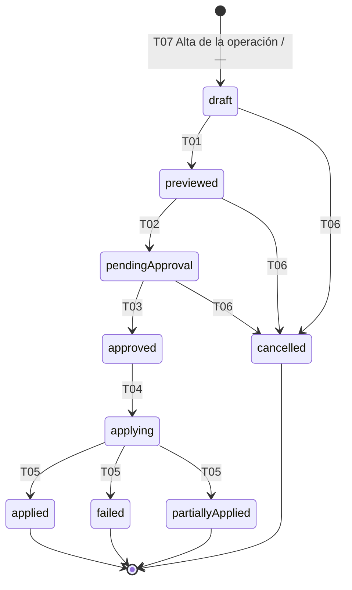

| # | Desde | Hasta | Disparador | Tipo | Guardas | Evento emitido |
|---|---|---|---|---|---|---|
| T01 | `draft` | `previewed` | — | no especificado | — | — |
| T02 | `previewed` | `pendingApproval` | — | no especificado | — | — |
| T03 | `pendingApproval` | `approved` | — | no especificado | — | — |
| T04 | `approved` | `applying` | — | no especificado | — | — |
| T05 | `applying` | `applied`, `failed`, `partiallyApplied` | — | no especificado | — | — |
| T06 | `draft`, `pendingApproval`, `previewed` | `cancelled` | — | no especificado | — | — |
| T07 | (nuevo) | `draft` | Alta de la operación / — | no especificado | — | — |

### EST-FAC-16 — `massOperationItems.status` (COL-FAC-26)

**Colección:** Ítems de operación masiva. **Campos de estado en el §7:** `status` (línea 1133; valores: `proposed`, `applied`, `skipped`, `failed`).

**Fuente:** M05 §8.13.

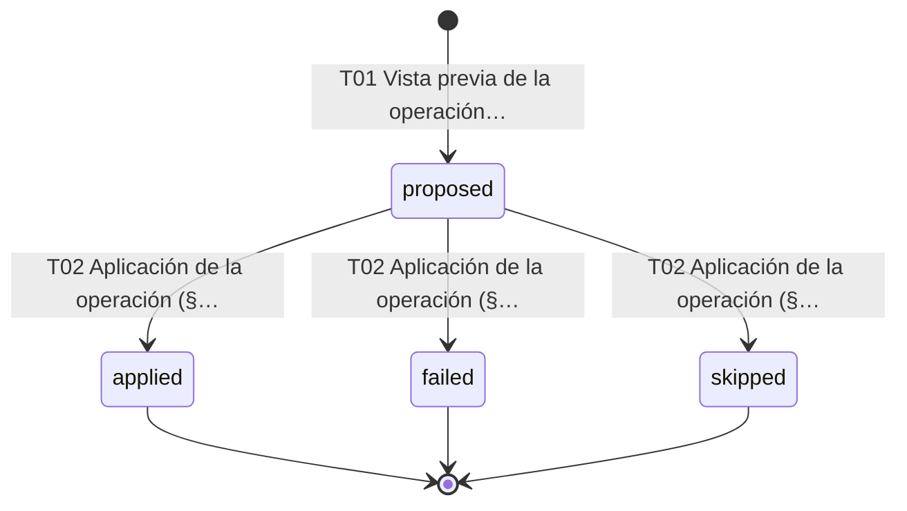

| # | Desde | Hasta | Disparador | Tipo | Guardas | Evento emitido |
|---|---|---|---|---|---|---|
| T01 | (nuevo) | `proposed` | Vista previa de la operación masiva / — | no especificado | — | — |
| T02 | `proposed` | `applied`, `failed`, `skipped` | Aplicación de la operación (§8.8) / — | no especificado | — | — |

### EST-FAC-17 — `billingImports.status` (COL-FAC-27)

**Colección:** Importaciones de facturación. **Campos de estado en el §7:** `status` (línea 1148; valores: `uploaded`, `validated`, `confirmed`, `applied`, `failed`, `cancelled`).

**Fuente:** M05 §8.8, M05 §8.13.

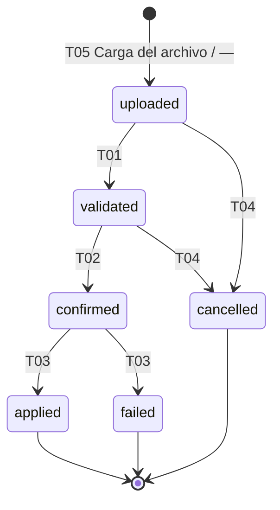

| # | Desde | Hasta | Disparador | Tipo | Guardas | Evento emitido |
|---|---|---|---|---|---|---|
| T01 | `uploaded` | `validated` | — | no especificado | — | — |
| T02 | `validated` | `confirmed` | — | no especificado | — | — |
| T03 | `confirmed` | `applied`, `failed` | — | no especificado | — | — |
| T04 | `uploaded`, `validated` | `cancelled` | — | no especificado | — | — |
| T05 | (nuevo) | `uploaded` | Carga del archivo / — | no especificado | — | — |

### EST-FAC-18 — `invoiceTemplates.status` (COL-FAC-30)

**Colección:** Reglas de selección de plantilla (el diseño vive en T11 `templateVersions`). **Campos de estado en el §7:** `status` (línea 1180; valores declarados en el §8, línea 1548; valores: `draft`, `published`, `retired`).

**Fuente:** el §8 del anexo no detalla esta colección; se aplica el patrón general de T05 §7.1.5 (versiones publicadas) sobre los valores del §7.

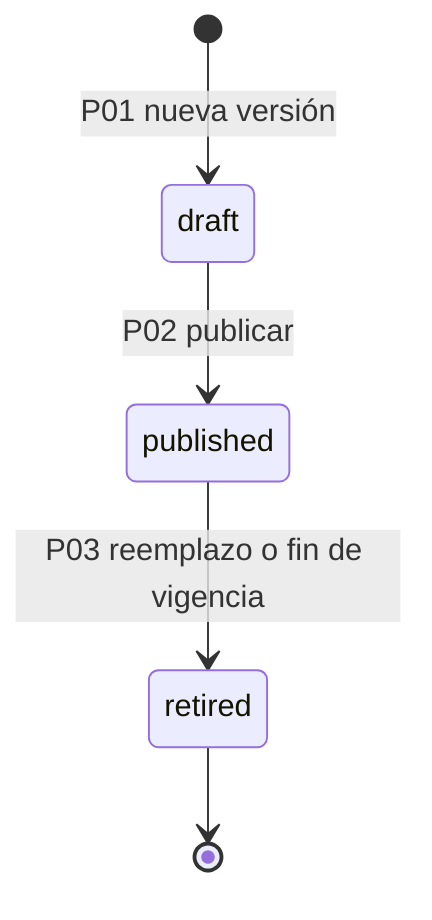

| # | Desde | Hasta | Disparador | Tipo | Guardas | Evento emitido |
|---|---|---|---|---|---|---|
| P01 | (nuevo) | `draft` | Configurador | usuario | — | — |
| P02 | `draft` | `published` | Configurador o aprobador | usuario | Versión validada; publicada queda inmutable (T05 §7.1.5) | — |
| P03 | `published` | `retired` | Sistema al publicar la sucesora o configurador | sistema, usuario | Existe versión sucesora o fin de vigencia | — |

### EST-FAC-19 — `barcodeFormats.status` (COL-FAC-33)

**Colección:** Formatos declarativos de código de barras. **Campos de estado en el §7:** `status` (línea 1234; valores declarados en el §8, línea 1548; valores: `draft`, `published`, `retired`).

**Fuente:** el §8 del anexo no detalla esta colección; se aplica el patrón general de T05 §7.1.5 (versiones publicadas) sobre los valores del §7.


| # | Desde | Hasta | Disparador | Tipo | Guardas | Evento emitido |
|---|---|---|---|---|---|---|
| P01 | (nuevo) | `draft` | Configurador | usuario | — | — |
| P02 | `draft` | `published` | Configurador o aprobador | usuario | Versión validada; publicada queda inmutable (T05 §7.1.5) | — |
| P03 | `published` | `retired` | Sistema al publicar la sucesora o configurador | sistema, usuario | Existe versión sucesora o fin de vigencia | — |

### EST-FAC-20 — `paymentSlips.status` (COL-FAC-35)

**Colección:** Talones sumados y de cuota (el cupón único vive en M07). **Campos de estado en el §7:** `status` (línea 1267; valores: `active`, `superseded`, `cancelled`, `paid`).

**Fuente:** M05 §8.13.

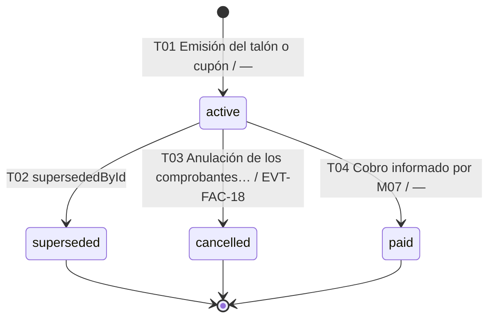

| # | Desde | Hasta | Disparador | Tipo | Guardas | Evento emitido |
|---|---|---|---|---|---|---|
| T01 | (nuevo) | `active` | Emisión del talón o cupón / — | no especificado | — | — |
| T02 | `active` | `superseded` | Reemplazo por un talón nuevo (`supersededById`) / — | job | — | — |
| T03 | `active` | `cancelled` | Anulación de los comprobantes que agrupa / — | no especificado | — | EVT-FAC-18 `fac.paymentSlip.cancelled` (inferido por nombre) |
| T04 | `active` | `paid` | Cobro informado por M07 / — | no especificado | — | — |

### EST-FAC-21 — `distributionRuns.status` (COL-FAC-38)

**Colección:** Corridas de distribución. **Campos de estado en el §7:** `status` (línea 1304; sin valores en el §7).

**Fuente:** M05 §8.9, M05 §8.13.

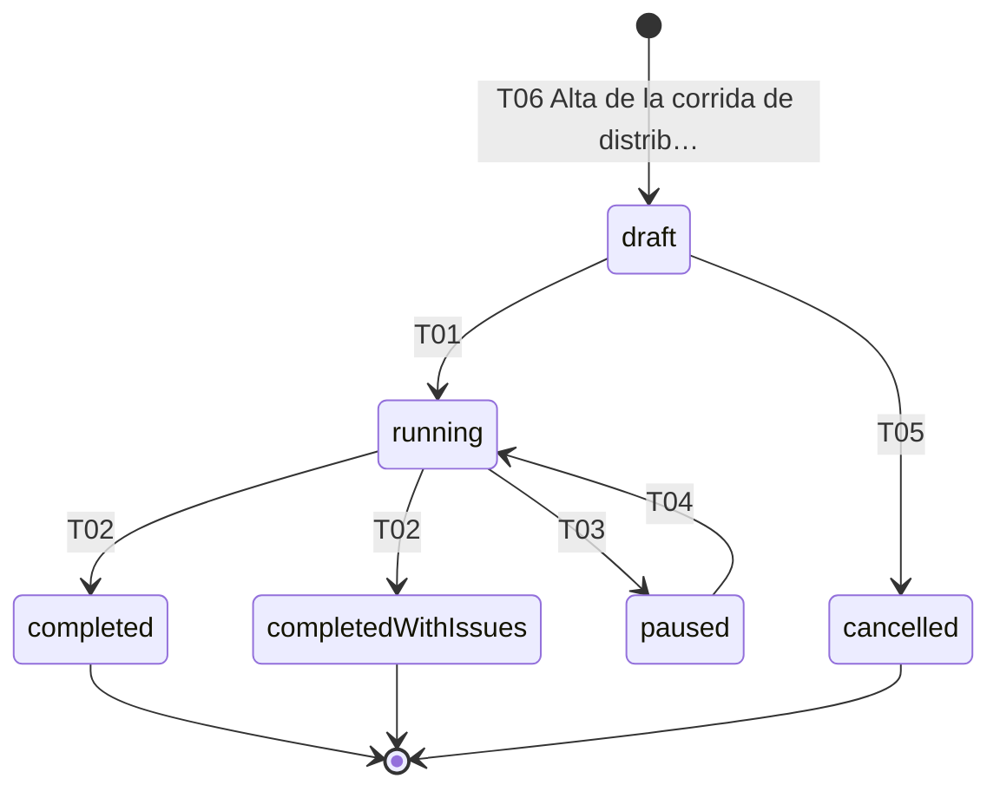

| # | Desde | Hasta | Disparador | Tipo | Guardas | Evento emitido |
|---|---|---|---|---|---|---|
| T01 | `draft` | `running` | — | no especificado | — | — |
| T02 | `running` | `completed`, `completedWithIssues` | — | no especificado | — | — |
| T03 | `running` | `paused` | — | no especificado | — | — |
| T04 | `paused` | `running` | — | no especificado | — | — |
| T05 | `draft` | `cancelled` | — | no especificado | — | — |
| T06 | (nuevo) | `draft` | Alta de la corrida de distribución / — | no especificado | — | — |

### EST-FAC-22 — `invoiceDeliveries.status` (COL-FAC-39)

**Colección:** Entrega por comprobante y canal (alto volumen). **Campos de estado en el §7:** `status` (línea 1322; sin valores en el §7).

**Fuente:** M05 §8.9, M05 §8.13.

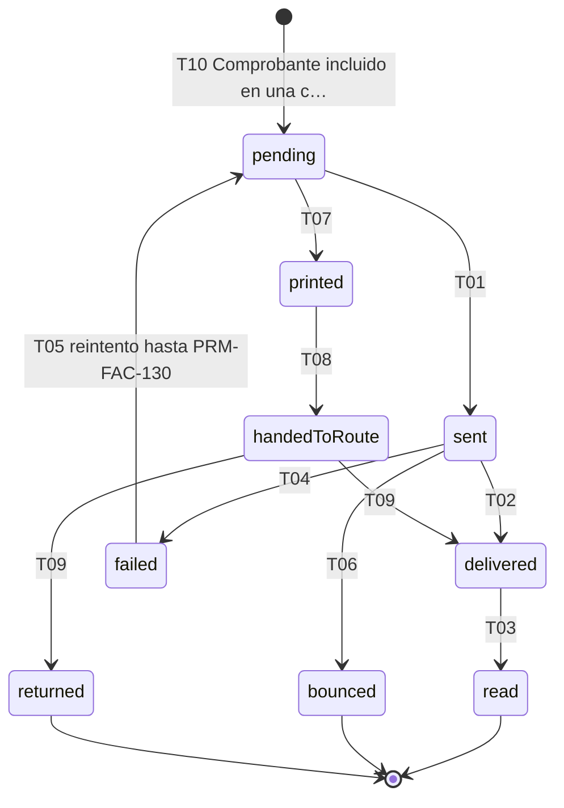

| # | Desde | Hasta | Disparador | Tipo | Guardas | Evento emitido |
|---|---|---|---|---|---|---|
| T01 | `pending` | `sent` | — | no especificado | — | — |
| T02 | `sent` | `delivered` | — | no especificado | — | — |
| T03 | `delivered` | `read` | — | no especificado | — | — |
| T04 | `sent` | `failed` | — | no especificado | — | — |
| T05 | `failed` | `pending` | reintento hasta PRM-FAC-130 | no especificado | — | — |
| T06 | `sent` | `bounced` | — | no especificado | — | — |
| T07 | `pending` | `printed` | — | no especificado | — | — |
| T08 | `printed` | `handedToRoute` | — | no especificado | — | — |
| T09 | `handedToRoute` | `delivered`, `returned` | — | no especificado | — | — |
| T10 | (nuevo) | `pending` | Comprobante incluido en una corrida de distribución / — | no especificado | — | — |

### EST-FAC-23 — `distributionRoutes.status` (COL-FAC-40)

**Colección:** Recorridos de reparto. **Campos de estado en el §7:** `status` (línea 1346; valores declarados en el §8, línea 1549; valores: `active`, `inactive`).

**Fuente:** el §8 del anexo no detalla esta colección; se aplica el patrón general de T05 §7.1.5 (estados, baja lógica) y T04 §8.3 (registros maestros) sobre los valores del §7.

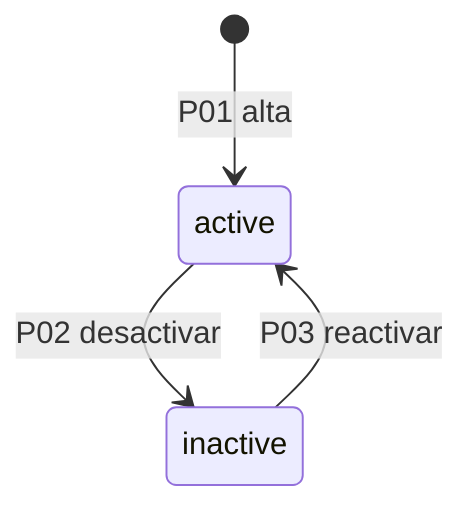

| # | Desde | Hasta | Disparador | Tipo | Guardas | Evento emitido |
|---|---|---|---|---|---|---|
| P01 | (nuevo) | `active` | Alta del registro (operador, importación o plataforma) | usuario, sistema | Validación del esquema (T04 §8.3) | — |
| P02 | `active` | `inactive` | Operador | usuario | Si está referenciado se informa el conteo; no se borra (T05 §7.1.5) | — |
| P03 | `inactive` | `active` | Operador | usuario | — | — |

### EST-FAC-24 — `billingCycleClosures.status` (COL-FAC-42)

**Colección:** Acta de cierre de ciclo. **Campos de estado en el §7:** `status` (línea 1383; sin valores en el §7).

**Fuente:** M05 §8.10.

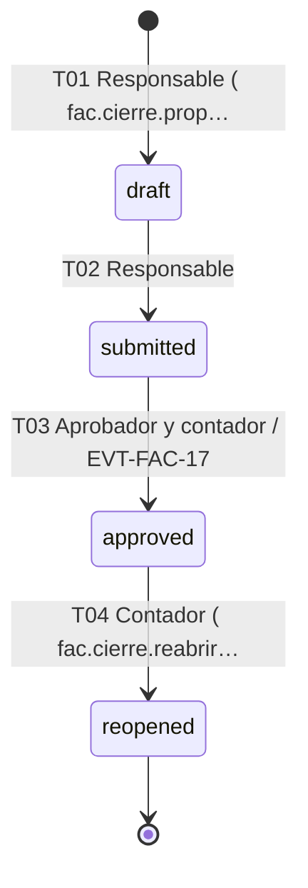

| # | Desde | Hasta | Disparador | Tipo | Guardas | Evento emitido |
|---|---|---|---|---|---|---|
| T01 | (nuevo) | `draft` | Responsable (`fac.cierre.proponer`) | usuario | Lotes del ciclo/período en `issued` o `issuedWithPending` | — |
| T02 | `draft` | `submitted` | Responsable | usuario | `reconciliation.balanced = true`; excepciones abiertas con responsable | — |
| T03 | `submitted` | `approved` | Aprobador y contador | usuario | — | EVT-FAC-17 `fac.billingCycle.closed` |
| T04 | `approved` | `reopened` | Contador (`fac.cierre.reabrir`) con aprobación | usuario | Motivo | — |

### EST-FAC-25 — `invoiceBlockHistory.status` (colección de otro dueño o absorbida)

**Fuente:** M05 §8.7. La colección figura en T05 como COL-FAC-16 A→COL-MOR-12 (dueño M05); no se crea con este dueño, se conserva el diagrama del §8 de este anexo.

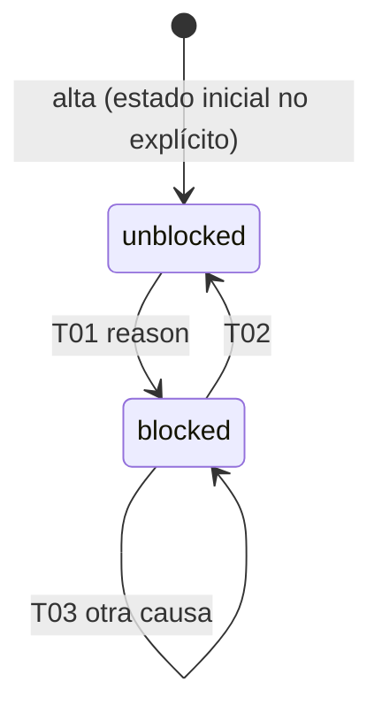

| # | Desde | Hasta | Disparador | Tipo | Guardas | Evento emitido |
|---|---|---|---|---|---|---|
| T01 | `unblocked` | `blocked` | reason | no especificado | — | — |
| T02 | `blocked` | `unblocked` | — | no especificado | — | — |
| T03 | `blocked` | `blocked` | otra causa | no especificado | — | — |

## M06 — FIS Fiscal e impuestos

### EST-FIS-01 — `normativeTableVersions.status` (COL-FIS-02)

**Colección:** Versiones publicadas con filas. **Campos de estado en el §7:** `status` (línea 588; valores: `draft`, `inReview`, `published`, `retired`).

**Fuente:** M06 §8.4, M06 §8.12.

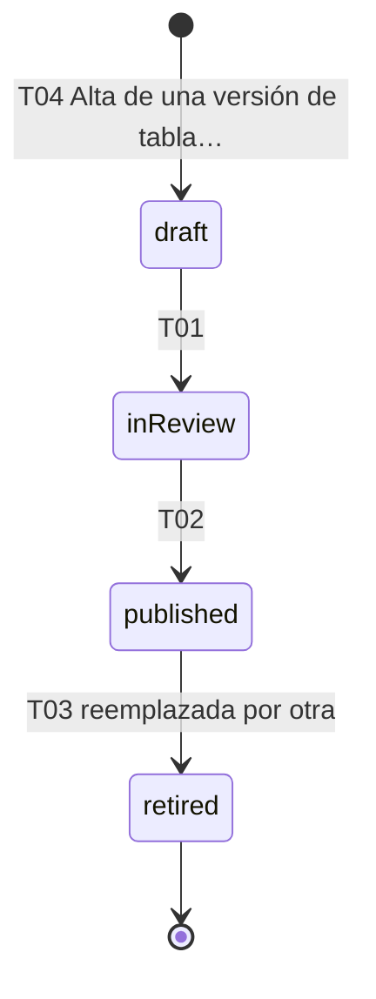

| # | Desde | Hasta | Disparador | Tipo | Guardas | Evento emitido |
|---|---|---|---|---|---|---|
| T01 | `draft` | `inReview` | — | no especificado | — | — |
| T02 | `inReview` | `published` | — | no especificado | — | — |
| T03 | `published` | `retired` | reemplazada por otra | no especificado | — | — |
| T04 | (nuevo) | `draft` | Alta de una versión de tabla normativa (plataforma) / — | no especificado | — | — |

### EST-FIS-02 — `normativeAdoptions.status` (COL-FIS-03)

**Colección:** Adopción por tenant con filas propias. **Campos de estado en el §7:** `status` (línea 606; valores: `proposed`, `approved`, `superseded`, `rejected`).

**Fuente:** M06 §8.4, M06 §8.12.

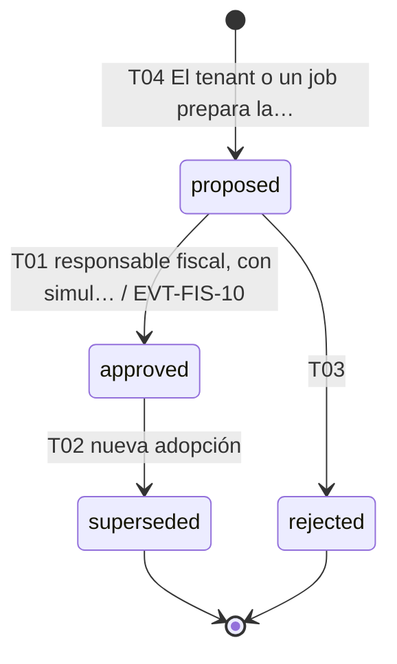

| # | Desde | Hasta | Disparador | Tipo | Guardas | Evento emitido |
|---|---|---|---|---|---|---|
| T01 | `proposed` | `approved` | responsable fiscal, con simulación opcional | usuario | — | EVT-FIS-10 `fis.normativeAdoption.approved` (inferido por nombre) |
| T02 | `approved` | `superseded` | nueva adopción | no especificado | — | — |
| T03 | `proposed` | `rejected` | — | no especificado | — | — |
| T04 | (nuevo) | `proposed` | El tenant o un job prepara la adopción / — | job | — | — |

### EST-FIS-03 — `fiscalSurveys.status` (COL-FIS-05)

**Colección:** Relevamiento fiscal (BASE §52.4). **Campos de estado en el §7:** `status` (línea 637; valores: `draft`, `inReview`, `approved`, `superseded`).

**Fuente:** M06 §8.11.

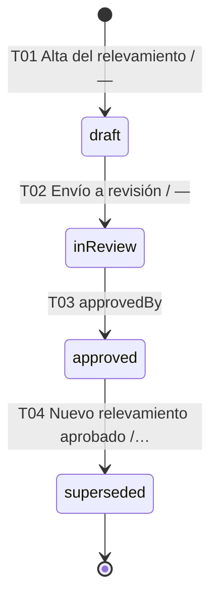

| # | Desde | Hasta | Disparador | Tipo | Guardas | Evento emitido |
|---|---|---|---|---|---|---|
| T01 | (nuevo) | `draft` | Alta del relevamiento / — | no especificado | — | — |
| T02 | `draft` | `inReview` | Envío a revisión / — | no especificado | — | — |
| T03 | `inReview` | `approved` | Aprobación (`approvedBy`) / — | no especificado | — | — |
| T04 | `approved` | `superseded` | Nuevo relevamiento aprobado / — | no especificado | — | — |

### EST-FIS-04 — `arcaCredentials.status` (COL-FIS-07)

**Colección:** Metadatos de certificado ARCA (el secreto en T06). **Campos de estado en el §7:** `status` (línea 680; valores: `pendingCertificate`, `testing`, `active`, `expiring`, `expired`, `revoked`, `replaced`).

**Fuente:** M06 §8.2, M06 §8.12.

```mermaid
stateDiagram-v2
    pendingCertificate --> testing : T01 certificado cargado prueba en…
    testing --> active : T02 prueba OK y relevamiento apro…
    active --> expiring : T03 EVT-FIS-08
    expiring --> expired : T04 vencido cola detenida / EVT-FIS-08
    active --> replaced : T05 nuevo certificado activo, sin…
    expiring --> replaced : T05 nuevo certificado activo, sin…
    [*] --> pendingCertificate : T07 Alta de la credencial (CSR ge…
    note left of revoked : T06 desde cualquier estado previsto
    expired --> [*]
    replaced --> [*]
    revoked --> [*]
```

| # | Desde | Hasta | Disparador | Tipo | Guardas | Evento emitido |
|---|---|---|---|---|---|---|
| T01 | `pendingCertificate` | `testing` | certificado cargado prueba en homologación | no especificado | — | — |
| T02 | `testing` | `active` | prueba OK y relevamiento aprobado | no especificado | — | — |
| T03 | `active` | `expiring` | — | no especificado | — | EVT-FIS-08 `fis.credential.expiring` (inferido por nombre) |
| T04 | `expiring` | `expired` | vencido cola detenida | job | — | EVT-FIS-08 `fis.credential.expiring` (inferido por nombre) |
| T05 | `active`, `expiring` | `replaced` | nuevo certificado activo, sin interrupción | no especificado | — | — |
| T06 | cualquiera | `revoked` | acción del responsable fiscal con MFA | usuario | — | — |
| T07 | (nuevo) | `pendingCertificate` | Alta de la credencial (CSR generado) / — | no especificado | — | — |

### EST-FIS-05 — `fiscalAuthorizations.status` (COL-FIS-10)

**Colección:** Cola de autorización CAE/CAEA/CAI/CESP. **Campos de estado en el §7:** `status` (línea 731; sin valores en el §7).

**Fuente:** M06 §8.1.

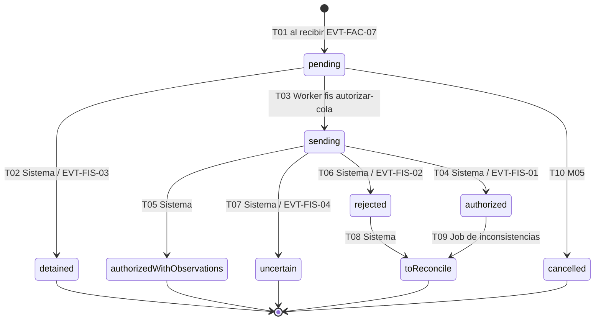

| # | Desde | Hasta | Disparador | Tipo | Guardas | Evento emitido |
|---|---|---|---|---|---|---|
| T01 | (nuevo) | `pending` | Sistema (evento `fac.invoice.issued`, `fac.creditNote.issued` o `fac.debitNote.issued`) | evento, sistema | Comprobante fiscal con modalidad CAE/CAEA | — |
| T02 | `pending` | `detained` | Sistema | sistema | Prevalidación falla (sin CUIT, alícuota sin mapeo, anterior pendiente, hueco, credencial vencida, punto pausado) | EVT-FIS-03 `fis.authorization.detained` |
| T03 | `pending` | `sending` | Worker `fis:autorizar-cola` | job, API/integración, usuario | Lock del par obtenido; TA vigente | — |
| T04 | `sending` | `authorized` | Sistema | sistema | Resultado `A` sin observaciones | EVT-FIS-01 `fis.invoice.authorized` |
| T05 | `sending` | `authorizedWithObservations` | Sistema | sistema | Resultado `A` con observaciones | — |
| T06 | `sending` | `rejected` | Sistema | sistema | Resultado `R` | EVT-FIS-02 `fis.authorization.rejected` |
| T07 | `sending` | `uncertain` | Sistema | sistema | Timeout, error de transporte o respuesta ilegible | EVT-FIS-04 `fis.authorization.uncertain` (inferido por nombre) |
| T08 | `rejected` | `toReconcile` | Sistema | sistema | Número ya autorizado en ARCA o fecha fuera de secuencia | — |
| T09 | `authorized` | `toReconcile` | Job de inconsistencias | job | CAE o total distinto en ARCA | — |
| T10 | `pending` | `cancelled` | M05 | no especificado | El comprobante no llegó a enviarse y M05 anula la emisión (solo si nunca hubo envío) | — |

### EST-FIS-06 — `arcaSubmissions.status` (COL-FIS-11)

**Colección:** Envíos a ARCA (cuerpos saneados en almacenamiento privado). **Campos de estado en el §7:** `status` (línea 749; valores: `sending`, `answered`, `timeout`, `transportError`).

**Fuente:** M06 §8.11.

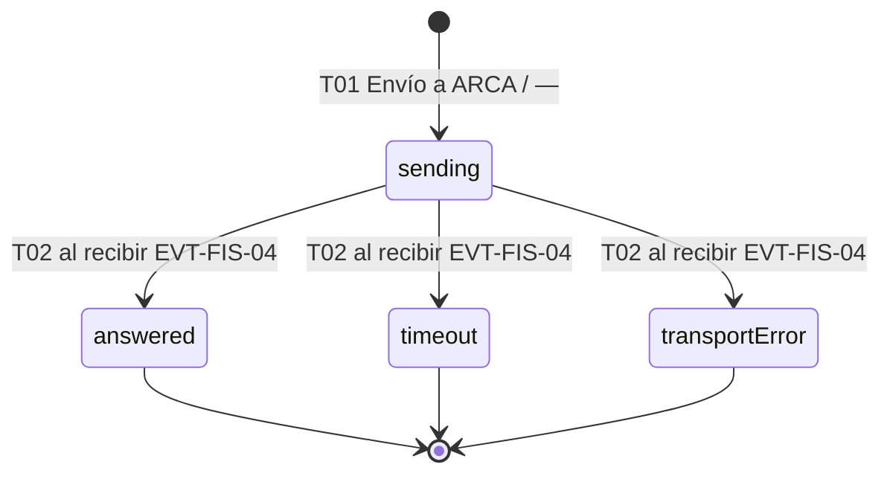

| # | Desde | Hasta | Disparador | Tipo | Guardas | Evento emitido |
|---|---|---|---|---|---|---|
| T01 | (nuevo) | `sending` | Envío a ARCA / — | API/integración | — | — |
| T02 | `sending` | `answered`, `timeout`, `transportError` | Respuesta, vencimiento o error de transporte / `fis.authorization.uncertain` (EVT-FIS-04) si `timeout` | job, evento | — | — |

### EST-FIS-07 — `caeaPeriods.status` (COL-FIS-12)

**Colección:** Períodos CAEA. **Campos de estado en el §7:** `status` (línea 776; valores: `requested`, `active`, `reporting`, `reported`, `expiredWithPending`).

**Fuente:** M06 §8.3, M06 §8.12.

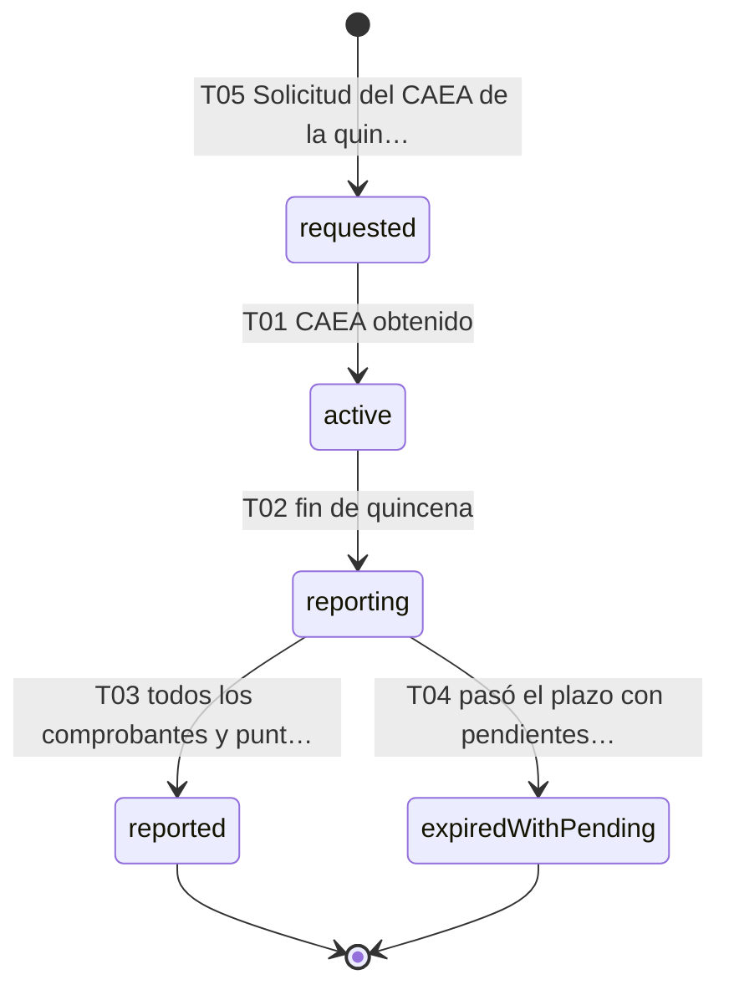

| # | Desde | Hasta | Disparador | Tipo | Guardas | Evento emitido |
|---|---|---|---|---|---|---|
| T01 | `requested` | `active` | CAEA obtenido | no especificado | — | — |
| T02 | `active` | `reporting` | fin de quincena | no especificado | — | — |
| T03 | `reporting` | `reported` | todos los comprobantes y puntos sin movimiento informados | no especificado | — | — |
| T04 | `reporting` | `expiredWithPending` | pasó el plazo con pendientes: alerta crítica | job | — | — |
| T05 | (nuevo) | `requested` | Solicitud del CAEA de la quincena / — | no especificado | — | — |

### EST-FIS-08 — `cespAuthorizations.status` (COL-FIS-13)

**Colección:** Autorizaciones CESP. **Campos de estado en el §7:** `status` (línea 795; valores: `active`, `expired`, `cancelled`).

**Fuente:** M06 §8.11.

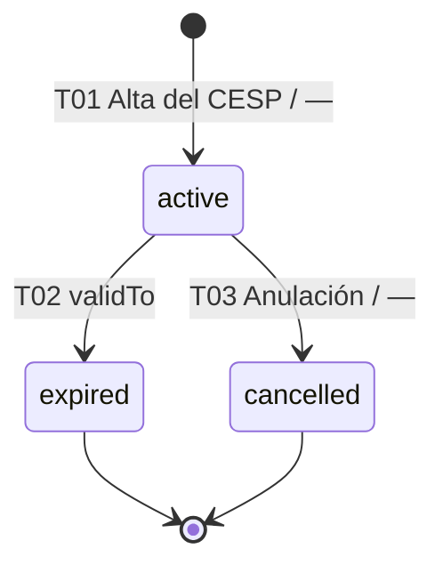

| # | Desde | Hasta | Disparador | Tipo | Guardas | Evento emitido |
|---|---|---|---|---|---|---|
| T01 | (nuevo) | `active` | Alta del CESP / — | no especificado | — | — |
| T02 | `active` | `expired` | Vence `validTo` / — | no especificado | — | — |
| T03 | `active` | `cancelled` | Anulación / — | no especificado | — | — |

### EST-FIS-09 — `provincialValidationCodes.status` (COL-FIS-14)

**Colección:** Códigos de validación provincial. **Campos de estado en el §7:** `status` (línea 814; valores: `active`, `expired`).

**Fuente:** M06 §8.12.

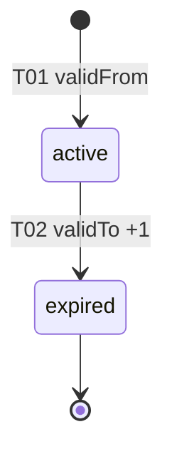

| # | Desde | Hasta | Disparador | Tipo | Guardas | Evento emitido |
|---|---|---|---|---|---|---|
| T01 | (nuevo) | `active` | Alta del CVP con vigencia (`validFrom`/`validTo`) / — | no especificado | — | — |
| T02 | `active` | `expired` | Job diario de vigencias: vence `validTo` / — | job | `validTo` anterior a la fecha; desde entonces no se imprime en comprobantes (RF-FIS-090) | — |
| T03 | `active` | `expired` | de por vencimiento de baja de máquina de los valores de regimeFilings, | job | — | — |

### EST-FIS-10 — `taxpayerRegistries.status` (COL-FIS-20)

**Colección:** Padrones importados (absorbe `taxRegistries` de T04). **Campos de estado en el §7:** `status` (línea 925; valores: `importing`, `validated`, `active`, `superseded`, `failed`).

**Fuente:** M06 §8.5, M06 §8.12.

```mermaid
stateDiagram-v2
    importing --> validated : T01 errores listados
    validated --> active : T02 aprobado reemplaza al anterio… / EVT-FIS-11
    active --> superseded : T03
    importing --> failed : T04
    [*] --> importing : T05 JOB-FIS-08
    superseded --> [*]
    failed --> [*]
```

| # | Desde | Hasta | Disparador | Tipo | Guardas | Evento emitido |
|---|---|---|---|---|---|---|
| T01 | `importing` | `validated` | errores listados | no especificado | — | — |
| T02 | `validated` | `active` | aprobado reemplaza al anterior para su vigencia | no especificado | — | EVT-FIS-11 `fis.registry.activated` (inferido por nombre) |
| T03 | `active` | `superseded` | — | no especificado | — | — |
| T04 | `importing` | `failed` | — | no especificado | — | — |
| T05 | (nuevo) | `importing` | Carga o descarga del padrón (JOB-FIS-08) / — | job | — | — |

### EST-FIS-11 — `withholdingsApplied.status` (COL-FIS-28)

**Colección:** Retenciones practicadas con certificado. **Campos de estado en el §7:** `status` (línea 1095; sin valores en el §7).

**Fuente:** M06 §8.6, M06 §8.12.

```mermaid
stateDiagram-v2
    calculated --> confirmed : T01 OP aprobada certificado numer…
    confirmed --> reported : T02 incluida en declaración prese…
    reported --> paid : T03 obligación pagada
    calculated --> cancelled : T04 OP anulada importes conservad…
    confirmed --> cancelled : T04 OP anulada importes conservad…
    reported --> rectified : T05 anulada después de presentada…
    [*] --> calculated : T06 Cálculo en la OP en preparaci…
    paid --> [*]
    cancelled --> [*]
    rectified --> [*]
```

| # | Desde | Hasta | Disparador | Tipo | Guardas | Evento emitido |
|---|---|---|---|---|---|---|
| T01 | `calculated` | `confirmed` | OP aprobada certificado numerado | no especificado | — | — |
| T02 | `confirmed` | `reported` | incluida en declaración presentada | no especificado | — | — |
| T03 | `reported` | `paid` | obligación pagada | no especificado | — | — |
| T04 | `calculated`, `confirmed` | `cancelled` | OP anulada importes conservados | no especificado | — | — |
| T05 | `reported` | `rectified` | anulada después de presentada requiere rectificativa | no especificado | — | — |
| T06 | (nuevo) | `calculated` | Cálculo en la OP en preparación (`fis.service.calculateWithholdings`) / — | usuario | — | — |

### EST-FIS-12 — `taxObligations.status` (COL-FIS-30)

**Colección:** Obligaciones fiscales a pagar. **Campos de estado en el §7:** `status` (línea 1120; valores: `pending`, `ordered`, `paid`, `reconciled`, `cancelled`).

**Fuente:** M06 §8.11.

```mermaid
stateDiagram-v2
    [*] --> pending : T01 Cierre del período del régime…
    pending --> ordered : T02 Orden de pago en M14 / —
    ordered --> paid : T03 treasuryMovementId
    paid --> reconciled : T04 journalEntryId
    ordered --> cancelled : T05 Anulación con motivo / —
    pending --> cancelled : T05 Anulación con motivo / —
    reconciled --> [*]
    cancelled --> [*]
```

| # | Desde | Hasta | Disparador | Tipo | Guardas | Evento emitido |
|---|---|---|---|---|---|---|
| T01 | (nuevo) | `pending` | Cierre del período del régimen / — | no especificado | — | — |
| T02 | `pending` | `ordered` | Orden de pago en M14 / — | no especificado | — | — |
| T03 | `ordered` | `paid` | Pago confirmado (`treasuryMovementId`) / — | no especificado | — | — |
| T04 | `paid` | `reconciled` | Conciliación con asiento (`journalEntryId`) / — | no especificado | — | — |
| T05 | `ordered`, `pending` | `cancelled` | Anulación con motivo / — | no especificado | — | — |

### EST-FIS-13 — `vatLedgers.status` (COL-FIS-31)

**Colección:** Libros IVA por período. **Campos de estado en el §7:** `status` (línea 1140; valores: `draft`, `closed`, `reopened`, `rectified`).

**Fuente:** M06 §8.9, M06 §8.12.

```mermaid
stateDiagram-v2
    draft --> closed : T01 EVT-FIS-15
    closed --> reopened : T02 con motivo y autorización / EVT-FIS-15
    reopened --> closed : T03 EVT-FIS-15
    closed --> rectified : T04 nueva versión vinculada cuand…
    [*] --> draft : T05 Apertura del libro del períod…
    rectified --> [*]
```

| # | Desde | Hasta | Disparador | Tipo | Guardas | Evento emitido |
|---|---|---|---|---|---|---|
| T01 | `draft` | `closed` | — | no especificado | — | EVT-FIS-15 `fis.vatLedger.closed` (inferido por nombre) |
| T02 | `closed` | `reopened` | con motivo y autorización | usuario | — | EVT-FIS-15 `fis.vatLedger.reopened` (inferido por nombre) |
| T03 | `reopened` | `closed` | — | no especificado | — | EVT-FIS-15 `fis.vatLedger.closed` (inferido por nombre) |
| T04 | `closed` | `rectified` | nueva versión vinculada cuando ya se presentó la declaración | no especificado | — | — |
| T05 | (nuevo) | `draft` | Apertura del libro del período / — | no especificado | — | — |

### EST-FIS-14 — `vatReconciliations.status` (COL-FIS-34)

**Colección:** Conciliación con ARCA. **Campos de estado en el §7:** `status` (línea 1206; valores: `open`, `reviewed`, `closed`).

**Fuente:** M06 §8.11.

```mermaid
stateDiagram-v2
    [*] --> open : T01 API-FIS-61
    open --> reviewed : T02 Revisión de diferencias / —
    reviewed --> closed : T03 Cierre / —
    closed --> [*]
```

| # | Desde | Hasta | Disparador | Tipo | Guardas | Evento emitido |
|---|---|---|---|---|---|---|
| T01 | (nuevo) | `open` | Importación de ARCA (API-FIS-61) / — | API/integración | — | — |
| T02 | `open` | `reviewed` | Revisión de diferencias / — | no especificado | — | — |
| T03 | `reviewed` | `closed` | Cierre / — | no especificado | — | — |

### EST-FIS-15 — `regimeFilings.status` (COL-FIS-36)

**Colección:** Presentaciones de regímenes. **Campos de estado en el §7:** `status` (línea 1239; sin valores en el §7).

**Fuente:** M06 §8.7, M06 §8.12.

```mermaid
stateDiagram-v2
    draft --> generated : T01 EVT-FIS-14
    generated --> validated : T02
    validationFailed --> draft : T03
    validated --> approved : T04 responsable fiscal
    approved --> submitted : T05 acuse cargado / EVT-FIS-14
    submitted --> accepted : T06 EVT-FIS-14
    submitted --> rejected : T06 EVT-FIS-14
    accepted --> rectified : T07 si se presenta una rectificat…
    [*] --> draft : T08 Generación de la presentación…
    rejected --> [*]
    rectified --> [*]
```

| # | Desde | Hasta | Disparador | Tipo | Guardas | Evento emitido |
|---|---|---|---|---|---|---|
| T01 | `draft` | `generated` | — | no especificado | — | EVT-FIS-14 `fis.filing.generated` (inferido por nombre) |
| T02 | `generated` | `validated` | — | no especificado | — | — |
| T03 | `validationFailed` | `draft` | — | no especificado | — | — |
| T04 | `validated` | `approved` | responsable fiscal | usuario | — | — |
| T05 | `approved` | `submitted` | acuse cargado | no especificado | — | EVT-FIS-14 `fis.filing.submitted` (inferido por nombre) |
| T06 | `submitted` | `accepted`, `rejected` | — | no especificado | — | EVT-FIS-14 `fis.filing.accepted` (inferido por nombre) |
| T07 | `accepted` | `rectified` | si se presenta una rectificativa posterior | no especificado | — | — |
| T08 | (nuevo) | `draft` | Generación de la presentación del período / — | no especificado | — | — |

### EST-FIS-16 — `thirdPartyAgreements.status` (COL-FIS-37)

**Colección:** Convenios de cobro por cuenta de terceros; `moraPolicy` (saldo de terceros en mora y recargo, HUECO-TAS-02); los conceptos de terceros siempre cuelgan de un contrato (DEC-083). **Campos de estado en el §7:** `status` (línea 1277; valores: `draft`, `active`, `suspended`, `expired`).

**Fuente:** M06 §8.10, M06 §8.12.

```mermaid
stateDiagram-v2
    draft --> active : T01 fundamento y aprobación
    active --> suspended : T02 no se factura se sigue rindie…
    suspended --> active : T03
    active --> expired : T04 por
    [*] --> draft : T05 Alta del convenio con tercero…
    expired --> [*]
```

| # | Desde | Hasta | Disparador | Tipo | Guardas | Evento emitido |
|---|---|---|---|---|---|---|
| T01 | `draft` | `active` | fundamento y aprobación | no especificado | — | — |
| T02 | `active` | `suspended` | no se factura se sigue rindiendo lo cobrado | no especificado | — | — |
| T03 | `suspended` | `active` | — | no especificado | — | — |
| T04 | `active` | `expired` | por | no especificado | — | — |
| T05 | (nuevo) | `draft` | Alta del convenio con tercero / — | no especificado | — | — |

### EST-FIS-17 — `thirdPartyCharges.status` (COL-FIS-38)

**Colección:** Cargos de terceros facturados. **Campos de estado en el §7:** `status` (línea 1282; valores: `billed`, `partiallyCollected`, `collected`, `cancelled`).

**Fuente:** M06 §8.11.

```mermaid
stateDiagram-v2
    [*] --> billed : T01 Comprobante con cargo de terc…
    billed --> collected : T02 Cobros (M07) / — / EVT-FIS-16
    billed --> partiallyCollected : T02 Cobros (M07) / — / EVT-FIS-16
    partiallyCollected --> collected : T03 Cobro del remanente / — / EVT-FIS-16
    billed --> cancelled : T04 Anulación del comprobante / —
    partiallyCollected --> cancelled : T04 Anulación del comprobante / —
    collected --> [*]
    cancelled --> [*]
```

| # | Desde | Hasta | Disparador | Tipo | Guardas | Evento emitido |
|---|---|---|---|---|---|---|
| T01 | (nuevo) | `billed` | Comprobante con cargo de tercero / — | no especificado | — | — |
| T02 | `billed` | `collected`, `partiallyCollected` | Cobros (M07) / — | no especificado | — | EVT-FIS-16 `fis.thirdPartyCharge.collected` (inferido por nombre) |
| T03 | `partiallyCollected` | `collected` | Cobro del remanente / — | no especificado | — | EVT-FIS-16 `fis.thirdPartyCharge.collected` (inferido por nombre) |
| T04 | `billed`, `partiallyCollected` | `cancelled` | Anulación del comprobante / — | no especificado | — | — |

### EST-FIS-18 — `thirdPartyRemittances.status` (COL-FIS-39)

**Colección:** Rendiciones a terceros. **Campos de estado en el §7:** `status` (línea 1298; sin valores en el §7).

**Fuente:** M06 §8.8, M06 §8.12.

```mermaid
stateDiagram-v2
    draft --> calculated : T01
    calculated --> approved : T02 EVT-FIS-17
    approved --> ordered : T03 OP en M14
    ordered --> paid : T04 movimiento confirmado / EVT-FIS-17
    paid --> reconciled : T05
    approved --> cancelled : T06 con motivo
    ordered --> cancelled : T06 con motivo
    [*] --> draft : T07 Inicio de la rendición del pe…
    reconciled --> [*]
    cancelled --> [*]
```

| # | Desde | Hasta | Disparador | Tipo | Guardas | Evento emitido |
|---|---|---|---|---|---|---|
| T01 | `draft` | `calculated` | — | no especificado | — | — |
| T02 | `calculated` | `approved` | — | no especificado | — | EVT-FIS-17 `fis.remittance.approved` (inferido por nombre) |
| T03 | `approved` | `ordered` | OP en M14 | no especificado | — | — |
| T04 | `ordered` | `paid` | movimiento confirmado | no especificado | — | EVT-FIS-17 `fis.remittance.paid` (inferido por nombre) |
| T05 | `paid` | `reconciled` | — | no especificado | — | — |
| T06 | `approved`, `ordered` | `cancelled` | con motivo | no especificado | — | — |
| T07 | (nuevo) | `draft` | Inicio de la rendición del período / — | no especificado | — | — |

### EST-FIS-19 — `regulatoryReportRuns.status` (COL-FIS-41)

**Colección:** Presentaciones a reguladores. **Campos de estado en el §7:** `status` (línea 1356; valores: `draft`, `generated`, `validated`, `validationFailed`, `approved`, `submitted`, `accepted`, `rejected`, `rectified`).

**Fuente:** M06 §8.12.

```mermaid
stateDiagram-v2
    [*] --> draft : T01 Inicio del informe al regulad…
    draft --> generated : T02 Generación de archivos / —
    generated --> validated : T03 Validación de formato superad…
    generated --> validationFailed : T04 Validación de formato con err…
    validationFailed --> draft : T05 Corrección de datos / —
    validated --> approved : T06 Aprobación del responsable fi…
    approved --> submitted : T07 acknowledgment
    submitted --> accepted : T08 El regulador acepta / —
    submitted --> rejected : T09 El regulador rechaza / —
    accepted --> rectified : T10 rectificationNo
    rejected --> [*]
    rectified --> [*]
```

| # | Desde | Hasta | Disparador | Tipo | Guardas | Evento emitido |
|---|---|---|---|---|---|---|
| T01 | (nuevo) | `draft` | Inicio del informe al regulador del período / — | no especificado | — | — |
| T02 | `draft` | `generated` | Generación de archivos / — | no especificado | — | — |
| T03 | `generated` | `validated` | Validación de formato superada / — | no especificado | — | — |
| T04 | `generated` | `validationFailed` | Validación de formato con errores / — | no especificado | — | — |
| T05 | `validationFailed` | `draft` | Corrección de datos / — | no especificado | — | — |
| T06 | `validated` | `approved` | Aprobación del responsable fiscal / — | usuario | — | — |
| T07 | `approved` | `submitted` | Carga del acuse (`acknowledgment`) / — | no especificado | Exige acuse o número de transacción | — |
| T08 | `submitted` | `accepted` | El regulador acepta / — | no especificado | — | — |
| T09 | `submitted` | `rejected` | El regulador rechaza / — | no especificado | — | — |
| T10 | `accepted` | `rectified` | Se presenta una rectificativa posterior (`rectificationNo` + 1) / — | no especificado | — | — |

### EST-FIS-20 — `publicAdminSelections.status` (COL-FIS-43)

**Colección:** Selecciones de comprobantes de administración pública. **Campos de estado en el §7:** `status` (línea 1374; valores: `active`, `replaced`).

**Fuente:** M06 §8.11.

```mermaid
stateDiagram-v2
    [*] --> active : T01 Selección guardada / —
    active --> replaced : T02 replacedById
    replaced --> [*]
```

| # | Desde | Hasta | Disparador | Tipo | Guardas | Evento emitido |
|---|---|---|---|---|---|---|
| T01 | (nuevo) | `active` | Selección guardada / — | no especificado | — | — |
| T02 | `active` | `replaced` | Nueva selección de la misma clave (`replacedById`) / — | no especificado | — | — |

### EST-FIS-21 — `gatewayDocuments.status` (COL-FIS-44)

**Colección:** Documentos en modo pasarela. **Campos de estado en el §7:** `exportStatus` (línea 1390; valores: `pending`, `exportedOk`, `exportedError`).

**Fuente:** M06 §8.11.

```mermaid
stateDiagram-v2
    [*] --> pending : T01 Recepción del comprobante de…
    pending --> exportedError : T02 Exportación al sistema extern…
    pending --> exportedOk : T02 Exportación al sistema extern…
    exportedError --> pending : T03 Reintento / —
    exportedOk --> [*]
```

| # | Desde | Hasta | Disparador | Tipo | Guardas | Evento emitido |
|---|---|---|---|---|---|---|
| T01 | (nuevo) | `pending` | Recepción del comprobante de la pasarela / — | no especificado | — | — |
| T02 | `pending` | `exportedError`, `exportedOk` | Exportación al sistema externo / — | sistema | — | — |
| T03 | `exportedError` | `pending` | Reintento / — | no especificado | — | — |

### EST-FIS-22 — `fiscalDeadlines.status` (COL-FIS-45)

**Colección:** Vencimientos fiscales. **Campos de estado en el §7:** `status` (línea 1427; valores: `upcoming`, `due`, `filed`, `overdue`).

**Fuente:** M06 §8.11.

```mermaid
stateDiagram-v2
    [*] --> upcoming : T01 Generación del calendario / —
    upcoming --> due : T02 Llega la fecha de vencimiento…
    due --> filed : T03 filingId
    upcoming --> filed : T03 filingId
    due --> overdue : T04 Vence sin presentación / —
    filed --> [*]
    overdue --> [*]
```

| # | Desde | Hasta | Disparador | Tipo | Guardas | Evento emitido |
|---|---|---|---|---|---|---|
| T01 | (nuevo) | `upcoming` | Generación del calendario / — | no especificado | — | — |
| T02 | `upcoming` | `due` | Llega la fecha de vencimiento / — | job | — | — |
| T03 | `due`, `upcoming` | `filed` | Presentación (`filingId`) / — | no especificado | — | — |
| T04 | `due` | `overdue` | Vence sin presentación / — | no especificado | — | — |

### EST-FIS-23 — `conceptFiscalCases.status` (COL-FIS-46)

**Colección:** Casos fiscales por concepto: aporte de capital no gravado (`ImpTotConc`) y derechos de sepultura por concepto (M06 §7.37; RF-FIS-161, RF-FIS-162; HUECO-CAP-04, HUECO-CEM-01). **Campos de estado en el §7:** `status` (línea 1494; valores: `draft`, `active`, `superseded`).

**Fuente:** el §8 del anexo no detalla esta colección; se aplica el patrón general de T05 §7.1.5 (versiones publicadas) sobre los valores del §7.

```mermaid
stateDiagram-v2
    [*] --> draft : P01 nueva versión
    draft --> active : P02 publicar
    active --> superseded : P03 reemplazo o fin de vigencia
    superseded --> [*]
```

| # | Desde | Hasta | Disparador | Tipo | Guardas | Evento emitido |
|---|---|---|---|---|---|---|
| P01 | (nuevo) | `draft` | Configurador | usuario | — | — |
| P02 | `draft` | `active` | Configurador o aprobador | usuario | Versión validada; publicada queda inmutable (T05 §7.1.5) | — |
| P03 | `active` | `superseded` | Sistema al publicar la sucesora o configurador | sistema, usuario | Existe versión sucesora o fin de vigencia | — |

### EST-FIS-24 — `fiscalClasses.status` (COL-FIS-47)

**Colección:** Clases fiscales (las usa `billableConcepts.fiscalClassId` de M02; agregada el 5-11-2026 por PA-FIS-21, M06 §7.38). **Campos de estado en el §7:** `status` (línea 1506; valores: `active`, `inactive`).

**Fuente:** M06 §8.11, M06 §8.12.

```mermaid
stateDiagram-v2
    active --> inactive : T01 baja del catálogo los concept… +1
    [*] --> active : T02 Alta de la clase fiscal / —
    inactive --> [*]
```

| # | Desde | Hasta | Disparador | Tipo | Guardas | Evento emitido |
|---|---|---|---|---|---|---|
| T01 | `active` | `inactive` | baja del catálogo los conceptos que la usan conservan la referencia histórica | no especificado | — | — |
| T02 | (nuevo) | `active` | Alta de la clase fiscal / — | no especificado | — | — |
| T03 | `active` | `inactive` | Baja del catálogo / — | no especificado | Los conceptos que la usan conservan la referencia histórica | — |

### EST-FIS-25 — `pointsOfSale.status` (colección de otro dueño o absorbida)

**Fuente:** M06 §8.11. La colección figura en T05 como COL-FAC-20 A→COL-FIS-09 (dueño M05); COL-FIS-09 C (antes `R`) (dueño M06); no se crea con este dueño, se conserva el diagrama del §8 de este anexo.

```mermaid
stateDiagram-v2
    [*] --> active : T01 Alta y habilitación ARCA / —
    active --> paused : T02 Pausa (ProCoop PAUSAR ) / —
    paused --> active : T03 Reanudación / —
    active --> retired : T04 Baja del punto de venta / —
    paused --> retired : T04 Baja del punto de venta / —
    retired --> [*]
```

| # | Desde | Hasta | Disparador | Tipo | Guardas | Evento emitido |
|---|---|---|---|---|---|---|
| T01 | (nuevo) | `active` | Alta y habilitación ARCA / — | API/integración | — | — |
| T02 | `active` | `paused` | Pausa (ProCoop `PAUSAR`) / — | no especificado | — | — |
| T03 | `paused` | `active` | Reanudación / — | no especificado | — | — |
| T04 | `active`, `paused` | `retired` | Baja del punto de venta / — | no especificado | Sin comprobantes pendientes de autorización | — |

## M07 — COB Cuenta corriente y cobranza

### EST-COB-01 — `currentAccounts.status` (COL-COB-01)

**Colección:** Cuenta corriente (auxiliar de saldo) de titular o grupo de facturación, una por titular y entidad jurídica (`legalEntityId` obligatorio; la imputación no cruza entidades, DEC-087). **Campos de estado en el §7:** `status` (línea 683; valores: `active`, `closed`).

**Fuente:** M07 §8.16.

```mermaid
stateDiagram-v2
    [*] --> active : T01 Alta de la cuenta del titular…
    active --> closed : T02 Cierre de la cuenta en M01 / —
    closed --> [*]
```

| # | Desde | Hasta | Disparador | Tipo | Guardas | Evento emitido |
|---|---|---|---|---|---|---|
| T01 | (nuevo) | `active` | Alta de la cuenta del titular (M01) / — | no especificado | — | — |
| T02 | `active` | `closed` | Cierre de la cuenta en M01 / — | no especificado | Saldo cero y sin obligaciones abiertas | — |

### EST-COB-02 — `obligations.balanceStatus` (COL-COB-02)

**Colección:** Obligaciones exigibles por bloque de servicio (alto volumen). **Campos de estado en el §7:** `balanceStatus` (línea 708; valores: `pending`, `partial`, `paid`, `voided`).

Ver también el diagrama curado B3 en `06-secuencias-y-estados.md` §4.

**Fuente:** M07 §8.1.

```mermaid
stateDiagram-v2
    [*] --> pending : T01 Sistema (consumo de evento M0…
    pending --> partial : T02 Motor de imputación
    partial --> paid : T03 Motor de imputación / EVT-COB-02
    pending --> paid : T03 Motor de imputación / EVT-COB-02
    pending --> voided : T04 Sistema (anulación M05 sin pa…
    paid --> [*]
    voided --> [*]
```

| # | Desde | Hasta | Disparador | Tipo | Guardas | Evento emitido |
|---|---|---|---|---|---|---|
| T01 | (nuevo) | `pending` | Sistema (consumo de evento M05/M08) | evento, sistema | Documento emitido | — |
| T02 | `pending` | `partial` | Motor de imputación | no especificado | Imputación activa < importe | — |
| T03 | `partial`, `pending` | `paid` | Motor de imputación | no especificado | Σ imputaciones = importe | EVT-COB-02 `cob.obligation.settled` |
| T04 | `pending` | `voided` | Sistema (anulación M05 sin pagos) | sistema | Sin imputaciones activas | — |

### EST-COB-03 — `allocations.status` (COL-COB-04)

**Colección:** Imputaciones (alto volumen). **Campos de estado en el §7:** `status` (línea 752; valores: `active`, `reversed`).

**Fuente:** M07 §8.16.

```mermaid
stateDiagram-v2
    [*] --> active : T01 al recibir EVT-COB-04
    active --> reversed : T02 al recibir EVT-COB-06 / EVT-COB-06
    reversed --> [*]
```

| # | Desde | Hasta | Disparador | Tipo | Guardas | Evento emitido |
|---|---|---|---|---|---|---|
| T01 | (nuevo) | `active` | Imputación de un recibo, saldo a favor o nota de crédito / `cob.payment.confirmed` (EVT-COB-04) | evento | Importe ≤ saldo abierto de la obligación | — |
| T02 | `active` | `reversed` | Anulación del recibo o reasignación de la imputación / `cob.allocation.reversed` (EVT-COB-06); `cob.receipt.voided` (EVT-COB-05) si anula el recibo | evento | La imputación no fue revertida antes | EVT-COB-06 `cob.allocation.reversed` (inferido por nombre) |

### EST-COB-04 — `allocationPolicies.status` (COL-COB-05)

**Colección:** Políticas de imputación versionadas. **Campos de estado en el §7:** `status` (línea 762; valores: `draft`, `published`, `retired`).

**Fuente:** M07 §8.19.

```mermaid
stateDiagram-v2
    [*] --> draft : T01 Configurador crea una versión…
    draft --> published : T02 Configurador o aprobador publ…
    published --> retired : T03 Sistema al publicar la versió…
    retired --> [*]
```

| # | Desde | Hasta | Disparador | Tipo | Guardas | Evento emitido |
|---|---|---|---|---|---|---|
| T01 | (nuevo) | `draft` | Configurador crea una versión / — | no especificado | — | — |
| T02 | `draft` | `published` | Configurador o aprobador publica / — | usuario | Versión validada; publicada queda inmutable (T05 §7.1.5) | — |
| T03 | `published` | `retired` | Sistema al publicar la versión sucesora / — | sistema | Existe versión sucesora | — |

### EST-COB-05 — `creditBalances.status` (COL-COB-06)

**Colección:** Saldos a favor y anticipos; `origin` incluye `guaranteeRefund` (devolución de depósito en garantía con `refundMode = accountCredit` de M08, HUECO-OTR-04). **Campos de estado en el §7:** `status` (línea 766; valores: `open`, `consumed`, `refundRequested`, `refunded`, `voided`).

**Fuente:** M07 §8.10, M07 §8.19.

```mermaid
stateDiagram-v2
    open --> consumed : T01 imputaciones agotan el saldo / EVT-COB-09
    open --> refundRequested : T02
    refundRequested --> refunded : T03
    open --> voided : T04 reverso del origen
    [*] --> open : T05 origin
    consumed --> [*]
    refunded --> [*]
    voided --> [*]
```

| # | Desde | Hasta | Disparador | Tipo | Guardas | Evento emitido |
|---|---|---|---|---|---|---|
| T01 | `open` | `consumed` | imputaciones agotan el saldo | no especificado | — | EVT-COB-09 `cob.creditBalance.consumed` (inferido por nombre) |
| T02 | `open` | `refundRequested` | — | no especificado | — | — |
| T03 | `refundRequested` | `refunded` | — | no especificado | — | — |
| T04 | `open` | `voided` | reverso del origen | no especificado | — | — |
| T05 | (nuevo) | `open` | Excedente de cobro, anticipo, nota de crédito, reverso o migración (`origin`) / — | no especificado | — | — |

### EST-COB-06 — `unidentifiedReceipts.status` (COL-COB-07)

**Colección:** Cobros no identificados. **Campos de estado en el §7:** `status` (línea 770; valores: `pending`, `identified`, `applied`, `refundRequested`, `refunded`, `transferredToCredit`, `voided`).

**Fuente:** M07 §8.9, M07 §8.19.

```mermaid
stateDiagram-v2
    pending --> identified : T01 operador con datos verificabl…
    identified --> applied : T02 con aprobación si supera umbr…
    pending --> transferredToCredit : T03 titular identificado sin obli…
    pending --> refundRequested : T04
    refundRequested --> refunded : T05 expediente
    pending --> voided : T06 error de carga del canal, con… / EVT-COB-05
    [*] --> pending : T07 Línea de rendición, transacci…
    applied --> [*]
    transferredToCredit --> [*]
    refunded --> [*]
    voided --> [*]
```

| # | Desde | Hasta | Disparador | Tipo | Guardas | Evento emitido |
|---|---|---|---|---|---|---|
| T01 | `pending` | `identified` | operador con datos verificables | usuario | RN-COB-043 | — |
| T02 | `identified` | `applied` | con aprobación si supera umbral | no especificado | RN-COB-043 | — |
| T03 | `pending` | `transferredToCredit` | titular identificado sin obligación | no especificado | RN-COB-043 | — |
| T04 | `pending` | `refundRequested` | — | no especificado | RN-COB-043 | — |
| T05 | `refundRequested` | `refunded` | expediente | no especificado | RN-COB-043 | — |
| T06 | `pending` | `voided` | error de carga del canal, con autorización | usuario | RN-COB-043 | EVT-COB-05 `cob.receipt.voided` (inferido por nombre) |
| T07 | (nuevo) | `pending` | Línea de rendición, transacción o movimiento bancario sin cuenta identificable / — | no especificado | — | — |

### EST-COB-07 — `accountStatements.status` (COL-COB-08)

**Colección:** Resúmenes de cuenta. **Campos de estado en el §7:** `status` (línea 774; valores: `issued`, `delivered`, `superseded`).

**Fuente:** M07 §8.19.

```mermaid
stateDiagram-v2
    [*] --> issued : T01 JOB-COB-11
    issued --> delivered : T02 Sistema entrega confirmada po…
    delivered --> superseded : T03 Sistema emisión de un resumen…
    issued --> superseded : T03 Sistema emisión de un resumen…
    superseded --> [*]
```

| # | Desde | Hasta | Disparador | Tipo | Guardas | Evento emitido |
|---|---|---|---|---|---|---|
| T01 | (nuevo) | `issued` | JOB-COB-11 al cierre del ciclo o emisión a demanda / — | job | Corte con obligaciones del grupo | — |
| T02 | `issued` | `delivered` | Sistema: entrega confirmada por el canal (T09) / — | sistema | — | — |
| T03 | `delivered`, `issued` | `superseded` | Sistema: emisión de un resumen posterior del mismo corte con corrección / — | sistema | Existe resumen sucesor | — |

### EST-COB-08 — `cashRegisters.status` (COL-COB-09)

**Colección:** Cajas. **Campos de estado en el §7:** `status` (línea 778; valores: `active`, `inactive`).

**Fuente:** M07 §8.19.

```mermaid
stateDiagram-v2
    [*] --> active : T01 Alta por el administrador / —
    active --> inactive : T02 Baja por el administrador / —
    inactive --> active : T03 Reactivación por el administr…
```

| # | Desde | Hasta | Disparador | Tipo | Guardas | Evento emitido |
|---|---|---|---|---|---|---|
| T01 | (nuevo) | `active` | Alta por el administrador / — | usuario | Validación del esquema (T04 §8.3) | — |
| T02 | `active` | `inactive` | Baja por el administrador / — | usuario | Sin sesiones abiertas (cajas), sin transacción en curso (QR) o sin exportaciones pendientes (entes); no se borra (T05 §7.1.5) | — |
| T03 | `inactive` | `active` | Reactivación por el administrador / — | usuario | — | — |

### EST-COB-09 — `cashSessions.status` (COL-COB-10)

**Colección:** Turnos de caja. **Campos de estado en el §7:** `status` (línea 782; sin valores en el §7).

**Fuente:** M07 §8.2.

```mermaid
stateDiagram-v2
    [*] --> open : T01 Cajero
    open --> closing : T02 Cajero
    closing --> closed : T03 Cajero (y supervisor si difer… / EVT-COB-12
    closed --> reopened : T04 Supervisor / EVT-COB-25
    closed --> handedOver : T05 Tesorero (M14) / EVT-TES-08
    reopened --> [*]
    handedOver --> [*]
```

| # | Desde | Hasta | Disparador | Tipo | Guardas | Evento emitido |
|---|---|---|---|---|---|---|
| T01 | (nuevo) | `open` | Cajero | usuario | Caja sin sesión abierta; permiso `cob.caja.abrir` (antes `cob.cajas.abrir`) | — |
| T02 | `open` | `closing` | Cajero | usuario | Sin operaciones en curso | — |
| T03 | `closing` | `closed` | Cajero (y supervisor si diferencia > umbral) | usuario | Declaración completa; integridad sin diferencias; diferencias justificadas | EVT-COB-12 `cob.cashSession.closed` |
| T04 | `closed` | `reopened` | Supervisor | usuario | M14 no recibió la rendición; tesorería abierta para la fecha | EVT-COB-25 `cob.cashSession.reopened` (inferido por nombre) |
| T05 | `closed` | `handedOver` | Tesorero (M14) | usuario | Rendición recibida | EVT-TES-08 `tes.cashRemittance.accepted` |

### EST-COB-10 — `cashOperations.status` (COL-COB-11)

**Colección:** Operaciones de caja. **Campos de estado en el §7:** `status` (línea 786; valores: `confirmed`, `pendingFiscal`, `voided`).

Ver también el diagrama curado B4 en `06-secuencias-y-estados.md` §4.

**Fuente:** M07 §8.3.

```mermaid
stateDiagram-v2
    [*] --> confirmed : T01 Cajero / sistema (ente, pasar… / EVT-COB-04
    [*] --> pendingFiscal : T02 Sistema
    confirmed --> voided : T03 Cajero con permiso (superviso… / EVT-COB-05
    pendingFiscal --> [*]
    voided --> [*]
```

| # | Desde | Hasta | Disparador | Tipo | Guardas | Evento emitido |
|---|---|---|---|---|---|---|
| T01 | (nuevo) | `confirmed` | Cajero / sistema (ente, pasarela, débito, cobrador) | sistema, usuario | Validaciones OK, integridad exacta | EVT-COB-04 `cob.payment.confirmed` |
| T02 | (nuevo) | `pendingFiscal` | Sistema | sistema | Espera de CAE configurada | — |
| T03 | `confirmed` | `voided` | Cajero con permiso (supervisor si es de otro usuario o sesión cerrada) | usuario | RN-COB-073, RN-COB-074 (RN-COB-075) | EVT-COB-05 `cob.receipt.voided` |

### EST-COB-11 — `receipts.status` (COL-COB-12)

**Colección:** Recibos; un cobro que cubre facturas de varias entidades emite un recibo por entidad (DEC-087). **Campos de estado en el §7:** `status` (línea 1177; valores: `issued`, `voided`).

Ver también el diagrama curado B4 en `06-secuencias-y-estados.md` §4.

**Fuente:** M07 §8.19.

```mermaid
stateDiagram-v2
    [*] --> issued : T01 al recibir EVT-COB-04
    issued --> voided : T02 al recibir EVT-COB-05 / EVT-COB-05
    voided --> [*]
```

| # | Desde | Hasta | Disparador | Tipo | Guardas | Evento emitido |
|---|---|---|---|---|---|---|
| T01 | (nuevo) | `issued` | Cobro confirmado (§8.3) / `cob.payment.confirmed` (EVT-COB-04) | evento | Operación de caja `confirmed` | — |
| T02 | `issued` | `voided` | Anulación de la operación de caja (cajero con permiso) / `cob.receipt.voided` (EVT-COB-05) | evento, usuario | RN-COB-073, RN-COB-074 | EVT-COB-05 `cob.receipt.voided` (inferido por nombre) |

### EST-COB-12 — `paymentTenders.status` (COL-COB-13)

**Colección:** Medios de pago aplicados. **Campos de estado en el §7:** `status` (línea 794; valores: `inRegister`, `handedOver`, `presented`, `deposited`, `rejected`, `voided`).

**Fuente:** M07 §8.19.

```mermaid
stateDiagram-v2
    [*] --> inRegister : T01 Registro del medio en la oper…
    inRegister --> handedOver : T02 handoverId
    handedOver --> presented : T03 M14 presenta cupones de tarje…
    handedOver --> deposited : T04 M14 deposita o recibe la acre…
    presented --> deposited : T04 M14 deposita o recibe la acre…
    presented --> rejected : T05 al recibir EVT-COB-06
    inRegister --> voided : T06 al recibir EVT-COB-05
    deposited --> [*]
    rejected --> [*]
    voided --> [*]
```

| # | Desde | Hasta | Disparador | Tipo | Guardas | Evento emitido |
|---|---|---|---|---|---|---|
| T01 | (nuevo) | `inRegister` | Registro del medio en la operación de caja / — | no especificado | — | — |
| T02 | `inRegister` | `handedOver` | Rendición a tesorería (`handoverId`) / — | usuario | Rendición `delivered` (§8.14) | — |
| T03 | `handedOver` | `presented` | M14 presenta cupones de tarjeta o cheques / — | no especificado | — | — |
| T04 | `handedOver`, `presented` | `deposited` | M14 deposita o recibe la acreditación / — | no especificado | — | — |
| T05 | `presented` | `rejected` | Rechazo del cheque o del cupón / `cob.allocation.reversed` (EVT-COB-06) | evento | — | — |
| T06 | `inRegister` | `voided` | Anulación de la operación de caja / `cob.receipt.voided` (EVT-COB-05) | evento | Sesión abierta o autorización del supervisor | — |

### EST-COB-13 — `staticQrCodes.status` (COL-COB-17)

**Colección:** QR estáticos por caja. **Campos de estado en el §7:** `status` (línea 825; valores: `active`, `inactive`).

**Fuente:** M07 §8.19.

```mermaid
stateDiagram-v2
    [*] --> active : T01 Alta por el administrador / —
    active --> inactive : T02 Baja por el administrador / —
    inactive --> active : T03 Reactivación por el administr…
```

| # | Desde | Hasta | Disparador | Tipo | Guardas | Evento emitido |
|---|---|---|---|---|---|---|
| T01 | (nuevo) | `active` | Alta por el administrador / — | usuario | Validación del esquema (T04 §8.3) | — |
| T02 | `active` | `inactive` | Baja por el administrador / — | usuario | Sin sesiones abiertas (cajas), sin transacción en curso (QR) o sin exportaciones pendientes (entes); no se borra (T05 §7.1.5) | — |
| T03 | `inactive` | `active` | Reactivación por el administrador / — | usuario | — | — |

### EST-COB-14 — `collectors.status` (COL-COB-18)

**Colección:** Cobradores (MER-007). **Campos de estado en el §7:** `status` (línea 1267; valores: `active`, `suspended`, `inactive`).

**Fuente:** M07 §8.19.

```mermaid
stateDiagram-v2
    [*] --> active : T01 Alta del cobrador por el admi…
    active --> suspended : T02 Supervisor suspende al cobrad…
    suspended --> active : T03 Supervisor rehabilita / —
    active --> inactive : T04 Baja por el administrador / —
    suspended --> inactive : T04 Baja por el administrador / —
    inactive --> active : T05 Reactivación por el administr…
```

| # | Desde | Hasta | Disparador | Tipo | Guardas | Evento emitido |
|---|---|---|---|---|---|---|
| T01 | (nuevo) | `active` | Alta del cobrador por el administrador de cobranza / — | usuario | Persona (M01) y caja de tipo `collector` asignadas | — |
| T02 | `active` | `suspended` | Supervisor suspende al cobrador / — | usuario | Rendición con diferencia sin justificar o límites excedidos (RF-COB-093) | — |
| T03 | `suspended` | `active` | Supervisor rehabilita / — | usuario | Diferencias justificadas | — |
| T04 | `active`, `suspended` | `inactive` | Baja por el administrador / — | usuario | Sin listas de cobro en `assigned` o `inProgress` ni rendición `open` | — |
| T05 | `inactive` | `active` | Reactivación por el administrador / — | usuario | — | — |

### EST-COB-15 — `collectionRounds.status` (COL-COB-19)

**Colección:** Rondas de cobro. **Campos de estado en el §7:** `status` (línea 830; valores: `draft`, `assigned`, `inProgress`, `synced`, `settled`).

**Fuente:** M07 §8.15, M07 §8.19.

```mermaid
stateDiagram-v2
    draft --> assigned : T01
    assigned --> inProgress : T02 descargada al dispositivo
    inProgress --> synced : T03
    synced --> settled : T04 rendición cerrada
    [*] --> draft : T05 Armado de la lista de cobro p…
    settled --> [*]
```

| # | Desde | Hasta | Disparador | Tipo | Guardas | Evento emitido |
|---|---|---|---|---|---|---|
| T01 | `draft` | `assigned` | — | no especificado | — | — |
| T02 | `assigned` | `inProgress` | descargada al dispositivo | no especificado | — | — |
| T03 | `inProgress` | `synced` | — | no especificado | — | — |
| T04 | `synced` | `settled` | rendición cerrada | no especificado | — | — |
| T05 | (nuevo) | `draft` | Armado de la lista de cobro por el supervisor / — | usuario | — | — |

### EST-COB-16 — `collectorSettlements.status` (COL-COB-20)

**Colección:** Rendiciones de cobradores. **Campos de estado en el §7:** `status` (línea 831; valores: `open`, `delivered`, `withDifference`, `closed`).

**Fuente:** M07 §8.17.

```mermaid
stateDiagram-v2
    [*] --> open : T01 El cobrador inicia la rendici…
    open --> delivered : T02 collectorSettlement
    delivered --> withDifference : T03 al recibir EVT-COB-22
    delivered --> closed : T04 Conciliación sin diferencia /…
    withDifference --> closed : T05 al recibir EVT-COB-14
    delivered --> open : T06 Anulación de la operación de…
    withDifference --> open : T06 Anulación de la operación de…
    closed --> [*]
```

| # | Desde | Hasta | Disparador | Tipo | Guardas | Evento emitido |
|---|---|---|---|---|---|---|
| T01 | (nuevo) | `open` | El cobrador inicia la rendición desde la PWA (`cob.cobradores.rendir`) / — | usuario | Listas de cobro incluidas en `synced` (§8.15) | — |
| T02 | `open` | `delivered` | Entrega de fondos en caja: operación `collectorSettlement` en la sesión `sessionId` / — | no especificado | `handedOverTotal` registrado por medio | — |
| T03 | `delivered` | `withDifference` | Conciliación lista vs. cobrado vs. entregado (RF-COB-093) / `cob.exception.opened` (EVT-COB-22) | evento | `difference` distinta de cero | — |
| T04 | `delivered` | `closed` | Conciliación sin diferencia / — | no especificado | `difference` igual a cero | — |
| T05 | `withDifference` | `closed` | Justificación aprobada por el supervisor / `cob.cashDifference.recorded` (EVT-COB-14) si queda quebranto o sobrante | evento, usuario | `justification` cargada (RF-COB-093: no se cierra con diferencias sin justificar) | — |
| T06 | `delivered`, `withDifference` | `open` | Anulación de la operación de caja de la entrega / — | no especificado | Sesión de caja abierta | — |

### EST-COB-17 — `collectionAgencies.status` (COL-COB-21)

**Colección:** Entes recaudadores (redes, bancos, pasarelas por archivo). **Campos de estado en el §7:** `status` (línea 859; valores: `active`, `inactive`).

**Fuente:** M07 §8.19.

```mermaid
stateDiagram-v2
    [*] --> active : T01 Alta por el administrador / —
    active --> inactive : T02 Baja por el administrador / —
    inactive --> active : T03 Reactivación por el administr…
```

| # | Desde | Hasta | Disparador | Tipo | Guardas | Evento emitido |
|---|---|---|---|---|---|---|
| T01 | (nuevo) | `active` | Alta por el administrador / — | usuario | Validación del esquema (T04 §8.3) | — |
| T02 | `active` | `inactive` | Baja por el administrador / — | usuario | Sin sesiones abiertas (cajas), sin transacción en curso (QR) o sin exportaciones pendientes (entes); no se borra (T05 §7.1.5) | — |
| T03 | `inactive` | `active` | Reactivación por el administrador / — | usuario | — | — |

## Cobertura de la parte D

| Módulo | Colección | ID propio | Clasificación | Fuente o motivo |
|---|---|---|---|---|
| M05 | COL-FAC-25 `massOperations` | EST-FAC-15 | Diagramada (transiciones del §8) | M05 §8.13, M05 §8.8 |
| M05 | COL-FAC-26 `massOperationItems` | EST-FAC-16 | Diagramada (transiciones del §8) | M05 §8.13 |
| M05 | COL-FAC-27 `billingImports` | EST-FAC-17 | Diagramada (transiciones del §8) | M05 §8.13, M05 §8.8 |
| M05 | COL-FAC-30 `invoiceTemplates` | EST-FAC-18 | Diagramada (patrón general) | T05 §7.1.5 (versiones publicadas) |
| M05 | COL-FAC-33 `barcodeFormats` | EST-FAC-19 | Diagramada (patrón general) | T05 §7.1.5 (versiones publicadas) |
| M05 | COL-FAC-35 `paymentSlips` | EST-FAC-20 | Diagramada (transiciones del §8) | M05 §8.13 |
| M05 | COL-FAC-38 `distributionRuns` | EST-FAC-21 | Diagramada (transiciones del §8) | M05 §8.13, M05 §8.9 |
| M05 | COL-FAC-39 `invoiceDeliveries` | EST-FAC-22 | Diagramada (transiciones del §8) | M05 §8.13, M05 §8.9 |
| M05 | COL-FAC-40 `distributionRoutes` | EST-FAC-23 | Diagramada (patrón general) | T05 §7.1.5 (estados, baja lógica) y T04 §8.3 (registros maestros) |
| M05 | COL-FAC-42 `billingCycleClosures` | EST-FAC-24 | Diagramada (transiciones del §8) | M05 §8.10 |
| M06 | COL-FIS-02 `normativeTableVersions` | EST-FIS-01 | Diagramada (transiciones del §8) | M06 §8.12, M06 §8.4 |
| M06 | COL-FIS-03 `normativeAdoptions` | EST-FIS-02 | Diagramada (transiciones del §8) | M06 §8.12, M06 §8.4 |
| M06 | COL-FIS-04 `fiscalProfiles` | — | Excluida | El §7 declara `mipymeStatus` sin valores y el §8 no define su máquina de estados. |
| M06 | COL-FIS-05 `fiscalSurveys` | EST-FIS-03 | Diagramada (transiciones del §8) | M06 §8.11 |
| M06 | COL-FIS-07 `arcaCredentials` | EST-FIS-04 | Diagramada (transiciones del §8) | M06 §8.12, M06 §8.2 |
| M06 | COL-FIS-10 `fiscalAuthorizations` | EST-FIS-05 | Diagramada (transiciones del §8) | M06 §8.1 |
| M06 | COL-FIS-11 `arcaSubmissions` | EST-FIS-06 | Diagramada (transiciones del §8) | M06 §8.11 |
| M06 | COL-FIS-12 `caeaPeriods` | EST-FIS-07 | Diagramada (transiciones del §8) | M06 §8.12, M06 §8.3 |
| M06 | COL-FIS-13 `cespAuthorizations` | EST-FIS-08 | Diagramada (transiciones del §8) | M06 §8.11 |
| M06 | COL-FIS-14 `provincialValidationCodes` | EST-FIS-09 | Diagramada (transiciones del §8) | M06 §8.12 |
| M06 | COL-FIS-20 `taxpayerRegistries` | EST-FIS-10 | Diagramada (transiciones del §8) | M06 §8.12, M06 §8.5 |
| M06 | COL-FIS-28 `withholdingsApplied` | EST-FIS-11 | Diagramada (transiciones del §8) | M06 §8.12, M06 §8.6 |
| M06 | COL-FIS-30 `taxObligations` | EST-FIS-12 | Diagramada (transiciones del §8) | M06 §8.11 |
| M06 | COL-FIS-31 `vatLedgers` | EST-FIS-13 | Diagramada (transiciones del §8) | M06 §8.12, M06 §8.9 |
| M06 | COL-FIS-34 `vatReconciliations` | EST-FIS-14 | Diagramada (transiciones del §8) | M06 §8.11 |
| M06 | COL-FIS-36 `regimeFilings` | EST-FIS-15 | Diagramada (transiciones del §8) | M06 §8.12, M06 §8.7 |
| M06 | COL-FIS-37 `thirdPartyAgreements` | EST-FIS-16 | Diagramada (transiciones del §8) | M06 §8.10, M06 §8.12 |
| M06 | COL-FIS-38 `thirdPartyCharges` | EST-FIS-17 | Diagramada (transiciones del §8) | M06 §8.11 |
| M06 | COL-FIS-39 `thirdPartyRemittances` | EST-FIS-18 | Diagramada (transiciones del §8) | M06 §8.12, M06 §8.8 |
| M06 | COL-FIS-41 `regulatoryReportRuns` | EST-FIS-19 | Diagramada (transiciones del §8) | M06 §8.12 |
| M06 | COL-FIS-43 `publicAdminSelections` | EST-FIS-20 | Diagramada (transiciones del §8) | M06 §8.11 |
| M06 | COL-FIS-44 `gatewayDocuments` | EST-FIS-21 | Diagramada (transiciones del §8) | M06 §8.11 |
| M06 | COL-FIS-45 `fiscalDeadlines` | EST-FIS-22 | Diagramada (transiciones del §8) | M06 §8.11 |
| M06 | COL-FIS-46 `conceptFiscalCases` | EST-FIS-23 | Diagramada (patrón general) | T05 §7.1.5 (versiones publicadas) |
| M06 | COL-FIS-47 `fiscalClasses` | EST-FIS-24 | Diagramada (transiciones del §8) | M06 §8.11, M06 §8.12 |
| M07 | COL-COB-01 `currentAccounts` | EST-COB-01 | Diagramada (transiciones del §8) | M07 §8.16 |
| M07 | COL-COB-02 `obligations` | EST-COB-02 | Diagramada (transiciones del §8) | M07 §8.1 |
| M07 | COL-COB-04 `allocations` | EST-COB-03 | Diagramada (transiciones del §8) | M07 §8.16 |
| M07 | COL-COB-05 `allocationPolicies` | EST-COB-04 | Diagramada (transiciones del §8) | M07 §8.19 |
| M07 | COL-COB-06 `creditBalances` | EST-COB-05 | Diagramada (transiciones del §8) | M07 §8.10, M07 §8.19 |
| M07 | COL-COB-07 `unidentifiedReceipts` | EST-COB-06 | Diagramada (transiciones del §8) | M07 §8.19, M07 §8.9 |
| M07 | COL-COB-08 `accountStatements` | EST-COB-07 | Diagramada (transiciones del §8) | M07 §8.19 |
| M07 | COL-COB-09 `cashRegisters` | EST-COB-08 | Diagramada (transiciones del §8) | M07 §8.19 |
| M07 | COL-COB-10 `cashSessions` | EST-COB-09 | Diagramada (transiciones del §8) | M07 §8.2 |
| M07 | COL-COB-11 `cashOperations` | EST-COB-10 | Diagramada (transiciones del §8) | M07 §8.3 |
| M07 | COL-COB-12 `receipts` | EST-COB-11 | Diagramada (transiciones del §8) | M07 §8.19 |
| M07 | COL-COB-13 `paymentTenders` | EST-COB-12 | Diagramada (transiciones del §8) | M07 §8.19 |
| M07 | COL-COB-17 `staticQrCodes` | EST-COB-13 | Diagramada (transiciones del §8) | M07 §8.19 |
| M07 | COL-COB-18 `collectors` | EST-COB-14 | Diagramada (transiciones del §8) | M07 §8.19 |
| M07 | COL-COB-19 `collectionRounds` | EST-COB-15 | Diagramada (transiciones del §8) | M07 §8.15, M07 §8.19 |
| M07 | COL-COB-20 `collectorSettlements` | EST-COB-16 | Diagramada (transiciones del §8) | M07 §8.17 |
| M07 | COL-COB-21 `collectionAgencies` | EST-COB-17 | Diagramada (transiciones del §8) | M07 §8.19 |
