# GoodApps Cooperativas — Diagramas de estados, parte E (M07-M08)

**Entregable de análisis y diseño — Artefacto 7.4 (diagramas de estados), ampliación a cobertura completa**

| Campo | Valor |
|---|---|
| Documento | `06e-estados-m07-m08.md` |
| Índice del entregable | [`06-secuencias-y-estados.md`](06-secuencias-y-estados.md) (sección 7) y [`06a-indice-cobertura-secuencias-estados.md`](06a-indice-cobertura-secuencias-estados.md) |
| Versión | 1.0 |
| Fecha | 05-11-2026 |
| Estado | Borrador para revisión |
| Fuentes | §7 (modelo de datos) y §8 (estados y transiciones) de los anexos M07, M08; T05 §7 (catálogo de colecciones); T11 §12 (eventos) |
| Generación | Script `_trabajo/gen06_build.py` (extrae de los anexos; revisión manual posterior) |

## 1. Cómo leer esta parte

Cada entidad tiene un identificador propio `EST-<prefijo>-NN`, el nombre de la colección y del campo de estado según T05 y el §7 del anexo dueño, y el ID de colección (`COL-`). Debajo del diagrama, la tabla de transiciones indica:

- **Desde / Hasta:** estados de origen y destino; `(nuevo)` es el alta y `cualquiera` una transición válida desde todo estado no terminal que el anexo habilita.
- **Disparador:** texto del anexo (actor, comando, API, job o evento consumido). **Tipo:** clasificación derivada del texto: `usuario`, `API/integración`, `evento`, `job`, `sistema`.
- **Guardas:** precondición y reglas `RN-` citadas en la fila del §8.
- **Evento emitido:** `EVT-` citado en los efectos; "(inferido por nombre)" cuando el §8 no lo nombra y el catálogo de T11 tiene un evento del mismo agregado cuyo hecho coincide con el estado de destino.

En el diagrama, la etiqueta de cada flecha lleva el número de transición (`T01`…), el disparador principal (API, job, evento o comando) y el evento emitido. "alta (estado inicial no explícito)" marca que el anexo no dice cuál es el estado inicial y se toma el primero del §7 o de la máquina. Clasificación de cobertura: **transiciones del §8**, **máquina compartida** (el §8 define una máquina para un grupo de colecciones), **patrón general** (T05 §7.1.5 o T04 §8.3 aplicados a los valores del §7), **registro inmutable** (el §8 declara que el documento se escribe con su estado final y no cambia), **solo estados** (el §7 enumera valores y el §8 no define transiciones) y **excluida** (campo de estado sin valores ni máquina; figura solo en la tabla de cobertura).

## M07 — COB Cuenta corriente y cobranza (continuación)

### EST-COB-18 — `paymentReferences.status` (COL-COB-23)

**Colección:** Identificadores de pago autocontenidos (DEC-050). **Campos de estado en el §7:** `status` (línea 871; valores: `active`, `consumed`, `cancelled`).

**Fuente:** M07 §8.19.

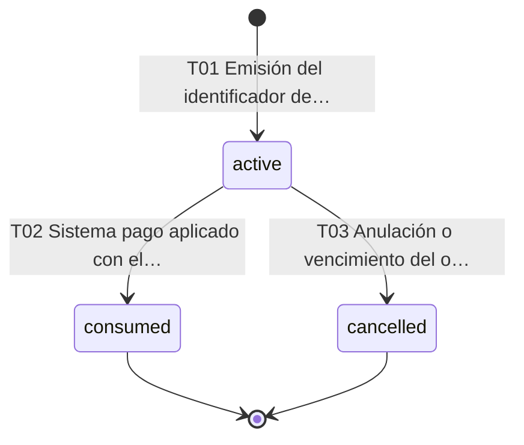

| # | Desde | Hasta | Disparador | Tipo | Guardas | Evento emitido |
|---|---|---|---|---|---|---|
| T01 | (nuevo) | `active` | Emisión del identificador de pago (DEC-050) / — | no especificado | — | — |
| T02 | `active` | `consumed` | Sistema: pago aplicado con el identificador / — | sistema | Pago imputado | — |
| T03 | `active` | `cancelled` | Anulación o vencimiento del objeto referido (obligación o cupón) / — | job | — | — |

### EST-COB-19 — `agencyDebtExports.status` (COL-COB-25)

**Colección:** Exportaciones de deuda a entes. **Campos de estado en el §7:** `status` (línea 877; valores: `generated`, `sent`, `acknowledged`, `failed`, `cancelled`).

**Fuente:** M07 §8.6, M07 §8.19.

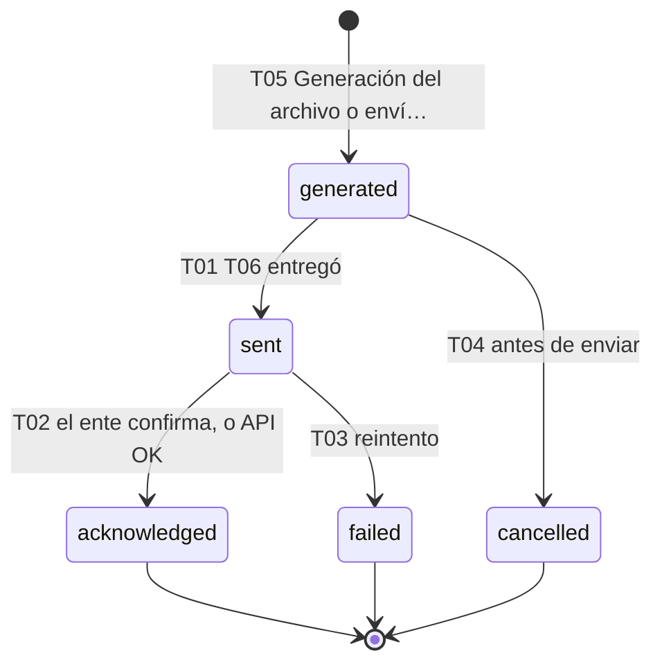

| # | Desde | Hasta | Disparador | Tipo | Guardas | Evento emitido |
|---|---|---|---|---|---|---|
| T01 | `generated` | `sent` | T06 entregó | no especificado | — | — |
| T02 | `sent` | `acknowledged` | el ente confirma, o API OK | API/integración | — | — |
| T03 | `sent` | `failed` | reintento | no especificado | — | — |
| T04 | `generated` | `cancelled` | antes de enviar | no especificado | — | — |
| T05 | (nuevo) | `generated` | Generación del archivo o envío por API (JOB o responsable) / — | API/integración, usuario | — | — |

### EST-COB-20 — `agencyPublishedDebts.status` (COL-COB-26)

**Colección:** Deuda publicada por ente. **Campos de estado en el §7:** `status` (línea 878; valores: `published`, `updated`, `withdrawn`, `paid`).

**Fuente:** M07 §8.19.

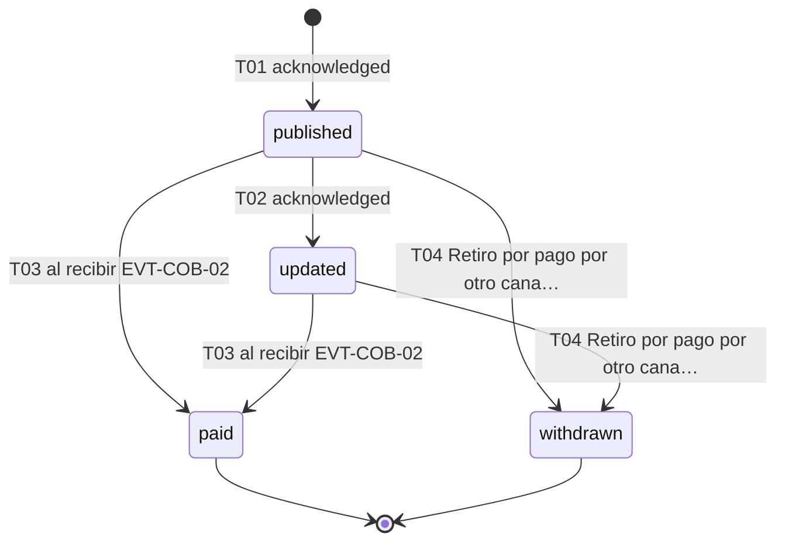

| # | Desde | Hasta | Disparador | Tipo | Guardas | Evento emitido |
|---|---|---|---|---|---|---|
| T01 | (nuevo) | `published` | Exportación `acknowledged` (§8.6) / — | no especificado | — | — |
| T02 | `published` | `updated` | Exportación de actualización `acknowledged` / — | no especificado | Cambio de importe o vencimiento | — |
| T03 | `published`, `updated` | `paid` | Rendición del ente aplicada / `cob.obligation.settled` | evento | Obligación `paid` | — |
| T04 | `published`, `updated` | `withdrawn` | Retiro por pago por otro canal o anulación del documento / — | no especificado | — | — |

### EST-COB-21 — `agencySettlements.status` (COL-COB-27)

**Colección:** Rendiciones de entes. **Campos de estado en el §7:** `status` (línea 882; valores: `imported`, `rejected`, `validated`, `partiallyConfirmed`, `confirmed`).

**Fuente:** M07 §8.5.

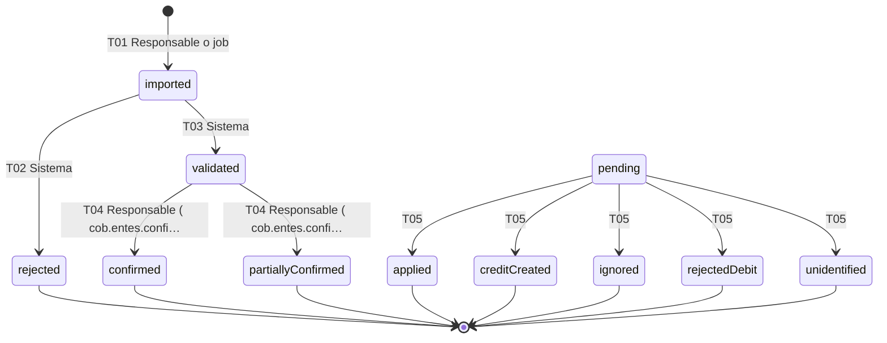

| # | Desde | Hasta | Disparador | Tipo | Guardas | Evento emitido |
|---|---|---|---|---|---|---|
| T01 | (nuevo) | `imported` | Responsable o job | job, usuario | Huella no repetida | — |
| T02 | `imported` | `rejected` | Sistema | sistema | Convenio o fecha inválidos | — |
| T03 | `imported` | `validated` | Sistema | sistema | Pie y líneas validadas | — |
| T04 | `validated` | `confirmed`, `partiallyConfirmed` | Responsable (`cob.entes.confirmar`) o autoconfirmación | usuario | Selección de líneas | — |
| T05 | `pending` | `applied`, `creditCreated`, `ignored`, `rejectedDebit`, `unidentified` | — | no especificado | — | — |

### EST-COB-22 — `agencyNoveltyFiles.status` (COL-COB-29)

**Colección:** Novedades y morosidad de entes. **Campos de estado en el §7:** `status` (línea 887; valores: `imported`, `applied`, `rejected`).

**Fuente:** M07 §8.19.

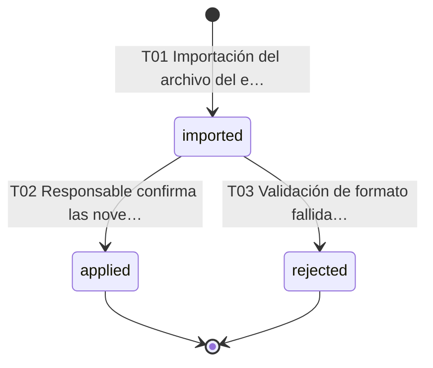

| # | Desde | Hasta | Disparador | Tipo | Guardas | Evento emitido |
|---|---|---|---|---|---|---|
| T01 | (nuevo) | `imported` | Importación del archivo del ente / — | no especificado | Huella `{agencyId, fileHash}` no repetida | — |
| T02 | `imported` | `applied` | Responsable confirma las novedades / — | usuario | — | — |
| T03 | `imported` | `rejected` | Validación de formato fallida o rechazo del responsable / — | usuario | — | — |

### EST-COB-23 — `directDebitMandates.status` (COL-COB-30)

**Colección:** Adhesiones a débito automático (CBU cifrado). **Campos de estado en el §7:** `status` (línea 891; sin valores en el §7).

**Fuente:** M07 §8.7.

```mermaid
stateDiagram-v2
    [*] --> pendingSignature : T01 Operador, socio, API
    pendingSignature --> active : T02 Proveedor / novedad / operador
    [*] --> active : T03 Proveedor / novedad / operador
    active --> suspended : T04 Sistema
    suspended --> active : T05 Operador / socio
    pendingSignature --> error : T07 Proveedor
    note left of cancelled : T06 desde cualquier estado previsto
    cancelled --> [*]
    error --> [*]
```

| # | Desde | Hasta | Disparador | Tipo | Guardas | Evento emitido |
|---|---|---|---|---|---|---|
| T01 | (nuevo) | `pendingSignature` | Operador, socio, API | API/integración, usuario | Medio válido | — |
| T02 | `pendingSignature` | `active` | Proveedor / novedad / operador | API/integración, usuario | Firma o alta confirmada | — |
| T03 | (nuevo) | `active` | Proveedor / novedad / operador | API/integración, usuario | Firma o alta confirmada | — |
| T04 | `active` | `suspended` | Sistema | sistema | Rechazos consecutivos o rechazo definitivo | — |
| T05 | `suspended` | `active` | Operador / socio | usuario | Corrección del medio | — |
| T06 | cualquiera | `cancelled` | Operador, socio, novedad de baja | usuario | — | — |
| T07 | `pendingSignature` | `error` | Proveedor | API/integración | Alta rechazada | — |

### EST-COB-24 — `directDebitBatches.status` (COL-COB-31)

**Colección:** Lotes de débito. **Campos de estado en el §7:** `status` (línea 892; valores: `draft`, `presented`, `settled`, `closed`).

**Máquina 1: `status` — Lote.** Fuente: M07 §8.8.

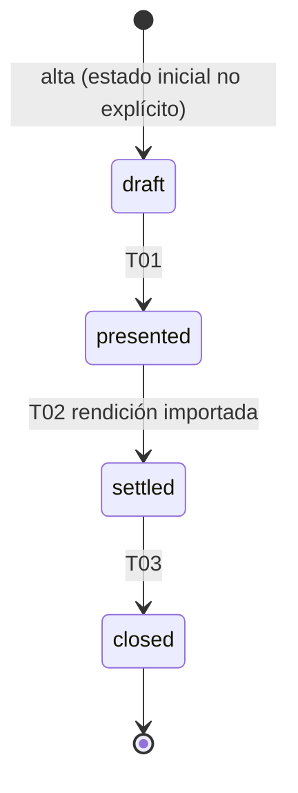

| # | Desde | Hasta | Disparador | Tipo | Guardas | Evento emitido |
|---|---|---|---|---|---|---|
| T01 | `draft` | `presented` | — | no especificado | — | — |
| T02 | `presented` | `settled` | rendición importada | no especificado | — | — |
| T03 | `settled` | `closed` | — | no especificado | — | — |

**Máquina 2: `status`.** Fuente: M07 §8.8, M07 §8.19.

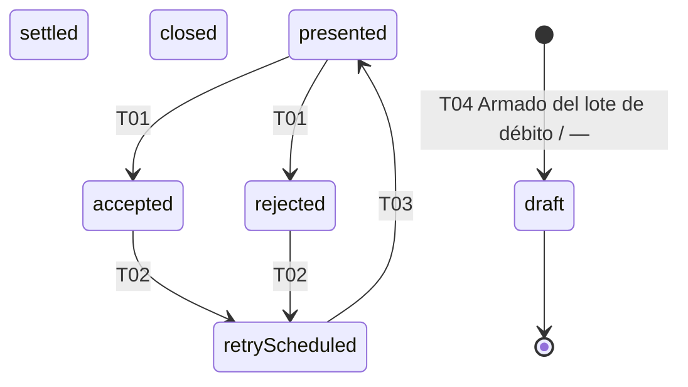

| # | Desde | Hasta | Disparador | Tipo | Guardas | Evento emitido |
|---|---|---|---|---|---|---|
| T01 | `presented` | `accepted`, `rejected` | — | no especificado | — | — |
| T02 | `accepted`, `rejected` | `retryScheduled` | — | no especificado | — | — |
| T03 | `retryScheduled` | `presented` | — | no especificado | — | — |
| T04 | (nuevo) | `draft` | Armado del lote de débito / — | no especificado | — | — |

### EST-COB-25 — `gatewayConnectors.status` (COL-COB-32)

**Colección:** Pasarelas (dominio sobre `integrationConnections`). **Campos de estado en el §7:** `status` (línea 1500; valores: `active`, `suspended`, `inactive`).

**Fuente:** M07 §8.19.

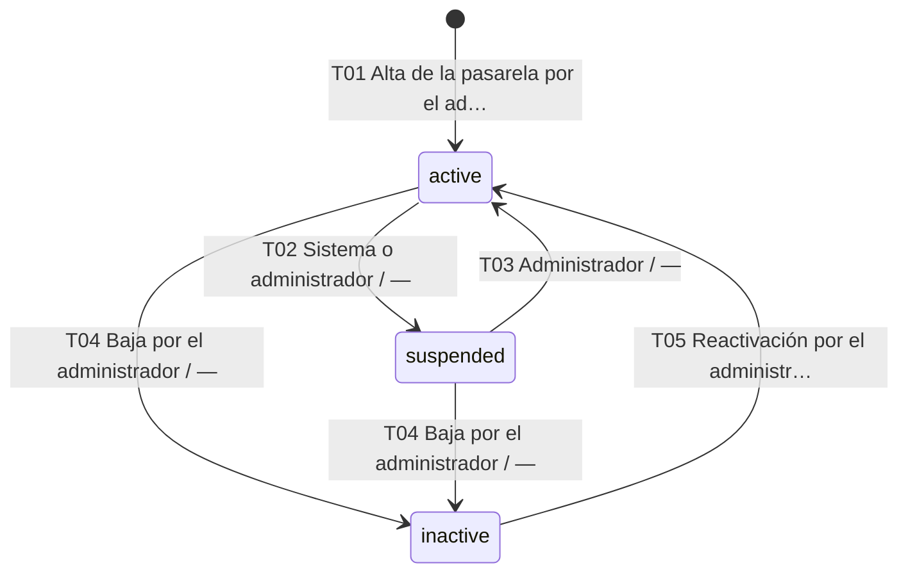

| # | Desde | Hasta | Disparador | Tipo | Guardas | Evento emitido |
|---|---|---|---|---|---|---|
| T01 | (nuevo) | `active` | Alta de la pasarela por el administrador / — | usuario | Credencial en la bóveda (T06) y prueba de conexión `health.status = ok` | — |
| T02 | `active` | `suspended` | Sistema o administrador / — | sistema, usuario | `health.status` en `credentialExpired` o `down` sostenido, o suspensión manual; los canales dejan de ofrecerla | — |
| T03 | `suspended` | `active` | Administrador / — | usuario | Credencial renovada y prueba de conexión correcta | — |
| T04 | `active`, `suspended` | `inactive` | Baja por el administrador / — | usuario | Sin intenciones `issued` vigentes | — |
| T05 | `inactive` | `active` | Reactivación por el administrador / — | usuario | Prueba de conexión correcta | — |

### EST-COB-26 — `paymentIntents.status` (COL-COB-34)

**Colección:** Intenciones de pago. **Campos de estado en el §7:** `status` (línea 914; sin valores en el §7).

**Fuente:** M07 §8.4.

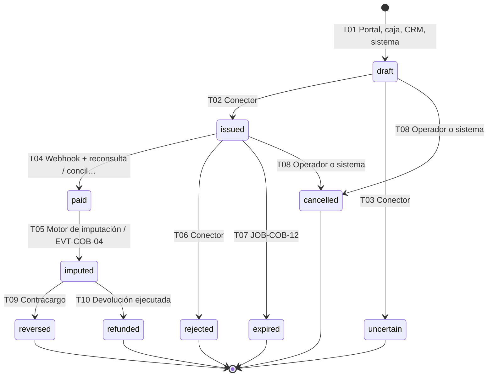

| # | Desde | Hasta | Disparador | Tipo | Guardas | Evento emitido |
|---|---|---|---|---|---|---|
| T01 | (nuevo) | `draft` | Portal, caja, CRM, sistema | sistema | Obligaciones con saldo; importe ≥ mínimo | — |
| T02 | `draft` | `issued` | Conector | API/integración | Respuesta OK del proveedor | — |
| T03 | `draft` | `uncertain` | Conector | API/integración | Timeout o error sin respuesta | — |
| T04 | `issued` | `paid` | Webhook + reconsulta / conciliación / polling | no especificado | Transacción confirmada por el proveedor | — |
| T05 | `paid` | `imputed` | Motor de imputación | no especificado | Transacción válida | EVT-COB-04 `cob.payment.confirmed` |
| T06 | `issued` | `rejected` | Conector | API/integración | Proveedor informa rechazo | — |
| T07 | `issued` | `expired` | Job JOB-COB-12 | job | Vencida sin pago | — |
| T08 | `draft`, `issued` | `cancelled` | Operador o sistema | sistema, usuario | Sin pago | — |
| T09 | `imputed` | `reversed` | Contracargo | no especificado | Transacción `chargeback` | — |
| T10 | `imputed` | `refunded` | Devolución ejecutada | no especificado | Expediente ejecutado | — |

### EST-COB-27 — `gatewayTransactions.status` (COL-COB-35)

**Colección:** Transacciones de pasarela. **Campos de estado en el §7:** `status` (línea 931; valores: `received`, `confirmed`, `rejected`, `applied`, `unmatched`, `reconciled`).

**Fuente:** M07 §8.17.

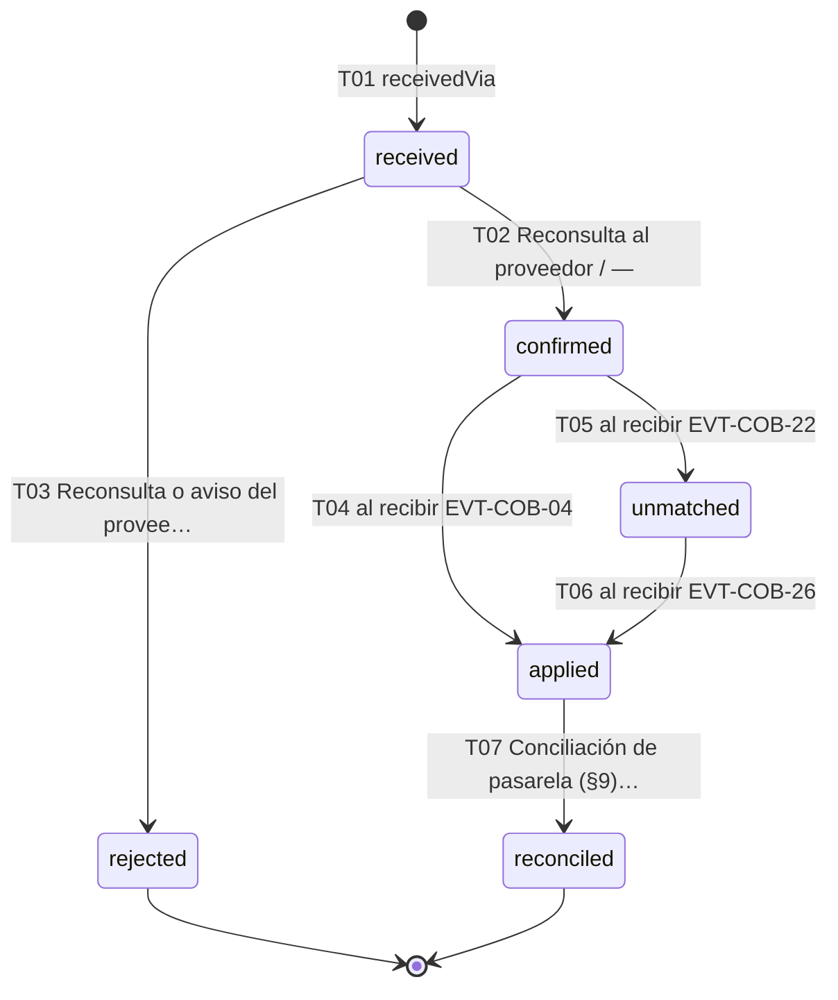

| # | Desde | Hasta | Disparador | Tipo | Guardas | Evento emitido |
|---|---|---|---|---|---|---|
| T01 | (nuevo) | `received` | Webhook, conciliación, polling o archivo (`receivedVia`) / — | no especificado | Clave `{connectorId, externalPaymentId, type}` no repetida | — |
| T02 | `received` | `confirmed` | Reconsulta al proveedor / — | API/integración | El proveedor confirma la operación | — |
| T03 | `received` | `rejected` | Reconsulta o aviso del proveedor / — | API/integración | El proveedor no confirma o informa rechazo | — |
| T04 | `confirmed` | `applied` | Motor de imputación (`type` = `payment`) o reverso (`chargeback`, `refund`, `reversal`, `rejection`) / `cob.payment.confirmed` (EVT-COB-04) para `pay`… | evento | Intención u obligación identificada | — |
| T05 | `confirmed` | `unmatched` | Motor de imputación / `cob.exception.opened` (EVT-COB-22); cobro no identificado (§8.9) | evento | Sin intención ni obligación identificable | — |
| T06 | `unmatched` | `applied` | Resolución desde la bandeja / `cob.unidentified.resolved` (EVT-COB-26) | evento | Cuenta identificada | — |
| T07 | `applied` | `reconciled` | Conciliación de pasarela (§9) / — | no especificado | Acreditación del proveedor identificada por `netAmount` | — |

### EST-COB-28 — `gatewayWebhookEvents.status` (COL-COB-36)

**Colección:** Webhooks de pasarela; retención 18 meses. **Campos de estado en el §7:** `status` (línea 932; valores: `received`, `processing`, `processed`, `ignored`, `failed`).

**Fuente:** M07 §8.19.

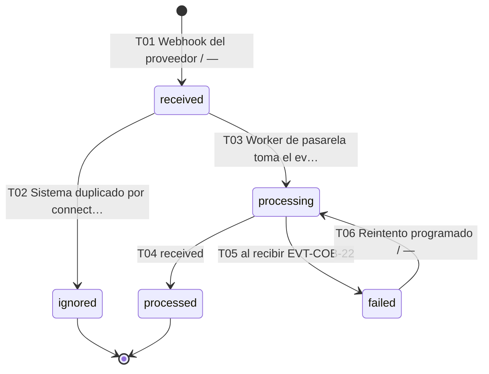

| # | Desde | Hasta | Disparador | Tipo | Guardas | Evento emitido |
|---|---|---|---|---|---|---|
| T01 | (nuevo) | `received` | Webhook del proveedor / — | API/integración | Firma válida | — |
| T02 | `received` | `ignored` | Sistema: duplicado por `{connectorId, dedupeKey}` o tipo no suscripto / — | sistema | — | — |
| T03 | `received` | `processing` | Worker de pasarela toma el evento / — | evento, API/integración | — | — |
| T04 | `processing` | `processed` | Reconsulta al proveedor confirmada / Transacción `received` (§8.17) | API/integración | — | — |
| T05 | `processing` | `failed` | Error de reconsulta o de proceso / `cob.exception.opened` (EVT-COB-22) al agotar reintentos | evento | — | — |
| T06 | `failed` | `processing` | Reintento programado / — | job | — | — |

### EST-COB-29 — `paymentCoupons.status` (COL-COB-37)

**Colección:** Cupón de pago único (canónica para la modalidad `singleCoupon` de `paymentSlips`). **Campos de estado en el §7:** `status` (línea 936; valores: `active`, `paid`, `partiallyPaid`, `expired`, `cancelled`).

**Fuente:** M07 §8.13, M07 §8.19.

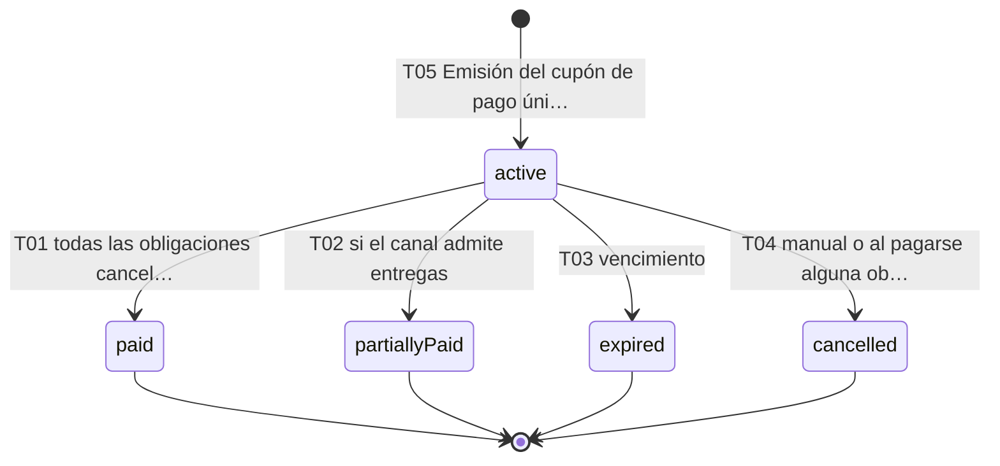

| # | Desde | Hasta | Disparador | Tipo | Guardas | Evento emitido |
|---|---|---|---|---|---|---|
| T01 | `active` | `paid` | todas las obligaciones canceladas por el cupón | no especificado | — | — |
| T02 | `active` | `partiallyPaid` | si el canal admite entregas | no especificado | — | — |
| T03 | `active` | `expired` | vencimiento | job | — | — |
| T04 | `active` | `cancelled` | manual o al pagarse alguna obligación por otra vía si se configura | no especificado | — | — |
| T05 | (nuevo) | `active` | Emisión del cupón de pago único / — | no especificado | Obligaciones de una sola entidad jurídica (RN-COB-156) | — |

### EST-COB-30 — `refundCases.status` (COL-COB-38)

**Colección:** Devoluciones. **Campos de estado en el §7:** `status` (línea 940; sin valores en el §7).

**Fuente:** M07 §8.11.

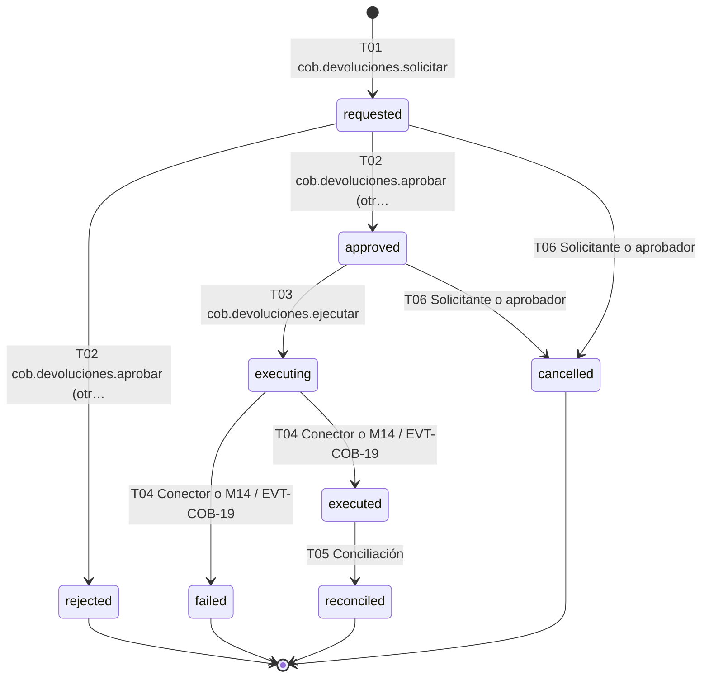

| # | Desde | Hasta | Disparador | Tipo | Guardas | Evento emitido |
|---|---|---|---|---|---|---|
| T01 | (nuevo) | `requested` | `cob.devoluciones.solicitar` | usuario | Saldo a favor, cobro o no identificado disponible | — |
| T02 | `requested` | `approved`, `rejected` | `cob.devoluciones.aprobar` (otra persona) | usuario | Workflow T11 | — |
| T03 | `approved` | `executing` | `cob.devoluciones.ejecutar` | usuario | Clave de idempotencia | — |
| T04 | `executing` | `executed`, `failed` | Conector o M14 | API/integración | Confirmación | EVT-COB-19 `cob.refund.executed` |
| T05 | `executed` | `reconciled` | Conciliación | no especificado | Débito bancario o del proveedor identificado | — |
| T06 | `approved`, `requested` | `cancelled` | Solicitante o aprobador | usuario | No ejecutada | — |

### EST-COB-31 — `chargebacks.status` (COL-COB-39)

**Colección:** Contracargos. **Campos de estado en el §7:** `status` (línea 896; valores: `received`, `applied`, `disputed`, `won`, `lost`).

**Fuente:** M07 §8.12, M07 §8.19.

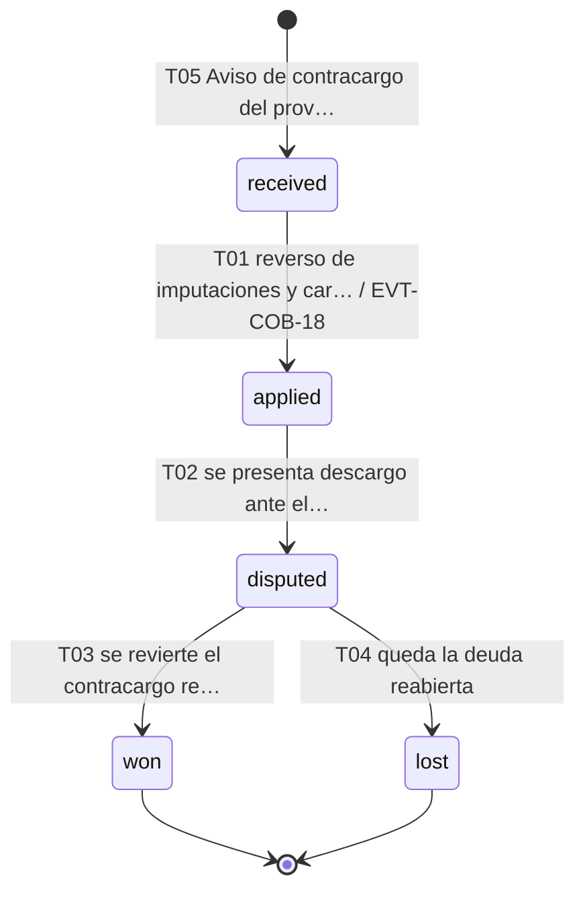

| # | Desde | Hasta | Disparador | Tipo | Guardas | Evento emitido |
|---|---|---|---|---|---|---|
| T01 | `received` | `applied` | reverso de imputaciones y cargos | no especificado | — | EVT-COB-18 `cob.chargeback.applied` (inferido por nombre) |
| T02 | `applied` | `disputed` | se presenta descargo ante el proveedor | API/integración | — | — |
| T03 | `disputed` | `won` | se revierte el contracargo: reimputa | no especificado | — | — |
| T04 | `disputed` | `lost` | queda la deuda reabierta | no especificado | — | — |
| T05 | (nuevo) | `received` | Aviso de contracargo del proveedor / — | API/integración | Transacción de pasarela identificada | — |

### EST-COB-32 — `collectionReconciliations.status` (COL-COB-40)

**Colección:** Conciliación de cobranza. **Campos de estado en el §7:** `status` (línea 945; valores: `open`, `inReview`, `closed`).

**Fuente:** M07 §8.14, M07 §8.19.

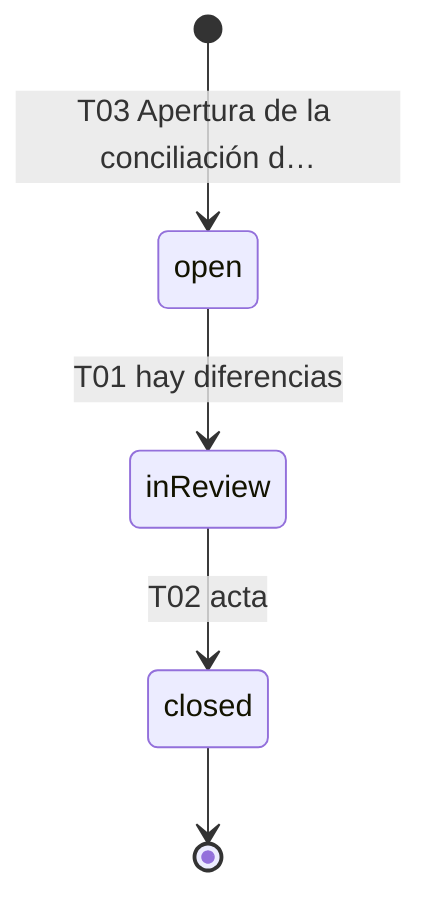

| # | Desde | Hasta | Disparador | Tipo | Guardas | Evento emitido |
|---|---|---|---|---|---|---|
| T01 | `open` | `inReview` | hay diferencias | no especificado | — | — |
| T02 | `inReview` | `closed` | acta | no especificado | — | — |
| T03 | (nuevo) | `open` | Apertura de la conciliación del día por ente, pasarela o caja / — | no especificado | — | — |

### EST-COB-33 — `treasuryHandovers.status` (COL-COB-41)

**Colección:** Entrega de fondos de caja a tesorería (M14 la recibe en `cashRemittances`). **Campos de estado en el §7:** `status` (línea 946; valores: `prepared`, `delivered`, `received`, `rejected`).

**Fuente:** M07 §8.14, M07 §8.19.

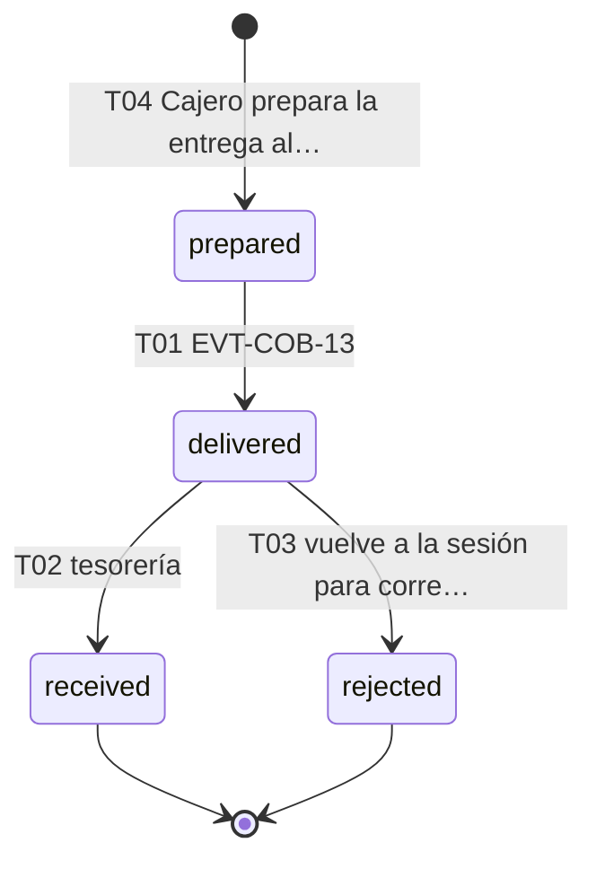

| # | Desde | Hasta | Disparador | Tipo | Guardas | Evento emitido |
|---|---|---|---|---|---|---|
| T01 | `prepared` | `delivered` | — | no especificado | — | EVT-COB-13 `cob.treasuryHandover.delivered` (inferido por nombre) |
| T02 | `delivered` | `received` | tesorería | usuario | — | — |
| T03 | `delivered` | `rejected` | vuelve a la sesión para corregir | no especificado | — | — |
| T04 | (nuevo) | `prepared` | Cajero prepara la entrega al cerrar la sesión / — | usuario | Sesión `closed` o rendición de cobrador cerrada | — |

### EST-COB-34 — `thirdPartyCollections.status` (COL-COB-43)

**Colección:** Cobros de terceros. **Campos de estado en el §7:** `status` (línea 951; valores: `collected`, `inSummary`, `rendered`, `voided`).

**Fuente:** M07 §8.17.

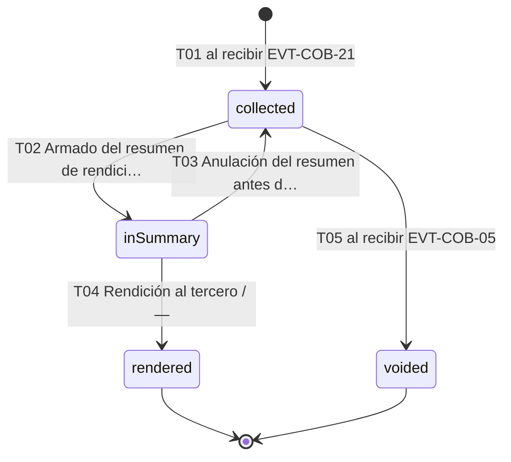

| # | Desde | Hasta | Disparador | Tipo | Guardas | Evento emitido |
|---|---|---|---|---|---|---|
| T01 | (nuevo) | `collected` | Cobro por cuenta de terceros (operación `thirdPartyCollection`) / `cob.thirdPartyCollection.recorded` (EVT-COB-21) | evento | Tercero con convenio vigente (`thirdPartyBillerId`) | — |
| T02 | `collected` | `inSummary` | Armado del resumen de rendición al tercero / — | no especificado | `summaryNumber` asignado | — |
| T03 | `inSummary` | `collected` | Anulación del resumen antes de rendir / — | no especificado | Resumen no rendido | — |
| T04 | `inSummary` | `rendered` | Rendición al tercero / — | no especificado | `renderedToThirdPartyAt` registrado | — |
| T05 | `collected` | `voided` | Anulación de la operación de caja / `cob.receipt.voided` (EVT-COB-05) | evento | No incluido en un resumen | — |

### EST-COB-35 — `externalObligationImports.status` (COL-COB-44)

**Colección:** Importación de obligaciones externas. **Campos de estado en el §7:** `status` (línea 955; valores: `uploaded`, `rejected`, `validated`, `applied`, `partiallyApplied`, `cancelled`).

**Fuente:** M07 §8.17.

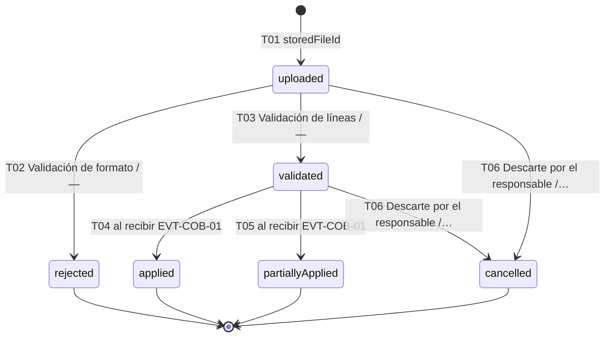

| # | Desde | Hasta | Disparador | Tipo | Guardas | Evento emitido |
|---|---|---|---|---|---|---|
| T01 | (nuevo) | `uploaded` | Carga del archivo (`storedFileId`) / — | no especificado | Huella `{source, fileHash}` no repetida | — |
| T02 | `uploaded` | `rejected` | Validación de formato / — | no especificado | `format` o encabezado inválido | — |
| T03 | `uploaded` | `validated` | Validación de líneas / — | no especificado | Cada línea con `result` | — |
| T04 | `validated` | `applied` | Confirmación del responsable / `cob.obligation.registered` (EVT-COB-01) por obligación creada | evento, usuario | Todas las líneas válidas | — |
| T05 | `validated` | `partiallyApplied` | Confirmación del responsable / `cob.obligation.registered` (EVT-COB-01) por obligación creada | evento, usuario | Líneas con error excluidas | — |
| T06 | `uploaded`, `validated` | `cancelled` | Descarte por el responsable / — | usuario | Sin líneas aplicadas | — |

### EST-COB-36 — `collectionExceptions.status` (COL-COB-46)

**Colección:** Excepciones de cobranza. **Campos de estado en el §7:** `status` (línea 957; valores: `open`, `inProgress`, `resolved`, `dismissed`).

**Fuente:** M07 §8.15, M07 §8.19.

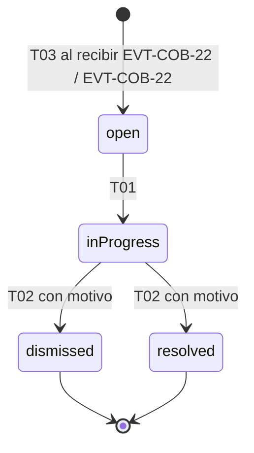

| # | Desde | Hasta | Disparador | Tipo | Guardas | Evento emitido |
|---|---|---|---|---|---|---|
| T01 | `open` | `inProgress` | — | no especificado | — | — |
| T02 | `inProgress` | `dismissed`, `resolved` | con motivo | no especificado | — | — |
| T03 | (nuevo) | `open` | Sistema registra la excepción / `cob.exception.opened` (EVT-COB-22) | evento, sistema | — | EVT-COB-22 `cob.exception.opened` (inferido por nombre) |

### EST-COB-37 — `collectionAccountingGroups.status` (COL-COB-47)

**Colección:** Grupos contables de cobranza (los usa `accounts.accountingGroupId` de M01; sus cuentas viven en `entityAccountAssignments` con `entityType = collectionAccountingGroup`, COL-CON-38; agregada el 5-11-2…. **Campos de estado en el §7:** `status` (línea 1764; valores: `active`, `inactive`).

**Fuente:** M07 §8.18.

```mermaid
stateDiagram-v2
    [*] --> active : T01 Alta del grupo contable / —
    active --> inactive : T02 Baja por el administrador / —
    inactive --> active : T03 Reactivación / —
```

| # | Desde | Hasta | Disparador | Tipo | Guardas | Evento emitido |
|---|---|---|---|---|---|---|
| T01 | (nuevo) | `active` | Alta del grupo contable / — | no especificado | `code` no repetido en el tenant | — |
| T02 | `active` | `inactive` | Baja por el administrador / — | usuario | Ninguna cuenta (`accounts.accountingGroupId`, M01) lo usa, o se reasignan antes; el grupo `0` no se desactiva | — |
| T03 | `inactive` | `active` | Reactivación / — | no especificado | — | — |

## M08 — MOR Mora y financiación

### EST-MOR-01 — `interestPolicies.status` (COL-MOR-01)

**Colección:** Políticas de interés. **Campos de estado en el §7:** `status` (línea 693; valores: `draft`, `published`, `retired`).

**Fuente:** M08 §8.1, M08 §8.15.

```mermaid
stateDiagram-v2
    state "eliminado lógico" as st_1
    draft --> published : T01 normative / EVT-MOR-01
    published --> retired : T02 Configurador / sistema al ree…
    draft --> st_1 : T03 Configurador
    [*] --> draft : T04 Configurador crea una versión…
    retired --> [*]
```

| # | Desde | Hasta | Disparador | Tipo | Guardas | Evento emitido |
|---|---|---|---|---|---|---|
| T01 | `draft` | `published` | Configurador (+ aprobación si `normative` o cargos) | no especificado | Validaciones de §7 sin errores; cobertura fiscal; sin superposición | EVT-MOR-01 `mor.policy.published` |
| T02 | `published` | `retired` | Configurador / sistema al reemplazar | sistema | Existe versión sucesora o fin de vigencia | — |
| T03 | `draft` | `(eliminado lógico)` | Configurador | no especificado | Nunca publicado | — |
| T04 | (nuevo) | `draft` | Configurador crea una versión (vale para las colecciones de la máquina común de §8.1) / — | no especificado | — | — |

### EST-MOR-02 — `interestRateTables.status` (COL-MOR-02)

**Colección:** Tablas de tasas por vigencia. **Campos de estado en el §7:** `status` (línea 750; valores: `draft`, `published`, `retired`).

**Máquina compartida.** El §8 del anexo define una sola máquina para este grupo de colecciones; rige la de `interestPolicies` (ver su diagrama en esta parte). Valores del §7: `draft`, `published`, `retired`.

### EST-MOR-03 — `interestIndexTables.status` (COL-MOR-03)

**Colección:** Índices de recargo por mora propios (las series de inflación van a `economicIndexSeries`). **Campos de estado en el §7:** `status` (línea 1141; valores: `active`, `inactive`).

**Fuente:** M08 §8.15.

```mermaid
stateDiagram-v2
    [*] --> active : T01 Alta de la tabla de índice pr…
    active --> inactive : T02 Baja por el configurador / —
    inactive --> active : T03 Reactivación por el configura…
```

| # | Desde | Hasta | Disparador | Tipo | Guardas | Evento emitido |
|---|---|---|---|---|---|---|
| T01 | (nuevo) | `active` | Alta de la tabla de índice propio por el configurador / — | no especificado | `code` no repetido | — |
| T02 | `active` | `inactive` | Baja por el configurador / — | no especificado | Ninguna política vigente la usa; no se borra (T05 §7.1.5) | — |
| T03 | `inactive` | `active` | Reactivación por el configurador / — | no especificado | — | — |

### EST-MOR-04 — `dueDateSurchargeSchemes.status` (COL-MOR-05)

**Colección:** Recargo entre vencimientos (canónica para las tramas de recargo de `TRAMASREC`). **Campos de estado en el §7:** `status` (línea 777; sin valores en el §7).

**Máquina compartida.** El §8 del anexo define una sola máquina para este grupo de colecciones; rige la de `interestPolicies` (ver su diagrama en esta parte). Valores del §7: sin valores propios.

### EST-MOR-05 — `earlyPaymentDiscountRules.status` (COL-MOR-06)

**Colección:** Descuento por pronto pago (canónica; absorbe `cashDiscountRules` de M07). **Campos de estado en el §7:** `status` (línea 783; sin valores en el §7).

**Máquina compartida.** El §8 del anexo define una sola máquina para este grupo de colecciones; rige la de `interestPolicies` (ver su diagrama en esta parte). Valores del §7: sin valores propios.

### EST-MOR-06 — `deferredInterests.status` (COL-MOR-08)

**Colección:** Intereses diferidos. **Campos de estado en el §7:** `status` (línea 809; valores: `pending`, `billed`, `cancelled`).

**Fuente:** M08 §8.3.

```mermaid
stateDiagram-v2
    [*] --> pending : T01 Sistema (cobro)
    pending --> billed : T02 Sistema (M05 emite) / EVT-MOR-03
    pending --> cancelled : T03 Supervisor / anulación del re… / EVT-MOR-03
    billed --> [*]
    cancelled --> [*]
```

| # | Desde | Hasta | Disparador | Tipo | Guardas | Evento emitido |
|---|---|---|---|---|---|---|
| T01 | (nuevo) | `pending` | Sistema (cobro) | sistema | Modo de diferimiento ≠ `none` | — |
| T02 | `pending` | `billed` | Sistema (M05 emite) | sistema | Factura emitida con el cargo | EVT-MOR-03 `mor.deferredInterest.created` |
| T03 | `pending` | `cancelled` | Supervisor / anulación del recibo | usuario | Recibo anulado o dispensa aprobada | EVT-MOR-03 `mor.deferredInterest.cancelled` (inferido por nombre) |

### EST-MOR-07 — `interestBillingRuns.status` (COL-MOR-09)

**Colección:** Corridas de intereses a facturar. **Campos de estado en el §7:** `status` (línea 813; sin valores en el §7).

**Fuente:** M08 §8.4.

```mermaid
stateDiagram-v2
    [*] --> draft : T01 Operador
    draft --> previewing : T02 Sistema (job)
    previewing --> previewed : T03 Sistema (job)
    previewed --> approved : T04 Contador (si la política exig…
    approved --> generating : T05 Operador / sistema / EVT-MOR-04
    previewed --> generating : T05 Operador / sistema / EVT-MOR-04
    generating --> completed : T06 Operador / sistema / EVT-MOR-04
    generating --> failed : T07 Sistema
    generating --> partiallyCompleted : T07 Sistema
    note left of cancelled : T08 desde cualquier estado previsto
    completed --> [*]
    failed --> [*]
    partiallyCompleted --> [*]
    cancelled --> [*]
```

| # | Desde | Hasta | Disparador | Tipo | Guardas | Evento emitido |
|---|---|---|---|---|---|---|
| T01 | (nuevo) | `draft` | Operador | usuario | Filtros válidos | — |
| T02 | `draft` | `previewing` | Sistema (job) | job | — | — |
| T03 | `previewing` | `previewed` | Sistema (job) | job | — | — |
| T04 | `previewed` | `approved` | Contador (si la política exige) | usuario | Totales revisados | — |
| T05 | `approved`, `previewed` | `generating` | Operador / sistema | sistema, usuario | Selección confirmada | EVT-MOR-04 `mor.interestRun.completed` |
| T06 | `generating` | `completed` | Operador / sistema | sistema, usuario | Selección confirmada | EVT-MOR-04 `mor.interestRun.completed` |
| T07 | `generating` | `failed`, `partiallyCompleted` | Sistema | sistema | Error | — |
| T08 | cualquiera | `cancelled` | Operador | usuario | Sin cargos generados | — |

### EST-MOR-08 — `interestBillingRunItems.status` (COL-MOR-10)

**Colección:** Ítems de la corrida. **Campos de estado en el §7:** `status` (línea 815; valores: `preview`, `excluded`, `charged`, `failed`).

**Fuente:** M08 §8.15.

```mermaid
stateDiagram-v2
    [*] --> preview : T01 previewing
    preview --> excluded : T02 Operador desmarca el ítem ( s…
    excluded --> preview : T03 Operador vuelve a marcar el í…
    preview --> charged : T04 al recibir EVT-MOR-04
    preview --> failed : T05 error
    failed --> charged : T06 Reintento idempotente de la c…
    charged --> [*]
```

| # | Desde | Hasta | Disparador | Tipo | Guardas | Evento emitido |
|---|---|---|---|---|---|---|
| T01 | (nuevo) | `preview` | Corrida en `previewing` (§8.4) calcula el ítem / — | no especificado | — | — |
| T02 | `preview` | `excluded` | Operador desmarca el ítem (`selected = false`) / — | usuario | Corrida en `previewed` | — |
| T03 | `excluded` | `preview` | Operador vuelve a marcar el ítem / — | usuario | Corrida en `previewed` | — |
| T04 | `preview` | `charged` | Corrida en `generating` crea el cargo en M05 (`chargeRequestId`) / `mor.interestRun.completed` al terminar la corrida | evento | Ítem seleccionado | — |
| T05 | `preview` | `failed` | Error al crear el cargo / — (`error` registrado) | no especificado | — | — |
| T06 | `failed` | `charged` | Reintento idempotente de la corrida / — | no especificado | — | — |

### EST-MOR-09 — `holdReasons.status` (COL-MOR-11)

**Colección:** Motivos de bloqueo de documento, cuenta o contrato (canónica; absorbe `invoiceBlockReasons` de M05 y `blockReasons` de M01). **Campos de estado en el §7:** `status` (línea 821; valores: `active`, `inactive`).

**Fuente:** M08 §8.15.

```mermaid
stateDiagram-v2
    [*] --> active : T01 Alta por el configurador / —
    active --> inactive : T02 Baja por el configurador / —
    inactive --> active : T03 Reactivación por el configura…
```

| # | Desde | Hasta | Disparador | Tipo | Guardas | Evento emitido |
|---|---|---|---|---|---|---|
| T01 | (nuevo) | `active` | Alta por el configurador / — | no especificado | Validación del esquema (T04 §8.3) | — |
| T02 | `active` | `inactive` | Baja por el configurador / — | no especificado | Si está referenciado se informa el conteo; no se borra (T05 §7.1.5) | — |
| T03 | `inactive` | `active` | Reactivación por el configurador / — | no especificado | — | — |

### EST-MOR-10 — `documentHolds.status` (COL-MOR-12)

**Colección:** Bloqueos de documentos (historial por documentos sucesivos; absorbe `invoiceBlockHistory` de M05). **Campos de estado en el §7:** `status` (línea 823; valores: `active`, `released`).

**Fuente:** M08 §8.5, M08 §8.15.

```mermaid
stateDiagram-v2
    active --> released : T01 usuario con capability si la…
    [*] --> active : T02 origin
    released --> [*]
```

| # | Desde | Hasta | Disparador | Tipo | Guardas | Evento emitido |
|---|---|---|---|---|---|---|
| T01 | `active` | `released` | usuario con capability si la causa tiene interés de desbloqueo, genera cargo | usuario | — | — |
| T02 | (nuevo) | `active` | Bloqueo manual, de notificación, de orden de cambio de estado, de expediente o de sistema (`origin`) / — | sistema | Causa `holdReasonId` activa | — |

### EST-MOR-11 — `delinquencyPolicies.status` (COL-MOR-13)

**Colección:** Políticas de mora (BASE §68). **Campos de estado en el §7:** `status` (línea 844; sin valores en el §7).

**Máquina compartida.** El §8 del anexo define una sola máquina para este grupo de colecciones; rige la de `interestPolicies` (ver su diagrama en esta parte). Valores del §7: sin valores propios.

### EST-MOR-12 — `delinquencyStages.status` (COL-MOR-14)

**Colección:** Instancias de mora. **Campos de estado en el §7:** `status` (línea 848; valores: `active`, `inactive`).

**Fuente:** M08 §8.15.

```mermaid
stateDiagram-v2
    [*] --> active : T01 Alta por el configurador / —
    active --> inactive : T02 Baja por el configurador / —
    inactive --> active : T03 Reactivación por el configura…
```

| # | Desde | Hasta | Disparador | Tipo | Guardas | Evento emitido |
|---|---|---|---|---|---|---|
| T01 | (nuevo) | `active` | Alta por el configurador / — | no especificado | Validación del esquema (T04 §8.3) | — |
| T02 | `active` | `inactive` | Baja por el configurador / — | no especificado | Si está referenciado se informa el conteo; no se borra (T05 §7.1.5) | — |
| T03 | `inactive` | `active` | Reactivación por el configurador / — | no especificado | — | — |

### EST-MOR-13 — `delinquencyNoticeModels.status` (COL-MOR-15)

**Colección:** Modelos de aviso. **Campos de estado en el §7:** `status` (línea 852; valores: `draft`, `published`, `retired`).

**Fuente:** M08 §8.15.

```mermaid
stateDiagram-v2
    [*] --> draft : T01 Configurador crea una versión…
    draft --> published : T02 Configurador publica / —
    published --> retired : T03 Sistema al publicar la versió…
    retired --> [*]
```

| # | Desde | Hasta | Disparador | Tipo | Guardas | Evento emitido |
|---|---|---|---|---|---|---|
| T01 | (nuevo) | `draft` | Configurador crea una versión del modelo / — | no especificado | — | — |
| T02 | `draft` | `published` | Configurador publica / — | no especificado | Plantilla validada; publicada queda inmutable (T05 §7.1.5) | — |
| T03 | `published` | `retired` | Sistema al publicar la versión sucesora / — | sistema | Existe versión sucesora | — |

### EST-MOR-14 — `delinquencyBatches.status` (COL-MOR-16)

**Colección:** Lotes de mora. **Campos de estado en el §7:** `status` (línea 856; valores: `running`, `completed`, `failed`, `annulled`).

**Fuente:** M08 §8.13.

```mermaid
stateDiagram-v2
    [*] --> running : T01 Generación o proceso de un lo…
    running --> completed : T02 al recibir EVT-MOR-07
    running --> failed : T03 Error del job / —
    completed --> annulled : T04 al recibir EVT-MOR-07
    failed --> [*]
    annulled --> [*]
```

| # | Desde | Hasta | Disparador | Tipo | Guardas | Evento emitido |
|---|---|---|---|---|---|---|
| T01 | (nuevo) | `running` | Generación o proceso de un lote de instancia / — | no especificado | — | — |
| T02 | `running` | `completed` | Fin del proceso sin error / `mor.batch.generated` (EVT-MOR-07) | evento | — | — |
| T03 | `running` | `failed` | Error del job / — | job | — | — |
| T04 | `completed` | `annulled` | Anulación del lote / `mor.batch.annulled` (EVT-MOR-07) | evento | Notificaciones del lote no procesadas | — |

### EST-MOR-15 — `delinquencyNotices.status` (COL-MOR-17)

**Colección:** Notificaciones de mora con promesa embebida. **Campos de estado en el §7:** —.

**Fuente:** M08 §8.6.

```mermaid
stateDiagram-v2
    [*] --> open : T01 Gestor / job
    open --> open : T02 Gestor / T09 evidencia +2
    open --> processed : T03 Gestor / job / EVT-MOR-08
    inTechnical --> paid : T04 Sistema (pago) / EVT-MOR-08
    open --> paid : T04 Sistema (pago) / EVT-MOR-08 +1
    open --> excluded : T05 Gestor / EVT-MOR-08
    open --> inTechnical : T06 Sistema (tratamiento)
    inTechnical --> closed : T07 Gestor / EVT-MOR-08
    open --> closed : T07 Gestor / EVT-MOR-08
    open --> broken : T09 Gestor / socio / job
    open --> kept : T09 Gestor / socio / job
    note left of annulled : T08 desde cualquier estado previsto
    processed --> [*]
    paid --> [*]
    excluded --> [*]
    closed --> [*]
    annulled --> [*]
    broken --> [*]
    kept --> [*]
```

| # | Desde | Hasta | Disparador | Tipo | Guardas | Evento emitido |
|---|---|---|---|---|---|---|
| T01 | (nuevo) | `open` | Gestor / job | job | Deuda > 0, sin exclusión | — |
| T02 | `open` | `open` | Gestor / T09 evidencia | no especificado | — | — |
| T03 | `open` | `processed` | Gestor / job | job | `dueDate` cumplida, sin promesa vigente, evidencia satisfecha si se exige, deuda > 0 | EVT-MOR-08 `mor.notice.processed` (inferido por nombre) |
| T04 | `inTechnical`, `open` | `paid` | Sistema (pago) | sistema | Todos los ítems saldados | EVT-MOR-08 `mor.notice.created` |
| T05 | `open` | `excluded` | Gestor | no especificado | Causa de tipo `noticeExclusion` | EVT-MOR-08 `mor.notice.excluded` (inferido por nombre) |
| T06 | `open` | `inTechnical` | Sistema (tratamiento) | sistema | Caso de interrupción creado y política "En técnica" | — |
| T07 | `inTechnical`, `open` | `closed` | Gestor | no especificado | Motivo | EVT-MOR-08 `mor.notice.closed` (inferido por nombre) |
| T08 | cualquiera | `annulled` | Supervisor | usuario | Lote anulable | — |
| T09 | `open` | `broken`, `kept`, `open` | Gestor / socio / job | job, usuario | Fecha de promesa | — |
| T10 | `open` | `open` | Sistema | sistema | Convenio vigente que incluye todos los ítems | — |
| T11 | `open` | `paid` | Sistema | sistema | Convenio vigente que incluye todos los ítems | EVT-MOR-08 `mor.notice.paid` (inferido por nombre) |

### EST-MOR-16 — `delinquencyNoticeEvents.fromStatus` (COL-MOR-18)

**Colección:** Bitácora estructurada de notificaciones. **Campos de estado en el §7:** `fromStatus`, `toStatus` (línea 1353, 1354; valores: `open`, `processed`, `paid`, `excluded`, `inTechnical`, `closed`, `annulled`, `fromStatus`).

**Fuente:** solo el §7 enumera los estados; el §8 no define transiciones (se lista como inconsistencia).

```mermaid
stateDiagram-v2
    open
    processed
    paid
    excluded
    inTechnical
    closed
    annulled
    fromStatus
    [*] --> open : alta (estado inicial no explícito)
    note right of open : Transiciones no especificadas en el anexo
```

### EST-MOR-17 — `suspensionRestrictionRules.validationStatus` (COL-MOR-21)

**Colección:** Matriz de restricciones de suspensión. **Campos de estado en el §7:** `validationStatus` (línea 940; valores: `validated`, `toValidate`, `review`).

**Máquina compartida.** El §8 del anexo define una sola máquina para este grupo de colecciones; rige la de `interestPolicies` (ver su diagrama en esta parte). Valores del §7: `validated`, `toValidate`, `review`.

### EST-MOR-18 — `delinquencyReasons.status` (COL-MOR-22)

**Colección:** Causas de mora y de baja de notificación. **Campos de estado en el §7:** `status` (línea 945; valores: `active`, `inactive`).

**Fuente:** M08 §8.15.

```mermaid
stateDiagram-v2
    [*] --> active : T01 Alta por el configurador / —
    active --> inactive : T02 Baja por el configurador / —
    inactive --> active : T03 Reactivación por el configura…
```

| # | Desde | Hasta | Disparador | Tipo | Guardas | Evento emitido |
|---|---|---|---|---|---|---|
| T01 | (nuevo) | `active` | Alta por el configurador / — | no especificado | Validación del esquema (T04 §8.3) | — |
| T02 | `active` | `inactive` | Baja por el configurador / — | no especificado | Si está referenciado se informa el conteo; no se borra (T05 §7.1.5) | — |
| T03 | `inactive` | `active` | Reactivación por el configurador / — | no especificado | — | — |

### EST-MOR-19 — `delinquencyEvaluations.status` (COL-MOR-23)

**Colección:** Evaluaciones de mora. **Campos de estado en el §7:** `status` (línea 949; valores: `open`, `closed`).

**Fuente:** M08 §8.13.

```mermaid
stateDiagram-v2
    [*] --> open : T01 Evaluación de la cuenta a una…
    open --> closed : T02 al recibir EVT-MOR-06 / EVT-MOR-06
    closed --> [*]
```

| # | Desde | Hasta | Disparador | Tipo | Guardas | Evento emitido |
|---|---|---|---|---|---|---|
| T01 | (nuevo) | `open` | Evaluación de la cuenta a una fecha / — | no especificado | — | — |
| T02 | `open` | `closed` | Decisión por servicio registrada / `mor.evaluation.closed` (EVT-MOR-06) | evento | Todas las decisiones de `perService[]` cargadas | EVT-MOR-06 `mor.evaluation.closed` (inferido por nombre) |

### EST-MOR-20 — `interruptionCases.status` (COL-MOR-24)

**Colección:** Suspensión, corte, reconexión, baja por mora. **Campos de estado en el §7:** `status` (línea 971; sin valores en el §7).

Ver también el diagrama curado B5 en `06-secuencias-y-estados.md` §4.

**Fuente:** M08 §8.7.

```mermaid
stateDiagram-v2
    [*] --> requested : T01 Gestor / socio / CRM / sistema
    requested --> evaluated : T02 Sistema
    evaluated --> blocked : T03 Sistema
    evaluated --> pendingApproval : T04 Sistema
    pendingApproval --> approved : T05 aprobarSensible
    pendingApproval --> rejected : T05 aprobarSensible
    approved --> pendingEvidence : T06 Sistema
    evaluated --> pendingEvidence : T06 Sistema
    approved --> scheduled : T07 Sistema
    evaluated --> scheduled : T07 Sistema
    pendingEvidence --> scheduled : T07 Sistema
    scheduled --> inExecution : T08 M10 / T06
    inExecution --> executed : T09 M10 (confirmación) / T06 (res… / EVT-MOR-13
    inExecution --> executionFailed : T10 M10 / T06
    requested --> cancelled : T11 Sistema (pago confirmado, V2…
    scheduled --> cancelled : T11 Sistema (pago confirmado, V2…
    executed --> reverted : T12 reconnection
    blocked --> [*]
    rejected --> [*]
    executionFailed --> [*]
    cancelled --> [*]
    reverted --> [*]
```

| # | Desde | Hasta | Disparador | Tipo | Guardas | Evento emitido |
|---|---|---|---|---|---|---|
| T01 | (nuevo) | `requested` | Gestor / socio / CRM / sistema | sistema, usuario | Servicio en estado compatible | — |
| T02 | `requested` | `evaluated` | Sistema | sistema | — | — |
| T03 | `evaluated` | `blocked` | Sistema | sistema | Restricción o protección `block` | — |
| T04 | `evaluated` | `pendingApproval` | Sistema | sistema | Requiere aprobación | — |
| T05 | `pendingApproval` | `approved`, `rejected` | Supervisor (`aprobarSensible` para protecciones) | usuario | — | — |
| T06 | `approved`, `evaluated` | `pendingEvidence` | Sistema | sistema | Preaviso con constancia no satisfecho | — |
| T07 | `approved`, `evaluated`, `pendingEvidence` | `scheduled` | Sistema | sistema | Evidencia y cargos previos ("antes") cumplidos | — |
| T08 | `scheduled` | `inExecution` | M10 / T06 | no especificado | Ventana válida | — |
| T09 | `inExecution` | `executed` | M10 (confirmación) / T06 (respuesta OK) | no especificado | Confirmación real | EVT-MOR-13 `mor.interruption.executed` |
| T10 | `inExecution` | `executionFailed` | M10 / T06 | no especificado | Error o sin sistema | — |
| T11 | `requested`, `scheduled` | `cancelled` | Sistema (pago confirmado, V2 #2917) / gestor / socio | sistema, usuario | Deuda regularizada, desistimiento | — |
| T12 | `executed` | `reverted` | Solo mediante caso `reconnection`/`reactivation` vinculado | no especificado | — | — |

### EST-MOR-21 — `interruptionChargeRules.status` (COL-MOR-25)

**Colección:** Cargos de suspensión y reconexión. **Campos de estado en el §7:** `status` (línea 979; sin valores en el §7).

**Máquina compartida.** El §8 del anexo define una sola máquina para este grupo de colecciones; rige la de `interestPolicies` (ver su diagrama en esta parte). Valores del §7: sin valores propios.

### EST-MOR-22 — `paymentPlans.status` (COL-MOR-26)

**Colección:** Planes y tipos de financiación. **Campos de estado en el §7:** `status` (línea 1008; sin valores en el §7).

**Máquina compartida.** El §8 del anexo define una sola máquina para este grupo de colecciones; rige la de `interestPolicies` (ver su diagrama en esta parte). Valores del §7: sin valores propios.

### EST-MOR-23 — `agreements.status` (COL-MOR-29)

**Colección:** Convenios con firmantes embebidos. **Campos de estado en el §7:** `status` (línea 1044; sin valores en el §7).

Ver también el diagrama curado B8 en `06-secuencias-y-estados.md` §4.

**Fuente:** M08 §8.8.

```mermaid
stateDiagram-v2
    [*] --> draft : T01 Gestor / socio
    draft --> pendingApproval : T02 Sistema
    approved --> pendingSignature : T03 Gestor
    draft --> pendingSignature : T03 Gestor
    pendingSignature --> pendingDownPayment : T04 Sistema
    pendingSignature --> active : T05 Sistema / EVT-MOR-14
    pendingDownPayment --> active : T06 Sistema (pago confirmado) / EVT-MOR-14
    pendingDownPayment --> lapsedNoDownPayment : T07 Job
    active --> inArrears : T08 Job
    inArrears --> defaultWarning : T09 Job
    defaultWarning --> defaulted : T10 Job / aprobador / EVT-MOR-14
    inArrears --> defaulted : T10 Job / aprobador / EVT-MOR-14
    active --> refinanced : T11 Gestor / EVT-MOR-14
    defaulted --> refinanced : T11 Gestor / EVT-MOR-14
    inArrears --> refinanced : T11 Gestor / EVT-MOR-14
    active --> completed : T12 Sistema / EVT-MOR-14
    active --> cancelledEarly : T13 Socio / gestor
    cancelledEarly --> completed : T14 Socio / gestor / EVT-MOR-14
    active --> annulled : T15 Aprobador / EVT-MOR-14
    draft --> annulled : T15 Aprobador / EVT-MOR-14
    pendingApproval --> [*]
    lapsedNoDownPayment --> [*]
    refinanced --> [*]
    completed --> [*]
    annulled --> [*]
```

| # | Desde | Hasta | Disparador | Tipo | Guardas | Evento emitido |
|---|---|---|---|---|---|---|
| T01 | (nuevo) | `draft` | Gestor / socio | usuario | Simulación válida | — |
| T02 | `draft` | `pendingApproval` | Sistema | sistema | Condiciones fuera de plan | — |
| T03 | `approved`, `draft` | `pendingSignature` | Gestor | no especificado | Firmantes definidos | — |
| T04 | `pendingSignature` | `pendingDownPayment` | Sistema | sistema | Todas las firmas requeridas (RN-MOR-114) | — |
| T05 | `pendingSignature` | `active` | Sistema | sistema | Plan sin anticipo | EVT-MOR-14 `mor.agreement.activated` (inferido por nombre) |
| T06 | `pendingDownPayment` | `active` | Sistema (pago confirmado) | sistema | Anticipo pagado | EVT-MOR-14 `mor.agreement.created` |
| T07 | `pendingDownPayment` | `lapsedNoDownPayment` | Job | job | Plazo vencido | — |
| T08 | `active` | `inArrears` | Job | job | Cuota vencida impaga | — |
| T09 | `inArrears` | `defaultWarning` | Job | job | Alcanza umbral −1 o umbral con aviso previo | — |
| T10 | `defaultWarning`, `inArrears` | `defaulted` | Job / aprobador | job, usuario | Umbral alcanzado y plazo de aviso vencido | EVT-MOR-14 `mor.agreement.defaulted` (inferido por nombre) |
| T11 | `active`, `defaulted`, `inArrears` | `refinanced` | Gestor | no especificado | Nuevo convenio que incluye sus cuotas | EVT-MOR-14 `mor.agreement.refinanced` (inferido por nombre) |
| T12 | `active` | `completed` | Sistema | sistema | Todas las cuotas pagas | EVT-MOR-14 `mor.agreement.created` |
| T13 | `active` | `cancelledEarly` | Socio / gestor | usuario | Pago de cancelación anticipada | — |
| T14 | `cancelledEarly` | `completed` | Socio / gestor | usuario | Pago de cancelación anticipada | EVT-MOR-14 `mor.agreement.completed` (inferido por nombre) |
| T15 | `active`, `draft` | `annulled` | Aprobador | usuario | RN-MOR-121 | EVT-MOR-14 `mor.agreement.annulled` (inferido por nombre) |

### EST-MOR-24 — `agreementObligations.status` (COL-MOR-30)

**Colección:** Obligaciones incluidas. **Campos de estado en el §7:** `status` (línea 1058; valores: `included`, `restored`).

**Fuente:** M08 §8.13.

```mermaid
stateDiagram-v2
    [*] --> included : T01 Alta del convenio con la obli…
    included --> restored : T02 Anulación o caducidad del con…
    restored --> [*]
```

| # | Desde | Hasta | Disparador | Tipo | Guardas | Evento emitido |
|---|---|---|---|---|---|---|
| T01 | (nuevo) | `included` | Alta del convenio con la obligación / — | no especificado | — | — |
| T02 | `included` | `restored` | Anulación o caducidad del convenio / — | no especificado | — | — |

### EST-MOR-25 — `agreementInstallments.status` (COL-MOR-31)

**Colección:** Cuotas de convenio. **Campos de estado en el §7:** `status` (línea 1064; valores: `scheduled`, `billed`, `due`, `paid`, `partiallyPaid`, `overdue`, `accelerated`, `cancelledEarly`, `annulled`, `refinanced`).

**Fuente:** M08 §8.14.

```mermaid
stateDiagram-v2
    [*] --> scheduled : T01 al recibir EVT-MOR-14
    scheduled --> billed : T02 mode
    billed --> due : T03 al recibir EVT-MOR-15 / EVT-MOR-15
    billed --> partiallyPaid : T04 al recibir EVT-COB-04
    due --> partiallyPaid : T04 al recibir EVT-COB-04
    billed --> paid : T05 al recibir EVT-COB-02
    due --> paid : T05 al recibir EVT-COB-02
    overdue --> paid : T05 al recibir EVT-COB-02
    partiallyPaid --> paid : T05 al recibir EVT-COB-02
    due --> overdue : T06 al recibir EVT-MOR-15 / EVT-MOR-15
    partiallyPaid --> overdue : T06 al recibir EVT-MOR-15 / EVT-MOR-15
    billed --> accelerated : T07 al recibir EVT-MOR-14
    due --> accelerated : T07 al recibir EVT-MOR-14
    overdue --> accelerated : T07 al recibir EVT-MOR-14
    partiallyPaid --> accelerated : T07 al recibir EVT-MOR-14
    scheduled --> accelerated : T07 al recibir EVT-MOR-14
    accelerated --> scheduled : T08 al recibir EVT-MOR-14
    billed --> cancelledEarly : T09 al recibir EVT-MOR-14
    scheduled --> cancelledEarly : T09 al recibir EVT-MOR-14
    accelerated --> refinanced : T10 al recibir EVT-MOR-14
    billed --> refinanced : T10 al recibir EVT-MOR-14
    due --> refinanced : T10 al recibir EVT-MOR-14
    overdue --> refinanced : T10 al recibir EVT-MOR-14
    partiallyPaid --> refinanced : T10 al recibir EVT-MOR-14
    scheduled --> refinanced : T10 al recibir EVT-MOR-14
    billed --> annulled : T11 al recibir EVT-MOR-14
    due --> annulled : T11 al recibir EVT-MOR-14
    overdue --> annulled : T11 al recibir EVT-MOR-14
    scheduled --> annulled : T11 al recibir EVT-MOR-14
    paid --> due : T12 al recibir EVT-COB-06 / EVT-MOR-15
    paid --> overdue : T12 al recibir EVT-COB-06 / EVT-MOR-15
    paid --> partiallyPaid : T12 al recibir EVT-COB-06 / EVT-MOR-15
    cancelledEarly --> [*]
    refinanced --> [*]
    annulled --> [*]
```

| # | Desde | Hasta | Disparador | Tipo | Guardas | Evento emitido |
|---|---|---|---|---|---|---|
| T01 | (nuevo) | `scheduled` | Registro transaccional del convenio (RN-MOR-114) / `mor.agreement.created` (EVT-MOR-14) | evento | Convenio con todas las firmas requeridas (RN-MOR-114) | — |
| T02 | `scheduled` | `billed` | Facturación de la cuota: cargo pendiente en M05 (`mode` = `monthlyInvoice`) o documento propio (`ownDocument`) / — | no especificado | Convenio en `pendingDownPayment` (solo la cuota 0) o `active` | — |
| T03 | `billed` | `due` | Llega `dueDate` / `mor.installment.due` (EVT-MOR-15) | evento | — | EVT-MOR-15 `mor.installment.due` (inferido por nombre) |
| T04 | `billed`, `due` | `partiallyPaid` | Imputación de M07 / `cob.payment.confirmed` (EVT-COB-04) | evento | Importe pagado menor que `total` | — |
| T05 | `billed`, `due`, `overdue`, `partiallyPaid` | `paid` | Imputación de M07 que cancela la cuota / `cob.obligation.settled` (EVT-COB-02) | evento | Importe pagado igual a `total` | — |
| T06 | `due`, `partiallyPaid` | `overdue` | Job de vencimientos / `mor.installment.overdue` (EVT-MOR-15) | job, evento | Vencida con saldo | EVT-MOR-15 `mor.installment.overdue` (inferido por nombre) |
| T07 | `billed`, `due`, `overdue`, `partiallyPaid`, `scheduled` | `accelerated` | Caducidad del convenio (`defaulted`, §8.8) / `mor.agreement.defaulted` (EVT-MOR-14) | evento | Saldo del plan exigible | — |
| T08 | `accelerated` | `scheduled` | Rehabilitación del convenio / `mor.agreement.rehabilitated` (EVT-MOR-14) | evento | Aprobación dentro del plazo (§8.8) | — |
| T09 | `billed`, `scheduled` | `cancelledEarly` | Cancelación anticipada del convenio / `mor.agreement.completed` (EVT-MOR-14) | evento | Pago de cancelación confirmado | — |
| T10 | `accelerated`, `billed`, `due`, `overdue`, `partiallyPaid`, `scheduled` | `refinanced` | Nuevo convenio que incluye la cuota / `mor.agreement.refinanced` (EVT-MOR-14) | evento | — | — |
| T11 | `billed`, `due`, `overdue`, `scheduled` | `annulled` | Anulación del convenio (RN-MOR-121) / `mor.agreement.annulled` (EVT-MOR-14) | evento | Cuota sin pagos imputados (RN-MOR-121) | — |
| T12 | `paid` | `due`, `overdue`, `partiallyPaid` | Reverso de imputación en M07 (anulación, contracargo, rechazo) / `cob.allocation.reversed` (EVT-COB-06) | evento | — | EVT-MOR-15 `mor.installment.due` (inferido por nombre) |

### EST-MOR-26 — `guarantees.status` (COL-MOR-32)

**Colección:** Garantías y garantes. **Campos de estado en el §7:** `status` (línea 1524; valores: `requested`, `active`, `executed`, `applied`, `refunded`, `released`, `expired`).

**Fuente:** M08 §8.9, M08 §8.15.

```mermaid
stateDiagram-v2
    requested --> active : T01 documentación válida
    active --> executed : T02 incumplimiento con causa / EVT-MOR-16
    executed --> applied : T03 aplicada a deuda devuelta lib… / EVT-MOR-16 +1
    [*] --> requested : T04 requirementRuleId
    active --> released : T05 Liberación sin uso al cumplir…
    active --> refunded : T06 Devolución del depósito en ga… / EVT-MOR-16
    active --> expired : T07 Job de vencimientos / —
    applied --> refunded : T09 Devolución del remanente / — / EVT-MOR-16
    released --> [*]
    refunded --> [*]
    expired --> [*]
```

| # | Desde | Hasta | Disparador | Tipo | Guardas | Evento emitido |
|---|---|---|---|---|---|---|
| T01 | `requested` | `active` | documentación válida | no especificado | — | — |
| T02 | `active` | `executed` | incumplimiento con causa | no especificado | — | EVT-MOR-16 `mor.guarantee.executed` (inferido por nombre) |
| T03 | `executed` | `applied` | aplicada a deuda devuelta liberada sin uso vencida | job | — | EVT-MOR-16 `mor.guarantee.applied` (inferido por nombre) |
| T04 | (nuevo) | `requested` | Alta de la garantía exigida por el convenio, el contrato o la regla (`requirementRuleId`) / — | no especificado | — | — |
| T05 | `active` | `released` | Liberación sin uso al cumplirse la obligación garantizada / — | no especificado | Sin incumplimiento | — |
| T06 | `active` | `refunded` | Devolución del depósito en garantía (`liquidation.refundMode`) / — | no especificado | Obligación garantizada cumplida; garantía de tipo `securityDeposit` | EVT-MOR-16 `mor.guarantee.refunded` (inferido por nombre) |
| T07 | `active` | `expired` | Job de vencimientos / — | job | `validTo` cumplido sin incumplimiento | — |
| T08 | `executed` | `applied` | Aplicación del importe a la deuda / — | no especificado | Incumplimiento con causa | EVT-MOR-16 `mor.guarantee.applied` (inferido por nombre) |
| T09 | `applied` | `refunded` | Devolución del remanente / — | no especificado | `liquidation.refundAmount` mayor que cero | EVT-MOR-16 `mor.guarantee.refunded` (inferido por nombre) |

### EST-MOR-27 — `guaranteeRequirementRules.status` (COL-MOR-33)

**Colección:** Reglas de exigencia de garantía. **Campos de estado en el §7:** `status` (línea 1072; sin valores en el §7).

**Máquina compartida.** El §8 del anexo define una sola máquina para este grupo de colecciones; rige la de `interestPolicies` (ver su diagrama en esta parte). Valores del §7: sin valores propios.

### EST-MOR-28 — `collectionCases.status` (COL-MOR-35)

**Colección:** Expedientes de gestión externa y judicial. **Campos de estado en el §7:** `status` (línea 1082; valores: `open`, `inNegotiation`, `lawsuitFiled`, `judgment`, `enforcement`, `closedPaid`, `closedAgreement`, `closedWriteOff`, `closedPrescribed`, `withdrawn`).

**Fuente:** M08 §8.10, M08 §8.15.

```mermaid
stateDiagram-v2
    open --> inNegotiation : T01
    inNegotiation --> lawsuitFiled : T02
    lawsuitFiled --> judgment : T03
    judgment --> enforcement : T04
    [*] --> open : T06 debtCollectionAgencyId / EVT-MOR-17
    note left of closedAgreement : T05 desde cualquier estado previsto
    note left of closedPaid : T05 desde cualquier estado previsto
    note left of closedPrescribed : T05 desde cualquier estado previsto
    note left of closedWriteOff : T05 desde cualquier estado previsto
    note left of withdrawn : T05 desde cualquier estado previsto
    enforcement --> [*]
    closedAgreement --> [*]
    closedPaid --> [*]
    closedPrescribed --> [*]
    closedWriteOff --> [*]
    withdrawn --> [*]
```

| # | Desde | Hasta | Disparador | Tipo | Guardas | Evento emitido |
|---|---|---|---|---|---|---|
| T01 | `open` | `inNegotiation` | — | no especificado | — | — |
| T02 | `inNegotiation` | `lawsuitFiled` | — | no especificado | — | — |
| T03 | `lawsuitFiled` | `judgment` | — | no especificado | — | — |
| T04 | `judgment` | `enforcement` | — | no especificado | — | — |
| T05 | cualquiera | `closedAgreement`, `closedPaid`, `closedPrescribed`, `closedWriteOff`, `withdrawn` | con causa | no especificado | — | EVT-MOR-17 `mor.collectionCase.closed` (inferido por nombre) |
| T06 | (nuevo) | `open` | Asignación de documentos a un estudio o agencia (`debtCollectionAgencyId`) / — | no especificado | — | EVT-MOR-17 `mor.collectionCase.opened` (inferido por nombre) |

### EST-MOR-29 — `writeOffs.status` (COL-MOR-36)

**Colección:** Incobrables. **Campos de estado en el §7:** `status` (línea 1086; valores: `proposed`, `approved`, `rejected`, `partiallyRecovered`, `reverted`).

**Fuente:** M08 §8.11.

```mermaid
stateDiagram-v2
    [*] --> proposed : T01 Propuesta de incobrable / —
    proposed --> approved : T02 al recibir EVT-MOR-18 / EVT-MOR-18 +1
    proposed --> rejected : T03 Rechazo del aprobador / —
    approved --> partiallyRecovered : T04 Imputación de un cobro poster… +1
    approved --> reverted : T05 Recupero total / — / EVT-MOR-18
    partiallyRecovered --> reverted : T05 Recupero total / — / EVT-MOR-18 +1
    rejected --> [*]
    reverted --> [*]
```

| # | Desde | Hasta | Disparador | Tipo | Guardas | Evento emitido |
|---|---|---|---|---|---|---|
| T01 | (nuevo) | `proposed` | Propuesta de incobrable / — | no especificado | — | — |
| T02 | `proposed` | `approved` | Aprobación del segundo usuario / `mor.writeOff.approved` | evento, usuario | Doble control: aprobador distinto del proponente | EVT-MOR-18 `mor.writeOff.approved` (inferido por nombre) |
| T03 | `proposed` | `rejected` | Rechazo del aprobador / — | usuario | Motivo obligatorio | — |
| T04 | `approved` | `partiallyRecovered` | Imputación de un cobro posterior / — | no especificado | Recupero menor al saldo dado de baja | — |
| T05 | `approved`, `partiallyRecovered` | `reverted` | Recupero total / — | no especificado | Recupero igual al saldo dado de baja | EVT-MOR-18 `mor.writeOff.reverted` (inferido por nombre) |
| T06 | `proposed` | `approved` | doble control evento mor.writeOff.approved | evento | — | EVT-MOR-18 `mor.writeOff.approved` (inferido por nombre) |
| T07 | `approved` | `partiallyRecovered` | — | no especificado | — | EVT-MOR-18 `mor.writeOff.approved` |
| T08 | `partiallyRecovered` | `reverted` | recupero total | no especificado | — | EVT-MOR-18 `mor.writeOff.reverted` (inferido por nombre) |

### EST-MOR-30 — `prescriptionRules.status` (COL-MOR-37)

**Colección:** Plazos por tipo de obligación (DEC-052). **Campos de estado en el §7:** `status`, `validationStatus` (línea 1090, 1615; sin valores en el §7).

**Máquina compartida.** El §8 del anexo define una sola máquina para este grupo de colecciones; rige la de `interestPolicies` (ver su diagrama en esta parte). Valores del §7: sin valores propios.

### EST-MOR-31 — `prescriptionRuns.status` (COL-MOR-38)

**Colección:** Corridas de prescripción. **Campos de estado en el §7:** `status` (línea 1092; valores: `draft`, `proposed`, `approved`, `executed`, `rejected`).

**Fuente:** M08 §8.12.

```mermaid
stateDiagram-v2
    [*] --> draft : T01 Alta de la corrida con fecha…
    draft --> proposed : T02 Cálculo de ítems elegibles / — +1
    proposed --> approved : T03 Aprobación / — +1
    proposed --> rejected : T04 Rechazo del aprobador / —
    approved --> executed : T05 al recibir EVT-MOR-19 +1
    rejected --> [*]
    executed --> [*]
```

| # | Desde | Hasta | Disparador | Tipo | Guardas | Evento emitido |
|---|---|---|---|---|---|---|
| T01 | (nuevo) | `draft` | Alta de la corrida con fecha de corte y reglas / — | no especificado | — | — |
| T02 | `draft` | `proposed` | Cálculo de ítems elegibles / — | no especificado | Al menos un ítem elegible | — |
| T03 | `proposed` | `approved` | Aprobación / — | no especificado | Aprobador con capability de aprobación (`approval`) | — |
| T04 | `proposed` | `rejected` | Rechazo del aprobador / — | usuario | Motivo obligatorio | — |
| T05 | `approved` | `executed` | Emisión e imputación de documentos de signo contrario / `mor.prescription.executed` | evento | Documentos emitidos en M05 e imputados en M07 | — |
| T06 | `draft` | `proposed` | — | no especificado | — | EVT-MOR-19 `mor.prescription.executed` |
| T07 | `proposed` | `approved` | — | no especificado | — | EVT-MOR-19 `mor.prescription.executed` |
| T08 | `approved` | `executed` | documentos de signo contrario emitidos e imputados evento mor.prescription.executed | evento | — | — |

### EST-MOR-32 — `collectionFollowUps.status` (COL-MOR-39)

**Colección:** Expedientes de seguimiento de deuda (BASE §14). **Campos de estado en el §7:** `status` (línea 1096; valores: `open`, `closed`).

**Fuente:** M08 §8.13.

```mermaid
stateDiagram-v2
    [*] --> open : T01 Alta del seguimiento de gesti…
    open --> closed : T02 Resultado registrado por el g…
    closed --> [*]
```

| # | Desde | Hasta | Disparador | Tipo | Guardas | Evento emitido |
|---|---|---|---|---|---|---|
| T01 | (nuevo) | `open` | Alta del seguimiento de gestión / — | no especificado | — | — |
| T02 | `open` | `closed` | Resultado registrado por el gestor / — | no especificado | — | — |

### EST-MOR-33 — `debtCollectionAgencies.status` (colección de otro dueño o absorbida)

**Fuente:** M08 §8.15. La colección figura en T05 como COL-MOR-34 C (antes `R`) (dueño M08); no se crea con este dueño, se conserva el diagrama del §8 de este anexo.

```mermaid
stateDiagram-v2
    [*] --> active : T01 Alta del estudio o agencia / —
    active --> suspended : T02 Supervisor de recupero suspen…
    suspended --> active : T03 Supervisor de recupero rehabi…
    active --> inactive : T04 Baja / —
    suspended --> inactive : T04 Baja / —
    inactive --> active : T05 Reactivación / —
```

| # | Desde | Hasta | Disparador | Tipo | Guardas | Evento emitido |
|---|---|---|---|---|---|---|
| T01 | (nuevo) | `active` | Alta del estudio o agencia / — | no especificado | Proveedor (`supplierId`) registrado en M12 | — |
| T02 | `active` | `suspended` | Supervisor de recupero suspende nuevas asignaciones / — | usuario | Motivo registrado | — |
| T03 | `suspended` | `active` | Supervisor de recupero rehabilita / — | usuario | — | — |
| T04 | `active`, `suspended` | `inactive` | Baja / — | no especificado | Sin expedientes abiertos asignados | — |
| T05 | `inactive` | `active` | Reactivación / — | no especificado | — | — |

### EST-MOR-34 — `financingInstitutionPlans.status` (colección de otro dueño o absorbida)

**Fuente:** M08 §8.15. La colección figura en T05 como COL-MOR-27 C (antes `R`) (dueño M08); no se crea con este dueño, se conserva el diagrama del §8 de este anexo.

```mermaid
stateDiagram-v2
    [*] --> active : T01 Alta por el configurador / —
    active --> inactive : T02 Baja por el configurador / —
    inactive --> active : T03 Reactivación por el configura…
```

| # | Desde | Hasta | Disparador | Tipo | Guardas | Evento emitido |
|---|---|---|---|---|---|---|
| T01 | (nuevo) | `active` | Alta por el configurador / — | no especificado | Validación del esquema (T04 §8.3) | — |
| T02 | `active` | `inactive` | Baja por el configurador / — | no especificado | Si está referenciado se informa el conteo; no se borra (T05 §7.1.5) | — |
| T03 | `inactive` | `active` | Reactivación por el configurador / — | no especificado | — | — |

## Cobertura de la parte E

| Módulo | Colección | ID propio | Clasificación | Fuente o motivo |
|---|---|---|---|---|
| M07 | COL-COB-23 `paymentReferences` | EST-COB-18 | Diagramada (transiciones del §8) | M07 §8.19 |
| M07 | COL-COB-25 `agencyDebtExports` | EST-COB-19 | Diagramada (transiciones del §8) | M07 §8.19, M07 §8.6 |
| M07 | COL-COB-26 `agencyPublishedDebts` | EST-COB-20 | Diagramada (transiciones del §8) | M07 §8.19 |
| M07 | COL-COB-27 `agencySettlements` | EST-COB-21 | Diagramada (transiciones del §8) | M07 §8.5 |
| M07 | COL-COB-29 `agencyNoveltyFiles` | EST-COB-22 | Diagramada (transiciones del §8) | M07 §8.19 |
| M07 | COL-COB-30 `directDebitMandates` | EST-COB-23 | Diagramada (transiciones del §8) | M07 §8.7 |
| M07 | COL-COB-31 `directDebitBatches` | EST-COB-24 | Diagramada (transiciones del §8) | M07 §8.19, M07 §8.8 |
| M07 | COL-COB-32 `gatewayConnectors` | EST-COB-25 | Diagramada (transiciones del §8) | M07 §8.19 |
| M07 | COL-COB-34 `paymentIntents` | EST-COB-26 | Diagramada (transiciones del §8) | M07 §8.4 |
| M07 | COL-COB-35 `gatewayTransactions` | EST-COB-27 | Diagramada (transiciones del §8) | M07 §8.17 |
| M07 | COL-COB-36 `gatewayWebhookEvents` | EST-COB-28 | Diagramada (transiciones del §8) | M07 §8.19 |
| M07 | COL-COB-37 `paymentCoupons` | EST-COB-29 | Diagramada (transiciones del §8) | M07 §8.13, M07 §8.19 |
| M07 | COL-COB-38 `refundCases` | EST-COB-30 | Diagramada (transiciones del §8) | M07 §8.11 |
| M07 | COL-COB-39 `chargebacks` | EST-COB-31 | Diagramada (transiciones del §8) | M07 §8.12, M07 §8.19 |
| M07 | COL-COB-40 `collectionReconciliations` | EST-COB-32 | Diagramada (transiciones del §8) | M07 §8.14, M07 §8.19 |
| M07 | COL-COB-41 `treasuryHandovers` | EST-COB-33 | Diagramada (transiciones del §8) | M07 §8.14, M07 §8.19 |
| M07 | COL-COB-43 `thirdPartyCollections` | EST-COB-34 | Diagramada (transiciones del §8) | M07 §8.17 |
| M07 | COL-COB-44 `externalObligationImports` | EST-COB-35 | Diagramada (transiciones del §8) | M07 §8.17 |
| M07 | COL-COB-46 `collectionExceptions` | EST-COB-36 | Diagramada (transiciones del §8) | M07 §8.15, M07 §8.19 |
| M07 | COL-COB-47 `collectionAccountingGroups` | EST-COB-37 | Diagramada (transiciones del §8) | M07 §8.18 |
| M08 | COL-MOR-01 `interestPolicies` | EST-MOR-01 | Diagramada (transiciones del §8) | M08 §8.1, M08 §8.15 |
| M08 | COL-MOR-02 `interestRateTables` | EST-MOR-02 | Diagramada (máquina compartida con `interestPolicies`) | Máquina común del §8 |
| M08 | COL-MOR-03 `interestIndexTables` | EST-MOR-03 | Diagramada (transiciones del §8) | M08 §8.15 |
| M08 | COL-MOR-05 `dueDateSurchargeSchemes` | EST-MOR-04 | Diagramada (máquina compartida con `interestPolicies`) | Máquina común del §8 |
| M08 | COL-MOR-06 `earlyPaymentDiscountRules` | EST-MOR-05 | Diagramada (máquina compartida con `interestPolicies`) | Máquina común del §8 |
| M08 | COL-MOR-08 `deferredInterests` | EST-MOR-06 | Diagramada (transiciones del §8) | M08 §8.3 |
| M08 | COL-MOR-09 `interestBillingRuns` | EST-MOR-07 | Diagramada (transiciones del §8) | M08 §8.4 |
| M08 | COL-MOR-10 `interestBillingRunItems` | EST-MOR-08 | Diagramada (transiciones del §8) | M08 §8.15 |
| M08 | COL-MOR-11 `holdReasons` | EST-MOR-09 | Diagramada (transiciones del §8) | M08 §8.15 |
| M08 | COL-MOR-12 `documentHolds` | EST-MOR-10 | Diagramada (transiciones del §8) | M08 §8.15, M08 §8.5 |
| M08 | COL-MOR-13 `delinquencyPolicies` | EST-MOR-11 | Diagramada (máquina compartida con `interestPolicies`) | Máquina común del §8 |
| M08 | COL-MOR-14 `delinquencyStages` | EST-MOR-12 | Diagramada (transiciones del §8) | M08 §8.15 |
| M08 | COL-MOR-15 `delinquencyNoticeModels` | EST-MOR-13 | Diagramada (transiciones del §8) | M08 §8.15 |
| M08 | COL-MOR-16 `delinquencyBatches` | EST-MOR-14 | Diagramada (transiciones del §8) | M08 §8.13 |
| M08 | COL-MOR-17 `delinquencyNotices` | EST-MOR-15 | Diagramada (transiciones del §8) | M08 §8.6 |
| M08 | COL-MOR-18 `delinquencyNoticeEvents` | EST-MOR-16 | Diagramada (solo estados) | Valores del §7 sin transiciones |
| M08 | COL-MOR-21 `suspensionRestrictionRules` | EST-MOR-17 | Diagramada (máquina compartida con `interestPolicies`) | Máquina común del §8 |
| M08 | COL-MOR-22 `delinquencyReasons` | EST-MOR-18 | Diagramada (transiciones del §8) | M08 §8.15 |
| M08 | COL-MOR-23 `delinquencyEvaluations` | EST-MOR-19 | Diagramada (transiciones del §8) | M08 §8.13 |
| M08 | COL-MOR-24 `interruptionCases` | EST-MOR-20 | Diagramada (transiciones del §8) | M08 §8.7 |
| M08 | COL-MOR-25 `interruptionChargeRules` | EST-MOR-21 | Diagramada (máquina compartida con `interestPolicies`) | Máquina común del §8 |
| M08 | COL-MOR-26 `paymentPlans` | EST-MOR-22 | Diagramada (máquina compartida con `interestPolicies`) | Máquina común del §8 |
| M08 | COL-MOR-29 `agreements` | EST-MOR-23 | Diagramada (transiciones del §8) | M08 §8.8 |
| M08 | COL-MOR-30 `agreementObligations` | EST-MOR-24 | Diagramada (transiciones del §8) | M08 §8.13 |
| M08 | COL-MOR-31 `agreementInstallments` | EST-MOR-25 | Diagramada (transiciones del §8) | M08 §8.14 |
| M08 | COL-MOR-32 `guarantees` | EST-MOR-26 | Diagramada (transiciones del §8) | M08 §8.15, M08 §8.9 |
| M08 | COL-MOR-33 `guaranteeRequirementRules` | EST-MOR-27 | Diagramada (máquina compartida con `interestPolicies`) | Máquina común del §8 |
| M08 | COL-MOR-35 `collectionCases` | EST-MOR-28 | Diagramada (transiciones del §8) | M08 §8.10, M08 §8.15 |
| M08 | COL-MOR-36 `writeOffs` | EST-MOR-29 | Diagramada (transiciones del §8) | M08 §8.11 |
| M08 | COL-MOR-37 `prescriptionRules` | EST-MOR-30 | Diagramada (máquina compartida con `interestPolicies`) | Máquina común del §8 |
| M08 | COL-MOR-38 `prescriptionRuns` | EST-MOR-31 | Diagramada (transiciones del §8) | M08 §8.12 |
| M08 | COL-MOR-39 `collectionFollowUps` | EST-MOR-32 | Diagramada (transiciones del §8) | M08 §8.13 |
