# GoodApps Cooperativas — Diagramas de estados, parte F (M09-M10)

**Entregable de análisis y diseño — Artefacto 7.4 (diagramas de estados), ampliación a cobertura completa**

| Campo | Valor |
|---|---|
| Documento | `06f-estados-m09-m10.md` |
| Índice del entregable | [`06-secuencias-y-estados.md`](06-secuencias-y-estados.md) (sección 7) y [`06a-indice-cobertura-secuencias-estados.md`](06a-indice-cobertura-secuencias-estados.md) |
| Versión | 1.0 |
| Fecha | 05-11-2026 |
| Estado | Borrador para revisión |
| Fuentes | §7 (modelo de datos) y §8 (estados y transiciones) de los anexos M09, M10; T05 §7 (catálogo de colecciones); T11 §12 (eventos) |
| Generación | Script `_trabajo/gen06_build.py` (extrae de los anexos; revisión manual posterior) |

## 1. Cómo leer esta parte

Cada entidad tiene un identificador propio `EST-<prefijo>-NN`, el nombre de la colección y del campo de estado según T05 y el §7 del anexo dueño, y el ID de colección (`COL-`). Debajo del diagrama, la tabla de transiciones indica:

- **Desde / Hasta:** estados de origen y destino; `(nuevo)` es el alta y `cualquiera` una transición válida desde todo estado no terminal que el anexo habilita.
- **Disparador:** texto del anexo (actor, comando, API, job o evento consumido). **Tipo:** clasificación derivada del texto: `usuario`, `API/integración`, `evento`, `job`, `sistema`.
- **Guardas:** precondición y reglas `RN-` citadas en la fila del §8.
- **Evento emitido:** `EVT-` citado en los efectos; "(inferido por nombre)" cuando el §8 no lo nombra y el catálogo de T11 tiene un evento del mismo agregado cuyo hecho coincide con el estado de destino.

En el diagrama, la etiqueta de cada flecha lleva el número de transición (`T01`…), el disparador principal (API, job, evento o comando) y el evento emitido. "alta (estado inicial no explícito)" marca que el anexo no dice cuál es el estado inicial y se toma el primero del §7 o de la máquina. Clasificación de cobertura: **transiciones del §8**, **máquina compartida** (el §8 define una máquina para un grupo de colecciones), **patrón general** (T05 §7.1.5 o T04 §8.3 aplicados a los valores del §7), **registro inmutable** (el §8 declara que el documento se escribe con su estado final y no cambia), **solo estados** (el §7 enumera valores y el §8 no define transiciones) y **excluida** (campo de estado sin valores ni máquina; figura solo en la tabla de cobertura).

## M09 — CRM Atención (CRM)

### EST-CRM-01 — `crmCases.baseStatus` (COL-CRM-01)

**Colección:** Expediente único de gestión (solicitudes, reclamos, mesa de entradas). **Campos de estado en el §7:** `baseStatus`, `status` (línea 513, 512; valores: `draft`, `received`, `pendingInfo`, `derived`, `assigned`, `inProgress`, `waitingCustomer`, `inEvaluation`, `approved`, `rejected`, `inExecution`, `resolved`, `reopened`, `closed`, `cancelled`, `merged`, `conflict`).

Ver también el diagrama curado B7 en `06-secuencias-y-estados.md` §4.

**Máquina 1: `baseStatus`.** Fuente: M09 §8.1, M09 §8.14.

```mermaid
stateDiagram-v2
    state "estado previo no final" as st_1
    [*] --> draft : T01 Socio (portal/app), bot +1
    draft --> received : T02 Socio, agente, bot, sistema,… / EVT-CRM-01
    received --> pendingInfo : T03 Supervisor, empleado
    pendingInfo --> received : T04 Sistema (socio aportó), emple…
    pendingInfo --> cancelled : T05 Sistema
    received --> derived : T06 autoDerive / EVT-CRM-03
    reopened --> derived : T06 autoDerive / EVT-CRM-03 +1
    derived --> received : T07 Empleado del área
    derived --> assigned : T08 Supervisor, responsable de ár…
    assigned --> inProgress : T09 Asignado (tomar) o primera ac…
    inProgress --> waitingCustomer : T10 Empleado
    inProgress --> inEvaluation : T11 Supervisor/empleado
    received --> inEvaluation : T11 Supervisor/empleado
    inEvaluation --> approved : T12 Aprobador ( crm.casos.aprobar…
    inEvaluation --> rejected : T13 Aprobador
    approved --> inExecution : T14 Sistema
    inProgress --> inExecution : T14 Sistema
    inExecution --> inProgress : T15 Sistema
    inExecution --> resolved : T16 Sistema o empleado
    inProgress --> resolved : T17 Empleado
    waitingCustomer --> resolved : T17 Empleado
    resolved --> closed : T18 Socio (conforme), empleado, s… / EVT-CRM-09
    closed --> reopened : T19 Socio (dentro de ventana), su…
    resolved --> reopened : T19 Socio (dentro de ventana), su…
    reopened --> assigned : T20 Supervisor/empleado
    reopened --> inProgress : T20 Supervisor/empleado
    inExecution --> conflict : T23 Sistema
    cancelled --> st_1 : T24 Supervisor ( crm.casos.reabri…
    closed --> st_1 : T24 Supervisor ( crm.casos.reabri…
    [*] --> received : T26 al recibir EVT-CRM-01
    note left of cancelled : T21 desde cualquier estado previsto
    note left of merged : T22 desde cualquier estado previsto
    rejected --> [*]
    merged --> [*]
    conflict --> [*]
```

| # | Desde | Hasta | Disparador | Tipo | Guardas | Evento emitido |
|---|---|---|---|---|---|---|
| T01 | (nuevo) | `draft` | Socio (portal/app), bot | usuario | Gestión iniciada sin enviar | — |
| T02 | `draft` | `received` | Socio, agente, bot, sistema, público | sistema, usuario | Datos mínimos del tipo; validación de pertenencia | EVT-CRM-01 `crm.case.created` |
| T03 | `received` | `pendingInfo` | Supervisor, empleado | usuario | Al menos un requisito `pending` | — |
| T04 | `pendingInfo` | `received` | Sistema (socio aportó), empleado | sistema, usuario | Requisitos completos | — |
| T05 | `pendingInfo` | `cancelled` | Sistema | sistema | Venció plazo y el tipo cancela por desistimiento (PRM-CRM-015) (RN-CRM-041) | — |
| T06 | `received`, `reopened` | `derived` | Supervisor (o regla `autoDerive` habilitada) | usuario | Tipo/servicio clasificados; área elegida | EVT-CRM-03 `crm.case.derived` |
| T07 | `derived` | `received` | Empleado del área | usuario | Motivo obligatorio | — |
| T08 | `derived` | `assigned` | Supervisor, responsable de área, empleado (autoasignación) | usuario | Usuario miembro del área | — |
| T09 | `assigned` | `inProgress` | Asignado (tomar) o primera acción de trabajo | no especificado | — | — |
| T10 | `inProgress` | `waitingCustomer` | Empleado | usuario | Mensaje visible enviado al socio | — |
| T11 | `inProgress`, `received` | `inEvaluation` | Supervisor/empleado | usuario | Tipo con aprobación (T11) | — |
| T12 | `inEvaluation` | `approved` | Aprobador (`crm.casos.aprobar`) | usuario | Decisión T11 aprobada | — |
| T13 | `inEvaluation` | `rejected` | Aprobador | usuario | Motivo obligatorio | — |
| T14 | `approved`, `inProgress` | `inExecution` | Sistema | sistema | Al menos un comando emitido | — |
| T15 | `inExecution` | `inProgress` | Sistema | sistema | Comando `rejected`/`failed` | — |
| T16 | `inExecution` | `resolved` | Sistema o empleado | sistema, usuario | Todos los comandos `executed` (o decisión explícita) | — |
| T17 | `inProgress`, `waitingCustomer` | `resolved` | Empleado | usuario | Solución + código de resolución; subtipo sin bloqueo | — |
| T18 | `resolved` | `closed` | Socio (conforme), empleado, sistema (cierre automático) | job, usuario | Tipo de cierre; causa si aplica; sin comandos pendientes | EVT-CRM-09 `crm.case.closed` |
| T19 | `closed`, `resolved` | `reopened` | Socio (dentro de ventana), supervisor | usuario | Motivo; dentro de `reopenWindowDays` | — |
| T20 | `reopened` | `assigned`, `derived`, `inProgress` | Supervisor/empleado | usuario | — | — |
| T21 | cualquiera | `cancelled` | Socio (desistimiento), supervisor | usuario | Motivo; si hay comandos ejecutados, no se permite (usar resolución) | — |
| T22 | cualquiera | `merged` | Supervisor | usuario | Caso principal abierto | — |
| T23 | `inExecution` | `conflict` | Sistema | sistema | Evento de M10/M02 contradictorio (ej. intervención ejecutada tras cancelación, ESC-03) | — |
| T24 | `cancelled`, `closed` | `(estado previo no final)` | Supervisor (`crm.casos.reabrir`) | usuario | Nota; sin horas facturadas | — |
| T25 | (nuevo) | `draft` | Socio (portal o app) o bot inicia la gestión sin enviarla / — | usuario | — | — |
| T26 | (nuevo) | `received` | Alta directa por socio, agente, bot, sistema o público / `crm.case.created` | evento, sistema, usuario | Datos mínimos del tipo | — |

**Máquina 2: `baseStatus` — Estados visibles.** Fuente: M09 §8.1.

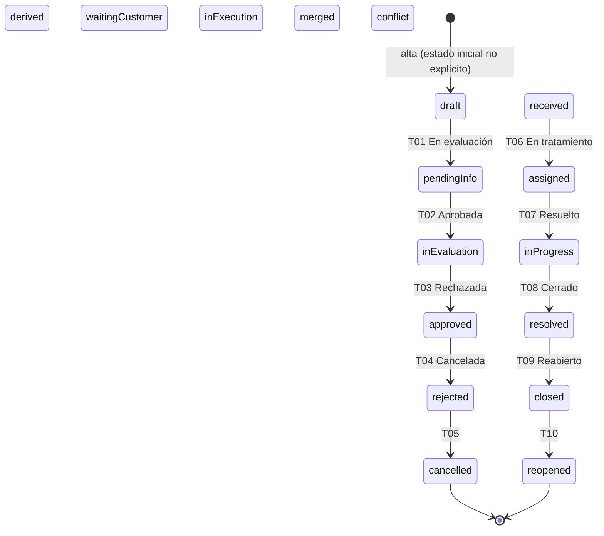

| # | Desde | Hasta | Disparador | Tipo | Guardas | Evento emitido |
|---|---|---|---|---|---|---|
| T01 | `draft` | `pendingInfo` | En evaluación | no especificado | — | — |
| T02 | `pendingInfo` | `inEvaluation` | Aprobada | no especificado | — | — |
| T03 | `inEvaluation` | `approved` | Rechazada | no especificado | — | — |
| T04 | `approved` | `rejected` | Cancelada | no especificado | — | — |
| T05 | `rejected` | `cancelled` | — | no especificado | — | — |
| T06 | `received` | `assigned` | En tratamiento | no especificado | — | — |
| T07 | `assigned` | `inProgress` | Resuelto | no especificado | — | — |
| T08 | `inProgress` | `resolved` | Cerrado | no especificado | — | — |
| T09 | `resolved` | `closed` | Reabierto | no especificado | — | — |
| T10 | `closed` | `reopened` | — | no especificado | — | — |

**Máquina 3: `pase`.** Fuente: M09 §8.11.

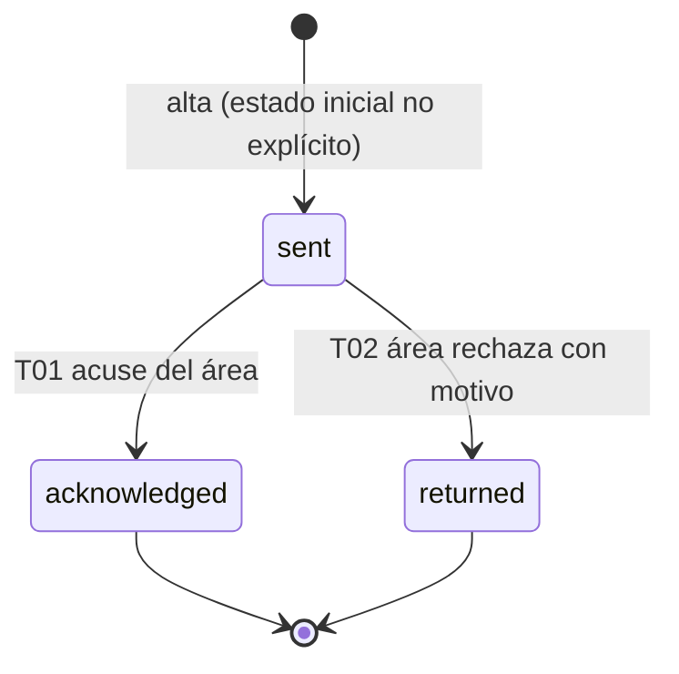

| # | Desde | Hasta | Disparador | Tipo | Guardas | Evento emitido |
|---|---|---|---|---|---|---|
| T01 | `sent` | `acknowledged` | acuse del área | no especificado | — | — |
| T02 | `sent` | `returned` | área rechaza con motivo | no especificado | — | — |

### EST-CRM-02 — `crmConversations.status` (COL-CRM-03)

**Colección:** Hilos por canal. **Campos de estado en el §7:** `status` (línea 583; valores: `botActive`, `queued`, `assigned`, `active`, `waitingCustomer`, `closed`, `expired`).

**Fuente:** M09 §8.4, M09 §8.14.

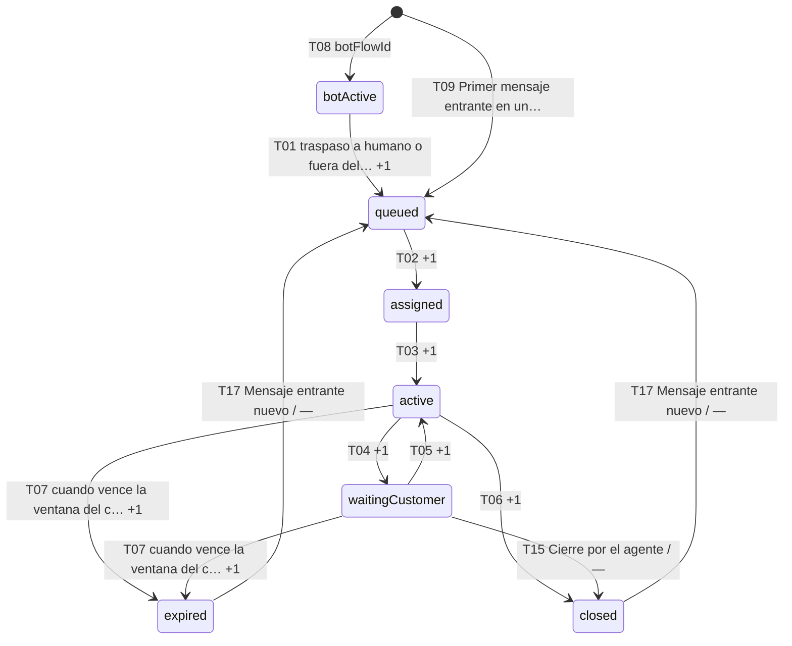

| # | Desde | Hasta | Disparador | Tipo | Guardas | Evento emitido |
|---|---|---|---|---|---|---|
| T01 | `botActive` | `queued` | traspaso a humano o fuera del bot | no especificado | RN-CRM-003 | — |
| T02 | `queued` | `assigned` | — | no especificado | RN-CRM-003 | — |
| T03 | `assigned` | `active` | — | no especificado | RN-CRM-003 | — |
| T04 | `active` | `waitingCustomer` | — | no especificado | RN-CRM-003 | — |
| T05 | `waitingCustomer` | `active` | — | no especificado | RN-CRM-003 | — |
| T06 | `active` | `closed` | — | no especificado | RN-CRM-003 | — |
| T07 | `active`, `waitingCustomer` | `expired` | cuando vence la ventana del canal sin respuesta WhatsApp h chat web inactividad PRM-CRM-064 | job | RN-CRM-003 | — |
| T08 | (nuevo) | `botActive` | Primer mensaje entrante en un canal con bot (`botFlowId`) / — | no especificado | — | — |
| T09 | (nuevo) | `queued` | Primer mensaje entrante en un canal sin bot o fuera del bot / — | no especificado | — | — |
| T10 | `botActive` | `queued` | Traspaso a humano / — | no especificado | — | — |
| T11 | `queued` | `assigned` | Asignación a un agente / — | usuario | — | — |
| T12 | `assigned` | `active` | El agente responde / — | usuario | — | — |
| T13 | `active` | `waitingCustomer` | Mensaje del agente que espera respuesta / — | usuario | — | — |
| T14 | `waitingCustomer` | `active` | Respuesta del socio / — | usuario | — | — |
| T15 | `active`, `waitingCustomer` | `closed` | Cierre por el agente / — | usuario | No cambia el caso (RN-CRM-003) | — |
| T16 | `active`, `waitingCustomer` | `expired` | Vence la ventana del canal sin respuesta / — | no especificado | WhatsApp 24 h; chat web PRM-CRM-064 | — |
| T17 | `closed`, `expired` | `queued` | Mensaje entrante nuevo / — | no especificado | Se vincula al último caso abierto de la persona | — |

### EST-CRM-03 — `crmCaseSubtypes.defaultStatus` (COL-CRM-07)

**Colección:** Subtipos y motivos; `claimTypeKey` (`dict:crm.claimType`), `externalDerivation` según el convenio de M02 (HUE-CLO-03, HUE-ALU-03) y `regulatoryReasonCode`. **Campos de estado en el §7:** `defaultStatus` (línea 671; valores: `code`).

**Fuente:** solo el §7 enumera los estados; el §8 no define transiciones (se lista como inconsistencia).

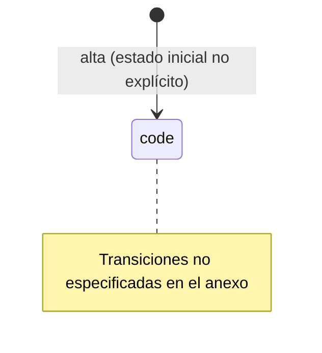

### EST-CRM-04 — `crmCommandRequests.status` (COL-CRM-12)

**Colección:** Comandos a módulos dueños. **Campos de estado en el §7:** `status` (línea 755; valores: `requested`, `accepted`, `rejected`, `executed`, `failed`, `cancelRequested`, `cancelled`).

**Fuente:** M09 §8.2.

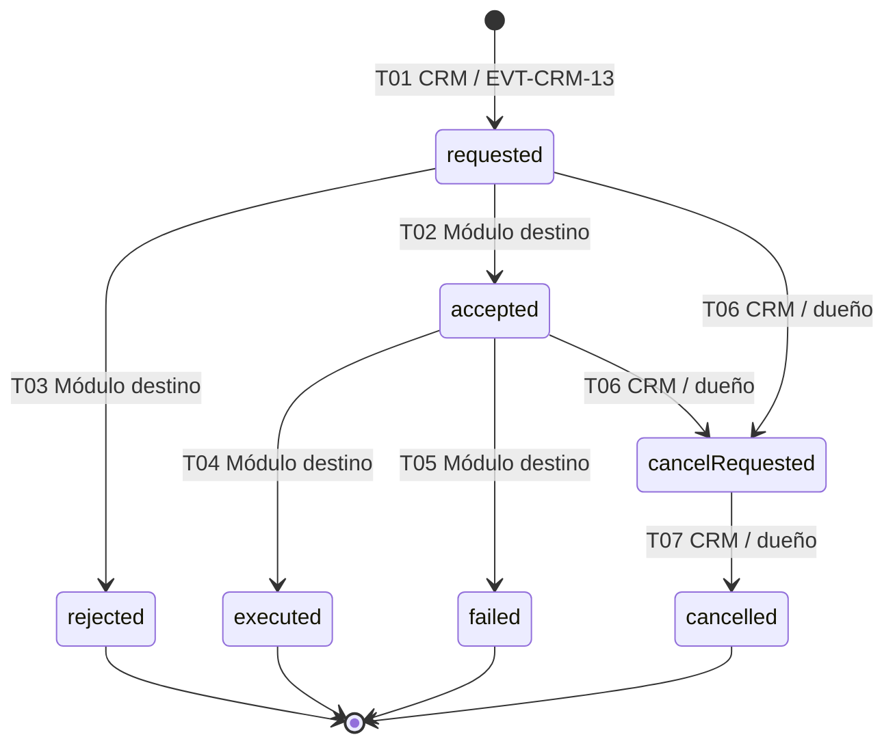

| # | Desde | Hasta | Disparador | Tipo | Guardas | Evento emitido |
|---|---|---|---|---|---|---|
| T01 | (nuevo) | `requested` | CRM | no especificado | Caso aprobado o tipo sin aprobación | EVT-CRM-13 `crm.commandRequest.requested` (inferido por nombre) |
| T02 | `requested` | `accepted` | Módulo destino | no especificado | Validación OK | — |
| T03 | `requested` | `rejected` | Módulo destino | no especificado | Regla del dueño (ej. contrato no existe) | — |
| T04 | `accepted` | `executed` | Módulo destino | no especificado | Efecto real ocurrido (ej. `cat.contract.cancelled`) | — |
| T05 | `accepted` | `failed` | Módulo destino | no especificado | Error de ejecución | — |
| T06 | `accepted`, `requested` | `cancelRequested` | CRM / dueño | no especificado | Dueño confirma que no hubo efecto | — |
| T07 | `cancelRequested` | `cancelled` | CRM / dueño | no especificado | Dueño confirma que no hubo efecto | — |

### EST-CRM-05 — `crmIncidents.status` (COL-CRM-14)

**Colección:** Incidentes comunes por zona. **Campos de estado en el §7:** `status` (línea 788; valores: `suspected`, `confirmed`, `inProgress`, `restored`, `closed`, `discarded`).

**Fuente:** M09 §8.3.

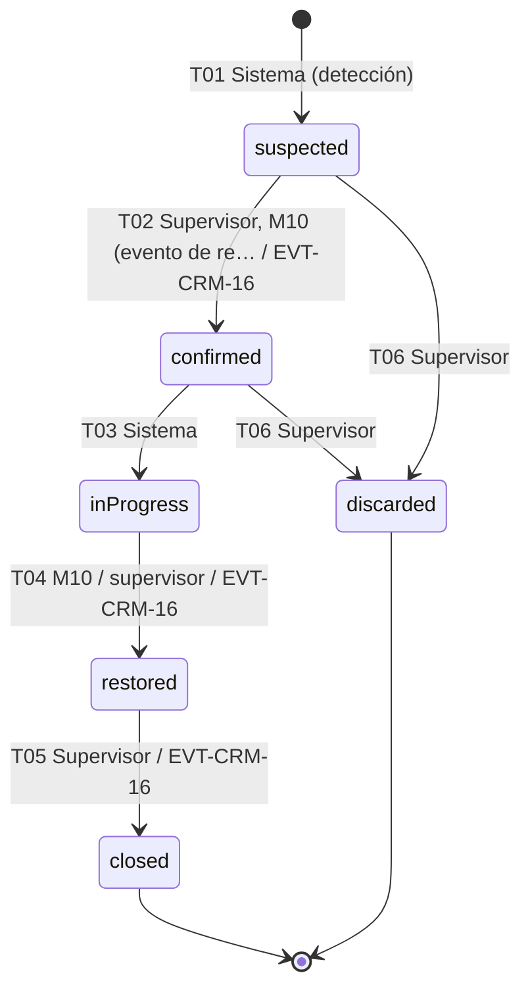

| # | Desde | Hasta | Disparador | Tipo | Guardas | Evento emitido |
|---|---|---|---|---|---|---|
| T01 | (nuevo) | `suspected` | Sistema (detección) | sistema | Umbral alcanzado | — |
| T02 | `suspected` | `confirmed` | Supervisor, M10 (evento de red) | evento, usuario | Servicio y alcance | EVT-CRM-16 `crm.incident.confirmed` (inferido por nombre) |
| T03 | `confirmed` | `inProgress` | Sistema | sistema | OT solicitada a M10 aceptada | — |
| T04 | `inProgress` | `restored` | M10 / supervisor | usuario | OT ejecutada o confirmación técnica | EVT-CRM-16 `crm.incident.restored` (inferido por nombre) |
| T05 | `restored` | `closed` | Supervisor | usuario | Plazo de observación cumplido (PRM-CRM-040) | EVT-CRM-16 `crm.incident.closed` (inferido por nombre) |
| T06 | `confirmed`, `suspected` | `discarded` | Supervisor | usuario | Motivo | — |

### EST-CRM-06 — `crmProcedureRecords.status` (COL-CRM-17)

**Colección:** Trámites presentados. **Campos de estado en el §7:** `status` (línea 835; valores: `presented`, `notPresented`, `expired`, `superseded`, `voided`).

**Fuente:** M09 §8.9, M09 §8.14.

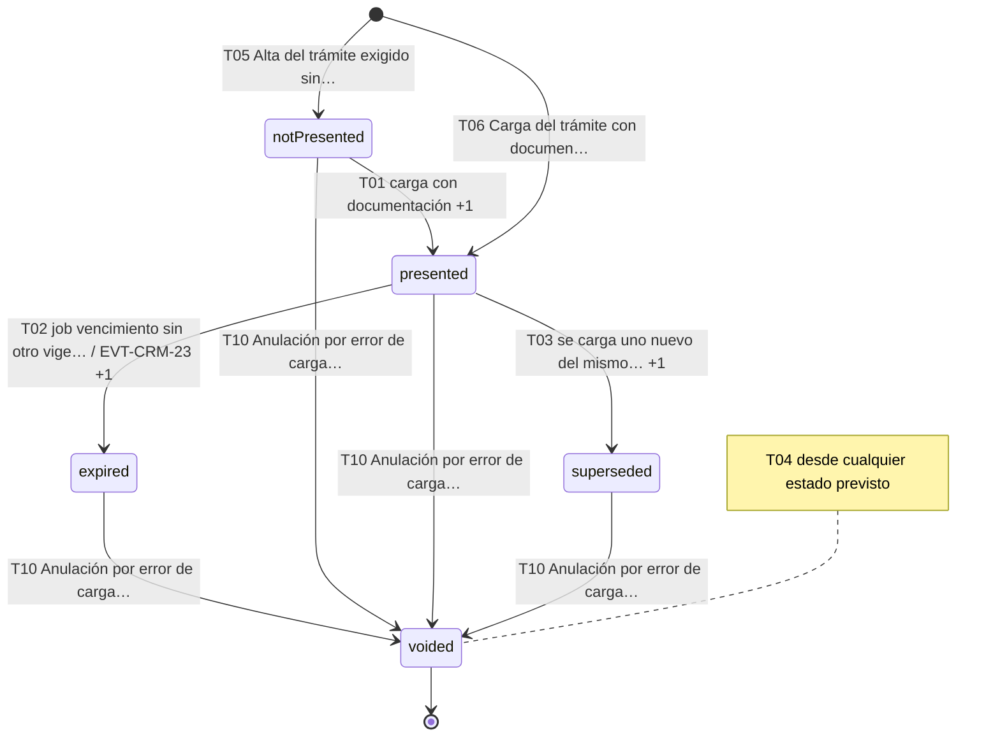

| # | Desde | Hasta | Disparador | Tipo | Guardas | Evento emitido |
|---|---|---|---|---|---|---|
| T01 | `notPresented` | `presented` | carga con documentación | no especificado | — | — |
| T02 | `presented` | `expired` | job: vencimiento sin otro vigente ejecuta acciones onExpiry | job | — | EVT-CRM-23 `crm.procedureRecord.expired` (inferido por nombre) |
| T03 | `presented` | `superseded` | se carga uno nuevo del mismo tipo | no especificado | — | — |
| T04 | cualquiera | `voided` | error de carga, con motivo | no especificado | — | — |
| T05 | (nuevo) | `notPresented` | Alta del trámite exigido sin documentación / — | no especificado | — | — |
| T06 | (nuevo) | `presented` | Carga del trámite con documentación / — | no especificado | — | — |
| T07 | `notPresented` | `presented` | Carga de la documentación / — | no especificado | — | — |
| T08 | `presented` | `expired` | Job de vencimientos / — | job | Sin otro trámite vigente del mismo tipo; ejecuta `onExpiry` | EVT-CRM-23 `crm.procedureRecord.expired` (inferido por nombre) |
| T09 | `presented` | `superseded` | Carga de un trámite nuevo del mismo tipo / — | no especificado | — | — |
| T10 | `expired`, `notPresented`, `presented`, `superseded` | `voided` | Anulación por error de carga / — | no especificado | Motivo obligatorio | — |

### EST-CRM-07 — `crmProjects.status` (COL-CRM-18)

**Colección:** Proyectos. **Campos de estado en el §7:** `status` (línea 850; valores: `active`, `onHold`, `closed`).

**Fuente:** M09 §8.12.

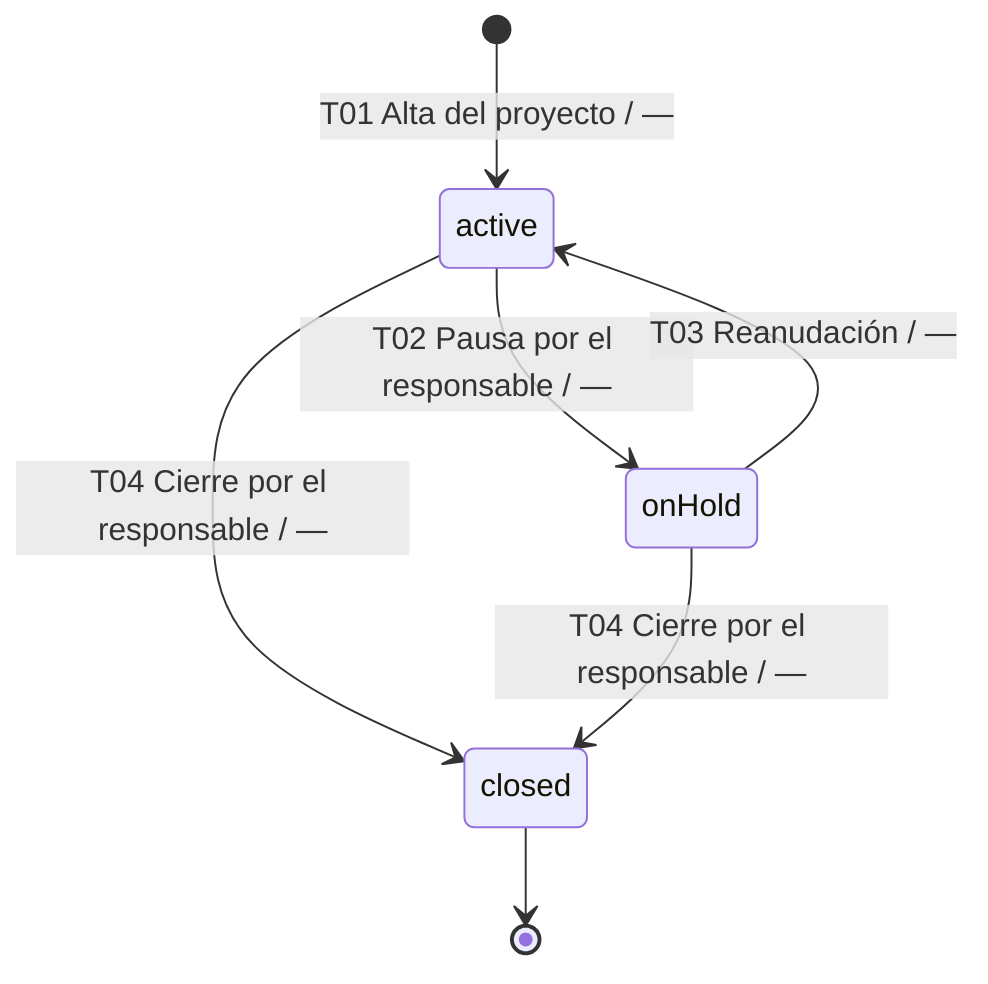

| # | Desde | Hasta | Disparador | Tipo | Guardas | Evento emitido |
|---|---|---|---|---|---|---|
| T01 | (nuevo) | `active` | Alta del proyecto / — | no especificado | — | — |
| T02 | `active` | `onHold` | Pausa por el responsable / — | usuario | — | — |
| T03 | `onHold` | `active` | Reanudación / — | no especificado | — | — |
| T04 | `active`, `onHold` | `closed` | Cierre por el responsable / — | usuario | Sin casos abiertos del proyecto | — |

### EST-CRM-08 — `crmWorkLogs.billingStatus` (COL-CRM-19)

**Colección:** Registro de tiempo. **Campos de estado en el §7:** `billingStatus` (línea 866; valores: `notBillable`, `pending`, `coveredByBank`, `requested`, `billed`).

**Fuente:** M09 §8.14.

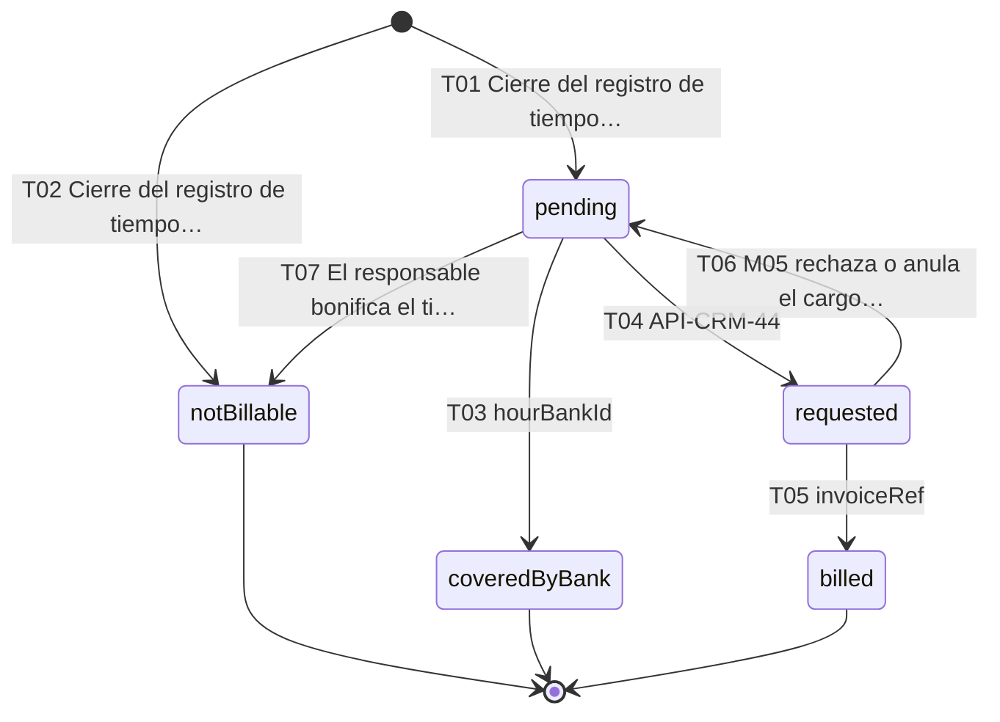

| # | Desde | Hasta | Disparador | Tipo | Guardas | Evento emitido |
|---|---|---|---|---|---|---|
| T01 | (nuevo) | `pending` | Cierre del registro de tiempo con minutos a facturar / — | no especificado | `billableMinutes` mayor que cero y tipo facturable | — |
| T02 | (nuevo) | `notBillable` | Cierre del registro de tiempo no facturable / — | no especificado | Tipo no facturable o `billableMinutes` = 0 | — |
| T03 | `pending` | `coveredByBank` | Consumo de una bolsa de horas (`hourBankId`) / — | no especificado | Bolsa vigente con saldo (RN-CRM-050) | — |
| T04 | `pending` | `requested` | Solicitud de facturación a M05 (API-CRM-44) / — | API/integración | `crm.horas.facturar` | — |
| T05 | `requested` | `billed` | M05 emite el comprobante (`invoiceRef`) / — | no especificado | — | — |
| T06 | `requested` | `pending` | M05 rechaza o anula el cargo pedido / — | no especificado | — | — |
| T07 | `pending` | `notBillable` | El responsable bonifica el tiempo / — | usuario | Nota obligatoria | — |

### EST-CRM-09 — `crmChannels.status` (COL-CRM-23)

**Colección:** Canales del tenant (único global `{kind, address}` para resolver el tenant de webhooks). **Campos de estado en el §7:** `status` (línea 913; valores: `draft`, `testing`, `active`, `suspended`).

**Fuente:** M09 §8.12.

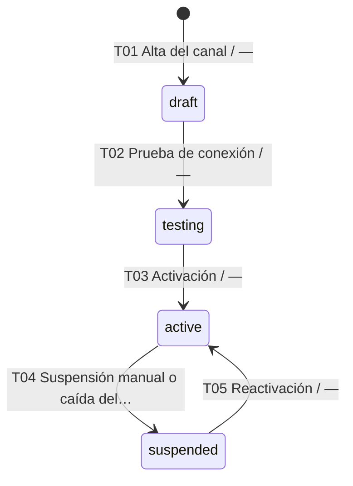

| # | Desde | Hasta | Disparador | Tipo | Guardas | Evento emitido |
|---|---|---|---|---|---|---|
| T01 | (nuevo) | `draft` | Alta del canal / — | no especificado | — | — |
| T02 | `draft` | `testing` | Prueba de conexión / — | no especificado | Credenciales del conector cargadas (T06) | — |
| T03 | `testing` | `active` | Activación / — | no especificado | Prueba exitosa | — |
| T04 | `active` | `suspended` | Suspensión manual o caída del conector / — | API/integración | — | — |
| T05 | `suspended` | `active` | Reactivación / — | no especificado | Prueba exitosa | — |

### EST-CRM-10 — `crmBotFlows.status` (COL-CRM-24)

**Colección:** Flujos de bot. **Campos de estado en el §7:** `status` (línea 927; valores: `draft`, `published`, `archived`).

**Fuente:** M09 §8.14.

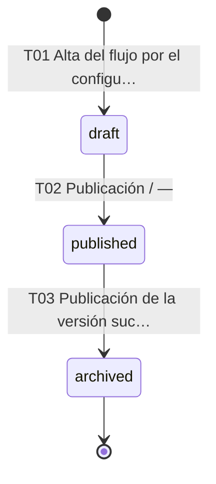

| # | Desde | Hasta | Disparador | Tipo | Guardas | Evento emitido |
|---|---|---|---|---|---|---|
| T01 | (nuevo) | `draft` | Alta del flujo por el configurador / — | no especificado | — | — |
| T02 | `draft` | `published` | Publicación / — | no especificado | Flujo validado; la versión publicada no se edita (se crea otra `version`) | — |
| T03 | `published` | `archived` | Publicación de la versión sucesora o retiro / — | no especificado | — | — |

### EST-CRM-11 — `crmAiSuggestions.status` (COL-CRM-26)

**Colección:** Sugerencias de IA supervisada. **Campos de estado en el §7:** `status` (línea 943; valores: `proposed`, `accepted`, `corrected`, `discarded`, `expired`, `failed`).

**Fuente:** M09 §8.8.

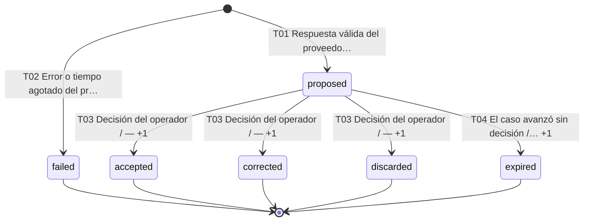

| # | Desde | Hasta | Disparador | Tipo | Guardas | Evento emitido |
|---|---|---|---|---|---|---|
| T01 | (nuevo) | `proposed` | Respuesta válida del proveedor de IA / — | API/integración | — | — |
| T02 | (nuevo) | `failed` | Error o tiempo agotado del proveedor de IA / — | API/integración | No bloquea el caso | — |
| T03 | `proposed` | `accepted`, `corrected`, `discarded` | Decisión del operador / — | usuario | Usuario humano con acceso al caso | — |
| T04 | `proposed` | `expired` | El caso avanzó sin decisión / — | no especificado | Cambio de estado del caso posterior a la sugerencia | — |
| T05 | `proposed` | `accepted`, `corrected`, `discarded` | decisión humana | no especificado | — | — |
| T06 | `proposed` | `expired` | el caso avanzó sin decisión | no especificado | — | — |

### EST-CRM-12 — `crmQueueTickets.status` (COL-CRM-27)

**Colección:** Turnos del turnero. **Campos de estado en el §7:** `status` (línea 964; valores: `waiting`, `calling`, `inService`, `finished`, `cancelled`).

**Fuente:** M09 §8.5.

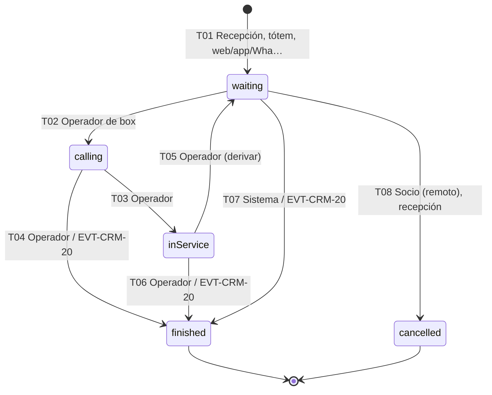

| # | Desde | Hasta | Disparador | Tipo | Guardas | Evento emitido |
|---|---|---|---|---|---|---|
| T01 | (nuevo) | `waiting` | Recepción, tótem, web/app/WhatsApp, check-in de reserva | no especificado | Área habilitada | — |
| T02 | `waiting` | `calling` | Operador de box | usuario | Box abierto con área del turno; llamado atómico | — |
| T03 | `calling` | `inService` | Operador | usuario | Persona presente | — |
| T04 | `calling` | `finished` | Operador | usuario | Tras N rellamados (PRM-CRM-107) | EVT-CRM-20 `crm.queueTicket.finished` (inferido por nombre) |
| T05 | `inService` | `waiting` | Operador (derivar) | usuario | Área destino habilitada | — |
| T06 | `inService` | `finished` | Operador | usuario | Motivo y resultado | EVT-CRM-20 `crm.queueTicket.finished` (inferido por nombre) |
| T07 | `waiting` | `finished` | Sistema | sistema | Cierre del día (RN-CRM-071) | EVT-CRM-20 `crm.queueTicket.finished` (inferido por nombre) |
| T08 | `waiting` | `cancelled` | Socio (remoto), recepción | usuario | — | — |

### EST-CRM-13 — `crmQueueAppointments.status` (COL-CRM-33)

**Colección:** Reservas de turno. **Campos de estado en el §7:** `status` (línea 996; valores: `booked`, `confirmed`, `checkedIn`, `noShow`, `cancelled`).

**Fuente:** M09 §8.6, M09 §8.14.

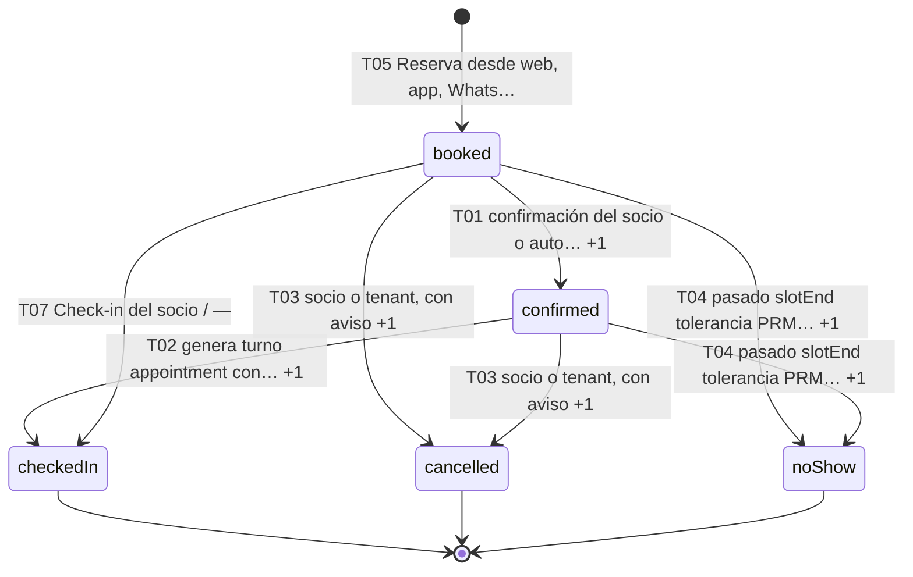

| # | Desde | Hasta | Disparador | Tipo | Guardas | Evento emitido |
|---|---|---|---|---|---|---|
| T01 | `booked` | `confirmed` | confirmación del socio o automática | job, usuario | — | — |
| T02 | `confirmed` | `checkedIn` | genera turno appointment con prioridad de hora | no especificado | — | — |
| T03 | `booked`, `confirmed` | `cancelled` | socio o tenant, con aviso | usuario | — | — |
| T04 | `booked`, `confirmed` | `noShow` | pasado slotEnd tolerancia PRM-CRM-111 | no especificado | — | — |
| T05 | (nuevo) | `booked` | Reserva desde web, app, WhatsApp o recepción / — | no especificado | Franja con cupo | — |
| T06 | `booked` | `confirmed` | Confirmación del socio o automática / — | job, usuario | — | — |
| T07 | `booked`, `confirmed` | `checkedIn` | Check-in del socio / — | usuario | Genera turno `appointment` con prioridad de hora | — |
| T08 | `booked`, `confirmed` | `cancelled` | Cancelación del socio o del tenant / — | usuario | Con aviso | — |
| T09 | `booked`, `confirmed` | `noShow` | Job: pasó `slotEnd` más la tolerancia / — | job | PRM-CRM-111 | — |

### EST-CRM-14 — `crmActivityOccurrences.status` (COL-CRM-38)

**Colección:** Ocurrencias de actividades. **Campos de estado en el §7:** `status` (línea 1016; valores: `pending`, `dueSoon`, `overdue`, `closedOnTime`, `closedLate`, `closedWithReview`, `voided`).

**Fuente:** M09 §8.7, M09 §8.14.

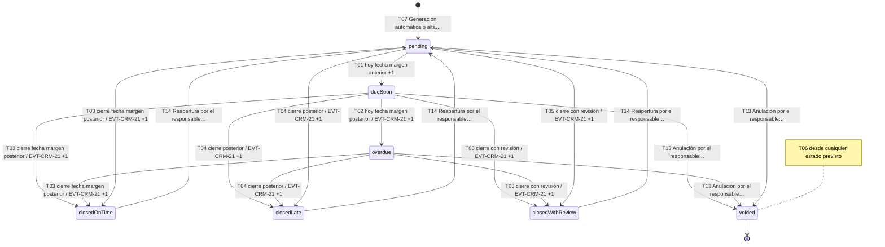

| # | Desde | Hasta | Disparador | Tipo | Guardas | Evento emitido |
|---|---|---|---|---|---|---|
| T01 | `pending` | `dueSoon` | hoy fecha margen anterior | no especificado | — | — |
| T02 | `dueSoon` | `overdue` | hoy fecha margen posterior | no especificado | — | EVT-CRM-21 `crm.activityOccurrence.overdue` (inferido por nombre) |
| T03 | `dueSoon`, `overdue`, `pending` | `closedOnTime` | cierre fecha margen posterior | no especificado | — | EVT-CRM-21 `crm.activityOccurrence.closed` (inferido por nombre) |
| T04 | `dueSoon`, `overdue`, `pending` | `closedLate` | cierre posterior | no especificado | — | EVT-CRM-21 `crm.activityOccurrence.closed` (inferido por nombre) |
| T05 | `dueSoon`, `overdue`, `pending` | `closedWithReview` | cierre con revisión | no especificado | — | EVT-CRM-21 `crm.activityOccurrence.closed` (inferido por nombre) |
| T06 | cualquiera | `voided` | con motivo, por responsable del área | usuario | — | — |
| T07 | (nuevo) | `pending` | Generación automática o alta manual de la ocurrencia / — | job | — | — |
| T08 | `pending` | `dueSoon` | Job diario / — | job | Hoy mayor o igual a fecha menos margen anterior | — |
| T09 | `dueSoon` | `overdue` | Job diario / — | job | Hoy mayor que fecha más margen posterior | EVT-CRM-21 `crm.activityOccurrence.overdue` (inferido por nombre) |
| T10 | `dueSoon`, `overdue`, `pending` | `closedOnTime` | Cierre por el responsable / — | usuario | Cierre hasta fecha más margen posterior | EVT-CRM-21 `crm.activityOccurrence.closed` (inferido por nombre) |
| T11 | `dueSoon`, `overdue`, `pending` | `closedLate` | Cierre por el responsable / — | usuario | Cierre posterior al margen | EVT-CRM-21 `crm.activityOccurrence.closed` (inferido por nombre) |
| T12 | `dueSoon`, `overdue`, `pending` | `closedWithReview` | Cierre con revisión / — | no especificado | Aprobación de otro usuario si la actividad la exige | EVT-CRM-21 `crm.activityOccurrence.closed` (inferido por nombre) |
| T13 | `dueSoon`, `overdue`, `pending` | `voided` | Anulación por el responsable del área / — | usuario | Motivo obligatorio | — |
| T14 | `closedLate`, `closedOnTime`, `closedWithReview` | `pending` | Reapertura por el responsable del área / — | usuario | Nota obligatoria | — |

### EST-CRM-15 — `crmCalendarEvents.status` (COL-CRM-40)

**Colección:** Eventos de calendario (se proyectan en `agendaEntries` de T11). **Campos de estado en el §7:** `status` (línea 1024; valores: `scheduled`, `completed`, `cancelled`, `missed`).

**Fuente:** M09 §8.13.

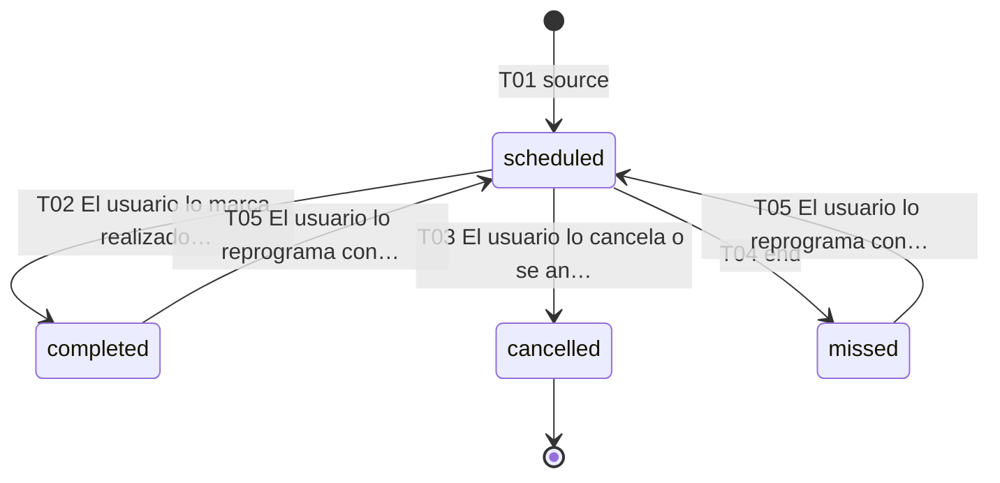

| # | Desde | Hasta | Disparador | Tipo | Guardas | Evento emitido |
|---|---|---|---|---|---|---|
| T01 | (nuevo) | `scheduled` | Alta manual del usuario o proyección desde una ocurrencia de actividad o un caso (`source`) / — | usuario | `start` anterior o igual a `end` | — |
| T02 | `scheduled` | `completed` | El usuario lo marca realizado o se cierra la fuente (ocurrencia o caso) / — | usuario | — | — |
| T03 | `scheduled` | `cancelled` | El usuario lo cancela o se anula la fuente / — | usuario | — | — |
| T04 | `scheduled` | `missed` | Job diario: pasó `end` sin marcarlo realizado / — | job | En eventos recurrentes aplica a cada instancia | — |
| T05 | `completed`, `missed` | `scheduled` | El usuario lo reprograma con fecha nueva / — | usuario | Solo eventos manuales (`source.type` = `manual`) | — |

### EST-CRM-16 — `crmCircularRuns.status` (COL-CRM-42)

**Colección:** Corridas de circulares. **Campos de estado en el §7:** `status` (línea 1032; valores: `draft`, `pendingApproval`, `approved`, `generating`, `sent`, `partiallyFailed`, `cancelled`).

**Fuente:** M09 §8.10, M09 §8.14.

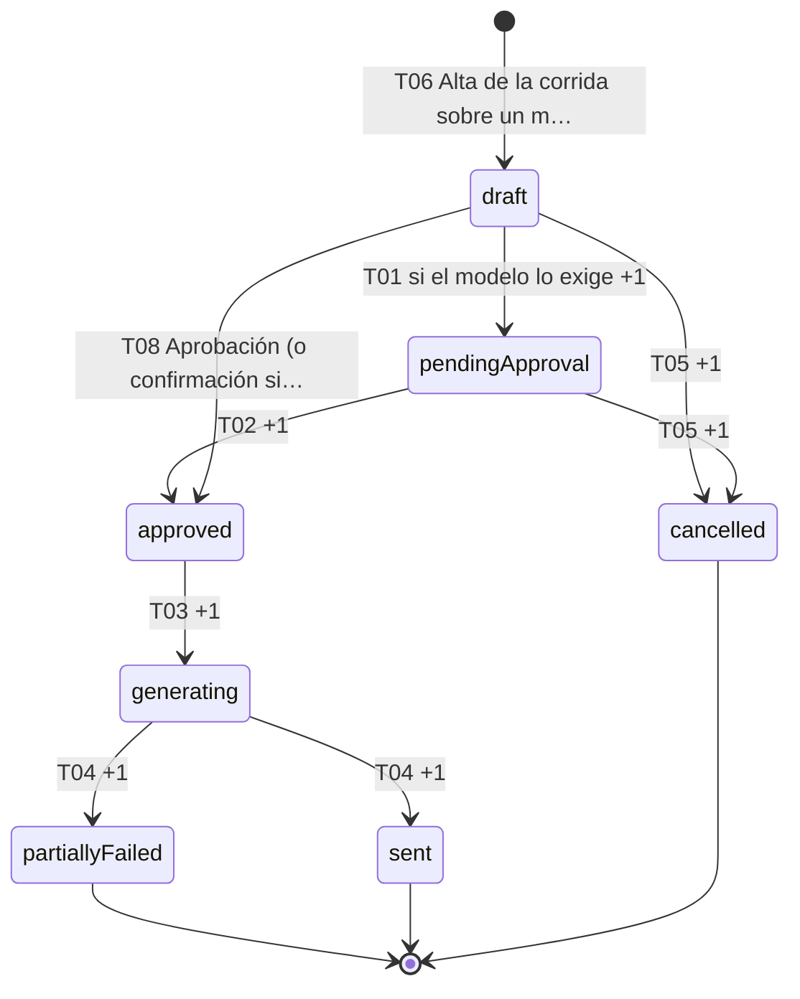

| # | Desde | Hasta | Disparador | Tipo | Guardas | Evento emitido |
|---|---|---|---|---|---|---|
| T01 | `draft` | `pendingApproval` | si el modelo lo exige | no especificado | — | — |
| T02 | `pendingApproval` | `approved` | — | no especificado | — | — |
| T03 | `approved` | `generating` | — | no especificado | — | — |
| T04 | `generating` | `partiallyFailed`, `sent` | — | no especificado | — | — |
| T05 | `draft`, `pendingApproval` | `cancelled` | — | no especificado | — | — |
| T06 | (nuevo) | `draft` | Alta de la corrida sobre un modelo de circular / — | no especificado | — | — |
| T07 | `draft` | `pendingApproval` | Envío a aprobación / — | no especificado | El modelo exige aprobación | — |
| T08 | `draft`, `pendingApproval` | `approved` | Aprobación (o confirmación si no exige aprobación) / — | no especificado | — | — |
| T09 | `approved` | `generating` | Inicio de la generación / — | no especificado | — | — |
| T10 | `generating` | `sent` | Envío completo por T09 / — | no especificado | — | — |
| T11 | `generating` | `partiallyFailed` | Envío con destinatarios fallidos / — | no especificado | Los fallidos se reintentan por T09 o en una corrida nueva | — |
| T12 | `draft`, `pendingApproval` | `cancelled` | Cancelación / — | no especificado | — | — |

## M10 — TEC Técnica, campo y redes

### EST-TEC-01 — `feasibilityRequests.status` (COL-TEC-01)

**Colección:** Factibilidades. **Campos de estado en el §7:** `adminStatus`, `status`, `techStatus` (línea 652, 651, 653; sin valores en el §7).

**Máquina 1: `status`.** Fuente: M10 §8.1, M10 §8.16.

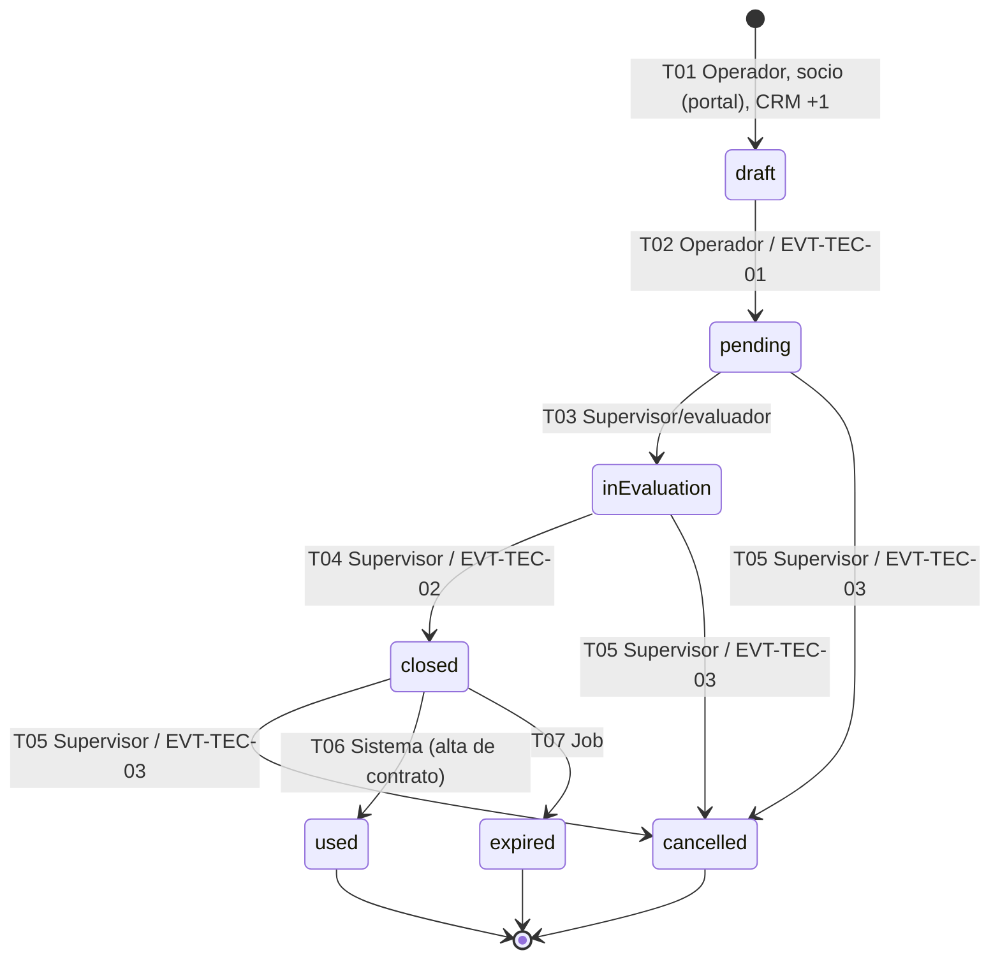

| # | Desde | Hasta | Disparador | Tipo | Guardas | Evento emitido |
|---|---|---|---|---|---|---|
| T01 | (nuevo) | `draft` | Operador, socio (portal), CRM | usuario | — | — |
| T02 | `draft` | `pending` | Operador | usuario | Datos mínimos (servicio, persona, domicilio) | EVT-TEC-01 `tec.feasibility.requested` |
| T03 | `pending` | `inEvaluation` | Supervisor/evaluador | usuario | — | — |
| T04 | `inEvaluation` | `closed` | Supervisor | usuario | Motivo, responsable técnico, estado técnico | EVT-TEC-02 `tec.feasibility.verdictIssued` |
| T05 | `closed`, `inEvaluation`, `pending` | `cancelled` | Supervisor | usuario | Motivo; no usada | EVT-TEC-03 `tec.feasibility.cancelled` |
| T06 | `closed` | `used` | Sistema (alta de contrato) | sistema | Vigente, no usada | — |
| T07 | `closed` | `expired` | Job | job | `validUntil` < hoy | — |
| T08 | (nuevo) | `draft` | Operador, socio (portal) o CRM inicia la factibilidad / — | usuario | — | — |

**Máquina 2: `estimate.status`.** Fuente: M10 §8.1.

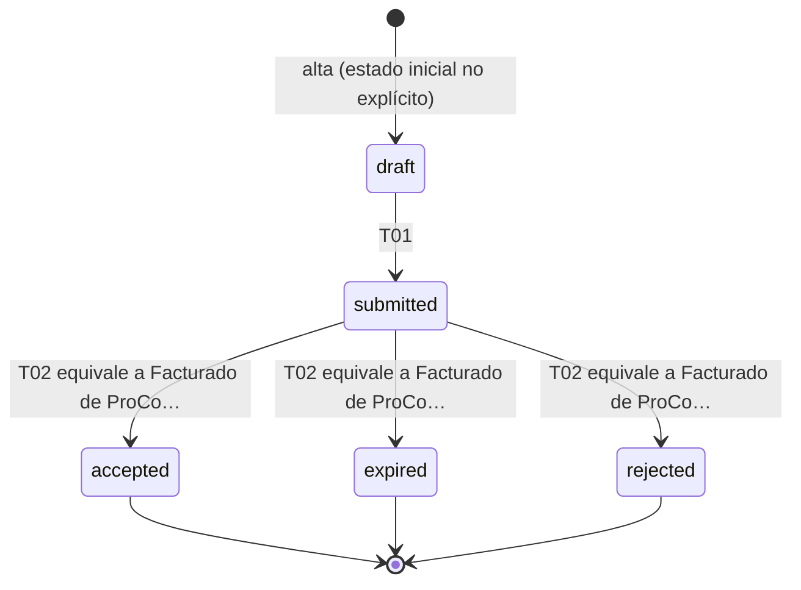

| # | Desde | Hasta | Disparador | Tipo | Guardas | Evento emitido |
|---|---|---|---|---|---|---|
| T01 | `draft` | `submitted` | — | no especificado | — | — |
| T02 | `submitted` | `accepted`, `expired`, `rejected` | equivale a Facturado de ProCoop cuando se acepta y factura | no especificado | — | — |

### EST-TEC-02 — `connectionEstimates.status` (COL-TEC-02)

**Colección:** Estimación técnica de conexión. **Campos de estado en el §7:** `status` (línea 675; valores: `draft`, `submitted`, `accepted`, `rejected`, `expired`).

**Fuente:** M10 §8.16.

```mermaid
stateDiagram-v2
    [*] --> draft : T01 Evaluador arma el cómputo / —
    draft --> submitted : T02 Envío del presupuesto a M11 /…
    submitted --> accepted : T03 Respuesta o vencimiento del p…
    submitted --> expired : T03 Respuesta o vencimiento del p…
    submitted --> rejected : T03 Respuesta o vencimiento del p…
    accepted --> [*]
    expired --> [*]
    rejected --> [*]
```

| # | Desde | Hasta | Disparador | Tipo | Guardas | Evento emitido |
|---|---|---|---|---|---|---|
| T01 | (nuevo) | `draft` | Evaluador arma el cómputo / — | usuario | — | — |
| T02 | `draft` | `submitted` | Envío del presupuesto a M11 / — | no especificado | — | — |
| T03 | `submitted` | `accepted`, `expired`, `rejected` | Respuesta o vencimiento del presupuesto de M11 / — | job | Refleja el estado del presupuesto | — |

### EST-TEC-03 — `workOrders.status` (COL-TEC-12)

**Colección:** Órdenes de trabajo (instalación como subdocumento). **Campos de estado en el §7:** `status` (línea 747; sin valores en el §7).

Ver también el diagrama curado B6 en `06-secuencias-y-estados.md` §4.

**Máquina 1: `status`.** Fuente: M10 §8.4, M10 §8.16.

```mermaid
stateDiagram-v2
    [*] --> pending : T01 Admin, CRM, mora, campo, regl… / EVT-TEC-04 +1
    pending --> scheduled : T02 Despachante/socio
    pending --> assigned : T03 Despachante
    scheduled --> assigned : T03 Despachante
    assigned --> dispatched : T04 Sistema / impresión (RN-TEC-0…
    dispatched --> inProgress : T05 Técnico (llegada/inicio)
    inProgress --> onHold : T06 Técnico/supervisor
    inProgress --> executed : T07 Técnico (campo) o administrat… / EVT-TEC-06
    executed --> closing : T08 Supervisor (confirmar) / auto…
    closing --> closed : T09 Sistema / EVT-TEC-07
    closing --> closing : T10 Sistema
    executed --> cancelled : T11 Supervisor / EVT-TEC-08
    closed --> pending : T12 Supervisor con capability
    onHold --> [*]
    cancelled --> [*]
```

| # | Desde | Hasta | Disparador | Tipo | Guardas | Evento emitido |
|---|---|---|---|---|---|---|
| T01 | (nuevo) | `pending` | Admin, CRM, mora, campo, regla, plan | usuario | Validaciones RF-TEC-027/028 (RN-TEC-050) | EVT-TEC-04 `tec.workOrder.created` |
| T02 | `pending` | `scheduled` | Despachante/socio | usuario | Visita confirmada | — |
| T03 | `pending`, `scheduled` | `assigned` | Despachante | usuario | Recurso/cuadrilla | — |
| T04 | `assigned` | `dispatched` | Sistema / impresión (RN-TEC-011) / envío automático (PRM-TEC-079) | job | — (RN-TEC-011) | — |
| T05 | `dispatched` | `inProgress` | Técnico (llegada/inicio) | usuario | — | — |
| T06 | `inProgress` | `onHold` | Técnico/supervisor | usuario | Motivo (falta material, permiso, acceso) | — |
| T07 | `inProgress` | `executed` | Técnico (campo) o administrativo | usuario | Requisitos de cierre de campo | EVT-TEC-06 `tec.workOrder.executed` (inferido por nombre) |
| T08 | `executed` | `closing` | Supervisor (confirmar) / automático | job, usuario | Requisitos de confirmación (RF-TEC-036); sin conflicto abierto | — |
| T09 | `closing` | `closed` | Sistema | sistema | Todos los pasos `done` | EVT-TEC-07 `tec.workOrder.closed` |
| T10 | `closing` | `closing` | Sistema | sistema | Error en un efecto | — |
| T11 | `executed` | `cancelled` | Supervisor | usuario | Motivo; si hay evidencia de ejecución en campo, se exige resolver conflicto (RN-TEC-036) | EVT-TEC-08 `tec.workOrder.cancelled` (inferido por nombre) |
| T12 | `closed` | `pending` | Supervisor con capability | usuario | Motivo | — |
| T13 | (nuevo) | `pending` | Alta por administración, CRM (comando `tec.workOrder.request`), mora, campo, regla o plan / `tec.workOrder.created` | evento, usuario | RF-TEC-027/028 | — |

**Máquina 2: `installation.stage`.** Fuente: M10 §8.5.

```mermaid
stateDiagram-v2
    pendingAppointment --> appointed : T01 visita confirmada
    appointed --> equipmentReserved : T02 M13 reserva
    equipmentReserved --> equipmentInCustody : T03 entrega al instalador
    equipmentInCustody --> enRoute : T04
    enRoute --> onSite : T05
    onSite --> installing : T06
    installing --> testing : T07
    testing --> testFailed : T08
    testFailed --> failedVisit : T09
    testFailed --> installing : T09
    testing --> awaitingConformity : T10
    awaitingConformity --> conformityRefused : T11
    awaitingConformity --> executed : T12 EVT-TEC-06
    executed --> awaitingProvisioning : T13 si triggersProvisioning
    awaitingProvisioning --> awaitingReview : T14 si revisión supervisora
    awaitingReview --> activationConfirmed : T15
    [*] --> pendingAppointment : alta (estado inicial no explícito)
    failedVisit --> [*]
    conformityRefused --> [*]
    activationConfirmed --> [*]
```

| # | Desde | Hasta | Disparador | Tipo | Guardas | Evento emitido |
|---|---|---|---|---|---|---|
| T01 | `pendingAppointment` | `appointed` | visita confirmada | no especificado | — | — |
| T02 | `appointed` | `equipmentReserved` | M13 reserva | no especificado | — | — |
| T03 | `equipmentReserved` | `equipmentInCustody` | entrega al instalador | usuario | — | — |
| T04 | `equipmentInCustody` | `enRoute` | — | no especificado | — | — |
| T05 | `enRoute` | `onSite` | — | no especificado | — | — |
| T06 | `onSite` | `installing` | — | no especificado | — | — |
| T07 | `installing` | `testing` | — | no especificado | — | — |
| T08 | `testing` | `testFailed` | — | no especificado | — | — |
| T09 | `testFailed` | `failedVisit`, `installing` | — | no especificado | — | — |
| T10 | `testing` | `awaitingConformity` | — | no especificado | — | — |
| T11 | `awaitingConformity` | `conformityRefused` | — | no especificado | — | — |
| T12 | `awaitingConformity` | `executed` | — | no especificado | — | EVT-TEC-06 `tec.workOrder.executed` (inferido por nombre) |
| T13 | `executed` | `awaitingProvisioning` | si triggersProvisioning | no especificado | — | — |
| T14 | `awaitingProvisioning` | `awaitingReview` | si revisión supervisora | usuario | — | — |
| T15 | `awaitingReview` | `activationConfirmed` | — | no especificado | — | — |

### EST-TEC-04 — `workOrderMaterials.status` (COL-TEC-13)

**Colección:** Materiales y necesidades. **Campos de estado en el §7:** `status` (línea 795; sin valores en el §7).

**Fuente:** M10 §8.6, M10 §8.16.

```mermaid
stateDiagram-v2
    requested --> authorized : T01 supervisor cantidad autorizad… +1
    authorized --> reserved : T02 +1
    reserved --> withdrawn : T03 vale entrega a custodia +1
    withdrawn --> used : T04 aplicación en sitio descuenta… / EVT-TEC-11 +1
    used --> returned : T05 devolución parcial total del… / EVT-TEC-11 +1
    authorized --> cancelled : T06 libera reserva +1
    requested --> cancelled : T06 libera reserva +1
    reserved --> cancelled : T06 libera reserva +1
    [*] --> requested : T07 Técnico o supervisor pide mat… / EVT-TEC-11
    withdrawn --> returned : T12 Devolución parcial o total de… / EVT-TEC-11
    returned --> [*]
    cancelled --> [*]
```

| # | Desde | Hasta | Disparador | Tipo | Guardas | Evento emitido |
|---|---|---|---|---|---|---|
| T01 | `requested` | `authorized` | supervisor cantidad autorizada solicitada | usuario | — | — |
| T02 | `authorized` | `reserved` | — | no especificado | — | — |
| T03 | `reserved` | `withdrawn` | vale entrega a custodia | no especificado | — | — |
| T04 | `withdrawn` | `used` | aplicación en sitio descuenta de custodia | no especificado | — | EVT-TEC-11 `tec.material.used` (inferido por nombre) |
| T05 | `used` | `returned` | devolución parcial total del no usado | no especificado | — | EVT-TEC-11 `tec.material.returned` (inferido por nombre) |
| T06 | `authorized`, `requested`, `reserved` | `cancelled` | libera reserva | no especificado | — | — |
| T07 | (nuevo) | `requested` | Técnico o supervisor pide material para la OT / — | usuario | — | EVT-TEC-11 `tec.material.requested` (inferido por nombre) |
| T08 | `requested` | `authorized` | Supervisor autoriza / — | usuario | Cantidad autorizada menor o igual a la solicitada | — |
| T09 | `authorized` | `reserved` | Reserva en M13 / — | no especificado | — | — |
| T10 | `reserved` | `withdrawn` | Vale o entrega a custodia / — | no especificado | — | — |
| T11 | `withdrawn` | `used` | Aplicación en sitio / — | no especificado | Descuenta de custodia | EVT-TEC-11 `tec.material.used` (inferido por nombre) |
| T12 | `used`, `withdrawn` | `returned` | Devolución parcial o total del no usado / — | no especificado | — | EVT-TEC-11 `tec.material.returned` (inferido por nombre) |
| T13 | `authorized`, `requested`, `reserved` | `cancelled` | Cancelación / — | no especificado | Libera la reserva | — |

### EST-TEC-05 — `damageAssessments.status` (COL-TEC-16)

**Colección:** Reclamos por daños. **Campos de estado en el §7:** `status` (línea 845; valores: `open`, `inReview`, `approved`, `rejected`, `paid`).

**Fuente:** M10 §8.16.

```mermaid
stateDiagram-v2
    [*] --> open : T01 Alta del reclamo por daños / —
    open --> inReview : T02 Evaluación técnica o inspecci…
    inReview --> approved : T03 Resolución favorable / —
    inReview --> rejected : T04 Resolución desfavorable / —
    approved --> paid : T05 Registro del pago o crédito a…
    rejected --> [*]
    paid --> [*]
```

| # | Desde | Hasta | Disparador | Tipo | Guardas | Evento emitido |
|---|---|---|---|---|---|---|
| T01 | (nuevo) | `open` | Alta del reclamo por daños / — | no especificado | — | — |
| T02 | `open` | `inReview` | Evaluación técnica o inspección / — | no especificado | — | — |
| T03 | `inReview` | `approved` | Resolución favorable / — | no especificado | Responsable con permiso | — |
| T04 | `inReview` | `rejected` | Resolución desfavorable / — | no especificado | Motivo obligatorio | — |
| T05 | `approved` | `paid` | Registro del pago o crédito al socio / — | usuario | — | — |

### EST-TEC-06 — `technicalProcedures.status` (COL-TEC-17)

**Colección:** Expedientes técnicos (vinculados a `dossiers` de T11). **Campos de estado en el §7:** `status` (línea 849; valores: `open`, `inReview`, `observed`, `approved`, `rejected`, `cancelled`).

**Fuente:** M10 §8.15.

```mermaid
stateDiagram-v2
    [*] --> open : T01 Alta del expediente (presenta…
    observed --> inReview : T02 Presentación de una etapa ( s…
    open --> inReview : T02 Presentación de una etapa ( s…
    inReview --> observed : T03 Resolución de la etapa con ob…
    inReview --> approved : T04 Resolución aprobatoria de la…
    inReview --> rejected : T05 Resolución de rechazo / —
    inReview --> cancelled : T06 Anulación del expediente / —
    observed --> cancelled : T06 Anulación del expediente / —
    open --> cancelled : T06 Anulación del expediente / —
    approved --> [*]
    rejected --> [*]
    cancelled --> [*]
```

| # | Desde | Hasta | Disparador | Tipo | Guardas | Evento emitido |
|---|---|---|---|---|---|---|
| T01 | (nuevo) | `open` | Alta del expediente (presentación del profesional certificado o carga interna) / — | no especificado | `installerId` vigente en `certifiedInstallers` | — |
| T02 | `observed`, `open` | `inReview` | Presentación de una etapa (`stages[].submittedAt`) / — | no especificado | — | — |
| T03 | `inReview` | `observed` | Resolución de la etapa con observación / — | no especificado | Observación obligatoria | — |
| T04 | `inReview` | `approved` | Resolución aprobatoria de la última etapa / — | no especificado | — | — |
| T05 | `inReview` | `rejected` | Resolución de rechazo / — | no especificado | Motivo obligatorio | — |
| T06 | `inReview`, `observed`, `open` | `cancelled` | Anulación del expediente / — | no especificado | Motivo obligatorio; auditoría (AGR-003) | — |

### EST-TEC-07 — `visitBookings.status` (COL-TEC-21)

**Colección:** Reservas de visita. **Campos de estado en el §7:** `status` (línea 863; sin valores en el §7).

**Fuente:** M10 §8.2.

```mermaid
stateDiagram-v2
    [*] --> held : T01 Socio/operador
    held --> confirmed : T02 Socio/operador
    held --> expired : T03 Job tec liberar-reservas
    held --> released : T04 Socio/operador
    confirmed --> cancelled : T05 Socio (con anticipación) / op…
    expired --> [*]
    released --> [*]
    cancelled --> [*]
```

| # | Desde | Hasta | Disparador | Tipo | Guardas | Evento emitido |
|---|---|---|---|---|---|---|
| T01 | (nuevo) | `held` | Socio/operador | usuario | Capacidad disponible (contador atómico) | — |
| T02 | `held` | `confirmed` | Socio/operador | usuario | No expirada | — |
| T03 | `held` | `expired` | Job `tec:liberar-reservas` | job | `holdExpiresAt` vencido | — |
| T04 | `held` | `released` | Socio/operador | usuario | — | — |
| T05 | `confirmed` | `cancelled` | Socio (con anticipación) / operador | usuario | Reglas PRM-TEC-136 | — |

### EST-TEC-08 — `visits.status` (COL-TEC-22)

**Colección:** Visitas. **Campos de estado en el §7:** `status` (línea 881; sin valores en el §7).

**Fuente:** M10 §8.3.

```mermaid
stateDiagram-v2
    [*] --> confirmed : T01 Sistema
    confirmed --> assigned : T02 Despachante/supervisor
    assigned --> enRoute : T03 Técnico
    enRoute --> onSite : T04 Técnico
    onSite --> completed : T05 Técnico
    assigned --> failed : T06 Técnico / EVT-TEC-14
    enRoute --> failed : T06 Técnico / EVT-TEC-14
    onSite --> failed : T06 Técnico / EVT-TEC-14
    assigned --> rescheduled : T07 Socio/operador
    confirmed --> rescheduled : T07 Socio/operador
    note left of cancelled : T08 desde cualquier estado previsto
    completed --> [*]
    failed --> [*]
    rescheduled --> [*]
    cancelled --> [*]
```

| # | Desde | Hasta | Disparador | Tipo | Guardas | Evento emitido |
|---|---|---|---|---|---|---|
| T01 | (nuevo) | `confirmed` | Sistema | sistema | Reserva confirmada | — |
| T02 | `confirmed` | `assigned` | Despachante/supervisor | usuario | Recurso con capacidad | — |
| T03 | `assigned` | `enRoute` | Técnico | usuario | — | — |
| T04 | `enRoute` | `onSite` | Técnico | usuario | — | — |
| T05 | `onSite` | `completed` | Técnico | usuario | Trabajo de la visita registrado | — |
| T06 | `assigned`, `enRoute`, `onSite` | `failed` | Técnico | usuario | Motivo y evidencia | EVT-TEC-14 `tec.visit.failed` (inferido por nombre) |
| T07 | `assigned`, `confirmed` | `rescheduled` | Socio/operador | usuario | Nueva reserva confirmada | — |
| T08 | cualquiera | `cancelled` | Operador/socio | usuario | Motivo | — |

### EST-TEC-09 — `fieldForms.status` (COL-TEC-27)

**Colección:** Formularios de campo (sobre `formVersions` de T11). **Campos de estado en el §7:** `status` (línea 901; valores: `draft`, `published`, `retired`).

**Fuente:** M10 §8.16.

```mermaid
stateDiagram-v2
    [*] --> draft : T01 Alta del formulario / —
    draft --> published : T02 Publicación / —
    published --> retired : T03 Publicación de la versión suc…
    retired --> [*]
```

| # | Desde | Hasta | Disparador | Tipo | Guardas | Evento emitido |
|---|---|---|---|---|---|---|
| T01 | (nuevo) | `draft` | Alta del formulario / — | no especificado | — | — |
| T02 | `draft` | `published` | Publicación / — | no especificado | La versión publicada no se edita | — |
| T03 | `published` | `retired` | Publicación de la versión sucesora o retiro / — | no especificado | — | — |

### EST-TEC-10 — `fieldDevices.status` (COL-TEC-28)

**Colección:** Dispositivos de campo. **Campos de estado en el §7:** `status` (línea 902; sin valores en el §7).

**Fuente:** M10 §8.16.

```mermaid
stateDiagram-v2
    [*] --> active : T01 Enrolamiento del dispositivo…
    active --> revoked : T02 Revocación por el supervisor…
    revoked --> [*]
```

| # | Desde | Hasta | Disparador | Tipo | Guardas | Evento emitido |
|---|---|---|---|---|---|---|
| T01 | (nuevo) | `active` | Enrolamiento del dispositivo del técnico / — | usuario | — | — |
| T02 | `active` | `revoked` | Revocación por el supervisor / — | usuario | Registra `revokedAt` y `revokedBy`; las mutaciones posteriores se rechazan | — |

### EST-TEC-11 — `syncMutations.result` (COL-TEC-29)

**Colección:** Mutaciones offline recibidas. **Campos de estado en el §7:** —.

**Fuente:** M10 §8.7, M10 §8.16.

```mermaid
stateDiagram-v2
    received --> applied : T01 mismo clientMutationId, devue… +1
    received --> duplicate : T01 mismo clientMutationId, devue… +1
    received --> conflict : T02 versión base desactualizada c… +1
    received --> rejected : T03 permiso, validación dura +1
    received --> deferred : T04 dependencia aún no recibida e… +1
    [*] --> received : T05 Llega la mutación del lote of…
    deferred --> applied : T11 Reintento en el mismo lote / —
    deferred --> conflict : T11 Reintento en el mismo lote / —
    deferred --> rejected : T11 Reintento en el mismo lote / —
    applied --> [*]
    duplicate --> [*]
    conflict --> [*]
    rejected --> [*]
```

| # | Desde | Hasta | Disparador | Tipo | Guardas | Evento emitido |
|---|---|---|---|---|---|---|
| T01 | `received` | `applied`, `duplicate` | mismo clientMutationId, devuelve resultado original | no especificado | — | — |
| T02 | `received` | `conflict` | versión base desactualizada con impacto crea syncConflicts | no especificado | — | — |
| T03 | `received` | `rejected` | permiso, validación dura | no especificado | — | — |
| T04 | `received` | `deferred` | dependencia aún no recibida en el lote se reintenta en el mismo lote | no especificado | — | — |
| T05 | (nuevo) | `received` | Llega la mutación del lote offline / — | no especificado | — | — |
| T06 | `received` | `applied` | Aplicación sin conflicto / — | no especificado | — | — |
| T07 | `received` | `duplicate` | Mismo `clientMutationId` / — | no especificado | Devuelve el resultado original | — |
| T08 | `received` | `conflict` | Versión base desactualizada con impacto / — | no especificado | Crea `syncConflicts` | — |
| T09 | `received` | `rejected` | Permiso o validación dura / — | no especificado | — | — |
| T10 | `received` | `deferred` | Dependencia aún no recibida en el lote / — | no especificado | — | — |
| T11 | `deferred` | `applied`, `conflict`, `rejected` | Reintento en el mismo lote / — | no especificado | — | — |

### EST-TEC-12 — `syncConflicts.status` (COL-TEC-30)

**Colección:** Conflictos de sincronización. **Campos de estado en el §7:** `status` (línea 921; valores: `open`, `inReview`, `resolved`, `dismissed`).

**Fuente:** M10 §8.8, M10 §8.16.

```mermaid
stateDiagram-v2
    open --> inReview : T01 asignado al supervisor +1
    inReview --> resolved : T02 con resolución aplicar efecto… / EVT-TEC-29 +1
    [*] --> open : T03 Mutación en conflicto / — / EVT-TEC-29
    inReview --> dismissed : T06 Descarte sin impacto / —
    open --> dismissed : T06 Descarte sin impacto / —
    resolved --> [*]
    dismissed --> [*]
```

| # | Desde | Hasta | Disparador | Tipo | Guardas | Evento emitido |
|---|---|---|---|---|---|---|
| T01 | `open` | `inReview` | asignado al supervisor | usuario | RN-TEC-068 | — |
| T02 | `inReview` | `resolved` | con resolución aplicar efectos de campo conservar evidencia, no aplicar efectos si hubo instalación real se genera OT de regularización revertir movi… | no especificado | RN-TEC-068 | EVT-TEC-29 `tec.syncConflict.resolved` (inferido por nombre) |
| T03 | (nuevo) | `open` | Mutación en conflicto / — | no especificado | — | EVT-TEC-29 `tec.syncConflict.opened` (inferido por nombre) |
| T04 | `open` | `inReview` | Asignación al supervisor / — | usuario | — | — |
| T05 | `inReview` | `resolved` | Resolución (`acceptField`, `acceptServer`, `merge`, `compensate`, `newWorkOrder`) / — | no especificado | Nunca se borra la evidencia | EVT-TEC-29 `tec.syncConflict.resolved` (inferido por nombre) |
| T06 | `inReview`, `open` | `dismissed` | Descarte sin impacto / — | no especificado | — | — |

### EST-TEC-13 — `outagePlans.status` (COL-TEC-32)

**Colección:** Cortes programados. **Campos de estado en el §7:** `status` (línea 926; valores: `draft`, `approved`, `notified`, `inProgress`, `completed`, `cancelled`).

**Fuente:** M10 §8.10, M10 §8.16.

```mermaid
stateDiagram-v2
    draft --> approved : T01 +1
    approved --> notified : T02 aviso masivo con constancia +1
    notified --> inProgress : T03 inicio real +1
    inProgress --> completed : T04 fin real, informe +1
    approved --> cancelled : T05 aviso de cancelación si ya no… +1
    draft --> cancelled : T05 aviso de cancelación si ya no… +1
    notified --> cancelled : T05 aviso de cancelación si ya no… +1
    [*] --> draft : T06 Alta de la interrupción plani…
    completed --> [*]
    cancelled --> [*]
```

| # | Desde | Hasta | Disparador | Tipo | Guardas | Evento emitido |
|---|---|---|---|---|---|---|
| T01 | `draft` | `approved` | — | no especificado | — | — |
| T02 | `approved` | `notified` | aviso masivo con constancia | no especificado | — | — |
| T03 | `notified` | `inProgress` | inicio real | no especificado | — | — |
| T04 | `inProgress` | `completed` | fin real, informe | no especificado | — | — |
| T05 | `approved`, `draft`, `notified` | `cancelled` | aviso de cancelación si ya notificada | no especificado | — | — |
| T06 | (nuevo) | `draft` | Alta de la interrupción planificada / — | no especificado | — | — |
| T07 | `draft` | `approved` | Aprobación del responsable / — | usuario | — | — |
| T08 | `approved` | `notified` | Aviso masivo con constancia / — | no especificado | — | — |
| T09 | `notified` | `inProgress` | Inicio real / — | no especificado | — | — |
| T10 | `inProgress` | `completed` | Fin real con informe / — | no especificado | — | — |
| T11 | `approved`, `draft`, `notified` | `cancelled` | Cancelación / — | no especificado | Aviso de cancelación si ya estaba notificada | — |

### EST-TEC-14 — `networkElements.status` (COL-TEC-38)

**Colección:** Elementos instalados (GIS). **Campos de estado en el §7:** `status` (línea 1582; valores: `planned`, `available`, `used`, `damaged`, `notApplicable`, `retired`).

**Máquina 1: `status`.** Fuente: M10 §8.13, M10 §8.16.

```mermaid
stateDiagram-v2
    planned --> available : T01 +1
    available --> used : T02 por conexiones +1
    used --> available : T03 +1
    used --> damaged : T04 +1
    damaged --> available : T05 +1
    available --> retired : T06 sin conexiones vigentes ni hi… +1
    [*] --> planned : T07 Alta del elemento proyectado…
    [*] --> notApplicable : T08 Alta de un elemento sin dispo…
    available --> damaged : T12 Registro de daño / —
    damaged --> retired : T14 Retiro / —
    notApplicable --> retired : T14 Retiro / —
    retired --> [*]
```

| # | Desde | Hasta | Disparador | Tipo | Guardas | Evento emitido |
|---|---|---|---|---|---|---|
| T01 | `planned` | `available` | — | no especificado | — | — |
| T02 | `available` | `used` | por conexiones | no especificado | — | — |
| T03 | `used` | `available` | — | no especificado | — | — |
| T04 | `used` | `damaged` | — | no especificado | — | — |
| T05 | `damaged` | `available` | — | no especificado | — | — |
| T06 | `available` | `retired` | sin conexiones vigentes ni hijos activos | no especificado | — | — |
| T07 | (nuevo) | `planned` | Alta del elemento proyectado / — | no especificado | — | — |
| T08 | (nuevo) | `notApplicable` | Alta de un elemento sin disponibilidad propia (tipo sin conexiones de servicio) / — | no especificado | — | — |
| T09 | `planned` | `available` | Habilitación del elemento / — | no especificado | — | — |
| T10 | `available` | `used` | Primera conexión vigente / — | no especificado | — | — |
| T11 | `used` | `available` | Baja de la última conexión / — | no especificado | — | — |
| T12 | `available`, `used` | `damaged` | Registro de daño / — | no especificado | — | — |
| T13 | `damaged` | `available` | Reparación / — | no especificado | — | — |
| T14 | `available`, `damaged`, `notApplicable` | `retired` | Retiro / — | no especificado | Sin conexiones vigentes ni hijos activos | — |

**Máquina 2: `status` — Conexión servicio-red.** Fuente: M10 §8.13.

```mermaid
stateDiagram-v2
    planned
    available
    used
    damaged
    notApplicable
    retired
    connected --> disconnected : T01 fecha de desconexión
    [*] --> connected : alta (estado inicial no explícito)
    disconnected --> [*]
```

| # | Desde | Hasta | Disparador | Tipo | Guardas | Evento emitido |
|---|---|---|---|---|---|---|
| T01 | `connected` | `disconnected` | fecha de desconexión | no especificado | — | — |

### EST-TEC-15 — `serviceNetworkConnections.status` (COL-TEC-39)

**Colección:** Conexión contrato–elemento. **Campos de estado en el §7:** `status` (línea 1603; valores: `connected`, `disconnected`).

**Fuente:** M10 §8.16.

```mermaid
stateDiagram-v2
    [*] --> connected : T01 Conexión del servicio a la re…
    connected --> disconnected : T02 Desconexión con fecha / —
    disconnected --> [*]
```

| # | Desde | Hasta | Disparador | Tipo | Guardas | Evento emitido |
|---|---|---|---|---|---|---|
| T01 | (nuevo) | `connected` | Conexión del servicio a la red / — | no especificado | — | — |
| T02 | `connected` | `disconnected` | Desconexión con fecha / — | no especificado | La reconexión crea una conexión nueva (historial) | — |

### EST-TEC-16 — `provisioningSystems.status` (COL-TEC-42)

**Colección:** Sistemas de aprovisionamiento (sobre `integrationConnections`). **Campos de estado en el §7:** `status` (línea 1657; valores: `active`, `disabled`).

**Fuente:** M10 §8.16.

```mermaid
stateDiagram-v2
    [*] --> active : T01 Alta del sistema de aprovisio…
    active --> disabled : T02 Deshabilitación / —
    disabled --> active : T03 Rehabilitación / —
```

| # | Desde | Hasta | Disparador | Tipo | Guardas | Evento emitido |
|---|---|---|---|---|---|---|
| T01 | (nuevo) | `active` | Alta del sistema de aprovisionamiento / — | sistema | — | — |
| T02 | `active` | `disabled` | Deshabilitación / — | no especificado | Sin comandos en `queued` o `sending` | — |
| T03 | `disabled` | `active` | Rehabilitación / — | no especificado | Prueba del conector exitosa (T06) | — |

### EST-TEC-17 — `serviceTechnicalProfiles.provisioningStatus` (COL-TEC-44)

**Colección:** Perfil técnico del contrato (secretos en bóveda); `decoders[]` con estado CAS y paquetes, solo TV (HUE-TV-04). **Campos de estado en el §7:** `provisioningStatus` (línea 1710; valores: `notProvisioned`, `active`, `suspended`, `deactivated`, `error`).

**Fuente:** M10 §8.16.

```mermaid
stateDiagram-v2
    [*] --> notProvisioned : T01 Alta del perfil técnico del s…
    error --> active : T02 al recibir EVT-TEC-21
    notProvisioned --> active : T02 al recibir EVT-TEC-21
    suspended --> active : T02 al recibir EVT-TEC-21
    active --> suspended : T03 al recibir EVT-TEC-21
    active --> deactivated : T04 al recibir EVT-TEC-21
    suspended --> deactivated : T04 al recibir EVT-TEC-21
    active --> error : T05 al recibir EVT-TEC-21
    notProvisioned --> error : T05 al recibir EVT-TEC-21
    suspended --> error : T05 al recibir EVT-TEC-21
    deactivated --> [*]
```

| # | Desde | Hasta | Disparador | Tipo | Guardas | Evento emitido |
|---|---|---|---|---|---|---|
| T01 | (nuevo) | `notProvisioned` | Alta del perfil técnico del servicio / — | usuario | — | — |
| T02 | `error`, `notProvisioned`, `suspended` | `active` | Comando de alta o reconexión confirmado / `tec.provisioning.confirmed` | evento | — | — |
| T03 | `active` | `suspended` | Comando de suspensión confirmado / `tec.provisioning.confirmed` | evento | — | — |
| T04 | `active`, `suspended` | `deactivated` | Comando de baja confirmado / `tec.provisioning.confirmed` | evento | — | — |
| T05 | `active`, `notProvisioned`, `suspended` | `error` | Comando fallido / `tec.provisioning.failed` | evento | — | — |

### EST-TEC-18 — `provisioningCommands.status` (COL-TEC-45)

**Colección:** Comandos de aprovisionamiento. **Campos de estado en el §7:** `status` (línea 1728; valores: `queued`, `sending`, `retrying`, `confirmed`, `failed`, `manualPending`, `manualDone`, `cancelled`, `compensated`, `unknown`).

**Fuente:** M10 §8.9.

```mermaid
stateDiagram-v2
    [*] --> queued : T01 TEC (desde OT, M08, M09)
    queued --> sending : T02 Worker
    sending --> confirmed : T03 Worker / EVT-TEC-21
    sending --> retrying : T04 Worker
    retrying --> sending : T05 Worker
    retrying --> failed : T06 Worker / EVT-TEC-21
    sending --> failed : T06 Worker / EVT-TEC-21
    failed --> manualPending : T07 Sistema
    manualPending --> manualDone : T08 Operador NOC
    queued --> cancelled : T09 Sistema/NOC
    retrying --> cancelled : T09 Sistema/NOC
    confirmed --> compensated : T10 Sistema
    sending --> unknown : T11 query
    unknown --> confirmed : T12 query
    unknown --> failed : T12 query
    manualDone --> [*]
    cancelled --> [*]
    compensated --> [*]
```

| # | Desde | Hasta | Disparador | Tipo | Guardas | Evento emitido |
|---|---|---|---|---|---|---|
| T01 | (nuevo) | `queued` | TEC (desde OT, M08, M09) | no especificado | — | — |
| T02 | `queued` | `sending` | Worker | API/integración | — | — |
| T03 | `sending` | `confirmed` | Worker | API/integración | — | EVT-TEC-21 `tec.provisioning.confirmed` |
| T04 | `sending` | `retrying` | Worker | API/integración | — | — |
| T05 | `retrying` | `sending` | Worker | API/integración | — | — |
| T06 | `retrying`, `sending` | `failed` | Worker | API/integración | — | EVT-TEC-21 `tec.provisioning.confirmed` |
| T07 | `failed` | `manualPending` | Sistema | sistema | — | — |
| T08 | `manualPending` | `manualDone` | Operador NOC | usuario | — | — |
| T09 | `queued`, `retrying` | `cancelled` | Sistema/NOC | sistema, usuario | — | — |
| T10 | `confirmed` | `compensated` | Sistema | sistema | — | — |
| T11 | `sending` | `unknown` | Worker con `query` | API/integración | — | — |
| T12 | `unknown` | `confirmed`, `failed` | Worker con `query` | API/integración | — | — |

### EST-TEC-19 — `works.status` (COL-TEC-46)

**Colección:** Obras y contribución por mejoras. **Campos de estado en el §7:** `status` (línea 1773; valores: `draft`, `budgeted`, `approved`, `inProgress`, `finished`, `levyProposed`, `levyApproved`, `billing`, `closed`, `cancelled`).

**Fuente:** M10 §8.11, M10 §8.16.

```mermaid
stateDiagram-v2
    draft --> budgeted : T01 +1
    budgeted --> approved : T02 base de aprobación cargada +1
    approved --> inProgress : T03 +1
    inProgress --> finished : T04 +1
    finished --> levyProposed : T05 +1
    inProgress --> levyProposed : T05 +1
    levyProposed --> levyApproved : T06 +1
    levyApproved --> billing : T07 M05 M08 +1
    billing --> closed : T08 +1
    budgeted --> cancelled : T09 +1
    draft --> cancelled : T09 +1
    [*] --> draft : T10 Alta de la obra / —
    finished --> closed : T18 Cierre / —
    closed --> [*]
    cancelled --> [*]
```

| # | Desde | Hasta | Disparador | Tipo | Guardas | Evento emitido |
|---|---|---|---|---|---|---|
| T01 | `draft` | `budgeted` | — | no especificado | — | — |
| T02 | `budgeted` | `approved` | base de aprobación cargada | no especificado | — | — |
| T03 | `approved` | `inProgress` | — | no especificado | — | — |
| T04 | `inProgress` | `finished` | — | no especificado | — | — |
| T05 | `finished`, `inProgress` | `levyProposed` | — | no especificado | — | — |
| T06 | `levyProposed` | `levyApproved` | — | no especificado | — | — |
| T07 | `levyApproved` | `billing` | M05 M08 | no especificado | — | — |
| T08 | `billing` | `closed` | — | no especificado | — | — |
| T09 | `budgeted`, `draft` | `cancelled` | — | no especificado | — | — |
| T10 | (nuevo) | `draft` | Alta de la obra / — | no especificado | — | — |
| T11 | `draft` | `budgeted` | Presupuesto cargado / — | no especificado | — | — |
| T12 | `budgeted` | `approved` | Aprobación / — | no especificado | Base de aprobación cargada | — |
| T13 | `approved` | `inProgress` | Inicio de la obra / — | no especificado | — | — |
| T14 | `inProgress` | `finished` | Fin de la obra / — | no especificado | — | — |
| T15 | `finished`, `inProgress` | `levyProposed` | Propuesta de contribución por mejoras / — | no especificado | Obra con contribución | — |
| T16 | `levyProposed` | `levyApproved` | Aprobación de la contribución / — | no especificado | — | — |
| T17 | `levyApproved` | `billing` | Envío a facturación (M05/M08) / — | no especificado | — | — |
| T18 | `billing`, `finished` | `closed` | Cierre / — | no especificado | Con contribución, facturación terminada | — |
| T19 | `budgeted`, `draft` | `cancelled` | Cancelación / — | no especificado | — | — |

### EST-TEC-20 — `inspectionCases.status` (COL-TEC-49)

**Colección:** Inspecciones y consumo no registrado. **Campos de estado en el §7:** `status` (línea 1816; valores: `suspected`, `inspectionOrdered`, `inspected`, `noIrregularity`, `irregularityConfirmed`, `userNotified`, `defenseReceived`, `defenseExpired`, `recoveryProposed`, `recoveryApproved`, `recoveryRejected`, `billed`, `regularized`, `closed`, `annulled`).

**Fuente:** M10 §8.12, M10 §8.16.

```mermaid
stateDiagram-v2
    suspected --> inspectionOrdered : T01 +1
    inspectionOrdered --> inspected : T02 +1
    inspected --> noIrregularity : T03 +1
    noIrregularity --> closed : T04 +1
    inspected --> irregularityConfirmed : T05 +1
    irregularityConfirmed --> userNotified : T06 +1
    userNotified --> defenseExpired : T07 +1
    userNotified --> defenseReceived : T07 +1
    defenseExpired --> recoveryProposed : T08 +1
    defenseReceived --> recoveryProposed : T08 +1
    recoveryProposed --> recoveryApproved : T09 +1
    recoveryApproved --> billed : T10 +1
    billed --> regularized : T11 +1
    regularized --> closed : T12 +1
    recoveryProposed --> recoveryRejected : T13 +1
    recoveryRejected --> closed : T14 +1
    [*] --> suspected : T16 Alta del caso por sospecha / —
    note left of annulled : T15 desde cualquier estado previsto
    note left of annulled : T29 desde cualquier estado previsto
    closed --> [*]
    annulled --> [*]
```

| # | Desde | Hasta | Disparador | Tipo | Guardas | Evento emitido |
|---|---|---|---|---|---|---|
| T01 | `suspected` | `inspectionOrdered` | — | no especificado | — | — |
| T02 | `inspectionOrdered` | `inspected` | — | no especificado | — | — |
| T03 | `inspected` | `noIrregularity` | — | no especificado | — | — |
| T04 | `noIrregularity` | `closed` | — | no especificado | — | — |
| T05 | `inspected` | `irregularityConfirmed` | — | no especificado | — | — |
| T06 | `irregularityConfirmed` | `userNotified` | — | no especificado | — | — |
| T07 | `userNotified` | `defenseExpired`, `defenseReceived` | — | no especificado | — | — |
| T08 | `defenseExpired`, `defenseReceived` | `recoveryProposed` | — | no especificado | — | — |
| T09 | `recoveryProposed` | `recoveryApproved` | — | no especificado | — | — |
| T10 | `recoveryApproved` | `billed` | — | no especificado | — | — |
| T11 | `billed` | `regularized` | — | no especificado | — | — |
| T12 | `regularized` | `closed` | — | no especificado | — | — |
| T13 | `recoveryProposed` | `recoveryRejected` | — | no especificado | — | — |
| T14 | `recoveryRejected` | `closed` | — | no especificado | — | — |
| T15 | cualquiera | `annulled` | con motivo aprobación | no especificado | — | — |
| T16 | (nuevo) | `suspected` | Alta del caso por sospecha / — | no especificado | — | — |
| T17 | `suspected` | `inspectionOrdered` | OT de inspección / — | no especificado | — | — |
| T18 | `inspectionOrdered` | `inspected` | Cierre de la OT de inspección / — | no especificado | — | — |
| T19 | `inspected` | `noIrregularity` | Sin irregularidad / — | no especificado | — | — |
| T20 | `noIrregularity` | `closed` | Cierre / — | no especificado | — | — |
| T21 | `inspected` | `irregularityConfirmed` | Irregularidad confirmada / — | no especificado | — | — |
| T22 | `irregularityConfirmed` | `userNotified` | Notificación al usuario / — | usuario | — | — |
| T23 | `userNotified` | `defenseExpired`, `defenseReceived` | Descargo recibido o plazo vencido / — | job | — | — |
| T24 | `defenseExpired`, `defenseReceived` | `recoveryProposed` | Propuesta de recupero / — | no especificado | — | — |
| T25 | `recoveryProposed` | `recoveryApproved`, `recoveryRejected` | Decisión sobre el recupero / — | no especificado | — | — |
| T26 | `recoveryApproved` | `billed` | Facturación del recupero / — | no especificado | — | — |
| T27 | `billed` | `regularized` | Regularización / — | no especificado | — | — |
| T28 | `recoveryRejected`, `regularized` | `closed` | Cierre / — | no especificado | — | — |
| T29 | cualquiera | `annulled` | Anulación / — | no especificado | Motivo y aprobación | — |

## Cobertura de la parte F

| Módulo | Colección | ID propio | Clasificación | Fuente o motivo |
|---|---|---|---|---|
| M09 | COL-CRM-01 `crmCases` | EST-CRM-01 | Diagramada (transiciones del §8) | M09 §8.1, M09 §8.11, M09 §8.14 |
| M09 | COL-CRM-03 `crmConversations` | EST-CRM-02 | Diagramada (transiciones del §8) | M09 §8.14, M09 §8.4 |
| M09 | COL-CRM-07 `crmCaseSubtypes` | EST-CRM-03 | Diagramada (solo estados) | Valores del §7 sin transiciones |
| M09 | COL-CRM-12 `crmCommandRequests` | EST-CRM-04 | Diagramada (transiciones del §8) | M09 §8.2 |
| M09 | COL-CRM-14 `crmIncidents` | EST-CRM-05 | Diagramada (transiciones del §8) | M09 §8.3 |
| M09 | COL-CRM-17 `crmProcedureRecords` | EST-CRM-06 | Diagramada (transiciones del §8) | M09 §8.14, M09 §8.9 |
| M09 | COL-CRM-18 `crmProjects` | EST-CRM-07 | Diagramada (transiciones del §8) | M09 §8.12 |
| M09 | COL-CRM-19 `crmWorkLogs` | EST-CRM-08 | Diagramada (transiciones del §8) | M09 §8.14 |
| M09 | COL-CRM-23 `crmChannels` | EST-CRM-09 | Diagramada (transiciones del §8) | M09 §8.12 |
| M09 | COL-CRM-24 `crmBotFlows` | EST-CRM-10 | Diagramada (transiciones del §8) | M09 §8.14 |
| M09 | COL-CRM-26 `crmAiSuggestions` | EST-CRM-11 | Diagramada (transiciones del §8) | M09 §8.8 |
| M09 | COL-CRM-27 `crmQueueTickets` | EST-CRM-12 | Diagramada (transiciones del §8) | M09 §8.5 |
| M09 | COL-CRM-33 `crmQueueAppointments` | EST-CRM-13 | Diagramada (transiciones del §8) | M09 §8.14, M09 §8.6 |
| M09 | COL-CRM-38 `crmActivityOccurrences` | EST-CRM-14 | Diagramada (transiciones del §8) | M09 §8.14, M09 §8.7 |
| M09 | COL-CRM-40 `crmCalendarEvents` | EST-CRM-15 | Diagramada (transiciones del §8) | M09 §8.13 |
| M09 | COL-CRM-42 `crmCircularRuns` | EST-CRM-16 | Diagramada (transiciones del §8) | M09 §8.10, M09 §8.14 |
| M10 | COL-TEC-01 `feasibilityRequests` | EST-TEC-01 | Diagramada (transiciones del §8) | M10 §8.1, M10 §8.16 |
| M10 | COL-TEC-02 `connectionEstimates` | EST-TEC-02 | Diagramada (transiciones del §8) | M10 §8.16 |
| M10 | COL-TEC-12 `workOrders` | EST-TEC-03 | Diagramada (transiciones del §8) | M10 §8.16, M10 §8.4, M10 §8.5 |
| M10 | COL-TEC-13 `workOrderMaterials` | EST-TEC-04 | Diagramada (transiciones del §8) | M10 §8.16, M10 §8.6 |
| M10 | COL-TEC-16 `damageAssessments` | EST-TEC-05 | Diagramada (transiciones del §8) | M10 §8.16 |
| M10 | COL-TEC-17 `technicalProcedures` | EST-TEC-06 | Diagramada (transiciones del §8) | M10 §8.15 |
| M10 | COL-TEC-21 `visitBookings` | EST-TEC-07 | Diagramada (transiciones del §8) | M10 §8.2 |
| M10 | COL-TEC-22 `visits` | EST-TEC-08 | Diagramada (transiciones del §8) | M10 §8.3 |
| M10 | COL-TEC-27 `fieldForms` | EST-TEC-09 | Diagramada (transiciones del §8) | M10 §8.16 |
| M10 | COL-TEC-28 `fieldDevices` | EST-TEC-10 | Diagramada (transiciones del §8) | M10 §8.16 |
| M10 | COL-TEC-29 `syncMutations` | EST-TEC-11 | Diagramada (transiciones del §8) | M10 §8.16, M10 §8.7 |
| M10 | COL-TEC-30 `syncConflicts` | EST-TEC-12 | Diagramada (transiciones del §8) | M10 §8.16, M10 §8.8 |
| M10 | COL-TEC-32 `outagePlans` | EST-TEC-13 | Diagramada (transiciones del §8) | M10 §8.10, M10 §8.16 |
| M10 | COL-TEC-38 `networkElements` | EST-TEC-14 | Diagramada (transiciones del §8) | M10 §8.13, M10 §8.16 |
| M10 | COL-TEC-39 `serviceNetworkConnections` | EST-TEC-15 | Diagramada (transiciones del §8) | M10 §8.16 |
| M10 | COL-TEC-42 `provisioningSystems` | EST-TEC-16 | Diagramada (transiciones del §8) | M10 §8.16 |
| M10 | COL-TEC-44 `serviceTechnicalProfiles` | EST-TEC-17 | Diagramada (transiciones del §8) | M10 §8.16 |
| M10 | COL-TEC-45 `provisioningCommands` | EST-TEC-18 | Diagramada (transiciones del §8) | M10 §8.9 |
| M10 | COL-TEC-46 `works` | EST-TEC-19 | Diagramada (transiciones del §8) | M10 §8.11, M10 §8.16 |
| M10 | COL-TEC-49 `inspectionCases` | EST-TEC-20 | Diagramada (transiciones del §8) | M10 §8.12, M10 §8.16 |
