# GoodApps Cooperativas — Diagramas de estados, parte G (M10-M13)

**Entregable de análisis y diseño — Artefacto 7.4 (diagramas de estados), ampliación a cobertura completa**

| Campo | Valor |
|---|---|
| Documento | `06g-estados-m10-m13.md` |
| Índice del entregable | [`06-secuencias-y-estados.md`](06-secuencias-y-estados.md) (sección 7) y [`06a-indice-cobertura-secuencias-estados.md`](06a-indice-cobertura-secuencias-estados.md) |
| Versión | 1.0 |
| Fecha | 05-11-2026 |
| Estado | Borrador para revisión |
| Fuentes | §7 (modelo de datos) y §8 (estados y transiciones) de los anexos M10, M11, M12, M13; T05 §7 (catálogo de colecciones); T11 §12 (eventos) |
| Generación | Script `_trabajo/gen06_build.py` (extrae de los anexos; revisión manual posterior) |

## 1. Cómo leer esta parte

Cada entidad tiene un identificador propio `EST-<prefijo>-NN`, el nombre de la colección y del campo de estado según T05 y el §7 del anexo dueño, y el ID de colección (`COL-`). Debajo del diagrama, la tabla de transiciones indica:

- **Desde / Hasta:** estados de origen y destino; `(nuevo)` es el alta y `cualquiera` una transición válida desde todo estado no terminal que el anexo habilita.
- **Disparador:** texto del anexo (actor, comando, API, job o evento consumido). **Tipo:** clasificación derivada del texto: `usuario`, `API/integración`, `evento`, `job`, `sistema`.
- **Guardas:** precondición y reglas `RN-` citadas en la fila del §8.
- **Evento emitido:** `EVT-` citado en los efectos; "(inferido por nombre)" cuando el §8 no lo nombra y el catálogo de T11 tiene un evento del mismo agregado cuyo hecho coincide con el estado de destino.

En el diagrama, la etiqueta de cada flecha lleva el número de transición (`T01`…), el disparador principal (API, job, evento o comando) y el evento emitido. "alta (estado inicial no explícito)" marca que el anexo no dice cuál es el estado inicial y se toma el primero del §7 o de la máquina. Clasificación de cobertura: **transiciones del §8**, **máquina compartida** (el §8 define una máquina para un grupo de colecciones), **patrón general** (T05 §7.1.5 o T04 §8.3 aplicados a los valores del §7), **registro inmutable** (el §8 declara que el documento se escribe con su estado final y no cambia), **solo estados** (el §7 enumera valores y el §8 no define transiciones) y **excluida** (campo de estado sin valores ni máquina; figura solo en la tabla de cobertura).

## M10 — TEC Técnica, campo y redes (continuación)

### EST-TEC-21 — `seals.status` (COL-TEC-50)

**Colección:** Precintos numerados con colocación (canónica; absorbe `meterSeals` de M03). **Campos de estado en el §7:** `status` (línea 1837; valores: `available`, `assigned`, `placed`, `removed`, `broken`, `voided`).

**Fuente:** M10 §8.16.

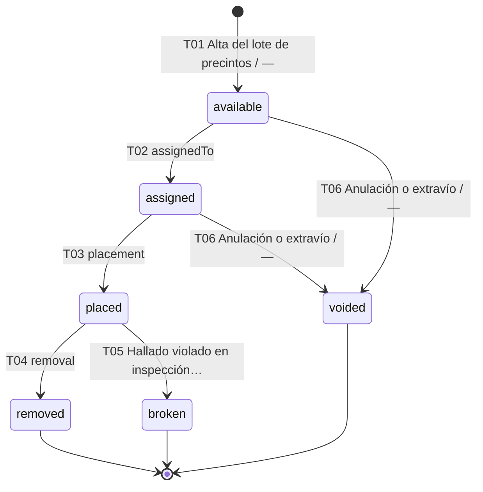

| # | Desde | Hasta | Disparador | Tipo | Guardas | Evento emitido |
|---|---|---|---|---|---|---|
| T01 | (nuevo) | `available` | Alta del lote de precintos / — | no especificado | — | — |
| T02 | `available` | `assigned` | Entrega al inspector (`assignedTo`) / — | usuario | — | — |
| T03 | `assigned` | `placed` | Colocación (`placement`) / — | no especificado | — | — |
| T04 | `placed` | `removed` | Retiro con motivo (`removal`) / — | no especificado | — | — |
| T05 | `placed` | `broken` | Hallado violado en inspección / — | no especificado | — | — |
| T06 | `assigned`, `available` | `voided` | Anulación o extravío / — | no especificado | Motivo obligatorio | — |

### EST-TEC-22 — `phoneStripPositions.status` (COL-TEC-55)

**Colección:** Posiciones de regleta. **Campos de estado en el §7:** `status` (línea 1931; valores: `available`, `reserved`, `connected`, `damaged`).

**Fuente:** M10 §8.16.

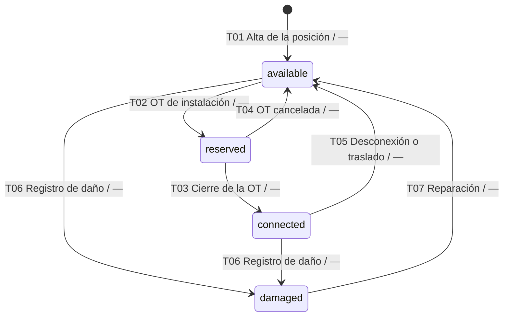

| # | Desde | Hasta | Disparador | Tipo | Guardas | Evento emitido |
|---|---|---|---|---|---|---|
| T01 | (nuevo) | `available` | Alta de la posición / — | no especificado | — | — |
| T02 | `available` | `reserved` | OT de instalación / — | no especificado | — | — |
| T03 | `reserved` | `connected` | Cierre de la OT / — | no especificado | Registra `contractId` | — |
| T04 | `reserved` | `available` | OT cancelada / — | no especificado | — | — |
| T05 | `connected` | `available` | Desconexión o traslado / — | no especificado | La posición nueva guarda `previousPositionId` | — |
| T06 | `available`, `connected` | `damaged` | Registro de daño / — | no especificado | — | — |
| T07 | `damaged` | `available` | Reparación / — | no especificado | — | — |

### EST-TEC-23 — `phonePorts.status` (COL-TEC-58)

**Colección:** Puertos. **Campos de estado en el §7:** `status` (línea 1874; valores: `available`, `unavailable`, `inactive`).

**Fuente:** M10 §8.16.

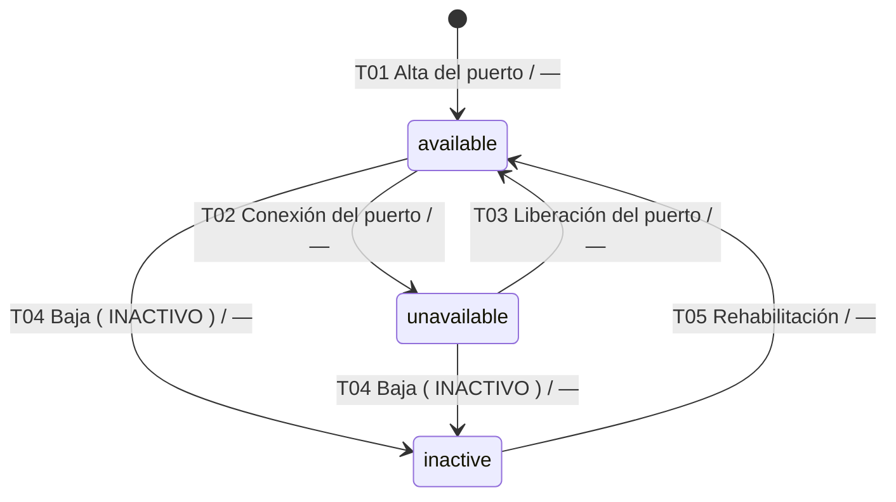

| # | Desde | Hasta | Disparador | Tipo | Guardas | Evento emitido |
|---|---|---|---|---|---|---|
| T01 | (nuevo) | `available` | Alta del puerto / — | no especificado | — | — |
| T02 | `available` | `unavailable` | Conexión del puerto / — | no especificado | — | — |
| T03 | `unavailable` | `available` | Liberación del puerto / — | no especificado | — | — |
| T04 | `available`, `unavailable` | `inactive` | Baja (`INACTIVO`) / — | no especificado | — | — |
| T05 | `inactive` | `available` | Rehabilitación / — | no especificado | — | — |

### EST-TEC-24 — `phoneNumbers.status` (COL-TEC-60)

**Colección:** Numeración. **Campos de estado en el §7:** `status` (línea 1980; valores: `available`, `reserved`, `assigned`, `quarantine`, `retired`).

**Fuente:** M10 §8.14, M10 §8.16.

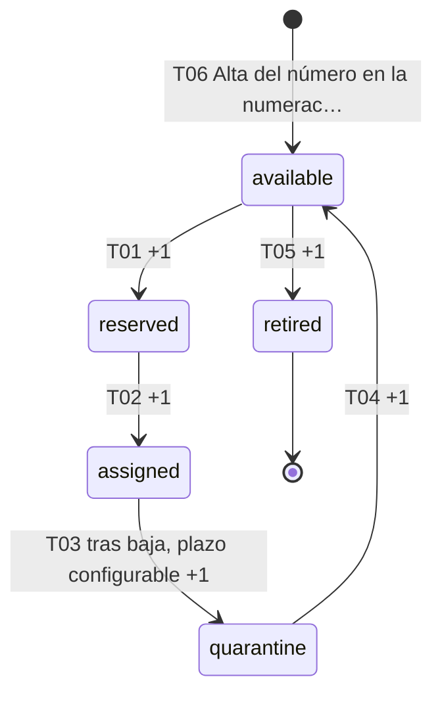

| # | Desde | Hasta | Disparador | Tipo | Guardas | Evento emitido |
|---|---|---|---|---|---|---|
| T01 | `available` | `reserved` | — | no especificado | — | — |
| T02 | `reserved` | `assigned` | — | no especificado | — | — |
| T03 | `assigned` | `quarantine` | tras baja, plazo configurable | job | — | — |
| T04 | `quarantine` | `available` | — | no especificado | — | — |
| T05 | `available` | `retired` | — | no especificado | — | — |
| T06 | (nuevo) | `available` | Alta del número en la numeración / — | no especificado | — | — |
| T07 | `available` | `reserved` | OT / — | no especificado | — | — |
| T08 | `reserved` | `assigned` | Asignación a una línea / — | no especificado | — | — |
| T09 | `assigned` | `quarantine` | Baja de la línea / — | no especificado | Plazo configurable | — |
| T10 | `quarantine` | `available` | Fin de la cuarentena / — | no especificado | — | — |
| T11 | `available` | `retired` | Retiro / — | no especificado | — | — |

### EST-TEC-25 — `phoneLines.status` (COL-TEC-61)

**Colección:** Líneas. **Campos de estado en el §7:** —.

**Fuente:** M10 §8.14, M10 §8.16.

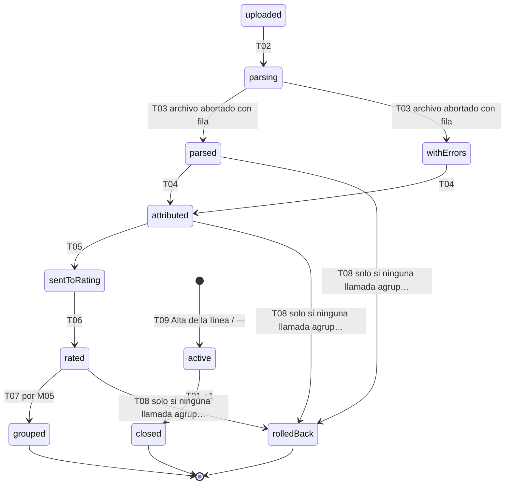

| # | Desde | Hasta | Disparador | Tipo | Guardas | Evento emitido |
|---|---|---|---|---|---|---|
| T01 | `active` | `closed` | — | no especificado | — | — |
| T02 | `uploaded` | `parsing` | — | no especificado | — | — |
| T03 | `parsing` | `parsed`, `withErrors` | archivo abortado con fila | no especificado | — | — |
| T04 | `parsed`, `withErrors` | `attributed` | — | no especificado | — | — |
| T05 | `attributed` | `sentToRating` | — | no especificado | — | — |
| T06 | `sentToRating` | `rated` | — | no especificado | — | — |
| T07 | `rated` | `grouped` | por M05 | no especificado | — | — |
| T08 | `attributed`, `parsed`, `rated` | `rolledBack` | solo si ninguna llamada agrupada | no especificado | — | — |
| T09 | (nuevo) | `active` | Alta de la línea / — | no especificado | — | — |
| T10 | `active` | `closed` | Baja de la línea / — | no especificado | — | — |

### EST-TEC-26 — `cdrImports.status` (COL-TEC-66)

**Colección:** Importaciones de CDR. **Campos de estado en el §7:** `status` (línea 2062; valores: `uploaded`, `parsing`, `parsed`, `withErrors`, `attributed`, `sentToRating`, `rated`, `grouped`, `rolledBack`).

**Fuente:** M10 §8.14, M10 §8.16.

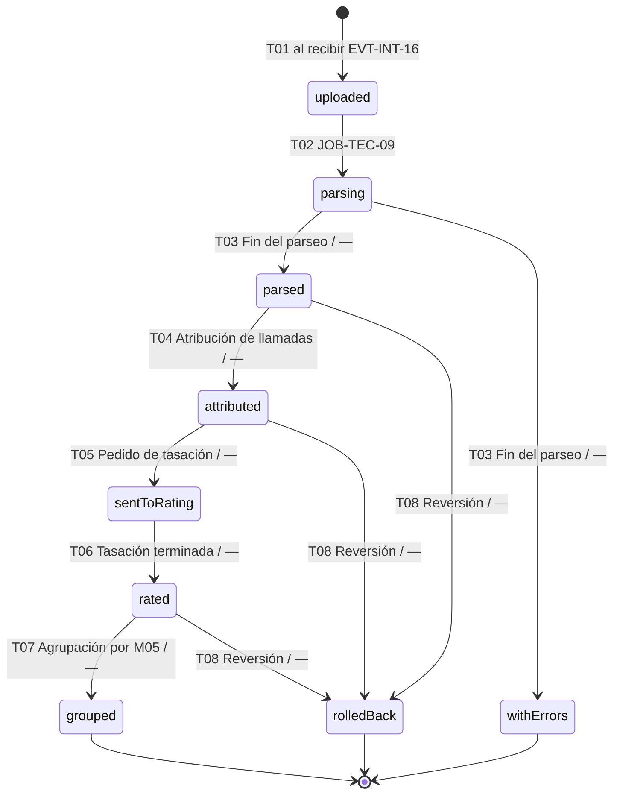

| # | Desde | Hasta | Disparador | Tipo | Guardas | Evento emitido |
|---|---|---|---|---|---|---|
| T01 | (nuevo) | `uploaded` | Subida del archivo o `int.cdr.batchReceived` (EVT-INT-16) / — | evento | `fileHash` no repetido | — |
| T02 | `uploaded` | `parsing` | Inicio de JOB-TEC-09 / — | job | — | — |
| T03 | `parsing` | `parsed`, `withErrors` | Fin del parseo / — | no especificado | Con fila de error se aborta el archivo | — |
| T04 | `parsed` | `attributed` | Atribución de llamadas / — | no especificado | — | — |
| T05 | `attributed` | `sentToRating` | Pedido de tasación / — | no especificado | — | — |
| T06 | `sentToRating` | `rated` | Tasación terminada / — | no especificado | — | — |
| T07 | `rated` | `grouped` | Agrupación por M05 / — | no especificado | — | — |
| T08 | `attributed`, `parsed`, `rated` | `rolledBack` | Reversión / — | no especificado | Ninguna llamada agrupada | — |

### EST-TEC-27 — `callRecords.attributionStatus` (COL-TEC-67)

**Colección:** Llamadas (alto volumen; dueño único de CDR, HUE-TEL-01). **Campos de estado en el §7:** `attributionStatus` (línea 2090; valores: `attributed`, `originNotFound`, `destinationNotFound`, `duplicate`, `manual`).

**Fuente:** M10 §8.16.

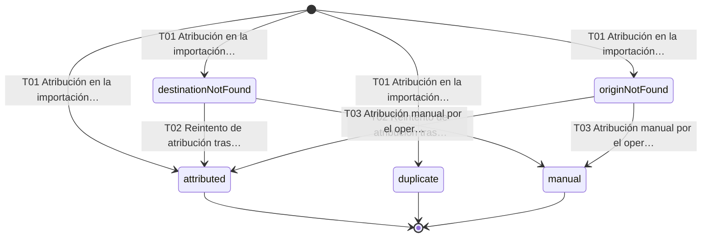

| # | Desde | Hasta | Disparador | Tipo | Guardas | Evento emitido |
|---|---|---|---|---|---|---|
| T01 | (nuevo) | `attributed`, `destinationNotFound`, `duplicate`, `originNotFound` | Atribución en la importación / — | no especificado | — | — |
| T02 | `destinationNotFound`, `originNotFound` | `attributed` | Reintento de atribución tras dar de alta el número / — | no especificado | — | — |
| T03 | `destinationNotFound`, `originNotFound` | `manual` | Atribución manual por el operador / — | usuario | — | — |

### EST-TEC-28 — `mobileUsageImports.status` (COL-TEC-68)

**Colección:** Consumos de telefonía móvil importados y, con `kind = ticQuota`, consumo del período de correo y pack SMS informado por T06 (EVT-INT-24) para el cupo de M04 (RF-TEC-195, RN-TAR-251, DEC-084). **Campos de estado en el §7:** `attributionStatus`, `status` (línea 2112, 2106; valores: `received`, `parsed`, `withErrors`, `attributed`, `applied`, `rolledBack`, `importedBy`).

**Fuente:** M10 §8.16.

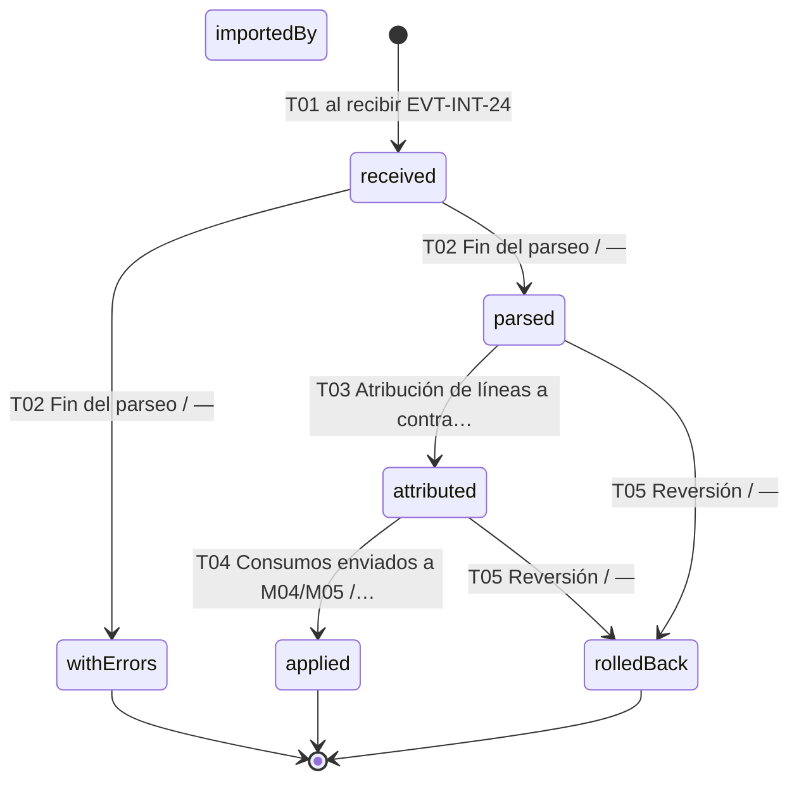

| # | Desde | Hasta | Disparador | Tipo | Guardas | Evento emitido |
|---|---|---|---|---|---|---|
| T01 | (nuevo) | `received` | Carga manual (`importedBy`) o EVT-INT-24 de T06 (`kind = ticQuota`) / — | evento | — | — |
| T02 | `received` | `parsed`, `withErrors` | Fin del parseo / — | no especificado | — | — |
| T03 | `parsed` | `attributed` | Atribución de líneas a contratos / — | no especificado | — | — |
| T04 | `attributed` | `applied` | Consumos enviados a M04/M05 / — | no especificado | — | — |
| T05 | `attributed`, `parsed` | `rolledBack` | Reversión / — | no especificado | Sin consumos aplicados | — |

### EST-TEC-29 — `providedMailboxes.status` (COL-TEC-69)

**Colección:** Casillas de correo provistas (secretos en bóveda). **Campos de estado en el §7:** `status` (línea 1749; valores: `active`, `suspended`, `deleted`).

**Fuente:** M10 §8.16.

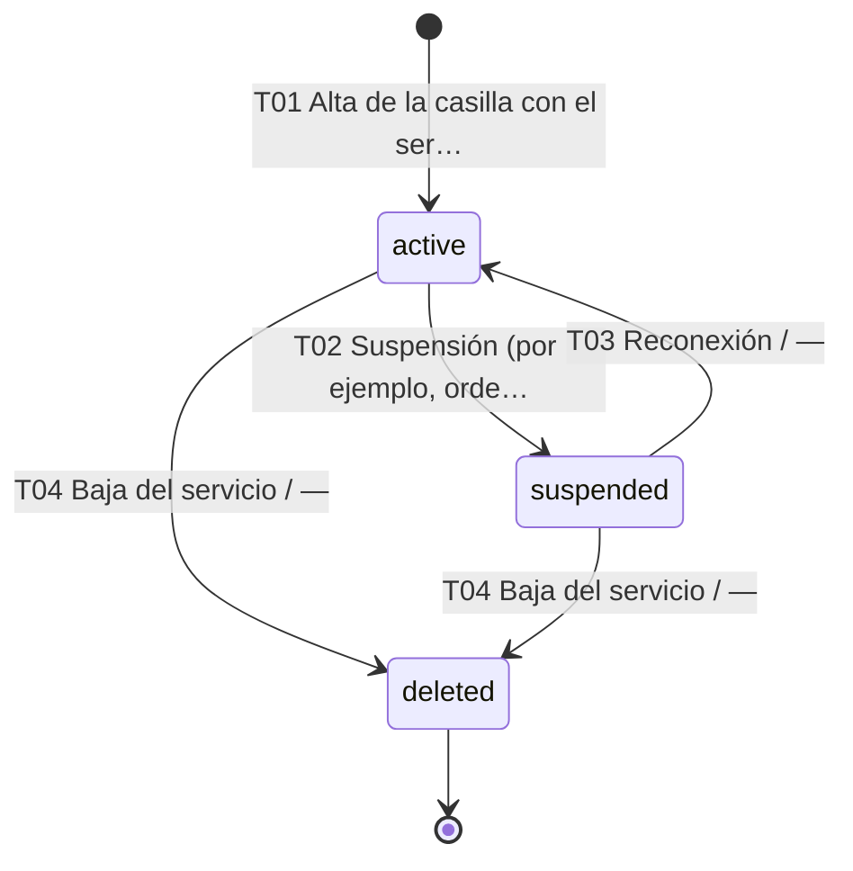

| # | Desde | Hasta | Disparador | Tipo | Guardas | Evento emitido |
|---|---|---|---|---|---|---|
| T01 | (nuevo) | `active` | Alta de la casilla con el servicio / — | no especificado | — | — |
| T02 | `active` | `suspended` | Suspensión (por ejemplo, orden de M08) / — | no especificado | — | — |
| T03 | `suspended` | `active` | Reconexión / — | no especificado | — | — |
| T04 | `active`, `suspended` | `deleted` | Baja del servicio / — | no especificado | Las credenciales no se conservan | — |

### EST-TEC-30 — `onCallShifts.status` (COL-TEC-71)

**Colección:** Turnos de guardia por servicio y zona con titular, suplente, jefe y teléfono publicado (HUE-GAS-05, RF-TEC-231; O3 para servicios con red, O7 GAS y ELE). **Campos de estado en el §7:** `status` (línea 896; valores: `planned`, `active`, `closed`).

**Fuente:** M10 §8.16.

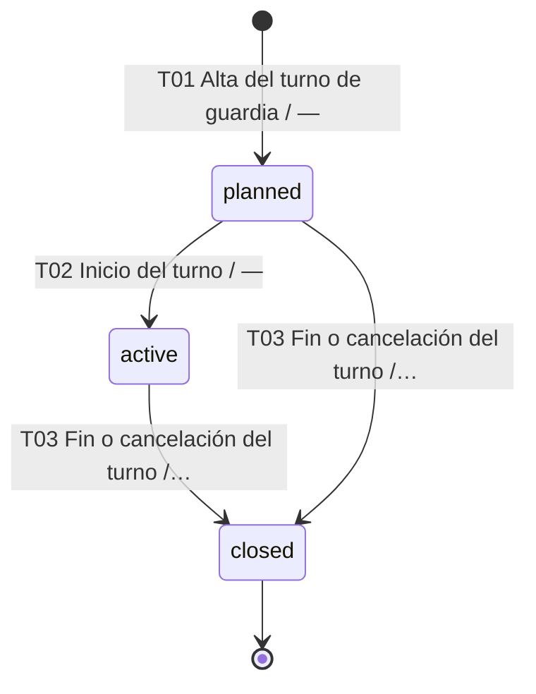

| # | Desde | Hasta | Disparador | Tipo | Guardas | Evento emitido |
|---|---|---|---|---|---|---|
| T01 | (nuevo) | `planned` | Alta del turno de guardia / — | no especificado | — | — |
| T02 | `planned` | `active` | Inicio del turno / — | no especificado | — | — |
| T03 | `active`, `planned` | `closed` | Fin o cancelación del turno / — | no especificado | Cambios registrados en `changes[]` | — |

### EST-TEC-31 — `numberPortings.status` (COL-TEC-73)

**Colección:** Portabilidad numérica entrante y saliente; solo con PRM-TEC-156 (RF-TEC-234, PA-TEC-19). **Campos de estado en el §7:** `status` (línea 2133; valores: `requested`, `submitted`, `accepted`, `rejected`, `scheduled`, `executed`, `cancelled`, `received`, `validated`).

**Fuente:** M10 §8.16.

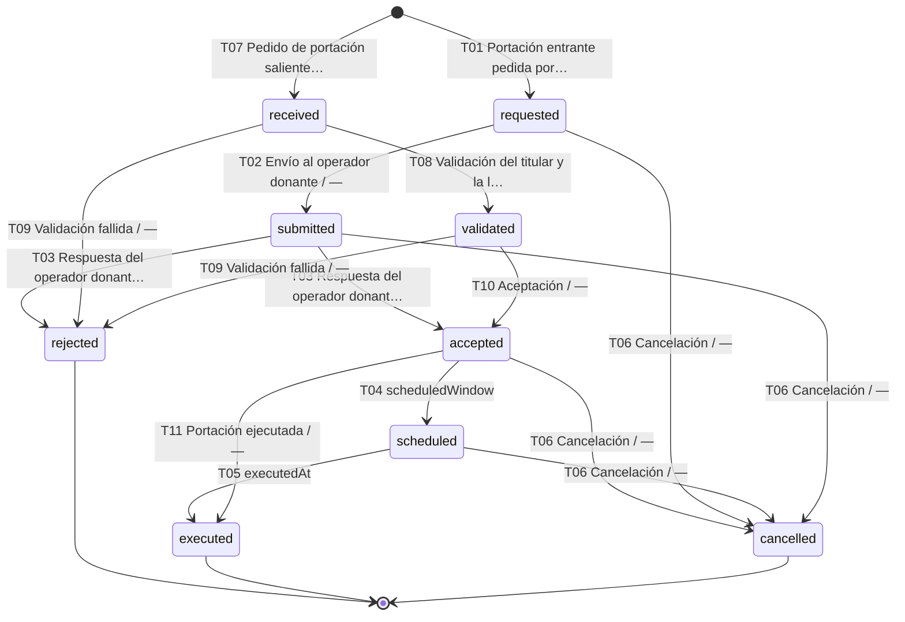

| # | Desde | Hasta | Disparador | Tipo | Guardas | Evento emitido |
|---|---|---|---|---|---|---|
| T01 | (nuevo) | `requested` | Portación entrante pedida por el socio / — | usuario | Dirección entrante | — |
| T02 | `requested` | `submitted` | Envío al operador donante / — | usuario | — | — |
| T03 | `submitted` | `accepted`, `rejected` | Respuesta del operador donante / — | usuario | `rejectionReason` si se rechaza | — |
| T04 | `accepted` | `scheduled` | Ventana acordada (`scheduledWindow`) / — | no especificado | — | — |
| T05 | `scheduled` | `executed` | Portación ejecutada (`executedAt`) / — | no especificado | — | — |
| T06 | `accepted`, `requested`, `scheduled`, `submitted` | `cancelled` | Cancelación / — | no especificado | Dirección entrante | — |
| T07 | (nuevo) | `received` | Pedido de portación saliente del operador receptor / — | usuario | Dirección saliente | — |
| T08 | `received` | `validated` | Validación del titular y la línea / — | no especificado | — | — |
| T09 | `received`, `validated` | `rejected` | Validación fallida / — | no especificado | `rejectionReason` | — |
| T10 | `validated` | `accepted` | Aceptación / — | no especificado | — | — |
| T11 | `accepted` | `executed` | Portación ejecutada / — | no especificado | Dirección saliente | — |

### EST-TEC-32 — `waterSamples.status` (COL-TEC-75)

**Colección:** Muestras, cadena de custodia, resultados por parámetro y acciones correctivas (RF-TEC-236); corrección = nuevo resultado. **Campos de estado en el §7:** `status` (línea 992; valores: `taken`, `inLab`, `resulted`, `actionPending`, `closed`).

**Fuente:** M10 §8.16.

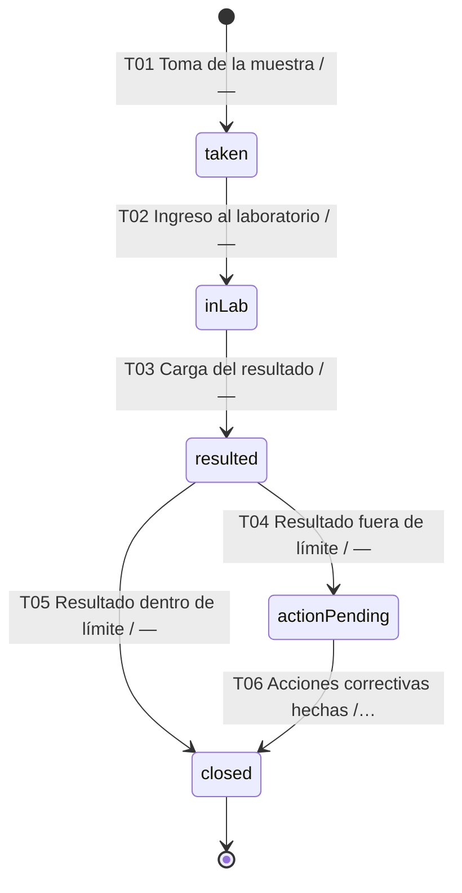

| # | Desde | Hasta | Disparador | Tipo | Guardas | Evento emitido |
|---|---|---|---|---|---|---|
| T01 | (nuevo) | `taken` | Toma de la muestra / — | no especificado | — | — |
| T02 | `taken` | `inLab` | Ingreso al laboratorio / — | no especificado | — | — |
| T03 | `inLab` | `resulted` | Carga del resultado / — | no especificado | — | — |
| T04 | `resulted` | `actionPending` | Resultado fuera de límite / — | no especificado | `outOfLimit` = true | — |
| T05 | `resulted` | `closed` | Resultado dentro de límite / — | no especificado | — | — |
| T06 | `actionPending` | `closed` | Acciones correctivas hechas / — | no especificado | Todas las `correctiveActions` con `doneAt` | — |

## M11 — VEN Ventas y presupuestos

### EST-VEN-01 — `operationCharges.status` (COL-VEN-01)

**Colección:** Cargos por operación con titulares (a facturar por M05). **Campos de estado en el §7:** `status` (línea 306; sin valores en el §7).

**Fuente:** M11 §8.1.

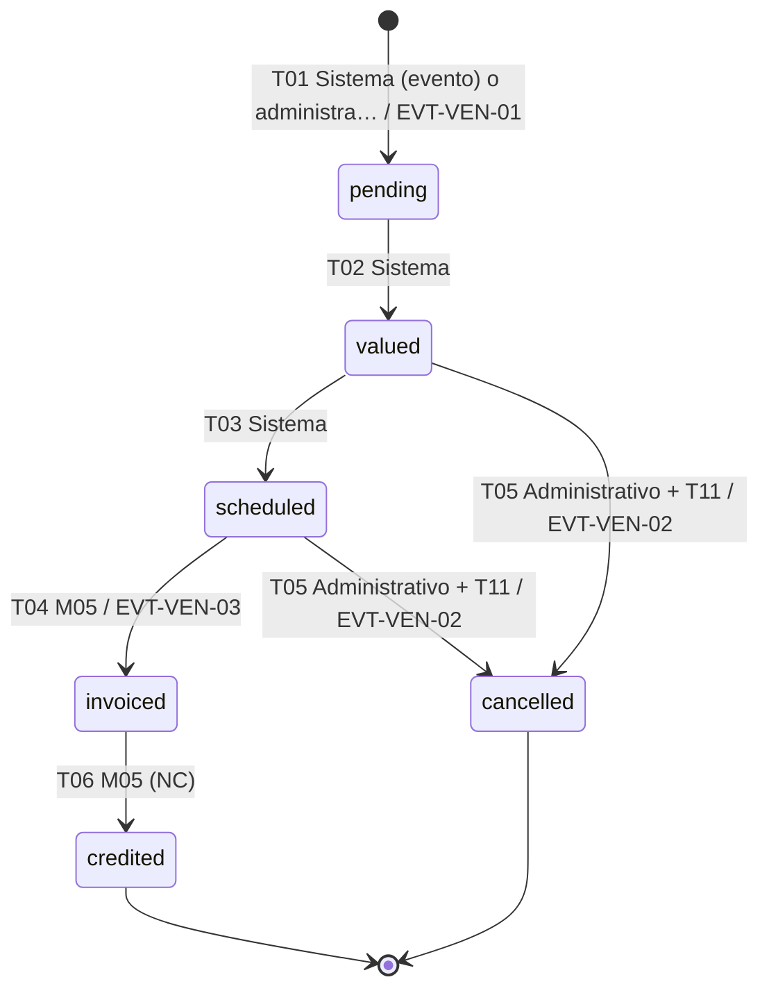

| # | Desde | Hasta | Disparador | Tipo | Guardas | Evento emitido |
|---|---|---|---|---|---|---|
| T01 | (nuevo) | `pending` | Sistema (evento) o administrativo | evento, sistema, usuario | Hito válido; idempotencia | EVT-VEN-01 `ven.operationCharge.created` |
| T02 | `pending` | `valued` | Sistema | sistema | Concepto con versión vigente | — |
| T03 | `valued` | `scheduled` | Sistema | sistema | Modalidad elegida | — |
| T04 | `scheduled` | `invoiced` | M05 | no especificado | Factura emitida (total o última cuota) | EVT-VEN-03 `ven.operationCharge.invoiced` |
| T05 | `scheduled`, `valued` | `cancelled` | Administrativo + T11 | usuario | Sin facturas | EVT-VEN-02 `ven.operationCharge.cancelled` (inferido por nombre) |
| T06 | `invoiced` | `credited` | M05 (NC) | no especificado | NC emitida | — |

### EST-VEN-02 — `salesQuotes.status` (COL-VEN-03)

**Colección:** Presupuestos con versiones, ítems y notas. **Campos de estado en el §7:** `status` (línea 346; sin valores en el §7).

**Fuente:** M11 §8.2.

```mermaid
stateDiagram-v2
    [*] --> draft : T01 Vendedor, técnico
    draft --> sent : T02 Vendedor / EVT-VEN-04
    sent --> sent : T03 Vendedor / EVT-VEN-04
    sent --> expired : T04 Job / EVT-VEN-06
    draft --> accepted : T05 Socio (online) o vendedor/sup… / EVT-VEN-05
    sent --> accepted : T05 Socio (online) o vendedor/sup… / EVT-VEN-05
    draft --> rejected : T06 Socio o vendedor / EVT-VEN-06
    sent --> rejected : T06 Socio o vendedor / EVT-VEN-06
    accepted --> inExecution : T07 Sistema
    accepted --> toInvoice : T08 Vendedor/sistema
    draft --> toInvoice : T08 Vendedor/sistema
    inExecution --> toInvoice : T08 Vendedor/sistema
    sent --> toInvoice : T08 Vendedor/sistema
    toInvoice --> invoiced : T09 Sistema
    toInvoice --> partiallyInvoiced : T09 Sistema
    note left of cancelled : T10 desde cualquier estado previsto
    expired --> [*]
    rejected --> [*]
    invoiced --> [*]
    partiallyInvoiced --> [*]
    cancelled --> [*]
```

| # | Desde | Hasta | Disparador | Tipo | Guardas | Evento emitido |
|---|---|---|---|---|---|---|
| T01 | (nuevo) | `draft` | Vendedor, técnico | usuario | RN-VEN-007, RN-VEN-013 | — |
| T02 | `draft` | `sent` | Vendedor | usuario | Ítems, validez, PDF generado | EVT-VEN-04 `ven.quote.created` |
| T03 | `sent` | `sent` | Vendedor | usuario | — | EVT-VEN-04 `ven.quote.sent` (inferido por nombre) |
| T04 | `sent` | `expired` | Job | job | `validUntil` < hoy | EVT-VEN-06 `ven.quote.expired` (inferido por nombre) |
| T05 | `draft`, `sent` | `accepted` | Socio (online) o vendedor/supervisor | usuario | RN-VEN-047, RN-VEN-012 (RN-VEN-008) | EVT-VEN-05 `ven.quote.accepted` |
| T06 | `draft`, `sent` | `rejected` | Socio o vendedor | usuario | Motivo | EVT-VEN-06 `ven.quote.rejected` (inferido por nombre) |
| T07 | `accepted` | `inExecution` | Sistema | sistema | OT creada | — |
| T08 | `accepted`, `draft`, `inExecution`, `sent` | `toInvoice` | Vendedor/sistema | sistema, usuario | No anulado, facturado ni rechazado | — |
| T09 | `toInvoice` | `invoiced`, `partiallyInvoiced` | Sistema | sistema | Comprobantes generados | — |
| T10 | cualquiera | `cancelled` | Supervisor | usuario | Confirmación si `accepted`/`sent`/`toInvoice`; RN-VEN-019 | EVT-VEN-06 `ven.quote.cancelled` (inferido por nombre) |

### EST-VEN-03 — `salesOrders.status` (COL-VEN-05)

**Colección:** Ventas de productos y servicios adicionales (no fiscales). **Campos de estado en el §7:** `deliveryStatus`, `status` (línea 394, 395; valores: `none`, `partial`, `complete`).

**Fuente:** M11 §8.3.

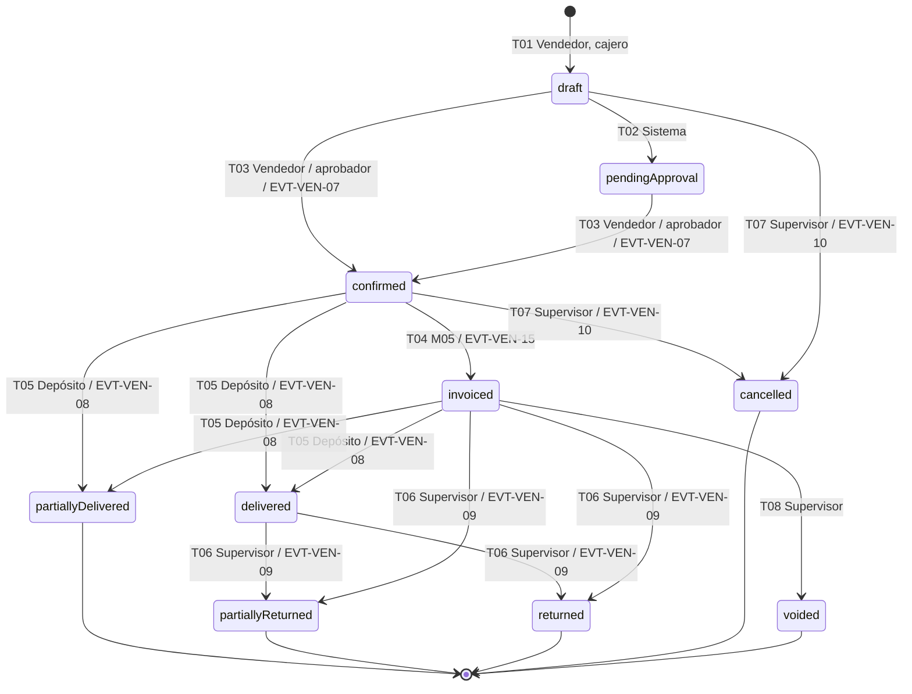

| # | Desde | Hasta | Disparador | Tipo | Guardas | Evento emitido |
|---|---|---|---|---|---|---|
| T01 | (nuevo) | `draft` | Vendedor, cajero | usuario | — | — |
| T02 | `draft` | `pendingApproval` | Sistema | sistema | Descuento o riesgo fuera de política | — |
| T03 | `draft`, `pendingApproval` | `confirmed` | Vendedor / aprobador | usuario | Disponibilidad, riesgo, vendedor | EVT-VEN-07 `ven.salesOrder.confirmed` (inferido por nombre) |
| T04 | `confirmed` | `invoiced` | M05 | no especificado | Comprobante con CAE (si P727) | EVT-VEN-15 `ven.salesOrder.invoiced` |
| T05 | `confirmed`, `invoiced` | `delivered`, `partiallyDelivered` | Depósito | no especificado | Entregas | EVT-VEN-08 `ven.salesOrder.delivered` (inferido por nombre) |
| T06 | `delivered`, `invoiced` | `partiallyReturned`, `returned` | Supervisor | usuario | `salesReturns` aprobada | EVT-VEN-09 `ven.salesOrder.returned` (inferido por nombre) |
| T07 | `confirmed`, `draft` | `cancelled` | Supervisor | usuario | Período abierto | EVT-VEN-10 `ven.salesOrder.cancelled` (inferido por nombre) |
| T08 | `invoiced` | `voided` | Supervisor | usuario | NC total; período abierto | — |

### EST-VEN-04 — `salesDeliveries.status` (COL-VEN-06)

**Colección:** Entregas. **Campos de estado en el §7:** `status` (línea 539; valores: `draft`, `confirmed`, `voided`).

**Fuente:** M11 §8.6.

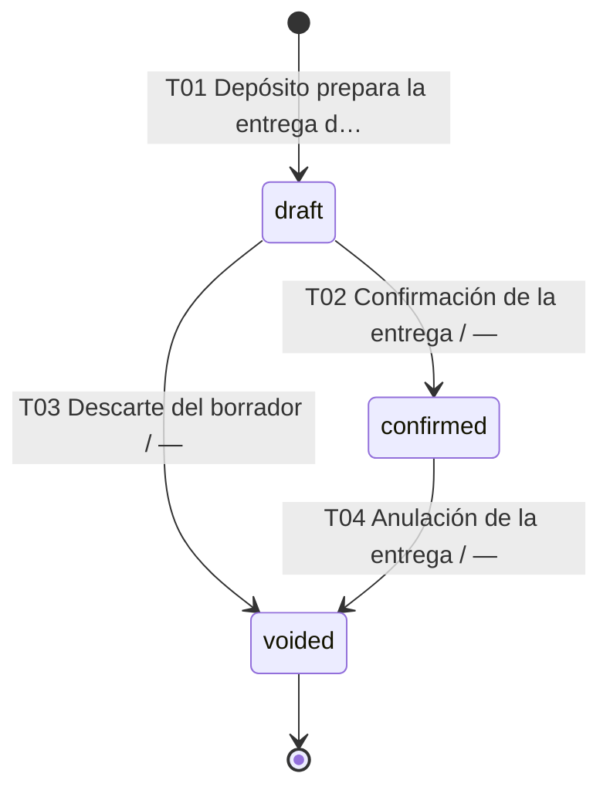

| # | Desde | Hasta | Disparador | Tipo | Guardas | Evento emitido |
|---|---|---|---|---|---|---|
| T01 | (nuevo) | `draft` | Depósito prepara la entrega de una venta confirmada o facturada / — | no especificado | Venta en `confirmed` o `invoiced` | — |
| T02 | `draft` | `confirmed` | Confirmación de la entrega / — | no especificado | Egreso de stock en M13 (`stockMovementIds`); firma del receptor | — |
| T03 | `draft` | `voided` | Descarte del borrador / — | no especificado | — | — |
| T04 | `confirmed` | `voided` | Anulación de la entrega / — | no especificado | Reingreso por movimiento compensatorio en M13; período abierto | — |

### EST-VEN-05 — `salesReturns.status` (COL-VEN-07)

**Colección:** Devoluciones de venta. **Campos de estado en el §7:** `status` (línea 555; valores: `draft`, `approved`, `completed`, `cancelled`).

**Fuente:** M11 §8.6.

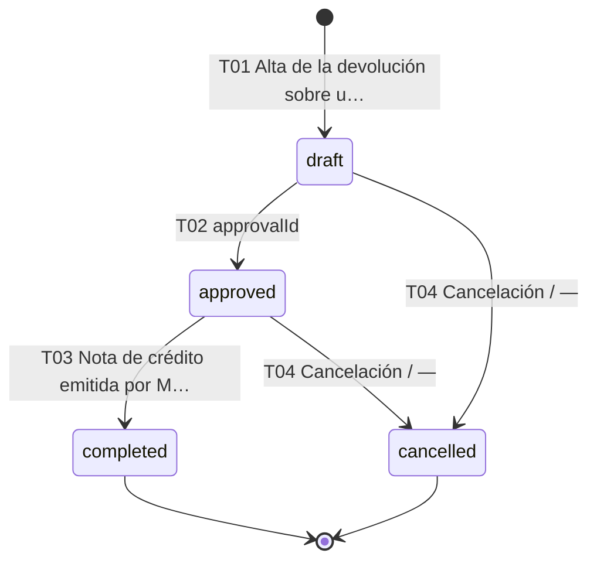

| # | Desde | Hasta | Disparador | Tipo | Guardas | Evento emitido |
|---|---|---|---|---|---|---|
| T01 | (nuevo) | `draft` | Alta de la devolución sobre una venta facturada o entregada / — | no especificado | — | — |
| T02 | `draft` | `approved` | Aprobación del supervisor (`approvalId` en T11) / — | usuario | Ítems y condición informados | — |
| T03 | `approved` | `completed` | Nota de crédito emitida por M05 y reingreso de stock en M13 / — | no especificado | `creditNoteRequestId` resuelto; `installmentActions` aplicadas | — |
| T04 | `approved`, `draft` | `cancelled` | Cancelación / — | no especificado | Sin nota de crédito emitida | — |

### EST-VEN-06 — `salesInstallments.status` (COL-VEN-09)

**Colección:** Cuotas de venta (a facturar por M05). **Campos de estado en el §7:** `paymentStatus`, `status` (línea 437, 438; valores: `scheduled`, `billed`, `partiallyPaid`, `paid`, `earlyPaidOff`, `voided`, `credited`).

**Fuente:** M11 §8.4, M11 §8.6.

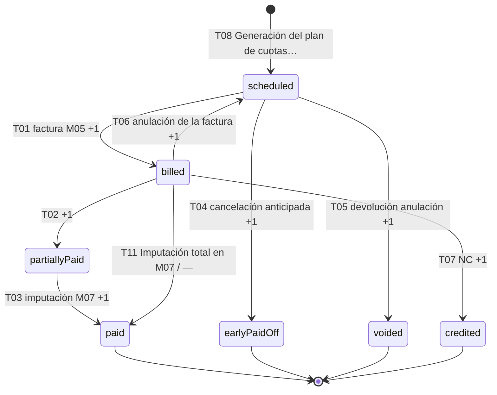

| # | Desde | Hasta | Disparador | Tipo | Guardas | Evento emitido |
|---|---|---|---|---|---|---|
| T01 | `scheduled` | `billed` | factura M05 | no especificado | — | — |
| T02 | `billed` | `partiallyPaid` | — | no especificado | — | — |
| T03 | `partiallyPaid` | `paid` | imputación M07 | no especificado | — | — |
| T04 | `scheduled` | `earlyPaidOff` | cancelación anticipada | no especificado | — | — |
| T05 | `scheduled` | `voided` | devolución anulación | no especificado | — | — |
| T06 | `billed` | `scheduled` | anulación de la factura | no especificado | — | — |
| T07 | `billed` | `credited` | NC | no especificado | — | — |
| T08 | (nuevo) | `scheduled` | Generación del plan de cuotas al confirmar la venta o el cargo financiado / — | no especificado | — | — |
| T09 | `scheduled` | `billed` | Factura de M05 que incluye la cuota / — | no especificado | — | — |
| T10 | `billed` | `partiallyPaid` | Imputación parcial en M07 / — | no especificado | — | — |
| T11 | `billed`, `partiallyPaid` | `paid` | Imputación total en M07 / — | no especificado | — | — |
| T12 | `scheduled` | `earlyPaidOff` | Cancelación anticipada / — | no especificado | — | — |
| T13 | `scheduled` | `voided` | Devolución o anulación de la venta / — | no especificado | — | — |
| T14 | `billed` | `scheduled` | Anulación de la factura / — | no especificado | — | — |
| T15 | `billed` | `credited` | Nota de crédito / — | no especificado | — | — |

### EST-VEN-07 — `posSessions.status` (COL-VEN-14)

**Colección:** Sesiones de punto de venta. **Campos de estado en el §7:** `status` (línea 651; valores: `open`, `closed`, `reconciled`).

**Fuente:** M11 §8.5, M11 §8.6.

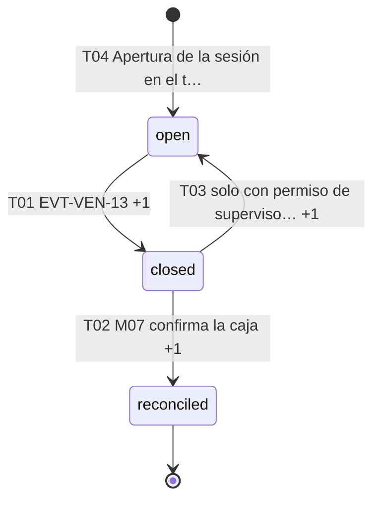

| # | Desde | Hasta | Disparador | Tipo | Guardas | Evento emitido |
|---|---|---|---|---|---|---|
| T01 | `open` | `closed` | — | no especificado | — | EVT-VEN-13 `ven.posSession.closed` (inferido por nombre) |
| T02 | `closed` | `reconciled` | M07 confirma la caja | no especificado | — | — |
| T03 | `closed` | `open` | solo con permiso de supervisor antes de la conciliación | usuario | — | — |
| T04 | (nuevo) | `open` | Apertura de la sesión en el terminal / — | no especificado | Sin otra sesión `open` en el terminal (único parcial de T05) | — |
| T05 | `open` | `closed` | Arqueo y cierre / — | no especificado | — | EVT-VEN-13 `ven.posSession.closed` (inferido por nombre) |
| T06 | `closed` | `reconciled` | M07 confirma la caja / — | no especificado | — | — |
| T07 | `closed` | `open` | Reapertura / — | no especificado | Permiso de supervisor; antes de la conciliación | — |

## M12 — CMP Compras y proveedores

### EST-CMP-01 — `suppliers.status` (COL-CMP-01)

**Colección:** Proveedores (CBU cifrado). **Campos de estado en el §7:** `status` (línea 392; valores: `active`, `blocked`, `inactive`).

**Fuente:** el §8 del anexo no detalla esta colección; se aplica el patrón general de T05 §7.1.5 (estados, baja lógica) y T04 §8.3 (registros maestros) sobre los valores del §7.

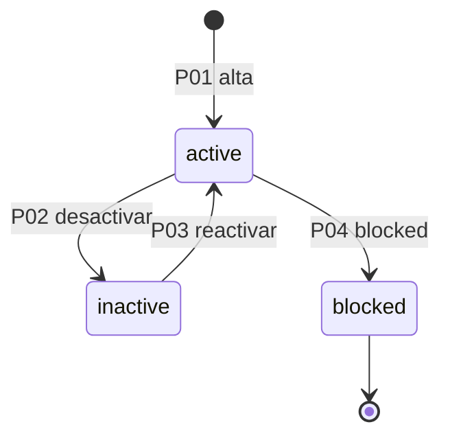

| # | Desde | Hasta | Disparador | Tipo | Guardas | Evento emitido |
|---|---|---|---|---|---|---|
| P01 | (nuevo) | `active` | Alta del registro (operador, importación o plataforma) | usuario, sistema | Validación del esquema (T04 §8.3) | — |
| P02 | `active` | `inactive` | Operador | usuario | Si está referenciado se informa el conteo; no se borra (T05 §7.1.5) | — |
| P03 | `inactive` | `active` | Operador | usuario | — | — |
| P04 | `active` | `blocked` | Operador con permiso | usuario | Patrón general; destino tomado del §7 | — |

### EST-CMP-02 — `supplyRequests.status` (COL-CMP-07)

**Colección:** Solicitudes de abastecimiento. **Campos de estado en el §7:** `status` (línea 420; sin valores en el §7).

Ver también el diagrama curado B10 en `06-secuencias-y-estados.md` §4.

**Fuente:** M12 §8.1.

```mermaid
stateDiagram-v2
    [*] --> draft : T01 Solicitante
    draft --> pendingApproval : T02 Solicitante
    pendingApproval --> approved : T03 Aprobador(es) / EVT-CMP-03
    pendingApproval --> rejected : T04 Aprobador
    draft --> approved : T05 Sistema / EVT-CMP-03
    approved --> inProcess : T06 Comprador
    approved --> partiallyProcessed : T07 Sistema
    approved --> processed : T07 Sistema
    inProcess --> partiallyProcessed : T07 Sistema
    inProcess --> processed : T07 Sistema
    approved --> discarded : T08 Comprador
    inProcess --> discarded : T08 Comprador
    partiallyProcessed --> discarded : T08 Comprador
    note left of cancelled : T09 desde cualquier estado previsto
    rejected --> [*]
    processed --> [*]
    discarded --> [*]
    cancelled --> [*]
```

| # | Desde | Hasta | Disparador | Tipo | Guardas | Evento emitido |
|---|---|---|---|---|---|---|
| T01 | (nuevo) | `draft` | Solicitante | usuario | — | — |
| T02 | `draft` | `pendingApproval` | Solicitante | usuario | Ítems válidos; destinatario si P2705 | — |
| T03 | `pendingApproval` | `approved` | Aprobador(es) | usuario | Banda; doble si aplica; aprobador ≠ solicitante | EVT-CMP-03 `cmp.supplyRequest.approved` |
| T04 | `pendingApproval` | `rejected` | Aprobador | usuario | Motivo | — |
| T05 | `draft` | `approved` | Sistema | sistema | Política "sin aprobación" para monto/área | EVT-CMP-03 `cmp.supplyRequest.approved` (inferido por nombre) |
| T06 | `approved` | `inProcess` | Comprador | usuario | Tomada por compras | — |
| T07 | `approved`, `inProcess` | `partiallyProcessed`, `processed` | Sistema | sistema | Ítems vinculados a cotización/OC/recepción | — |
| T08 | `approved`, `inProcess`, `partiallyProcessed` | `discarded` | Comprador | usuario | Motivo | — |
| T09 | cualquiera | `cancelled` | Solicitante/aprobador | usuario | Motivo | EVT-CMP-03 `cmp.supplyRequest.cancelled` (inferido por nombre) |

### EST-CMP-03 — `quoteRequests.status` (COL-CMP-08)

**Colección:** Pedidos de cotización. **Campos de estado en el §7:** `status` (línea 662; sin valores en el §7).

**Fuente:** M12 §8.2, M12 §8.8.

```mermaid
stateDiagram-v2
    draft --> sent : T01
    sent --> quoted : T02 todos los ítems con precio
    quoted --> evaluated : T03 ningún ítem sin evaluar
    evaluated --> processed : T04 algún ítem generó OC
    quoted --> rejected : T05 motivo
    sent --> rejected : T05 motivo
    sent --> expired : T06 job
    [*] --> draft : T07 Carga de la solicitud de coti…
    processed --> [*]
    rejected --> [*]
    expired --> [*]
```

| # | Desde | Hasta | Disparador | Tipo | Guardas | Evento emitido |
|---|---|---|---|---|---|---|
| T01 | `draft` | `sent` | — | no especificado | — | — |
| T02 | `sent` | `quoted` | todos los ítems con precio | no especificado | — | — |
| T03 | `quoted` | `evaluated` | ningún ítem sin evaluar | no especificado | — | — |
| T04 | `evaluated` | `processed` | algún ítem generó OC | no especificado | — | — |
| T05 | `quoted`, `sent` | `rejected` | motivo | no especificado | — | — |
| T06 | `sent` | `expired` | job | job | — | — |
| T07 | (nuevo) | `draft` | Carga de la solicitud de cotización / — | no especificado | — | — |

### EST-CMP-04 — `sourcingEvents.status` (COL-CMP-09)

**Colección:** Concursos y comparativas. **Campos de estado en el §7:** `status` (línea 684; valores: `draft`, `published`, `closed`, `opened`, `awarded`, `cancelled`).

**Fuente:** M12 §8.2, M12 §8.8.

```mermaid
stateDiagram-v2
    draft --> published : T01
    published --> closed : T02 vence plazo de ofertas
    closed --> opened : T03
    opened --> awarded : T04 planilla
    [*] --> draft : T05 Alta del evento de selección…
    closed --> cancelled : T06 Anulación del evento antes de…
    draft --> cancelled : T06 Anulación del evento antes de…
    opened --> cancelled : T06 Anulación del evento antes de…
    published --> cancelled : T06 Anulación del evento antes de…
    awarded --> [*]
    cancelled --> [*]
```

| # | Desde | Hasta | Disparador | Tipo | Guardas | Evento emitido |
|---|---|---|---|---|---|---|
| T01 | `draft` | `published` | — | no especificado | — | — |
| T02 | `published` | `closed` | vence plazo de ofertas | job | — | — |
| T03 | `closed` | `opened` | — | no especificado | — | — |
| T04 | `opened` | `awarded` | planilla | no especificado | — | — |
| T05 | (nuevo) | `draft` | Alta del evento de selección / — | evento | — | — |
| T06 | `closed`, `draft`, `opened`, `published` | `cancelled` | Anulación del evento antes de adjudicar / — | evento | Motivo obligatorio | — |

### EST-CMP-05 — `purchaseOrders.status` (COL-CMP-10)

**Colección:** Órdenes de compra. **Campos de estado en el §7:** `status` (línea 449; sin valores en el §7).

**Fuente:** M12 §8.3.

```mermaid
stateDiagram-v2
    [*] --> draft : T01 Comprador
    draft --> pendingApproval : T02 Comprador
    draft --> approved : T03 Sistema / EVT-CMP-04
    pendingApproval --> approved : T04 Aprobador / EVT-CMP-04
    pendingApproval --> rejected : T05 Aprobador
    approved --> sent : T06 Comprador/sistema
    approved --> pendingApproval : T07 Comprador
    sent --> pendingApproval : T07 Comprador
    sent --> partiallyReceived : T08 Sistema
    sent --> received : T08 Sistema
    partiallyReceived --> invoiced : T09 Sistema
    partiallyReceived --> partiallyInvoiced : T09 Sistema
    received --> invoiced : T09 Sistema
    received --> partiallyInvoiced : T09 Sistema
    approved --> closed : T10 Comprador / EVT-CMP-05
    partiallyReceived --> closed : T10 Comprador / EVT-CMP-05
    draft --> cancelled : T11 Comprador + aprobador / EVT-CMP-05
    sent --> cancelled : T11 Comprador + aprobador / EVT-CMP-05
    rejected --> [*]
    invoiced --> [*]
    partiallyInvoiced --> [*]
    closed --> [*]
    cancelled --> [*]
```

| # | Desde | Hasta | Disparador | Tipo | Guardas | Evento emitido |
|---|---|---|---|---|---|---|
| T01 | (nuevo) | `draft` | Comprador | usuario | — | — |
| T02 | `draft` | `pendingApproval` | Comprador | usuario | Completa (P2335); distribución 100 % | — |
| T03 | `draft` | `approved` | Sistema | sistema | Banda "sin aprobación" | EVT-CMP-04 `cmp.purchaseOrder.approved` (inferido por nombre) |
| T04 | `pendingApproval` | `approved` | Aprobador | usuario | Capability, banda, segregación | EVT-CMP-04 `cmp.purchaseOrder.approved` |
| T05 | `pendingApproval` | `rejected` | Aprobador | usuario | Motivo | — |
| T06 | `approved` | `sent` | Comprador/sistema | sistema, usuario | — | — |
| T07 | `approved`, `sent` | `pendingApproval` | Comprador | usuario | Cambio fuera de tolerancia | — |
| T08 | `sent` | `partiallyReceived`, `received` | Sistema | sistema | Recepciones | — |
| T09 | `partiallyReceived`, `received` | `invoiced`, `partiallyInvoiced` | Sistema | sistema | Facturas | — |
| T10 | `approved`, `partiallyReceived` | `closed` | Comprador | usuario | Motivo; saldo no se recibirá | EVT-CMP-05 `cmp.purchaseOrder.cancelled` |
| T11 | `draft`, `sent` | `cancelled` | Comprador + aprobador | usuario | Motivo | EVT-CMP-05 `cmp.purchaseOrder.cancelled` |

### EST-CMP-06 — `supplierReceipts.status` (COL-CMP-11)

**Colección:** Recepciones de bienes y servicios. **Campos de estado en el §7:** `status`, `stockStatus` (línea 712, 710; valores: `notApplicable`, `pending`, `confirmed`, `rejected`).

**Fuente:** M12 §8.4, M12 §8.8.

```mermaid
stateDiagram-v2
    draft --> confirmed : T01 al recibir EVT-STK-01 / EVT-CMP-06
    confirmed --> voided : T02 solo sin facturas vinculadas… / EVT-CMP-07
    confirmed --> invoiced : T03 por vínculos
    confirmed --> partiallyInvoiced : T03 por vínculos
    [*] --> draft : T04 Carga de la recepción / —
    voided --> [*]
    invoiced --> [*]
    partiallyInvoiced --> [*]
```

| # | Desde | Hasta | Disparador | Tipo | Guardas | Evento emitido |
|---|---|---|---|---|---|---|
| T01 | `draft` | `confirmed` | cmp.receipt.confirmed stockStatus pending si hay productos con stock EVT-STK-01 | evento | — | EVT-CMP-06 `cmp.receipt.confirmed` (inferido por nombre) |
| T02 | `confirmed` | `voided` | solo sin facturas vinculadas con período abierto pide reversión a M13 | no especificado | — | EVT-CMP-07 `cmp.receipt.voided` (inferido por nombre) |
| T03 | `confirmed` | `invoiced`, `partiallyInvoiced` | por vínculos | no especificado | — | — |
| T04 | (nuevo) | `draft` | Carga de la recepción / — | no especificado | — | — |

### EST-CMP-07 — `supplierInvoices.status` (COL-CMP-12)

**Colección:** Comprobantes de proveedor; `wholesaleSupply` (factura mayorista de energía o gas con control contra la medición de M03, HUE-ELE-01, HUE-GAS-04) y `signalRightsSettlementId` (HUE-TV-01); destino de `F`…. **Campos de estado en el §7:** `matchStatus`, `status` (línea 479, 482; valores: `notRequired`, `matched`, `exception`, `withoutPO`).

**Fuente:** M12 §8.5.

```mermaid
stateDiagram-v2
    [*] --> draft : T01 Usuario, portal, Mis Comproba…
    draft --> registered : T02 Cuentas a pagar / EVT-CMP-08
    registered --> onHold : T03 Sistema
    onHold --> releasedForPayment : T04 Sistema o habilitador / EVT-CMP-09
    registered --> releasedForPayment : T04 Sistema o habilitador / EVT-CMP-09
    releasedForPayment --> inPayment : T05 Sistema
    inPayment --> paid : T06 Sistema
    inPayment --> partiallyPaid : T06 Sistema
    onHold --> voided : T07 Supervisor / EVT-CMP-09
    registered --> voided : T07 Supervisor / EVT-CMP-09
    releasedForPayment --> voided : T07 Supervisor / EVT-CMP-09
    paid --> [*]
    partiallyPaid --> [*]
    voided --> [*]
```

| # | Desde | Hasta | Disparador | Tipo | Guardas | Evento emitido |
|---|---|---|---|---|---|---|
| T01 | (nuevo) | `draft` | Usuario, portal, Mis Comprobantes, IA | usuario | — | — |
| T02 | `draft` | `registered` | Cuentas a pagar | no especificado | Validaciones RN-CMP-033 a 041 | EVT-CMP-08 `cmp.supplierInvoice.registered` |
| T03 | `registered` | `onHold` | Sistema | sistema | Excepción abierta o sin conformidad | — |
| T04 | `onHold`, `registered` | `releasedForPayment` | Sistema o habilitador | sistema | Conciliado o habilitación manual con motivo | EVT-CMP-09 `cmp.supplierInvoice.released` |
| T05 | `releasedForPayment` | `inPayment` | Sistema | sistema | Incluida en OP aprobada | — |
| T06 | `inPayment` | `paid`, `partiallyPaid` | Sistema | sistema | `tes.paymentExecution.executed` | — |
| T07 | `onHold`, `registered`, `releasedForPayment` | `voided` | Supervisor | usuario | Sin OP; período abierto | EVT-CMP-09 `cmp.supplierInvoice.released` |

### EST-CMP-08 — `matchExceptions.decision` (COL-CMP-14)

**Colección:** Excepciones de conciliación de tres vías. **Campos de estado en el §7:** —.

**Fuente:** M12 §8.7, M12 §8.8.

```mermaid
stateDiagram-v2
    [*] --> pending : T01 el estado es decision, PA-CMP… +1
    pending --> accepted : T02 se espera NC al llegar, resol…
    pending --> claimCreditNote : T02 se espera NC al llegar, resol…
    pending --> rejected : T03 factura devuelta al proveedor…
    accepted --> [*]
    claimCreditNote --> [*]
    rejected --> [*]
```

| # | Desde | Hasta | Disparador | Tipo | Guardas | Evento emitido |
|---|---|---|---|---|---|---|
| T01 | (nuevo) | `pending` | el estado es decision, PA-CMP-16 | no especificado | — | — |
| T02 | `pending` | `accepted`, `claimCreditNote` | se espera NC al llegar, resolved | no especificado | — | — |
| T03 | `pending` | `rejected` | factura devuelta al proveedor todas con decisión T11 | API/integración | — | — |
| T04 | (nuevo) | `pending` | Conciliación con diferencia / — | no especificado | — | — |

### EST-CMP-09 — `paymentOrders.status` (COL-CMP-15)

**Colección:** Órdenes de pago a proveedores. **Campos de estado en el §7:** `status` (línea 511; sin valores en el §7).

Ver también el diagrama curado B10 en `06-secuencias-y-estados.md` §4.

**Fuente:** M12 §8.6.

```mermaid
stateDiagram-v2
    [*] --> draft : T01 Responsable de pagos
    draft --> pendingApproval : T02 Responsable
    pendingApproval --> approved : T03 Aprobador / EVT-CMP-11
    approved --> inExecution : T04 M14
    inExecution --> paid : T05 Sistema / EVT-CMP-13
    inExecution --> approved : T06 Sistema / EVT-CMP-11
    paid --> approved : T06 Sistema / EVT-CMP-11
    approved --> cancelled : T07 Supervisor ( cmp.ordenesPago.… / EVT-CMP-12
    draft --> cancelled : T07 Supervisor ( cmp.ordenesPago.… / EVT-CMP-12
    pendingApproval --> cancelled : T07 Supervisor ( cmp.ordenesPago.… / EVT-CMP-12
    cancelled --> [*]
```

| # | Desde | Hasta | Disparador | Tipo | Guardas | Evento emitido |
|---|---|---|---|---|---|---|
| T01 | (nuevo) | `draft` | Responsable de pagos | usuario | Comprobantes habilitados | — |
| T02 | `draft` | `pendingApproval` | Responsable | usuario | Neto > 0 o anticipo | — |
| T03 | `pendingApproval` | `approved` | Aprobador | usuario | Banda, segregación, CBU aprobado si transferencia | EVT-CMP-11 `cmp.paymentOrder.approved` |
| T04 | `approved` | `inExecution` | M14 | no especificado | Ejecución creada | — |
| T05 | `inExecution` | `paid` | Sistema | sistema | `tes.paymentExecution.executed` | EVT-CMP-13 `cmp.paymentOrder.paid` (inferido por nombre) |
| T06 | `inExecution`, `paid` | `approved` | Sistema | sistema | `tes.paymentExecution.voided` con reinstrumentación | EVT-CMP-11 `cmp.paymentOrder.approved` (inferido por nombre) |
| T07 | `approved`, `draft`, `pendingApproval` | `cancelled` | Supervisor (`cmp.ordenesPago.anular`) | usuario | Sin ejecución vigente en M14; períodos abiertos | EVT-CMP-12 `cmp.paymentOrder.cancelled` |

### EST-CMP-10 — `supplierAdvances.status` (COL-CMP-16)

**Colección:** Anticipos a proveedores. **Campos de estado en el §7:** `status` (línea 773; valores: `open`, `partiallyApplied`, `applied`, `voided`).

**Fuente:** M12 §8.8.

```mermaid
stateDiagram-v2
    [*] --> open : T01 OP de anticipo aprobada / —
    open --> partiallyApplied : T02 Aplicación parcial a una fact…
    open --> applied : T03 Aplicación del saldo total / —
    partiallyApplied --> applied : T03 Aplicación del saldo total / —
    open --> voided : T04 Anulación de la OP que lo ori…
    applied --> [*]
    voided --> [*]
```

| # | Desde | Hasta | Disparador | Tipo | Guardas | Evento emitido |
|---|---|---|---|---|---|---|
| T01 | (nuevo) | `open` | OP de anticipo aprobada / — | no especificado | — | — |
| T02 | `open` | `partiallyApplied` | Aplicación parcial a una factura / — | no especificado | — | — |
| T03 | `open`, `partiallyApplied` | `applied` | Aplicación del saldo total / — | no especificado | — | — |
| T04 | `open` | `voided` | Anulación de la OP que lo originó (§8.6) / — | no especificado | Sin aplicaciones | — |

### EST-CMP-11 — `supplyBalances.status` (COL-CMP-21)

**Colección:** Balance mensual de compra mayorista de energía o gas: comprado, medido en frontera, facturado a usuarios y pérdida (RF-CMP-151; EVT-CMP-16 `balanceId`). **Campos de estado en el §7:** `status` (línea 845; valores: `draft`, `approved`).

**Fuente:** M12 §8.8.

```mermaid
stateDiagram-v2
    [*] --> draft : T01 Cálculo del balance de compra…
    draft --> approved : T02 approvedBy / EVT-CMP-16
    approved --> [*]
```

| # | Desde | Hasta | Disparador | Tipo | Guardas | Evento emitido |
|---|---|---|---|---|---|---|
| T01 | (nuevo) | `draft` | Cálculo del balance de compra y pérdidas del período / — | no especificado | — | — |
| T02 | `draft` | `approved` | Aprobación (`approvedBy`) / — | no especificado | — | EVT-CMP-16 `cmp.supplyBalance.approved` (inferido por nombre) |

### EST-CMP-12 — `signalRightsContracts.status` (COL-CMP-22)

**Colección:** Contratos de derechos de señales de TV por programadora (RF-CMP-154, HUE-TV-01). **Campos de estado en el §7:** `status` (línea 864; valores: `draft`, `active`, `ended`).

**Fuente:** M12 §8.8.

```mermaid
stateDiagram-v2
    [*] --> draft : T01 Carga del contrato con la pro…
    draft --> active : T02 Aprobación del contrato / —
    active --> ended : T03 validTo
    ended --> [*]
```

| # | Desde | Hasta | Disparador | Tipo | Guardas | Evento emitido |
|---|---|---|---|---|---|---|
| T01 | (nuevo) | `draft` | Carga del contrato con la programadora / — | job | — | — |
| T02 | `draft` | `active` | Aprobación del contrato / — | no especificado | — | — |
| T03 | `active` | `ended` | Fin de vigencia (`validTo`) o rescisión / — | no especificado | — | — |

### EST-CMP-13 — `signalRightsSettlements.status` (COL-CMP-23)

**Colección:** Liquidación mensual de derechos de señales por abonados activos (RF-CMP-155; EVT-CMP-17 `settlementId`). **Campos de estado en el §7:** `status` (línea 883; valores: `draft`, `approved`, `invoiced`, `voided`).

**Fuente:** M12 §8.8.

```mermaid
stateDiagram-v2
    [*] --> draft : T01 Liquidación mensual por abona…
    draft --> approved : T02 al recibir EVT-CMP-17 / EVT-CMP-17
    approved --> invoiced : T03 invoiceId
    approved --> voided : T04 al recibir EVT-CMP-17 / EVT-CMP-17
    draft --> voided : T04 al recibir EVT-CMP-17 / EVT-CMP-17
    invoiced --> [*]
    voided --> [*]
```

| # | Desde | Hasta | Disparador | Tipo | Guardas | Evento emitido |
|---|---|---|---|---|---|---|
| T01 | (nuevo) | `draft` | Liquidación mensual por abonados activos / — | no especificado | — | — |
| T02 | `draft` | `approved` | Aprobación (`approvedBy`) / EVT-CMP-17 `cmp.signalRightsSettlement.approved` | evento | — | EVT-CMP-17 `cmp.signalRightsSettlement.approved` (inferido por nombre) |
| T03 | `approved` | `invoiced` | Registro de la factura de la programadora (`invoiceId`) / — | job | — | — |
| T04 | `approved`, `draft` | `voided` | Anulación; un ajuste posterior usa `adjustsSettlementId` / EVT-CMP-17 `cmp.signalRightsSettlement.voided` | evento | — | EVT-CMP-17 `cmp.signalRightsSettlement.voided` (inferido por nombre) |

## M13 — STK Stock, bienes de uso y fabricación

### EST-STK-01 — `stockDocuments.status` (COL-STK-10)

**Colección:** Documentos de stock (vales, remitos internos, transferencias entre depósitos). **Campos de estado en el §7:** `status` (línea 554; sin valores en el §7).

**Fuente:** M13 §8.1.

```mermaid
stateDiagram-v2
    [*] --> draft : T01 crear
    draft --> pendingApproval : T02 Sistema
    draft --> posted : T03 Usuario / aprobador
    pendingApproval --> posted : T03 Usuario / aprobador
    posted --> inTransit : T04 Receptor
    inTransit --> partiallyReceived : T05 Receptor
    inTransit --> received : T05 Receptor
    posted --> cancelled : T06 anular
    note left of conflict : T07 desde cualquier estado previsto
    partiallyReceived --> [*]
    received --> [*]
    cancelled --> [*]
    conflict --> [*]
```

| # | Desde | Hasta | Disparador | Tipo | Guardas | Evento emitido |
|---|---|---|---|---|---|---|
| T01 | (nuevo) | `draft` | Usuario con `crear` | usuario | — | — |
| T02 | `draft` | `pendingApproval` | Sistema | sistema | Tipo con aprobación (ajuste sobre umbral, baja, revaluación) | — |
| T03 | `draft`, `pendingApproval` | `posted` | Usuario / aprobador | usuario | Período abierto, stock suficiente según política, series válidas | — |
| T04 | `posted` | `inTransit` | Receptor | no especificado | Aceptación en destino | — |
| T05 | `inTransit` | `partiallyReceived`, `received` | Receptor | no especificado | Aceptación en destino | — |
| T06 | `posted` | `cancelled` | Usuario con `anular` | usuario | RN-STK-007, período abierto | — |
| T07 | cualquiera | `conflict` | Sistema | sistema | Sincronización contra OT cancelada/reasignada | — |

### EST-STK-02 — `stockMovements.stockState` (COL-STK-11)

**Colección:** Libro de movimientos (alto volumen, solo agregado). **Campos de estado en el §7:** `stockState` (línea 583; valores: `available`, `inTransit`, `custody`, `applied`, `repair`, `supplier`, `quarantine`, `consigned`, `scrap`).

**Máquina 1: `stockState`.** Fuente: M13 §8.14.2.

```mermaid
stateDiagram-v2
    [*] --> available : T01 Ingreso por compra, vale de e…
    available --> inTransit : T02 Transferencia con tránsito o…
    inTransit --> available : T03 Recepción en el depósito dest…
    inTransit --> custody : T04 Aceptación por la cuadrilla o…
    available --> custody : T05 Entrega a cuadrilla sin tráns…
    custody --> available : T06 Devolución de cuadrilla / —
    custody --> applied : T07 Aplicación en OT / —
    applied --> quarantine : T08 Retiro pendiente de revisión…
    quarantine --> available : T09 Revisión apta / —
    available --> repair : T10 Envío a reparación interna / —
    quarantine --> repair : T10 Envío a reparación interna / —
    repair --> available : T11 Reparación terminada / —
    available --> supplier : T12 Envío a proveedor (RMA) / —
    quarantine --> supplier : T12 Envío a proveedor (RMA) / —
    repair --> supplier : T12 Envío a proveedor (RMA) / —
    supplier --> available : T13 Retorno del proveedor / —
    available --> consigned : T14 Entrega en consignación / —
    consigned --> available : T15 Devolución de consignación / —
    available --> scrap : T16 Baja técnica aprobada / —
    quarantine --> scrap : T16 Baja técnica aprobada / —
    repair --> scrap : T16 Baja técnica aprobada / —
    supplier --> scrap : T16 Baja técnica aprobada / —
    scrap --> [*]
```

| # | Desde | Hasta | Disparador | Tipo | Guardas | Evento emitido |
|---|---|---|---|---|---|---|
| T01 | (nuevo) | `available` | Ingreso por compra, vale de entrada, producción o saldo inicial / — | no especificado | RN-STK-003 | — |
| T02 | `available` | `inTransit` | Transferencia con tránsito o entrega emitida (§8.1) / — | no especificado | — | — |
| T03 | `inTransit` | `available` | Recepción en el depósito destino / — | no especificado | — | — |
| T04 | `inTransit` | `custody` | Aceptación por la cuadrilla o el técnico / — | usuario | — | — |
| T05 | `available` | `custody` | Entrega a cuadrilla sin tránsito / — | no especificado | — | — |
| T06 | `custody` | `available` | Devolución de cuadrilla / — | no especificado | — | — |
| T07 | `custody` | `applied` | Aplicación en OT / — | no especificado | RN-STK-018 | — |
| T08 | `applied` | `quarantine` | Retiro pendiente de revisión / — | no especificado | — | — |
| T09 | `quarantine` | `available` | Revisión apta / — | no especificado | — | — |
| T10 | `available`, `quarantine` | `repair` | Envío a reparación interna / — | no especificado | — | — |
| T11 | `repair` | `available` | Reparación terminada / — | no especificado | — | — |
| T12 | `available`, `quarantine`, `repair` | `supplier` | Envío a proveedor (RMA) / — | API/integración | — | — |
| T13 | `supplier` | `available` | Retorno del proveedor / — | API/integración | — | — |
| T14 | `available` | `consigned` | Entrega en consignación / — | no especificado | — | — |
| T15 | `consigned` | `available` | Devolución de consignación / — | no especificado | — | — |
| T16 | `available`, `quarantine`, `repair`, `supplier` | `scrap` | Baja técnica aprobada / — | no especificado | — | — |

**Máquina 2: `stockState` — Estado inicial.** Fuente: M13 §8.14.2.

```mermaid
stateDiagram-v2
    inTransit
    custody
    applied
    repair
    supplier
    quarantine
    consigned
    scrap
    [*] --> available : T01
    available --> [*]
```

| # | Desde | Hasta | Disparador | Tipo | Guardas | Evento emitido |
|---|---|---|---|---|---|---|
| T01 | (nuevo) | `available` | — | no especificado | — | — |

### EST-STK-03 — `stockBalances.stockState` (COL-STK-12)

**Colección:** Saldos materializados (reconstruibles). **Campos de estado en el §7:** `stockState` (línea 596; valores: `available`, `inTransit`, `custody`, `applied`, `repair`, `supplier`, `quarantine`, `consigned`, `scrap`).

**Fuente:** M13 §8.14.1.

```mermaid
stateDiagram-v2
    [*] --> available : T01 Ingreso por compra, vale de e… +1
    available --> inTransit : T02 Transferencia con tránsito o…
    inTransit --> available : T03 Recepción en el depósito dest…
    inTransit --> custody : T04 Aceptación por la cuadrilla o…
    available --> custody : T05 Entrega a cuadrilla sin tráns…
    custody --> available : T06 Devolución de cuadrilla / —
    custody --> applied : T07 Aplicación en OT / —
    applied --> quarantine : T08 Retiro pendiente de revisión…
    quarantine --> available : T09 Revisión apta / —
    available --> repair : T10 Envío a reparación interna / —
    quarantine --> repair : T10 Envío a reparación interna / —
    repair --> available : T11 Reparación terminada / —
    available --> supplier : T12 Envío a proveedor (RMA) / —
    quarantine --> supplier : T12 Envío a proveedor (RMA) / —
    repair --> supplier : T12 Envío a proveedor (RMA) / —
    supplier --> available : T13 Retorno del proveedor / —
    available --> consigned : T14 Entrega en consignación / —
    consigned --> available : T15 Devolución de consignación / —
    available --> scrap : T16 Baja técnica aprobada / —
    quarantine --> scrap : T16 Baja técnica aprobada / —
    repair --> scrap : T16 Baja técnica aprobada / —
    supplier --> scrap : T16 Baja técnica aprobada / —
    scrap --> [*]
```

| # | Desde | Hasta | Disparador | Tipo | Guardas | Evento emitido |
|---|---|---|---|---|---|---|
| T01 | (nuevo) | `available` | Ingreso por compra, vale de entrada, producción o saldo inicial / — | no especificado | RN-STK-003 | — |
| T02 | `available` | `inTransit` | Transferencia con tránsito o entrega emitida (§8.1) / — | no especificado | — | — |
| T03 | `inTransit` | `available` | Recepción en el depósito destino / — | no especificado | — | — |
| T04 | `inTransit` | `custody` | Aceptación por la cuadrilla o el técnico / — | usuario | — | — |
| T05 | `available` | `custody` | Entrega a cuadrilla sin tránsito / — | no especificado | — | — |
| T06 | `custody` | `available` | Devolución de cuadrilla / — | no especificado | — | — |
| T07 | `custody` | `applied` | Aplicación en OT / — | no especificado | RN-STK-018 | — |
| T08 | `applied` | `quarantine` | Retiro pendiente de revisión / — | no especificado | — | — |
| T09 | `quarantine` | `available` | Revisión apta / — | no especificado | — | — |
| T10 | `available`, `quarantine` | `repair` | Envío a reparación interna / — | no especificado | — | — |
| T11 | `repair` | `available` | Reparación terminada / — | no especificado | — | — |
| T12 | `available`, `quarantine`, `repair` | `supplier` | Envío a proveedor (RMA) / — | API/integración | — | — |
| T13 | `supplier` | `available` | Retorno del proveedor / — | API/integración | — | — |
| T14 | `available` | `consigned` | Entrega en consignación / — | no especificado | — | — |
| T15 | `consigned` | `available` | Devolución de consignación / — | no especificado | — | — |
| T16 | `available`, `quarantine`, `repair`, `supplier` | `scrap` | Baja técnica aprobada / — | no especificado | — | — |
| T17 | (nuevo) | `available` | — | no especificado | — | — |

### EST-STK-04 — `serialUnits.status` (COL-STK-13)

**Colección:** Unidades serializadas (equipos). **Campos de estado en el §7:** `status` (línea 605; sin valores en el §7).

**Fuente:** M13 §8.2.

```mermaid
stateDiagram-v2
    [*] --> available : T01 Recepción (M12), vale de entr…
    available --> reserved : T02 Reserva por serie
    reserved --> available : T03 Liberación de reserva
    available --> inTransit : T04 Transferencia o entrega emiti…
    reserved --> inTransit : T04 Transferencia o entrega emiti…
    inTransit --> inCustody : T05 Aceptación por cuadrilla/técn…
    inTransit --> available : T06 Recepción en depósito destino
    inCustody --> applied : T07 Aplicación en OT (campo o adm…
    inCustody --> available : T08 Devolución de cuadrilla
    applied --> retrievedPendingReview : T09 Retiro en OT o devolución en…
    applied --> sold : T10 Venta / cambio de modalidad a…
    applied --> lost : T11 Vencimiento de devolución (no…
    retrievedPendingReview --> available : T12 Revisión
    retrievedPendingReview --> inRepair : T12 Revisión
    retrievedPendingReview --> inRma : T12 Revisión
    retrievedPendingReview --> quarantine : T12 Revisión
    retrievedPendingReview --> scrapped : T12 Revisión
    inRepair --> available : T13 Reparación interna
    inRepair --> scrapped : T13 Reparación interna
    available --> inRma : T14 Envío a proveedor
    inRepair --> inRma : T14 Envío a proveedor
    inRma --> available : T15 Retorno RMA
    inRma --> replacedBySupplier : T15 Retorno RMA
    inRma --> scrapped : T15 Retorno RMA
    lost --> retrievedPendingReview : T17 Recupero posterior
    note left of scrapped : T16 desde cualquier estado previsto
    sold --> [*]
    quarantine --> [*]
    scrapped --> [*]
    replacedBySupplier --> [*]
```

| # | Desde | Hasta | Disparador | Tipo | Guardas | Evento emitido |
|---|---|---|---|---|---|---|
| T01 | (nuevo) | `available` | Recepción (M12), vale de entrada, migración, retorno de revisión apto | no especificado | Serie válida (RN-STK-020/021) | — |
| T02 | `available` | `reserved` | Reserva por serie | no especificado | Sin otra reserva activa | — |
| T03 | `reserved` | `available` | Liberación de reserva | no especificado | — | — |
| T04 | `available`, `reserved` | `inTransit` | Transferencia o entrega emitida | no especificado | — | — |
| T05 | `inTransit` | `inCustody` | Aceptación por cuadrilla/técnico | usuario | — | — |
| T06 | `inTransit` | `available` | Recepción en depósito destino | no especificado | — | — |
| T07 | `inCustody` | `applied` | Aplicación en OT (campo o admin) | usuario | RN-STK-018/019/075; OT válida o conflicto | — |
| T08 | `inCustody` | `available` | Devolución de cuadrilla | no especificado | — | — |
| T09 | `applied` | `retrievedPendingReview` | Retiro en OT o devolución en mostrador | no especificado | Asignación activa | — |
| T10 | `applied` | `sold` | Venta / cambio de modalidad a venta | no especificado | Comprobante M05/M11 | — |
| T11 | `applied` | `lost` | Vencimiento de devolución (no recuperado) aprobado | no especificado | RN-STK-038 | — |
| T12 | `retrievedPendingReview` | `available`, `inRepair`, `inRma`, `quarantine`, `scrapped` | Revisión | no especificado | — | — |
| T13 | `inRepair` | `available`, `scrapped` | Reparación interna | no especificado | — | — |
| T14 | `available`, `inRepair` | `inRma` | Envío a proveedor | API/integración | RMA abierto | — |
| T15 | `inRma` | `available`, `replacedBySupplier`, `scrapped` | Retorno RMA | no especificado | — | — |
| T16 | cualquiera | `scrapped` | Baja técnica aprobada | no especificado | Aprobación | — |
| T17 | `lost` | `retrievedPendingReview` | Recupero posterior | no especificado | — (RN-STK-021) | — |

### EST-STK-05 — `lots.status` (COL-STK-16)

**Colección:** Lotes. **Campos de estado en el §7:** `status` (línea 632; valores: `available`, `blocked`, `expired`, `depleted`).

**Fuente:** M13 §8.12.

```mermaid
stateDiagram-v2
    [*] --> available : T01 Ingreso del lote / —
    available --> blocked : T02 Bloqueo de calidad / —
    blocked --> available : T03 Liberación / —
    available --> expired : T04 Job de vencimiento / —
    blocked --> expired : T04 Job de vencimiento / —
    available --> depleted : T05 Último egreso / —
    expired --> [*]
    depleted --> [*]
```

| # | Desde | Hasta | Disparador | Tipo | Guardas | Evento emitido |
|---|---|---|---|---|---|---|
| T01 | (nuevo) | `available` | Ingreso del lote / — | no especificado | — | — |
| T02 | `available` | `blocked` | Bloqueo de calidad / — | no especificado | — | — |
| T03 | `blocked` | `available` | Liberación / — | no especificado | — | — |
| T04 | `available`, `blocked` | `expired` | Job de vencimiento / — | job | Fecha de vencimiento cumplida | — |
| T05 | `available` | `depleted` | Último egreso / — | no especificado | Saldo del lote cero | — |

### EST-STK-06 — `stockReservations.status` (COL-STK-17)

**Colección:** Reservas. **Campos de estado en el §7:** `status` (línea 636; sin valores en el §7).

**Fuente:** M13 §8.3.

```mermaid
stateDiagram-v2
    [*] --> active : T01 PA-STK-11
    active --> partiallyConsumed : T02
    partiallyConsumed --> consumed : T03 entrega aplicación
    active --> released : T04 EVT-STK-10
    released --> expired : T05 EVT-STK-10
    active --> substituted : T06 otra serie aplicada, RN-STK-0…
    consumed --> [*]
    expired --> [*]
    substituted --> [*]
```

| # | Desde | Hasta | Disparador | Tipo | Guardas | Evento emitido |
|---|---|---|---|---|---|---|
| T01 | (nuevo) | `active` | PA-STK-11 | no especificado | — | — |
| T02 | `active` | `partiallyConsumed` | — | no especificado | RN-STK-017 | — |
| T03 | `partiallyConsumed` | `consumed` | entrega aplicación | no especificado | RN-STK-017 | — |
| T04 | `active` | `released` | — | no especificado | RN-STK-017 | EVT-STK-10 `stk.reservation.released` (inferido por nombre) |
| T05 | `released` | `expired` | — | no especificado | RN-STK-017 | EVT-STK-10 `stk.reservation.expired` (inferido por nombre) |
| T06 | `active` | `substituted` | otra serie aplicada, RN-STK-017 | no especificado | RN-STK-017 | — |

### EST-STK-07 — `crewSettlements.status` (COL-STK-19)

**Colección:** Rendiciones de material de cuadrilla. **Campos de estado en el §7:** `status` (línea 665; sin valores en el §7).

**Fuente:** M13 §8.5.

```mermaid
stateDiagram-v2
    [*] --> draft : T01 PA-STK-11
    draft --> counting : T02 técnico supervisor cuenta
    counting --> balanced : T03
    counting --> withDifferences : T03
    balanced --> pendingApproval : T04
    withDifferences --> pendingApproval : T04
    pendingApproval --> closed : T05 EVT-STK-22
    closed --> [*]
```

| # | Desde | Hasta | Disparador | Tipo | Guardas | Evento emitido |
|---|---|---|---|---|---|---|
| T01 | (nuevo) | `draft` | PA-STK-11 | no especificado | — | — |
| T02 | `draft` | `counting` | técnico supervisor cuenta | usuario | — | — |
| T03 | `counting` | `balanced`, `withDifferences` | — | no especificado | — | — |
| T04 | `balanced`, `withDifferences` | `pendingApproval` | — | no especificado | — | — |
| T05 | `pendingApproval` | `closed` | — | no especificado | — | EVT-STK-22 `stk.crewSettlement.closed` (inferido por nombre) |

### EST-STK-08 — `physicalCounts.status` (COL-STK-20)

**Colección:** Inventarios físicos. **Campos de estado en el §7:** `status` (línea 669; sin valores en el §7).

**Fuente:** M13 §8.6.

```mermaid
stateDiagram-v2
    [*] --> planned : T01 PA-STK-11
    planned --> snapshotTaken : T02
    snapshotTaken --> counting : T03
    counting --> review : T04
    review --> pendingApproval : T05
    pendingApproval --> closed : T06 ajuste contabilizado sin ajus… / EVT-STK-16
    closed --> [*]
```

| # | Desde | Hasta | Disparador | Tipo | Guardas | Evento emitido |
|---|---|---|---|---|---|---|
| T01 | (nuevo) | `planned` | PA-STK-11 | no especificado | — | — |
| T02 | `planned` | `snapshotTaken` | — | no especificado | — | — |
| T03 | `snapshotTaken` | `counting` | — | no especificado | — | — |
| T04 | `counting` | `review` | — | no especificado | — | — |
| T05 | `review` | `pendingApproval` | — | no especificado | — | — |
| T06 | `pendingApproval` | `closed` | ajuste contabilizado sin ajustes | no especificado | — | EVT-STK-16 `stk.physicalCount.closed` (inferido por nombre) |

## Cobertura de la parte G

| Módulo | Colección | ID propio | Clasificación | Fuente o motivo |
|---|---|---|---|---|
| M10 | COL-TEC-50 `seals` | EST-TEC-21 | Diagramada (transiciones del §8) | M10 §8.16 |
| M10 | COL-TEC-55 `phoneStripPositions` | EST-TEC-22 | Diagramada (transiciones del §8) | M10 §8.16 |
| M10 | COL-TEC-58 `phonePorts` | EST-TEC-23 | Diagramada (transiciones del §8) | M10 §8.16 |
| M10 | COL-TEC-60 `phoneNumbers` | EST-TEC-24 | Diagramada (transiciones del §8) | M10 §8.14, M10 §8.16 |
| M10 | COL-TEC-61 `phoneLines` | EST-TEC-25 | Diagramada (transiciones del §8) | M10 §8.14, M10 §8.16 |
| M10 | COL-TEC-66 `cdrImports` | EST-TEC-26 | Diagramada (transiciones del §8) | M10 §8.14, M10 §8.16 |
| M10 | COL-TEC-67 `callRecords` | EST-TEC-27 | Diagramada (transiciones del §8) | M10 §8.16 |
| M10 | COL-TEC-68 `mobileUsageImports` | EST-TEC-28 | Diagramada (transiciones del §8) | M10 §8.16 |
| M10 | COL-TEC-69 `providedMailboxes` | EST-TEC-29 | Diagramada (transiciones del §8) | M10 §8.16 |
| M10 | COL-TEC-71 `onCallShifts` | EST-TEC-30 | Diagramada (transiciones del §8) | M10 §8.16 |
| M10 | COL-TEC-73 `numberPortings` | EST-TEC-31 | Diagramada (transiciones del §8) | M10 §8.16 |
| M10 | COL-TEC-75 `waterSamples` | EST-TEC-32 | Diagramada (transiciones del §8) | M10 §8.16 |
| M11 | COL-VEN-01 `operationCharges` | EST-VEN-01 | Diagramada (transiciones del §8) | M11 §8.1 |
| M11 | COL-VEN-03 `salesQuotes` | EST-VEN-02 | Diagramada (transiciones del §8) | M11 §8.2 |
| M11 | COL-VEN-05 `salesOrders` | EST-VEN-03 | Diagramada (transiciones del §8) | M11 §8.3 |
| M11 | COL-VEN-06 `salesDeliveries` | EST-VEN-04 | Diagramada (transiciones del §8) | M11 §8.6 |
| M11 | COL-VEN-07 `salesReturns` | EST-VEN-05 | Diagramada (transiciones del §8) | M11 §8.6 |
| M11 | COL-VEN-09 `salesInstallments` | EST-VEN-06 | Diagramada (transiciones del §8) | M11 §8.4, M11 §8.6 |
| M11 | COL-VEN-14 `posSessions` | EST-VEN-07 | Diagramada (transiciones del §8) | M11 §8.5, M11 §8.6 |
| M12 | COL-CMP-01 `suppliers` | EST-CMP-01 | Diagramada (patrón general) | T05 §7.1.5 (estados, baja lógica) y T04 §8.3 (registros maestros) |
| M12 | COL-CMP-07 `supplyRequests` | EST-CMP-02 | Diagramada (transiciones del §8) | M12 §8.1 |
| M12 | COL-CMP-08 `quoteRequests` | EST-CMP-03 | Diagramada (transiciones del §8) | M12 §8.2, M12 §8.8 |
| M12 | COL-CMP-09 `sourcingEvents` | EST-CMP-04 | Diagramada (transiciones del §8) | M12 §8.2, M12 §8.8 |
| M12 | COL-CMP-10 `purchaseOrders` | EST-CMP-05 | Diagramada (transiciones del §8) | M12 §8.3 |
| M12 | COL-CMP-11 `supplierReceipts` | EST-CMP-06 | Diagramada (transiciones del §8) | M12 §8.4, M12 §8.8 |
| M12 | COL-CMP-12 `supplierInvoices` | EST-CMP-07 | Diagramada (transiciones del §8) | M12 §8.5 |
| M12 | COL-CMP-14 `matchExceptions` | EST-CMP-08 | Diagramada (transiciones del §8) | M12 §8.7, M12 §8.8 |
| M12 | COL-CMP-15 `paymentOrders` | EST-CMP-09 | Diagramada (transiciones del §8) | M12 §8.6 |
| M12 | COL-CMP-16 `supplierAdvances` | EST-CMP-10 | Diagramada (transiciones del §8) | M12 §8.8 |
| M12 | COL-CMP-21 `supplyBalances` | EST-CMP-11 | Diagramada (transiciones del §8) | M12 §8.8 |
| M12 | COL-CMP-22 `signalRightsContracts` | EST-CMP-12 | Diagramada (transiciones del §8) | M12 §8.8 |
| M12 | COL-CMP-23 `signalRightsSettlements` | EST-CMP-13 | Diagramada (transiciones del §8) | M12 §8.8 |
| M13 | COL-STK-14 `serialUnitEvents` | — | Excluida | El §7 declara `fromStatus`, `toStatus` sin valores y el §8 no define su máquina de estados. |
| M13 | COL-STK-10 `stockDocuments` | EST-STK-01 | Diagramada (transiciones del §8) | M13 §8.1 |
| M13 | COL-STK-11 `stockMovements` | EST-STK-02 | Diagramada (transiciones del §8) | M13 §8.14.2 |
| M13 | COL-STK-12 `stockBalances` | EST-STK-03 | Diagramada (transiciones del §8) | M13 §8.14.1 |
| M13 | COL-STK-13 `serialUnits` | EST-STK-04 | Diagramada (transiciones del §8) | M13 §8.2 |
| M13 | COL-STK-16 `lots` | EST-STK-05 | Diagramada (transiciones del §8) | M13 §8.12 |
| M13 | COL-STK-17 `stockReservations` | EST-STK-06 | Diagramada (transiciones del §8) | M13 §8.3 |
| M13 | COL-STK-19 `crewSettlements` | EST-STK-07 | Diagramada (transiciones del §8) | M13 §8.5 |
| M13 | COL-STK-20 `physicalCounts` | EST-STK-08 | Diagramada (transiciones del §8) | M13 §8.6 |
