# GoodApps Cooperativas — Diagramas de estados, parte H (M13-M15)

**Entregable de análisis y diseño — Artefacto 7.4 (diagramas de estados), ampliación a cobertura completa**

| Campo | Valor |
|---|---|
| Documento | `06h-estados-m13-m15.md` |
| Índice del entregable | [`06-secuencias-y-estados.md`](06-secuencias-y-estados.md) (sección 7) y [`06a-indice-cobertura-secuencias-estados.md`](06a-indice-cobertura-secuencias-estados.md) |
| Versión | 1.0 |
| Fecha | 05-11-2026 |
| Estado | Borrador para revisión |
| Fuentes | §7 (modelo de datos) y §8 (estados y transiciones) de los anexos M13, M14, M15; T05 §7 (catálogo de colecciones); T11 §12 (eventos) |
| Generación | Script `_trabajo/gen06_build.py` (extrae de los anexos; revisión manual posterior) |

## 1. Cómo leer esta parte

Cada entidad tiene un identificador propio `EST-<prefijo>-NN`, el nombre de la colección y del campo de estado según T05 y el §7 del anexo dueño, y el ID de colección (`COL-`). Debajo del diagrama, la tabla de transiciones indica:

- **Desde / Hasta:** estados de origen y destino; `(nuevo)` es el alta y `cualquiera` una transición válida desde todo estado no terminal que el anexo habilita.
- **Disparador:** texto del anexo (actor, comando, API, job o evento consumido). **Tipo:** clasificación derivada del texto: `usuario`, `API/integración`, `evento`, `job`, `sistema`.
- **Guardas:** precondición y reglas `RN-` citadas en la fila del §8.
- **Evento emitido:** `EVT-` citado en los efectos; "(inferido por nombre)" cuando el §8 no lo nombra y el catálogo de T11 tiene un evento del mismo agregado cuyo hecho coincide con el estado de destino.

En el diagrama, la etiqueta de cada flecha lleva el número de transición (`T01`…), el disparador principal (API, job, evento o comando) y el evento emitido. "alta (estado inicial no explícito)" marca que el anexo no dice cuál es el estado inicial y se toma el primero del §7 o de la máquina. Clasificación de cobertura: **transiciones del §8**, **máquina compartida** (el §8 define una máquina para un grupo de colecciones), **patrón general** (T05 §7.1.5 o T04 §8.3 aplicados a los valores del §7), **registro inmutable** (el §8 declara que el documento se escribe con su estado final y no cambia), **solo estados** (el §7 enumera valores y el §8 no define transiciones) y **excluida** (campo de estado sin valores ni máquina; figura solo en la tabla de cobertura).

## M13 — STK Stock, bienes de uso y fabricación (continuación)

### EST-STK-09 — `revaluations.status` (COL-STK-23)

**Colección:** Revaluaciones. **Campos de estado en el §7:** `status` (línea 677; valores: `draft`, `approved`, `posted`, `cancelled`).

**Fuente:** M13 §8.14.3.

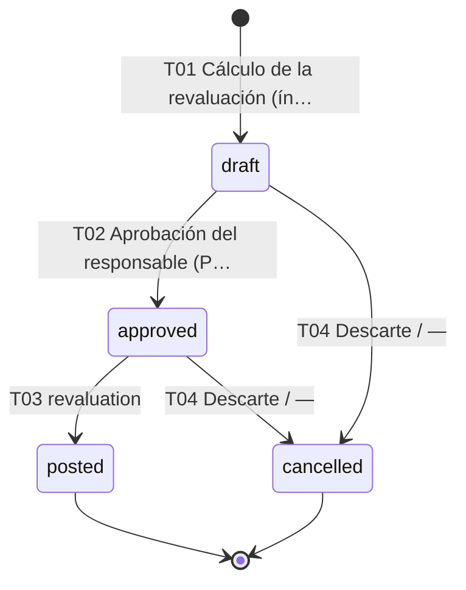

| # | Desde | Hasta | Disparador | Tipo | Guardas | Evento emitido |
|---|---|---|---|---|---|---|
| T01 | (nuevo) | `draft` | Cálculo de la revaluación (índice, costo o manual) / — | no especificado | — | — |
| T02 | `draft` | `approved` | Aprobación del responsable (P3042) / — | usuario | — | — |
| T03 | `approved` | `posted` | Contabilización: genera el documento `revaluation` y los movimientos `kind = value` / — | no especificado | Período abierto | — |
| T04 | `approved`, `draft` | `cancelled` | Descarte / — | no especificado | — | — |

### EST-STK-10 — `reorderSuggestions.status` (COL-STK-24)

**Colección:** Sugerencias de compra. **Campos de estado en el §7:** `status` (línea 681; valores: `open`, `converted`, `dismissed`).

**Fuente:** M13 §8.12.

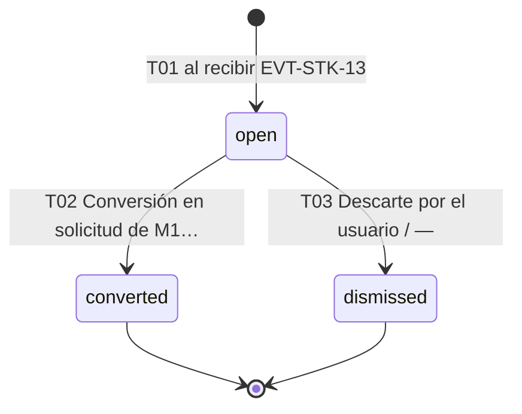

| # | Desde | Hasta | Disparador | Tipo | Guardas | Evento emitido |
|---|---|---|---|---|---|---|
| T01 | (nuevo) | `open` | Corrida de reposición / `stk.reorder.suggested` (EVT-STK-13) | evento | Saldo bajo mínimo o punto de pedido | — |
| T02 | `open` | `converted` | Conversión en solicitud de M12 / — | no especificado | — | — |
| T03 | `open` | `dismissed` | Descarte por el usuario / — | usuario | — | — |

### EST-STK-11 — `fixedAssets.status` (COL-STK-26)

**Colección:** Bienes de uso. **Campos de estado en el §7:** `status` (línea 709; sin valores en el §7).

**Fuente:** M13 §8.7.

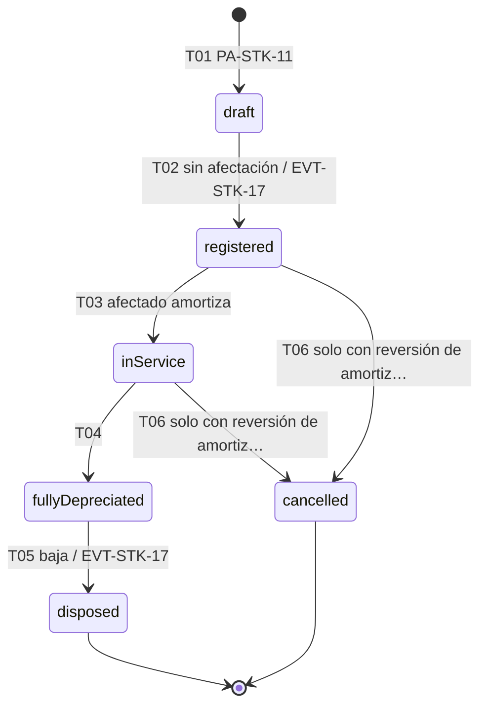

| # | Desde | Hasta | Disparador | Tipo | Guardas | Evento emitido |
|---|---|---|---|---|---|---|
| T01 | (nuevo) | `draft` | PA-STK-11 | no especificado | — | — |
| T02 | `draft` | `registered` | sin afectación | no especificado | RN-STK-052 | EVT-STK-17 `stk.fixedAsset.registered` (inferido por nombre) |
| T03 | `registered` | `inService` | afectado amortiza | no especificado | RN-STK-052 | — |
| T04 | `inService` | `fullyDepreciated` | — | no especificado | RN-STK-052 | — |
| T05 | `fullyDepreciated` | `disposed` | baja | no especificado | RN-STK-052 | EVT-STK-17 `stk.fixedAsset.disposed` (inferido por nombre) |
| T06 | `inService`, `registered` | `cancelled` | solo con reversión de amortizaciones RN-STK-052 | no especificado | RN-STK-052 | — |

### EST-STK-12 — `fixedAssetValueChanges.status` (COL-STK-28)

**Colección:** Mejoras, disminuciones y ajustes. **Campos de estado en el §7:** `status` (línea 719; valores: `draft`, `posted`, `voided`).

**Fuente:** M13 §8.13.

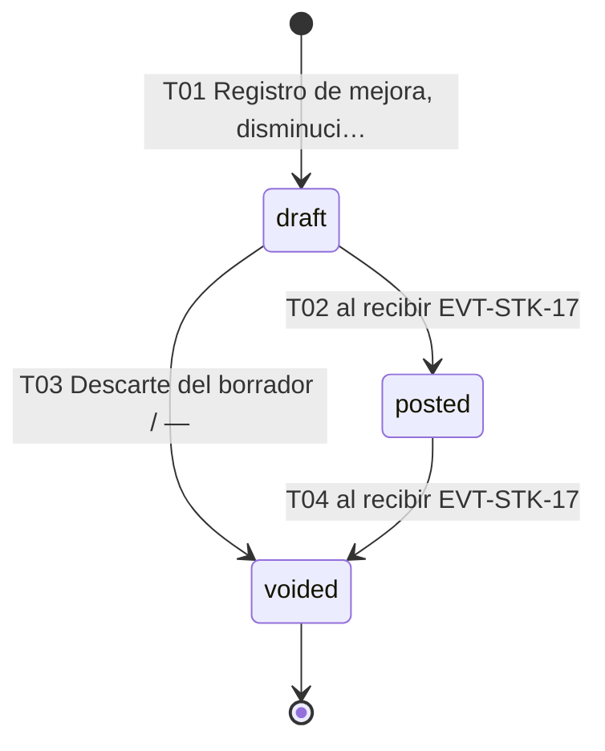

| # | Desde | Hasta | Disparador | Tipo | Guardas | Evento emitido |
|---|---|---|---|---|---|---|
| T01 | (nuevo) | `draft` | Registro de mejora, disminución, ajuste o revalúo (RF-STK-099) / — | no especificado | Bien no `disposed` ni `cancelled` | — |
| T02 | `draft` | `posted` | Confirmación: actualiza el valor del bien y emite el evento contable (`eventId`, `journalEntryId` de M15) / `stk.fixedAsset.valueChanged` (EVT-STK-17) | evento | Período abierto | — |
| T03 | `draft` | `voided` | Descarte del borrador / — | no especificado | — | — |
| T04 | `posted` | `voided` | Anulación con contramovimiento de valor y reversión contable (no se borra; RN-STK-052) / `stk.fixedAsset.valueChanged` (EVT-STK-17, reversión) | evento | Período abierto; sin amortizaciones posteriores contabilizadas que dependan del cambio (RN-STK-052) | — |

### EST-STK-13 — `depreciationRuns.status` (COL-STK-29)

**Colección:** Corridas de amortización. **Campos de estado en el §7:** `status` (línea 723; sin valores en el §7).

**Fuente:** M13 §8.8.

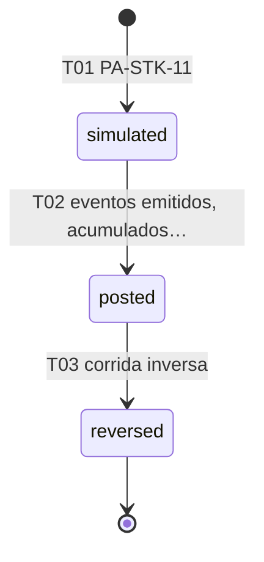

| # | Desde | Hasta | Disparador | Tipo | Guardas | Evento emitido |
|---|---|---|---|---|---|---|
| T01 | (nuevo) | `simulated` | PA-STK-11 | no especificado | — | — |
| T02 | `simulated` | `posted` | eventos emitidos, acumulados actualizados | no especificado | — | — |
| T03 | `posted` | `reversed` | corrida inversa | no especificado | — | — |

### EST-STK-14 — `rmaCases.status` (COL-STK-31)

**Colección:** RMA de equipos con proveedores. **Campos de estado en el §7:** —.

**Fuente:** M13 §8.11.

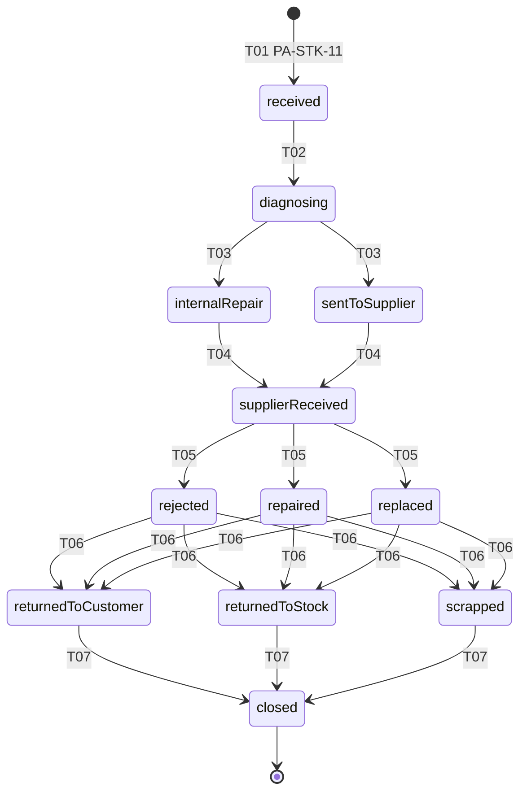

| # | Desde | Hasta | Disparador | Tipo | Guardas | Evento emitido |
|---|---|---|---|---|---|---|
| T01 | (nuevo) | `received` | PA-STK-11 | no especificado | — | — |
| T02 | `received` | `diagnosing` | — | no especificado | RN-STK-055 | — |
| T03 | `diagnosing` | `internalRepair`, `sentToSupplier` | — | no especificado | RN-STK-055 | — |
| T04 | `internalRepair`, `sentToSupplier` | `supplierReceived` | — | no especificado | RN-STK-055 | — |
| T05 | `supplierReceived` | `rejected`, `repaired`, `replaced` | — | no especificado | RN-STK-055 | — |
| T06 | `rejected`, `repaired`, `replaced` | `returnedToCustomer`, `returnedToStock`, `scrapped` | — | no especificado | RN-STK-055 | — |
| T07 | `returnedToCustomer`, `returnedToStock`, `scrapped` | `closed` | — | no especificado | RN-STK-055 | — |

### EST-STK-15 — `serviceReceptions.status` (COL-STK-33)

**Colección:** Equipos de clientes recibidos para reparación. **Campos de estado en el §7:** `status` (línea 1265; valores: `open`, `closed`, `cancelled`).

**Fuente:** M13 §8.14.4.

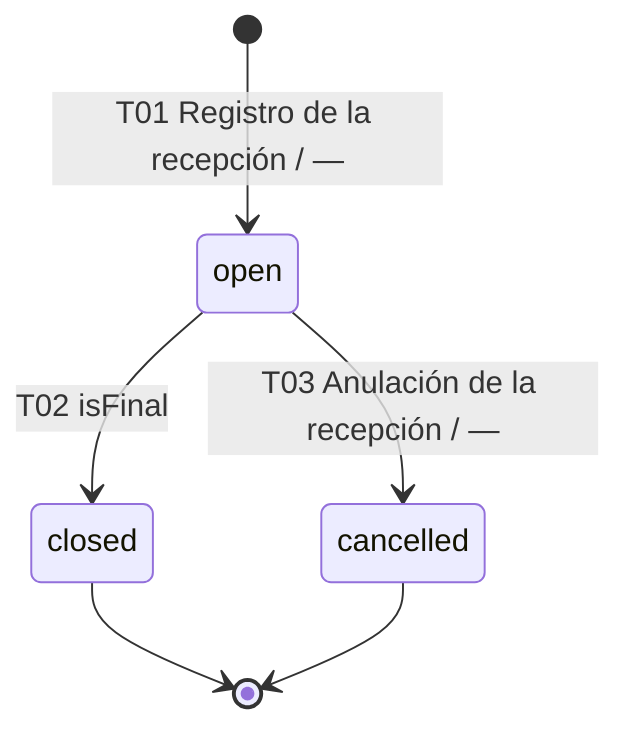

| # | Desde | Hasta | Disparador | Tipo | Guardas | Evento emitido |
|---|---|---|---|---|---|---|
| T01 | (nuevo) | `open` | Registro de la recepción / — | no especificado | — | — |
| T02 | `open` | `closed` | Todos los renglones en un estado con `isFinal` / — | no especificado | — | — |
| T03 | `open` | `cancelled` | Anulación de la recepción / — | no especificado | — | — |

### EST-STK-16 — `manufacturingOrders.stage` (COL-STK-38)

**Colección:** Órdenes de fabricación. **Campos de estado en el §7:** `stage` (línea 771; sin valores en el §7).

**Fuente:** M13 §8.9.

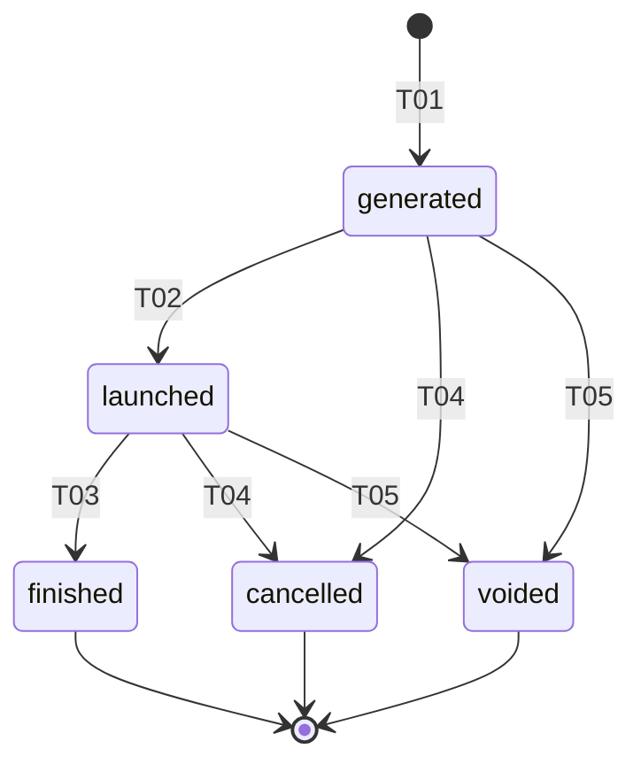

| # | Desde | Hasta | Disparador | Tipo | Guardas | Evento emitido |
|---|---|---|---|---|---|---|
| T01 | (nuevo) | `generated` | — | no especificado | Estructura vigente | — |
| T02 | `generated` | `launched` | — | no especificado | Componentes disponibles o confirmación con faltantes | — |
| T03 | `launched` | `finished` | — | no especificado | Todos los renglones fabricados, o finalización manual permitida (PRM-STK-049) (RN-STK-063) | — |
| T04 | `generated`, `launched` | `cancelled` | — | no especificado | — | — |
| T05 | `generated`, `launched` | `voided` | — | no especificado | RN-STK-059 | — |

### EST-STK-17 — `productionReports.status` (COL-STK-39)

**Colección:** Partes de producción. **Campos de estado en el §7:** `status` (línea 785; sin valores en el §7).

**Fuente:** M13 §8.10.

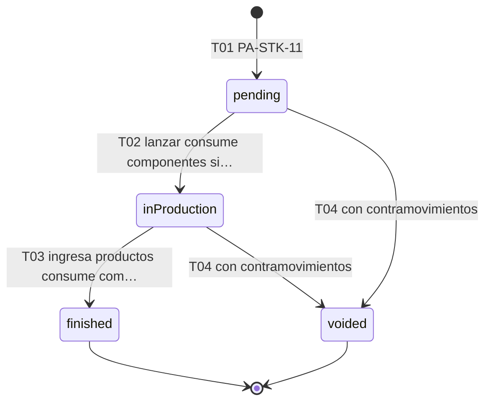

| # | Desde | Hasta | Disparador | Tipo | Guardas | Evento emitido |
|---|---|---|---|---|---|---|
| T01 | (nuevo) | `pending` | PA-STK-11 | no especificado | — | — |
| T02 | `pending` | `inProduction` | lanzar consume componentes si PRM-STK-040 | no especificado | — | — |
| T03 | `inProduction` | `finished` | ingresa productos consume componentes si no se consumieron | no especificado | — | — |
| T04 | `inProduction`, `pending` | `voided` | con contramovimientos | no especificado | — | — |

### EST-STK-18 — `mrpRuns.status` (COL-STK-40)

**Colección:** Aprovisionamiento de fabricación. **Campos de estado en el §7:** `status` (línea 789; valores: `calculated`, `confirmed`, `discarded`, `failed`).

**Fuente:** M13 §8.13.

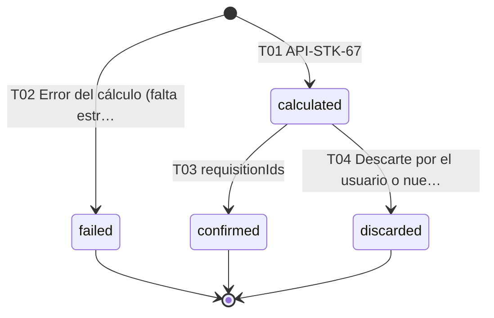

| # | Desde | Hasta | Disparador | Tipo | Guardas | Evento emitido |
|---|---|---|---|---|---|---|
| T01 | (nuevo) | `calculated` | Corrida de aprovisionamiento (JOB-STK-08, API-STK-67) / — | job, API/integración | RN-STK-066 | — |
| T02 | (nuevo) | `failed` | Error del cálculo (falta estructura vigente o datos de stock) / — | no especificado | — | — |
| T03 | `calculated` | `confirmed` | Generar requisiciones por proveedor en M12 (`requisitionIds`) / — | API/integración | Solo requisiciones, nunca OC directa (RN-STK-044, CTR-STK-09) | — |
| T04 | `calculated` | `discarded` | Descarte por el usuario o nueva corrida del mismo rango / — | usuario | — | — |

### EST-STK-19 — `contractEquipmentAssignments.status` (colección de otro dueño o absorbida)

**Fuente:** M13 §8.4. La colección figura en T05 como COL-CAT-20 C (dueño M02); no se crea con este dueño, se conserva el diagrama del §8 de este anexo.

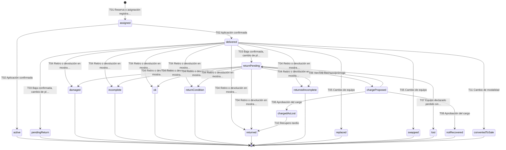

| # | Desde | Hasta | Disparador | Tipo | Guardas | Evento emitido |
|---|---|---|---|---|---|---|
| T01 | (nuevo) | `assigned` | Reserva o asignación registrada en la OT | no especificado | — | — |
| T02 | `assigned` | `active`, `delivered` | Aplicación confirmada | no especificado | — | — |
| T03 | `delivered` | `pendingReturn`, `returnPending` | Baja confirmada, cambio de plan que no usa el equipo, fin de préstamo | no especificado | — | — |
| T04 | `delivered`, `returnPending` | `damaged`, `incomplete`, `ok`, `returnCondition`, `returned`, `returnedIncomplete` | Retiro o devolución en mostrador | no especificado | — | — |
| T05 | `delivered` | `replaced`, `swapped` | Cambio de equipo | no especificado | — | — |
| T06 | `returnPending` | `chargeProposed` | Vence plazo | job | — | — |
| T07 | `returnPending` | `lost` | Equipo declarado perdido sin propuesta de cargo | no especificado | — | — |
| T08 | `chargeProposed` | `chargedAsLost`, `notRecovered` | Aprobación del cargo | no especificado | — | — |
| T09 | `chargeProposed` | `returnPending` | Rechazo/prórroga | no especificado | — | — |
| T10 | `chargedAsLost` | `returned` | Recupero tardío | no especificado | — | — |
| T11 | `delivered` | `convertedToSale` | Cambio de modalidad | no especificado | — | — |

## M14 — TES Tesorería y bancos

### EST-TES-01 — `treasuryAccounts.status` (COL-TES-03)

**Colección:** Cuentas financieras (bancos, cajas de tesorería y de pagos, tránsito). **Campos de estado en el §7:** `status` (línea 582; valores: `active`, `blocked`, `closed`).

**Fuente:** M14 §8.16.1.

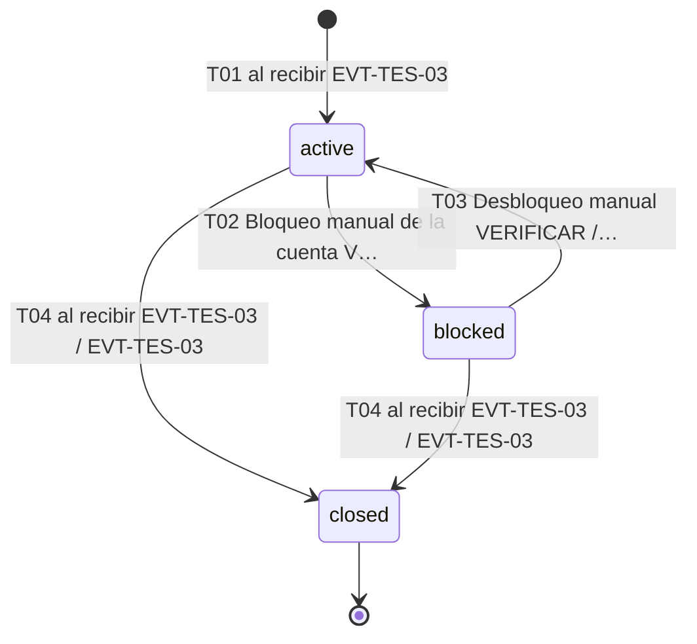

| # | Desde | Hasta | Disparador | Tipo | Guardas | Evento emitido |
|---|---|---|---|---|---|---|
| T01 | (nuevo) | `active` | Alta de la cuenta (RF-TES-001) / EVT-TES-03 `tes.account.created` | evento | — | — |
| T02 | `active` | `blocked` | Bloqueo manual de la cuenta `[VERIFICAR]` / — | no especificado | — | — |
| T03 | `blocked` | `active` | Desbloqueo manual `[VERIFICAR]` / — | no especificado | — | — |
| T04 | `active`, `blocked` | `closed` | Cierre de la cuenta / EVT-TES-03 `tes.account.closed` | evento | RN-TES-002 (saldo materializado; sin saldo pendiente `[VERIFICAR]`) | EVT-TES-03 `tes.account.closed` (inferido por nombre) |

### EST-TES-02 — `treasuryAccountSigners.status` (COL-TES-04)

**Colección:** Firmantes autorizados de cuentas y órdenes de pago, con vigencia, tope y regla de firmas conjuntas (RF-TES-008; CTR-DAT-78; absorbe `paymentOrderSigners` de T07). **Campos de estado en el §7:** `status` (línea 598; valores: `active`, `revoked`).

**Fuente:** M14 §8.16.2.

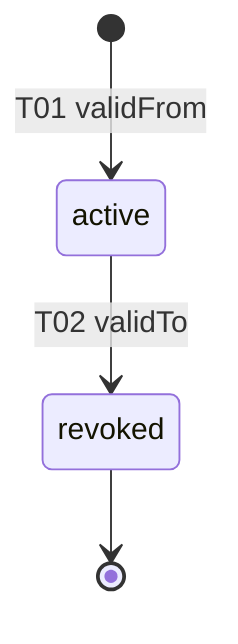

| # | Desde | Hasta | Disparador | Tipo | Guardas | Evento emitido |
|---|---|---|---|---|---|---|
| T01 | (nuevo) | `active` | Alta del firmante con vigencia `validFrom` / — | usuario | — | — |
| T02 | `active` | `revoked` | Revocación manual o vencimiento de `validTo` `[VERIFICAR]` / — | job | — | — |

### EST-TES-03 — `treasuryOperations.status` (COL-TES-09)

**Colección:** Operaciones de tesorería. **Campos de estado en el §7:** `status` (línea 686; valores: `draft`, `pendingApproval`, `posted`, `voided`).

**Fuente:** M14 §8.1.

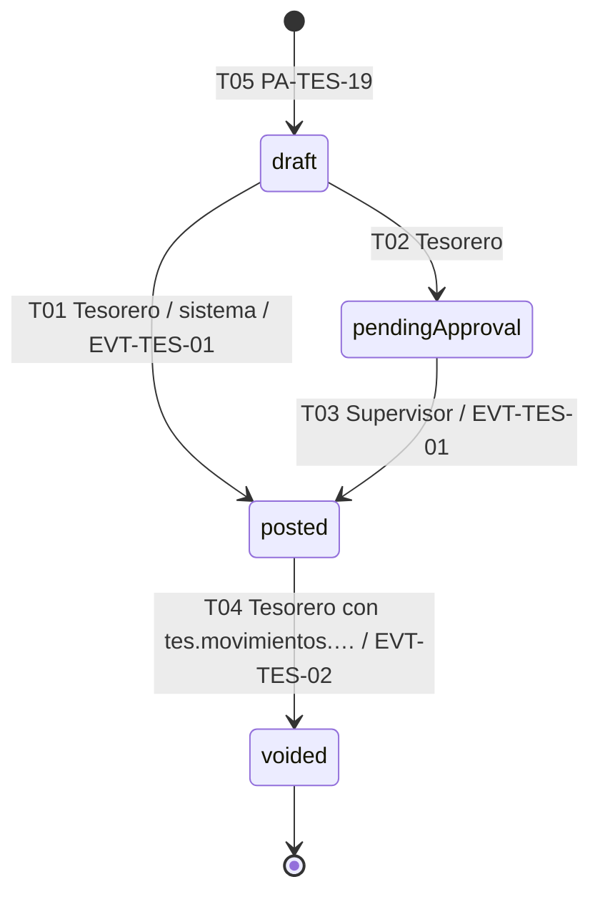

| # | Desde | Hasta | Disparador | Tipo | Guardas | Evento emitido |
|---|---|---|---|---|---|---|
| T01 | `draft` | `posted` | Tesorero / sistema | sistema, usuario | Balance correcto; período abierto; medios válidos; no requiere aprobación | EVT-TES-01 `tes.operation.posted` |
| T02 | `draft` | `pendingApproval` | Tesorero | usuario | Supera umbral (PRM-TES-061/062) | — |
| T03 | `pendingApproval` | `posted` | Supervisor | usuario | Aprobación; período abierto | EVT-TES-01 `tes.operation.posted` (inferido por nombre) |
| T04 | `posted` | `voided` | Tesorero con `tes.movimientos.anular` | usuario | Período abierto; movimientos no conciliados (o desconciliados antes); valores en estado reversible | EVT-TES-02 `tes.operation.voided` (inferido por nombre) |
| T05 | (nuevo) | `draft` | PA-TES-19 | no especificado | — | — |

### EST-TES-04 — `treasuryMovements.reconciliation.status` (COL-TES-10)

**Colección:** Libro único de movimientos de fondos (alto volumen). **Campos de estado en el §7:** `status` (línea 757; valores: `pendingApproval`, `posted`, `voided`).

**Fuente:** M14 §8.2.

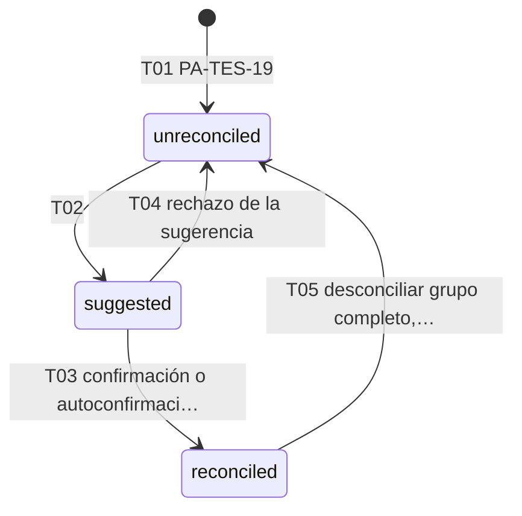

| # | Desde | Hasta | Disparador | Tipo | Guardas | Evento emitido |
|---|---|---|---|---|---|---|
| T01 | (nuevo) | `unreconciled` | PA-TES-19 | no especificado | — | — |
| T02 | `unreconciled` | `suggested` | — | no especificado | — | — |
| T03 | `suggested` | `reconciled` | confirmación o autoconfirmación | no especificado | — | — |
| T04 | `suggested` | `unreconciled` | rechazo de la sugerencia | no especificado | — | — |
| T05 | `reconciled` | `unreconciled` | desconciliar grupo completo, con conciliación abierta o reabierta | no especificado | — | — |

### EST-TES-05 — `bankDeposits.status` (COL-TES-11)

**Colección:** Depósitos bancarios. **Campos de estado en el §7:** `status` (línea 765; valores: `registered`, `partiallyCredited`, `credited`, `rejected`, `voided`).

**Fuente:** M14 §8.13.

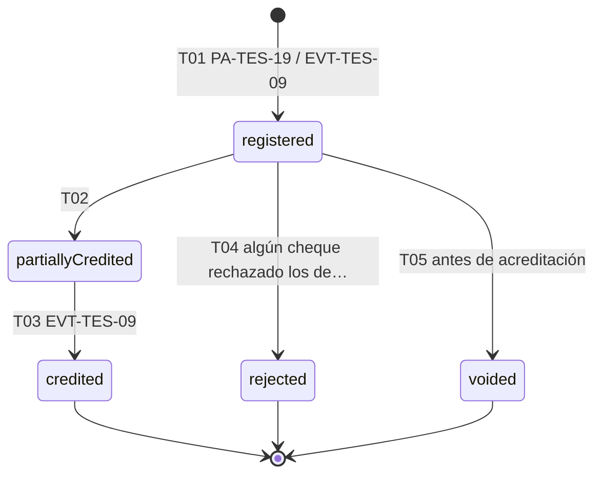

| # | Desde | Hasta | Disparador | Tipo | Guardas | Evento emitido |
|---|---|---|---|---|---|---|
| T01 | (nuevo) | `registered` | PA-TES-19 | no especificado | — | EVT-TES-09 `tes.deposit.registered` (inferido por nombre) |
| T02 | `registered` | `partiallyCredited` | — | no especificado | — | — |
| T03 | `partiallyCredited` | `credited` | — | no especificado | — | EVT-TES-09 `tes.deposit.credited` (inferido por nombre) |
| T04 | `registered` | `rejected` | algún cheque rechazado: los demás siguen | no especificado | — | — |
| T05 | `registered` | `voided` | antes de acreditación | no especificado | — | — |

### EST-TES-06 — `bankStatementImports.status` (COL-TES-13)

**Colección:** Importaciones de extractos. **Campos de estado en el §7:** `status` (línea 807; valores: `previewed`, `imported`, `rejected`).

**Fuente:** M14 §8.16.3.

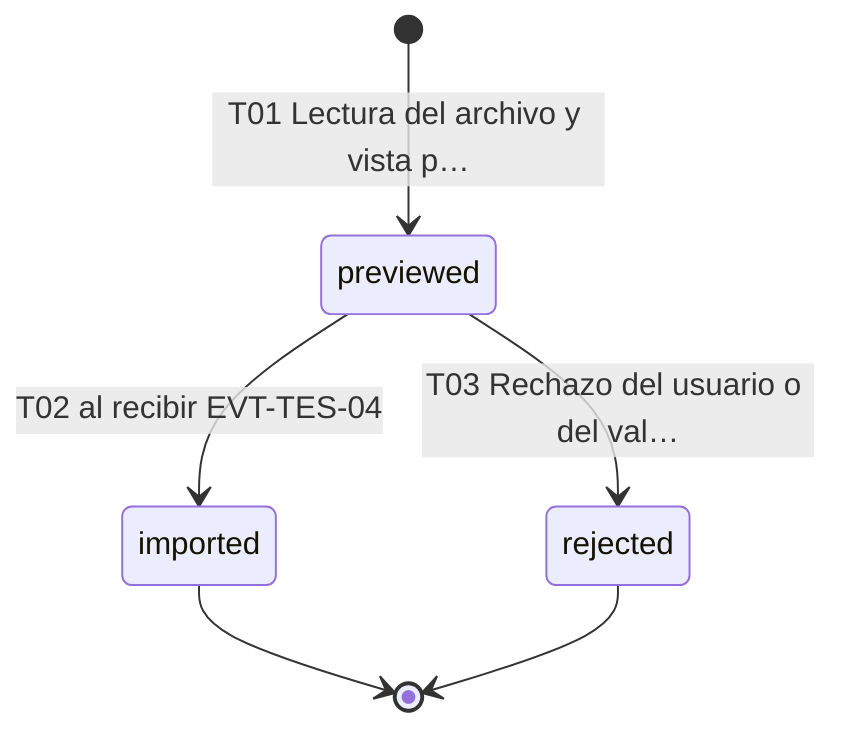

| # | Desde | Hasta | Disparador | Tipo | Guardas | Evento emitido |
|---|---|---|---|---|---|---|
| T01 | (nuevo) | `previewed` | Lectura del archivo y vista previa / — | no especificado | — | — |
| T02 | `previewed` | `imported` | Confirmación de la importación / EVT-TES-04 `tes.statement.imported` | evento | RN-TES-060 (deduplicación), RN-TES-082 (líneas inmutables) | — |
| T03 | `previewed` | `rejected` | Rechazo del usuario o del validador / — | usuario | — | — |

### EST-TES-07 — `reconciliations.status` (COL-TES-15)

**Colección:** Conciliaciones bancarias. **Campos de estado en el §7:** `status` (línea 853; valores: `open`, `inReview`, `closed`, `reopened`).

**Fuente:** M14 §8.3.

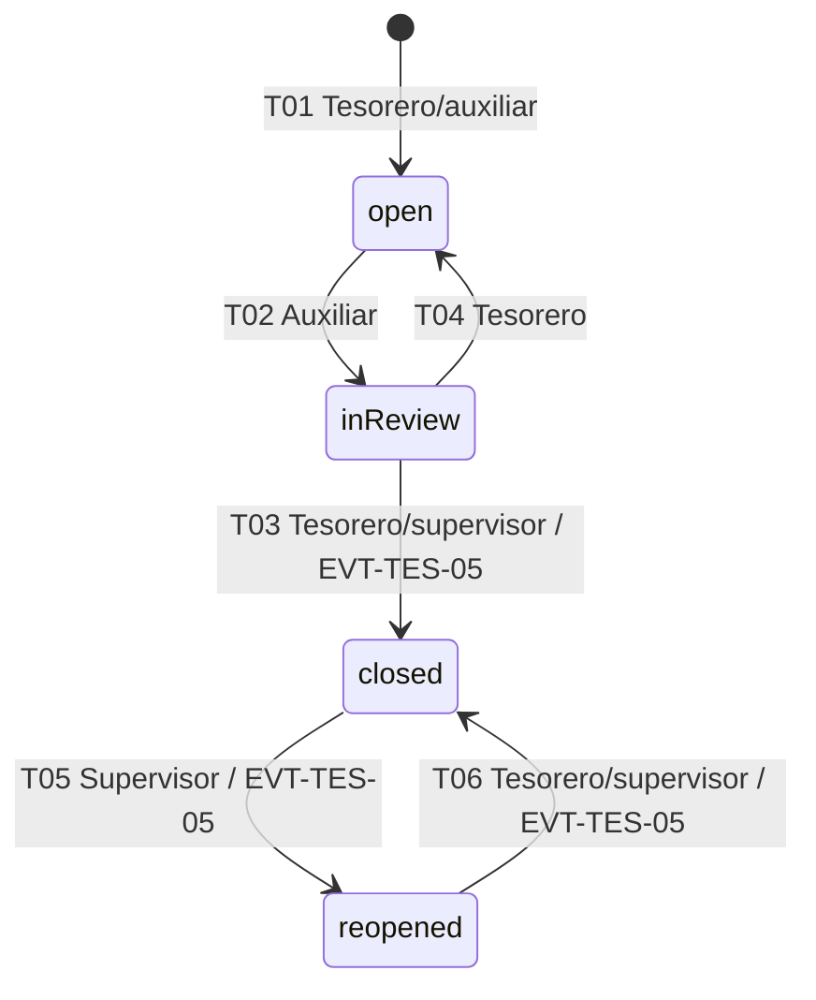

| # | Desde | Hasta | Disparador | Tipo | Guardas | Evento emitido |
|---|---|---|---|---|---|---|
| T01 | (nuevo) | `open` | Tesorero/auxiliar | usuario | Cuenta y fecha de corte posterior a la última cerrada | — |
| T02 | `open` | `inReview` | Auxiliar | no especificado | — | — |
| T03 | `inReview` | `closed` | Tesorero/supervisor | usuario | `unexplainedDifference = 0`; continuidad de extracto ok o justificada | EVT-TES-05 `tes.reconciliation.closed` |
| T04 | `inReview` | `open` | Tesorero | usuario | Observación | — |
| T05 | `closed` | `reopened` | Supervisor | usuario | Período no cerrado; motivo | EVT-TES-05 `tes.reconciliation.reopened` (inferido por nombre) |
| T06 | `reopened` | `closed` | Tesorero/supervisor | usuario | Ídem cierre (otro usuario si hubo desconciliación) | EVT-TES-05 `tes.reconciliation.closed` (inferido por nombre) |

### EST-TES-08 — `reconciliationMatches.status` (COL-TES-16)

**Colección:** Pareos. **Campos de estado en el §7:** `status` (línea 875; valores: `active`, `undone`).

**Fuente:** M14 §8.16.4.

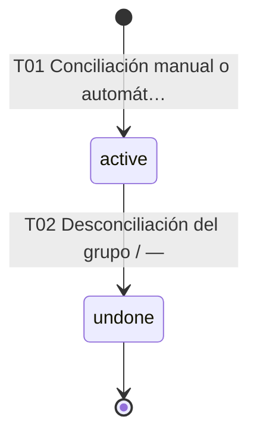

| # | Desde | Hasta | Disparador | Tipo | Guardas | Evento emitido |
|---|---|---|---|---|---|---|
| T01 | (nuevo) | `active` | Conciliación manual o automática de un grupo / — | job | RN-TES-061 (el grupo cuadra o la diferencia se explica) | — |
| T02 | `active` | `undone` | Desconciliación del grupo / — | no especificado | RN-TES-062 (se deshace el grupo completo) | — |

### EST-TES-09 — `interbankingConnections.status` (COL-TES-18)

**Colección:** Conexión Interbanking (secreto en bóveda). **Campos de estado en el §7:** `status` (línea 918; valores: `active`, `error`, `disabled`).

**Fuente:** M14 §8.16.5.

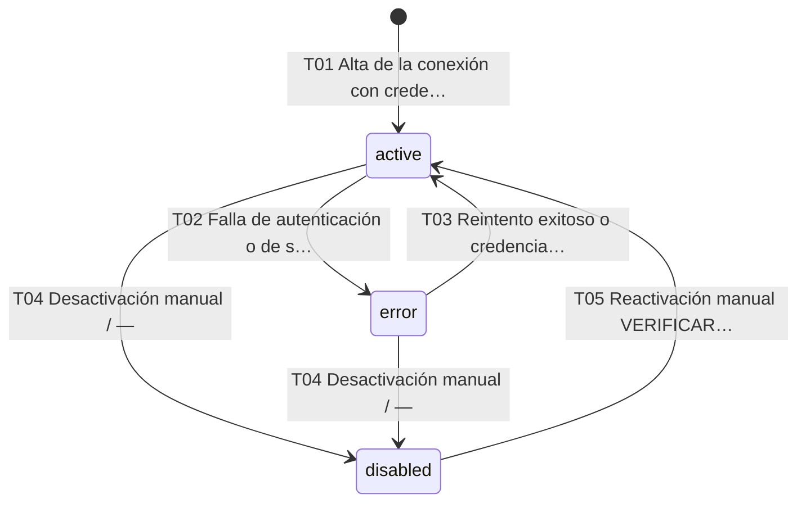

| # | Desde | Hasta | Disparador | Tipo | Guardas | Evento emitido |
|---|---|---|---|---|---|---|
| T01 | (nuevo) | `active` | Alta de la conexión con credencial en bóveda / — | no especificado | RN-TES-075 | — |
| T02 | `active` | `error` | Falla de autenticación o de sincronización `[VERIFICAR]` / — | no especificado | — | — |
| T03 | `error` | `active` | Reintento exitoso o credencial renovada `[VERIFICAR]` / — | no especificado | RN-TES-075 | — |
| T04 | `active`, `error` | `disabled` | Desactivación manual / — | no especificado | — | — |
| T05 | `disabled` | `active` | Reactivación manual `[VERIFICAR]` / — | no especificado | RN-TES-075 | — |

### EST-TES-10 — `interbankingSyncRuns.status` (COL-TES-19)

**Colección:** Sincronizaciones. **Campos de estado en el §7:** `status` (línea 948; valores: `running`, `completed`, `partial`, `failed`).

**Fuente:** M14 §8.16.11.

```mermaid
stateDiagram-v2
    [*] --> running : T01 Inicio de la sincronización (…
    running --> completed : T02 Todas las páginas procesadas…
    running --> partial : T03 Alguna página con error la co…
    partial --> running : T04 Reanudación desde la última p…
    running --> failed : T05 Error de conexión o de creden…
    completed --> [*]
    failed --> [*]
```

| # | Desde | Hasta | Disparador | Tipo | Guardas | Evento emitido |
|---|---|---|---|---|---|---|
| T01 | (nuevo) | `running` | Inicio de la sincronización (programada o manual) / — | job | — | — |
| T02 | `running` | `completed` | Todas las páginas procesadas / — | no especificado | — | — |
| T03 | `running` | `partial` | Alguna página con error; la corrida es reanudable / — | no especificado | — | — |
| T04 | `partial` | `running` | Reanudación desde la última página procesada / — | no especificado | — | — |
| T05 | `running` | `failed` | Error de conexión o de credenciales / — | no especificado | — | — |

### EST-TES-11 — `paymentFiles.status` (COL-TES-21)

**Colección:** Archivos de pago masivo. **Campos de estado en el §7:** `status` (línea 980; valores: `generated`, `sent`, `partiallyAccepted`, `accepted`, `rejected`, `debited`, `voided`).

**Fuente:** M14 §8.10.

```mermaid
stateDiagram-v2
    [*] --> generated : T01 PA-TES-19 / EVT-TES-16
    generated --> sent : T02 carga manual con acuse o enví… / EVT-TES-16
    sent --> accepted : T03
    sent --> partiallyAccepted : T03
    sent --> rejected : T03
    accepted --> debited : T04 conciliación
    partiallyAccepted --> debited : T04 conciliación
    rejected --> debited : T04 conciliación
    generated --> voided : T05 no enviado
    debited --> [*]
    voided --> [*]
```

| # | Desde | Hasta | Disparador | Tipo | Guardas | Evento emitido |
|---|---|---|---|---|---|---|
| T01 | (nuevo) | `generated` | PA-TES-19 | no especificado | — | EVT-TES-16 `tes.paymentFile.generated` (inferido por nombre) |
| T02 | `generated` | `sent` | carga manual con acuse o envío por API | API/integración | — | EVT-TES-16 `tes.paymentFile.sent` (inferido por nombre) |
| T03 | `sent` | `accepted`, `partiallyAccepted`, `rejected` | — | no especificado | — | — |
| T04 | `accepted`, `partiallyAccepted`, `rejected` | `debited` | conciliación | no especificado | — | — |
| T05 | `generated` | `voided` | no enviado | no especificado | — | — |

### EST-TES-12 — `thirdPartyChecks.state` (COL-TES-22)

**Colección:** Cheques y eCheq de terceros. **Campos de estado en el §7:** `state` (línea 1001; valores: `received`, `pendingAcceptance`, `inPortfolio`, `deliveredToSupplier`, `deposited`, `credited`, `rejected`, `recovered`, `returned`, `voided`, `manualOut`, `inCustody`, `negotiated`, `repudiated`).

**Fuente:** M14 §8.4.

```mermaid
stateDiagram-v2
    [*] --> received : T01 M07 (cobro) / tesorero
    [*] --> pendingAcceptance : T02 Sistema (eCheq recibido)
    pendingAcceptance --> inPortfolio : T03 Tesorero
    pendingAcceptance --> repudiated : T03 Tesorero
    received --> inPortfolio : T04 Aceptación de rendición
    inPortfolio --> deliveredToSupplier : T05 Ejecución de pago
    inPortfolio --> deposited : T06 Depósito
    inPortfolio --> inCustody : T07 Tesorero
    inPortfolio --> negotiated : T07 Tesorero
    inPortfolio --> manualOut : T08 Supervisor
    inPortfolio --> voided : T09 Tesorero
    received --> voided : T09 Tesorero
    deposited --> credited : T10 Conciliación
    negotiated --> credited : T10 Conciliación
    credited --> rejected : T11 Tesorero / EVT-TES-10
    deposited --> rejected : T11 Tesorero / EVT-TES-10
    deliveredToSupplier --> rejected : T12 Tesorero / EVT-TES-10
    rejected --> recovered : T13 Tesorero
    rejected --> returned : T14 Tesorero
    deliveredToSupplier --> inPortfolio : T15 Anulación de ejecución
    repudiated --> [*]
    inCustody --> [*]
    manualOut --> [*]
    voided --> [*]
    recovered --> [*]
    returned --> [*]
```

| # | Desde | Hasta | Disparador | Tipo | Guardas | Evento emitido |
|---|---|---|---|---|---|---|
| T01 | (nuevo) | `received` | M07 (cobro) / tesorero | usuario | Validaciones RN-TES-028…030 | — |
| T02 | (nuevo) | `pendingAcceptance` | Sistema (eCheq recibido) | sistema | eCheq informado | — |
| T03 | `pendingAcceptance` | `inPortfolio`, `repudiated` | Tesorero | usuario | Dentro del plazo | — |
| T04 | `received` | `inPortfolio` | Aceptación de rendición | no especificado | Rendición `accepted` | — |
| T05 | `inPortfolio` | `deliveredToSupplier` | Ejecución de pago | no especificado | `availableForPayments.enabled` | — |
| T06 | `inPortfolio` | `deposited` | Depósito | no especificado | Cuenta habilita depósito de valores | — |
| T07 | `inPortfolio` | `inCustody`, `negotiated` | Tesorero | usuario | eCheq o valor habilitado | — |
| T08 | `inPortfolio` | `manualOut` | Supervisor | usuario | Motivo | — |
| T09 | `inPortfolio`, `received` | `voided` | Tesorero | usuario | Error de carga, sin movimientos posteriores | — |
| T10 | `deposited`, `negotiated` | `credited` | Conciliación | no especificado | Línea bancaria | — |
| T11 | `credited`, `deposited` | `rejected` | Tesorero | usuario | Aviso bancario | EVT-TES-10 `tes.thirdPartyCheck.stateChanged` |
| T12 | `deliveredToSupplier` | `rejected` | Tesorero | usuario | Devuelto por proveedor | EVT-TES-10 `tes.thirdPartyCheck.rejected` (inferido por nombre) |
| T13 | `rejected` | `recovered` | Tesorero | usuario | Cobro del recupero | — |
| T14 | `rejected` | `returned` | Tesorero | usuario | Devolución física al librador | — |
| T15 | `deliveredToSupplier` | `inPortfolio` | Anulación de ejecución | no especificado | Pago anulado | — |

### EST-TES-13 — `checkbooks.status` (COL-TES-24)

**Colección:** Chequeras. **Campos de estado en el §7:** `status` (línea 1029; valores: `active`, `exhausted`, `voided`).

**Fuente:** M14 §8.16.6.

```mermaid
stateDiagram-v2
    [*] --> active : T01 Alta de la chequera (genera u…
    active --> exhausted : T02 Último cheque disponible usad…
    active --> voided : T03 Anulación de la chequera (anu…
    exhausted --> [*]
    voided --> [*]
```

| # | Desde | Hasta | Disparador | Tipo | Guardas | Evento emitido |
|---|---|---|---|---|---|---|
| T01 | (nuevo) | `active` | Alta de la chequera (genera un cheque por número) / — | no especificado | RN-TES-039 | — |
| T02 | `active` | `exhausted` | Último cheque disponible usado / — | no especificado | RN-TES-036 | — |
| T03 | `active` | `voided` | Anulación de la chequera (anula los cheques disponibles) / — | no especificado | RN-TES-039 | — |

### EST-TES-14 — `ownChecks.state` (COL-TES-25)

**Colección:** Cheques propios. **Campos de estado en el §7:** `state` (línea 1047; valores: `available`, `issued`, `pendingAcceptance`, `accepted`, `repudiated`, `debited`, `voided`, `rejected`, `recovered`).

**Fuente:** M14 §8.5.

```mermaid
stateDiagram-v2
    [*] --> available : T01 Alta de chequera
    available --> issued : T02 Ejecución de pago / EVT-TES-11
    issued --> pendingAcceptance : T03 Banco (importación/adaptador)
    pendingAcceptance --> accepted : T04 Banco (importación/adaptador)
    pendingAcceptance --> repudiated : T04 Banco (importación/adaptador)
    accepted --> debited : T05 Conciliación / EVT-TES-11
    issued --> debited : T05 Conciliación / EVT-TES-11
    accepted --> recovered : T06 Tesorero
    issued --> recovered : T06 Tesorero
    accepted --> rejected : T07 Tesorero
    issued --> rejected : T07 Tesorero
    available --> voided : T08 Tesorero / EVT-TES-11
    voided --> available : T09 Tesorero
    repudiated --> [*]
    debited --> [*]
    recovered --> [*]
    rejected --> [*]
```

| # | Desde | Hasta | Disparador | Tipo | Guardas | Evento emitido |
|---|---|---|---|---|---|---|
| T01 | (nuevo) | `available` | Alta de chequera | no especificado | — | — |
| T02 | `available` | `issued` | Ejecución de pago | no especificado | Número válido | EVT-TES-11 `tes.ownCheck.issued` (inferido por nombre) |
| T03 | `issued` | `pendingAcceptance` | Banco (importación/adaptador) | no especificado | — | — |
| T04 | `pendingAcceptance` | `accepted`, `repudiated` | Banco (importación/adaptador) | no especificado | — | — |
| T05 | `accepted`, `issued` | `debited` | Conciliación | no especificado | Línea de débito | EVT-TES-11 `tes.ownCheck.debited` (inferido por nombre) |
| T06 | `accepted`, `issued` | `recovered` | Tesorero | usuario | Devuelto antes del débito | — |
| T07 | `accepted`, `issued` | `rejected` | Tesorero | usuario | Rechazo bancario | — |
| T08 | `available` | `voided` | Tesorero | usuario | — | EVT-TES-11 `tes.ownCheck.voided` (inferido por nombre) |
| T09 | `voided` | `available` | Tesorero | usuario | Nunca emitido | — |

### EST-TES-15 — `cardVouchers.state` (COL-TES-27)

**Colección:** Cupones de tarjeta (sin PAN, vencimiento ni código). **Campos de estado en el §7:** `state` (línea 1079; valores: `collected`, `inTreasury`, `presented`, `settled`, `rejected`, `voided`).

**Fuente:** M14 §8.6.

```mermaid
stateDiagram-v2
    [*] --> collected : T01 PA-TES-19
    collected --> inTreasury : T02 rendición aceptada
    inTreasury --> presented : T03 lote o automático / EVT-TES-13
    presented --> settled : T04 liquidación
    presented --> inTreasury : T05 anular presentación
    settled --> presented : T06 anular liquidación / EVT-TES-13
    collected --> rejected : T07 evento a M07 / EVT-TES-13
    inTreasury --> rejected : T07 evento a M07 / EVT-TES-13
    presented --> rejected : T07 evento a M07 / EVT-TES-13
    collected --> voided : T08 anulación del cobro en M07
    rejected --> [*]
    voided --> [*]
```

| # | Desde | Hasta | Disparador | Tipo | Guardas | Evento emitido |
|---|---|---|---|---|---|---|
| T01 | (nuevo) | `collected` | PA-TES-19 | no especificado | — | — |
| T02 | `collected` | `inTreasury` | rendición aceptada | no especificado | — | — |
| T03 | `inTreasury` | `presented` | lote o automático | job | — | EVT-TES-13 `tes.cardVoucher.presented` (inferido por nombre) |
| T04 | `presented` | `settled` | liquidación | no especificado | — | — |
| T05 | `presented` | `inTreasury` | anular presentación | no especificado | — | — |
| T06 | `settled` | `presented` | anular liquidación | no especificado | — | EVT-TES-13 `tes.cardVoucher.presented` (inferido por nombre) |
| T07 | `collected`, `inTreasury`, `presented` | `rejected` | evento a M07 | evento | — | EVT-TES-13 `tes.cardVoucher.rejected` (inferido por nombre) |
| T08 | `collected` | `voided` | anulación del cobro en M07 | no especificado | — | — |

### EST-TES-16 — `cardPresentations.status` (COL-TES-28)

**Colección:** Presentaciones a procesadoras. **Campos de estado en el §7:** `status` (línea 1101; valores: `presented`, `voided`).

**Fuente:** M14 §8.16.7.

```mermaid
stateDiagram-v2
    [*] --> presented : T01 al recibir EVT-TES-13
    presented --> voided : T02 Anulación de la presentación…
    voided --> [*]
```

| # | Desde | Hasta | Disparador | Tipo | Guardas | Evento emitido |
|---|---|---|---|---|---|---|
| T01 | (nuevo) | `presented` | Presentación de cupones a la procesadora / EVT-TES-13 `tes.cardVoucher.presented` | evento | RN-TES-042 | — |
| T02 | `presented` | `voided` | Anulación de la presentación / — | no especificado | RN-TES-044 (solo con cupones no pagados y suma coincidente) | — |

### EST-TES-17 — `cardSettlements.status` (COL-TES-29)

**Colección:** Liquidaciones de tarjetas. **Campos de estado en el §7:** `status` (línea 1118; valores: `registered`, `credited`, `voided`).

**Fuente:** M14 §8.16.8.

```mermaid
stateDiagram-v2
    [*] --> registered : T01 al recibir EVT-TES-13
    registered --> credited : T02 Acreditación en la cuenta de…
    registered --> voided : T03 Anulación de la liquidación V…
    credited --> [*]
    voided --> [*]
```

| # | Desde | Hasta | Disparador | Tipo | Guardas | Evento emitido |
|---|---|---|---|---|---|---|
| T01 | (nuevo) | `registered` | Registro de la liquidación de la procesadora / EVT-TES-13 `tes.cardSettlement.recorded` | evento | RN-TES-042 | — |
| T02 | `registered` | `credited` | Acreditación en la cuenta de destino `[VERIFICAR]` / — | no especificado | — | — |
| T03 | `registered` | `voided` | Anulación de la liquidación `[VERIFICAR]` / — | no especificado | — | — |

### EST-TES-18 — `receivedWithholdings.state` (COL-TES-30)

**Colección:** Retenciones sufridas en cartera. **Campos de estado en el §7:** `state` (línea 1143; valores: `received`, `inPortfolio`, `presented`, `out`, `voided`).

**Fuente:** M14 §8.7.

```mermaid
stateDiagram-v2
    [*] --> received : T01 PA-TES-19
    received --> inPortfolio : T02 rendición aceptada o registro…
    inPortfolio --> presented : T03 lote o automático / EVT-TES-14
    inPortfolio --> out : T04 salida con destino
    presented --> inPortfolio : T05 anular presentación si M06 no…
    inPortfolio --> voided : T06 anulación del cobro
    received --> voided : T06 anulación del cobro
    out --> [*]
    voided --> [*]
```

| # | Desde | Hasta | Disparador | Tipo | Guardas | Evento emitido |
|---|---|---|---|---|---|---|
| T01 | (nuevo) | `received` | PA-TES-19 | no especificado | — | — |
| T02 | `received` | `inPortfolio` | rendición aceptada o registro directo | no especificado | — | — |
| T03 | `inPortfolio` | `presented` | lote o automático | job | — | EVT-TES-14 `tes.receivedWithholding.presented` (inferido por nombre) |
| T04 | `inPortfolio` | `out` | salida con destino | no especificado | — | — |
| T05 | `presented` | `inPortfolio` | anular presentación si M06 no la computó en DDJJ presentada | no especificado | — | — |
| T06 | `inPortfolio`, `received` | `voided` | anulación del cobro | no especificado | — | — |

### EST-TES-19 — `withholdingPresentations.status` (COL-TES-31)

**Colección:** Presentación de retenciones sufridas. **Campos de estado en el §7:** `status` (línea 1166; valores: `posted`, `voided`).

**Fuente:** M14 §8.16.9.

```mermaid
stateDiagram-v2
    [*] --> posted : T01 al recibir EVT-TES-14
    posted --> voided : T02 al recibir EVT-TES-14
    voided --> [*]
```

| # | Desde | Hasta | Disparador | Tipo | Guardas | Evento emitido |
|---|---|---|---|---|---|---|
| T01 | (nuevo) | `posted` | Presentación de retenciones recibidas / EVT-TES-14 `tes.receivedWithholding.presented` | evento | — | — |
| T02 | `posted` | `voided` | Anulación de la presentación / EVT-TES-14 `tes.receivedWithholding.presentationVoided` | evento | RN-TES-044 (mismo criterio que cupones) | — |

### EST-TES-20 — `paymentCashSessions.status` (COL-TES-32)

**Colección:** Turnos de la caja de pagos. **Campos de estado en el §7:** `status` (línea 1183; valores: `open`, `closed`, `reopened`).

**Fuente:** M14 §8.11.

```mermaid
stateDiagram-v2
    [*] --> open : T01 PA-TES-19
    open --> closed : T02
    closed --> reopened : T03
    reopened --> closed : T04
```

| # | Desde | Hasta | Disparador | Tipo | Guardas | Evento emitido |
|---|---|---|---|---|---|---|
| T01 | (nuevo) | `open` | PA-TES-19 | no especificado | — | — |
| T02 | `open` | `closed` | — | no especificado | — | — |
| T03 | `closed` | `reopened` | — | no especificado | — | — |
| T04 | `reopened` | `closed` | — | no especificado | — | — |

### EST-TES-21 — `cashRemittances.status` (COL-TES-33)

**Colección:** Recepción en tesorería de la entrega de caja de M07 (`treasuryHandovers`). **Campos de estado en el §7:** `status` (línea 1219; valores: `pendingReception`, `inReview`, `observed`, `accepted`, `acceptedWithDifference`, `voided`).

Ver también el diagrama curado B9 en `06-secuencias-y-estados.md` §4.

**Fuente:** M14 §8.8.

```mermaid
stateDiagram-v2
    [*] --> pendingReception : T01 al recibir EVT-COB-12
    pendingReception --> inReview : T02 Auxiliar/tesorero
    inReview --> accepted : T03 Tesorero / EVT-TES-08
    inReview --> acceptedWithDifference : T04 Tesorero + aprobación / EVT-TES-08
    inReview --> observed : T05 Tesorero / EVT-TES-08
    pendingReception --> accepted : T06 Sistema / EVT-TES-08
    accepted --> voided : T07 Supervisor / EVT-TES-08
    acceptedWithDifference --> [*]
    observed --> [*]
    voided --> [*]
```

| # | Desde | Hasta | Disparador | Tipo | Guardas | Evento emitido |
|---|---|---|---|---|---|---|
| T01 | (nuevo) | `pendingReception` | Sistema (`cob.cashSession.closed`) | evento, sistema | Caja cerrada en M07 | — |
| T02 | `pendingReception` | `inReview` | Auxiliar/tesorero | usuario | No es el cajero | — |
| T03 | `inReview` | `accepted` | Tesorero | usuario | Contado = declarado | EVT-TES-08 `tes.cashRemittance.accepted` (inferido por nombre) |
| T04 | `inReview` | `acceptedWithDifference` | Tesorero + aprobación | usuario | Diferencia ≤ tope o aprobada | EVT-TES-08 `tes.cashRemittance.accepted` (inferido por nombre) |
| T05 | `inReview` | `observed` | Tesorero | usuario | Diferencia o faltante | EVT-TES-08 `tes.cashRemittance.accepted` |
| T06 | `pendingReception` | `accepted` | Sistema | sistema | `zeroCash` | EVT-TES-08 `tes.cashRemittance.accepted` (inferido por nombre) |
| T07 | `accepted` | `voided` | Supervisor | usuario | Período abierto; valores sin movimientos posteriores | EVT-TES-08 `tes.cashRemittance.voided` (inferido por nombre) |

### EST-TES-22 — `treasuryCashClosings.status` (COL-TES-34)

**Colección:** Arqueos de caja de tesorería. **Campos de estado en el §7:** `status` (línea 1226; valores: `open`, `closed`, `reopened`).

**Fuente:** M14 §8.12.

```mermaid
stateDiagram-v2
    [*] --> open : T01 PA-TES-19
    open --> closed : T02 arqueo y, si hay diferencia,… / EVT-TES-18
    closed --> reopened : T03 supervisor, período abierto r… / EVT-TES-18
    reopened --> closed : T04 EVT-TES-18
```

| # | Desde | Hasta | Disparador | Tipo | Guardas | Evento emitido |
|---|---|---|---|---|---|---|
| T01 | (nuevo) | `open` | PA-TES-19 | no especificado | — | — |
| T02 | `open` | `closed` | arqueo y, si hay diferencia, aprobación del quebranto | no especificado | — | EVT-TES-18 `tes.cashClosing.closed` (inferido por nombre) |
| T03 | `closed` | `reopened` | supervisor, período abierto revierte quebranto | usuario | — | EVT-TES-18 `tes.cashClosing.reopened` (inferido por nombre) |
| T04 | `reopened` | `closed` | — | no especificado | — | EVT-TES-18 `tes.cashClosing.closed` (inferido por nombre) |

### EST-TES-23 — `paymentExecutions.status` (COL-TES-35)

**Colección:** Ejecución de pagos (firma, entrega, medios). **Campos de estado en el §7:** `status` (línea 1260; valores: `pending`, `instrumented`, `partiallySigned`, `signed`, `delivered`, `sentToBank`, `executed`, `rejected`, `voided`).

**Fuente:** M14 §8.9.

```mermaid
stateDiagram-v2
    [*] --> pending : T01 al recibir EVT-CMP-11
    pending --> instrumented : T02 Tesorero
    instrumented --> partiallySigned : T03 Firmantes
    partiallySigned --> signed : T04 Firmantes / EVT-TES-15
    signed --> delivered : T05 Tesorero/cajero de pagos
    signed --> sentToBank : T06 Tesorero
    delivered --> executed : T07 Sistema (conciliación / respu… / EVT-TES-15
    sentToBank --> executed : T07 Sistema (conciliación / respu… / EVT-TES-15
    sentToBank --> rejected : T08 Sistema/tesorero / EVT-TES-15
    executed --> voided : T10 Supervisor / EVT-TES-15
    note left of voided : T09 desde cualquier estado previsto
    rejected --> [*]
    voided --> [*]
```

| # | Desde | Hasta | Disparador | Tipo | Guardas | Evento emitido |
|---|---|---|---|---|---|---|
| T01 | (nuevo) | `pending` | Sistema (`cmp.paymentOrder.approved`, obligación M06, reintegro M07, lote M16) | evento, sistema | Origen aprobado | — |
| T02 | `pending` | `instrumented` | Tesorero | usuario | Σ medios = neto; caja de pagos abierta si hay efectivo | — |
| T03 | `instrumented` | `partiallySigned` | Firmantes | usuario | Firmante vigente ≠ quien instrumentó; tope | — |
| T04 | `partiallySigned` | `signed` | Firmantes | usuario | Firmante vigente ≠ quien instrumentó; tope | EVT-TES-15 `tes.paymentExecution.signed` (inferido por nombre) |
| T05 | `signed` | `delivered` | Tesorero/cajero de pagos | usuario | Firmado | — |
| T06 | `signed` | `sentToBank` | Tesorero | usuario | Transferencias en archivo enviado | — |
| T07 | `delivered`, `sentToBank` | `executed` | Sistema (conciliación / respuesta) | sistema | Débito conciliado o aceptación del banco | EVT-TES-15 `tes.paymentExecution.signed` |
| T08 | `sentToBank` | `rejected` | Sistema/tesorero | sistema, usuario | Rechazo de línea | EVT-TES-15 `tes.paymentExecution.signed` |
| T09 | cualquiera | `voided` | Tesorero con `tes.pagos.anular` | usuario | Sin salida de caja pendiente sin anular; período abierto | EVT-TES-15 `tes.paymentExecution.signed` |
| T10 | `executed` | `voided` | Supervisor | usuario | Devolución del banco o error documentado | EVT-TES-15 `tes.paymentExecution.voided` (inferido por nombre) |

### EST-TES-24 — `fundCommitments.status` (COL-TES-39)

**Colección:** Compromisos de fondos. **Campos de estado en el §7:** `status` (línea 1327; valores: `active`, `partiallyConsumed`, `consumed`, `released`, `cancelled`).

**Fuente:** M14 §8.14.

```mermaid
stateDiagram-v2
    [*] --> active : T01 PA-TES-19
    active --> partiallyConsumed : T02
    partiallyConsumed --> consumed : T03 EVT-TES-20
    active --> released : T04 cancelación de OC libera el r… / EVT-TES-20
    partiallyConsumed --> released : T04 cancelación de OC libera el r… / EVT-TES-20
    active --> cancelled : T05 error de carga, manual
    consumed --> [*]
    released --> [*]
    cancelled --> [*]
```

| # | Desde | Hasta | Disparador | Tipo | Guardas | Evento emitido |
|---|---|---|---|---|---|---|
| T01 | (nuevo) | `active` | PA-TES-19 | no especificado | — | — |
| T02 | `active` | `partiallyConsumed` | — | no especificado | — | — |
| T03 | `partiallyConsumed` | `consumed` | — | no especificado | — | EVT-TES-20 `tes.commitment.consumed` (inferido por nombre) |
| T04 | `active`, `partiallyConsumed` | `released` | cancelación de OC: libera el remanente | no especificado | — | EVT-TES-20 `tes.commitment.released` (inferido por nombre) |
| T05 | `active` | `cancelled` | error de carga, manual | no especificado | — | — |

### EST-TES-25 — `cashFlowScenarios.status` (COL-TES-40)

**Colección:** Escenarios de flujo de fondos. **Campos de estado en el §7:** `status` (línea 1347; valores: `draft`, `active`, `archived`).

**Fuente:** M14 §8.16.10.

```mermaid
stateDiagram-v2
    [*] --> draft : T01 Creación del escenario de sim…
    draft --> active : T02 Uso del escenario en la proye…
    active --> archived : T03 Archivo del escenario / —
    draft --> archived : T03 Archivo del escenario / —
    archived --> [*]
```

| # | Desde | Hasta | Disparador | Tipo | Guardas | Evento emitido |
|---|---|---|---|---|---|---|
| T01 | (nuevo) | `draft` | Creación del escenario de simulación / — | no especificado | — | — |
| T02 | `draft` | `active` | Uso del escenario en la proyección / — | no especificado | — | — |
| T03 | `active`, `draft` | `archived` | Archivo del escenario / — | no especificado | — | — |

### EST-TES-26 — `payrollPaymentBatches.status` (COL-TES-42)

**Colección:** Lotes de pago de haberes (confidenciales). **Campos de estado en el §7:** `status` (línea 1375; valores: `received`, `fileGenerated`, `sent`, `partiallyExecuted`, `executed`, `voided`).

**Fuente:** M14 §8.15.

```mermaid
stateDiagram-v2
    received --> fileGenerated : T01
    fileGenerated --> sent : T02
    sent --> executed : T03
    sent --> partiallyExecuted : T03
    fileGenerated --> voided : T04 M16 anula
    received --> voided : T04 M16 anula
    [*] --> voided : T05 M16 anula
    executed --> voided : T06 solo por reversa bancaria doc…
    partiallyExecuted --> [*]
    voided --> [*]
```

| # | Desde | Hasta | Disparador | Tipo | Guardas | Evento emitido |
|---|---|---|---|---|---|---|
| T01 | `received` | `fileGenerated` | — | no especificado | — | — |
| T02 | `fileGenerated` | `sent` | — | no especificado | — | — |
| T03 | `sent` | `executed`, `partiallyExecuted` | — | no especificado | — | — |
| T04 | `fileGenerated`, `received` | `voided` | M16 anula | no especificado | — | — |
| T05 | (nuevo) | `voided` | M16 anula | no especificado | — | — |
| T06 | `executed` | `voided` | solo por reversa bancaria documentada | no especificado | — | — |

## M15 — CON Contabilidad

### EST-CON-01 — `chartOfAccounts.status` (COL-CON-02)

**Colección:** Planes de cuentas (uno operativo por ejercicio). **Campos de estado en el §7:** `status` (línea 611; valores: `draft`, `approved`, `operative`, `alternative`, `archived`).

**Fuente:** M15 §8.2.

```mermaid
stateDiagram-v2
    [*] --> draft : T01 PA-CON-19
    draft --> approved : T02 contador validaciones de árbo…
    approved --> operative : T03 asignado a un ejercicio solo…
    alternative --> archived : T04 sin ejercicios abiertos que l…
    operative --> archived : T05 solo tras promoción de otro p…
    archived --> [*]
```

| # | Desde | Hasta | Disparador | Tipo | Guardas | Evento emitido |
|---|---|---|---|---|---|---|
| T01 | (nuevo) | `draft` | PA-CON-19 | no especificado | — | — |
| T02 | `draft` | `approved` | contador validaciones de árbol y naturaleza | usuario | — | — |
| T03 | `approved` | `operative` | asignado a un ejercicio solo uno | no especificado | — | — |
| T04 | `alternative` | `archived` | sin ejercicios abiertos que lo usen | no especificado | — | — |
| T05 | `operative` | `archived` | solo tras promoción de otro plan para un ejercicio nuevo RF-CON-111 | no especificado | — | — |

### EST-CON-02 — `ledgerAccounts.status` (COL-CON-04)

**Colección:** Cuentas contables (sin saldos). **Campos de estado en el §7:** `status` (línea 669; valores: `active`, `inactive`).

**Fuente:** el §8 del anexo no detalla esta colección; se aplica el patrón general de T05 §7.1.5 (estados, baja lógica) y T04 §8.3 (registros maestros) sobre los valores del §7.

```mermaid
stateDiagram-v2
    [*] --> active : P01 alta
    active --> inactive : P02 desactivar
    inactive --> active : P03 reactivar
```

| # | Desde | Hasta | Disparador | Tipo | Guardas | Evento emitido |
|---|---|---|---|---|---|---|
| P01 | (nuevo) | `active` | Alta del registro (operador, importación o plataforma) | usuario, sistema | Validación del esquema (T04 §8.3) | — |
| P02 | `active` | `inactive` | Operador | usuario | Si está referenciado se informa el conteo; no se borra (T05 §7.1.5) | — |
| P03 | `inactive` | `active` | Operador | usuario | — | — |

### EST-CON-03 — `postingRules.status` (COL-CON-06)

**Colección:** Reglas de contabilización. **Campos de estado en el §7:** `status` (línea 708; valores: `active`, `inactive`).

**Fuente:** el §8 del anexo no detalla esta colección; se aplica el patrón general de T05 §7.1.5 (estados, baja lógica) y T04 §8.3 (registros maestros) sobre los valores del §7.

```mermaid
stateDiagram-v2
    [*] --> active : P01 alta
    active --> inactive : P02 desactivar
    inactive --> active : P03 reactivar
```

| # | Desde | Hasta | Disparador | Tipo | Guardas | Evento emitido |
|---|---|---|---|---|---|---|
| P01 | (nuevo) | `active` | Alta del registro (operador, importación o plataforma) | usuario, sistema | Validación del esquema (T04 §8.3) | — |
| P02 | `active` | `inactive` | Operador | usuario | Si está referenciado se informa el conteo; no se borra (T05 §7.1.5) | — |
| P03 | `inactive` | `active` | Operador | usuario | — | — |

### EST-CON-04 — `accountingEvents.status` (COL-CON-07)

**Colección:** Bandeja de eventos a contabilizar (alto volumen). **Campos de estado en el §7:** `status` (línea 729; valores: `received`, `posted`, `pendingConfiguration`, `error`, `ignored`, `reversed`).

**Fuente:** M15 §8.3.

```mermaid
stateDiagram-v2
    [*] --> received : T01 Consumidor outbox
    received --> posted : T02 Worker
    received --> pendingConfiguration : T03 Worker / EVT-CON-04
    received --> error : T04 Worker
    received --> ignored : T05 Contador con con.eventos.igno…
    error --> received : T06 Reproceso
    pendingConfiguration --> received : T06 Reproceso
    posted --> reversed : T07 Worker
    ignored --> [*]
    reversed --> [*]
```

| # | Desde | Hasta | Disparador | Tipo | Guardas | Evento emitido |
|---|---|---|---|---|---|---|
| T01 | (nuevo) | `received` | Consumidor outbox | no especificado | Contrato válido, `sourceEventId` nuevo | — |
| T02 | `received` | `posted` | Worker | API/integración | Modo tiempo real y cuentas resueltas, o lote confirmado | — |
| T03 | `received` | `pendingConfiguration` | Worker | API/integración | Falta cuenta, centro o equivalencia | EVT-CON-04 `con.event.pendingConfiguration` (inferido por nombre) |
| T04 | `received` | `error` | Worker | API/integración | Contrato inválido, período bloqueado sin regla de traslado, desequilibrio fuera de tolerancia | — |
| T05 | `received` | `ignored` | Contador con `con.eventos.ignorar` | evento, usuario | Evento sin efecto contable definido (ej. transferencia entre depósitos de igual cuenta) | — |
| T06 | `error`, `pendingConfiguration` | `received` | Reproceso | no especificado | Configuración corregida | — |
| T07 | `posted` | `reversed` | Worker | API/integración | Llega evento de anulación | — |

### EST-CON-05 — `journalEntries.status` (COL-CON-08)

**Colección:** Asientos. **Campos de estado en el §7:** `status` (línea 753; valores: `draft`, `pendingApproval`, `posted`, `voided`, `reversed`).

**Fuente:** M15 §8.1.

```mermaid
stateDiagram-v2
    [*] --> draft : T01 Usuario, lote, plantilla
    draft --> pendingApproval : T02 Usuario
    draft --> posted : T03 Usuario con con.asientos.cont… / EVT-CON-01
    pendingApproval --> posted : T03 Usuario con con.asientos.cont… / EVT-CON-01
    posted --> voided : T04 Contador con con.asientos.anu… / EVT-CON-03
    posted --> reversed : T05 Contador / worker por anulaci… / EVT-CON-02
    voided --> [*]
    reversed --> [*]
```

| # | Desde | Hasta | Disparador | Tipo | Guardas | Evento emitido |
|---|---|---|---|---|---|---|
| T01 | (nuevo) | `draft` | Usuario, lote, plantilla | usuario | — | — |
| T02 | `draft` | `pendingApproval` | Usuario | usuario | Supera umbral o tipo requiere aprobación | — |
| T03 | `draft`, `pendingApproval` | `posted` | Usuario con `con.asientos.contabilizar` / aprobador / worker | API/integración, usuario | RN-CON-001…006, período abierto | EVT-CON-01 `con.entry.posted` |
| T04 | `posted` | `voided` | Contador con `con.asientos.anular` | usuario | Período abierto, no transcripto, no apertura/cierre (RN-CON-013) | EVT-CON-03 `con.entry.voided` |
| T05 | `posted` | `reversed` | Contador / worker por anulación de origen | API/integración, usuario | — | EVT-CON-02 `con.entry.reversed` |

### EST-CON-06 — `journalLines.entryStatus` (COL-CON-09)

**Colección:** Renglones de asiento (alto volumen). **Campos de estado en el §7:** `entryStatus` (línea 783; valores: `draft`, `pendingApproval`, `posted`, `voided`, `reversed`).

**Fuente:** M15 §8.11.9.

```mermaid
stateDiagram-v2
    [*] --> draft : T01 Alta del renglón con el asien…
    draft --> pendingApproval : T02 El asiento pasa a aprobación…
    draft --> posted : T03 al recibir EVT-CON-01
    pendingApproval --> posted : T03 al recibir EVT-CON-01
    posted --> voided : T04 al recibir EVT-CON-03
    posted --> reversed : T05 al recibir EVT-CON-02
    voided --> [*]
    reversed --> [*]
```

| # | Desde | Hasta | Disparador | Tipo | Guardas | Evento emitido |
|---|---|---|---|---|---|---|
| T01 | (nuevo) | `draft` | Alta del renglón con el asiento / — | no especificado | — | — |
| T02 | `draft` | `pendingApproval` | El asiento pasa a aprobación (§8.1) / — | no especificado | — | — |
| T03 | `draft`, `pendingApproval` | `posted` | Contabilización del asiento (§8.1) / EVT-CON-01 `con.entry.posted` | evento | RN-CON-001 | — |
| T04 | `posted` | `voided` | Anulación del asiento (§8.1) / EVT-CON-03 `con.entry.voided` | evento | RN-CON-013 | — |
| T05 | `posted` | `reversed` | Contraasiento del asiento (§8.1) / EVT-CON-02 `con.entry.reversed` | evento | — | — |

### EST-CON-07 — `entryTemplates.status` (COL-CON-10)

**Colección:** Modelos de asiento. **Campos de estado en el §7:** `status` (línea 806; valores: `active`, `inactive`).

**Fuente:** el §8 del anexo no detalla esta colección; se aplica el patrón general de T05 §7.1.5 (estados, baja lógica) y T04 §8.3 (registros maestros) sobre los valores del §7.

```mermaid
stateDiagram-v2
    [*] --> active : P01 alta
    active --> inactive : P02 desactivar
    inactive --> active : P03 reactivar
```

| # | Desde | Hasta | Disparador | Tipo | Guardas | Evento emitido |
|---|---|---|---|---|---|---|
| P01 | (nuevo) | `active` | Alta del registro (operador, importación o plataforma) | usuario, sistema | Validación del esquema (T04 §8.3) | — |
| P02 | `active` | `inactive` | Operador | usuario | Si está referenciado se informa el conteo; no se borra (T05 §7.1.5) | — |
| P03 | `inactive` | `active` | Operador | usuario | — | — |

### EST-CON-08 — `postingBatches.status` (COL-CON-11)

**Colección:** Lotes de contabilización. **Campos de estado en el §7:** `status` (línea 818; valores: `preparing`, `preview`, `confirming`, `confirmed`, `discarded`, `failed`).

**Fuente:** M15 §8.5.

```mermaid
stateDiagram-v2
    [*] --> preparing : T01 PA-CON-19
    preparing --> preview : T02 borradores listos
    preview --> confirming : T03
    confirming --> confirmed : T04
    preview --> discarded : T05 eventos vuelven a received
    note left of failed : T06 desde cualquier estado previsto
    confirmed --> [*]
    discarded --> [*]
    failed --> [*]
```

| # | Desde | Hasta | Disparador | Tipo | Guardas | Evento emitido |
|---|---|---|---|---|---|---|
| T01 | (nuevo) | `preparing` | PA-CON-19 | no especificado | — | — |
| T02 | `preparing` | `preview` | borradores listos | no especificado | — | — |
| T03 | `preview` | `confirming` | — | no especificado | — | — |
| T04 | `confirming` | `confirmed` | — | no especificado | — | — |
| T05 | `preview` | `discarded` | eventos vuelven a received | no especificado | — | — |
| T06 | cualquiera | `failed` | reanudable desde el último evento procesado | evento | — | — |

### EST-CON-09 — `fiscalYears.status` (COL-CON-12)

**Colección:** Ejercicios. **Campos de estado en el §7:** `status` (línea 833; valores: `planned`, `open`, `closing`, `closed`, `reopened`).

**Fuente:** M15 §8.4.

```mermaid
stateDiagram-v2
    [*] --> planned : T01 PA-CON-19
    planned --> open : T02
    open --> closing : T03 inicia cierre bloquea asiento…
    closing --> closed : T04 tres asientos registrados / EVT-CON-09
    closed --> reopened : T05 doble aprobación revierte los… / EVT-CON-09
    reopened --> closing : T06
```

| # | Desde | Hasta | Disparador | Tipo | Guardas | Evento emitido |
|---|---|---|---|---|---|---|
| T01 | (nuevo) | `planned` | PA-CON-19 | no especificado | — | — |
| T02 | `planned` | `open` | — | no especificado | — | — |
| T03 | `open` | `closing` | inicia cierre bloquea asientos de usuarios salvo ajustes de cierre | usuario | — | — |
| T04 | `closing` | `closed` | tres asientos registrados | no especificado | — | EVT-CON-09 `con.fiscalYear.closed` (inferido por nombre) |
| T05 | `closed` | `reopened` | doble aprobación revierte los tres | no especificado | — | EVT-CON-09 `con.fiscalYear.reopened` (inferido por nombre) |
| T06 | `reopened` | `closing` | — | no especificado | — | — |

### EST-CON-10 — `accountingPeriods.status` (COL-CON-13)

**Colección:** Períodos contables. **Campos de estado en el §7:** `status` (línea 853; valores: `open`, `softLocked`, `closed`, `reopened`).

**Fuente:** M15 §8.6.

```mermaid
stateDiagram-v2
    [*] --> open : T01 al abrir el ejercicio PA-CON-…
    open --> softLocked : T02 bloqueados módulos operativos…
    softLocked --> closed : T03 checklist completa todos los… / EVT-CON-07
    closed --> reopened : T04 aprobación plazo / EVT-CON-08
    reopened --> closed : T05 EVT-CON-07
```

| # | Desde | Hasta | Disparador | Tipo | Guardas | Evento emitido |
|---|---|---|---|---|---|---|
| T01 | (nuevo) | `open` | al abrir el ejercicio PA-CON-19 | no especificado | — | — |
| T02 | `open` | `softLocked` | bloqueados módulos operativos, contable abierto para ajustes | no especificado | — | — |
| T03 | `softLocked` | `closed` | checklist completa todos los módulos bloqueados | no especificado | — | EVT-CON-07 `con.period.closed` (inferido por nombre) |
| T04 | `closed` | `reopened` | aprobación plazo | job | — | EVT-CON-08 `con.period.reopened` (inferido por nombre) |
| T05 | `reopened` | `closed` | — | no especificado | — | EVT-CON-07 `con.period.closed` (inferido por nombre) |

### EST-CON-11 — `costCenters.status` (COL-CON-16)

**Colección:** Centros de costo. **Campos de estado en el §7:** `status` (línea 890; valores: `active`, `inactive`).

**Fuente:** M15 §8.11.8.

```mermaid
stateDiagram-v2
    [*] --> active : T01 Alta del maestro / —
    active --> inactive : T02 Baja lógica / —
    inactive --> active : T03 Reactivación / —
```

| # | Desde | Hasta | Disparador | Tipo | Guardas | Evento emitido |
|---|---|---|---|---|---|---|
| T01 | (nuevo) | `active` | Alta del maestro / — | no especificado | — | — |
| T02 | `active` | `inactive` | Baja lógica / — | no especificado | — | — |
| T03 | `inactive` | `active` | Reactivación / — | no especificado | — | — |

### EST-CON-12 — `costCenterGroups.status` (COL-CON-17)

**Colección:** Grupos de centros. **Campos de estado en el §7:** `status` (línea 896; valores: `active`, `inactive`).

**Fuente:** el §8 del anexo no detalla esta colección; se aplica el patrón general de T05 §7.1.5 (estados, baja lógica) y T04 §8.3 (registros maestros) sobre los valores del §7.

```mermaid
stateDiagram-v2
    [*] --> active : P01 alta
    active --> inactive : P02 desactivar
    inactive --> active : P03 reactivar
```

| # | Desde | Hasta | Disparador | Tipo | Guardas | Evento emitido |
|---|---|---|---|---|---|---|
| P01 | (nuevo) | `active` | Alta del registro (operador, importación o plataforma) | usuario, sistema | Validación del esquema (T04 §8.3) | — |
| P02 | `active` | `inactive` | Operador | usuario | Si está referenciado se informa el conteo; no se borra (T05 §7.1.5) | — |
| P03 | `inactive` | `active` | Operador | usuario | — | — |

### EST-CON-13 — `distributionModels.status` (COL-CON-19)

**Colección:** Modelos de reparto. **Campos de estado en el §7:** `status` (línea 925; valores: `active`, `inactive`).

**Fuente:** el §8 del anexo no detalla esta colección; se aplica el patrón general de T05 §7.1.5 (estados, baja lógica) y T04 §8.3 (registros maestros) sobre los valores del §7.

```mermaid
stateDiagram-v2
    [*] --> active : P01 alta
    active --> inactive : P02 desactivar
    inactive --> active : P03 reactivar
```

| # | Desde | Hasta | Disparador | Tipo | Guardas | Evento emitido |
|---|---|---|---|---|---|---|
| P01 | (nuevo) | `active` | Alta del registro (operador, importación o plataforma) | usuario, sistema | Validación del esquema (T04 §8.3) | — |
| P02 | `active` | `inactive` | Operador | usuario | Si está referenciado se informa el conteo; no se borra (T05 §7.1.5) | — |
| P03 | `inactive` | `active` | Operador | usuario | — | — |

## Cobertura de la parte H

| Módulo | Colección | ID propio | Clasificación | Fuente o motivo |
|---|---|---|---|---|
| M13 | COL-STK-23 `revaluations` | EST-STK-09 | Diagramada (transiciones del §8) | M13 §8.14.3 |
| M13 | COL-STK-24 `reorderSuggestions` | EST-STK-10 | Diagramada (transiciones del §8) | M13 §8.12 |
| M13 | COL-STK-26 `fixedAssets` | EST-STK-11 | Diagramada (transiciones del §8) | M13 §8.7 |
| M13 | COL-STK-28 `fixedAssetValueChanges` | EST-STK-12 | Diagramada (transiciones del §8) | M13 §8.13 |
| M13 | COL-STK-29 `depreciationRuns` | EST-STK-13 | Diagramada (transiciones del §8) | M13 §8.8 |
| M13 | COL-STK-31 `rmaCases` | EST-STK-14 | Diagramada (transiciones del §8) | M13 §8.11 |
| M13 | COL-STK-33 `serviceReceptions` | EST-STK-15 | Diagramada (transiciones del §8) | M13 §8.14.4 |
| M13 | COL-STK-38 `manufacturingOrders` | EST-STK-16 | Diagramada (transiciones del §8) | M13 §8.9 |
| M13 | COL-STK-39 `productionReports` | EST-STK-17 | Diagramada (transiciones del §8) | M13 §8.10 |
| M13 | COL-STK-40 `mrpRuns` | EST-STK-18 | Diagramada (transiciones del §8) | M13 §8.13 |
| M14 | COL-TES-03 `treasuryAccounts` | EST-TES-01 | Diagramada (transiciones del §8) | M14 §8.16.1 |
| M14 | COL-TES-04 `treasuryAccountSigners` | EST-TES-02 | Diagramada (transiciones del §8) | M14 §8.16.2 |
| M14 | COL-TES-09 `treasuryOperations` | EST-TES-03 | Diagramada (transiciones del §8) | M14 §8.1 |
| M14 | COL-TES-10 `treasuryMovements` | EST-TES-04 | Diagramada (transiciones del §8) | M14 §8.2 |
| M14 | COL-TES-11 `bankDeposits` | EST-TES-05 | Diagramada (transiciones del §8) | M14 §8.13 |
| M14 | COL-TES-13 `bankStatementImports` | EST-TES-06 | Diagramada (transiciones del §8) | M14 §8.16.3 |
| M14 | COL-TES-15 `reconciliations` | EST-TES-07 | Diagramada (transiciones del §8) | M14 §8.3 |
| M14 | COL-TES-16 `reconciliationMatches` | EST-TES-08 | Diagramada (transiciones del §8) | M14 §8.16.4 |
| M14 | COL-TES-18 `interbankingConnections` | EST-TES-09 | Diagramada (transiciones del §8) | M14 §8.16.5 |
| M14 | COL-TES-19 `interbankingSyncRuns` | EST-TES-10 | Diagramada (transiciones del §8) | M14 §8.16.11 |
| M14 | COL-TES-21 `paymentFiles` | EST-TES-11 | Diagramada (transiciones del §8) | M14 §8.10 |
| M14 | COL-TES-22 `thirdPartyChecks` | EST-TES-12 | Diagramada (transiciones del §8) | M14 §8.4 |
| M14 | COL-TES-23 `checkEvents` | — | Excluida | El §7 declara `fromState`, `toState` sin valores y el §8 no define su máquina de estados. |
| M14 | COL-TES-24 `checkbooks` | EST-TES-13 | Diagramada (transiciones del §8) | M14 §8.16.6 |
| M14 | COL-TES-25 `ownChecks` | EST-TES-14 | Diagramada (transiciones del §8) | M14 §8.5 |
| M14 | COL-TES-27 `cardVouchers` | EST-TES-15 | Diagramada (transiciones del §8) | M14 §8.6 |
| M14 | COL-TES-28 `cardPresentations` | EST-TES-16 | Diagramada (transiciones del §8) | M14 §8.16.7 |
| M14 | COL-TES-29 `cardSettlements` | EST-TES-17 | Diagramada (transiciones del §8) | M14 §8.16.8 |
| M14 | COL-TES-30 `receivedWithholdings` | EST-TES-18 | Diagramada (transiciones del §8) | M14 §8.7 |
| M14 | COL-TES-31 `withholdingPresentations` | EST-TES-19 | Diagramada (transiciones del §8) | M14 §8.16.9 |
| M14 | COL-TES-32 `paymentCashSessions` | EST-TES-20 | Diagramada (transiciones del §8) | M14 §8.11 |
| M14 | COL-TES-33 `cashRemittances` | EST-TES-21 | Diagramada (transiciones del §8) | M14 §8.8 |
| M14 | COL-TES-34 `treasuryCashClosings` | EST-TES-22 | Diagramada (transiciones del §8) | M14 §8.12 |
| M14 | COL-TES-35 `paymentExecutions` | EST-TES-23 | Diagramada (transiciones del §8) | M14 §8.9 |
| M14 | COL-TES-39 `fundCommitments` | EST-TES-24 | Diagramada (transiciones del §8) | M14 §8.14 |
| M14 | COL-TES-40 `cashFlowScenarios` | EST-TES-25 | Diagramada (transiciones del §8) | M14 §8.16.10 |
| M14 | COL-TES-42 `payrollPaymentBatches` | EST-TES-26 | Diagramada (transiciones del §8) | M14 §8.15 |
| M15 | COL-CON-02 `chartOfAccounts` | EST-CON-01 | Diagramada (transiciones del §8) | M15 §8.2 |
| M15 | COL-CON-04 `ledgerAccounts` | EST-CON-02 | Diagramada (patrón general) | T05 §7.1.5 (estados, baja lógica) y T04 §8.3 (registros maestros) |
| M15 | COL-CON-06 `postingRules` | EST-CON-03 | Diagramada (patrón general) | T05 §7.1.5 (estados, baja lógica) y T04 §8.3 (registros maestros) |
| M15 | COL-CON-07 `accountingEvents` | EST-CON-04 | Diagramada (transiciones del §8) | M15 §8.3 |
| M15 | COL-CON-08 `journalEntries` | EST-CON-05 | Diagramada (transiciones del §8) | M15 §8.1 |
| M15 | COL-CON-09 `journalLines` | EST-CON-06 | Diagramada (transiciones del §8) | M15 §8.11.9 |
| M15 | COL-CON-10 `entryTemplates` | EST-CON-07 | Diagramada (patrón general) | T05 §7.1.5 (estados, baja lógica) y T04 §8.3 (registros maestros) |
| M15 | COL-CON-11 `postingBatches` | EST-CON-08 | Diagramada (transiciones del §8) | M15 §8.5 |
| M15 | COL-CON-12 `fiscalYears` | EST-CON-09 | Diagramada (transiciones del §8) | M15 §8.4 |
| M15 | COL-CON-13 `accountingPeriods` | EST-CON-10 | Diagramada (transiciones del §8) | M15 §8.6 |
| M15 | COL-CON-16 `costCenters` | EST-CON-11 | Diagramada (transiciones del §8) | M15 §8.11.8 |
| M15 | COL-CON-17 `costCenterGroups` | EST-CON-12 | Diagramada (patrón general) | T05 §7.1.5 (estados, baja lógica) y T04 §8.3 (registros maestros) |
| M15 | COL-CON-19 `distributionModels` | EST-CON-13 | Diagramada (patrón general) | T05 §7.1.5 (estados, baja lógica) y T04 §8.3 (registros maestros) |
