# GoodApps Cooperativas — Diagramas de estados, parte I (M15-M16)

**Entregable de análisis y diseño — Artefacto 7.4 (diagramas de estados), ampliación a cobertura completa**

| Campo | Valor |
|---|---|
| Documento | `06i-estados-m15-m16.md` |
| Índice del entregable | [`06-secuencias-y-estados.md`](06-secuencias-y-estados.md) (sección 7) y [`06a-indice-cobertura-secuencias-estados.md`](06a-indice-cobertura-secuencias-estados.md) |
| Versión | 1.0 |
| Fecha | 05-11-2026 |
| Estado | Borrador para revisión |
| Fuentes | §7 (modelo de datos) y §8 (estados y transiciones) de los anexos M15, M16; T05 §7 (catálogo de colecciones); T11 §12 (eventos) |
| Generación | Script `_trabajo/gen06_build.py` (extrae de los anexos; revisión manual posterior) |

## 1. Cómo leer esta parte

Cada entidad tiene un identificador propio `EST-<prefijo>-NN`, el nombre de la colección y del campo de estado según T05 y el §7 del anexo dueño, y el ID de colección (`COL-`). Debajo del diagrama, la tabla de transiciones indica:

- **Desde / Hasta:** estados de origen y destino; `(nuevo)` es el alta y `cualquiera` una transición válida desde todo estado no terminal que el anexo habilita.
- **Disparador:** texto del anexo (actor, comando, API, job o evento consumido). **Tipo:** clasificación derivada del texto: `usuario`, `API/integración`, `evento`, `job`, `sistema`.
- **Guardas:** precondición y reglas `RN-` citadas en la fila del §8.
- **Evento emitido:** `EVT-` citado en los efectos; "(inferido por nombre)" cuando el §8 no lo nombra y el catálogo de T11 tiene un evento del mismo agregado cuyo hecho coincide con el estado de destino.

En el diagrama, la etiqueta de cada flecha lleva el número de transición (`T01`…), el disparador principal (API, job, evento o comando) y el evento emitido. "alta (estado inicial no explícito)" marca que el anexo no dice cuál es el estado inicial y se toma el primero del §7 o de la máquina. Clasificación de cobertura: **transiciones del §8**, **máquina compartida** (el §8 define una máquina para un grupo de colecciones), **patrón general** (T05 §7.1.5 o T04 §8.3 aplicados a los valores del §7), **registro inmutable** (el §8 declara que el documento se escribe con su estado final y no cambia), **solo estados** (el §7 enumera valores y el §8 no define transiciones) y **excluida** (campo de estado sin valores ni máquina; figura solo en la tabla de cobertura).

## M15 — CON Contabilidad (continuación)

### EST-CON-14 — `costDistributionRuns.status` (COL-CON-20)

**Colección:** Corridas de reparto. **Campos de estado en el §7:** `status` (línea 969; valores: `draft`, `final`, `superseded`).

**Fuente:** M15 §8.7, M15 §8.11.1.

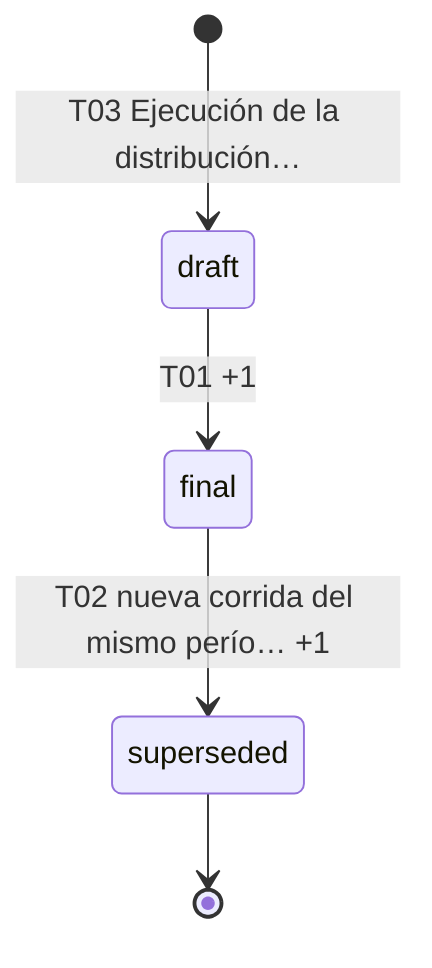

| # | Desde | Hasta | Disparador | Tipo | Guardas | Evento emitido |
|---|---|---|---|---|---|---|
| T01 | `draft` | `final` | — | no especificado | — | — |
| T02 | `final` | `superseded` | nueva corrida del mismo período | no especificado | — | — |
| T03 | (nuevo) | `draft` | Ejecución de la distribución del período / — | no especificado | RN-CON-077 | — |
| T04 | `draft` | `final` | Confirmación de la corrida / — | no especificado | RN-CON-077 (total distribuido = importe asignado) | — |
| T05 | `final` | `superseded` | Nueva corrida del mismo período / — | no especificado | — | — |

### EST-CON-15 — `simulationScenarios.status` (COL-CON-22)

**Colección:** Escenarios de simulación. **Campos de estado en el §7:** `status` (línea 994; valores: `draft`, `running`, `completed`, `failed`, `archived`).

**Fuente:** M15 §8.8, M15 §8.11.4.

```mermaid
stateDiagram-v2
    draft --> running : T01 +1
    running --> completed : T02 con comparable verdadero o fa… +1
    completed --> running : T03 re-ejecución +1
    [*] --> draft : T05 Creación del escenario / —
    running --> failed : T08 Error de la simulación / —
    note left of archived : T04 desde cualquier estado previsto
    note left of archived : T10 desde cualquier estado previsto
    archived --> [*]
    failed --> [*]
```

| # | Desde | Hasta | Disparador | Tipo | Guardas | Evento emitido |
|---|---|---|---|---|---|---|
| T01 | `draft` | `running` | — | no especificado | — | — |
| T02 | `running` | `completed` | con comparable verdadero o falso | no especificado | — | — |
| T03 | `completed` | `running` | re-ejecución | no especificado | — | — |
| T04 | cualquiera | `archived` | — | no especificado | — | — |
| T05 | (nuevo) | `draft` | Creación del escenario / — | no especificado | — | — |
| T06 | `draft` | `running` | Ejecución de la simulación / — | no especificado | — | — |
| T07 | `running` | `completed` | Fin de la simulación (con `comparable` verdadero o falso) / EVT-CON-16 `con.simulation.completed` | evento | RN-CON-088 | — |
| T08 | `running` | `failed` | Error de la simulación / — | no especificado | — | — |
| T09 | `completed` | `running` | Re-ejecución / — | no especificado | — | — |
| T10 | cualquiera | `archived` | Archivo del escenario / — | no especificado | — | — |

### EST-CON-16 — `budgets.status` (COL-CON-26)

**Colección:** Presupuestos. **Campos de estado en el §7:** `status` (línea 1052; valores: `draft`, `submitted`, `approved`, `active`, `closed`, `superseded`).

**Fuente:** M15 §8.9.

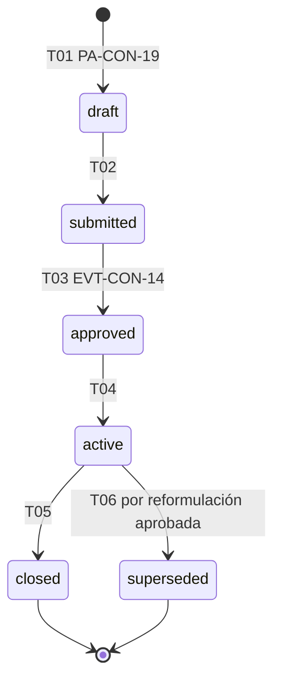

| # | Desde | Hasta | Disparador | Tipo | Guardas | Evento emitido |
|---|---|---|---|---|---|---|
| T01 | (nuevo) | `draft` | PA-CON-19 | no especificado | — | — |
| T02 | `draft` | `submitted` | — | no especificado | — | — |
| T03 | `submitted` | `approved` | — | no especificado | — | EVT-CON-14 `con.budget.approved` (inferido por nombre) |
| T04 | `approved` | `active` | — | no especificado | — | — |
| T05 | `active` | `closed` | — | no especificado | — | — |
| T06 | `active` | `superseded` | por reformulación aprobada | no especificado | — | — |

### EST-CON-17 — `commitments.status` (COL-CON-28)

**Colección:** Compromisos presupuestarios. **Campos de estado en el §7:** `status` (línea 1093; valores: `open`, `partiallyAccrued`, `accrued`, `released`, `cancelled`).

**Fuente:** M15 §8.9, M15 §8.11.5.

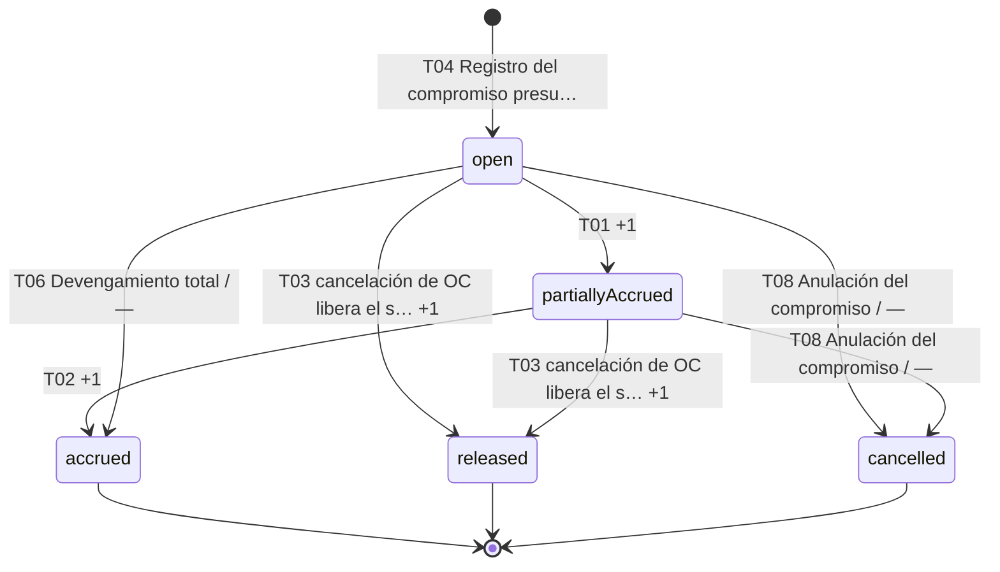

| # | Desde | Hasta | Disparador | Tipo | Guardas | Evento emitido |
|---|---|---|---|---|---|---|
| T01 | `open` | `partiallyAccrued` | — | no especificado | — | — |
| T02 | `partiallyAccrued` | `accrued` | — | no especificado | — | — |
| T03 | `open`, `partiallyAccrued` | `released` | cancelación de OC: libera el saldo no devengado | no especificado | — | — |
| T04 | (nuevo) | `open` | Registro del compromiso presupuestario / — | no especificado | RN-CON-115 (sin asiento oficial) | — |
| T05 | `open` | `partiallyAccrued` | Devengamiento parcial / — | no especificado | RN-CON-103 | — |
| T06 | `open`, `partiallyAccrued` | `accrued` | Devengamiento total / — | no especificado | RN-CON-103 | — |
| T07 | `open`, `partiallyAccrued` | `released` | Cancelación de la OC (libera el saldo no devengado) / — | no especificado | RN-CON-103 | — |
| T08 | `open`, `partiallyAccrued` | `cancelled` | Anulación del compromiso / — | no especificado | — | — |

### EST-CON-18 — `inflationAdjustmentRuns.status` (COL-CON-31)

**Colección:** Ajuste por inflación contable. **Campos de estado en el §7:** `status` (línea 1106; valores: `preview`, `posted`, `reversed`).

**Fuente:** M15 §8.7, M15 §8.11.2.

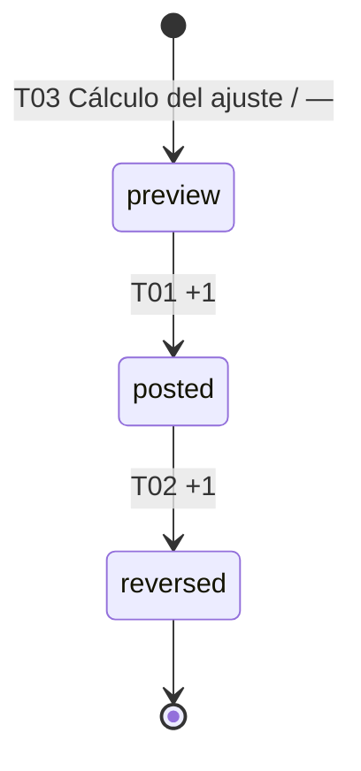

| # | Desde | Hasta | Disparador | Tipo | Guardas | Evento emitido |
|---|---|---|---|---|---|---|
| T01 | `preview` | `posted` | — | no especificado | — | — |
| T02 | `posted` | `reversed` | — | no especificado | — | — |
| T03 | (nuevo) | `preview` | Cálculo del ajuste / — | no especificado | RN-CON-100 | — |
| T04 | `preview` | `posted` | Contabilización del asiento de ajuste / EVT-CON-12 `con.inflationAdjustment.posted` | evento | RN-CON-100 | — |
| T05 | `posted` | `reversed` | Reversión del ajuste (contraasiento) `[VERIFICAR]` / EVT-CON-02 `con.entry.reversed` | evento | — | — |

### EST-CON-19 — `reconciliationRuns.status` (COL-CON-32)

**Colección:** Conciliación contable con auxiliares. **Campos de estado en el §7:** `status` (línea 1132; valores: `running`, `balanced`, `withDifferences`, `explained`, `closed`).

**Fuente:** M15 §8.10.

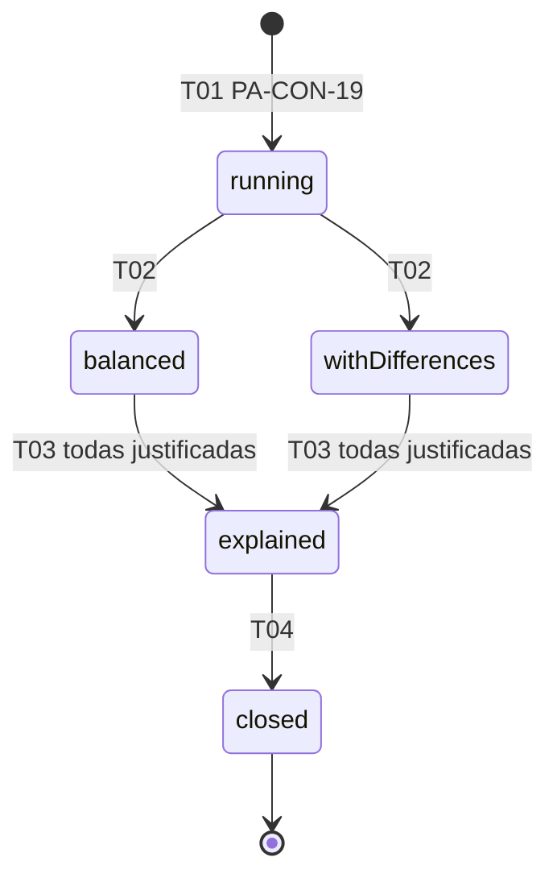

| # | Desde | Hasta | Disparador | Tipo | Guardas | Evento emitido |
|---|---|---|---|---|---|---|
| T01 | (nuevo) | `running` | PA-CON-19 | no especificado | — | — |
| T02 | `running` | `balanced`, `withDifferences` | — | no especificado | — | — |
| T03 | `balanced`, `withDifferences` | `explained` | todas justificadas | no especificado | — | — |
| T04 | `explained` | `closed` | — | no especificado | — | — |

### EST-CON-20 — `rubricatedBooks.status` (COL-CON-33)

**Colección:** Libros rubricados. **Campos de estado en el §7:** `status` (línea 1148; valores: `active`, `exhausted`, `closed`).

**Fuente:** M15 §8.11.6.

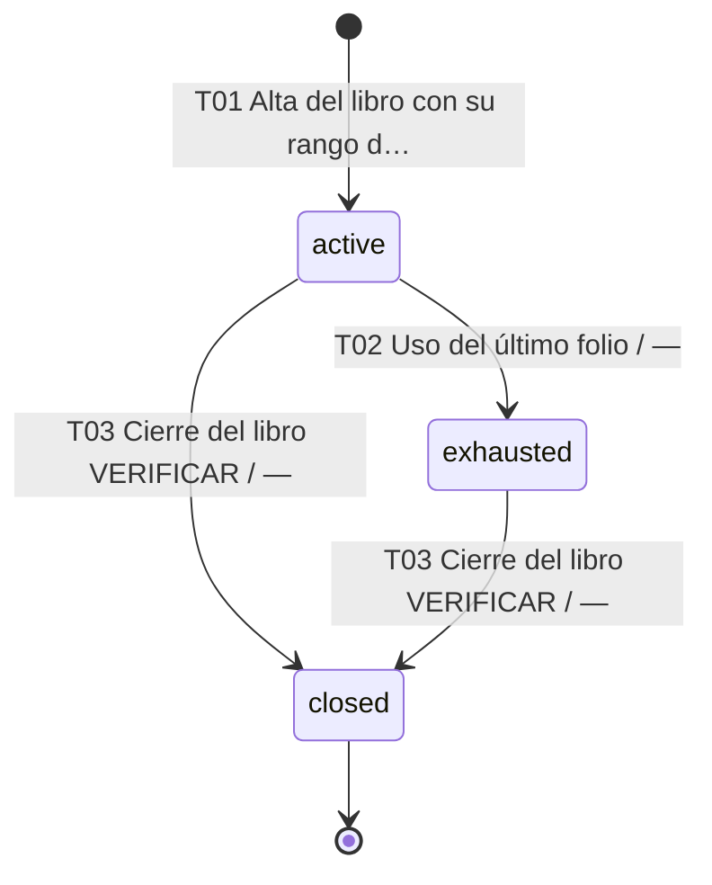

| # | Desde | Hasta | Disparador | Tipo | Guardas | Evento emitido |
|---|---|---|---|---|---|---|
| T01 | (nuevo) | `active` | Alta del libro con su rango de folios / — | no especificado | RN-CON-102 | — |
| T02 | `active` | `exhausted` | Uso del último folio / — | no especificado | RN-CON-102 | — |
| T03 | `active`, `exhausted` | `closed` | Cierre del libro `[VERIFICAR]` / — | no especificado | — | — |

### EST-CON-21 — `financialStatementRuns.status` (COL-CON-35)

**Colección:** Emisión de estados contables. **Campos de estado en el §7:** `status` (línea 1152; valores: `draft`, `approved`, `issued`).

**Fuente:** M15 §8.7, M15 §8.11.3.

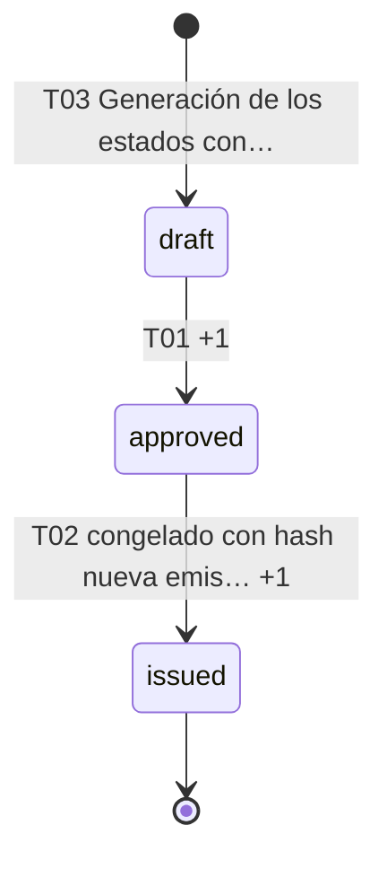

| # | Desde | Hasta | Disparador | Tipo | Guardas | Evento emitido |
|---|---|---|---|---|---|---|
| T01 | `draft` | `approved` | — | no especificado | — | — |
| T02 | `approved` | `issued` | congelado con hash nueva emisión nueva corrida | no especificado | — | — |
| T03 | (nuevo) | `draft` | Generación de los estados contables / — | no especificado | — | — |
| T04 | `draft` | `approved` | Aprobación del consejo / — | usuario | — | — |
| T05 | `approved` | `issued` | Emisión (valores congelados con `hash`); una nueva emisión es una nueva corrida / EVT-CON-18 `con.statements.issued` | evento | — | — |

### EST-CON-22 — `externalLedgerTransfers.status` (COL-CON-37)

**Colección:** Exportación/importación con contabilidad externa (convivencia DEC-069). **Campos de estado en el §7:** `status` (línea 1182; valores: `running`, `completed`, `failed`, `partially`).

**Fuente:** M15 §8.11.7.

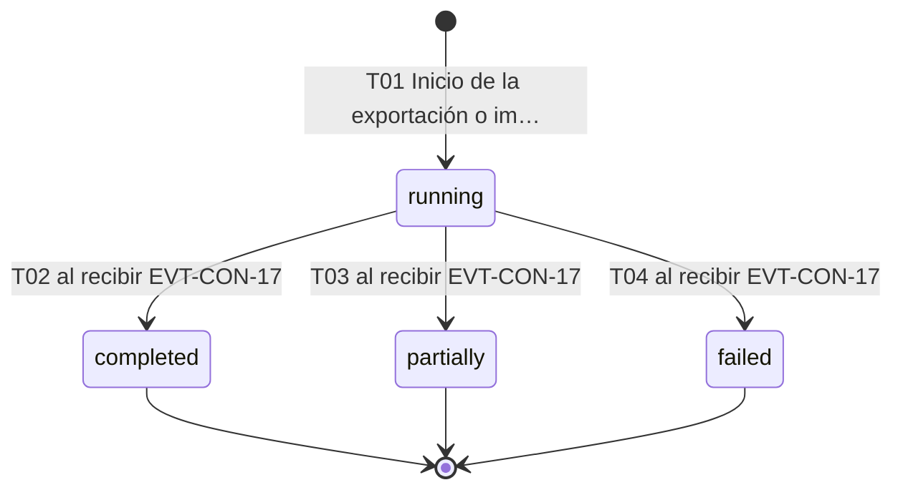

| # | Desde | Hasta | Disparador | Tipo | Guardas | Evento emitido |
|---|---|---|---|---|---|---|
| T01 | (nuevo) | `running` | Inicio de la exportación o importación / — | no especificado | — | — |
| T02 | `running` | `completed` | Fin sin errores / EVT-CON-17 `con.export.completed` | evento | — | — |
| T03 | `running` | `partially` | Fin con errores en parte de los asientos / EVT-CON-17 `con.export.completed` `[VERIFICAR]` | evento | — | — |
| T04 | `running` | `failed` | Error que impide la transferencia / EVT-CON-17 `con.export.failed` | evento | — | — |

### EST-CON-23 — `costCenterModels.status` (COL-CON-39)

**Colección:** Modelos de centro de costo: reparto fijo (`splits`) o delegado en `distributionModels` (agregada el 5-11-2026 por PA-CON-18 de M15, §7.19.1). **Campos de estado en el §7:** `status` (línea 949; valores: `active`, `inactive`).

**Fuente:** el §8 del anexo no detalla esta colección; se aplica el patrón general de T05 §7.1.5 (estados, baja lógica) y T04 §8.3 (registros maestros) sobre los valores del §7.

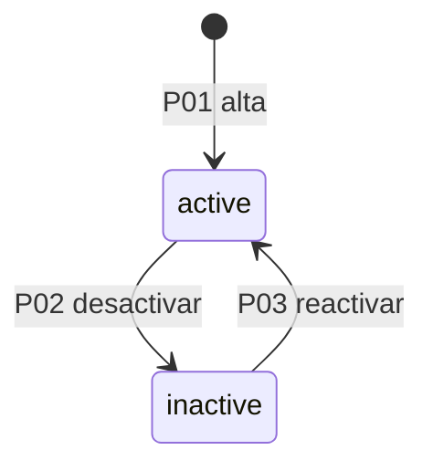

| # | Desde | Hasta | Disparador | Tipo | Guardas | Evento emitido |
|---|---|---|---|---|---|---|
| P01 | (nuevo) | `active` | Alta del registro (operador, importación o plataforma) | usuario, sistema | Validación del esquema (T04 §8.3) | — |
| P02 | `active` | `inactive` | Operador | usuario | Si está referenciado se informa el conteo; no se borra (T05 §7.1.5) | — |
| P03 | `inactive` | `active` | Operador | usuario | — | — |

## M16 — SUE Personal y sueldos

### EST-SUE-01 — `employees.status` (COL-SUE-02)

**Colección:** Legajos. **Campos de estado en el §7:** `status` (línea 578; valores: `preHire`, `active`, `onLeave`, `suspended`, `terminated`).

**Fuente:** M16 §8.1.

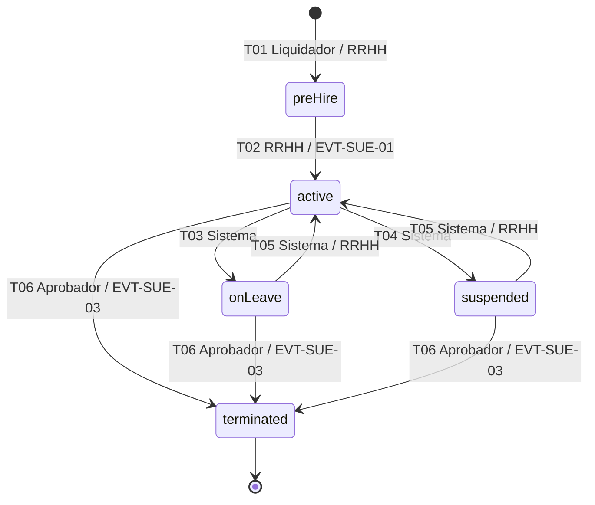

| # | Desde | Hasta | Disparador | Tipo | Guardas | Evento emitido |
|---|---|---|---|---|---|---|
| T01 | (nuevo) | `preHire` | Liquidador / RRHH | usuario | Persona válida en M01 | — |
| T02 | `preHire` | `active` | RRHH | no especificado | Fecha de ingreso, empresa, modalidad, situación de revista, constancia de alta registrada (advertencia) | EVT-SUE-01 `sue.employee.hired` |
| T03 | `active` | `onLeave` | Sistema | sistema | Licencia aprobada de causa con reserva de puesto o > N días | — |
| T04 | `active` | `suspended` | Sistema | sistema | Sanción de suspensión notificada | — |
| T05 | `onLeave`, `suspended` | `active` | Sistema / RRHH | sistema | Fin de licencia o suspensión | — |
| T06 | `active`, `onLeave`, `suspended` | `terminated` | Aprobador | usuario | Egreso aprobado (§8.9) | EVT-SUE-03 `sue.employee.terminated` |

### EST-SUE-02 — `employeePayAccounts.status` (COL-SUE-06)

**Colección:** Cuentas de cobro (CBU cifrado). **Campos de estado en el §7:** `status` (línea 640; valores: `active`, `inactive`).

**Fuente:** M16 §8.12.7.

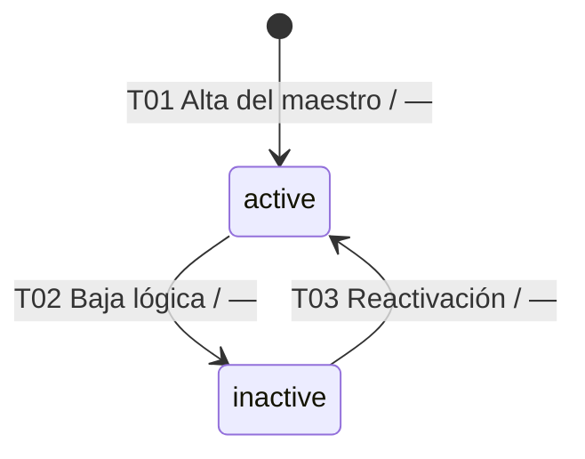

| # | Desde | Hasta | Disparador | Tipo | Guardas | Evento emitido |
|---|---|---|---|---|---|---|
| T01 | (nuevo) | `active` | Alta del maestro / — | no especificado | — | — |
| T02 | `active` | `inactive` | Baja lógica / — | no especificado | — | — |
| T03 | `inactive` | `active` | Reactivación / — | no especificado | — | — |

### EST-SUE-03 — `employeeDocuments.status` (COL-SUE-07)

**Colección:** Documentación del legajo. **Campos de estado en el §7:** `status` (línea 665; valores: `pending`, `authorized`, `rejected`, `expired`).

**Fuente:** M16 §8.12.1.

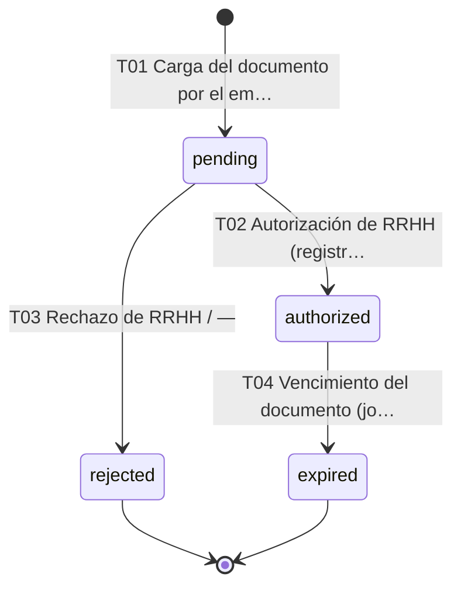

| # | Desde | Hasta | Disparador | Tipo | Guardas | Evento emitido |
|---|---|---|---|---|---|---|
| T01 | (nuevo) | `pending` | Carga del documento por el empleado o RRHH / — | usuario | RN-SUE-008 | — |
| T02 | `pending` | `authorized` | Autorización de RRHH (registra vencimiento) / — | job, usuario | RN-SUE-008 | — |
| T03 | `pending` | `rejected` | Rechazo de RRHH / — | no especificado | RN-SUE-008 | — |
| T04 | `authorized` | `expired` | Vencimiento del documento (job) `[VERIFICAR]` / — | job | — | — |

### EST-SUE-04 — `shifts.status` (COL-SUE-10)

**Colección:** Turnos de trabajo. **Campos de estado en el §7:** `status` (línea 725; valores: `active`, `inactive`).

**Fuente:** M16 §8.12.11.

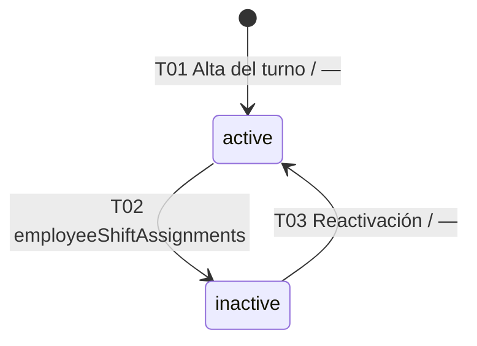

| # | Desde | Hasta | Disparador | Tipo | Guardas | Evento emitido |
|---|---|---|---|---|---|---|
| T01 | (nuevo) | `active` | Alta del turno / — | no especificado | — | — |
| T02 | `active` | `inactive` | Baja lógica (sin asignaciones vigentes en `employeeShiftAssignments`) / — | no especificado | — | — |
| T03 | `inactive` | `active` | Reactivación / — | no especificado | — | — |

### EST-SUE-05 — `deductionPlans.status` (COL-SUE-16)

**Colección:** Descuentos en cuotas (préstamos, embargos). **Campos de estado en el §7:** `status` (línea 789; valores: `active`, `suspended`, `completed`, `cancelled`).

**Fuente:** M16 §8.12.2.

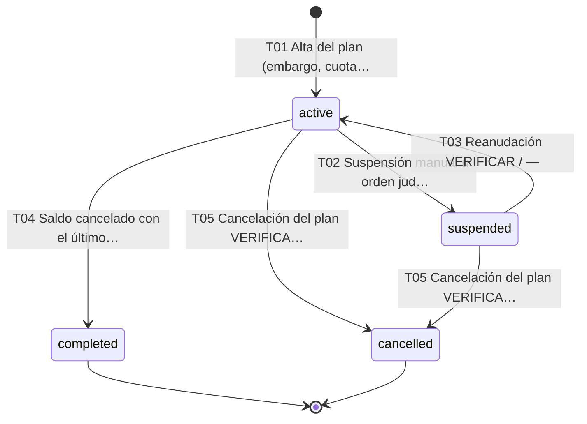

| # | Desde | Hasta | Disparador | Tipo | Guardas | Evento emitido |
|---|---|---|---|---|---|---|
| T01 | (nuevo) | `active` | Alta del plan (embargo, cuota, préstamo) / — | no especificado | RN-SUE-063 (tope de deducciones voluntarias) | — |
| T02 | `active` | `suspended` | Suspensión manual u orden judicial `[VERIFICAR]` / — | no especificado | — | — |
| T03 | `suspended` | `active` | Reanudación `[VERIFICAR]` / — | no especificado | — | — |
| T04 | `active` | `completed` | Saldo cancelado con el último recibo / — | no especificado | — | — |
| T05 | `active`, `suspended` | `cancelled` | Cancelación del plan `[VERIFICAR]` / — | no especificado | — | — |

### EST-SUE-06 — `unions.status` (COL-SUE-17)

**Colección:** Sindicatos. **Campos de estado en el §7:** `status` (línea 814; valores: `active`, `inactive`).

**Fuente:** el §8 del anexo no detalla esta colección; se aplica el patrón general de T05 §7.1.5 (estados, baja lógica) y T04 §8.3 (registros maestros) sobre los valores del §7.


| # | Desde | Hasta | Disparador | Tipo | Guardas | Evento emitido |
|---|---|---|---|---|---|---|
| P01 | (nuevo) | `active` | Alta del registro (operador, importación o plataforma) | usuario, sistema | Validación del esquema (T04 §8.3) | — |
| P02 | `active` | `inactive` | Operador | usuario | Si está referenciado se informa el conteo; no se borra (T05 §7.1.5) | — |
| P03 | `inactive` | `active` | Operador | usuario | — | — |

### EST-SUE-07 — `laborAgreements.status` (COL-SUE-18)

**Colección:** Convenios colectivos. **Campos de estado en el §7:** `status` (línea 856; valores: `draft`, `published`, `retired`).

**Fuente:** el §8 del anexo no detalla esta colección; se aplica el patrón general de T05 §7.1.5 (versiones publicadas) sobre los valores del §7.

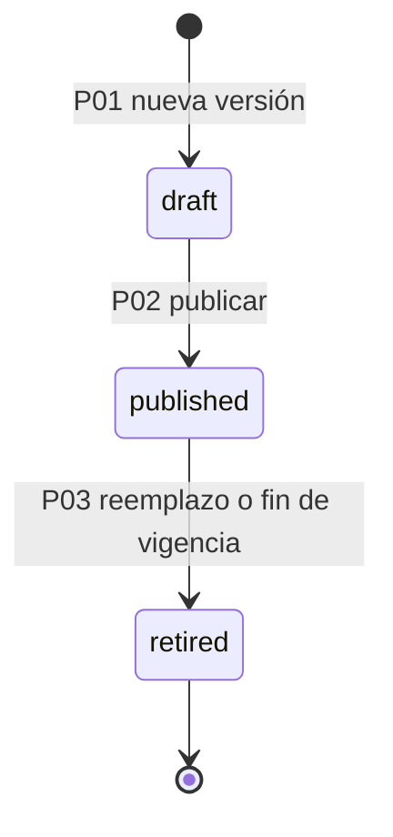

| # | Desde | Hasta | Disparador | Tipo | Guardas | Evento emitido |
|---|---|---|---|---|---|---|
| P01 | (nuevo) | `draft` | Configurador | usuario | — | — |
| P02 | `draft` | `published` | Configurador o aprobador | usuario | Versión validada; publicada queda inmutable (T05 §7.1.5) | — |
| P03 | `published` | `retired` | Sistema al publicar la sucesora o configurador | sistema, usuario | Existe versión sucesora o fin de vigencia | — |

### EST-SUE-08 — `salaryCategories.status` (COL-SUE-19)

**Colección:** Categorías salariales. **Campos de estado en el §7:** `status` (línea 860; valores: `active`, `inactive`).

**Fuente:** el §8 del anexo no detalla esta colección; se aplica el patrón general de T05 §7.1.5 (estados, baja lógica) y T04 §8.3 (registros maestros) sobre los valores del §7.


| # | Desde | Hasta | Disparador | Tipo | Guardas | Evento emitido |
|---|---|---|---|---|---|---|
| P01 | (nuevo) | `active` | Alta del registro (operador, importación o plataforma) | usuario, sistema | Validación del esquema (T04 §8.3) | — |
| P02 | `active` | `inactive` | Operador | usuario | Si está referenciado se informa el conteo; no se borra (T05 §7.1.5) | — |
| P03 | `inactive` | `active` | Operador | usuario | — | — |

### EST-SUE-09 — `salaryScales.status` (COL-SUE-20)

**Colección:** Escalas salariales. **Campos de estado en el §7:** `status` (línea 860; valores: `draft`, `approved`, `published`, `superseded`).

**Máquina compartida.** El §8 del anexo define una sola máquina para este grupo de colecciones; rige la de `payrollConfigVersions` (ver su diagrama en esta parte). Valores del §7: `draft`, `approved`, `published`, `superseded`.

### EST-SUE-10 — `healthInsurerAdoptions.status` (COL-SUE-24)

**Colección:** Obras sociales adoptadas (catálogo oficial en `payrollOfficialCodes`). **Campos de estado en el §7:** `status` (línea 932; valores: `active`, `inactive`).

**Fuente:** el §8 del anexo no detalla esta colección; se aplica el patrón general de T05 §7.1.5 (estados, baja lógica) y T04 §8.3 (registros maestros) sobre los valores del §7.


| # | Desde | Hasta | Disparador | Tipo | Guardas | Evento emitido |
|---|---|---|---|---|---|---|
| P01 | (nuevo) | `active` | Alta del registro (operador, importación o plataforma) | usuario, sistema | Validación del esquema (T04 §8.3) | — |
| P02 | `active` | `inactive` | Operador | usuario | Si está referenciado se informa el conteo; no se borra (T05 §7.1.5) | — |
| P03 | `inactive` | `active` | Operador | usuario | — | — |

### EST-SUE-11 — `payrollVariables.status` (COL-SUE-26)

**Colección:** Variables de liquidación. **Campos de estado en el §7:** `status` (línea 960; valores: `active`, `inactive`).

**Fuente:** el §8 del anexo no detalla esta colección; se aplica el patrón general de T05 §7.1.5 (estados, baja lógica) y T04 §8.3 (registros maestros) sobre los valores del §7.


| # | Desde | Hasta | Disparador | Tipo | Guardas | Evento emitido |
|---|---|---|---|---|---|---|
| P01 | (nuevo) | `active` | Alta del registro (operador, importación o plataforma) | usuario, sistema | Validación del esquema (T04 §8.3) | — |
| P02 | `active` | `inactive` | Operador | usuario | Si está referenciado se informa el conteo; no se borra (T05 §7.1.5) | — |
| P03 | `inactive` | `active` | Operador | usuario | — | — |

### EST-SUE-12 — `payrollConcepts.status` (COL-SUE-27)

**Colección:** Conceptos de liquidación. **Campos de estado en el §7:** `status` (línea 999; valores: `draft`, `published`, `retired`).

**Fuente:** el §8 del anexo no detalla esta colección; se aplica el patrón general de T05 §7.1.5 (versiones publicadas) sobre los valores del §7.

```mermaid
stateDiagram-v2
    [*] --> draft : P01 nueva versión
    draft --> published : P02 publicar
    published --> retired : P03 reemplazo o fin de vigencia
    retired --> [*]
```

| # | Desde | Hasta | Disparador | Tipo | Guardas | Evento emitido |
|---|---|---|---|---|---|---|
| P01 | (nuevo) | `draft` | Configurador | usuario | — | — |
| P02 | `draft` | `published` | Configurador o aprobador | usuario | Versión validada; publicada queda inmutable (T05 §7.1.5) | — |
| P03 | `published` | `retired` | Sistema al publicar la sucesora o configurador | sistema, usuario | Existe versión sucesora o fin de vigencia | — |

### EST-SUE-13 — `payrollTypes.status` (COL-SUE-28)

**Colección:** Tipos de liquidación. **Campos de estado en el §7:** `status` (línea 1005; valores: `active`, `inactive`).

**Fuente:** el §8 del anexo no detalla esta colección; se aplica el patrón general de T05 §7.1.5 (estados, baja lógica) y T04 §8.3 (registros maestros) sobre los valores del §7.

```mermaid
stateDiagram-v2
    [*] --> active : P01 alta
    active --> inactive : P02 desactivar
    inactive --> active : P03 reactivar
```

| # | Desde | Hasta | Disparador | Tipo | Guardas | Evento emitido |
|---|---|---|---|---|---|---|
| P01 | (nuevo) | `active` | Alta del registro (operador, importación o plataforma) | usuario, sistema | Validación del esquema (T04 §8.3) | — |
| P02 | `active` | `inactive` | Operador | usuario | Si está referenciado se informa el conteo; no se borra (T05 §7.1.5) | — |
| P03 | `inactive` | `active` | Operador | usuario | — | — |

### EST-SUE-14 — `payrollConfigVersions.status` (COL-SUE-29)

**Colección:** Versiones publicadas de configuración. **Campos de estado en el §7:** `status` (línea 1027; valores: `draft`, `inReview`, `published`, `superseded`, `discarded`).

**Fuente:** M16 §8.2.

```mermaid
stateDiagram-v2
    draft --> inReview : T01 Configurador
    inReview --> published : T02 Aprobador (≠ autor) / EVT-SUE-05
    inReview --> draft : T03 Aprobador
    draft --> discarded : T04 Configurador
    published --> superseded : T05 Sistema
    [*] --> draft : T06 PA-SUE-18
    discarded --> [*]
    superseded --> [*]
```

| # | Desde | Hasta | Disparador | Tipo | Guardas | Evento emitido |
|---|---|---|---|---|---|---|
| T01 | `draft` | `inReview` | Configurador | no especificado | Validación sin errores; simulación ejecutada | — |
| T02 | `inReview` | `published` | Aprobador (≠ autor) | usuario | Diferencias revisadas; convenio validado | EVT-SUE-05 `sue.payrollConfig.published` |
| T03 | `inReview` | `draft` | Aprobador | usuario | — | — |
| T04 | `draft` | `discarded` | Configurador | no especificado | — | — |
| T05 | `published` | `superseded` | Sistema | sistema | Publicación de una versión nueva con `effectiveFrom` | — |
| T06 | (nuevo) | `draft` | PA-SUE-18 | no especificado | — | — |

### EST-SUE-15 — `noveltyTypes.status` (COL-SUE-30)

**Colección:** Tipos de novedad. **Campos de estado en el §7:** `status` (línea 1049; valores: `active`, `inactive`).

**Fuente:** el §8 del anexo no detalla esta colección; se aplica el patrón general de T05 §7.1.5 (estados, baja lógica) y T04 §8.3 (registros maestros) sobre los valores del §7.

```mermaid
stateDiagram-v2
    [*] --> active : P01 alta
    active --> inactive : P02 desactivar
    inactive --> active : P03 reactivar
```

| # | Desde | Hasta | Disparador | Tipo | Guardas | Evento emitido |
|---|---|---|---|---|---|---|
| P01 | (nuevo) | `active` | Alta del registro (operador, importación o plataforma) | usuario, sistema | Validación del esquema (T04 §8.3) | — |
| P02 | `active` | `inactive` | Operador | usuario | Si está referenciado se informa el conteo; no se borra (T05 §7.1.5) | — |
| P03 | `inactive` | `active` | Operador | usuario | — | — |

### EST-SUE-16 — `novelties.status` (COL-SUE-31)

**Colección:** Novedades. **Campos de estado en el §7:** `status` (línea 1085; valores: `draft`, `pendingApproval`, `approved`, `rejected`, `settled`, `voided`).

**Fuente:** M16 §8.4.

```mermaid
stateDiagram-v2
    [*] --> draft : T01 Liquidador / importación
    draft --> pendingApproval : T02 Liquidador
    draft --> approved : T03 Encargado / liquidador / EVT-SUE-07
    pendingApproval --> approved : T03 Encargado / liquidador / EVT-SUE-07
    pendingApproval --> rejected : T04 Encargado
    approved --> settled : T05 Sistema
    approved --> voided : T06 Liquidador
    draft --> voided : T06 Liquidador
    rejected --> [*]
    settled --> [*]
    voided --> [*]
```

| # | Desde | Hasta | Disparador | Tipo | Guardas | Evento emitido |
|---|---|---|---|---|---|---|
| T01 | (nuevo) | `draft` | Liquidador / importación | usuario | Período abierto | — |
| T02 | `draft` | `pendingApproval` | Liquidador | usuario | Tipo requiere aprobación | — |
| T03 | `draft`, `pendingApproval` | `approved` | Encargado / liquidador | usuario | Tope anual no superado | EVT-SUE-07 `sue.novelty.approved` (inferido por nombre) |
| T04 | `pendingApproval` | `rejected` | Encargado | no especificado | Motivo | — |
| T05 | `approved` | `settled` | Sistema | sistema | Recibo aprobado | — |
| T06 | `approved`, `draft` | `voided` | Liquidador | usuario | No liquidada | — |

### EST-SUE-17 — `noveltyImportBatches.status` (COL-SUE-32)

**Colección:** Lotes de importación de novedades. **Campos de estado en el §7:** `status` (línea 1109; valores: `uploaded`, `validated`, `confirmed`, `failed`).

**Fuente:** M16 §8.12.13.

```mermaid
stateDiagram-v2
    [*] --> uploaded : T01 Carga del archivo o recepción…
    uploaded --> validated : T02 accepted
    validated --> confirmed : T03 Confirmación crea las novedad…
    uploaded --> failed : T04 Error del job o rechazo total…
    validated --> failed : T04 Error del job o rechazo total…
    confirmed --> [*]
    failed --> [*]
```

| # | Desde | Hasta | Disparador | Tipo | Guardas | Evento emitido |
|---|---|---|---|---|---|---|
| T01 | (nuevo) | `uploaded` | Carga del archivo o recepción del origen / — | no especificado | `fileHash` no repetido | — |
| T02 | `uploaded` | `validated` | Validación de filas (`accepted`, `rejected`, `errors[]`) / — | no especificado | — | — |
| T03 | `validated` | `confirmed` | Confirmación: crea las novedades aceptadas / — | no especificado | Período abierto | — |
| T04 | `uploaded`, `validated` | `failed` | Error del job o rechazo total / — | job | — | — |

### EST-SUE-18 — `extraTasks.status` (COL-SUE-34)

**Colección:** Tareas extraordinarias. **Campos de estado en el §7:** `status` (línea 1146; valores: `draft`, `confirmed`, `voided`).

**Fuente:** M16 §8.12.12.

```mermaid
stateDiagram-v2
    [*] --> draft : T01 Registro de la tarea (manual…
    draft --> confirmed : T02 noveltyIds
    draft --> voided : T03 Descarte / —
    confirmed --> voided : T04 Anulación anula las novedades…
    voided --> [*]
```

| # | Desde | Hasta | Disparador | Tipo | Guardas | Evento emitido |
|---|---|---|---|---|---|---|
| T01 | (nuevo) | `draft` | Registro de la tarea (manual o desde la OT) / — | no especificado | — | — |
| T02 | `draft` | `confirmed` | Confirmación: genera las novedades de `noveltyIds` / — | no especificado | — | — |
| T03 | `draft` | `voided` | Descarte / — | no especificado | — | — |
| T04 | `confirmed` | `voided` | Anulación; anula las novedades no liquidadas / — | no especificado | Novedades sin liquidar | — |

### EST-SUE-19 — `leaveCauses.status` (COL-SUE-35)

**Colección:** Causas de licencia. **Campos de estado en el §7:** `status` (línea 837; valores: `draft`, `published`, `retired`).

**Fuente:** el §8 del anexo no detalla esta colección; se aplica el patrón general de T05 §7.1.5 (versiones publicadas) sobre los valores del §7.

```mermaid
stateDiagram-v2
    [*] --> draft : P01 nueva versión
    draft --> published : P02 publicar
    published --> retired : P03 reemplazo o fin de vigencia
    retired --> [*]
```

| # | Desde | Hasta | Disparador | Tipo | Guardas | Evento emitido |
|---|---|---|---|---|---|---|
| P01 | (nuevo) | `draft` | Configurador | usuario | — | — |
| P02 | `draft` | `published` | Configurador o aprobador | usuario | Versión validada; publicada queda inmutable (T05 §7.1.5) | — |
| P03 | `published` | `retired` | Sistema al publicar la sucesora o configurador | sistema, usuario | Existe versión sucesora o fin de vigencia | — |

### EST-SUE-20 — `leaveRequests.status` (COL-SUE-36)

**Colección:** Licencias (diagnóstico nunca en claro). **Campos de estado en el §7:** `status` (línea 1174; valores: `requested`, `approvedBySupervisor`, `approved`, `rejected`, `cancelled`, `interrupted`).

**Fuente:** M16 §8.3.

```mermaid
stateDiagram-v2
    [*] --> requested : T01 Empleado / RRHH
    requested --> approvedBySupervisor : T02 Encargado
    approvedBySupervisor --> approved : T03 Encargado / RRHH / EVT-SUE-08
    requested --> approved : T03 Encargado / RRHH / EVT-SUE-08
    approvedBySupervisor --> rejected : T04 Encargado / RRHH
    requested --> rejected : T04 Encargado / RRHH
    approved --> interrupted : T05 RRHH
    approved --> cancelled : T06 Empleado / RRHH
    approvedBySupervisor --> cancelled : T06 Empleado / RRHH
    requested --> cancelled : T06 Empleado / RRHH
    rejected --> [*]
    interrupted --> [*]
    cancelled --> [*]
```

| # | Desde | Hasta | Disparador | Tipo | Guardas | Evento emitido |
|---|---|---|---|---|---|---|
| T01 | (nuevo) | `requested` | Empleado / RRHH | usuario | Sin superposición; días disponibles | — |
| T02 | `requested` | `approvedBySupervisor` | Encargado | no especificado | Causa con flujo de dos pasos | — |
| T03 | `approvedBySupervisor`, `requested` | `approved` | Encargado / RRHH | no especificado | Sin superposición con autorizadas; días disponibles | EVT-SUE-08 `sue.leave.requested` |
| T04 | `approvedBySupervisor`, `requested` | `rejected` | Encargado / RRHH | no especificado | Causa obligatoria | — |
| T05 | `approved` | `interrupted` | RRHH | no especificado | Licencia en curso (ej. vacaciones interrumpidas por enfermedad) | — |
| T06 | `approved`, `approvedBySupervisor`, `requested` | `cancelled` | Empleado / RRHH | usuario | Antes del inicio de la licencia | — |

### EST-SUE-21 — `payPeriods.status` (COL-SUE-38)

**Colección:** Períodos de liquidación. **Campos de estado en el §7:** `status` (línea 1218; valores: `open`, `inPayroll`, `closed`, `reopened`).

**Fuente:** M16 §8.12.3.

```mermaid
stateDiagram-v2
    [*] --> open : T01 Apertura del período / —
    open --> inPayroll : T02 al recibir EVT-SUE-09
    inPayroll --> closed : T03 al recibir EVT-SUE-13
    closed --> reopened : T04 Reapertura con aprobación ( r…
    reopened --> closed : T05 al recibir EVT-SUE-13
```

| # | Desde | Hasta | Disparador | Tipo | Guardas | Evento emitido |
|---|---|---|---|---|---|---|
| T01 | (nuevo) | `open` | Apertura del período / — | no especificado | — | — |
| T02 | `open` | `inPayroll` | Primera liquidación calculada del período `[VERIFICAR]` / EVT-SUE-09 `sue.payrollRun.calculated` | evento | — | — |
| T03 | `inPayroll` | `closed` | Cierre de las liquidaciones del período / EVT-SUE-13 `sue.payrollRun.closed` | evento | — | — |
| T04 | `closed` | `reopened` | Reapertura con aprobación (`reopenings[].approvalId`) / — | no especificado | — | — |
| T05 | `reopened` | `closed` | Nuevo cierre `[VERIFICAR]` / EVT-SUE-13 `sue.payrollRun.closed` | evento | — | — |

### EST-SUE-22 — `payrollRuns.status` (COL-SUE-39)

**Colección:** Liquidaciones. **Campos de estado en el §7:** `status` (línea 1246; sin valores en el §7).

**Fuente:** M16 §8.5.

```mermaid
stateDiagram-v2
    [*] --> draft : T01 Liquidador
    draft --> calculating : T02 JOB-SUE-01 +1
    calculating --> calculated : T03 Sistema / EVT-SUE-09 +1
    calculated --> pendingApproval : T04 Liquidador
    pendingApproval --> approved : T05 JOB-SUE-03 / EVT-SUE-11
    pendingApproval --> calculated : T06 Aprobador / EVT-SUE-09
    approved --> paymentRequested : T07 Liquidador / tesorero
    paymentRequested --> paid : T08 Sistema (evento M14)
    paymentRequested --> partiallyPaid : T08 Sistema (evento M14)
    paid --> closed : T09 Aprobador / EVT-SUE-13
    approved --> voided : T10 Aprobador / EVT-SUE-12
    calculated --> discarded : T11 Liquidador +1
    draft --> discarded : T11 Liquidador
    partiallyPaid --> [*]
    closed --> [*]
    voided --> [*]
    discarded --> [*]
```

| # | Desde | Hasta | Disparador | Tipo | Guardas | Evento emitido |
|---|---|---|---|---|---|---|
| T01 | (nuevo) | `draft` | Liquidador | usuario | Período abierto o en liquidación | — |
| T02 | `draft` | `calculating` | Liquidador | usuario | Universo definido | — |
| T03 | `calculating` | `calculated` | Sistema | sistema | Todos los empleados procesados (con o sin error marcado) | EVT-SUE-09 `sue.payrollRun.calculated` (inferido por nombre) |
| T04 | `calculated` | `pendingApproval` | Liquidador | usuario | Sin controles bloqueantes; advertencias justificadas | — |
| T05 | `pendingApproval` | `approved` | Aprobador (≠ calculador) | usuario | RN-SUE-065, RN-SUE-066 (RN-SUE-067) | EVT-SUE-11 `sue.payrollRun.approved` |
| T06 | `pendingApproval` | `calculated` | Aprobador | usuario | Observaciones | EVT-SUE-09 `sue.payrollRun.calculated` (inferido por nombre) |
| T07 | `approved` | `paymentRequested` | Liquidador / tesorero | usuario | — | — |
| T08 | `paymentRequested` | `paid`, `partiallyPaid` | Sistema (evento M14) | evento, sistema | Acreditaciones confirmadas | — |
| T09 | `paid` | `closed` | Aprobador | usuario | Presentaciones generadas (RN-SUE-068) | EVT-SUE-13 `sue.payrollRun.closed` (inferido por nombre) |
| T10 | `approved` | `voided` | Aprobador | usuario | Sin pagos confirmados | EVT-SUE-12 `sue.payrollRun.voided` (inferido por nombre) |
| T11 | `calculated`, `draft` | `discarded` | Liquidador | usuario | — | — |
| T12 | `draft` | `calculating` | — | no especificado | — | — |
| T13 | `calculating` | `calculated` | — | no especificado | — | EVT-SUE-09 `sue.payrollRun.calculated` (inferido por nombre) |
| T14 | `calculated` | `discarded` | se purgan a los días PRM-SUE-050 | no especificado | — | — |

### EST-SUE-23 — `payslips.status` (COL-SUE-40)

**Colección:** Recibos de sueldo. **Campos de estado en el §7:** `status` (línea 1276; sin valores en el §7).

**Máquina 1: `status`.** Fuente: M16 §8.6.

```mermaid
stateDiagram-v2
    [*] --> calculated : T01 PA-SUE-18
    calculated --> issued : T02 al aprobar la liquidación PDF… / EVT-SUE-14
    issued --> sentForSignature : T03
    sentForSignature --> signedByEmployer : T04
    signedByEmployer --> delivered : T05
    delivered --> acknowledged : T06 firma o conformidad del emple… / EVT-SUE-15
    acknowledged --> [*]
```

| # | Desde | Hasta | Disparador | Tipo | Guardas | Evento emitido |
|---|---|---|---|---|---|---|
| T01 | (nuevo) | `calculated` | PA-SUE-18 | no especificado | — | — |
| T02 | `calculated` | `issued` | al aprobar la liquidación PDF y numeración | no especificado | — | EVT-SUE-14 `sue.payslip.issued` (inferido por nombre) |
| T03 | `issued` | `sentForSignature` | — | no especificado | — | — |
| T04 | `sentForSignature` | `signedByEmployer` | — | no especificado | — | — |
| T05 | `signedByEmployer` | `delivered` | — | no especificado | — | — |
| T06 | `delivered` | `acknowledged` | firma o conformidad del empleado o acknowledgedWithDisagreement | usuario | — | EVT-SUE-15 `sue.payslip.acknowledged` (inferido por nombre) |

**Máquina 2: `paymentStatus`.** Fuente: M16 §8.6.

```mermaid
stateDiagram-v2
    pending --> sent : T01
    sent --> credited : T02
    sent --> rejected : T02
    acknowledged --> voided : T03 solo por rectificativa replac… / EVT-SUE-16
    delivered --> voided : T03 solo por rectificativa replac… / EVT-SUE-16
    issued --> voided : T03 solo por rectificativa replac… / EVT-SUE-16
    [*] --> pending : T04 PA-SUE-18
    credited --> [*]
    rejected --> [*]
    voided --> [*]
```

| # | Desde | Hasta | Disparador | Tipo | Guardas | Evento emitido |
|---|---|---|---|---|---|---|
| T01 | `pending` | `sent` | — | no especificado | — | — |
| T02 | `sent` | `credited`, `rejected` | — | no especificado | — | — |
| T03 | `acknowledged`, `delivered`, `issued` | `voided` | solo por rectificativa replacedByPayslipId anulación de la liquidación no pagada | no especificado | — | EVT-SUE-16 `sue.payslip.voided` (inferido por nombre) |
| T04 | (nuevo) | `pending` | PA-SUE-18 | no especificado | — | — |

### EST-SUE-24 — `incomeTaxDeclarations.status` (COL-SUE-42)

**Colección:** Formularios del empleado (F.572). **Campos de estado en el §7:** `status` (línea 1307; valores: `imported`, `applied`, `superseded`).

**Fuente:** M16 §8.12.4.

```mermaid
stateDiagram-v2
    [*] --> imported : T01 Importación del F.572 / SIRAD…
    imported --> applied : T02 Uso en el cálculo de Ganancia…
    applied --> superseded : T03 Importación de una presentaci…
    imported --> superseded : T03 Importación de una presentaci…
    superseded --> [*]
```

| # | Desde | Hasta | Disparador | Tipo | Guardas | Evento emitido |
|---|---|---|---|---|---|---|
| T01 | (nuevo) | `imported` | Importación del F.572 / SIRADIG / — | no especificado | RN-SUE-009 | — |
| T02 | `imported` | `applied` | Uso en el cálculo de Ganancias / — | no especificado | — | — |
| T03 | `applied`, `imported` | `superseded` | Importación de una presentación posterior del mismo período / — | no especificado | — | — |

### EST-SUE-25 — `statutoryFilings.status` (COL-SUE-43)

**Colección:** Presentaciones (LSD, F.931). **Campos de estado en el §7:** `status` (línea 1329; valores: `generated`, `approved`, `filed`, `rectified`, `voided`).

**Fuente:** M16 §8.8.

```mermaid
stateDiagram-v2
    [*] --> generated : T01 PA-SUE-18 / EVT-SUE-18
    generated --> approved : T02
    approved --> filed : T03 usuario carga acuse / EVT-SUE-18
    filed --> rectified : T04 se genera una rectificativa q…
    generated --> voided : T05 regenerar antes de aprobar
    rectified --> [*]
    voided --> [*]
```

| # | Desde | Hasta | Disparador | Tipo | Guardas | Evento emitido |
|---|---|---|---|---|---|---|
| T01 | (nuevo) | `generated` | PA-SUE-18 | no especificado | — | EVT-SUE-18 `sue.filing.generated` (inferido por nombre) |
| T02 | `generated` | `approved` | — | no especificado | — | — |
| T03 | `approved` | `filed` | usuario carga acuse | usuario | — | EVT-SUE-18 `sue.filing.filed` (inferido por nombre) |
| T04 | `filed` | `rectified` | se genera una rectificativa que la reemplaza | no especificado | — | — |
| T05 | `generated` | `voided` | regenerar antes de aprobar | no especificado | — | — |

### EST-SUE-26 — `payrollPaymentRequests.status` (COL-SUE-44)

**Colección:** Solicitudes de pago a M14. **Campos de estado en el §7:** `status` (línea 1354; sin valores en el §7).

**Fuente:** M16 §8.7.

```mermaid
stateDiagram-v2
    [*] --> draft : T01 PA-SUE-18
    draft --> submitted : T02 comando idempotente a M14
    submitted --> accepted : T03 M14 generó orden y archivo
    accepted --> partiallySettled : T04
    accepted --> rejected : T04
    accepted --> settled : T04
    accepted --> cancelled : T05 comando de anulación a M14 co… / EVT-SUE-27
    submitted --> cancelled : T05 comando de anulación a M14 co… / EVT-SUE-27
    partiallySettled --> [*]
    rejected --> [*]
    settled --> [*]
    cancelled --> [*]
```

| # | Desde | Hasta | Disparador | Tipo | Guardas | Evento emitido |
|---|---|---|---|---|---|---|
| T01 | (nuevo) | `draft` | PA-SUE-18 | no especificado | — | — |
| T02 | `draft` | `submitted` | comando idempotente a M14 | no especificado | — | — |
| T03 | `submitted` | `accepted` | M14 generó orden y archivo | no especificado | — | — |
| T04 | `accepted` | `partiallySettled`, `rejected`, `settled` | — | no especificado | — | — |
| T05 | `accepted`, `submitted` | `cancelled` | comando de anulación a M14 confirmado | no especificado | — | EVT-SUE-27 `sue.paymentRequest.cancelled` (inferido por nombre) |

### EST-SUE-27 — `payrollAccountingRules.status` (COL-SUE-45)

**Colección:** Reglas de asiento de sueldos (resuelven contra `postingRules`). **Campos de estado en el §7:** `status` (línea 1374; valores: `active`, `inactive`).

**Fuente:** el §8 del anexo no detalla esta colección; se aplica el patrón general de T05 §7.1.5 (estados, baja lógica) y T04 §8.3 (registros maestros) sobre los valores del §7.

```mermaid
stateDiagram-v2
    [*] --> active : P01 alta
    active --> inactive : P02 desactivar
    inactive --> active : P03 reactivar
```

| # | Desde | Hasta | Disparador | Tipo | Guardas | Evento emitido |
|---|---|---|---|---|---|---|
| P01 | (nuevo) | `active` | Alta del registro (operador, importación o plataforma) | usuario, sistema | Validación del esquema (T04 §8.3) | — |
| P02 | `active` | `inactive` | Operador | usuario | Si está referenciado se informa el conteo; no se borra (T05 §7.1.5) | — |
| P03 | `inactive` | `active` | Operador | usuario | — | — |

### EST-SUE-28 — `terminations.status` (COL-SUE-46)

**Colección:** Egresos y liquidación final. **Campos de estado en el §7:** `status` (línea 1395; valores: `draft`, `calculated`, `approved`, `settled`, `cancelled`).

**Fuente:** M16 §8.9.

```mermaid
stateDiagram-v2
    [*] --> draft : T01 PA-SUE-18
    draft --> calculated : T02 liquidación final simulada
    calculated --> approved : T03 al recibir EVT-SUE-20 / EVT-SUE-20
    approved --> settled : T04 liquidación final pagada y ce…
    calculated --> cancelled : T05 EVT-SUE-20
    draft --> cancelled : T05 EVT-SUE-20
    settled --> [*]
    cancelled --> [*]
```

| # | Desde | Hasta | Disparador | Tipo | Guardas | Evento emitido |
|---|---|---|---|---|---|---|
| T01 | (nuevo) | `draft` | PA-SUE-18 | no especificado | — | — |
| T02 | `draft` | `calculated` | liquidación final simulada | no especificado | — | — |
| T03 | `calculated` | `approved` | aprobador emite sue.termination.approved legajo terminated en la fecha | evento, usuario | — | EVT-SUE-20 `sue.termination.approved` (inferido por nombre) |
| T04 | `approved` | `settled` | liquidación final pagada y certificados emitidos | no especificado | — | — |
| T05 | `calculated`, `draft` | `cancelled` | — | no especificado | — | EVT-SUE-20 `sue.termination.approved` |

### EST-SUE-29 — `employmentCertificates.status` (COL-SUE-47)

**Colección:** Certificados de trabajo. **Campos de estado en el §7:** `status` (línea 1418; valores: `requested`, `issued`, `delivered`).

**Fuente:** M16 §8.12.5.

```mermaid
stateDiagram-v2
    [*] --> requested : T01 Solicitud del certificado (ar…
    requested --> issued : T02 al recibir EVT-SUE-21 / EVT-SUE-21
    issued --> delivered : T03 delivery
    delivered --> [*]
```

| # | Desde | Hasta | Disparador | Tipo | Guardas | Evento emitido |
|---|---|---|---|---|---|---|
| T01 | (nuevo) | `requested` | Solicitud del certificado (art. 80) / — | no especificado | — | — |
| T02 | `requested` | `issued` | Emisión del certificado / EVT-SUE-21 `sue.certificate.issued` | evento | — | EVT-SUE-21 `sue.certificate.issued` (inferido por nombre) |
| T03 | `issued` | `delivered` | Entrega registrada en `delivery` / — | no especificado | — | — |

### EST-SUE-30 — `payslipNotifications.status` (COL-SUE-48)

**Colección:** Entrega y firma de recibos. **Campos de estado en el §7:** `status` (línea 1437; valores: `sent`, `viewed`, `signed`, `disagreed`).

**Fuente:** M16 §8.12.8.

```mermaid
stateDiagram-v2
    [*] --> sent : T01 Envío de la notificación / —
    sent --> viewed : T02 Apertura por el empleado / —
    sent --> signed : T03 al recibir EVT-SUE-15
    viewed --> signed : T03 al recibir EVT-SUE-15
    sent --> disagreed : T04 note
    viewed --> disagreed : T04 note
    signed --> [*]
    disagreed --> [*]
```

| # | Desde | Hasta | Disparador | Tipo | Guardas | Evento emitido |
|---|---|---|---|---|---|---|
| T01 | (nuevo) | `sent` | Envío de la notificación / — | no especificado | — | — |
| T02 | `sent` | `viewed` | Apertura por el empleado / — | usuario | — | — |
| T03 | `sent`, `viewed` | `signed` | Firma de conformidad / EVT-SUE-15 `sue.payslip.acknowledged` | evento | — | — |
| T04 | `sent`, `viewed` | `disagreed` | Firma en disconformidad con `note` / — | no especificado | — | — |

### EST-SUE-31 — `performanceCycles.status` (COL-SUE-50)

**Colección:** Ciclos de evaluación. **Campos de estado en el §7:** `status` (línea 1458; valores: `planned`, `open`, `calibration`, `closed`).

**Fuente:** M16 §8.11.

```mermaid
stateDiagram-v2
    [*] --> planned : T01 PA-SUE-18
    planned --> open : T02
    open --> calibration : T03
    calibration --> closed : T04
    closed --> [*]
```

| # | Desde | Hasta | Disparador | Tipo | Guardas | Evento emitido |
|---|---|---|---|---|---|---|
| T01 | (nuevo) | `planned` | PA-SUE-18 | no especificado | — | — |
| T02 | `planned` | `open` | — | no especificado | — | — |
| T03 | `open` | `calibration` | — | no especificado | — | — |
| T04 | `calibration` | `closed` | — | no especificado | — | — |

### EST-SUE-32 — `performanceReviews.status` (COL-SUE-51)

**Colección:** Evaluaciones. **Campos de estado en el §7:** `status` (línea 1459; valores: `draft`, `inEvaluation`, `completed`, `acknowledged`).

**Fuente:** M16 §8.12.9.

```mermaid
stateDiagram-v2
    [*] --> draft : T01 Apertura del ciclo para el em…
    draft --> inEvaluation : T02 Primera evaluación enviada / —
    inEvaluation --> completed : T03 feedbackAt
    completed --> acknowledged : T04 Toma de conocimiento del empl…
    acknowledged --> [*]
```

| # | Desde | Hasta | Disparador | Tipo | Guardas | Evento emitido |
|---|---|---|---|---|---|---|
| T01 | (nuevo) | `draft` | Apertura del ciclo para el empleado / — | usuario | — | — |
| T02 | `draft` | `inEvaluation` | Primera evaluación enviada / — | no especificado | — | — |
| T03 | `inEvaluation` | `completed` | Devolución registrada (`feedbackAt`) / — | no especificado | — | — |
| T04 | `completed` | `acknowledged` | Toma de conocimiento del empleado / — | usuario | — | — |

### EST-SUE-33 — `objectives.status` (COL-SUE-52)

**Colección:** Objetivos. **Campos de estado en el §7:** `status` (línea 1460; valores: `draft`, `active`, `closed`, `cancelled`).

**Fuente:** M16 §8.12.10.

```mermaid
stateDiagram-v2
    [*] --> draft : T01 Carga del objetivo / —
    draft --> active : T02 Inicio del ciclo / —
    active --> closed : T03 finalAchievement
    active --> cancelled : T04 Cancelación / —
    draft --> cancelled : T04 Cancelación / —
    closed --> [*]
    cancelled --> [*]
```

| # | Desde | Hasta | Disparador | Tipo | Guardas | Evento emitido |
|---|---|---|---|---|---|---|
| T01 | (nuevo) | `draft` | Carga del objetivo / — | no especificado | — | — |
| T02 | `draft` | `active` | Inicio del ciclo / — | no especificado | — | — |
| T03 | `active` | `closed` | Registro de `finalAchievement` / — | no especificado | — | — |
| T04 | `active`, `draft` | `cancelled` | Cancelación / — | no especificado | — | — |

### EST-SUE-34 — `disciplinaryActions.status` (COL-SUE-53)

**Colección:** Sanciones. **Campos de estado en el §7:** `status` (línea 1461; valores: `draft`, `notified`, `disputed`, `firm`, `annulled`).

**Fuente:** M16 §8.11.

```mermaid
stateDiagram-v2
    [*] --> draft : T01 PA-SUE-18
    draft --> notified : T02
    notified --> disputed : T03
    disputed --> annulled : T04
    disputed --> firm : T04
    annulled --> [*]
    firm --> [*]
```

| # | Desde | Hasta | Disparador | Tipo | Guardas | Evento emitido |
|---|---|---|---|---|---|---|
| T01 | (nuevo) | `draft` | PA-SUE-18 | no especificado | — | — |
| T02 | `draft` | `notified` | — | no especificado | — | — |
| T03 | `notified` | `disputed` | — | no especificado | — | — |
| T04 | `disputed` | `annulled`, `firm` | — | no especificado | — | — |

### EST-SUE-35 — `administrativeInquiries.status` (COL-SUE-54)

**Colección:** Sumarios. **Campos de estado en el §7:** `status` (línea 1462; valores: `open`, `inDefense`, `resolved`, `archived`).

**Fuente:** M16 §8.11.

```mermaid
stateDiagram-v2
    [*] --> open : T01 PA-SUE-18
    open --> inDefense : T02
    inDefense --> resolved : T03
    resolved --> archived : T04
    archived --> [*]
```

| # | Desde | Hasta | Disparador | Tipo | Guardas | Evento emitido |
|---|---|---|---|---|---|---|
| T01 | (nuevo) | `open` | PA-SUE-18 | no especificado | — | — |
| T02 | `open` | `inDefense` | — | no especificado | — | — |
| T03 | `inDefense` | `resolved` | — | no especificado | — | — |
| T04 | `resolved` | `archived` | — | no especificado | — | — |

### EST-SUE-36 — `workAccidents.status` (COL-SUE-55)

**Colección:** Accidentes de trabajo. **Campos de estado en el §7:** `status` (línea 1463; valores: `reported`, `inTreatment`, `discharged`, `closed`, `rejectedByArt`).

**Fuente:** M16 §8.11.

```mermaid
stateDiagram-v2
    [*] --> reported : T01 PA-SUE-18 / EVT-SUE-22
    reported --> inTreatment : T02
    inTreatment --> discharged : T03
    discharged --> closed : T04
    reported --> rejectedByArt : T05 pasa a enfermedad inculpable…
    closed --> [*]
    rejectedByArt --> [*]
```

| # | Desde | Hasta | Disparador | Tipo | Guardas | Evento emitido |
|---|---|---|---|---|---|---|
| T01 | (nuevo) | `reported` | PA-SUE-18 | no especificado | — | EVT-SUE-22 `sue.accident.reported` (inferido por nombre) |
| T02 | `reported` | `inTreatment` | — | no especificado | — | — |
| T03 | `inTreatment` | `discharged` | — | no especificado | — | — |
| T04 | `discharged` | `closed` | — | no especificado | — | — |
| T05 | `reported` | `rejectedByArt` | pasa a enfermedad inculpable si corresponde | no especificado | — | — |

### EST-SUE-37 — `laborLawsuits.status` (COL-SUE-56)

**Colección:** Juicios laborales. **Campos de estado en el §7:** `procedureStatus`, `status` (línea 1584, 1464; valores: `active`, `settled`, `judgment`, `archived`).

**Fuente:** M16 §8.11.

```mermaid
stateDiagram-v2
    [*] --> active : T01 PA-SUE-18
    active --> judgment : T02
    active --> settled : T02
    judgment --> archived : T03
    settled --> archived : T03
    archived --> [*]
```

| # | Desde | Hasta | Disparador | Tipo | Guardas | Evento emitido |
|---|---|---|---|---|---|---|
| T01 | (nuevo) | `active` | PA-SUE-18 | no especificado | — | — |
| T02 | `active` | `judgment`, `settled` | — | no especificado | — | — |
| T03 | `judgment`, `settled` | `archived` | — | no especificado | — | — |

### EST-SUE-38 — `salaryIncreaseBatches.status` (COL-SUE-58)

**Colección:** Aumentos masivos. **Campos de estado en el §7:** `status` (línea 1591; valores: `draft`, `applied`, `discarded`).

**Fuente:** M16 §8.12.6.

```mermaid
stateDiagram-v2
    [*] --> draft : T01 Armado del lote con vista pre…
    draft --> applied : T02 al recibir EVT-SUE-06
    draft --> discarded : T03 Descarte del lote / —
    applied --> [*]
    discarded --> [*]
```

| # | Desde | Hasta | Disparador | Tipo | Guardas | Evento emitido |
|---|---|---|---|---|---|---|
| T01 | (nuevo) | `draft` | Armado del lote con vista previa / — | no especificado | RN-SUE-014 (cálculo sobre el básico puro) | — |
| T02 | `draft` | `applied` | Aplicación (genera la escala `resultingScaleId`) / EVT-SUE-06 `sue.salaryScale.published` `[VERIFICAR]` | evento | RN-SUE-014 | — |
| T03 | `draft` | `discarded` | Descarte del lote / — | no especificado | — | — |

### EST-SUE-39 — `externalPayrollImports.status` (COL-SUE-59)

**Colección:** Liquidaciones de liquidador externo (DEC-058). **Campos de estado en el §7:** `status` (línea 1592; valores: `uploaded`, `validated`, `rejected`, `approved`, `posted`, `paid`, `voided`).

**Fuente:** M16 §8.10.

```mermaid
stateDiagram-v2
    [*] --> uploaded : T01 PA-SUE-18
    uploaded --> rejected : T02 duplicado, total no coincide,…
    uploaded --> validated : T02 duplicado, total no coincide,…
    rejected --> approved : T03 aprobador importador
    validated --> approved : T03 aprobador importador
    approved --> posted : T04 asiento M15 confirmado
    posted --> paid : T05 si se pidió pago
    approved --> voided : T06 con contraasiento si no está…
    posted --> voided : T06 con contraasiento si no está…
    paid --> [*]
    voided --> [*]
```

| # | Desde | Hasta | Disparador | Tipo | Guardas | Evento emitido |
|---|---|---|---|---|---|---|
| T01 | (nuevo) | `uploaded` | PA-SUE-18 | no especificado | — | — |
| T02 | `uploaded` | `rejected`, `validated` | duplicado, total no coincide, centros de costo inexistentes, conceptos sin cuenta | no especificado | — | — |
| T03 | `rejected`, `validated` | `approved` | aprobador importador | usuario | — | — |
| T04 | `approved` | `posted` | asiento M15 confirmado | no especificado | — | — |
| T05 | `posted` | `paid` | si se pidió pago | no especificado | — | — |
| T06 | `approved`, `posted` | `voided` | con contraasiento si no está pagada | no especificado | — | — |

## Cobertura de la parte I

| Módulo | Colección | ID propio | Clasificación | Fuente o motivo |
|---|---|---|---|---|
| M15 | COL-CON-20 `costDistributionRuns` | EST-CON-14 | Diagramada (transiciones del §8) | M15 §8.11.1, M15 §8.7 |
| M15 | COL-CON-22 `simulationScenarios` | EST-CON-15 | Diagramada (transiciones del §8) | M15 §8.11.4, M15 §8.8 |
| M15 | COL-CON-26 `budgets` | EST-CON-16 | Diagramada (transiciones del §8) | M15 §8.9 |
| M15 | COL-CON-28 `commitments` | EST-CON-17 | Diagramada (transiciones del §8) | M15 §8.11.5, M15 §8.9 |
| M15 | COL-CON-31 `inflationAdjustmentRuns` | EST-CON-18 | Diagramada (transiciones del §8) | M15 §8.11.2, M15 §8.7 |
| M15 | COL-CON-32 `reconciliationRuns` | EST-CON-19 | Diagramada (transiciones del §8) | M15 §8.10 |
| M15 | COL-CON-33 `rubricatedBooks` | EST-CON-20 | Diagramada (transiciones del §8) | M15 §8.11.6 |
| M15 | COL-CON-35 `financialStatementRuns` | EST-CON-21 | Diagramada (transiciones del §8) | M15 §8.11.3, M15 §8.7 |
| M15 | COL-CON-37 `externalLedgerTransfers` | EST-CON-22 | Diagramada (transiciones del §8) | M15 §8.11.7 |
| M15 | COL-CON-39 `costCenterModels` | EST-CON-23 | Diagramada (patrón general) | T05 §7.1.5 (estados, baja lógica) y T04 §8.3 (registros maestros) |
| M16 | COL-SUE-02 `employees` | EST-SUE-01 | Diagramada (transiciones del §8) | M16 §8.1 |
| M16 | COL-SUE-06 `employeePayAccounts` | EST-SUE-02 | Diagramada (transiciones del §8) | M16 §8.12.7 |
| M16 | COL-SUE-07 `employeeDocuments` | EST-SUE-03 | Diagramada (transiciones del §8) | M16 §8.12.1 |
| M16 | COL-SUE-10 `shifts` | EST-SUE-04 | Diagramada (transiciones del §8) | M16 §8.12.11 |
| M16 | COL-SUE-16 `deductionPlans` | EST-SUE-05 | Diagramada (transiciones del §8) | M16 §8.12.2 |
| M16 | COL-SUE-17 `unions` | EST-SUE-06 | Diagramada (patrón general) | T05 §7.1.5 (estados, baja lógica) y T04 §8.3 (registros maestros) |
| M16 | COL-SUE-18 `laborAgreements` | EST-SUE-07 | Diagramada (patrón general) | T05 §7.1.5 (versiones publicadas) |
| M16 | COL-SUE-19 `salaryCategories` | EST-SUE-08 | Diagramada (patrón general) | T05 §7.1.5 (estados, baja lógica) y T04 §8.3 (registros maestros) |
| M16 | COL-SUE-20 `salaryScales` | EST-SUE-09 | Diagramada (máquina compartida con `payrollConfigVersions`) | Máquina común del §8 |
| M16 | COL-SUE-24 `healthInsurerAdoptions` | EST-SUE-10 | Diagramada (patrón general) | T05 §7.1.5 (estados, baja lógica) y T04 §8.3 (registros maestros) |
| M16 | COL-SUE-26 `payrollVariables` | EST-SUE-11 | Diagramada (patrón general) | T05 §7.1.5 (estados, baja lógica) y T04 §8.3 (registros maestros) |
| M16 | COL-SUE-27 `payrollConcepts` | EST-SUE-12 | Diagramada (patrón general) | T05 §7.1.5 (versiones publicadas) |
| M16 | COL-SUE-28 `payrollTypes` | EST-SUE-13 | Diagramada (patrón general) | T05 §7.1.5 (estados, baja lógica) y T04 §8.3 (registros maestros) |
| M16 | COL-SUE-29 `payrollConfigVersions` | EST-SUE-14 | Diagramada (transiciones del §8) | M16 §8.2 |
| M16 | COL-SUE-30 `noveltyTypes` | EST-SUE-15 | Diagramada (patrón general) | T05 §7.1.5 (estados, baja lógica) y T04 §8.3 (registros maestros) |
| M16 | COL-SUE-31 `novelties` | EST-SUE-16 | Diagramada (transiciones del §8) | M16 §8.4 |
| M16 | COL-SUE-32 `noveltyImportBatches` | EST-SUE-17 | Diagramada (transiciones del §8) | M16 §8.12.13 |
| M16 | COL-SUE-34 `extraTasks` | EST-SUE-18 | Diagramada (transiciones del §8) | M16 §8.12.12 |
| M16 | COL-SUE-35 `leaveCauses` | EST-SUE-19 | Diagramada (patrón general) | T05 §7.1.5 (versiones publicadas) |
| M16 | COL-SUE-36 `leaveRequests` | EST-SUE-20 | Diagramada (transiciones del §8) | M16 §8.3 |
| M16 | COL-SUE-38 `payPeriods` | EST-SUE-21 | Diagramada (transiciones del §8) | M16 §8.12.3 |
| M16 | COL-SUE-39 `payrollRuns` | EST-SUE-22 | Diagramada (transiciones del §8) | M16 §8.5 |
| M16 | COL-SUE-40 `payslips` | EST-SUE-23 | Diagramada (transiciones del §8) | M16 §8.6 |
| M16 | COL-SUE-42 `incomeTaxDeclarations` | EST-SUE-24 | Diagramada (transiciones del §8) | M16 §8.12.4 |
| M16 | COL-SUE-43 `statutoryFilings` | EST-SUE-25 | Diagramada (transiciones del §8) | M16 §8.8 |
| M16 | COL-SUE-44 `payrollPaymentRequests` | EST-SUE-26 | Diagramada (transiciones del §8) | M16 §8.7 |
| M16 | COL-SUE-45 `payrollAccountingRules` | EST-SUE-27 | Diagramada (patrón general) | T05 §7.1.5 (estados, baja lógica) y T04 §8.3 (registros maestros) |
| M16 | COL-SUE-46 `terminations` | EST-SUE-28 | Diagramada (transiciones del §8) | M16 §8.9 |
| M16 | COL-SUE-47 `employmentCertificates` | EST-SUE-29 | Diagramada (transiciones del §8) | M16 §8.12.5 |
| M16 | COL-SUE-48 `payslipNotifications` | EST-SUE-30 | Diagramada (transiciones del §8) | M16 §8.12.8 |
| M16 | COL-SUE-50 `performanceCycles` | EST-SUE-31 | Diagramada (transiciones del §8) | M16 §8.11 |
| M16 | COL-SUE-51 `performanceReviews` | EST-SUE-32 | Diagramada (transiciones del §8) | M16 §8.12.9 |
| M16 | COL-SUE-52 `objectives` | EST-SUE-33 | Diagramada (transiciones del §8) | M16 §8.12.10 |
| M16 | COL-SUE-53 `disciplinaryActions` | EST-SUE-34 | Diagramada (transiciones del §8) | M16 §8.11 |
| M16 | COL-SUE-54 `administrativeInquiries` | EST-SUE-35 | Diagramada (transiciones del §8) | M16 §8.11 |
| M16 | COL-SUE-55 `workAccidents` | EST-SUE-36 | Diagramada (transiciones del §8) | M16 §8.11 |
| M16 | COL-SUE-56 `laborLawsuits` | EST-SUE-37 | Diagramada (transiciones del §8) | M16 §8.11 |
| M16 | COL-SUE-58 `salaryIncreaseBatches` | EST-SUE-38 | Diagramada (transiciones del §8) | M16 §8.12.6 |
| M16 | COL-SUE-59 `externalPayrollImports` | EST-SUE-39 | Diagramada (transiciones del §8) | M16 §8.10 |
