# GoodApps Cooperativas — Diagramas de estados, parte J (M17-M18)

**Entregable de análisis y diseño — Artefacto 7.4 (diagramas de estados), ampliación a cobertura completa**

| Campo | Valor |
|---|---|
| Documento | `06j-estados-m17-m18.md` |
| Índice del entregable | [`06-secuencias-y-estados.md`](06-secuencias-y-estados.md) (sección 7) y [`06a-indice-cobertura-secuencias-estados.md`](06a-indice-cobertura-secuencias-estados.md) |
| Versión | 1.0 |
| Fecha | 05-11-2026 |
| Estado | Borrador para revisión |
| Fuentes | §7 (modelo de datos) y §8 (estados y transiciones) de los anexos M17, M18; T05 §7 (catálogo de colecciones); T11 §12 (eventos) |
| Generación | Script `_trabajo/gen06_build.py` (extrae de los anexos; revisión manual posterior) |

## 1. Cómo leer esta parte

Cada entidad tiene un identificador propio `EST-<prefijo>-NN`, el nombre de la colección y del campo de estado según T05 y el §7 del anexo dueño, y el ID de colección (`COL-`). Debajo del diagrama, la tabla de transiciones indica:

- **Desde / Hasta:** estados de origen y destino; `(nuevo)` es el alta y `cualquiera` una transición válida desde todo estado no terminal que el anexo habilita.
- **Disparador:** texto del anexo (actor, comando, API, job o evento consumido). **Tipo:** clasificación derivada del texto: `usuario`, `API/integración`, `evento`, `job`, `sistema`.
- **Guardas:** precondición y reglas `RN-` citadas en la fila del §8.
- **Evento emitido:** `EVT-` citado en los efectos; "(inferido por nombre)" cuando el §8 no lo nombra y el catálogo de T11 tiene un evento del mismo agregado cuyo hecho coincide con el estado de destino.

En el diagrama, la etiqueta de cada flecha lleva el número de transición (`T01`…), el disparador principal (API, job, evento o comando) y el evento emitido. "alta (estado inicial no explícito)" marca que el anexo no dice cuál es el estado inicial y se toma el primero del §7 o de la máquina. Clasificación de cobertura: **transiciones del §8**, **máquina compartida** (el §8 define una máquina para un grupo de colecciones), **patrón general** (T05 §7.1.5 o T04 §8.3 aplicados a los valores del §7), **registro inmutable** (el §8 declara que el documento se escribe con su estado final y no cambia), **solo estados** (el §7 enumera valores y el §8 no define transiciones) y **excluida** (campo de estado sin valores ni máquina; figura solo en la tabla de cobertura).

## M17 — INS Institucional

### EST-INS-01 — `capitalMovements.status` (COL-INS-08)

**Colección:** Libro mayor de capital (económico). **Campos de estado en el §7:** `accountingStatus`, `status` (línea 479, 477; valores: `pending`, `confirmed`, `rejected`, `posted`, `error`, `notApplicable`).

**Fuente:** M17 §8.2.

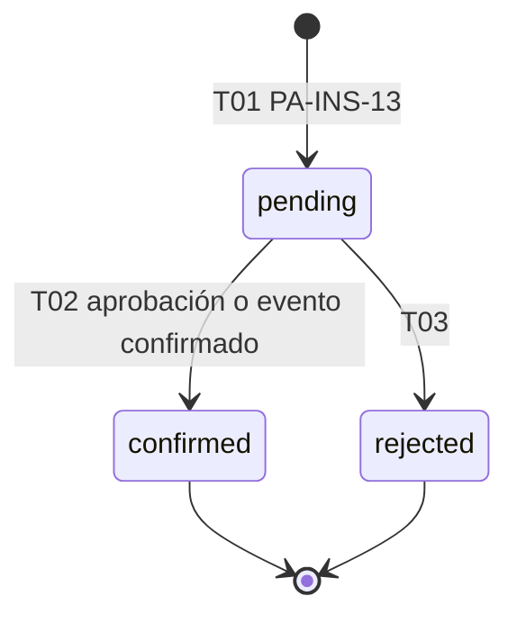

| # | Desde | Hasta | Disparador | Tipo | Guardas | Evento emitido |
|---|---|---|---|---|---|---|
| T01 | (nuevo) | `pending` | PA-INS-13 | no especificado | — | — |
| T02 | `pending` | `confirmed` | aprobación o evento confirmado | evento | — | — |
| T03 | `pending` | `rejected` | — | no especificado | — | — |

### EST-INS-02 — `capitalReserves.status` (COL-INS-09)

**Colección:** Reservas de capital. **Campos de estado en el §7:** `status` (línea 489; valores: `active`, `released`, `applied`, `voided`).

**Fuente:** M17 §8.13.4.

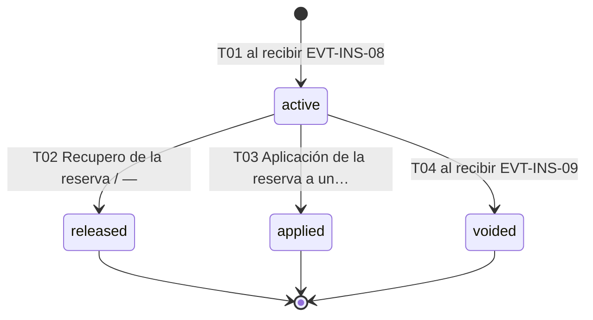

| # | Desde | Hasta | Disparador | Tipo | Guardas | Evento emitido |
|---|---|---|---|---|---|---|
| T01 | (nuevo) | `active` | Reserva de capital / EVT-INS-08 `ins.capitalMovement.recorded` (antes `ins.capital.movement.recorded`) `[VERIFICAR]` | evento | RN-INS-022 | — |
| T02 | `active` | `released` | Recupero de la reserva / — | no especificado | RN-INS-022 | — |
| T03 | `active` | `applied` | Aplicación de la reserva a un rescate o egreso `[VERIFICAR]` / — | no especificado | — | — |
| T04 | `active` | `voided` | Anulación / EVT-INS-09 `ins.capitalMovement.reversed` (antes `ins.capital.movement.reversed`) `[VERIFICAR]` | evento | — | — |

### EST-INS-03 — `capitalTransfers.status` (COL-INS-10)

**Colección:** Transferencias de capital. **Campos de estado en el §7:** `status` (línea 508; valores: `draft`, `pendingApproval`, `approved`, `executed`, `rejected`, `voided`).

**Fuente:** M17 §8.4.

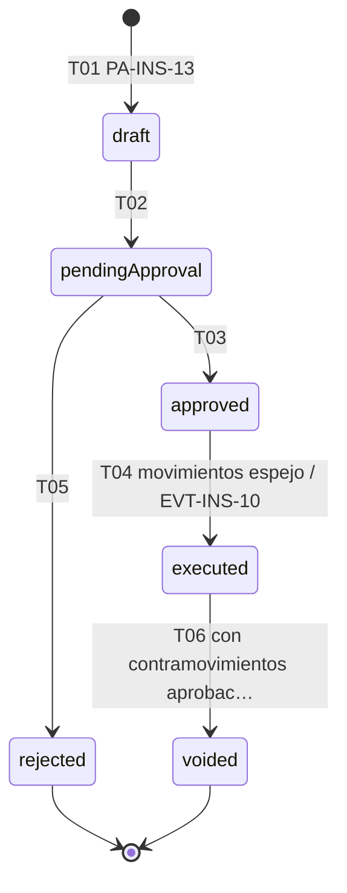

| # | Desde | Hasta | Disparador | Tipo | Guardas | Evento emitido |
|---|---|---|---|---|---|---|
| T01 | (nuevo) | `draft` | PA-INS-13 | no especificado | — | — |
| T02 | `draft` | `pendingApproval` | — | no especificado | — | — |
| T03 | `pendingApproval` | `approved` | — | no especificado | — | — |
| T04 | `approved` | `executed` | movimientos espejo | no especificado | — | EVT-INS-10 `ins.capitalTransfer.executed` (inferido por nombre) |
| T05 | `pendingApproval` | `rejected` | — | no especificado | — | — |
| T06 | `executed` | `voided` | con contramovimientos aprobación | no especificado | — | — |

### EST-INS-04 — `capitalRefunds.status` (COL-INS-11)

**Colección:** Reembolsos de capital. **Campos de estado en el §7:** `status` (línea 540; valores: `requested`, `calculated`, `pendingApproval`, `approved`, `queued`, `scheduled`, `paid`, `rejected`, `cancelled`).

**Fuente:** M17 §8.3, M17 §8.13.1.

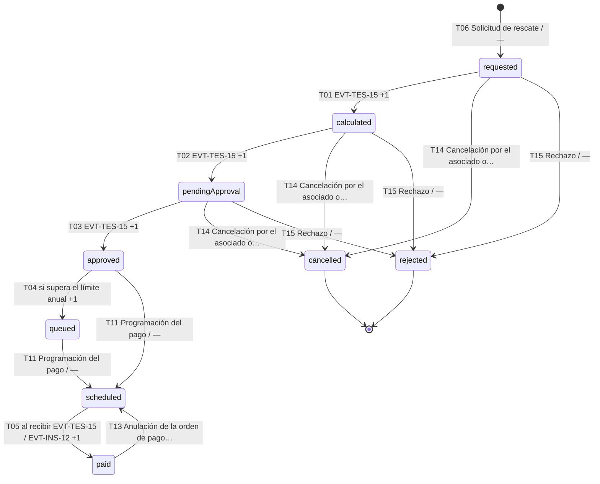

| # | Desde | Hasta | Disparador | Tipo | Guardas | Evento emitido |
|---|---|---|---|---|---|---|
| T01 | `requested` | `calculated` | — | no especificado | — | EVT-TES-15 `tes.paymentExecution.signed` |
| T02 | `calculated` | `pendingApproval` | — | no especificado | — | EVT-TES-15 `tes.paymentExecution.signed` |
| T03 | `pendingApproval` | `approved` | — | no especificado | — | EVT-TES-15 `tes.paymentExecution.signed` |
| T04 | `approved` | `queued` | si supera el límite anual | no especificado | — | — |
| T05 | `scheduled` | `paid` | evento tes.paymentExecution.executed, EVT-TES-15 | evento | — | EVT-INS-12 `ins.capitalRefund.paid` (inferido por nombre) |
| T06 | (nuevo) | `requested` | Solicitud de rescate / — | no especificado | RN-INS-023 | — |
| T07 | `requested` | `calculated` | Cálculo del sistema / — | sistema | RN-INS-023 | — |
| T08 | `calculated` | `pendingApproval` | Envío a aprobación (T11) / — | no especificado | — | — |
| T09 | `pendingApproval` | `approved` | Aprobación / EVT-INS-11 `ins.capitalRefund.approved` (antes `ins.capital.refund.approved`) | evento | — | EVT-INS-11 `ins.capitalRefund.approved` (inferido por nombre) |
| T10 | `approved` | `queued` | El rescate supera el límite anual / — | no especificado | — | — |
| T11 | `approved`, `queued` | `scheduled` | Programación del pago / — | no especificado | — | — |
| T12 | `scheduled` | `paid` | `tes.paymentExecution.executed` (EVT-TES-15) / EVT-INS-12 `ins.capitalRefund.paid` (antes `ins.capital.refund.paid`) | evento | — | EVT-INS-12 `ins.capitalRefund.paid` (inferido por nombre) |
| T13 | `paid` | `scheduled` | Anulación de la orden de pago en M14 / — | no especificado | — | — |
| T14 | `calculated`, `pendingApproval`, `requested` | `cancelled` | Cancelación por el asociado o el operador / — | usuario | — | — |
| T15 | `calculated`, `pendingApproval`, `requested` | `rejected` | Rechazo / — | no especificado | — | — |

### EST-INS-05 — `capitalClosings.status` (COL-INS-12)

**Colección:** Cierres de capital. **Campos de estado en el §7:** `status` (línea 549; valores: `closed`, `reopened`).

**Fuente:** M17 §8.13.5.

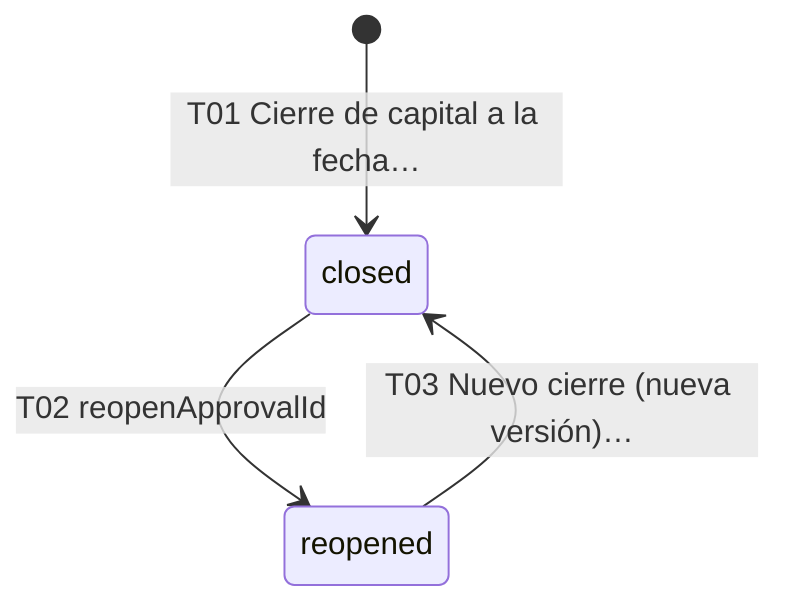

| # | Desde | Hasta | Disparador | Tipo | Guardas | Evento emitido |
|---|---|---|---|---|---|---|
| T01 | (nuevo) | `closed` | Cierre de capital a la fecha / — | no especificado | RN-INS-024 | — |
| T02 | `closed` | `reopened` | Reapertura aprobada (`reopenApprovalId`) / — | no especificado | — | — |
| T03 | `reopened` | `closed` | Nuevo cierre (nueva versión) `[VERIFICAR]` / — | no especificado | RN-INS-024 | — |

### EST-INS-06 — `shareCertificates.status` (COL-INS-13)

**Colección:** Certificados de aportación. **Campos de estado en el §7:** `status` (línea 564; valores: `issued`, `voided`, `replaced`).

**Fuente:** M17 §8.13.6.

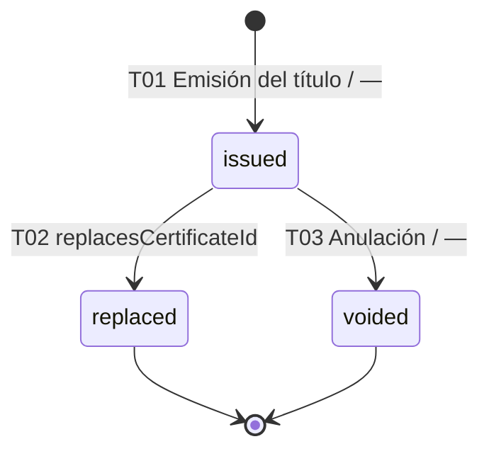

| # | Desde | Hasta | Disparador | Tipo | Guardas | Evento emitido |
|---|---|---|---|---|---|---|
| T01 | (nuevo) | `issued` | Emisión del título / — | no especificado | — | — |
| T02 | `issued` | `replaced` | Emisión de un título que lo reemplaza (`replacesCertificateId`) / — | no especificado | — | — |
| T03 | `issued` | `voided` | Anulación / — | no especificado | — | — |

### EST-INS-07 — `surplusDistributions.status` (COL-INS-14)

**Colección:** Distribución de excedentes. **Campos de estado en el §7:** `status` (línea 590; valores: `draft`, `simulated`, `approved`, `executing`, `executed`, `voided`).

**Fuente:** M17 §8.5.

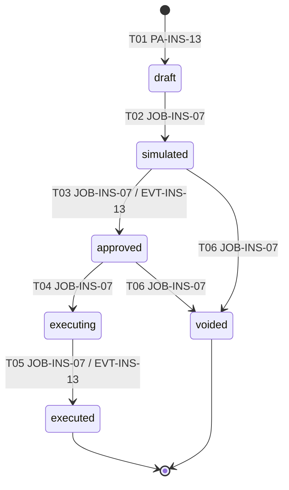

| # | Desde | Hasta | Disparador | Tipo | Guardas | Evento emitido |
|---|---|---|---|---|---|---|
| T01 | (nuevo) | `draft` | PA-INS-13 | no especificado | — | — |
| T02 | `draft` | `simulated` | — | no especificado | — | — |
| T03 | `simulated` | `approved` | requiere resolutionId | no especificado | — | EVT-INS-13 `ins.surplusDistribution.approved` (inferido por nombre) |
| T04 | `approved` | `executing` | — | no especificado | — | — |
| T05 | `executing` | `executed` | — | no especificado | — | EVT-INS-13 `ins.surplusDistribution.executed` (inferido por nombre) |
| T06 | `approved`, `simulated` | `voided` | — | no especificado | — | — |

### EST-INS-08 — `surplusAllocations.status` (COL-INS-15)

**Colección:** Retornos por asociado. **Campos de estado en el §7:** `status` (línea 598; valores: `pending`, `executed`, `unclaimed`, `prescribed`, `voided`).

**Fuente:** M17 §8.13.7.

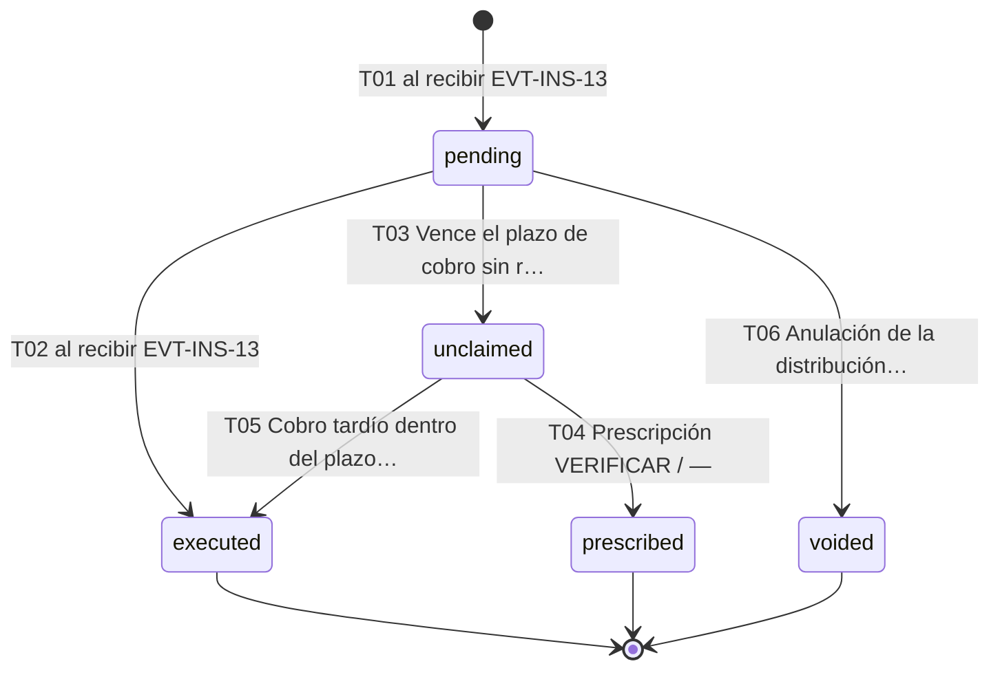

| # | Desde | Hasta | Disparador | Tipo | Guardas | Evento emitido |
|---|---|---|---|---|---|---|
| T01 | (nuevo) | `pending` | Aprobación de la distribución / EVT-INS-13 `ins.surplusDistribution.approved` (antes `ins.surplus.distribution.approved`) | evento | RN-INS-039 | — |
| T02 | `pending` | `executed` | Ejecución (capitalización, crédito o pago) / EVT-INS-13 `ins.surplusDistribution.executed` (antes `ins.surplus.distribution.executed`) | evento | RN-INS-039 | — |
| T03 | `pending` | `unclaimed` | Vence el plazo de cobro sin reclamo `[VERIFICAR]` / — | job | — | — |
| T04 | `unclaimed` | `prescribed` | Prescripción `[VERIFICAR]` / — | no especificado | — | — |
| T05 | `unclaimed` | `executed` | Cobro tardío dentro del plazo de prescripción `[VERIFICAR]` / — | job | — | — |
| T06 | `pending` | `voided` | Anulación de la distribución `[VERIFICAR]` / — | no especificado | — | — |

### EST-INS-09 — `bodyMandates.status` (COL-INS-17)

**Colección:** Mandatos. **Campos de estado en el §7:** `status` (línea 632; valores: `active`, `ended`, `resigned`, `removed`, `replaced`).

**Fuente:** M17 §8.10, M17 §8.13.3.

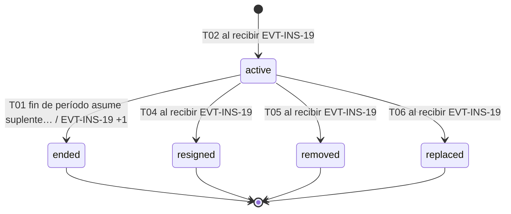

| # | Desde | Hasta | Disparador | Tipo | Guardas | Evento emitido |
|---|---|---|---|---|---|---|
| T01 | `active` | `ended` | fin de período asume suplente: se crea un mandato nuevo para el suplente | no especificado | — | EVT-INS-19 `ins.mandate.ended` (inferido por nombre) |
| T02 | (nuevo) | `active` | Inicio del mandato / EVT-INS-19 `ins.mandate.started` | evento | RN-INS-042 | — |
| T03 | `active` | `ended` | Fin del período / EVT-INS-19 `ins.mandate.ended` | evento | — | EVT-INS-19 `ins.mandate.ended` (inferido por nombre) |
| T04 | `active` | `resigned` | Renuncia / EVT-INS-19 `ins.mandate.ended` | evento | — | — |
| T05 | `active` | `removed` | Remoción / EVT-INS-19 `ins.mandate.ended` | evento | — | — |
| T06 | `active` | `replaced` | Asume el suplente (se crea un mandato nuevo para él) / EVT-INS-19 `ins.mandate.ended` | evento | RN-INS-042 | — |

### EST-INS-10 — `meetings.status` (COL-INS-18)

**Colección:** Reuniones y asambleas. **Campos de estado en el §7:** `status` (línea 665; valores: `draft`, `convened`, `inProgress`, `recess`, `closed`, `cancelled`).

**Fuente:** M17 §8.6.

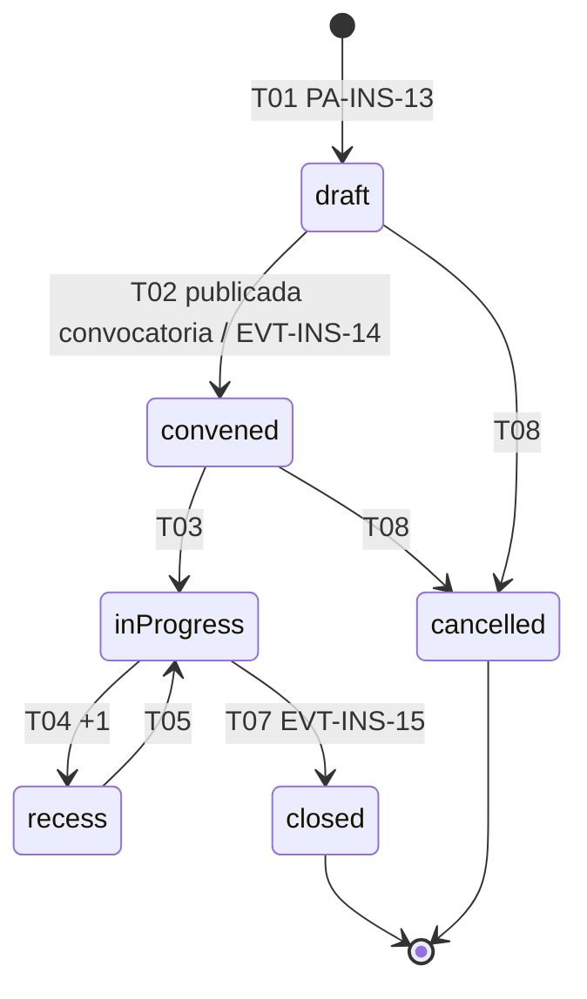

| # | Desde | Hasta | Disparador | Tipo | Guardas | Evento emitido |
|---|---|---|---|---|---|---|
| T01 | (nuevo) | `draft` | PA-INS-13 | no especificado | — | — |
| T02 | `draft` | `convened` | publicada convocatoria | no especificado | — | EVT-INS-14 `ins.meeting.convened` (inferido por nombre) |
| T03 | `convened` | `inProgress` | — | no especificado | — | — |
| T04 | `inProgress` | `recess` | — | no especificado | — | — |
| T05 | `recess` | `inProgress` | — | no especificado | — | — |
| T06 | `inProgress` | `recess` | — | no especificado | — | — |
| T07 | `inProgress` | `closed` | — | no especificado | — | EVT-INS-15 `ins.meeting.closed` (inferido por nombre) |
| T08 | `convened`, `draft` | `cancelled` | — | no especificado | — | — |

### EST-INS-11 — `minutes.signatureStatus` (COL-INS-22)

**Colección:** Actas. **Campos de estado en el §7:** `signatureStatus` (línea 732; valores: `draft`, `pendingSignatures`, `signed`, `voided`).

**Fuente:** M17 §8.7.

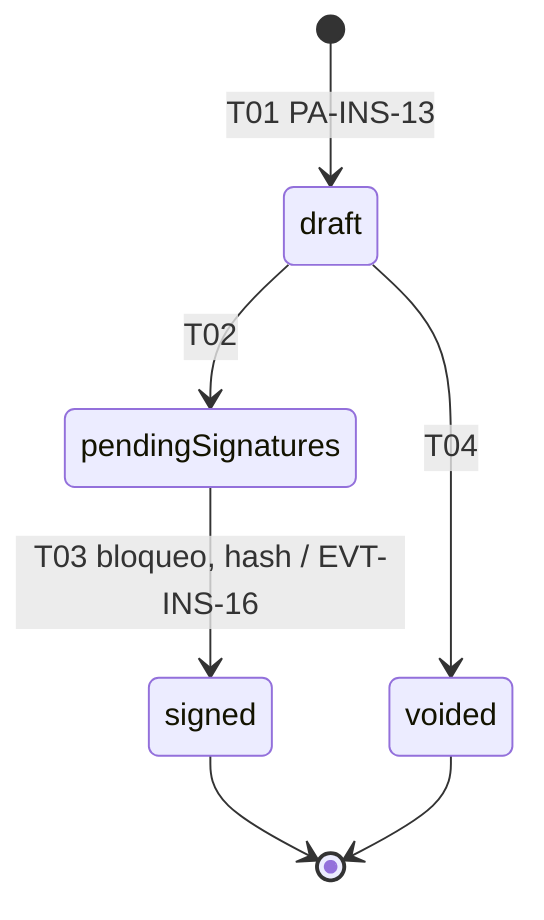

| # | Desde | Hasta | Disparador | Tipo | Guardas | Evento emitido |
|---|---|---|---|---|---|---|
| T01 | (nuevo) | `draft` | PA-INS-13 | no especificado | — | — |
| T02 | `draft` | `pendingSignatures` | — | no especificado | — | — |
| T03 | `pendingSignatures` | `signed` | bloqueo, hash | no especificado | — | EVT-INS-16 `ins.minute.signed` (inferido por nombre) |
| T04 | `draft` | `voided` | — | no especificado | — | — |

### EST-INS-12 — `resolutions.status` (COL-INS-23)

**Colección:** Resoluciones. **Campos de estado en el §7:** `status` (línea 753; valores: `open`, `inProgress`, `done`, `cancelled`).

**Fuente:** M17 §8.13.8.

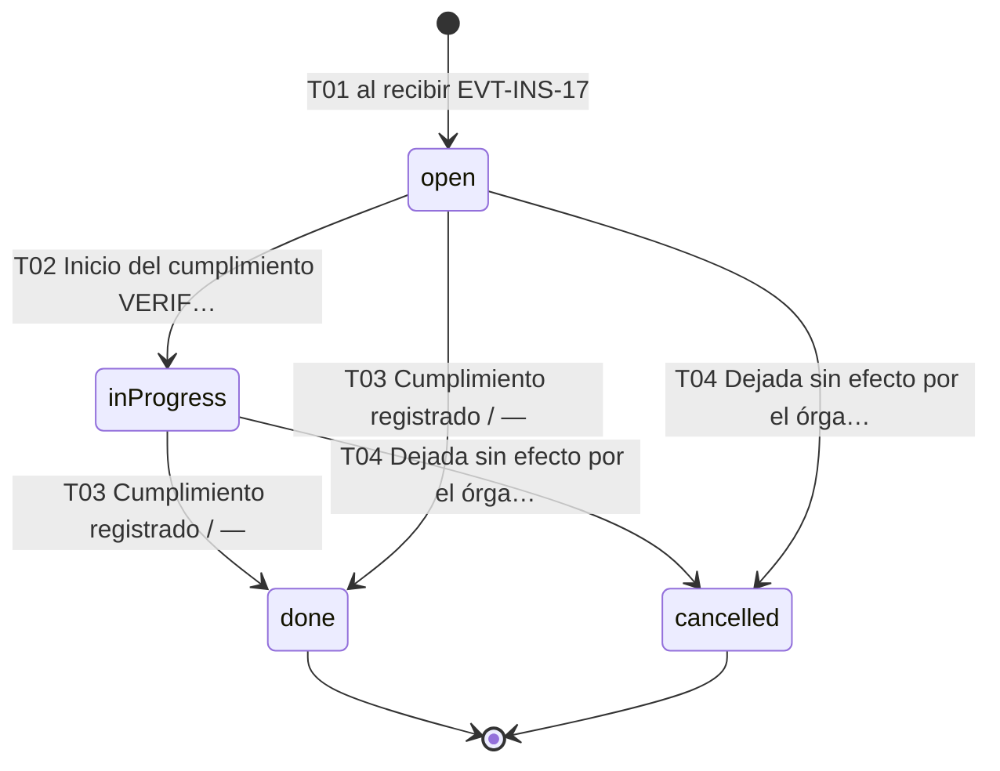

| # | Desde | Hasta | Disparador | Tipo | Guardas | Evento emitido |
|---|---|---|---|---|---|---|
| T01 | (nuevo) | `open` | Registro de la resolución del órgano / EVT-INS-17 `ins.resolution.created` | evento | — | — |
| T02 | `open` | `inProgress` | Inicio del cumplimiento `[VERIFICAR]` / — | no especificado | — | — |
| T03 | `inProgress`, `open` | `done` | Cumplimiento registrado / — | no especificado | — | — |
| T04 | `inProgress`, `open` | `cancelled` | Dejada sin efecto por el órgano / — | no especificado | — | — |

### EST-INS-13 — `rosters.status` (COL-INS-24)

**Colección:** Padrones. **Campos de estado en el §7:** `status` (línea 772; valores: `preliminary`, `observed`, `final`, `superseded`).

**Fuente:** M17 §8.8, M17 §8.13.2.

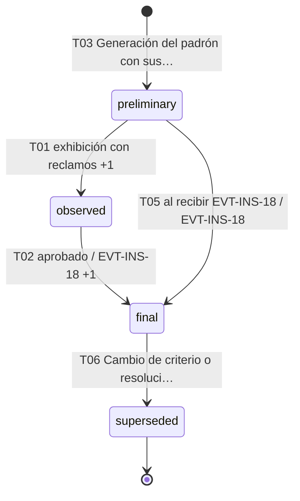

| # | Desde | Hasta | Disparador | Tipo | Guardas | Evento emitido |
|---|---|---|---|---|---|---|
| T01 | `preliminary` | `observed` | exhibición con reclamos | no especificado | — | — |
| T02 | `observed` | `final` | aprobado | no especificado | — | EVT-INS-18 `ins.roster.finalized` (inferido por nombre) |
| T03 | (nuevo) | `preliminary` | Generación del padrón con sus criterios / — | no especificado | RN-INS-031, RN-INS-044 | — |
| T04 | `preliminary` | `observed` | Exhibición con reclamos / — | no especificado | — | — |
| T05 | `observed`, `preliminary` | `final` | Aprobación del padrón / EVT-INS-18 `ins.roster.finalized` | evento | — | EVT-INS-18 `ins.roster.finalized` (inferido por nombre) |
| T06 | `final` | `superseded` | Cambio de criterio o resolución de reclamo (crea versión nueva) / — | no especificado | — | — |

### EST-INS-14 — `proxies.status` (COL-INS-26)

**Colección:** Poderes. **Campos de estado en el §7:** `status` (línea 810; valores: `submitted`, `validated`, `rejected`, `revoked`).

**Fuente:** M17 §8.13.9.

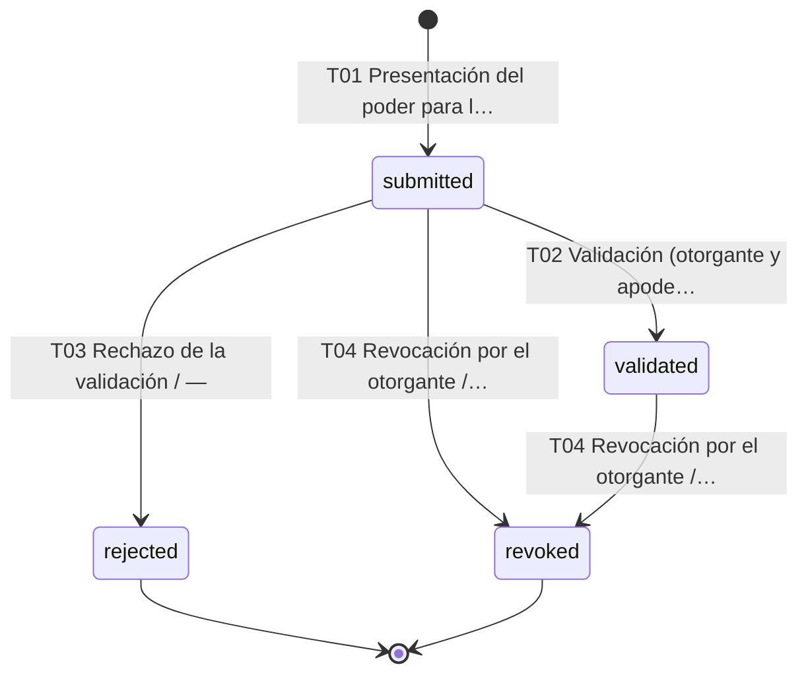

| # | Desde | Hasta | Disparador | Tipo | Guardas | Evento emitido |
|---|---|---|---|---|---|---|
| T01 | (nuevo) | `submitted` | Presentación del poder para la reunión / — | no especificado | — | — |
| T02 | `submitted` | `validated` | Validación (otorgante y apoderado habilitados en el padrón) / — | no especificado | RN-INS-032 | — |
| T03 | `submitted` | `rejected` | Rechazo de la validación / — | no especificado | — | — |
| T04 | `submitted`, `validated` | `revoked` | Revocación por el otorgante / — | no especificado | — | — |

### EST-INS-15 — `electoralLists.status` (COL-INS-27)

**Colección:** Listas electorales. **Campos de estado en el §7:** `status` (línea 826; valores: `submitted`, `observed`, `officialized`, `rejected`, `withdrawn`).

**Fuente:** M17 §8.13.10.

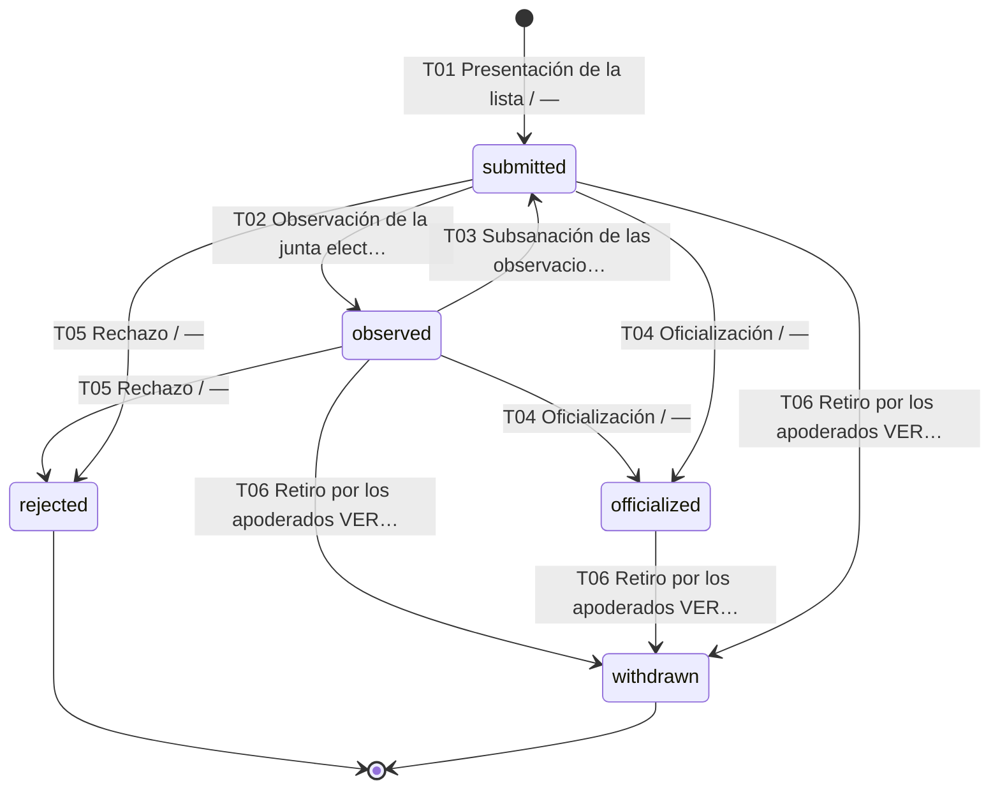

| # | Desde | Hasta | Disparador | Tipo | Guardas | Evento emitido |
|---|---|---|---|---|---|---|
| T01 | (nuevo) | `submitted` | Presentación de la lista / — | no especificado | — | — |
| T02 | `submitted` | `observed` | Observación de la junta electoral / — | no especificado | — | — |
| T03 | `observed` | `submitted` | Subsanación de las observaciones `[VERIFICAR]` / — | no especificado | — | — |
| T04 | `observed`, `submitted` | `officialized` | Oficialización / — | no especificado | — | — |
| T05 | `observed`, `submitted` | `rejected` | Rechazo / — | no especificado | — | — |
| T06 | `observed`, `officialized`, `submitted` | `withdrawn` | Retiro por los apoderados `[VERIFICAR]` / — | no especificado | — | — |

### EST-INS-16 — `votingSessions.status` (COL-INS-28)

**Colección:** Votaciones. **Campos de estado en el §7:** `status` (línea 842; valores: `open`, `closed`, `tallied`, `voided`).

**Fuente:** M17 §8.9.

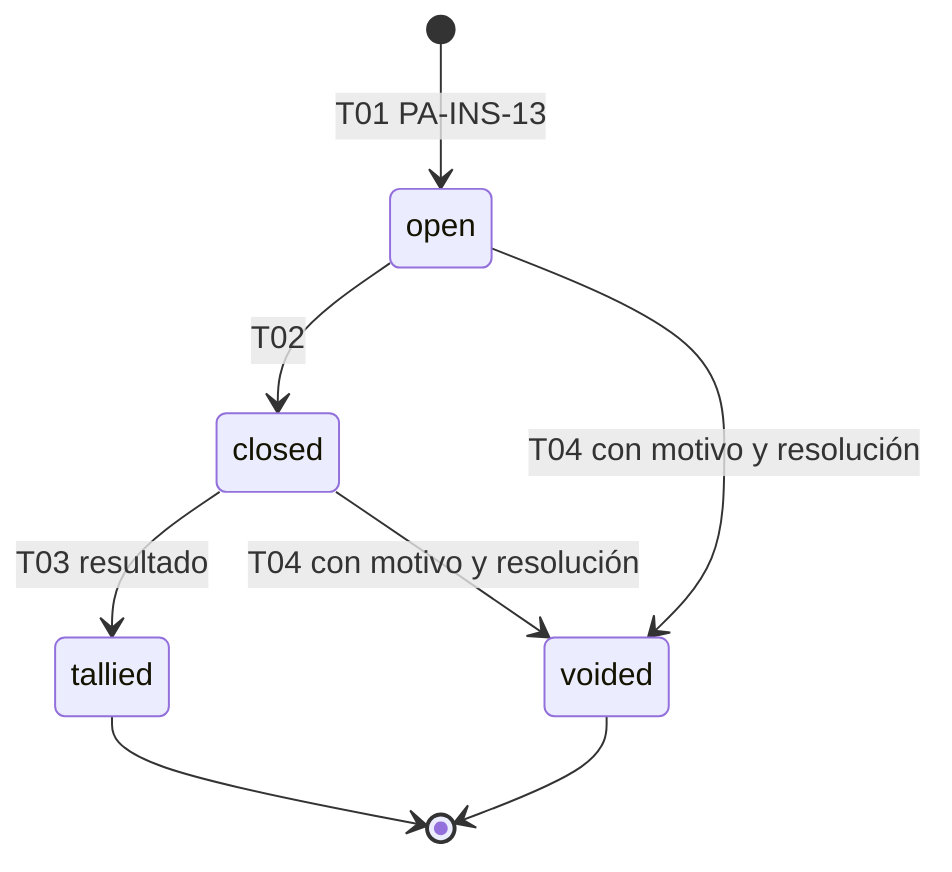

| # | Desde | Hasta | Disparador | Tipo | Guardas | Evento emitido |
|---|---|---|---|---|---|---|
| T01 | (nuevo) | `open` | PA-INS-13 | no especificado | — | — |
| T02 | `open` | `closed` | — | no especificado | — | — |
| T03 | `closed` | `tallied` | resultado | no especificado | — | — |
| T04 | `closed`, `open` | `voided` | con motivo y resolución | no especificado | — | — |

### EST-INS-17 — `institutionalFeeSettlements.status` (COL-INS-31)

**Colección:** Liquidación de retribuciones. **Campos de estado en el §7:** `status` (línea 873; valores: `draft`, `approved`, `paid`, `voided`).

**Fuente:** M17 §8.11.

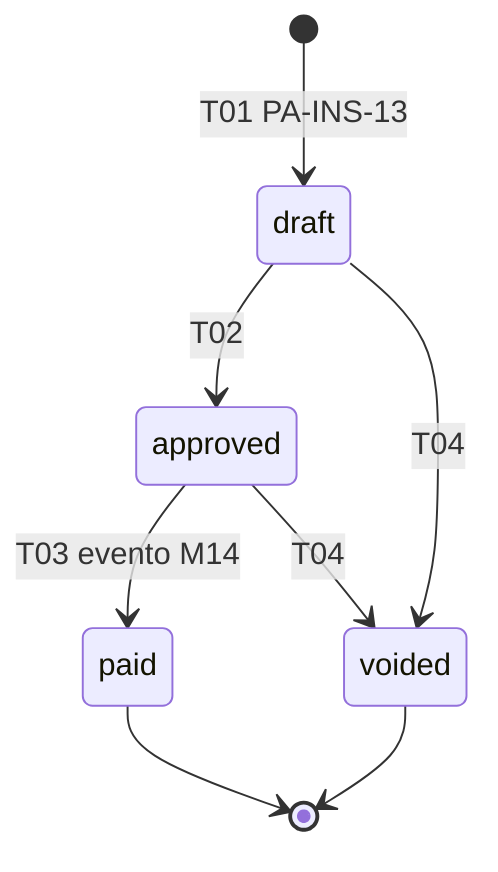

| # | Desde | Hasta | Disparador | Tipo | Guardas | Evento emitido |
|---|---|---|---|---|---|---|
| T01 | (nuevo) | `draft` | PA-INS-13 | no especificado | — | — |
| T02 | `draft` | `approved` | — | no especificado | — | — |
| T03 | `approved` | `paid` | evento M14 | evento | — | — |
| T04 | `approved`, `draft` | `voided` | — | no especificado | — | — |

### EST-INS-18 — `inaesReports.status` (COL-INS-33)

**Colección:** Presentaciones INAES. **Campos de estado en el §7:** `status` (línea 920; valores: `draft`, `validated`, `submitted`, `acknowledged`, `rejected`).

**Fuente:** M17 §8.12.

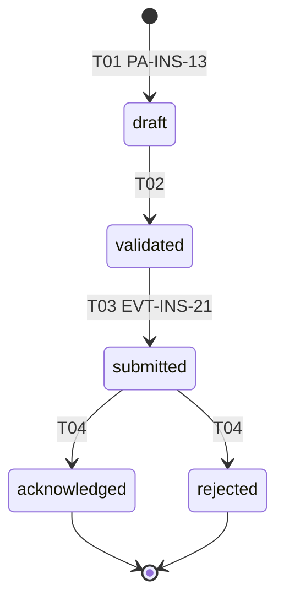

| # | Desde | Hasta | Disparador | Tipo | Guardas | Evento emitido |
|---|---|---|---|---|---|---|
| T01 | (nuevo) | `draft` | PA-INS-13 | no especificado | — | — |
| T02 | `draft` | `validated` | — | no especificado | — | — |
| T03 | `validated` | `submitted` | — | no especificado | — | EVT-INS-21 `ins.inaesReport.submitted` (inferido por nombre) |
| T04 | `submitted` | `acknowledged`, `rejected` | — | no especificado | — | — |

### EST-INS-19 — `associateRegisterEditions.status` (COL-INS-34)

**Colección:** Ediciones del registro de asociados. **Campos de estado en el §7:** `status` (línea 941; valores: `draft`, `issued`, `rubricated`).

**Fuente:** M17 §8.13.11.

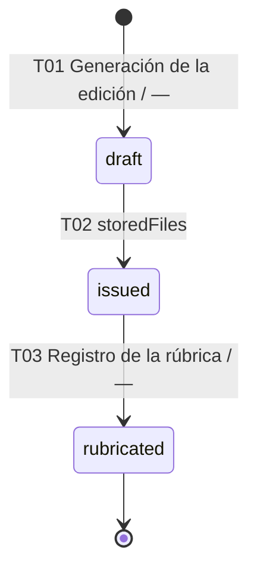

| # | Desde | Hasta | Disparador | Tipo | Guardas | Evento emitido |
|---|---|---|---|---|---|---|
| T01 | (nuevo) | `draft` | Generación de la edición / — | no especificado | RN-INS-047 | — |
| T02 | `draft` | `issued` | Emisión del libro (PDF en `storedFiles`) / — | no especificado | — | — |
| T03 | `issued` | `rubricated` | Registro de la rúbrica / — | no especificado | — | — |

### EST-INS-20 — `memberCredentials.status` (COL-INS-35)

**Colección:** Credenciales del asociado. **Campos de estado en el §7:** `status` (línea 960; valores: `active`, `revoked`).

**Fuente:** M17 §8.13.12.

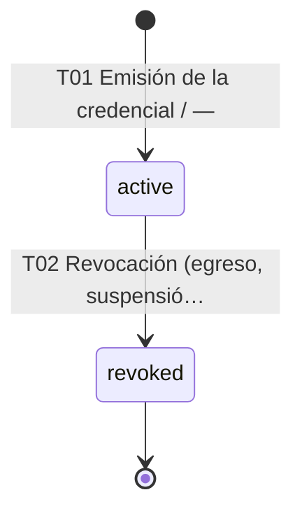

| # | Desde | Hasta | Disparador | Tipo | Guardas | Evento emitido |
|---|---|---|---|---|---|---|
| T01 | (nuevo) | `active` | Emisión de la credencial / — | no especificado | — | — |
| T02 | `active` | `revoked` | Revocación (egreso, suspensión o reemisión) `[VERIFICAR]` / — | no especificado | — | — |

### EST-INS-21 — `associateMemberships.status` (colección de otro dueño o absorbida)

**Fuente:** M17 §8.1. La colección figura en T05 como COL-INS-01 C (antes `R`) (dueño M17); no se crea con este dueño, se conserva el diagrama del §8 de este anexo.

```mermaid
stateDiagram-v2
    [*] --> applicant : T01 Operador / asociado PWA / EVT-INS-01
    applicant --> pendingApproval : T02 Secretaría
    pendingApproval --> active : T03 Consejo (vía acta) / Secretar… / EVT-INS-02
    pendingApproval --> rejected : T04 Consejo / EVT-INS-03
    active --> suspended : T05 Consejo / EVT-INS-04
    active --> withdrawalRequested : T06 Asociado / Secretaría
    withdrawalRequested --> withdrawn : T07 Consejo / Secretaría / EVT-INS-06
    active --> exclusionPending : T08 Consejo
    exclusionPending --> excluded : T09 Sistema al vencer el plazo /… / EVT-INS-06
    active --> dissolved : T11 Secretaría / EVT-INS-06
    note left of deceased : T10 desde cualquier estado previsto
    rejected --> [*]
    suspended --> [*]
    withdrawn --> [*]
    excluded --> [*]
    deceased --> [*]
    dissolved --> [*]
```

| # | Desde | Hasta | Disparador | Tipo | Guardas | Evento emitido |
|---|---|---|---|---|---|---|
| T01 | (nuevo) | `applicant` | Operador / asociado PWA | usuario | Persona en M01 | EVT-INS-01 `ins.membership.requested` |
| T02 | `applicant` | `pendingApproval` | Secretaría | usuario | Documentación completa, estatuto aceptado | — |
| T03 | `pendingApproval` | `active` | Consejo (vía acta) / Secretaría con PRM-INS-005 = `active` | usuario | Resolución aprobada | EVT-INS-02 `ins.membership.approved` |
| T04 | `pendingApproval` | `rejected` | Consejo | usuario | Resolución con motivo | EVT-INS-03 `ins.membership.rejected` (inferido por nombre) |
| T05 | `active` | `suspended` | Consejo | usuario | Resolución | EVT-INS-04 `ins.membership.suspended` (inferido por nombre) |
| T06 | `active` | `withdrawalRequested` | Asociado / Secretaría | usuario | Solicitud de egreso | — |
| T07 | `withdrawalRequested` | `withdrawn` | Consejo / Secretaría | usuario | Validaciones RN-INS-007/008 | EVT-INS-06 `ins.membership.exited` |
| T08 | `active` | `exclusionPending` | Consejo | usuario | Resolución y notificación | — |
| T09 | `exclusionPending` | `excluded` | Sistema al vencer el plazo / Asamblea | job | Sin apelación o apelación rechazada | EVT-INS-06 `ins.membership.exited` |
| T10 | cualquiera | `deceased` | Sistema (evento M01) | evento, sistema | `per.person.deceased` | — |
| T11 | `active` | `dissolved` | Secretaría | usuario | Persona jurídica extinguida | EVT-INS-06 `ins.membership.exited` |

## M18 — SOC Servicios sociales y flota

### EST-SOC-01 — `serviceDependents.status` (COL-SOC-01)

**Colección:** Adherentes (canónica, DEC-071, HUECO-TRV-01). **Campos de estado en el §7:** `status` (línea 436; valores: `pendingValidation`, `active`, `observed`, `suspended`, `ended`).

**Fuente:** M18 §8, M18 §8.2.

```mermaid
stateDiagram-v2
    pendingValidation --> active : T01 Operador requisitos del plan…
    active --> observed : T02 Operador requisitos del plan… +1
    observed --> active : T03 Operador requisitos del plan…
    active --> suspended : T05 Operador requisitos del plan…
    suspended --> active : T06 Operador requisitos del plan… / EVT-SOC-01
    suspended --> ended : T06 Operador requisitos del plan… / EVT-SOC-01
    [*] --> pendingValidation : T07 Alta del adherente / —
    ended --> [*]
```

| # | Desde | Hasta | Disparador | Tipo | Guardas | Evento emitido |
|---|---|---|---|---|---|---|
| T01 | `pendingValidation` | `active` | Operador; requisitos del plan; desconexión (sistema) | sistema, usuario | — | — |
| T02 | `active` | `observed` | Operador; requisitos del plan; desconexión (sistema) | sistema, usuario | — | — |
| T03 | `observed` | `active` | Operador; requisitos del plan; desconexión (sistema) | sistema, usuario | — | — |
| T04 | `active` | `observed` | Operador; requisitos del plan; desconexión (sistema) | sistema, usuario | — | — |
| T05 | `active` | `suspended` | Operador; requisitos del plan; desconexión (sistema) | sistema, usuario | — | — |
| T06 | `suspended` | `active`, `ended` | Operador; requisitos del plan; desconexión (sistema) | sistema, usuario | — | EVT-SOC-01 `soc.dependent.ended` (inferido por nombre) |
| T07 | (nuevo) | `pendingValidation` | Alta del adherente / — | no especificado | — | — |

### EST-SOC-02 — `serviceBeneficiaries.status` (COL-SOC-02)

**Colección:** Beneficiarios del contrato; destino único de `BENSOC` (DEC-086, HUECO-SEP-02): ninguna fila va a M04 y `benefitType` no admite `socialTariff`; `legacy.codBen` y `legacy.codCse` (código compuesto del…. **Campos de estado en el §7:** `status` (línea 463; valores: `active`, `ended`).

**Fuente:** M18 §8, M18 §8.2.

```mermaid
stateDiagram-v2
    active --> ended : T01 Operador / sistema
    [*] --> active : T02 Alta del beneficiario / —
    ended --> [*]
```

| # | Desde | Hasta | Disparador | Tipo | Guardas | Evento emitido |
|---|---|---|---|---|---|---|
| T01 | `active` | `ended` | Operador / sistema | sistema, usuario | — | — |
| T02 | (nuevo) | `active` | Alta del beneficiario / — | no especificado | — | — |

### EST-SOC-03 — `coveragePlans.status` (COL-SOC-04)

**Colección:** Planes de cobertura. **Campos de estado en el §7:** `status` (línea 504; valores: `draft`, `active`, `closedToNew`, `retired`).

**Fuente:** el §8 del anexo no detalla esta colección; se aplica el patrón general de T05 §7.1.5 (versiones publicadas) sobre los valores del §7.

```mermaid
stateDiagram-v2
    [*] --> draft : P01 nueva versión
    draft --> active : P02 publicar
    active --> retired : P03 reemplazo o fin de vigencia
    retired --> [*]
    closedToNew
    note right of closedToNew : Sin transición en el patrón, ver el anexo
```

| # | Desde | Hasta | Disparador | Tipo | Guardas | Evento emitido |
|---|---|---|---|---|---|---|
| P01 | (nuevo) | `draft` | Configurador | usuario | — | — |
| P02 | `draft` | `active` | Configurador o aprobador | usuario | Versión validada; publicada queda inmutable (T05 §7.1.5) | — |
| P03 | `active` | `retired` | Sistema al publicar la sucesora o configurador | sistema, usuario | Existe versión sucesora o fin de vigencia | — |

### EST-SOC-04 — `providerAgreements.status` (COL-SOC-06)

**Colección:** Convenios con prestadores. **Campos de estado en el §7:** `status` (línea 526; valores: `draft`, `active`, `ended`).

**Fuente:** M18 §8.1.6.

```mermaid
stateDiagram-v2
    [*] --> draft : T01 Carga del convenio / —
    draft --> active : T02 Aprobación del convenio / —
    active --> ended : T03 validTo
    ended --> [*]
```

| # | Desde | Hasta | Disparador | Tipo | Guardas | Evento emitido |
|---|---|---|---|---|---|---|
| T01 | (nuevo) | `draft` | Carga del convenio / — | no especificado | — | — |
| T02 | `draft` | `active` | Aprobación del convenio / — | no especificado | — | — |
| T03 | `active` | `ended` | Fin de vigencia (`validTo`) o rescisión / — | no especificado | — | — |

### EST-SOC-05 — `benefitRequests.status` (COL-SOC-09)

**Colección:** Solicitudes de prestación. **Campos de estado en el §7:** `status` (línea 584; valores: `requested`, `inReview`, `approved`, `rejected`, `inProgressWithProvider`, `answered`, `completed`, `cancelled`).

**Fuente:** M18 §8, M18 §8.2.

```mermaid
stateDiagram-v2
    requested --> inReview : T01 Operador excepción con respon…
    inReview --> approved : T02 Operador excepción con respon…
    inReview --> rejected : T02 Operador excepción con respon…
    approved --> inProgressWithProvider : T03 Operador excepción con respon…
    inProgressWithProvider --> answered : T04 Operador excepción con respon…
    answered --> completed : T05 Operador excepción con respon…
    [*] --> requested : T07 Solicitud de prestación / —
    note left of cancelled : T06 desde cualquier estado previsto
    rejected --> [*]
    completed --> [*]
    cancelled --> [*]
```

| # | Desde | Hasta | Disparador | Tipo | Guardas | Evento emitido |
|---|---|---|---|---|---|---|
| T01 | `requested` | `inReview` | Operador; excepción con responsable | usuario | — | — |
| T02 | `inReview` | `approved`, `rejected` | Operador; excepción con responsable | usuario | — | — |
| T03 | `approved` | `inProgressWithProvider` | Operador; excepción con responsable | usuario | — | — |
| T04 | `inProgressWithProvider` | `answered` | Operador; excepción con responsable | usuario | — | — |
| T05 | `answered` | `completed` | Operador; excepción con responsable | usuario | — | — |
| T06 | cualquiera | `cancelled` | Operador; excepción con responsable | usuario | — | — |
| T07 | (nuevo) | `requested` | Solicitud de prestación / — | no especificado | — | — |

### EST-SOC-06 — `burialServiceCases.status` (COL-SOC-10)

**Colección:** Casos de sepelio. **Campos de estado en el §7:** `status` (línea 593; valores: `open`, `coordinated`, `completed`, `cancelled`).

**Fuente:** M18 §8.1.2.

```mermaid
stateDiagram-v2
    [*] --> open : T01 al recibir EVT-SOC-03
    open --> coordinated : T02 Servicios coordinados con el…
    coordinated --> completed : T03 Prestación realizada / —
    coordinated --> cancelled : T04 Cancelación VERIFICAR / —
    open --> cancelled : T04 Cancelación VERIFICAR / —
    completed --> [*]
    cancelled --> [*]
```

| # | Desde | Hasta | Disparador | Tipo | Guardas | Evento emitido |
|---|---|---|---|---|---|---|
| T01 | (nuevo) | `open` | Aprobación de la solicitud de prestación de sepelio / EVT-SOC-03 `soc.benefitRequest.decided` | evento | — | — |
| T02 | `open` | `coordinated` | Servicios coordinados con el prestador / — | no especificado | — | — |
| T03 | `coordinated` | `completed` | Prestación realizada / — | no especificado | — | — |
| T04 | `coordinated`, `open` | `cancelled` | Cancelación `[VERIFICAR]` / — | no especificado | — | — |

### EST-SOC-07 — `deathSubsidyCases.status` (COL-SOC-11)

**Colección:** Subsidios por fallecimiento. **Campos de estado en el §7:** `status` (línea 613; valores: `draft`, `pendingApproval`, `approved`, `paid`, `rejected`, `expired`).

**Fuente:** M18 §8, M18 §8.2.

```mermaid
stateDiagram-v2
    draft --> pendingApproval : T01 Responsable reglamento
    pendingApproval --> approved : T02 Responsable reglamento
    approved --> paid : T03 Responsable reglamento
    pendingApproval --> rejected : T04 Responsable reglamento
    draft --> expired : T05 Responsable reglamento
    [*] --> draft : T06 Carga del subsidio / —
    paid --> [*]
    rejected --> [*]
    expired --> [*]
```

| # | Desde | Hasta | Disparador | Tipo | Guardas | Evento emitido |
|---|---|---|---|---|---|---|
| T01 | `draft` | `pendingApproval` | Responsable; reglamento | usuario | — | — |
| T02 | `pendingApproval` | `approved` | Responsable; reglamento | usuario | — | — |
| T03 | `approved` | `paid` | Responsable; reglamento | usuario | — | — |
| T04 | `pendingApproval` | `rejected` | Responsable; reglamento | usuario | — | — |
| T05 | `draft` | `expired` | Responsable; reglamento | usuario | — | — |
| T06 | (nuevo) | `draft` | Carga del subsidio / — | no especificado | — | — |

### EST-SOC-08 — `bloodCoverageRequests.status` (COL-SOC-12)

**Colección:** Cobertura de sangre (sin datos clínicos). **Campos de estado en el §7:** `status` (línea 631; valores: `requested`, `inProgressWithProvider`, `answered`, `closed`).

**Fuente:** M18 §8.1.3.

```mermaid
stateDiagram-v2
    [*] --> requested : T01 Solicitud de cobertura / —
    requested --> inProgressWithProvider : T02 Derivación al prestador del c…
    inProgressWithProvider --> answered : T03 responseAt
    answered --> closed : T04 Cierre del caso / —
    closed --> [*]
```

| # | Desde | Hasta | Disparador | Tipo | Guardas | Evento emitido |
|---|---|---|---|---|---|---|
| T01 | (nuevo) | `requested` | Solicitud de cobertura / — | no especificado | RN-SOC-028, RN-SOC-055 (un aporte impago nunca rechaza ni demora la solicitud) | — |
| T02 | `requested` | `inProgressWithProvider` | Derivación al prestador del convenio / — | no especificado | — | — |
| T03 | `inProgressWithProvider` | `answered` | Respuesta del prestador (`responseAt`) / — | no especificado | — | — |
| T04 | `answered` | `closed` | Cierre del caso / — | no especificado | — | — |

### EST-SOC-09 — `donationCampaigns.status` (COL-SOC-13)

**Colección:** Campañas de donación. **Campos de estado en el §7:** `status` (línea 648; valores: `planned`, `open`, `closed`, `cancelled`).

**Fuente:** M18 §8.1.7.

```mermaid
stateDiagram-v2
    [*] --> planned : T01 Alta de la campaña / —
    planned --> open : T02 Apertura de turnos / —
    open --> closed : T03 Fin de la campaña / —
    open --> cancelled : T04 Cancelación / —
    planned --> cancelled : T04 Cancelación / —
    closed --> [*]
    cancelled --> [*]
```

| # | Desde | Hasta | Disparador | Tipo | Guardas | Evento emitido |
|---|---|---|---|---|---|---|
| T01 | (nuevo) | `planned` | Alta de la campaña / — | no especificado | — | — |
| T02 | `planned` | `open` | Apertura de turnos / — | no especificado | — | — |
| T03 | `open` | `closed` | Fin de la campaña / — | no especificado | — | — |
| T04 | `open`, `planned` | `cancelled` | Cancelación / — | no especificado | — | — |

### EST-SOC-10 — `donationAppointments.status` (COL-SOC-14)

**Colección:** Turnos de donación (sin aptitud ni resultados). **Campos de estado en el §7:** `status` (línea 648; valores: `booked`, `attended`, `noShow`, `cancelled`).

**Fuente:** M18 §8.1.4.

```mermaid
stateDiagram-v2
    [*] --> booked : T01 Reserva del turno en la campa…
    booked --> attended : T02 Asistencia registrada (sin ap…
    booked --> noShow : T03 Inasistencia al cierre de la…
    booked --> cancelled : T04 Cancelación del turno / —
    attended --> [*]
    noShow --> [*]
    cancelled --> [*]
```

| # | Desde | Hasta | Disparador | Tipo | Guardas | Evento emitido |
|---|---|---|---|---|---|---|
| T01 | (nuevo) | `booked` | Reserva del turno en la campaña / — | no especificado | — | — |
| T02 | `booked` | `attended` | Asistencia registrada (sin aptitud ni resultados) / — | no especificado | — | — |
| T03 | `booked` | `noShow` | Inasistencia al cierre de la jornada `[VERIFICAR]` / — | no especificado | — | — |
| T04 | `booked` | `cancelled` | Cancelación del turno / — | no especificado | — | — |

### EST-SOC-11 — `healthAuthorizations.status` (COL-SOC-15)

**Colección:** Autorizaciones de internación y prácticas (sin diagnóstico). **Campos de estado en el §7:** `status` (línea 672; valores: `requested`, `authorized`, `rejected`, `closed`).

**Fuente:** M18 §8.1.5.

```mermaid
stateDiagram-v2
    [*] --> requested : T01 Solicitud de autorización / —
    requested --> authorized : T02 Autorización del responsable…
    requested --> rejected : T03 Rechazo / —
    authorized --> closed : T04 Cierre tras la prestación VER…
    rejected --> [*]
    closed --> [*]
```

| # | Desde | Hasta | Disparador | Tipo | Guardas | Evento emitido |
|---|---|---|---|---|---|---|
| T01 | (nuevo) | `requested` | Solicitud de autorización / — | usuario | — | — |
| T02 | `requested` | `authorized` | Autorización del responsable / — | usuario | — | — |
| T03 | `requested` | `rejected` | Rechazo / — | no especificado | — | — |
| T04 | `authorized` | `closed` | Cierre tras la prestación `[VERIFICAR]` / — | no especificado | — | — |

### EST-SOC-12 — `transportTrips.status` (COL-SOC-16)

**Colección:** Traslados sanitarios y generales (canónica, HUECO-SAL-02). **Campos de estado en el §7:** `status` (línea 710; valores: `requested`, `scheduled`, `inProgress`, `completed`, `cancelled`, `derived`).

**Fuente:** M18 §8, M18 §8.1.1.

```mermaid
stateDiagram-v2
    requested --> scheduled : T01 Operador de traslados chofer… +1
    scheduled --> inProgress : T02 Operador de traslados chofer… +1
    inProgress --> completed : T03 Operador de traslados chofer… +1
    requested --> derived : T04 Operador de traslados chofer… +1
    [*] --> requested : T05 Solicitud de traslado / —
    requested --> cancelled : T10 Cancelación del viaje VERIFIC…
    scheduled --> cancelled : T10 Cancelación del viaje VERIFIC…
    completed --> [*]
    derived --> [*]
    cancelled --> [*]
```

| # | Desde | Hasta | Disparador | Tipo | Guardas | Evento emitido |
|---|---|---|---|---|---|---|
| T01 | `requested` | `scheduled` | Operador de traslados; chofer en PWA | usuario | — | — |
| T02 | `scheduled` | `inProgress` | Operador de traslados; chofer en PWA | usuario | — | — |
| T03 | `inProgress` | `completed` | Operador de traslados; chofer en PWA | usuario | — | — |
| T04 | `requested` | `derived` | Operador de traslados; chofer en PWA | usuario | — | — |
| T05 | (nuevo) | `requested` | Solicitud de traslado / — | no especificado | — | — |
| T06 | `requested` | `scheduled` | Programación por el operador de traslados / — | usuario | — | — |
| T07 | `scheduled` | `inProgress` | Inicio del viaje por el chofer (PWA) / — | no especificado | — | — |
| T08 | `inProgress` | `completed` | Fin del viaje / EVT-SOC-07 `soc.trip.completed` | evento | — | — |
| T09 | `requested` | `derived` | Derivación por emergencia / — | no especificado | — | — |
| T10 | `requested`, `scheduled` | `cancelled` | Cancelación del viaje `[VERIFICAR]` (la tabla anterior no declaraba el origen) / — | no especificado | — | — |

### EST-SOC-13 — `burialUnits.status` (COL-SOC-21)

**Colección:** Parcelas y nichos. **Campos de estado en el §7:** —.

**Fuente:** M18 §8, M18 §8.2.

```mermaid
stateDiagram-v2
    available --> reserved : T01 Sistema / administrador
    reserved --> assigned : T02 Sistema / administrador
    reserved --> available : T03 Sistema / administrador
    assigned --> blocked : T04 Sistema / administrador
    [*] --> available : T05 Alta de la unidad / —
    blocked --> [*]
```

| # | Desde | Hasta | Disparador | Tipo | Guardas | Evento emitido |
|---|---|---|---|---|---|---|
| T01 | `available` | `reserved` | Sistema / administrador | sistema, usuario | — | — |
| T02 | `reserved` | `assigned` | Sistema / administrador | sistema, usuario | — | — |
| T03 | `reserved` | `available` | Sistema / administrador | sistema, usuario | — | — |
| T04 | `assigned` | `blocked` | Sistema / administrador | sistema, usuario | — | — |
| T05 | (nuevo) | `available` | Alta de la unidad / — | no especificado | — | — |

### EST-SOC-14 — `burialRights.status` (COL-SOC-22)

**Colección:** Derechos de sepultura. **Campos de estado en el §7:** `status` (línea 804; valores: `reserved`, `pendingDocumentation`, `active`, `inTransfer`, `extinguished`, `cancelledReservation`).

**Fuente:** M18 §8, M18 §8.2.

```mermaid
stateDiagram-v2
    reserved --> pendingDocumentation : T01 Administrador cesión y extinc…
    pendingDocumentation --> active : T02 Administrador cesión y extinc…
    active --> inTransfer : T03 Administrador cesión y extinc…
    inTransfer --> active : T04 Administrador cesión y extinc…
    reserved --> cancelledReservation : T05 Administrador cesión y extinc…
    [*] --> reserved : T06 Reserva del derecho / —
    active --> extinguished : T07 Extinción con aprobación jurí… / EVT-SOC-05
    inTransfer --> extinguished : T07 Extinción con aprobación jurí… / EVT-SOC-05
    cancelledReservation --> [*]
    extinguished --> [*]
```

| # | Desde | Hasta | Disparador | Tipo | Guardas | Evento emitido |
|---|---|---|---|---|---|---|
| T01 | `reserved` | `pendingDocumentation` | Administrador; cesión y extinción con aprobación jurídica | usuario | — | — |
| T02 | `pendingDocumentation` | `active` | Administrador; cesión y extinción con aprobación jurídica | usuario | — | — |
| T03 | `active` | `inTransfer` | Administrador; cesión y extinción con aprobación jurídica | usuario | — | — |
| T04 | `inTransfer` | `active` | Administrador; cesión y extinción con aprobación jurídica | usuario | — | — |
| T05 | `reserved` | `cancelledReservation` | Administrador; cesión y extinción con aprobación jurídica | usuario | — | — |
| T06 | (nuevo) | `reserved` | Reserva del derecho / — | no especificado | — | — |
| T07 | `active`, `inTransfer` | `extinguished` | Extinción con aprobación jurídica / — | no especificado | — | EVT-SOC-05 `soc.burialRight.extinguished` (inferido por nombre) |

### EST-SOC-15 — `burialOccupancies.status` (COL-SOC-24)

**Colección:** Ocupaciones. **Campos de estado en el §7:** `status` (línea 830; valores: `occupied`, `reduced`, `transferredOut`).

**Fuente:** M18 §8, M18 §8.2.

```mermaid
stateDiagram-v2
    occupied --> reduced : T01 Acto realizado
    occupied --> transferredOut : T01 Acto realizado
    [*] --> occupied : T02 Acto de inhumación realizado…
    reduced --> [*]
    transferredOut --> [*]
```

| # | Desde | Hasta | Disparador | Tipo | Guardas | Evento emitido |
|---|---|---|---|---|---|---|
| T01 | `occupied` | `reduced`, `transferredOut` | Acto realizado | no especificado | — | — |
| T02 | (nuevo) | `occupied` | Acto de inhumación realizado / — | no especificado | — | — |

### EST-SOC-16 — `cemeteryActs.status` (COL-SOC-25)

**Colección:** Inhumaciones, exhumaciones, traslados. **Campos de estado en el §7:** `status` (línea 850; valores: `requested`, `documentationPending`, `scheduled`, `performed`, `cancelled`).

**Fuente:** M18 §8, M18 §8.2.

```mermaid
stateDiagram-v2
    requested --> documentationPending : T01 Autorizado válido + permiso
    documentationPending --> scheduled : T02 Autorizado válido + permiso
    scheduled --> performed : T03 Autorizado válido + permiso / EVT-SOC-06
    [*] --> requested : T04 Solicitud del acto / —
    documentationPending --> cancelled : T05 Cancelación antes de realizar…
    requested --> cancelled : T05 Cancelación antes de realizar…
    scheduled --> cancelled : T05 Cancelación antes de realizar…
    performed --> [*]
    cancelled --> [*]
```

| # | Desde | Hasta | Disparador | Tipo | Guardas | Evento emitido |
|---|---|---|---|---|---|---|
| T01 | `requested` | `documentationPending` | Autorizado válido + permiso | usuario | — | — |
| T02 | `documentationPending` | `scheduled` | Autorizado válido + permiso | usuario | — | — |
| T03 | `scheduled` | `performed` | Autorizado válido + permiso | usuario | — | EVT-SOC-06 `soc.cemeteryAct.performed` (inferido por nombre) |
| T04 | (nuevo) | `requested` | Solicitud del acto / — | no especificado | — | — |
| T05 | `documentationPending`, `requested`, `scheduled` | `cancelled` | Cancelación antes de realizarse / — | no especificado | — | — |

### EST-SOC-17 — `orthopedicLoans.status` (COL-SOC-27)

**Colección:** Préstamos ortopédicos. **Campos de estado en el §7:** `status` (línea 884; valores: `active`, `overdue`, `returned`, `lost`).

**Fuente:** M18 §8, M18 §8.2.

```mermaid
stateDiagram-v2
    active --> overdue : T01 Sistema / operador
    overdue --> lost : T02 Sistema / operador
    overdue --> returned : T02 Sistema / operador
    [*] --> active : T03 Entrega del elemento / —
    lost --> [*]
    returned --> [*]
```

| # | Desde | Hasta | Disparador | Tipo | Guardas | Evento emitido |
|---|---|---|---|---|---|---|
| T01 | `active` | `overdue` | Sistema / operador | sistema, usuario | — | — |
| T02 | `overdue` | `lost`, `returned` | Sistema / operador | sistema, usuario | — | — |
| T03 | (nuevo) | `active` | Entrega del elemento / — | no especificado | — | — |

### EST-SOC-18 — `housingPlans.status` (COL-SOC-29)

**Colección:** Planes de vivienda. **Campos de estado en el §7:** `status` (línea 941; valores: `draft`, `active`, `closed`).

**Fuente:** M18 §8.1.8.

```mermaid
stateDiagram-v2
    [*] --> draft : T01 Carga del plan y sus tipologí…
    draft --> active : T02 Habilitación del plan para nu…
    active --> closed : T03 Cierre del plan a nuevas adhe…
    closed --> [*]
```

| # | Desde | Hasta | Disparador | Tipo | Guardas | Evento emitido |
|---|---|---|---|---|---|---|
| T01 | (nuevo) | `draft` | Carga del plan y sus tipologías / — | no especificado | — | — |
| T02 | `draft` | `active` | Habilitación del plan para nuevas adhesiones / — | no especificado | Al menos una tipología con precio vigente (`housingPrices`) | — |
| T03 | `active` | `closed` | Cierre del plan a nuevas adhesiones / — | no especificado | — | — |

### EST-SOC-19 — `housingPrices.status` (COL-SOC-30)

**Colección:** Precios de vivienda por plan, categoría y fecha, con aprobación (colección propia de M18, HUECO-VIV-02). **Reemplaza** el texto anterior: "(precios de vivienda: canónica `productPrices` de M04, HUECO…. **Campos de estado en el §7:** `status` (línea 951; valores: `draft`, `approved`).

**Fuente:** M18 §8.2.

```mermaid
stateDiagram-v2
    [*] --> draft : T01 Carga del precio de la tipolo…
    draft --> approved : T02 approvalId
    approved --> [*]
```

| # | Desde | Hasta | Disparador | Tipo | Guardas | Evento emitido |
|---|---|---|---|---|---|---|
| T01 | (nuevo) | `draft` | Carga del precio de la tipología / — | no especificado | — | — |
| T02 | `draft` | `approved` | Aprobación (`approvalId`, T11) / — | no especificado | — | — |

### EST-SOC-20 — `housingUnits.status` (COL-SOC-31)

**Colección:** Viviendas adjudicables. **Campos de estado en el §7:** `status` (línea 977; valores: `enrolled`, `allocated`, `underConstruction`, `partiallyDelivered`, `delivered`, `terminated`, `transferred`).

**Fuente:** M18 §8, M18 §8.2.

```mermaid
stateDiagram-v2
    enrolled --> allocated : T01 Responsable de planes
    allocated --> underConstruction : T02 Responsable de planes
    underConstruction --> partiallyDelivered : T03 Responsable de planes
    partiallyDelivered --> delivered : T04 Responsable de planes
    [*] --> enrolled : T06 Inscripción en el plan / —
    allocated --> transferred : T07 Cesión aprobada a otro asocia…
    enrolled --> transferred : T07 Cesión aprobada a otro asocia…
    partiallyDelivered --> transferred : T07 Cesión aprobada a otro asocia…
    underConstruction --> transferred : T07 Cesión aprobada a otro asocia…
    allocated --> terminated : T08 housingTerminations
    enrolled --> terminated : T08 housingTerminations
    partiallyDelivered --> terminated : T08 housingTerminations
    underConstruction --> terminated : T08 housingTerminations
    note left of terminated : T05 desde cualquier estado previsto
    delivered --> [*]
    terminated --> [*]
    transferred --> [*]
```

| # | Desde | Hasta | Disparador | Tipo | Guardas | Evento emitido |
|---|---|---|---|---|---|---|
| T01 | `enrolled` | `allocated` | Responsable de planes | usuario | — | — |
| T02 | `allocated` | `underConstruction` | Responsable de planes | usuario | — | — |
| T03 | `underConstruction` | `partiallyDelivered` | Responsable de planes | usuario | — | — |
| T04 | `partiallyDelivered` | `delivered` | Responsable de planes | usuario | — | — |
| T05 | cualquiera | `terminated` | Responsable de planes | usuario | — | — |
| T06 | (nuevo) | `enrolled` | Inscripción en el plan / — | no especificado | — | — |
| T07 | `allocated`, `enrolled`, `partiallyDelivered`, `underConstruction` | `transferred` | Cesión aprobada a otro asociado / — | no especificado | — | — |
| T08 | `allocated`, `enrolled`, `partiallyDelivered`, `underConstruction` | `terminated` | Rescisión aprobada (`housingTerminations` `executed`) / — | no especificado | — | — |

### EST-SOC-21 — `housingContributions.status` (COL-SOC-32)

**Colección:** Aportes por período. **Campos de estado en el §7:** `status` (línea 989; valores: `billed`, `paid`, `voided`).

**Fuente:** M18 §8.2.

```mermaid
stateDiagram-v2
    [*] --> billed : T01 Facturación del aporte (M05)…
    billed --> paid : T02 Cobro del aporte (M07) / —
    billed --> voided : T03 Anulación de la factura / —
    paid --> [*]
    voided --> [*]
```

| # | Desde | Hasta | Disparador | Tipo | Guardas | Evento emitido |
|---|---|---|---|---|---|---|
| T01 | (nuevo) | `billed` | Facturación del aporte (M05) / — | no especificado | — | — |
| T02 | `billed` | `paid` | Cobro del aporte (M07) / — | no especificado | — | — |
| T03 | `billed` | `voided` | Anulación de la factura / — | no especificado | — | — |

### EST-SOC-22 — `housingMaterialAllocations.state` (COL-SOC-38)

**Colección:** Materiales asignados a la vivienda. **Campos de estado en el §7:** `state` (línea 1058; valores: `assigned`, `reserved`, `withdrawn`, `used`, `released`).

**Fuente:** M18 §8.2.

```mermaid
stateDiagram-v2
    [*] --> assigned : T01 Asignación del material a la…
    assigned --> reserved : T02 Reserva en M13 / —
    reserved --> withdrawn : T03 housingMaterialWithdrawals
    withdrawn --> used : T04 Certificación del avance que…
    assigned --> released : T05 Liberación (cambio de plan o…
    reserved --> released : T05 Liberación (cambio de plan o…
    used --> [*]
    released --> [*]
```

| # | Desde | Hasta | Disparador | Tipo | Guardas | Evento emitido |
|---|---|---|---|---|---|---|
| T01 | (nuevo) | `assigned` | Asignación del material a la unidad / — | no especificado | — | — |
| T02 | `assigned` | `reserved` | Reserva en M13 / — | no especificado | — | — |
| T03 | `reserved` | `withdrawn` | Retiro de materiales (`housingMaterialWithdrawals`) / — | no especificado | — | — |
| T04 | `withdrawn` | `used` | Certificación del avance que lo consume / — | no especificado | — | — |
| T05 | `assigned`, `reserved` | `released` | Liberación (cambio de plan o rescisión) / — | no especificado | — | — |

### EST-SOC-23 — `housingMaterialWithdrawals.status` (COL-SOC-39)

**Colección:** Retiros de materiales (el movimiento lo hace M13). **Campos de estado en el §7:** `status` (línea 1073; valores: `issued`, `returnedPartial`, `returned`, `voided`).

**Fuente:** M18 §8, M18 §8.2.

```mermaid
stateDiagram-v2
    issued --> returnedPartial : T01 Operador de vivienda
    returnedPartial --> returned : T02 Operador de vivienda
    issued --> voided : T03 Operador de vivienda
    [*] --> issued : T04 Emisión del retiro / —
    returned --> [*]
    voided --> [*]
```

| # | Desde | Hasta | Disparador | Tipo | Guardas | Evento emitido |
|---|---|---|---|---|---|---|
| T01 | `issued` | `returnedPartial` | Operador de vivienda | usuario | — | — |
| T02 | `returnedPartial` | `returned` | Operador de vivienda | usuario | — | — |
| T03 | `issued` | `voided` | Operador de vivienda | usuario | — | — |
| T04 | (nuevo) | `issued` | Emisión del retiro / — | no especificado | — | — |

### EST-SOC-24 — `housingCertificates.status` (COL-SOC-40)

**Colección:** Certificados de obra. **Campos de estado en el §7:** `status` (línea 1090; valores: `draft`, `saved`, `approved`, `liquidated`, `cancelled`).

**Fuente:** M18 §8, M18 §8.2.

```mermaid
stateDiagram-v2
    draft --> saved : T01 Técnico / responsable (distin…
    saved --> approved : T02 Técnico / responsable (distin…
    approved --> liquidated : T03 Técnico / responsable (distin…
    draft --> cancelled : T04 Técnico / responsable (distin…
    saved --> cancelled : T04 Técnico / responsable (distin…
    [*] --> draft : T05 Carga del certificado / —
    liquidated --> [*]
    cancelled --> [*]
```

| # | Desde | Hasta | Disparador | Tipo | Guardas | Evento emitido |
|---|---|---|---|---|---|---|
| T01 | `draft` | `saved` | Técnico / responsable (distinto) | usuario | — | — |
| T02 | `saved` | `approved` | Técnico / responsable (distinto) | usuario | — | — |
| T03 | `approved` | `liquidated` | Técnico / responsable (distinto) | usuario | — | — |
| T04 | `draft`, `saved` | `cancelled` | Técnico / responsable (distinto) | usuario | — | — |
| T05 | (nuevo) | `draft` | Carga del certificado / — | no especificado | — | — |

### EST-SOC-25 — `housingTerminations.status` (COL-SOC-42)

**Colección:** Bajas y rescisiones. **Campos de estado en el §7:** `status` (línea 1120; valores: `draft`, `approved`, `executed`, `cancelled`).

**Fuente:** M18 §8.2.

```mermaid
stateDiagram-v2
    [*] --> draft : T01 Carga de la baja o rescisión…
    draft --> approved : T02 approvalId
    approved --> executed : T03 Liquidación de la devolución…
    approved --> cancelled : T04 Desistimiento / —
    draft --> cancelled : T04 Desistimiento / —
    executed --> [*]
    cancelled --> [*]
```

| # | Desde | Hasta | Disparador | Tipo | Guardas | Evento emitido |
|---|---|---|---|---|---|---|
| T01 | (nuevo) | `draft` | Carga de la baja o rescisión / — | no especificado | — | — |
| T02 | `draft` | `approved` | Aprobación (`approvalId`, T11) / — | no especificado | — | — |
| T03 | `approved` | `executed` | Liquidación de la devolución y baja de la unidad / — | no especificado | — | — |
| T04 | `approved`, `draft` | `cancelled` | Desistimiento / — | no especificado | — | — |

### EST-SOC-26 — `fleetVehicles.status` (COL-SOC-43)

**Colección:** Vehículos (canónica para `vehicleId`). **Campos de estado en el §7:** `status` (línea 1156; valores: `available`, `inUse`, `maintenance`, `unfit`, `retired`).

**Fuente:** M18 §8, M18 §8.2.

```mermaid
stateDiagram-v2
    available --> inUse : T01 Sistema / responsable
    inUse --> available : T02 Sistema / responsable
    available --> maintenance : T03 Sistema / responsable
    maintenance --> available : T04 Sistema / responsable
    unfit --> available : T05 Sistema / responsable
    [*] --> available : T06 Alta del vehículo / —
    available --> retired : T07 Baja definitiva / —
    maintenance --> retired : T07 Baja definitiva / —
    unfit --> retired : T07 Baja definitiva / —
    retired --> [*]
```

| # | Desde | Hasta | Disparador | Tipo | Guardas | Evento emitido |
|---|---|---|---|---|---|---|
| T01 | `available` | `inUse` | Sistema / responsable | sistema, usuario | — | — |
| T02 | `inUse` | `available` | Sistema / responsable | sistema, usuario | — | — |
| T03 | `available` | `maintenance` | Sistema / responsable | sistema, usuario | — | — |
| T04 | `maintenance` | `available` | Sistema / responsable | sistema, usuario | — | — |
| T05 | `unfit` | `available` | Sistema / responsable | sistema, usuario | — | — |
| T06 | (nuevo) | `available` | Alta del vehículo / — | no especificado | — | — |
| T07 | `available`, `maintenance`, `unfit` | `retired` | Baja definitiva / — | no especificado | — | — |

### EST-SOC-27 — `vehicleMaintenances.status` (COL-SOC-46)

**Colección:** Mantenimientos. **Campos de estado en el §7:** `status` (línea 1195; valores: `planned`, `inProgress`, `done`, `cancelled`).

**Fuente:** M18 §8.2.

```mermaid
stateDiagram-v2
    [*] --> planned : T01 Programación por km o fecha /…
    planned --> inProgress : T02 Ingreso del vehículo al talle…
    inProgress --> done : T03 Fin del mantenimiento / —
    planned --> cancelled : T04 Cancelación / —
    done --> [*]
    cancelled --> [*]
```

| # | Desde | Hasta | Disparador | Tipo | Guardas | Evento emitido |
|---|---|---|---|---|---|---|
| T01 | (nuevo) | `planned` | Programación por km o fecha / — | no especificado | — | — |
| T02 | `planned` | `inProgress` | Ingreso del vehículo al taller / — | no especificado | — | — |
| T03 | `inProgress` | `done` | Fin del mantenimiento / — | no especificado | — | — |
| T04 | `planned` | `cancelled` | Cancelación / — | no especificado | — | — |

### EST-SOC-28 — `fuelLoads.status` (COL-SOC-49)

**Colección:** Cargas de combustible. **Campos de estado en el §7:** `status` (línea 1235; valores: `active`, `voided`).

**Fuente:** M18 §8.2.

```mermaid
stateDiagram-v2
    [*] --> active : T01 Registro de la carga / —
    active --> voided : T02 al recibir EVT-SOC-17
    voided --> [*]
```

| # | Desde | Hasta | Disparador | Tipo | Guardas | Evento emitido |
|---|---|---|---|---|---|---|
| T01 | (nuevo) | `active` | Registro de la carga / — | no especificado | — | — |
| T02 | `active` | `voided` | Anulación por carga errónea / EVT-SOC-17 `soc.vehicle.usageVoided` | evento | — | — |

### EST-SOC-29 — `tripSettlements.status` (COL-SOC-50)

**Colección:** Rendiciones de viaje (canónica; absorbe `freightSettlements` de M11). **Campos de estado en el §7:** `status` (línea 1254; valores: `draft`, `submitted`, `approved`, `rejected`, `posted`).

**Fuente:** M18 §8, M18 §8.2.

```mermaid
stateDiagram-v2
    draft --> submitted : T01 Chofer / responsable (distint…
    submitted --> approved : T02 Chofer / responsable (distint… / EVT-SOC-14
    approved --> posted : T03 Chofer / responsable (distint…
    submitted --> rejected : T04 Chofer / responsable (distint…
    rejected --> draft : T05 Chofer / responsable (distint…
    [*] --> draft : T06 Carga de la rendición / —
    posted --> [*]
```

| # | Desde | Hasta | Disparador | Tipo | Guardas | Evento emitido |
|---|---|---|---|---|---|---|
| T01 | `draft` | `submitted` | Chofer / responsable (distinto) | usuario | — | — |
| T02 | `submitted` | `approved` | Chofer / responsable (distinto) | usuario | — | EVT-SOC-14 `soc.tripSettlement.approved` (inferido por nombre) |
| T03 | `approved` | `posted` | Chofer / responsable (distinto) | usuario | — | — |
| T04 | `submitted` | `rejected` | Chofer / responsable (distinto) | usuario | — | — |
| T05 | `rejected` | `draft` | Chofer / responsable (distinto) | usuario | — | — |
| T06 | (nuevo) | `draft` | Carga de la rendición / — | no especificado | — | — |

### EST-SOC-30 — `contractRegistrations.status` (COL-SOC-53)

**Colección:** Registraciones del contrato: vehículo eléctrico, dispositivo u otro tipo habilitado por la ficha de M02 (RF-SOC-148, HUECO-OTR-05); reemplaza la registración como dispositivo de M01. **Campos de estado en el §7:** `status` (línea 909; valores: `active`, `ended`).

**Fuente:** M18 §8.2.

```mermaid
stateDiagram-v2
    [*] --> active : T01 Registro asociado al contrato…
    active --> ended : T02 Baja del contrato o del regis…
    ended --> [*]
```

| # | Desde | Hasta | Disparador | Tipo | Guardas | Evento emitido |
|---|---|---|---|---|---|---|
| T01 | (nuevo) | `active` | Registro asociado al contrato / — | no especificado | — | — |
| T02 | `active` | `ended` | Baja del contrato o del registro / — | no especificado | — | — |

## Cobertura de la parte J

| Módulo | Colección | ID propio | Clasificación | Fuente o motivo |
|---|---|---|---|---|
| M17 | COL-INS-02 `membershipEvents` | — | Excluida | Campos `fromStatus`/`toStatus` de historia: registran transiciones de `memberships` (diagramada); no es un ciclo propio. |
| M17 | COL-INS-08 `capitalMovements` | EST-INS-01 | Diagramada (transiciones del §8) | M17 §8.2 |
| M17 | COL-INS-09 `capitalReserves` | EST-INS-02 | Diagramada (transiciones del §8) | M17 §8.13.4 |
| M17 | COL-INS-10 `capitalTransfers` | EST-INS-03 | Diagramada (transiciones del §8) | M17 §8.4 |
| M17 | COL-INS-11 `capitalRefunds` | EST-INS-04 | Diagramada (transiciones del §8) | M17 §8.13.1, M17 §8.3 |
| M17 | COL-INS-12 `capitalClosings` | EST-INS-05 | Diagramada (transiciones del §8) | M17 §8.13.5 |
| M17 | COL-INS-13 `shareCertificates` | EST-INS-06 | Diagramada (transiciones del §8) | M17 §8.13.6 |
| M17 | COL-INS-14 `surplusDistributions` | EST-INS-07 | Diagramada (transiciones del §8) | M17 §8.5 |
| M17 | COL-INS-15 `surplusAllocations` | EST-INS-08 | Diagramada (transiciones del §8) | M17 §8.13.7 |
| M17 | COL-INS-17 `bodyMandates` | EST-INS-09 | Diagramada (transiciones del §8) | M17 §8.10, M17 §8.13.3 |
| M17 | COL-INS-18 `meetings` | EST-INS-10 | Diagramada (transiciones del §8) | M17 §8.6 |
| M17 | COL-INS-22 `minutes` | EST-INS-11 | Diagramada (transiciones del §8) | M17 §8.7 |
| M17 | COL-INS-23 `resolutions` | EST-INS-12 | Diagramada (transiciones del §8) | M17 §8.13.8 |
| M17 | COL-INS-24 `rosters` | EST-INS-13 | Diagramada (transiciones del §8) | M17 §8.13.2, M17 §8.8 |
| M17 | COL-INS-26 `proxies` | EST-INS-14 | Diagramada (transiciones del §8) | M17 §8.13.9 |
| M17 | COL-INS-27 `electoralLists` | EST-INS-15 | Diagramada (transiciones del §8) | M17 §8.13.10 |
| M17 | COL-INS-28 `votingSessions` | EST-INS-16 | Diagramada (transiciones del §8) | M17 §8.9 |
| M17 | COL-INS-31 `institutionalFeeSettlements` | EST-INS-17 | Diagramada (transiciones del §8) | M17 §8.11 |
| M17 | COL-INS-33 `inaesReports` | EST-INS-18 | Diagramada (transiciones del §8) | M17 §8.12 |
| M17 | COL-INS-34 `associateRegisterEditions` | EST-INS-19 | Diagramada (transiciones del §8) | M17 §8.13.11 |
| M17 | COL-INS-35 `memberCredentials` | EST-INS-20 | Diagramada (transiciones del §8) | M17 §8.13.12 |
| M18 | COL-SOC-01 `serviceDependents` | EST-SOC-01 | Diagramada (transiciones del §8) | M18 §8, M18 §8.2 |
| M18 | COL-SOC-02 `serviceBeneficiaries` | EST-SOC-02 | Diagramada (transiciones del §8) | M18 §8, M18 §8.2 |
| M18 | COL-SOC-04 `coveragePlans` | EST-SOC-03 | Diagramada (patrón general) | T05 §7.1.5 (versiones publicadas) |
| M18 | COL-SOC-06 `providerAgreements` | EST-SOC-04 | Diagramada (transiciones del §8) | M18 §8.1.6 |
| M18 | COL-SOC-09 `benefitRequests` | EST-SOC-05 | Diagramada (transiciones del §8) | M18 §8, M18 §8.2 |
| M18 | COL-SOC-10 `burialServiceCases` | EST-SOC-06 | Diagramada (transiciones del §8) | M18 §8.1.2 |
| M18 | COL-SOC-11 `deathSubsidyCases` | EST-SOC-07 | Diagramada (transiciones del §8) | M18 §8, M18 §8.2 |
| M18 | COL-SOC-12 `bloodCoverageRequests` | EST-SOC-08 | Diagramada (transiciones del §8) | M18 §8.1.3 |
| M18 | COL-SOC-13 `donationCampaigns` | EST-SOC-09 | Diagramada (transiciones del §8) | M18 §8.1.7 |
| M18 | COL-SOC-14 `donationAppointments` | EST-SOC-10 | Diagramada (transiciones del §8) | M18 §8.1.4 |
| M18 | COL-SOC-15 `healthAuthorizations` | EST-SOC-11 | Diagramada (transiciones del §8) | M18 §8.1.5 |
| M18 | COL-SOC-16 `transportTrips` | EST-SOC-12 | Diagramada (transiciones del §8) | M18 §8, M18 §8.1.1 |
| M18 | COL-SOC-21 `burialUnits` | EST-SOC-13 | Diagramada (transiciones del §8) | M18 §8, M18 §8.2 |
| M18 | COL-SOC-22 `burialRights` | EST-SOC-14 | Diagramada (transiciones del §8) | M18 §8, M18 §8.2 |
| M18 | COL-SOC-24 `burialOccupancies` | EST-SOC-15 | Diagramada (transiciones del §8) | M18 §8, M18 §8.2 |
| M18 | COL-SOC-25 `cemeteryActs` | EST-SOC-16 | Diagramada (transiciones del §8) | M18 §8, M18 §8.2 |
| M18 | COL-SOC-27 `orthopedicLoans` | EST-SOC-17 | Diagramada (transiciones del §8) | M18 §8, M18 §8.2 |
| M18 | COL-SOC-29 `housingPlans` | EST-SOC-18 | Diagramada (transiciones del §8) | M18 §8.1.8 |
| M18 | COL-SOC-30 `housingPrices` | EST-SOC-19 | Diagramada (transiciones del §8) | M18 §8.2 |
| M18 | COL-SOC-31 `housingUnits` | EST-SOC-20 | Diagramada (transiciones del §8) | M18 §8, M18 §8.2 |
| M18 | COL-SOC-32 `housingContributions` | EST-SOC-21 | Diagramada (transiciones del §8) | M18 §8.2 |
| M18 | COL-SOC-38 `housingMaterialAllocations` | EST-SOC-22 | Diagramada (transiciones del §8) | M18 §8.2 |
| M18 | COL-SOC-39 `housingMaterialWithdrawals` | EST-SOC-23 | Diagramada (transiciones del §8) | M18 §8, M18 §8.2 |
| M18 | COL-SOC-40 `housingCertificates` | EST-SOC-24 | Diagramada (transiciones del §8) | M18 §8, M18 §8.2 |
| M18 | COL-SOC-42 `housingTerminations` | EST-SOC-25 | Diagramada (transiciones del §8) | M18 §8.2 |
| M18 | COL-SOC-43 `fleetVehicles` | EST-SOC-26 | Diagramada (transiciones del §8) | M18 §8, M18 §8.2 |
| M18 | COL-SOC-46 `vehicleMaintenances` | EST-SOC-27 | Diagramada (transiciones del §8) | M18 §8.2 |
| M18 | COL-SOC-49 `fuelLoads` | EST-SOC-28 | Diagramada (transiciones del §8) | M18 §8.2 |
| M18 | COL-SOC-50 `tripSettlements` | EST-SOC-29 | Diagramada (transiciones del §8) | M18 §8, M18 §8.2 |
| M18 | COL-SOC-53 `contractRegistrations` | EST-SOC-30 | Diagramada (transiciones del §8) | M18 §8.2 |
