# GoodApps Cooperativas — Diagramas de estados, parte K (M19-T02)

**Entregable de análisis y diseño — Artefacto 7.4 (diagramas de estados), ampliación a cobertura completa**

| Campo | Valor |
|---|---|
| Documento | `06k-estados-m19-t02.md` |
| Índice del entregable | [`06-secuencias-y-estados.md`](06-secuencias-y-estados.md) (sección 7) y [`06a-indice-cobertura-secuencias-estados.md`](06a-indice-cobertura-secuencias-estados.md) |
| Versión | 1.0 |
| Fecha | 05-11-2026 |
| Estado | Borrador para revisión |
| Fuentes | §7 (modelo de datos) y §8 (estados y transiciones) de los anexos M19, T01, T02; T05 §7 (catálogo de colecciones); T11 §12 (eventos) |
| Generación | Script `_trabajo/gen06_build.py` (extrae de los anexos; revisión manual posterior) |

## 1. Cómo leer esta parte

Cada entidad tiene un identificador propio `EST-<prefijo>-NN`, el nombre de la colección y del campo de estado según T05 y el §7 del anexo dueño, y el ID de colección (`COL-`). Debajo del diagrama, la tabla de transiciones indica:

- **Desde / Hasta:** estados de origen y destino; `(nuevo)` es el alta y `cualquiera` una transición válida desde todo estado no terminal que el anexo habilita.
- **Disparador:** texto del anexo (actor, comando, API, job o evento consumido). **Tipo:** clasificación derivada del texto: `usuario`, `API/integración`, `evento`, `job`, `sistema`.
- **Guardas:** precondición y reglas `RN-` citadas en la fila del §8.
- **Evento emitido:** `EVT-` citado en los efectos; "(inferido por nombre)" cuando el §8 no lo nombra y el catálogo de T11 tiene un evento del mismo agregado cuyo hecho coincide con el estado de destino.

En el diagrama, la etiqueta de cada flecha lleva el número de transición (`T01`…), el disparador principal (API, job, evento o comando) y el evento emitido. "alta (estado inicial no explícito)" marca que el anexo no dice cuál es el estado inicial y se toma el primero del §7 o de la máquina. Clasificación de cobertura: **transiciones del §8**, **máquina compartida** (el §8 define una máquina para un grupo de colecciones), **patrón general** (T05 §7.1.5 o T04 §8.3 aplicados a los valores del §7), **registro inmutable** (el §8 declara que el documento se escribe con su estado final y no cambia), **solo estados** (el §7 enumera valores y el §8 no define transiciones) y **excluida** (campo de estado sin valores ni máquina; figura solo en la tabla de cobertura).

## M19 — POR Portal del socio y landing

### EST-POR-01 — `landingPages.status` (COL-POR-01)

**Colección:** Landing del tenant. **Campos de estado en el §7:** `customDomainStatus`, `status` (línea 508, 513; valores: `pendienteVerificacion`, `verificado`, `certificadoEmitido`, `error`, `activa`, `suspendida`).

**Fuente:** M19 §8.10.2.

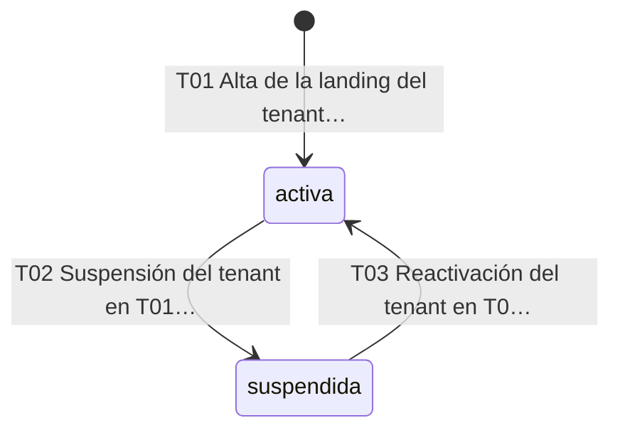

| # | Desde | Hasta | Disparador | Tipo | Guardas | Evento emitido |
|---|---|---|---|---|---|---|
| T01 | (nuevo) | `activa` | Alta de la landing del tenant / — | no especificado | — | — |
| T02 | `activa` | `suspendida` | Suspensión del tenant en T01 / — | no especificado | — | — |
| T03 | `suspendida` | `activa` | Reactivación del tenant en T01 / — | no especificado | — | — |

### EST-POR-02 — `landingPageVersions.status` (COL-POR-02)

**Colección:** Versiones publicadas de la landing. **Campos de estado en el §7:** `status` (línea 526; valores: `borrador`, `enRevision`, `aprobada`, `programada`, `publicada`, `archivada`, `rechazada`).

**Fuente:** M19 §8.3.

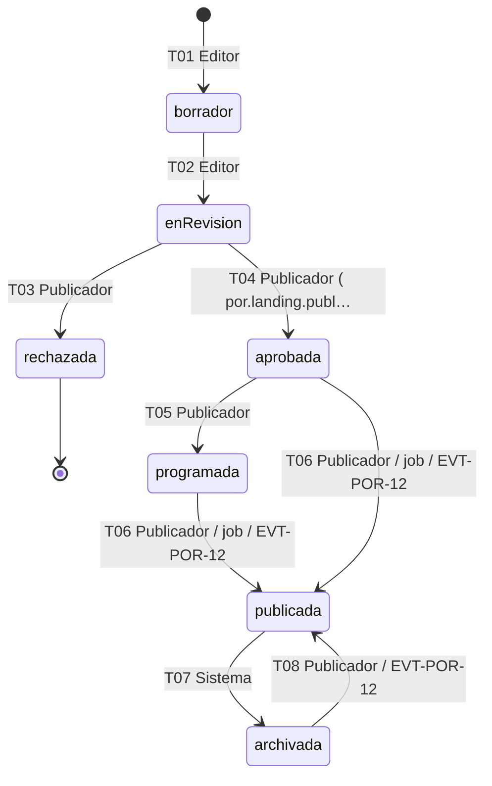

| # | Desde | Hasta | Disparador | Tipo | Guardas | Evento emitido |
|---|---|---|---|---|---|---|
| T01 | (nuevo) | `borrador` | Editor | usuario | — | — |
| T02 | `borrador` | `enRevision` | Editor | usuario | Validación de bloques OK (botón de baja presente si corresponde) | — |
| T03 | `enRevision` | `rechazada` | Publicador | no especificado | Comentario obligatorio | — |
| T04 | `enRevision` | `aprobada` | Publicador (`por.landing.publicar`) | usuario | — | — |
| T05 | `aprobada` | `programada` | Publicador | no especificado | `scheduledAt` futura | — |
| T06 | `aprobada`, `programada` | `publicada` | Publicador / job | job | — | EVT-POR-12 `por.landing.published` |
| T07 | `publicada` | `archivada` | Sistema | sistema | Otra versión publicada | — |
| T08 | `archivada` | `publicada` | Publicador | no especificado | Reversión | EVT-POR-12 `por.landing.published` |

### EST-POR-03 — `portalAccountAccess.status` (COL-POR-03)

**Colección:** Vínculo usuario del portal–cuenta (DEC-043). **Campos de estado en el §7:** `status` (línea 552; valores: `pendienteVerificacion`, `pendienteConfirmacionTitular`, `activo`, `suspendido`, `revocado`, `vencido`).

**Fuente:** M19 §8.1.

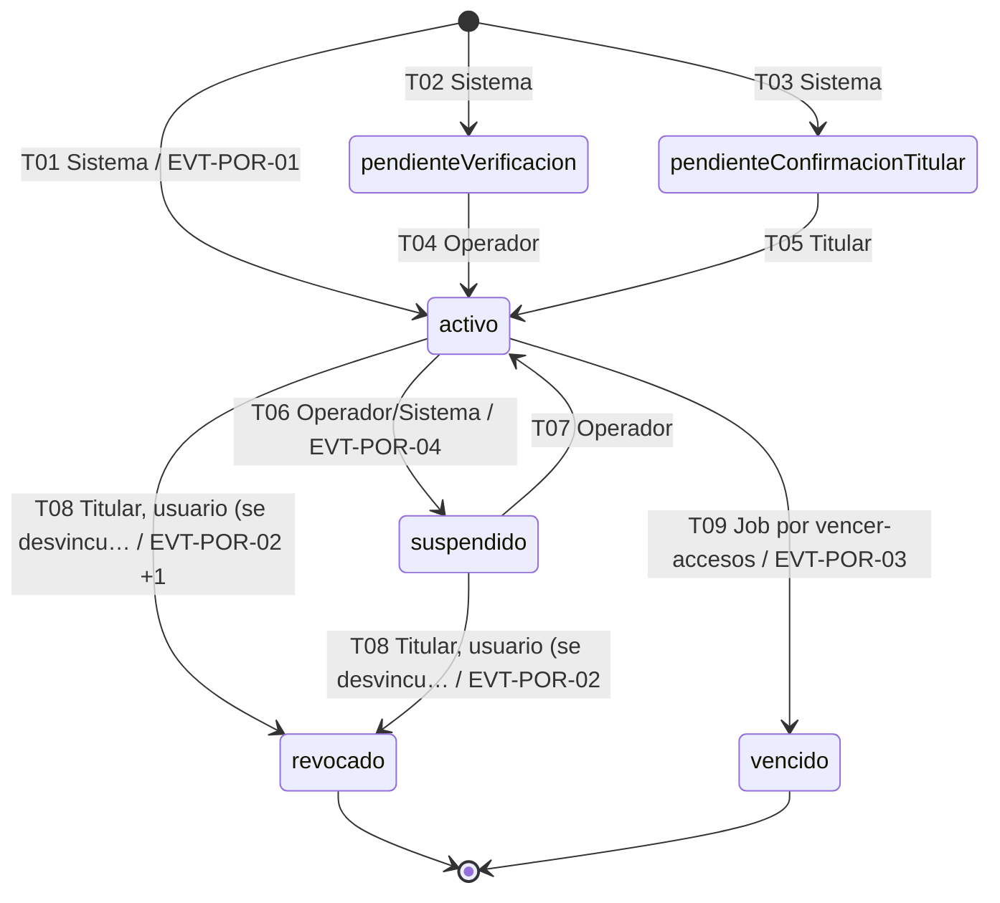

| # | Desde | Hasta | Disparador | Tipo | Guardas | Evento emitido |
|---|---|---|---|---|---|---|
| T01 | (nuevo) | `activo` | Sistema | sistema | Verificación suficiente (RN-POR-003) o migración con documento coincidente (RN-POR-006) | EVT-POR-01 `por.accountAccess.granted` |
| T02 | (nuevo) | `pendienteVerificacion` | Sistema | sistema | Método requiere validación de operador (evidencia legal, asistida) | — |
| T03 | (nuevo) | `pendienteConfirmacionTitular` | Sistema | sistema | Vinculación por factura sin coincidencia de documento | — |
| T04 | `pendienteVerificacion` | `activo` | Operador | usuario | Evidencia validada | — |
| T05 | `pendienteConfirmacionTitular` | `activo` | Titular | no especificado | Confirma | — |
| T06 | `activo` | `suspendido` | Operador/Sistema | sistema, usuario | Sospecha de fraude, titularidad en disputa, fallecimiento informado | EVT-POR-04 `por.accountAccess.suspended` |
| T07 | `suspendido` | `activo` | Operador | usuario | Revisión favorable | — |
| T08 | `activo`, `suspendido` | `revocado` | Titular, usuario (se desvincula), operador | usuario | — | EVT-POR-02 `por.accountAccess.revoked` |
| T09 | `activo` | `vencido` | Job `por:vencer-accesos` | job | `validTo` < ahora | EVT-POR-03 `por.accountAccess.expired` |
| T10 | `activo` | `revocado` | Sistema | sistema | Cambio de titularidad ejecutado en M01 (`per.ownership.changed`) para accesos `titular` del titular saliente | — |

### EST-POR-04 — `portalDelegationInvites.status` (COL-POR-05)

**Colección:** Invitaciones de delegación. **Campos de estado en el §7:** `status` (línea 592; valores: `enviada`, `aceptada`, `rechazada`, `vencida`, `revocada`).

**Fuente:** M19 §8.2.

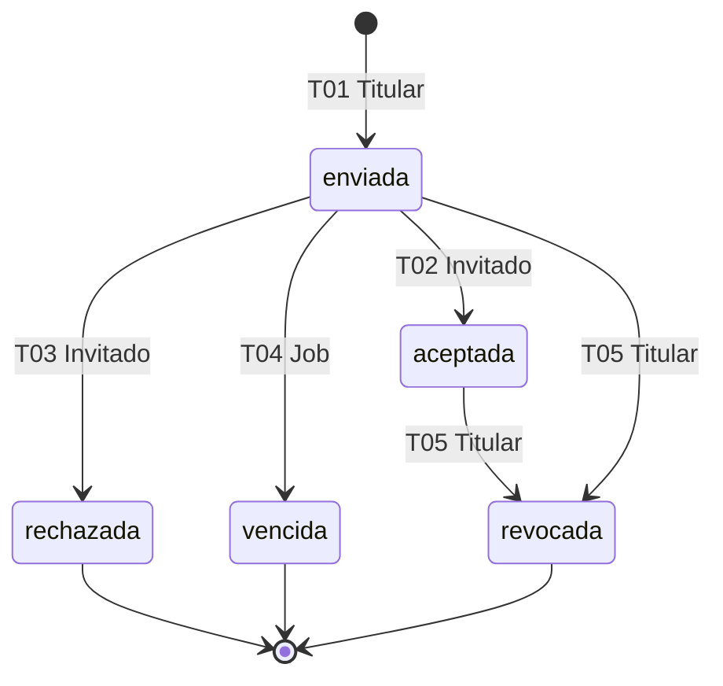

| # | Desde | Hasta | Disparador | Tipo | Guardas | Evento emitido |
|---|---|---|---|---|---|---|
| T01 | (nuevo) | `enviada` | Titular | no especificado | Acceso con rol titular/cotitular | — |
| T02 | `enviada` | `aceptada` | Invitado | no especificado | Token válido, usuario autenticado, documento coincide si se indicó | — |
| T03 | `enviada` | `rechazada` | Invitado | no especificado | — | — |
| T04 | `enviada` | `vencida` | Job | job | 7 días sin respuesta | — |
| T05 | `aceptada`, `enviada` | `revocada` | Titular | no especificado | — | — |

### EST-POR-05 — `portalForms.status` (COL-POR-06)

**Colección:** Formularios del portal (sobre `formVersions` de T11). **Campos de estado en el §7:** `status` (línea 618; valores: `borrador`, `publicado`, `retirado`).

**Fuente:** M19 §8.4.

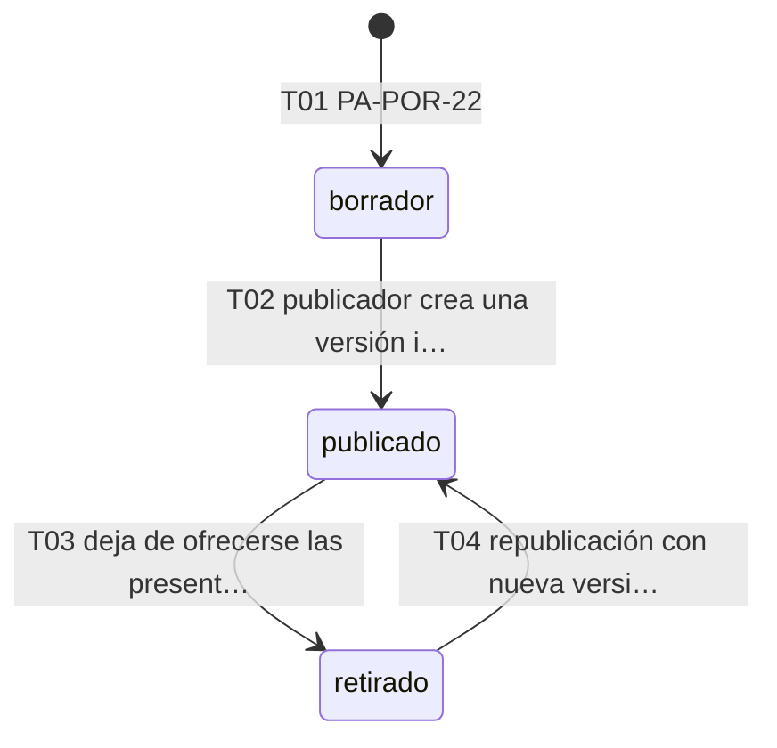

| # | Desde | Hasta | Disparador | Tipo | Guardas | Evento emitido |
|---|---|---|---|---|---|---|
| T01 | (nuevo) | `borrador` | PA-POR-22 | no especificado | — | — |
| T02 | `borrador` | `publicado` | publicador crea una versión inmutable en formVersions de T11 y actualiza formVersionId, PA-POR-21 antes crea versions n inmutable | no especificado | — | — |
| T03 | `publicado` | `retirado` | deja de ofrecerse las presentaciones existentes siguen | no especificado | — | — |
| T04 | `retirado` | `publicado` | republicación con nueva versión | no especificado | — | — |

### EST-POR-06 — `portalFormSubmissions.status` (COL-POR-07)

**Colección:** Envíos de formularios (generan caso en M09). **Campos de estado en el §7:** `status` (línea 646; valores: `enviada`, `observada`, `aceptada`, `rechazada`, `cancelada`).

**Fuente:** M19 §8.5.

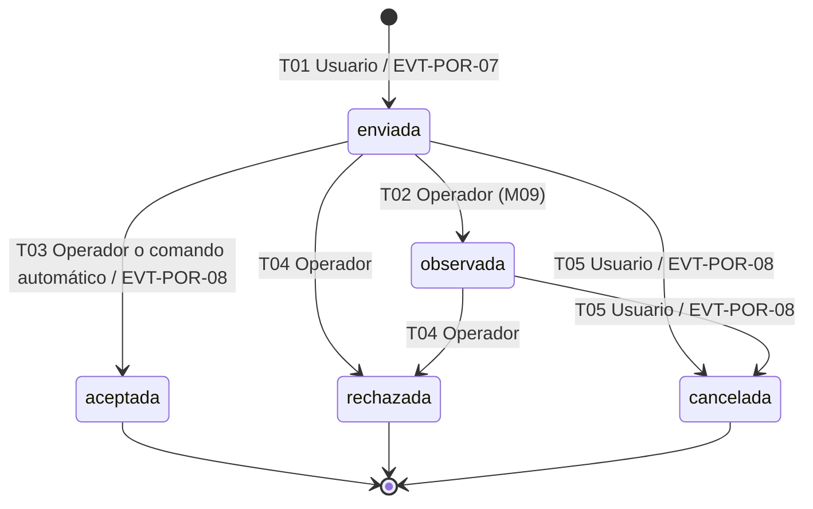

| # | Desde | Hasta | Disparador | Tipo | Guardas | Evento emitido |
|---|---|---|---|---|---|---|
| T01 | (nuevo) | `enviada` | Usuario | usuario | Validación completa, T&C aceptados, `compareDocument` OK | EVT-POR-07 `por.formSubmission.submitted` |
| T02 | `enviada` | `observada` | Operador (M09) | usuario | Faltante o error | — |
| T03 | `enviada` | `aceptada` | Operador o comando automático | job, usuario | Comando de ejecución OK | EVT-POR-08 `por.formSubmission.accepted` |
| T04 | `enviada`, `observada` | `rechazada` | Operador | usuario | Motivo obligatorio | — |
| T05 | `enviada`, `observada` | `cancelada` | Usuario | usuario | Sin ejecución iniciada (M09 lo confirma) | EVT-POR-08 `por.formSubmission.cancelled` (inferido por nombre) |

### EST-POR-07 — `publicSubmissions.status` (COL-POR-09)

**Colección:** Envíos públicos sin sesión. **Campos de estado en el §7:** `status` (línea 695; valores: `recibida`, `codigoEntregado`, `identificada`, `derivada`, `constanciaEmitida`, `cerrada`, `descartadaSpam`).

**Fuente:** M19 §8.6.

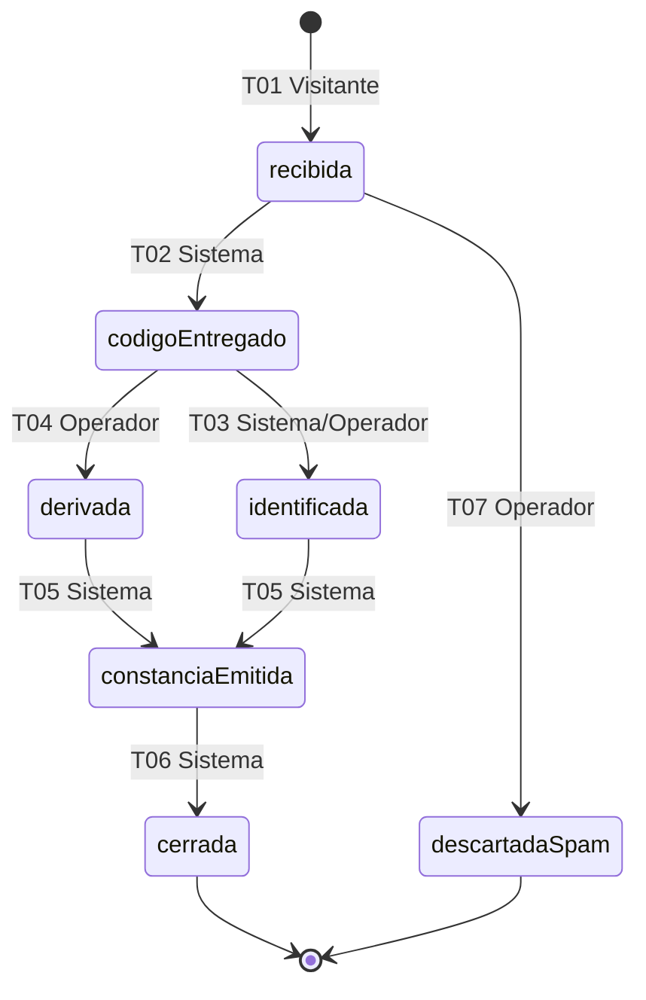

| # | Desde | Hasta | Disparador | Tipo | Guardas | Evento emitido |
|---|---|---|---|---|---|---|
| T01 | (nuevo) | `recibida` | Visitante | no especificado | Captcha/antiabuso OK, datos mínimos | — |
| T02 | `recibida` | `codigoEntregado` | Sistema | sistema | Evidencia de entrega por el medio informado (T09) | — |
| T03 | `codigoEntregado` | `identificada` | Sistema/Operador | sistema, usuario | Coincidencia con contrato (documento + cuenta/suministro/domicilio) | — |
| T04 | `codigoEntregado` | `derivada` | Operador | usuario | No identificable automáticamente | — |
| T05 | `derivada`, `identificada` | `constanciaEmitida` | Sistema | sistema | Caso creado | — |
| T06 | `constanciaEmitida` | `cerrada` | Sistema | sistema | Caso M09 cerrado (baja ejecutada o desistida por el solicitante) | — |
| T07 | `recibida` | `descartadaSpam` | Operador | usuario | Evidencia de abuso, con motivo | — |

### EST-POR-08 — `portalUserPreferences.installPromptState` (COL-POR-10)

**Colección:** Preferencias del usuario. **Campos de estado en el §7:** `installPromptState` (línea 714; valores: `noMostrado`, `rechazado`, `instalado`).

**Fuente:** M19 §8.10.3.

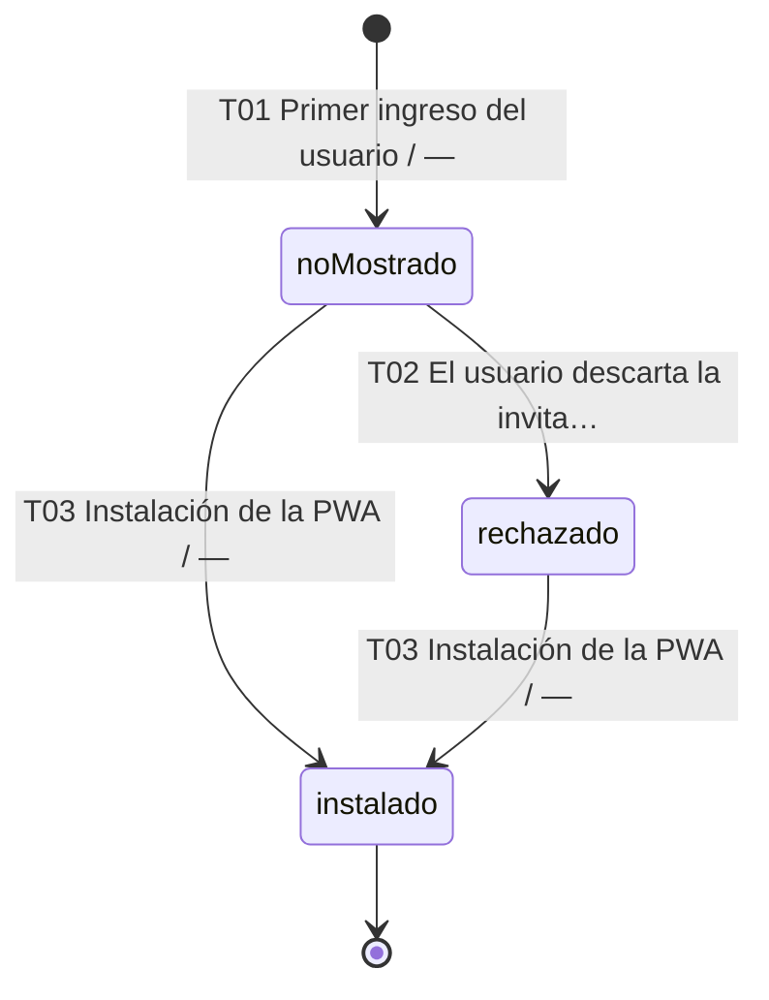

| # | Desde | Hasta | Disparador | Tipo | Guardas | Evento emitido |
|---|---|---|---|---|---|---|
| T01 | (nuevo) | `noMostrado` | Primer ingreso del usuario / — | usuario | — | — |
| T02 | `noMostrado` | `rechazado` | El usuario descarta la invitación a instalar la PWA / — | usuario | — | — |
| T03 | `noMostrado`, `rechazado` | `instalado` | Instalación de la PWA / — | no especificado | — | — |

### EST-POR-09 — `portalBanners.status` (COL-POR-11)

**Colección:** Avisos y banners. **Campos de estado en el §7:** `status` (línea 732; valores: `borrador`, `activo`, `pausado`, `vencido`).

**Fuente:** M19 §8.10.4.

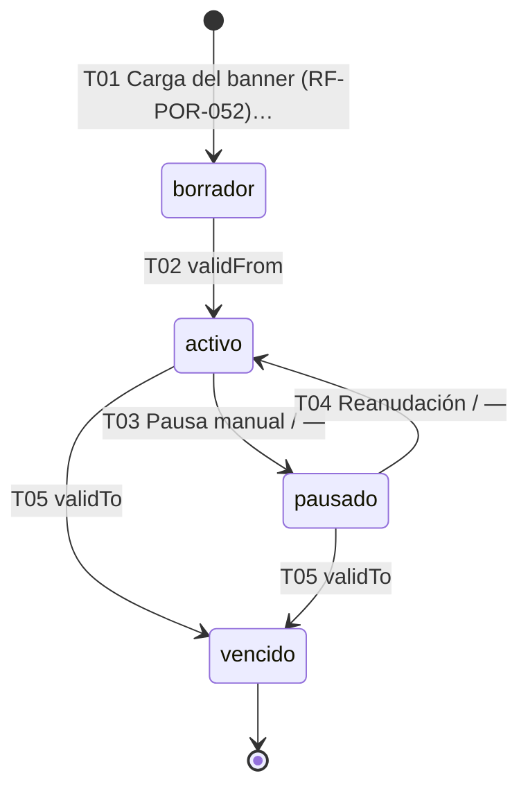

| # | Desde | Hasta | Disparador | Tipo | Guardas | Evento emitido |
|---|---|---|---|---|---|---|
| T01 | (nuevo) | `borrador` | Carga del banner (RF-POR-052) / — | no especificado | — | — |
| T02 | `borrador` | `activo` | Activación con vigencia `validFrom`/`validTo` / — | no especificado | — | — |
| T03 | `activo` | `pausado` | Pausa manual / — | no especificado | — | — |
| T04 | `pausado` | `activo` | Reanudación / — | no especificado | — | — |
| T05 | `activo`, `pausado` | `vencido` | Vence `validTo` (job) `[VERIFICAR]` / — | job | — | — |

### EST-POR-10 — `legacyPortalImports.status` (COL-POR-12)

**Colección:** Importación de usuarios de CoopOnline. **Campos de estado en el §7:** `status` (línea 744; valores: `cargado`, `validando`, `validado`, `conErrores`, `importando`, `importado`, `revertido`).

**Fuente:** M19 §8.7, M19 §8.10.1.

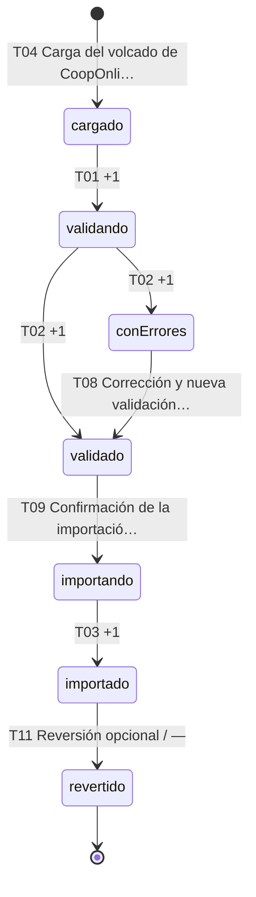

| # | Desde | Hasta | Disparador | Tipo | Guardas | Evento emitido |
|---|---|---|---|---|---|---|
| T01 | `cargado` | `validando` | — | no especificado | — | — |
| T02 | `validando` | `conErrores`, `validado` | — | no especificado | — | — |
| T03 | `importando` | `importado` | — | no especificado | — | — |
| T04 | (nuevo) | `cargado` | Carga del volcado de CoopOnline / — | no especificado | — | — |
| T05 | `cargado` | `validando` | Inicio de la validación / — | no especificado | — | — |
| T06 | `validando` | `validado` | Validación sin errores / — | no especificado | — | — |
| T07 | `validando` | `conErrores` | Validación con errores / — | no especificado | — | — |
| T08 | `conErrores` | `validado` | Corrección y nueva validación / — | no especificado | — | — |
| T09 | `validado` | `importando` | Confirmación de la importación / — | no especificado | — | — |
| T10 | `importando` | `importado` | Fin de la importación / EVT-POR-13 `por.legacyImport.completed` | evento | — | — |
| T11 | `importado` | `revertido` | Reversión opcional / — | no especificado | Dentro de los 7 días y sin activaciones (§8.7) | — |

### EST-POR-11 — `legacyPortalUserMap.status` (COL-POR-13)

**Colección:** Mapa de usuarios heredados. **Campos de estado en el §7:** `status` (línea 759; valores: `pendiente`, `creado`, `fusionado`, `conflicto`, `invitado`, `activado`, `descartado`).

**Fuente:** M19 §8.10.5.

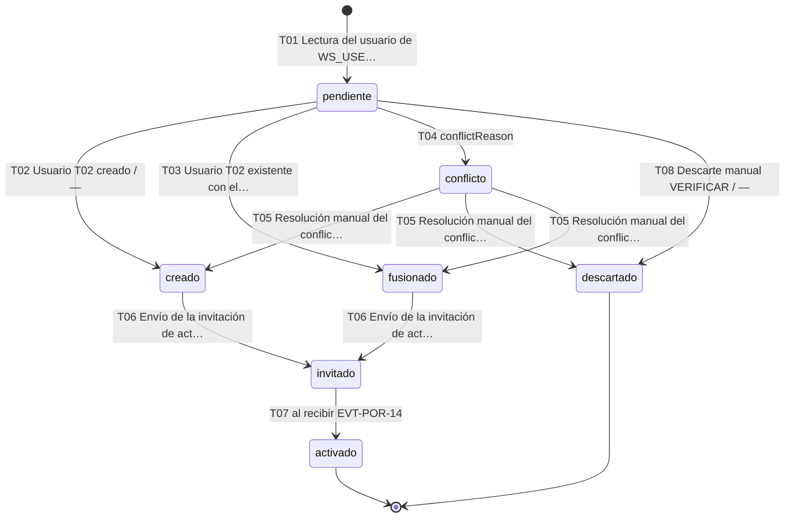

| # | Desde | Hasta | Disparador | Tipo | Guardas | Evento emitido |
|---|---|---|---|---|---|---|
| T01 | (nuevo) | `pendiente` | Lectura del usuario de `WS_USERS` / — | usuario | — | — |
| T02 | `pendiente` | `creado` | Usuario T02 creado / — | usuario | — | — |
| T03 | `pendiente` | `fusionado` | Usuario T02 existente con el mismo correo o documento / — | usuario | — | — |
| T04 | `pendiente` | `conflicto` | Correo compartido o documento que no coincide (`conflictReason`) / — | no especificado | — | — |
| T05 | `conflicto` | `creado`, `descartado`, `fusionado` | Resolución manual del conflicto `[VERIFICAR]` / — | no especificado | — | — |
| T06 | `creado`, `fusionado` | `invitado` | Envío de la invitación de activación / — | no especificado | — | — |
| T07 | `invitado` | `activado` | El usuario activa su cuenta / EVT-POR-14 `por.legacyUser.activated` | evento, usuario | — | — |
| T08 | `pendiente` | `descartado` | Descarte manual `[VERIFICAR]` / — | no especificado | — | — |

### EST-POR-12 — `kioskDevices.status` (COL-POR-14)

**Colección:** Terminales de autoconsulta. **Campos de estado en el §7:** `status` (línea 781; valores: `activo`, `fueraDeServicio`, `baja`).

**Fuente:** M19 §8.8.

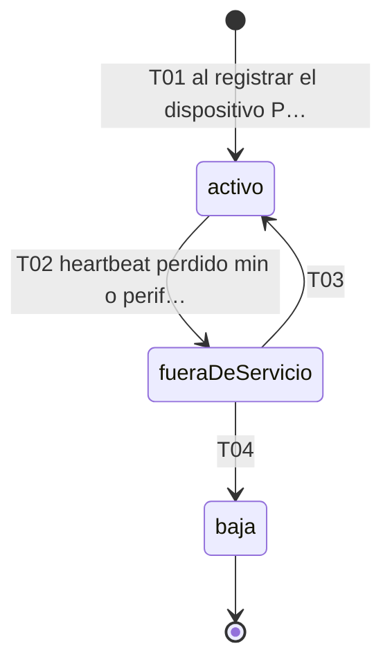

| # | Desde | Hasta | Disparador | Tipo | Guardas | Evento emitido |
|---|---|---|---|---|---|---|
| T01 | (nuevo) | `activo` | al registrar el dispositivo PA-POR-22 | no especificado | — | — |
| T02 | `activo` | `fueraDeServicio` | heartbeat perdido min o periférico con error vuelve al recuperar | no especificado | — | — |
| T03 | `fueraDeServicio` | `activo` | — | no especificado | — | — |
| T04 | `fueraDeServicio` | `baja` | — | no especificado | — | — |

## T01 — PLA Plataforma SaaS

### EST-PLA-01 — `tenants.status` (COL-PLA-01)

**Colección:** Registro del tenant, ciclo de vida, dominios, zona horaria. **Campos de estado en el §7:** `status` (línea 852; valores: `preparing`, `testing`, `readyToEnable`, `operational`, `suspended`, `closing`, `closed`, `purged`).

**Fuente:** T01 §8.1.

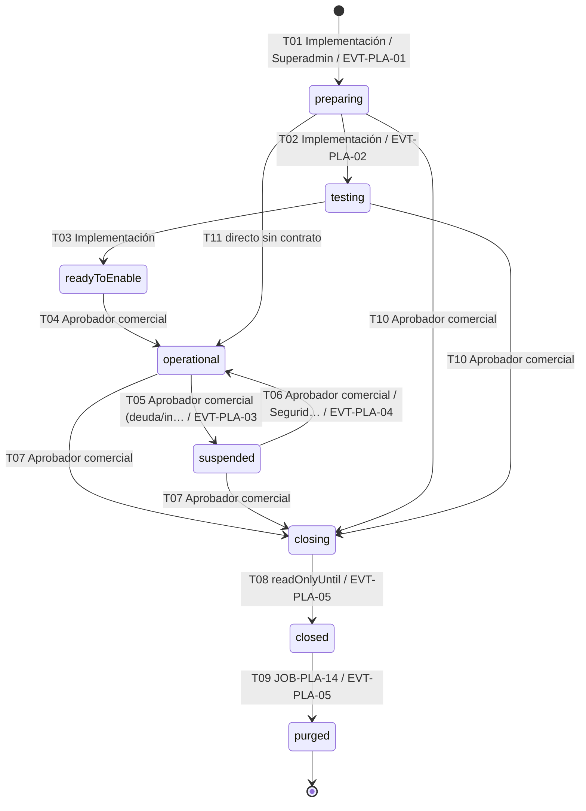

| # | Desde | Hasta | Disparador | Tipo | Guardas | Evento emitido |
|---|---|---|---|---|---|---|
| T01 | (nuevo) | `preparing` | Implementación / Superadmin | usuario | Borrador de alta confirmado; CUIT válido y no duplicado | EVT-PLA-01 `pla.tenant.created` |
| T02 | `preparing` | `testing` | Implementación | no especificado | Checklist `tenant.base` completo (identidad, contactos, administrador con 2FA, región, zona horaria, dominio, branding mínimo) | EVT-PLA-02 `pla.tenant.statusChanged` |
| T03 | `testing` | `readyToEnable` | Implementación | no especificado | Al menos un módulo con checklist productivo completo; contrato SaaS `active` o aprobado; ensayo del recorrido piloto con evidencia (AGR-036) | — |
| T04 | `readyToEnable` | `operational` | Aprobador comercial | usuario | Checklist `tenant.operational` completo (contrato activo, legales publicados, backup lógico inicial OK, `noDemoData`, usuarios de prueba deshabilitad… | — |
| T05 | `operational` | `suspended` | Aprobador comercial (deuda/incumplimiento/pedido) o Seguridad (riesgo) | usuario | Motivo, modo y comunicación previa registrados (salvo riesgo de seguridad) (RN-PLA-012) | EVT-PLA-03 `pla.tenant.suspended` |
| T06 | `suspended` | `operational` | Aprobador comercial / Seguridad | usuario | Causa resuelta y registrada (RN-PLA-013) | EVT-PLA-04 `pla.tenant.reactivated` |
| T07 | `operational`, `suspended` | `closing` | Aprobador comercial | usuario | Contrato `terminated` o pedido de la cooperativa; exportación de salida encolada | — |
| T08 | `closing` | `closed` | Sistema (job) al vencer `readOnlyUntil` | job | Exportación entregada (descarga registrada o constancia de entrega) | EVT-PLA-05 `pla.tenant.closed` (inferido por nombre) |
| T09 | `closed` | `purged` | Sistema + aprobación de Seguridad | sistema | Vencido `purgeAfter`; sin retención legal pendiente (`legalHold`) | EVT-PLA-05 `pla.tenant.closed` |
| T10 | `preparing`, `testing` | `closing` | Aprobador comercial | usuario | Cooperativa desiste | — |
| T11 | `preparing` | `operational` | directo sin contrato | no especificado | — | — |

### EST-PLA-02 — `moduleCatalog.status` (COL-PLA-02)

**Colección:** Módulos y capabilities licenciables. **Campos de estado en el §7:** `status` (línea 888; valores: `draft`, `available`, `deprecated`, `retired`).

**Fuente:** T01 §8.12.

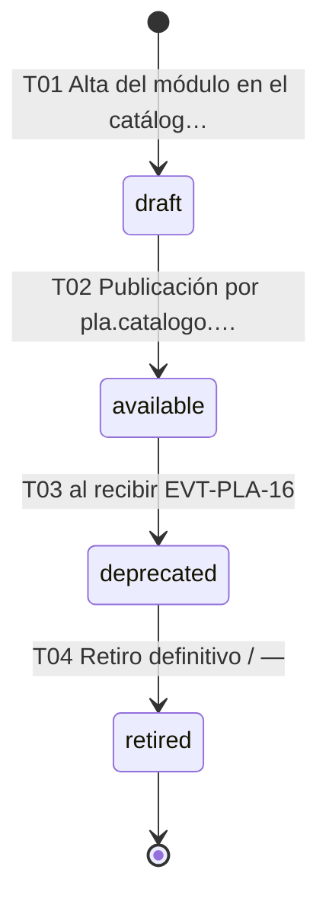

| # | Desde | Hasta | Disparador | Tipo | Guardas | Evento emitido |
|---|---|---|---|---|---|---|
| T01 | (nuevo) | `draft` | Alta del módulo en el catálogo / — | no especificado | — | — |
| T02 | `draft` | `available` | Publicación por `pla.catalogo.editar` / — | usuario | Manifiesto del módulo validado | — |
| T03 | `available` | `deprecated` | Anuncio de retiro / EVT-PLA-16 (notas de versión) | evento | — | — |
| T04 | `deprecated` | `retired` | Retiro definitivo / — | no especificado | Ningún tenant con el módulo en `test` o `production` | — |

### EST-PLA-03 — `platformPlans.status` (COL-PLA-03)

**Colección:** Packs y complementos comerciales (DEC-065). **Campos de estado en el §7:** `status` (línea 929; valores: `draft`, `available`, `retired`).

**Fuente:** T01 §8.12.

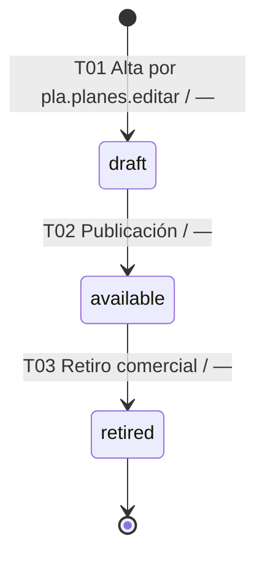

| # | Desde | Hasta | Disparador | Tipo | Guardas | Evento emitido |
|---|---|---|---|---|---|---|
| T01 | (nuevo) | `draft` | Alta por `pla.planes.editar` / — | usuario | — | — |
| T02 | `draft` | `available` | Publicación / — | no especificado | — | — |
| T03 | `available` | `retired` | Retiro comercial / — | no especificado | Las licencias vigentes del plan siguen hasta su `validTo` | — |

### EST-PLA-04 — `tenantLicenses.status` (COL-PLA-04)

**Colección:** Licencia vigente y cupos. **Campos de estado en el §7:** `status` (línea 940; valores: `active`, `expired`, `revoked`).

**Fuente:** T01 §8.12.

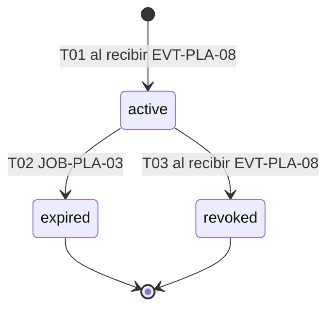

| # | Desde | Hasta | Disparador | Tipo | Guardas | Evento emitido |
|---|---|---|---|---|---|---|
| T01 | (nuevo) | `active` | Aprobación del contrato SaaS o alta por `pla.licencias.editar` / EVT-PLA-08 | evento | Contrato `approved` (§8.4) | — |
| T02 | `active` | `expired` | JOB-PLA-03 al pasar `validTo` / EVT-PLA-08 | job, evento | — | — |
| T03 | `active` | `revoked` | Baja por `pla.licencias.editar` con motivo / EVT-PLA-08 | evento | — | — |

### EST-PLA-05 — `tenantModuleActivations.mode` (COL-PLA-05)

**Colección:** Activación de módulos por tenant. **Campos de estado en el §7:** `status` (línea 947; valores: `ok`, `pendingChecklist`, `blocked`).

**Fuente:** T01 §8.2, T01 §8.13.

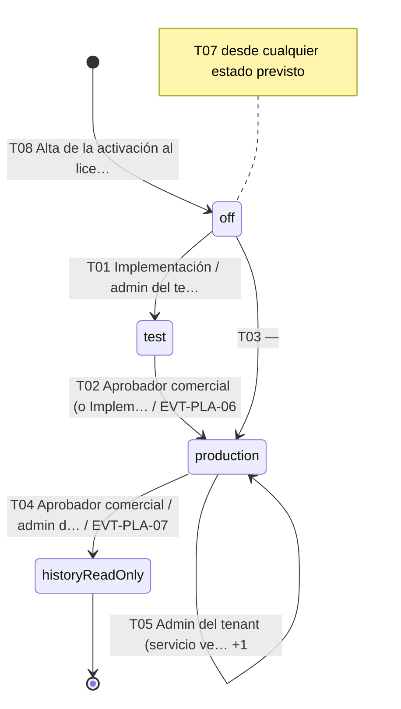

| # | Desde | Hasta | Disparador | Tipo | Guardas | Evento emitido |
|---|---|---|---|---|---|---|
| T01 | `off` | `test` | Implementación / admin del tenant (si delegado) | usuario | Licencia vigente; dependencias en `test` o `production`; tenant ≥ `testing` | — |
| T02 | `test` | `production` | Aprobador comercial (o Implementación con permiso) | usuario | RN-PLA-010; tenant en `readyToEnable`/`operational` | EVT-PLA-06 `pla.capability.activated` |
| T03 | `off` | `production` | — | no especificado | No permitido | — |
| T04 | `production` | `historyReadOnly` | Aprobador comercial / admin del tenant | usuario | Motivo; módulos dependientes en `historyReadOnly` u `off` | EVT-PLA-07 `pla.capability.deactivated` |
| T05 | `production` | `production` | Admin del tenant (servicio vertical) | usuario | — | — |
| T06 | `production` | `production` | Admin del tenant (servicio vertical) | usuario | — | — |
| T07 | cualquiera | `off` | — | no especificado | Solo si nunca estuvo en `production` | — |
| T08 | (nuevo) | `off` | Alta de la activación al licenciar el módulo / — | no especificado | Licencia vigente | — |

### EST-PLA-06 — `tenantChecklists.items[].status` (COL-PLA-06)

**Colección:** Lista de puesta en marcha. **Campos de estado en el §7:** `overallStatus`, `status` (línea 951, 951; valores: `pending`, `ok`, `failed`, `waived`, `notApplicable`, `incomplete`, `complete`).

**Máquina 1: `items[].status`.** Fuente: T01 §8.3.

```mermaid
stateDiagram-v2
    pending --> ok : T01 evaluación automática exitosa…
    failed --> failed : T02 evaluación negativa, con deta…
    pending --> failed : T02 evaluación negativa, con deta…
    failed --> waived : T03 dispensa aprobada, RN-PLA-011…
    pending --> waived : T03 dispensa aprobada, RN-PLA-011…
    ok --> pending : T05 JOB-PLA-02 +1
    [*] --> pending : alta (estado inicial no explícito)
    note left of notApplicable : T04 desde cualquier estado previsto
    waived --> [*]
    notApplicable --> [*]
```

| # | Desde | Hasta | Disparador | Tipo | Guardas | Evento emitido |
|---|---|---|---|---|---|---|
| T01 | `pending` | `ok` | evaluación automática exitosa o verificación manual con evidencia | job | — | — |
| T02 | `failed`, `pending` | `failed` | evaluación negativa, con detalle | no especificado | — | — |
| T03 | `failed`, `pending` | `waived` | dispensa aprobada, RN-PLA-011, con vencimiento al vencer vuelve a pending | job | RN-PLA-011 | — |
| T04 | cualquiera | `notApplicable` | justificado p ej mig para cooperativa sin sistema previo | sistema | — | — |
| T05 | `ok` | `pending` | cambio en la dependencia: credencial revocada, certificado vencido, tarifa despublicada detectado por evento o reevaluación diaria JOB-PLA-02 | job, evento | — | — |
| T06 | `ok` | `pending` | en una capacidad en no la desactiva genera alerta PLA-ALR-13 aviso al tenant | no especificado | — | — |

**Máquina 2: `items.status`.** Fuente: T01 §8.13.

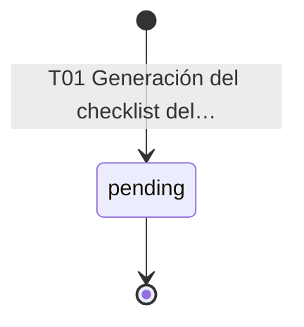

| # | Desde | Hasta | Disparador | Tipo | Guardas | Evento emitido |
|---|---|---|---|---|---|---|
| T01 | (nuevo) | `pending` | Generación del checklist del módulo / — | no especificado | — | — |

### EST-PLA-07 — `onboardingDrafts.status` (COL-PLA-07)

**Colección:** Alta asistida antes de crear el tenant. **Campos de estado en el §7:** `status` (línea 955; valores: `draft`, `proposed`, `confirmed`, `discarded`, `expired`).

**Fuente:** T01 §8.12.

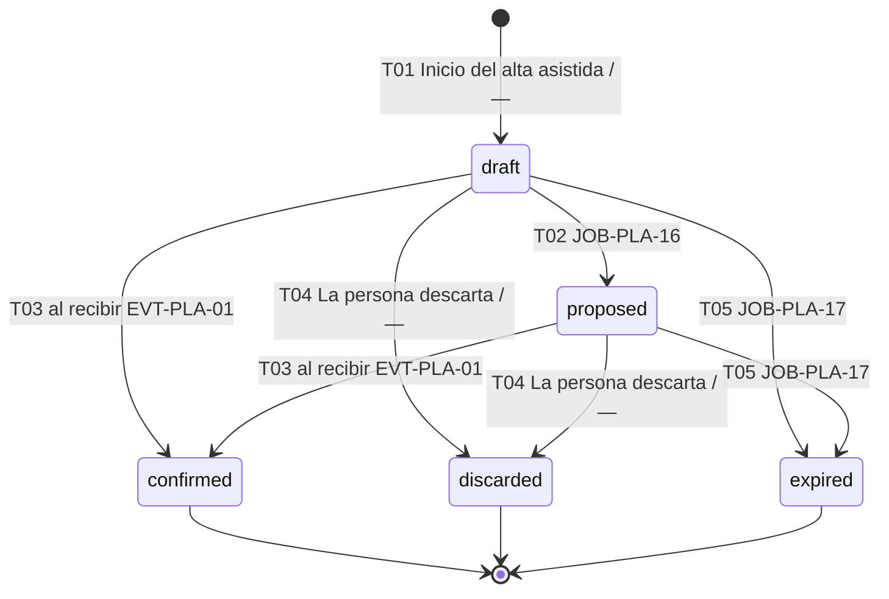

| # | Desde | Hasta | Disparador | Tipo | Guardas | Evento emitido |
|---|---|---|---|---|---|---|
| T01 | (nuevo) | `draft` | Inicio del alta asistida / — | no especificado | — | — |
| T02 | `draft` | `proposed` | JOB-PLA-16 devuelve la propuesta de IA / — | job | `PRM-PLA-040 = true` | — |
| T03 | `draft`, `proposed` | `confirmed` | La persona confirma el alta / EVT-PLA-01 (`pla.tenant.created`) | evento | Pasos validados | — |
| T04 | `draft`, `proposed` | `discarded` | La persona descarta / — | no especificado | — | — |
| T05 | `draft`, `proposed` | `expired` | JOB-PLA-17 al pasar `expiresAt` / — | job | — | — |

### EST-PLA-08 — `saasContracts.status` (COL-PLA-08)

**Colección:** Contrato SaaS GoodApps–cooperativa. **Campos de estado en el §7:** `status` (línea 971; valores: `draft`, `pendingApproval`, `active`, `suspended`, `terminated`, `expired`).

**Fuente:** T01 §8.4, T01 §8.13.

```mermaid
stateDiagram-v2
    draft --> pendingApproval : T01 Comercial
    pendingApproval --> active : T02 Aprobador comercial / EVT-PLA-09
    pendingApproval --> draft : T03 Aprobador
    active --> active : T04 Comercial + Aprobador
    active --> suspended : T05 Sistema/Aprobador
    active --> expired : T06 Sistema
    active --> terminated : T07 Aprobador comercial
    expired --> terminated : T07 Aprobador comercial
    [*] --> draft : T08 Alta del contrato por Comerci…
    suspended --> [*]
    terminated --> [*]
```

| # | Desde | Hasta | Disparador | Tipo | Guardas | Evento emitido |
|---|---|---|---|---|---|---|
| T01 | `draft` | `pendingApproval` | Comercial | no especificado | Plan, cupos, región, condiciones de salida | — |
| T02 | `pendingApproval` | `active` | Aprobador comercial | usuario | Documento firmado adjunto | EVT-PLA-09 `pla.saasContract.approved` |
| T03 | `pendingApproval` | `draft` | Aprobador | usuario | Rechazo con motivo | — |
| T04 | `active` | `active` | Comercial + Aprobador | usuario | Cambio de plan/cupos con `validFrom` | — |
| T05 | `active` | `suspended` | Sistema/Aprobador | sistema, usuario | Tenant suspendido por motivo comercial | — |
| T06 | `active` | `expired` | Sistema | sistema | `validTo` vencido sin renovación | — |
| T07 | `active`, `expired` | `terminated` | Aprobador comercial | usuario | Baja comunicada | — |
| T08 | (nuevo) | `draft` | Alta del contrato por Comercial / — | no especificado | — | — |

### EST-PLA-09 — `supportCases.status` (COL-PLA-10)

**Colección:** Casos de soporte del tenant. **Campos de estado en el §7:** `status` (línea 983; sin valores en el §7).

**Fuente:** T01 §8.5, T01 §8.13.

```mermaid
stateDiagram-v2
    received --> inAnalysis : T01 En análisis asignado
    inAnalysis --> waitingTenant : T02 Esperando a la cooperativa +1
    waitingTenant --> inAnalysis : T03
    inAnalysis --> inResolution : T05 En resolución
    inResolution --> resolved : T06 Resuelta notifica y pide encu… / EVT-PLA-11
    resolved --> closed : T07 Cerrada automático a los PRM-…
    resolved --> reopened : T08
    reopened --> inAnalysis : T09 dentro de PRM-PLA-034 días
    [*] --> received : T11 Alta del caso (admin, correo,…
    note left of cancelled : T10 desde cualquier estado previsto
    closed --> [*]
    cancelled --> [*]
```

| # | Desde | Hasta | Disparador | Tipo | Guardas | Evento emitido |
|---|---|---|---|---|---|---|
| T01 | `received` | `inAnalysis` | En análisis asignado | no especificado | — | — |
| T02 | `inAnalysis` | `waitingTenant` | Esperando a la cooperativa | no especificado | — | — |
| T03 | `waitingTenant` | `inAnalysis` | — | no especificado | — | — |
| T04 | `inAnalysis` | `waitingTenant` | — | no especificado | — | — |
| T05 | `inAnalysis` | `inResolution` | En resolución | no especificado | — | — |
| T06 | `inResolution` | `resolved` | Resuelta notifica y pide encuesta | no especificado | — | EVT-PLA-11 `pla.supportCase.resolved` (inferido por nombre) |
| T07 | `resolved` | `closed` | Cerrada automático a los PRM-PLA-034 días o por el tenant | job | — | — |
| T08 | `resolved` | `reopened` | — | no especificado | — | — |
| T09 | `reopened` | `inAnalysis` | dentro de PRM-PLA-034 días | no especificado | — | — |
| T10 | cualquiera | `cancelled` | el tenant desiste | no especificado | — | — |
| T11 | (nuevo) | `received` | Alta del caso (admin, correo, teléfono o plataforma) / — | usuario | — | — |

### EST-PLA-10 — `platformIncidents.status` (COL-PLA-14)

**Colección:** Incidentes operativos de plataforma. **Campos de estado en el §7:** `status` (línea 1015; sin valores en el §7).

**Fuente:** T01 §8.7, T01 §8.13.

```mermaid
stateDiagram-v2
    investigating --> identified : T01
    identified --> monitoring : T02
    monitoring --> resolved : T03
    resolved --> postmortem : T04 cerrado con documento
    monitoring --> investigating : T05 recurrencia
    [*] --> investigating : T06 Declaración del incidente / —
    postmortem --> [*]
```

| # | Desde | Hasta | Disparador | Tipo | Guardas | Evento emitido |
|---|---|---|---|---|---|---|
| T01 | `investigating` | `identified` | — | no especificado | — | — |
| T02 | `identified` | `monitoring` | — | no especificado | — | — |
| T03 | `monitoring` | `resolved` | — | no especificado | — | — |
| T04 | `resolved` | `postmortem` | cerrado con documento | no especificado | — | — |
| T05 | `monitoring` | `investigating` | recurrencia | no especificado | — | — |
| T06 | (nuevo) | `investigating` | Declaración del incidente / — | no especificado | — | — |

### EST-PLA-11 — `alerts.status` (COL-PLA-16)

**Colección:** Alertas disparadas (absorbe `alertEvents` de T08). **Campos de estado en el §7:** `status` (línea 1040; sin valores en el §7).

**Fuente:** T01 §8.9, T01 §8.13.

```mermaid
stateDiagram-v2
    open --> acknowledged : T01 reconocida por un destinatario
    acknowledged --> resolved : T02 manual o automática al desapa… / EVT-PLA-17
    acknowledged --> silenced : T03 hasta silencedUntil, con moti…
    open --> silenced : T03 hasta silencedUntil, con moti…
    silenced --> open : T04
    resolved --> open : T05 recurrencia fuera de la venta…
    [*] --> open : T06 Regla de alerta disparada / —
```

| # | Desde | Hasta | Disparador | Tipo | Guardas | Evento emitido |
|---|---|---|---|---|---|---|
| T01 | `open` | `acknowledged` | reconocida por un destinatario | no especificado | — | — |
| T02 | `acknowledged` | `resolved` | manual o automática al desaparecer la condición | job | — | EVT-PLA-17 `pla.alert.resolved` (inferido por nombre) |
| T03 | `acknowledged`, `open` | `silenced` | hasta silencedUntil, con motivo | no especificado | — | — |
| T04 | `silenced` | `open` | — | no especificado | — | — |
| T05 | `resolved` | `open` | recurrencia fuera de la ventana de deduplicación crea nueva alerta dentro de la ventana reabre la misma | no especificado | — | — |
| T06 | (nuevo) | `open` | Regla de alerta disparada / — | no especificado | Deduplicación por ventana | — |

### EST-PLA-12 — `backupRuns.status` (COL-PLA-18)

**Colección:** Ejecuciones de respaldo y PITR. **Campos de estado en el §7:** `status` (línea 1048; valores: `running`, `completed`, `failed`, `verified`).

**Fuente:** T01 §8.12.

```mermaid
stateDiagram-v2
    [*] --> running : T01 JOB-PLA-09
    running --> completed : T02 al recibir EVT-PLA-13
    running --> failed : T03 al recibir EVT-PLA-13
    completed --> verified : T04 JOB-PLA-10
    failed --> [*]
    verified --> [*]
```

| # | Desde | Hasta | Disparador | Tipo | Guardas | Evento emitido |
|---|---|---|---|---|---|---|
| T01 | (nuevo) | `running` | JOB-PLA-09 / — | job | — | — |
| T02 | `running` | `completed` | Fin sin error / EVT-PLA-13 `pla.backup.completed` | evento | — | — |
| T03 | `running` | `failed` | Error o tiempo agotado / EVT-PLA-13 `pla.backup.failed`; alerta PLA-ALR-01 | evento | — | — |
| T04 | `completed` | `verified` | JOB-PLA-10 / — | job | Checksum del manifiesto coincide | — |

### EST-PLA-13 — `restoreRequests.status` (COL-PLA-19)

**Colección:** Pedidos de restauración por tenant. **Campos de estado en el §7:** `status` (línea 1060; sin valores en el §7).

**Fuente:** T01 §8.8, T01 §8.13.

```mermaid
stateDiagram-v2
    requested --> approved : T01 fullTenant
    approved --> stagingRestored : T02 JOB-PLA-11
    stagingRestored --> diffReady : T03 Sistema
    diffReady --> executing : T04 Operaciones (confirmación fin…
    diffReady --> completed : T05 Sistema
    executing --> reconciling : T06 JOB-PLA-12
    reconciling --> completed : T07 Operaciones / EVT-PLA-14
    reconciling --> completedWithIssues : T08 Operaciones
    [*] --> requested : T10 Operaciones o admin del tenan…
    note left of cancelled : T09 desde cualquier estado previsto
    note left of failed : T09 desde cualquier estado previsto
    completed --> [*]
    completedWithIssues --> [*]
    cancelled --> [*]
    failed --> [*]
```

| # | Desde | Hasta | Disparador | Tipo | Guardas | Evento emitido |
|---|---|---|---|---|---|---|
| T01 | `requested` | `approved` | Operaciones + Seguridad (+ admin del tenant si `fullTenant`) | usuario | RF-PLA-125 | — |
| T02 | `approved` | `stagingRestored` | Sistema (JOB-PLA-11) | job | Snapshot disponible para el punto | — |
| T03 | `stagingRestored` | `diffReady` | Sistema | sistema | Extracción del tenant | — |
| T04 | `diffReady` | `executing` | Operaciones (confirmación final) | no especificado | Para `fullTenant`: tenant en mantenimiento (RN-PLA-023) (RN-PLA-024) | — |
| T05 | `diffReady` | `completed` | Sistema | sistema | Modo `sandboxCopy`: copia al sandbox | — |
| T06 | `executing` | `reconciling` | Sistema (JOB-PLA-12) | job | — | — |
| T07 | `reconciling` | `completed` | Operaciones | no especificado | Sin `issues` bloqueantes | EVT-PLA-14 `pla.restore.requested` |
| T08 | `reconciling` | `completedWithIssues` | Operaciones | no especificado | Issues derivados a bandeja del tenant/soporte | — |
| T09 | cualquiera | `cancelled`, `failed` | Operaciones / Sistema | sistema | — | — |
| T10 | (nuevo) | `requested` | Operaciones o admin del tenant vía caso (antes "→ `requested`") / — | usuario | Motivo, punto en el tiempo, modo | — |

### EST-PLA-14 — `tenantExports.status` (COL-PLA-21)

**Colección:** Exportaciones completas del tenant. **Campos de estado en el §7:** `status` (línea 1073; valores: `queued`, `running`, `ready`, `downloaded`, `expired`, `failed`).

**Fuente:** T01 §8.10, T01 §8.13.

```mermaid
stateDiagram-v2
    queued --> running : T01
    running --> ready : T02 EVT-PLA-18
    ready --> downloaded : T03
    downloaded --> expired : T04
    running --> failed : T05
    failed --> queued : T06 reintento
    [*] --> queued : T07 Pedido de exportación (CU-PLA…
    expired --> [*]
```

| # | Desde | Hasta | Disparador | Tipo | Guardas | Evento emitido |
|---|---|---|---|---|---|---|
| T01 | `queued` | `running` | — | no especificado | — | — |
| T02 | `running` | `ready` | — | no especificado | — | EVT-PLA-18 `pla.tenantExport.ready` (inferido por nombre) |
| T03 | `ready` | `downloaded` | — | no especificado | — | — |
| T04 | `downloaded` | `expired` | — | no especificado | — | — |
| T05 | `running` | `failed` | — | no especificado | — | — |
| T06 | `failed` | `queued` | reintento | no especificado | — | — |
| T07 | (nuevo) | `queued` | Pedido de exportación (CU-PLA-14) / — | no especificado | — | — |

### EST-PLA-15 — `releases.status` (COL-PLA-22)

**Colección:** Versiones desplegadas y notas. **Campos de estado en el §7:** `status` (línea 1401; valores: `candidate`, `deploying`, `deployed`, `rolledBack`).

**Fuente:** T01 §8.11, T01 §8.13.

```mermaid
stateDiagram-v2
    candidate --> deploying : T01 por ambiente anillo
    deploying --> deployed : T02 EVT-PLA-16
    deployed --> rolledBack : T03 vuelta al digest anterior las…
    deploying --> rolledBack : T03 vuelta al digest anterior las…
    [*] --> candidate : T04 Build aprobado por el pipelin…
    rolledBack --> [*]
```

| # | Desde | Hasta | Disparador | Tipo | Guardas | Evento emitido |
|---|---|---|---|---|---|---|
| T01 | `candidate` | `deploying` | por ambiente anillo | no especificado | — | — |
| T02 | `deploying` | `deployed` | — | no especificado | — | EVT-PLA-16 `pla.release.deployed` (inferido por nombre) |
| T03 | `deployed`, `deploying` | `rolledBack` | vuelta al digest anterior las migraciones expandir contraer garantizan compatibilidad | no especificado | — | — |
| T04 | (nuevo) | `candidate` | Build aprobado por el pipeline / — | no especificado | — | — |

### EST-PLA-16 — `featureFlags.status` (COL-PLA-23)

**Colección:** Banderas funcionales y de UI (absorbe `uiFeatureFlags` de T03). **Campos de estado en el §7:** `status` (línea 1081; valores: `active`, `retired`).

**Fuente:** T01 §8.12.

```mermaid
stateDiagram-v2
    [*] --> active : T01 Alta del flag con el desplieg…
    active --> retired : T02 El flag se retira del código…
    retired --> [*]
```

| # | Desde | Hasta | Disparador | Tipo | Guardas | Evento emitido |
|---|---|---|---|---|---|---|
| T01 | (nuevo) | `active` | Alta del flag con el despliegue / — | no especificado | `expiresAt` informado | — |
| T02 | `active` | `retired` | El flag se retira del código / — | no especificado | Al vencer `expiresAt`, PLA-ALR-07 avisa si sigue `active` | — |

### EST-PLA-17 — `outboxEvents.status` (COL-PLA-24)

**Colección:** Outbox transaccional; TTL tras publicar. **Campos de estado en el §7:** `status` (línea 1085; valores: `pending`, `published`, `failed`).

**Fuente:** T01 §8.12.

```mermaid
stateDiagram-v2
    [*] --> pending : T01 publish() en la transacción d…
    pending --> published : T02 JOB-PLA-01
    pending --> failed : T03 deadLetters
    published --> [*]
    failed --> [*]
```

| # | Desde | Hasta | Disparador | Tipo | Guardas | Evento emitido |
|---|---|---|---|---|---|---|
| T01 | (nuevo) | `pending` | `publish()` en la transacción del cambio / — | no especificado | — | — |
| T02 | `pending` | `published` | JOB-PLA-01 encola a los suscriptores / El propio evento | job, evento | — | — |
| T03 | `pending` | `failed` | Reintentos agotados (`PRM-PLA-027`) / Alta en `deadLetters`; PLA-ALR-06 | no especificado | — | — |

### EST-PLA-18 — `deadLetters.status` (COL-PLA-26)

**Colección:** Mensajes fallidos para reproceso. **Campos de estado en el §7:** `status` (línea 1087; valores: `open`, `reprocessed`, `discarded`).

**Fuente:** T01 §8.12.

```mermaid
stateDiagram-v2
    [*] --> open : T01 Evento o job agotado / PLA-AL…
    open --> reprocessed : T02 Reintento manual por pla.dead…
    open --> discarded : T03 Descarte justificado por pla.…
    reprocessed --> [*]
    discarded --> [*]
```

| # | Desde | Hasta | Disparador | Tipo | Guardas | Evento emitido |
|---|---|---|---|---|---|---|
| T01 | (nuevo) | `open` | Evento o job agotado / PLA-ALR-06 | job | — | — |
| T02 | `open` | `reprocessed` | Reintento manual por `pla.deadLetters.reprocesar` / — | usuario | El consumidor es idempotente por `inboxReceipts` | — |
| T03 | `open` | `discarded` | Descarte justificado por `pla.deadLetters.reprocesar` / — | usuario | Motivo obligatorio | — |

### EST-PLA-19 — `jobRuns.status` (COL-PLA-27)

**Colección:** Ejecuciones de jobs BullMQ; TTL. **Campos de estado en el §7:** `status` (línea 1100; valores: `queued`, `running`, `paused`, `succeeded`, `failed`, `cancelled`, `uncertain`).

**Fuente:** T01 §8.10, T01 §8.13.

```mermaid
stateDiagram-v2
    queued --> running : T01
    running --> cancelled : T02 resultado externo desconocido…
    running --> failed : T02 resultado externo desconocido…
    running --> succeeded : T02 resultado externo desconocido…
    running --> uncertain : T02 resultado externo desconocido…
    running --> paused : T03 suspensión del tenant o pausa…
    paused --> running : T04
    [*] --> queued : T05 Encolado del job / —
    cancelled --> [*]
    failed --> [*]
    succeeded --> [*]
    uncertain --> [*]
```

| # | Desde | Hasta | Disparador | Tipo | Guardas | Evento emitido |
|---|---|---|---|---|---|---|
| T01 | `queued` | `running` | — | no especificado | — | — |
| T02 | `running` | `cancelled`, `failed`, `succeeded`, `uncertain` | resultado externo desconocido requiere conciliación | no especificado | — | — |
| T03 | `running` | `paused` | suspensión del tenant o pausa de cola | no especificado | — | — |
| T04 | `paused` | `running` | — | no especificado | — | — |
| T05 | (nuevo) | `queued` | Encolado del job / — | job | — | — |

### EST-PLA-20 — `idempotencyKeys.status` (COL-PLA-28)

**Colección:** Claves de idempotencia de API; TTL (absorbe la de T08). **Campos de estado en el §7:** `responseStatus`, `status` (línea 1468, 1112; valores: `processing`, `completed`, `failed`).

**Fuente:** T01 §8.12.

```mermaid
stateDiagram-v2
    [*] --> processing : T01 Primera solicitud con la clav…
    processing --> completed : T02 Respuesta 2xx guardada / —
    processing --> failed : T03 Error del servidor la clave p…
    completed --> [*]
    failed --> [*]
```

| # | Desde | Hasta | Disparador | Tipo | Guardas | Evento emitido |
|---|---|---|---|---|---|---|
| T01 | (nuevo) | `processing` | Primera solicitud con la clave / — | no especificado | — | — |
| T02 | `processing` | `completed` | Respuesta 2xx guardada / — | no especificado | — | — |
| T03 | `processing` | `failed` | Error del servidor; la clave puede reintentarse / — | no especificado | — | — |

### EST-PLA-21 — `storedFiles.scanStatus` (COL-PLA-29)

**Colección:** Metadatos de binarios en almacenamiento privado. **Campos de estado en el §7:** `scanStatus` (línea 1116; valores: `pending`, `clean`, `infected`, `failed`).

**Fuente:** T01 §8.12.

```mermaid
stateDiagram-v2
    [*] --> pending : T01 API-PLA-63
    pending --> clean : T02 JOB-PLA-21
    pending --> infected : T03 JOB-PLA-21
    pending --> failed : T04 Error del antivirus / PLA-ALR…
    clean --> [*]
    infected --> [*]
    failed --> [*]
```

| # | Desde | Hasta | Disparador | Tipo | Guardas | Evento emitido |
|---|---|---|---|---|---|---|
| T01 | (nuevo) | `pending` | Confirmación de subida (API-PLA-63) / — | API/integración | — | — |
| T02 | `pending` | `clean` | JOB-PLA-21 sin hallazgos / — | job | Tipo real coincide con el declarado | — |
| T03 | `pending` | `infected` | JOB-PLA-21 detecta malware / — (el archivo queda inaccesible) | job | — | — |
| T04 | `pending` | `failed` | Error del antivirus / PLA-ALR-07 | no especificado | — | — |

### EST-PLA-22 — `healthSnapshots.status` (COL-PLA-31)

**Colección:** Fotos de salud de servicios; TTL. **Campos de estado en el §7:** `status` (línea 1124; valores: `up`, `degraded`, `down`).

**Fuente:** T01 §8.12.

```mermaid
stateDiagram-v2
    [*] --> up : T01 JOB-PLA-08
    [*] --> degraded : T02 JOB-PLA-08
    [*] --> down : T03 JOB-PLA-08
    up --> [*]
    degraded --> [*]
    down --> [*]
```

| # | Desde | Hasta | Disparador | Tipo | Guardas | Evento emitido |
|---|---|---|---|---|---|---|
| T01 | (nuevo) | `up` | Muestra de JOB-PLA-08 con el servicio sano / — | job | — | — |
| T02 | (nuevo) | `degraded` | Muestra de JOB-PLA-08 con el servicio degradado / — | job | — | — |
| T03 | (nuevo) | `down` | Muestra de JOB-PLA-08 con el servicio caído / PLA-ALR-01 si corresponde | job | — | — |

### EST-PLA-23 — `schemaMigrations.status` (COL-PLA-32)

**Colección:** Registro de migraciones de esquema (§7.1.14); declarada en T01 §7.11.28 (antes `N`, propuesta de T05). **Campos de estado en el §7:** `status` (línea 1140; valores: `applied`, `failed`, `rolledBack`, `phase`, `expand`).

**Fuente:** T01 §8.12.

```mermaid
stateDiagram-v2
    phase
    expand
    [*] --> applied : T01 Paso de migración ejecutado e…
    [*] --> failed : T02 Error del paso / Bloquea el d…
    applied --> rolledBack : T03 Vuelta atrás del release / —
    failed --> [*]
    rolledBack --> [*]
```

| # | Desde | Hasta | Disparador | Tipo | Guardas | Evento emitido |
|---|---|---|---|---|---|---|
| T01 | (nuevo) | `applied` | Paso de migración ejecutado en el despliegue / — | no especificado | — | — |
| T02 | (nuevo) | `failed` | Error del paso / Bloquea el despliegue | no especificado | — | — |
| T03 | `applied` | `rolledBack` | Vuelta atrás del release / — | no especificado | Solo pasos de la fase de expansión (`phase`) sin datos escritos | — |

### EST-PLA-24 — `supportAccessGrants.status` (colección de otro dueño o absorbida)

**Fuente:** T01 §8.6. La colección figura en T05 como COL-PLA-12 A→COL-IAM-20 (dueño T01); COL-IAM-20 C (dueño T02); no se crea con este dueño, se conserva el diagrama del §8 de este anexo.

```mermaid
stateDiagram-v2
    requested --> approved : T01 Admin del tenant (operate/con…
    requested --> rejected : T02 Aprobador
    approved --> active : T03 Agente (inicia sesión de sopo… / EVT-PLA-12
    active --> expired : T04 JOB-PLA-04
    approved --> expired : T04 JOB-PLA-04
    active --> revoked : T05 Admin del tenant, Seguridad o… / EVT-PLA-12
    approved --> revoked : T05 Admin del tenant, Seguridad o… / EVT-PLA-12
    requested --> revoked : T05 Admin del tenant, Seguridad o… / EVT-PLA-12
    [*] --> requested : alta (estado inicial no explícito)
    rejected --> [*]
    expired --> [*]
    revoked --> [*]
```

| # | Desde | Hasta | Disparador | Tipo | Guardas | Evento emitido |
|---|---|---|---|---|---|---|
| T01 | `requested` | `approved` | Admin del tenant (operate/config/PII) o líder de soporte (observe sin PII) o dos aprobadores de plataforma (break-glass) | usuario | RN-PLA-018 / RN-PLA-021 | — |
| T02 | `requested` | `rejected` | Aprobador | usuario | Motivo | — |
| T03 | `approved` | `active` | Agente (inicia sesión de soporte) | usuario | `now` ≥ `validFrom` y < `expiresAt` | EVT-PLA-12 `pla.supportGrant.requested` |
| T04 | `active`, `approved` | `expired` | Sistema (JOB-PLA-04, cada minuto) | job | `now` ≥ `expiresAt` (RN-PLA-020) | — |
| T05 | `active`, `approved`, `requested` | `revoked` | Admin del tenant, Seguridad o el propio agente | usuario | — | EVT-PLA-12 `pla.supportGrant.requested` |

## T02 — IAM Identidad, roles y auditoría

### EST-IAM-01 — `identities.status` (COL-IAM-01)

**Colección:** Identidad de inicio de sesión (persona humana). **Campos de estado en el §7:** `status` (línea 3127; valores: `pendingActivation`, `active`, `locked`, `suspended`, `disabled`).

**Fuente:** T02 §8.1, T02 §8.11.

```mermaid
stateDiagram-v2
    [*] --> pendingActivation : T01 Invitación, registro de socio… +1
    pendingActivation --> active : T02 Titular / EVT-IAM-01 +1
    active --> locked : T03 Sistema / EVT-IAM-02 +1
    locked --> active : T04 Sistema / titular / T-ADM / EVT-IAM-01 +1
    active --> suspended : T05 P-SEC +1
    suspended --> active : T11 P-SEC reactiva con step-up de… / EVT-IAM-01
    pendingActivation --> disabled : T12 Supresión (T08) o vencimiento…
    active --> disabled : T13 Titular (supresión) / P-SEC /…
    locked --> disabled : T14 Titular (supresión) / P-SEC /…
    suspended --> disabled : T15 Titular (supresión) / P-SEC /…
    disabled --> [*]
```

| # | Desde | Hasta | Disparador | Tipo | Guardas | Evento emitido |
|---|---|---|---|---|---|---|
| T01 | (nuevo) | `pendingActivation` | Invitación, registro de socio, migración | usuario | Correo válido | — |
| T02 | `pendingActivation` | `active` | Titular | no especificado | Verifica correo / acepta invitación / define contraseña o vínculo federado | EVT-IAM-01 `iam.identity.created` |
| T03 | `active` | `locked` | Sistema | sistema | `PRM-IAM-011` fallos | EVT-IAM-02 `iam.identity.locked` (inferido por nombre) |
| T04 | `locked` | `active` | Sistema / titular / T-ADM | sistema, usuario | Vencimiento, recuperación con factor, desbloqueo administrativo (auditado) | EVT-IAM-01 `iam.identity.activated` (inferido por nombre) |
| T05 | `active` | `suspended` | P-SEC | no especificado | Incidente (cuenta comprometida) | — |
| T06 | (nuevo) | `pendingActivation` | Invitación, registro de socio o migración / — | usuario | Correo válido | — |
| T07 | `pendingActivation` | `active` | Titular verifica y define acceso / `iam.identity.activated` | evento | — | EVT-IAM-01 `iam.identity.activated` (inferido por nombre) |
| T08 | `active` | `locked` | Sistema por fallos (`PRM-IAM-011`) / — | sistema | — | EVT-IAM-02 `iam.identity.locked` (inferido por nombre) |
| T09 | `locked` | `active` | Vencimiento, recuperación o desbloqueo T-ADM / — | usuario | — | EVT-IAM-01 `iam.identity.activated` (inferido por nombre) |
| T10 | `active` | `suspended` | P-SEC por incidente / — | no especificado | — | — |
| T11 | `suspended` | `active` | P-SEC reactiva con step-up del titular / — | no especificado | — | EVT-IAM-01 `iam.identity.activated` (inferido por nombre) |
| T12 | `pendingActivation` | `disabled` | Supresión (T08) o vencimiento sin pertenencias / — | job | Sin obligaciones que impidan (T08) | — |
| T13 | `active` | `disabled` | Titular (supresión) / P-SEC / — | no especificado | Sin obligaciones que impidan (T08) | — |
| T14 | `locked` | `disabled` | Titular (supresión) / P-SEC / — | no especificado | Sin obligaciones que impidan (T08) | — |
| T15 | `suspended` | `disabled` | Titular (supresión) / P-SEC / — | no especificado | Sin obligaciones que impidan (T08) | — |

### EST-IAM-02 — `authFactors.status` (COL-IAM-02)

**Colección:** Factores de autenticación (contraseña hash, TOTP, passkey). **Campos de estado en el §7:** `status` (línea 3155; valores: `pending`, `active`, `revoked`).

**Fuente:** T02 §8.5, T02 §8.11.

```mermaid
stateDiagram-v2
    pending --> active : T01 verificación con código attes… +1
    active --> revoked : T02 titular con step-up T-ADM por… +1
    [*] --> pending : T03 Titular inicia el enrolamient…
    pending --> revoked : T05 Titular cancela o vence el en…
    revoked --> [*]
```

| # | Desde | Hasta | Disparador | Tipo | Guardas | Evento emitido |
|---|---|---|---|---|---|---|
| T01 | `pending` | `active` | verificación con código attestation | no especificado | — | — |
| T02 | `active` | `revoked` | titular con step-up T-ADM por recuperación asistida sistema al detectar compromiso | sistema, usuario | — | — |
| T03 | (nuevo) | `pending` | Titular inicia el enrolamiento / — | no especificado | — | — |
| T04 | `pending` | `active` | Verificación con código o attestation / — | no especificado | — | — |
| T05 | `pending` | `revoked` | Titular cancela o vence el enrolamiento / — | job | — | — |
| T06 | `active` | `revoked` | Titular con step-up, T-ADM (recuperación asistida) o sistema (compromiso) / — | sistema, usuario | No quitar el último factor con MFA obligatorio salvo recuperación asistida | — |

### EST-IAM-03 — `federatedLinks.status` (COL-IAM-03)

**Colección:** Vínculos Google/OIDC/CiDi. **Campos de estado en el §7:** `status` (línea 3177; valores: `active`, `revoked`).

**Fuente:** T02 §8.11.

```mermaid
stateDiagram-v2
    [*] --> active : T01 API-IAM-28
    active --> revoked : T02 API-IAM-28
    revoked --> [*]
```

| # | Desde | Hasta | Disparador | Tipo | Guardas | Evento emitido |
|---|---|---|---|---|---|---|
| T01 | (nuevo) | `active` | Titular vincula Google, CiDi o IdP del tenant (API-IAM-28) / — | API/integración | Step-up | — |
| T02 | `active` | `revoked` | Titular desvincula (API-IAM-28) o P-SEC / — | API/integración | Queda otro método de ingreso | — |

### EST-IAM-04 — `memberships.status` (COL-IAM-04)

**Colección:** Identidad dentro del tenant (staff, socio, empleado, proveedor). **Campos de estado en el §7:** `status` (línea 3190; valores: `invited`, `active`, `suspended`, `revoked`, `registered`, `linked`, `blocked`).

**Máquina 1: `status`.** Fuente: T02 §8.2, T02 §8.11.

```mermaid
stateDiagram-v2
    registered
    linked
    blocked
    [*] --> invited : T01 T-ADM/T-USR (staff) sistema (… / EVT-IAM-03 +1
    invited --> active : T02 Invitado / EVT-IAM-03 +1
    [*] --> active : T03 Socio/visitante / EVT-IAM-03 +1
    active --> suspended : T04 T-ADM/T-USR sistema (inactivi… / EVT-IAM-03 +1
    active --> revoked : T05 al recibir EVT-SUE-03 / EVT-IAM-03 +1
    suspended --> revoked : T05 al recibir EVT-SUE-03 / EVT-IAM-03 +1
    suspended --> active : T10 T-ADM/T-USR / — / EVT-IAM-03
    revoked --> [*]
```

| # | Desde | Hasta | Disparador | Tipo | Guardas | Evento emitido |
|---|---|---|---|---|---|---|
| T01 | (nuevo) | `invited` | T-ADM/T-USR (staff); sistema (C-EMP) | sistema, usuario | `iam.usuarios.invitar` | EVT-IAM-03 `iam.membership.invited` (inferido por nombre) |
| T02 | `invited` | `active` | Invitado | no especificado | Acepta dentro de vigencia; MFA si corresponde | EVT-IAM-03 `iam.membership.invited` |
| T03 | (nuevo) | `active` | Socio/visitante | usuario | Registro verificado | EVT-IAM-03 `iam.membership.invited` |
| T04 | `active` | `suspended` | T-ADM/T-USR; sistema (inactividad, recertificación vencida) | job, usuario | Motivo | EVT-IAM-03 `iam.membership.suspended` (inferido por nombre) |
| T05 | `active`, `suspended` | `revoked` | T-ADM/T-USR; evento `sue.employee.terminated` (solo contexto staff) | evento, usuario | Motivo; reasignación de clientes API y tareas | EVT-IAM-03 `iam.membership.revoked` (inferido por nombre) |
| T06 | (nuevo) | `invited` | T-ADM/T-USR invita (staff) / — | usuario | `iam.usuarios.invitar` | EVT-IAM-03 `iam.membership.invited` (inferido por nombre) |
| T07 | `invited` | `active` | Invitado acepta / `iam.membership.activated` | evento | Vigencia; MFA si corresponde | EVT-IAM-03 `iam.membership.activated` (inferido por nombre) |
| T08 | (nuevo) | `active` | Registro verificado de socio o visitante (portal) / `iam.membership.activated` | evento, usuario | — | EVT-IAM-03 `iam.membership.activated` (inferido por nombre) |
| T09 | `active` | `suspended` | T-ADM/T-USR o sistema (inactividad, recertificación vencida) / — | job, usuario | Motivo | EVT-IAM-03 `iam.membership.suspended` (inferido por nombre) |
| T10 | `suspended` | `active` | T-ADM/T-USR / — | usuario | — | EVT-IAM-03 `iam.membership.activated` (inferido por nombre) |
| T11 | `active` | `revoked` | T-ADM/T-USR o `sue.employee.terminated` / — | evento, usuario | Motivo | EVT-IAM-03 `iam.membership.revoked` (inferido por nombre) |
| T12 | `suspended` | `revoked` | T-ADM/T-USR o `sue.employee.terminated` / — | evento, usuario | Motivo | EVT-IAM-03 `iam.membership.revoked` (inferido por nombre) |

**Máquina 2: `portal.status`.** Fuente: T02 §8.11.

```mermaid
stateDiagram-v2
    [*] --> registered : T01 API-IAM-20
    registered --> linked : T02 API-IAM-29
    registered --> blocked : T03 API-IAM-63
    linked --> blocked : T04 API-IAM-63
    blocked --> registered : T05 API-IAM-63
    blocked --> linked : T06 API-IAM-63
    linked --> registered : T07 API-IAM-63
```

| # | Desde | Hasta | Disparador | Tipo | Guardas | Evento emitido |
|---|---|---|---|---|---|---|
| T01 | (nuevo) | `registered` | Registro del socio o visitante (API-IAM-20) / — | API/integración, usuario | Correo verificado | — |
| T02 | `registered` | `linked` | Vinculación de cuenta con prueba (API-IAM-29) / — | API/integración | Prueba válida | — |
| T03 | `registered` | `blocked` | T-ADM/T-USR bloquea (API-IAM-63) / — | API/integración, usuario | Motivo | — |
| T04 | `linked` | `blocked` | T-ADM/T-USR bloquea (API-IAM-63) / — | API/integración, usuario | Motivo | — |
| T05 | `blocked` | `registered` | T-ADM/T-USR desbloquea (API-IAM-63) / — | API/integración, usuario | Sin cuenta vinculada | — |
| T06 | `blocked` | `linked` | T-ADM/T-USR desbloquea (API-IAM-63) / — | API/integración, usuario | Con cuenta vinculada | — |
| T07 | `linked` | `registered` | T-ADM/T-USR desvincula (API-IAM-63, `unlink`) / — | API/integración, usuario | — | — |

### EST-IAM-05 — `roles.status` (COL-IAM-05)

**Colección:** Roles con capabilities. **Campos de estado en el §7:** `status` (línea 3220; valores: `draft`, `active`, `retired`).

**Fuente:** el §8 del anexo no detalla esta colección; se aplica el patrón general de T05 §7.1.5 (versiones publicadas) sobre los valores del §7.

```mermaid
stateDiagram-v2
    [*] --> draft : P01 nueva versión
    draft --> active : P02 publicar
    active --> retired : P03 reemplazo o fin de vigencia
    retired --> [*]
```

| # | Desde | Hasta | Disparador | Tipo | Guardas | Evento emitido |
|---|---|---|---|---|---|---|
| P01 | (nuevo) | `draft` | Configurador | usuario | — | — |
| P02 | `draft` | `active` | Configurador o aprobador | usuario | Versión validada; publicada queda inmutable (T05 §7.1.5) | — |
| P03 | `active` | `retired` | Sistema al publicar la sucesora o configurador | sistema, usuario | Existe versión sucesora o fin de vigencia | — |

### EST-IAM-06 — `screenProfiles.status` (COL-IAM-06)

**Colección:** Perfiles de pantalla. **Campos de estado en el §7:** `status` (línea 3234; valores: `draft`, `active`, `retired`, `expired`, `revoked`).

**Fuente:** el §8 del anexo no detalla esta colección; se aplica el patrón general de T05 §7.1.5 (versiones publicadas) sobre los valores del §7.

```mermaid
stateDiagram-v2
    [*] --> draft : P01 nueva versión
    draft --> active : P02 publicar
    active --> retired : P03 reemplazo o fin de vigencia
    retired --> [*]
    expired
    note right of expired : Sin transición en el patrón, ver el anexo
    revoked
    note right of revoked : Sin transición en el patrón, ver el anexo
```

| # | Desde | Hasta | Disparador | Tipo | Guardas | Evento emitido |
|---|---|---|---|---|---|---|
| P01 | (nuevo) | `draft` | Configurador | usuario | — | — |
| P02 | `draft` | `active` | Configurador o aprobador | usuario | Versión validada; publicada queda inmutable (T05 §7.1.5) | — |
| P03 | `active` | `retired` | Sistema al publicar la sucesora o configurador | sistema, usuario | Existe versión sucesora o fin de vigencia | — |

### EST-IAM-07 — `roleAssignments.status` (COL-IAM-07)

**Colección:** Rol asignado con alcance de datos. **Campos de estado en el §7:** `status` (línea 3245; valores: `active`, `suspended`, `expired`, `revoked`).

**Fuente:** T02 §8.3, T02 §8.11.

```mermaid
stateDiagram-v2
    [*] --> active : T01 T-ADM/T-USR / EVT-IAM-04 +1
    active --> suspended : T02 T-ADM/T-USR recertificación v… +1
    active --> expired : T03 Sistema +1
    suspended --> active : T06 T-ADM/T-USR o recertificación…
    active --> revoked : T08 al recibir EVT-IAM-04
    suspended --> revoked : T09 al recibir EVT-IAM-04
    expired --> [*]
    revoked --> [*]
```

| # | Desde | Hasta | Disparador | Tipo | Guardas | Evento emitido |
|---|---|---|---|---|---|---|
| T01 | (nuevo) | `active` | T-ADM/T-USR | usuario | `iam.roles.asignar`, no autoasignación, alcance ⊆ propio, SoD estática OK o excepción aprobada, MFA del destinatario si rol S | EVT-IAM-04 `iam.role.assigned` |
| T02 | `active` | `suspended` | T-ADM/T-USR; recertificación vencida | job, usuario | — | — |
| T03 | `active` | `expired` | Sistema | sistema | `validTo` alcanzado | — |
| T04 | (nuevo) | `active` | T-ADM/T-USR asigna / `iam.role.assigned` | evento, usuario | `iam.roles.asignar`; SoD | — |
| T05 | `active` | `suspended` | T-ADM/T-USR o recertificación vencida / — | job, usuario | — | — |
| T06 | `suspended` | `active` | T-ADM/T-USR o recertificación aprobada / — | usuario | — | — |
| T07 | `active` | `expired` | Sistema al llegar `validTo` / — | sistema | — | — |
| T08 | `active` | `revoked` | T-ADM/T-USR u offboarding / `iam.role.unassigned` | evento, usuario | — | — |
| T09 | `suspended` | `revoked` | T-ADM/T-USR u offboarding / `iam.role.unassigned` | evento, usuario | — | — |

### EST-IAM-08 — `profileAssignments.status` (COL-IAM-08)

**Colección:** Perfil de pantalla asignado. **Campos de estado en el §7:** `status` (línea 3425; valores: `active`, `expired`, `revoked`).

**Fuente:** T02 §8.11.

```mermaid
stateDiagram-v2
    [*] --> active : T01 API-IAM-39
    active --> expired : T02 validTo
    active --> revoked : T03 API-IAM-39
    expired --> [*]
    revoked --> [*]
```

| # | Desde | Hasta | Disparador | Tipo | Guardas | Evento emitido |
|---|---|---|---|---|---|---|
| T01 | (nuevo) | `active` | T-ADM/T-USR asigna el perfil (API-IAM-39) / — | API/integración, usuario | `iam.perfiles.asignar` | — |
| T02 | `active` | `expired` | Sistema al llegar `validTo` / — | sistema | — | — |
| T03 | `active` | `revoked` | T-ADM/T-USR quita el perfil (API-IAM-39) u offboarding / — | API/integración, usuario | — | — |

### EST-IAM-09 — `sodRules.status` (COL-IAM-11)

**Colección:** Reglas de separación de funciones. **Campos de estado en el §7:** `status` (línea 3264; valores: `active`, `inactive`).

**Fuente:** T02 §8.11.

```mermaid
stateDiagram-v2
    [*] --> active : T01 API-IAM-42
    active --> inactive : T02 API-IAM-42
    inactive --> active : T03 API-IAM-42
```

| # | Desde | Hasta | Disparador | Tipo | Guardas | Evento emitido |
|---|---|---|---|---|---|---|
| T01 | (nuevo) | `active` | T-ADM configura la regla (API-IAM-42) o set por defecto de `PLATFORM` / — | API/integración, usuario | `iam.sod.configurar` | — |
| T02 | `active` | `inactive` | T-ADM desactiva la regla (API-IAM-42) / — | API/integración, usuario | `iam.sod.configurar`; las reglas de `PLATFORM` no se desactivan | — |
| T03 | `inactive` | `active` | T-ADM reactiva la regla (API-IAM-42) / — | API/integración, usuario | `iam.sod.configurar` | — |

### EST-IAM-10 — `sodExceptions.status` (COL-IAM-12)

**Colección:** Excepciones aprobadas a SoD. **Campos de estado en el §7:** `status` (línea 3266; valores: `requested`, `approved`, `rejected`, `expired`, `revoked`).

**Fuente:** T02 §8.11.

```mermaid
stateDiagram-v2
    [*] --> requested : T01 API-IAM-43
    requested --> approved : T02 API-IAM-43
    requested --> rejected : T03 API-IAM-43
    approved --> expired : T04 validTo
    approved --> revoked : T05 T-ADM o recertificación / —
    rejected --> [*]
    expired --> [*]
    revoked --> [*]
```

| # | Desde | Hasta | Disparador | Tipo | Guardas | Evento emitido |
|---|---|---|---|---|---|---|
| T01 | (nuevo) | `requested` | T-ADM/T-USR pide la excepción (API-IAM-43) / — | API/integración, usuario | Justificación y control compensatorio | — |
| T02 | `requested` | `approved` | Aprobador (API-IAM-43) / — | API/integración, usuario | `iam.sod.excepcionAprobar`; aprobador ≠ solicitante | — |
| T03 | `requested` | `rejected` | Aprobador (API-IAM-43) / — | API/integración, usuario | Motivo | — |
| T04 | `approved` | `expired` | Sistema al llegar `validTo` / — | sistema | — | — |
| T05 | `approved` | `revoked` | T-ADM o recertificación / — | usuario | — | — |

### EST-IAM-11 — `sessions.status` (COL-IAM-13)

**Colección:** Sesiones y refresh rotativo; TTL. **Campos de estado en el §7:** `status` (línea 3287; valores: `active`, `rotated`, `revoked`, `expired`).

**Fuente:** T02 §8.4, T02 §8.11.

```mermaid
stateDiagram-v2
    active --> rotated : T01 implícito por cada refresh mi… +1
    rotated --> revoked : T02 logout, logoutAll, reuseDetec… / EVT-IAM-06 +1
    revoked --> absoluteExpiresAt : T03
    revoked --> expiresAt : T03
    [*] --> active : T04 API-IAM-06
    rotated --> active : T06 Refresh vigente dentro de la…
    active --> revoked : T07 logout / EVT-IAM-06
    active --> expired : T09 expiresAt
    absoluteExpiresAt --> [*]
    expiresAt --> [*]
    expired --> [*]
```

| # | Desde | Hasta | Disparador | Tipo | Guardas | Evento emitido |
|---|---|---|---|---|---|---|
| T01 | `active` | `rotated` | implícito por cada refresh mismo documento | no especificado | — | — |
| T02 | `rotated` | `revoked` | logout, logoutAll, reuseDetected, admin, passwordChanged, membershipRevoked, idleAbsolute | usuario | — | EVT-IAM-06 `iam.session.revoked` (inferido por nombre) |
| T03 | `revoked` | `absoluteExpiresAt`, `expiresAt` | — | no especificado | — | — |
| T04 | (nuevo) | `active` | Login o selección de ámbito (API-IAM-06) / — | API/integración | — | — |
| T05 | `active` | `rotated` | Refresh (API-IAM-09); mismo documento / — | API/integración | — | — |
| T06 | `rotated` | `active` | Refresh vigente dentro de la gracia / — | no especificado | — | — |
| T07 | `active` | `revoked` | `logout`, `logoutAll`, `reuseDetected`, `admin`, `passwordChanged`, `membershipRevoked`, `idleAbsolute` / — | usuario | — | EVT-IAM-06 `iam.session.revoked` (inferido por nombre) |
| T08 | `rotated` | `revoked` | Reutilización detectada (`reuseDetected`) / — | no especificado | — | EVT-IAM-06 `iam.session.revoked` (inferido por nombre) |
| T09 | `active` | `expired` | `expiresAt` o `absoluteExpiresAt` / — | no especificado | — | — |

## Cobertura de la parte K

| Módulo | Colección | ID propio | Clasificación | Fuente o motivo |
|---|---|---|---|---|
| M19 | COL-POR-01 `landingPages` | EST-POR-01 | Diagramada (transiciones del §8) | M19 §8.10.2 |
| M19 | COL-POR-02 `landingPageVersions` | EST-POR-02 | Diagramada (transiciones del §8) | M19 §8.3 |
| M19 | COL-POR-03 `portalAccountAccess` | EST-POR-03 | Diagramada (transiciones del §8) | M19 §8.1 |
| M19 | COL-POR-05 `portalDelegationInvites` | EST-POR-04 | Diagramada (transiciones del §8) | M19 §8.2 |
| M19 | COL-POR-06 `portalForms` | EST-POR-05 | Diagramada (transiciones del §8) | M19 §8.4 |
| M19 | COL-POR-07 `portalFormSubmissions` | EST-POR-06 | Diagramada (transiciones del §8) | M19 §8.5 |
| M19 | COL-POR-09 `publicSubmissions` | EST-POR-07 | Diagramada (transiciones del §8) | M19 §8.6 |
| M19 | COL-POR-10 `portalUserPreferences` | EST-POR-08 | Diagramada (transiciones del §8) | M19 §8.10.3 |
| M19 | COL-POR-11 `portalBanners` | EST-POR-09 | Diagramada (transiciones del §8) | M19 §8.10.4 |
| M19 | COL-POR-12 `legacyPortalImports` | EST-POR-10 | Diagramada (transiciones del §8) | M19 §8.10.1, M19 §8.7 |
| M19 | COL-POR-13 `legacyPortalUserMap` | EST-POR-11 | Diagramada (transiciones del §8) | M19 §8.10.5 |
| M19 | COL-POR-14 `kioskDevices` | EST-POR-12 | Diagramada (transiciones del §8) | M19 §8.8 |
| T01 | COL-PLA-01 `tenants` | EST-PLA-01 | Diagramada (transiciones del §8) | T01 §8.1 |
| T01 | COL-PLA-02 `moduleCatalog` | EST-PLA-02 | Diagramada (transiciones del §8) | T01 §8.12 |
| T01 | COL-PLA-03 `platformPlans` | EST-PLA-03 | Diagramada (transiciones del §8) | T01 §8.12 |
| T01 | COL-PLA-04 `tenantLicenses` | EST-PLA-04 | Diagramada (transiciones del §8) | T01 §8.12 |
| T01 | COL-PLA-05 `tenantModuleActivations` | EST-PLA-05 | Diagramada (transiciones del §8) | T01 §8.13, T01 §8.2 |
| T01 | COL-PLA-06 `tenantChecklists` | EST-PLA-06 | Diagramada (transiciones del §8) | T01 §8.13, T01 §8.3 |
| T01 | COL-PLA-07 `onboardingDrafts` | EST-PLA-07 | Diagramada (transiciones del §8) | T01 §8.12 |
| T01 | COL-PLA-08 `saasContracts` | EST-PLA-08 | Diagramada (transiciones del §8) | T01 §8.13, T01 §8.4 |
| T01 | COL-PLA-10 `supportCases` | EST-PLA-09 | Diagramada (transiciones del §8) | T01 §8.13, T01 §8.5 |
| T01 | COL-PLA-14 `platformIncidents` | EST-PLA-10 | Diagramada (transiciones del §8) | T01 §8.13, T01 §8.7 |
| T01 | COL-PLA-16 `alerts` | EST-PLA-11 | Diagramada (transiciones del §8) | T01 §8.13, T01 §8.9 |
| T01 | COL-PLA-18 `backupRuns` | EST-PLA-12 | Diagramada (transiciones del §8) | T01 §8.12 |
| T01 | COL-PLA-19 `restoreRequests` | EST-PLA-13 | Diagramada (transiciones del §8) | T01 §8.13, T01 §8.8 |
| T01 | COL-PLA-21 `tenantExports` | EST-PLA-14 | Diagramada (transiciones del §8) | T01 §8.10, T01 §8.13 |
| T01 | COL-PLA-22 `releases` | EST-PLA-15 | Diagramada (transiciones del §8) | T01 §8.11, T01 §8.13 |
| T01 | COL-PLA-23 `featureFlags` | EST-PLA-16 | Diagramada (transiciones del §8) | T01 §8.12 |
| T01 | COL-PLA-24 `outboxEvents` | EST-PLA-17 | Diagramada (transiciones del §8) | T01 §8.12 |
| T01 | COL-PLA-26 `deadLetters` | EST-PLA-18 | Diagramada (transiciones del §8) | T01 §8.12 |
| T01 | COL-PLA-27 `jobRuns` | EST-PLA-19 | Diagramada (transiciones del §8) | T01 §8.10, T01 §8.13 |
| T01 | COL-PLA-28 `idempotencyKeys` | EST-PLA-20 | Diagramada (transiciones del §8) | T01 §8.12 |
| T01 | COL-PLA-29 `storedFiles` | EST-PLA-21 | Diagramada (transiciones del §8) | T01 §8.12 |
| T01 | COL-PLA-31 `healthSnapshots` | EST-PLA-22 | Diagramada (transiciones del §8) | T01 §8.12 |
| T01 | COL-PLA-32 `schemaMigrations` | EST-PLA-23 | Diagramada (transiciones del §8) | T01 §8.12 |
| T02 | COL-IAM-01 `identities` | EST-IAM-01 | Diagramada (transiciones del §8) | T02 §8.1, T02 §8.11 |
| T02 | COL-IAM-02 `authFactors` | EST-IAM-02 | Diagramada (transiciones del §8) | T02 §8.11, T02 §8.5 |
| T02 | COL-IAM-03 `federatedLinks` | EST-IAM-03 | Diagramada (transiciones del §8) | T02 §8.11 |
| T02 | COL-IAM-04 `memberships` | EST-IAM-04 | Diagramada (transiciones del §8) | T02 §8.11, T02 §8.2 |
| T02 | COL-IAM-05 `roles` | EST-IAM-05 | Diagramada (patrón general) | T05 §7.1.5 (versiones publicadas) |
| T02 | COL-IAM-06 `screenProfiles` | EST-IAM-06 | Diagramada (patrón general) | T05 §7.1.5 (versiones publicadas) |
| T02 | COL-IAM-07 `roleAssignments` | EST-IAM-07 | Diagramada (transiciones del §8) | T02 §8.11, T02 §8.3 |
| T02 | COL-IAM-08 `profileAssignments` | EST-IAM-08 | Diagramada (transiciones del §8) | T02 §8.11 |
| T02 | COL-IAM-11 `sodRules` | EST-IAM-09 | Diagramada (transiciones del §8) | T02 §8.11 |
| T02 | COL-IAM-12 `sodExceptions` | EST-IAM-10 | Diagramada (transiciones del §8) | T02 §8.11 |
| T02 | COL-IAM-13 `sessions` | EST-IAM-11 | Diagramada (transiciones del §8) | T02 §8.11, T02 §8.4 |
