# GoodApps Cooperativas — Diagramas de estados, parte L (T02-T06)

**Entregable de análisis y diseño — Artefacto 7.4 (diagramas de estados), ampliación a cobertura completa**

| Campo | Valor |
|---|---|
| Documento | `06l-estados-t02-t06.md` |
| Índice del entregable | [`06-secuencias-y-estados.md`](06-secuencias-y-estados.md) (sección 7) y [`06a-indice-cobertura-secuencias-estados.md`](06a-indice-cobertura-secuencias-estados.md) |
| Versión | 1.0 |
| Fecha | 05-11-2026 |
| Estado | Borrador para revisión |
| Fuentes | §7 (modelo de datos) y §8 (estados y transiciones) de los anexos T02, T03, T04, T06; T05 §7 (catálogo de colecciones); T11 §12 (eventos) |
| Generación | Script `_trabajo/gen06_build.py` (extrae de los anexos; revisión manual posterior) |

## 1. Cómo leer esta parte

Cada entidad tiene un identificador propio `EST-<prefijo>-NN`, el nombre de la colección y del campo de estado según T05 y el §7 del anexo dueño, y el ID de colección (`COL-`). Debajo del diagrama, la tabla de transiciones indica:

- **Desde / Hasta:** estados de origen y destino; `(nuevo)` es el alta y `cualquiera` una transición válida desde todo estado no terminal que el anexo habilita.
- **Disparador:** texto del anexo (actor, comando, API, job o evento consumido). **Tipo:** clasificación derivada del texto: `usuario`, `API/integración`, `evento`, `job`, `sistema`.
- **Guardas:** precondición y reglas `RN-` citadas en la fila del §8.
- **Evento emitido:** `EVT-` citado en los efectos; "(inferido por nombre)" cuando el §8 no lo nombra y el catálogo de T11 tiene un evento del mismo agregado cuyo hecho coincide con el estado de destino.

En el diagrama, la etiqueta de cada flecha lleva el número de transición (`T01`…), el disparador principal (API, job, evento o comando) y el evento emitido. "alta (estado inicial no explícito)" marca que el anexo no dice cuál es el estado inicial y se toma el primero del §7 o de la máquina. Clasificación de cobertura: **transiciones del §8**, **máquina compartida** (el §8 define una máquina para un grupo de colecciones), **patrón general** (T05 §7.1.5 o T04 §8.3 aplicados a los valores del §7), **registro inmutable** (el §8 declara que el documento se escribe con su estado final y no cambia), **solo estados** (el §7 enumera valores y el §8 no define transiciones) y **excluida** (campo de estado sin valores ni máquina; figura solo en la tabla de cobertura).

## T02 — IAM Identidad, roles y auditoría (continuación)

### EST-IAM-12 — `actionTokens.status` (COL-IAM-17)

**Colección:** Tokens de acción (recuperación, invitación); TTL. **Campos de estado en el §7:** —.

**Fuente:** T02 §8.9, T02 §8.11.

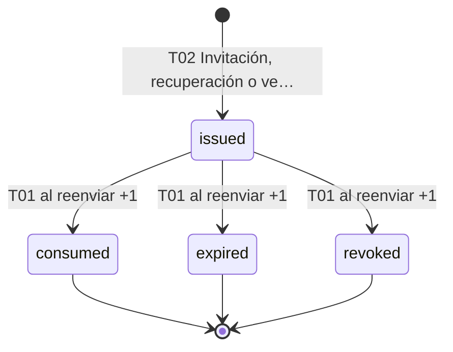

| # | Desde | Hasta | Disparador | Tipo | Guardas | Evento emitido |
|---|---|---|---|---|---|---|
| T01 | `issued` | `consumed`, `expired`, `revoked` | al reenviar | no especificado | — | — |
| T02 | (nuevo) | `issued` | Invitación, recuperación o verificación / — | no especificado | — | — |
| T03 | `issued` | `consumed` | Uso válido del token / — | no especificado | Vigente | — |
| T04 | `issued` | `expired` | Vencimiento / — | no especificado | — | — |
| T05 | `issued` | `revoked` | Reenvío (se emite un token nuevo) / — | no especificado | — | — |

### EST-IAM-13 — `authorizationRequests.status` (COL-IAM-19)

**Colección:** Autorizaciones de supervisor en línea. **Campos de estado en el §7:** `status` (línea 3315; valores: `pending`, `approved`, `rejected`, `expired`, `cancelled`, `consumed`).

**Máquina 1: `status`.** Fuente: T02 §8.6, T02 §8.11.

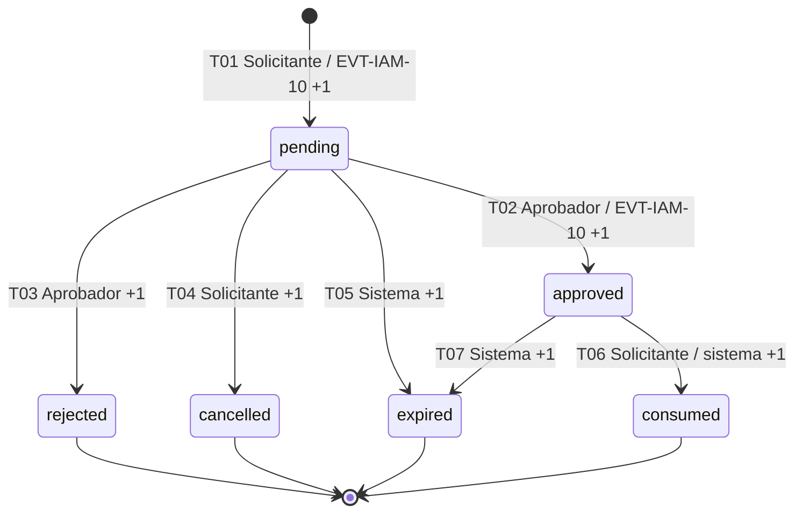

| # | Desde | Hasta | Disparador | Tipo | Guardas | Evento emitido |
|---|---|---|---|---|---|---|
| T01 | (nuevo) | `pending` | Solicitante | usuario | Acción U denegada; motivo | EVT-IAM-10 `iam.authorization.requested` |
| T02 | `pending` | `approved` | Aprobador | usuario | Capability + alcance + límite, ≠ solicitante, step-up | EVT-IAM-10 `iam.authorization.requested` |
| T03 | `pending` | `rejected` | Aprobador | usuario | Motivo obligatorio | — |
| T04 | `pending` | `cancelled` | Solicitante | usuario | — | — |
| T05 | `pending` | `expired` | Sistema | sistema | `expiresAt` | — |
| T06 | `approved` | `consumed` | Solicitante / sistema | sistema, usuario | Mismo `actionHash`, dentro de vigencia | — |
| T07 | `approved` | `expired` | Sistema | sistema | Vigencia de consumo vencida | — |
| T08 | (nuevo) | `pending` | Solicitante (API-IAM-49) / `iam.authorization.requested` | evento, API/integración, usuario | Acción U denegada; motivo | — |
| T09 | `pending` | `approved` | Aprobador (API-IAM-50, API-IAM-52) / `iam.authorization.granted` | evento, API/integración, usuario | Capability, alcance y límite; ≠ solicitante; step-up | — |
| T10 | `pending` | `rejected` | Aprobador (API-IAM-52) / — | API/integración, usuario | Motivo obligatorio | — |
| T11 | `pending` | `cancelled` | Solicitante (API-IAM-52) / — | API/integración, usuario | — | — |
| T12 | `pending` | `expired` | Sistema por `expiresAt` / — | sistema | — | — |
| T13 | `approved` | `consumed` | Solicitante o sistema ejecuta la acción / — | sistema, usuario | Mismo `actionHash`, vigente | — |
| T14 | `approved` | `expired` | Sistema por vigencia de consumo / — | sistema | — | — |

**Máquina 2: `inline`.** Fuente: T02 §8.6.

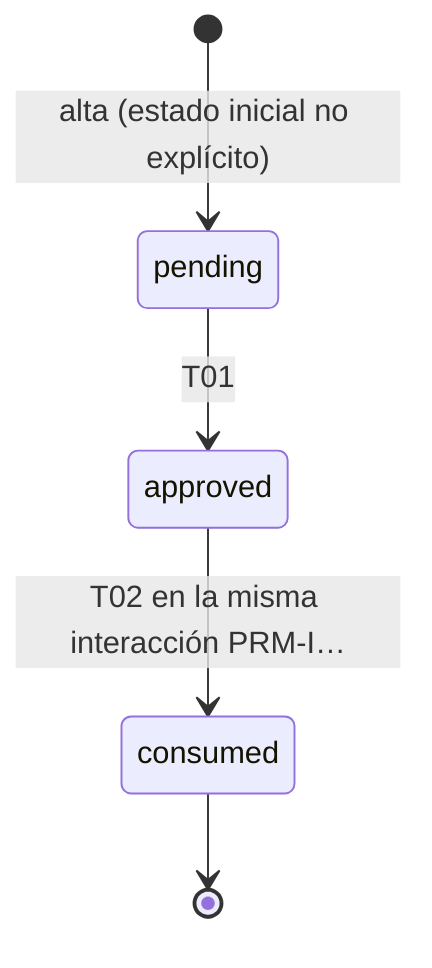

| # | Desde | Hasta | Disparador | Tipo | Guardas | Evento emitido |
|---|---|---|---|---|---|---|
| T01 | `pending` | `approved` | — | no especificado | — | — |
| T02 | `approved` | `consumed` | en la misma interacción PRM-IAM-034 min | no especificado | — | — |

### EST-IAM-14 — `supportAccessGrants.status` (COL-IAM-20)

**Colección:** Concesión de acceso temporal de soporte (canónica). **Campos de estado en el §7:** `status` (línea 3325; valores: `requested`, `approved`, `active`, `expired`, `revoked`, `rejected`).

**Fuente:** T02 §8.7, T02 §8.11.

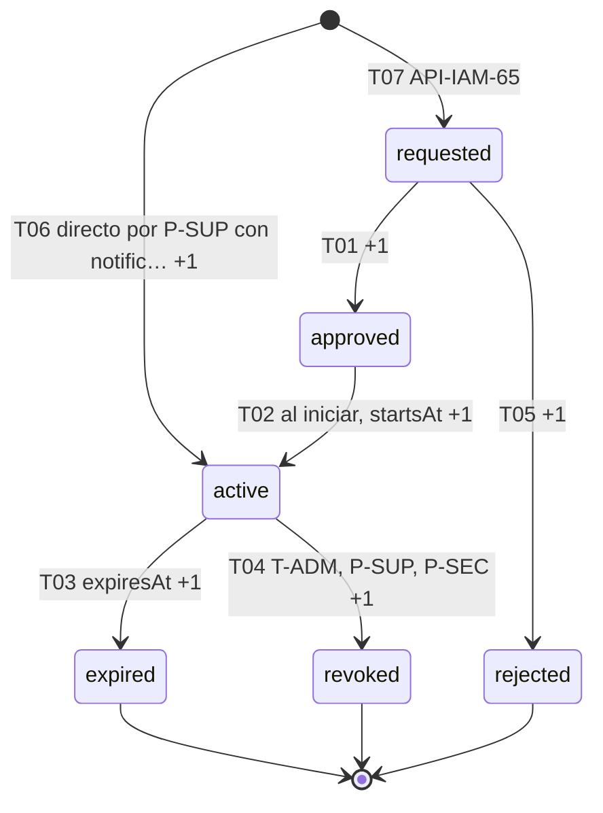

| # | Desde | Hasta | Disparador | Tipo | Guardas | Evento emitido |
|---|---|---|---|---|---|---|
| T01 | `requested` | `approved` | — | no especificado | — | — |
| T02 | `approved` | `active` | al iniciar, startsAt | no especificado | — | — |
| T03 | `active` | `expired` | expiresAt | no especificado | — | — |
| T04 | `active` | `revoked` | T-ADM, P-SUP, P-SEC | usuario | — | — |
| T05 | `requested` | `rejected` | — | no especificado | — | — |
| T06 | (nuevo) | `active` | directo por P-SUP con notificación inmediata obligatoria en h | no especificado | — | — |
| T07 | (nuevo) | `requested` | P-SUP solicita (API-IAM-65) / — | API/integración | — | — |
| T08 | (nuevo) | `active` | P-SUP por emergencia (`approvalType = emergency`) / — | no especificado | Revisión posterior en 72 h | — |
| T09 | `requested` | `approved` | T-ADM aprueba (API-IAM-64) / — | API/integración, usuario | — | — |
| T10 | `requested` | `rejected` | T-ADM rechaza (API-IAM-64) / — | API/integración, usuario | — | — |
| T11 | `approved` | `active` | Inicio (`startsAt`, API-IAM-65 `start`) / — | API/integración | — | — |
| T12 | `active` | `expired` | `expiresAt` / — | no especificado | — | — |
| T13 | `active` | `revoked` | T-ADM, P-SUP o P-SEC (API-IAM-64 `revoke`) / — | API/integración, usuario | — | — |

### EST-IAM-15 — `identityProviderConfigs.status` (COL-IAM-21)

**Colección:** Configuración SSO/OIDC/CiDi. **Campos de estado en el §7:** `status` (línea 3329; valores: `draft`, `active`, `disabled`).

**Fuente:** T02 §8.11.

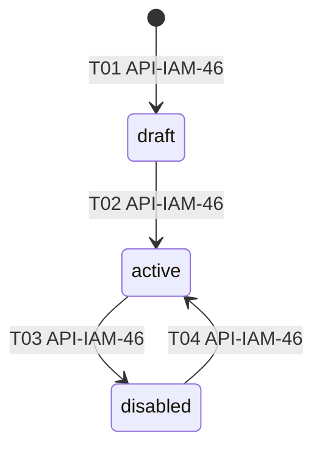

| # | Desde | Hasta | Disparador | Tipo | Guardas | Evento emitido |
|---|---|---|---|---|---|---|
| T01 | (nuevo) | `draft` | T-ADM crea el IdP (API-IAM-46) / — | API/integración, usuario | `iam.idp.configurar` | — |
| T02 | `draft` | `active` | T-ADM habilita tras prueba exitosa (API-IAM-46 `test`) / — | API/integración, usuario | `lastTestResult` correcto | — |
| T03 | `active` | `disabled` | T-ADM deshabilita (API-IAM-46) / — | API/integración, usuario | Queda otro método de ingreso para los usuarios | — |
| T04 | `disabled` | `active` | T-ADM rehabilita (API-IAM-46) / — | API/integración, usuario | Prueba exitosa | — |

### EST-IAM-16 — `apiClients.status` (COL-IAM-22)

**Colección:** Clientes API de terceros (canónica; absorbe T10). **Campos de estado en el §7:** `status` (línea 3333; valores: `active`, `suspended`, `revoked`).

**Fuente:** T02 §8.11.

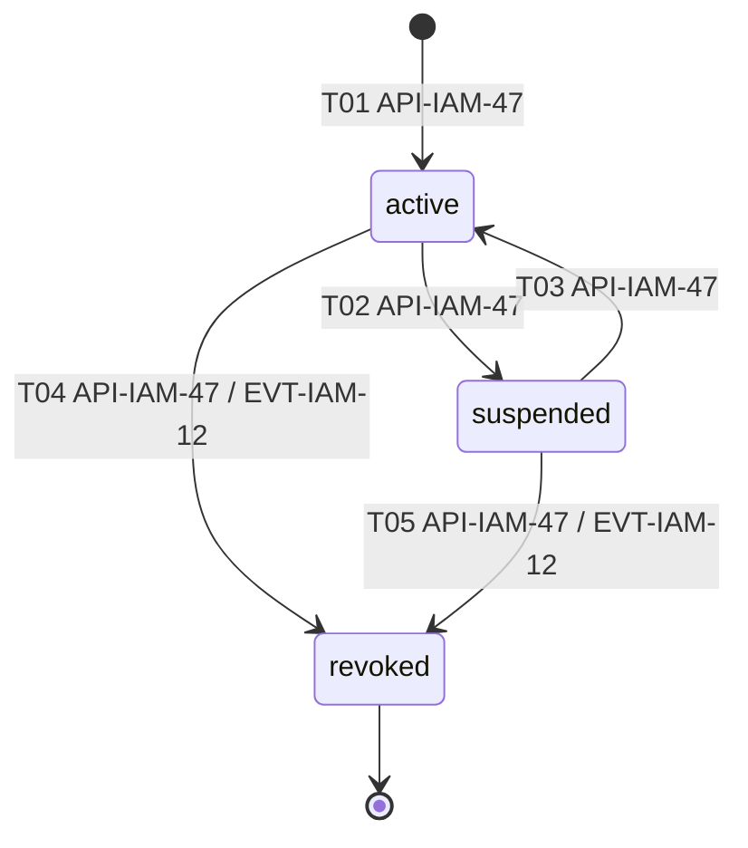

| # | Desde | Hasta | Disparador | Tipo | Guardas | Evento emitido |
|---|---|---|---|---|---|---|
| T01 | (nuevo) | `active` | T-ADM crea el cliente (API-IAM-47) / — | API/integración, usuario | `iam.apiClientes.gestionar` + step-up | — |
| T02 | `active` | `suspended` | T-ADM o P-SEC suspende (API-IAM-47) / — | API/integración, usuario | Motivo | — |
| T03 | `suspended` | `active` | T-ADM reactiva (API-IAM-47) / — | API/integración, usuario | — | — |
| T04 | `active` | `revoked` | T-ADM o P-SEC revoca (API-IAM-47 `revoke`) / — | API/integración, usuario | — | EVT-IAM-12 `iam.apiClient.revoked` (inferido por nombre) |
| T05 | `suspended` | `revoked` | T-ADM o P-SEC revoca (API-IAM-47 `revoke`) / — | API/integración, usuario | — | EVT-IAM-12 `iam.apiClient.revoked` (inferido por nombre) |

### EST-IAM-17 — `apiCredentials.status` (COL-IAM-23)

**Colección:** Credenciales hash de clientes API (canónica; absorbe T10). **Campos de estado en el §7:** `status` (línea 3335; valores: `active`, `rotating`, `expired`, `revoked`).

**Fuente:** T02 §8.8, T02 §8.11.

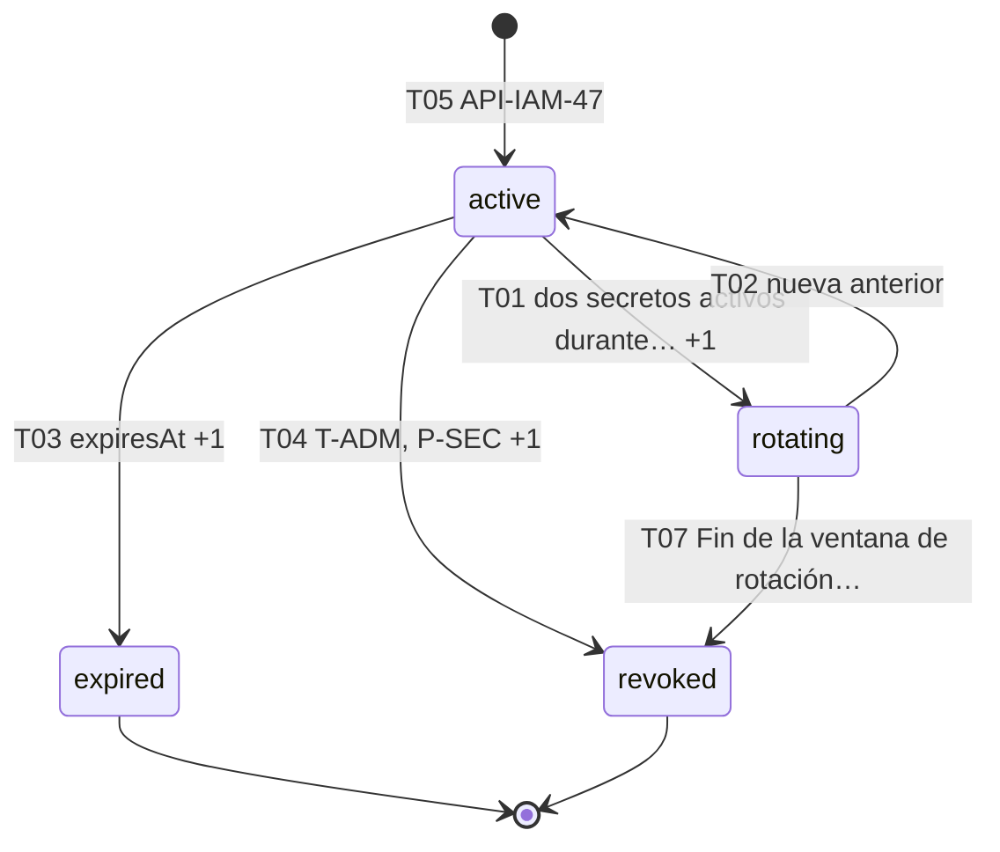

| # | Desde | Hasta | Disparador | Tipo | Guardas | Evento emitido |
|---|---|---|---|---|---|---|
| T01 | `active` | `rotating` | dos secretos activos durante PRM-IAM-074 horas | no especificado | — | — |
| T02 | `rotating` | `active` | nueva anterior | no especificado | — | — |
| T03 | `active` | `expired` | expiresAt | no especificado | — | — |
| T04 | `active` | `revoked` | T-ADM, P-SEC | usuario | — | — |
| T05 | (nuevo) | `active` | Alta del cliente o rotación (API-IAM-47) / — | API/integración | — | — |
| T06 | `active` | `rotating` | Rotación (API-IAM-47 `rotate`) / — | API/integración | Dos secretos durante `PRM-IAM-074` horas | — |
| T07 | `rotating` | `revoked` | Fin de la ventana de rotación (credencial anterior) / — | no especificado | — | — |
| T08 | `active` | `expired` | `expiresAt` / — | no especificado | — | — |
| T09 | `active` | `revoked` | T-ADM o P-SEC / — | usuario | — | — |

### EST-IAM-18 — `auditMessages.status` (COL-IAM-27)

**Colección:** Auditoría de mensajes enviados. **Campos de estado en el §7:** `status` (línea 3372; valores: `queued`, `sent`, `delivered`, `opened`, `bounced`, `failed`, `rejected`).

**Fuente:** T02 §8.11.

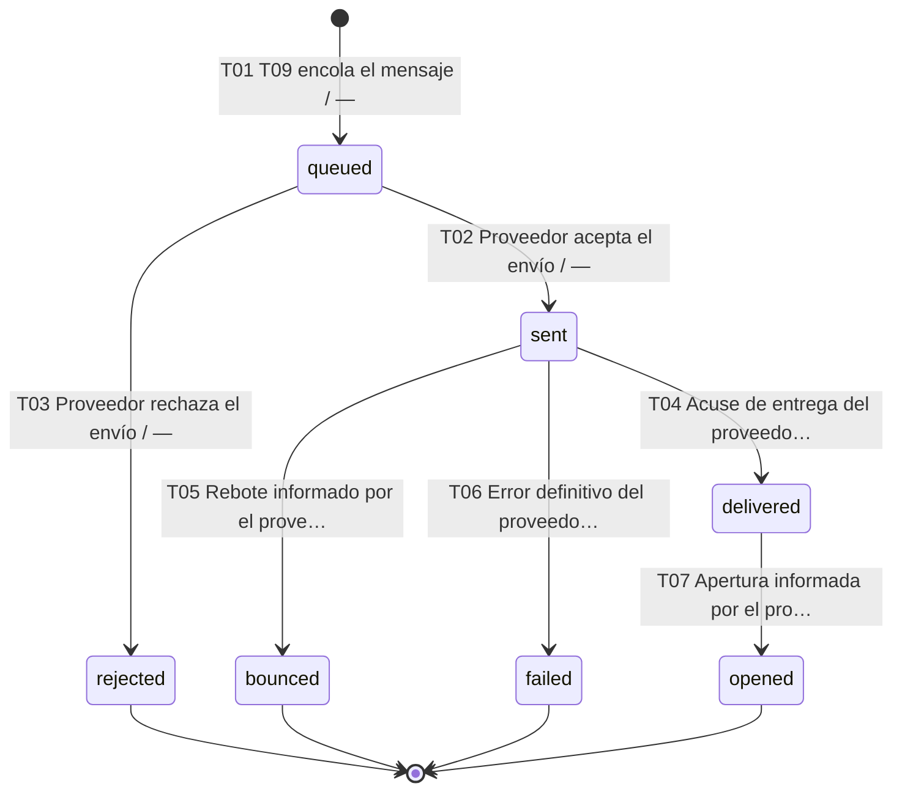

| # | Desde | Hasta | Disparador | Tipo | Guardas | Evento emitido |
|---|---|---|---|---|---|---|
| T01 | (nuevo) | `queued` | T09 encola el mensaje / — | no especificado | — | — |
| T02 | `queued` | `sent` | Proveedor acepta el envío / — | API/integración | — | — |
| T03 | `queued` | `rejected` | Proveedor rechaza el envío / — | API/integración | — | — |
| T04 | `sent` | `delivered` | Acuse de entrega del proveedor / — | API/integración | — | — |
| T05 | `sent` | `bounced` | Rebote informado por el proveedor / — | API/integración | — | — |
| T06 | `sent` | `failed` | Error definitivo del proveedor / — | API/integración | — | — |
| T07 | `delivered` | `opened` | Apertura informada por el proveedor / — | API/integración | — | — |

### EST-IAM-19 — `auditAi.decision.status` (COL-IAM-28)

**Colección:** Auditoría de acciones asistidas por IA. **Campos de estado en el §7:** `status` (línea 3376; sin valores en el §7).

**Fuente:** T02 §8.11.

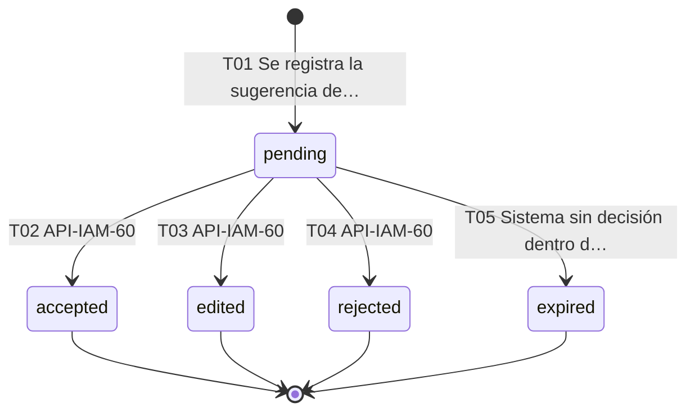

| # | Desde | Hasta | Disparador | Tipo | Guardas | Evento emitido |
|---|---|---|---|---|---|---|
| T01 | (nuevo) | `pending` | Se registra la sugerencia de IA / — | no especificado | — | — |
| T02 | `pending` | `accepted` | Usuario acepta (API-IAM-60) / — | API/integración, usuario | `iam.ia.decisiones.registrar` | — |
| T03 | `pending` | `edited` | Usuario acepta con cambios (API-IAM-60) / — | API/integración, usuario | `iam.ia.decisiones.registrar` | — |
| T04 | `pending` | `rejected` | Usuario descarta (API-IAM-60) / — | API/integración, usuario | `iam.ia.decisiones.registrar` | — |
| T05 | `pending` | `expired` | Sistema: sin decisión dentro de la vigencia / — | sistema | — | — |

### EST-IAM-20 — `accessReviews.status` (COL-IAM-30)

**Colección:** Recertificación de accesos. **Campos de estado en el §7:** `status` (línea 3384; valores: `open`, `completed`, `overdue`).

**Fuente:** T02 §8.11.

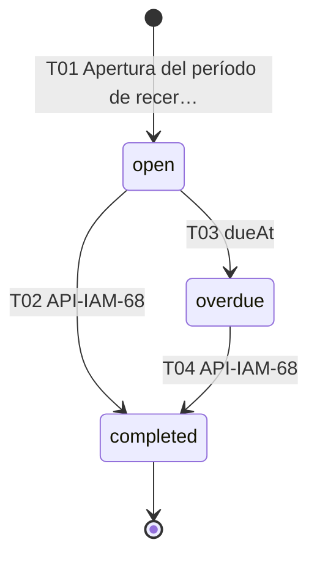

| # | Desde | Hasta | Disparador | Tipo | Guardas | Evento emitido |
|---|---|---|---|---|---|---|
| T01 | (nuevo) | `open` | Apertura del período de recertificación / — | no especificado | — | — |
| T02 | `open` | `completed` | Revisor decide todos los ítems (API-IAM-68) / — | API/integración, usuario | `iam.recertificacion.ejecutar` | — |
| T03 | `open` | `overdue` | Sistema al pasar `dueAt` / — | sistema | — | — |
| T04 | `overdue` | `completed` | Revisor completa fuera de término (API-IAM-68) / — | API/integración, usuario | `iam.recertificacion.ejecutar` | — |

### EST-IAM-21 — `securityAlerts.status` (COL-IAM-31)

**Colección:** Alertas de seguridad de identidad. **Campos de estado en el §7:** `status` (línea 3386; valores: `open`, `acknowledged`, `resolved`, `falsePositive`).

**Fuente:** T02 §8.10, T02 §8.11.

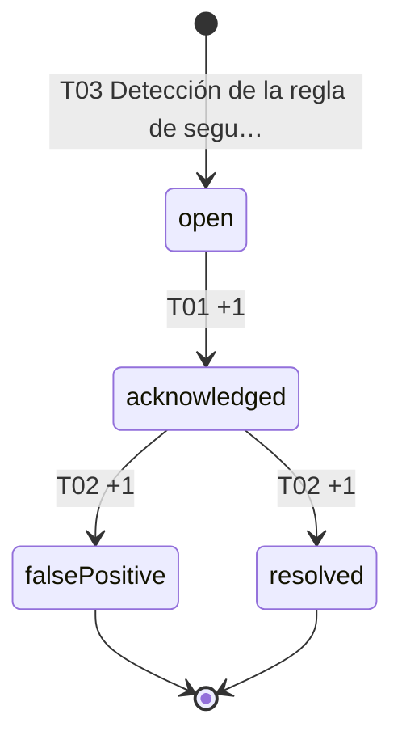

| # | Desde | Hasta | Disparador | Tipo | Guardas | Evento emitido |
|---|---|---|---|---|---|---|
| T01 | `open` | `acknowledged` | — | no especificado | — | — |
| T02 | `acknowledged` | `falsePositive`, `resolved` | — | no especificado | — | — |
| T03 | (nuevo) | `open` | Detección de la regla de seguridad / — | no especificado | Deduplicación por `dedupKey` | — |
| T04 | `open` | `acknowledged` | P-SEC o T-ADM toma la alerta (API-IAM-67) / — | API/integración, usuario | — | — |
| T05 | `acknowledged` | `resolved` | P-SEC o T-ADM resuelve (API-IAM-67) / — | API/integración, usuario | `resolution` obligatoria | — |
| T06 | `acknowledged` | `falsePositive` | P-SEC o T-ADM descarta (API-IAM-67) / — | API/integración, usuario | `resolution` obligatoria | — |

## T03 — UXD Experiencia, marca y diccionario

### EST-UXD-01 — `tenantBrandings.status` (COL-UXD-01)

**Colección:** Marca publicada por canal (referida por `tenants.brandingRef`). **Campos de estado en el §7:** `status` (línea 590; valores: `draft`, `published`, `superseded`).

**Fuente:** T03 §8.1.

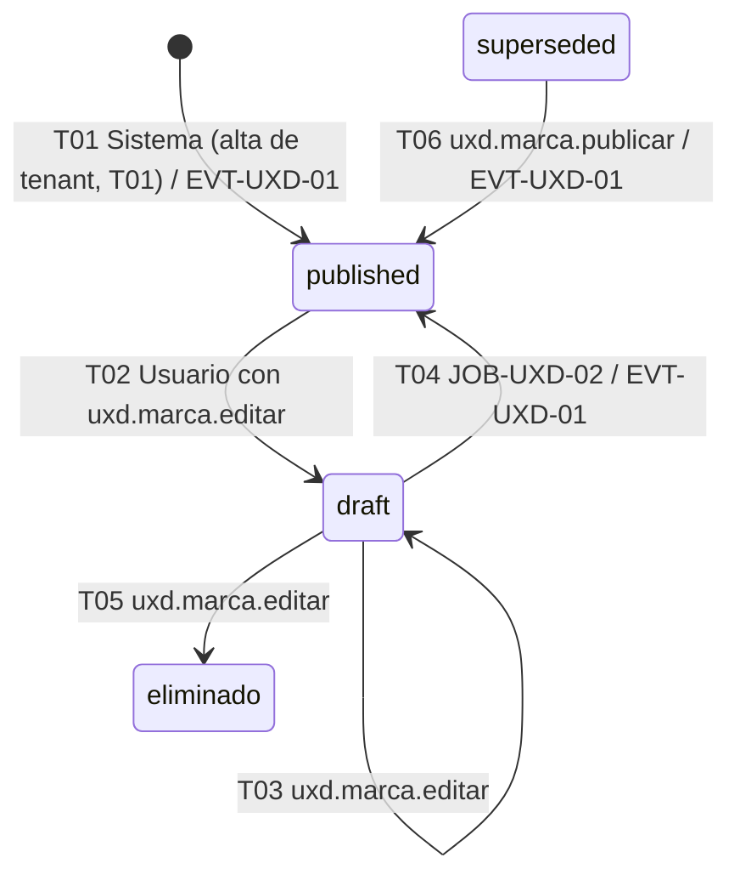

| # | Desde | Hasta | Disparador | Tipo | Guardas | Evento emitido |
|---|---|---|---|---|---|---|
| T01 | (nuevo) | `published` | Sistema (alta de tenant, T01) | sistema | Tenant creado | EVT-UXD-01 `uxd.branding.published` |
| T02 | `published` | `draft` | Usuario con `uxd.marca.editar` | usuario | No existe otro borrador | — |
| T03 | `draft` | `draft` | `uxd.marca.editar` | usuario | Control optimista `version` | — |
| T04 | `draft` | `published` | `uxd.marca.publicar` (y distinto del editor si PRM-UXD-021) | usuario | Assets en `ready`; validaciones sin errores bloqueantes | EVT-UXD-01 `uxd.branding.published` |
| T05 | `draft` | `((eliminado))` | `uxd.marca.editar` | usuario | — | — |
| T06 | `superseded` | `published` | `uxd.marca.publicar` | usuario | — | EVT-UXD-01 `uxd.branding.published` (inferido por nombre) |

### EST-UXD-02 — `brandAssets.status` (COL-UXD-02)

**Colección:** Recursos de marca (logos, íconos). **Campos de estado en el §7:** `status` (línea 630; valores: `processing`, `ready`, `rejected`).

**Fuente:** T03 §8.2, T03 §8.8.

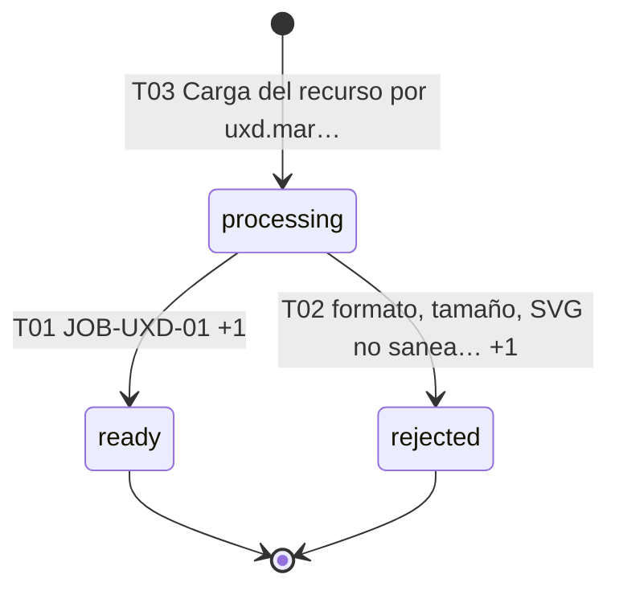

| # | Desde | Hasta | Disparador | Tipo | Guardas | Evento emitido |
|---|---|---|---|---|---|---|
| T01 | `processing` | `ready` | JOB-UXD-01 valida y genera variantes | job | — | — |
| T02 | `processing` | `rejected` | formato, tamaño, SVG no saneable | no especificado | — | — |
| T03 | (nuevo) | `processing` | Carga del recurso por `uxd.marca.editar` / — | usuario | Formato y tamaño admitidos | — |
| T04 | `processing` | `ready` | JOB-UXD-01 valida y genera variantes / — | job | — | — |
| T05 | `processing` | `rejected` | JOB-UXD-01 rechaza (formato, tamaño, SVG no saneable) / — | job | — | — |

### EST-UXD-03 — `tenantDictionaryEntries.status` (COL-UXD-04)

**Colección:** Textos propios del tenant. **Campos de estado en el §7:** `state` (línea 697; valores: `draft`, `published`, `deleted`).

**Máquina 1: `status`.** Fuente: T03 §8.3.

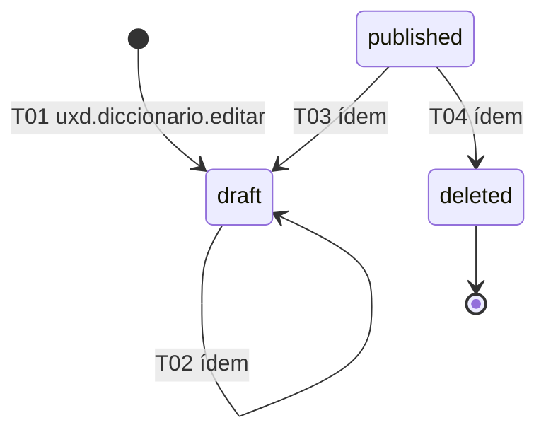

| # | Desde | Hasta | Disparador | Tipo | Guardas | Evento emitido |
|---|---|---|---|---|---|---|
| T01 | (nuevo) | `draft` | `uxd.diccionario.editar` | usuario | Clave existe, no protegida, validaciones OK | — |
| T02 | `draft` | `draft` | ídem | no especificado | — | — |
| T03 | `published` | `draft` | ídem | no especificado | — | — |
| T04 | `published` | `deleted` | ídem | no especificado | — | — |

**Máquina 2: `state`.** Fuente: T03 §8.8.

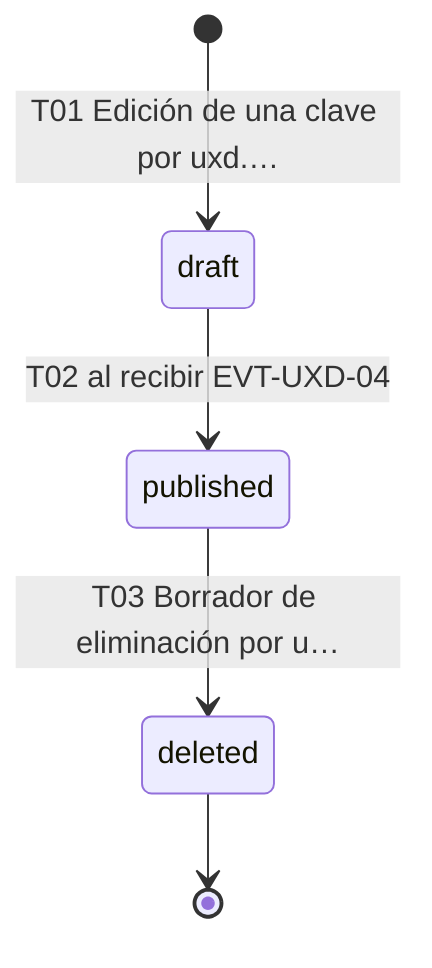

| # | Desde | Hasta | Disparador | Tipo | Guardas | Evento emitido |
|---|---|---|---|---|---|---|
| T01 | (nuevo) | `draft` | Edición de una clave por `uxd.diccionario.editar` (antes "(sin entrada)") / — | usuario | Clave existente, no protegida, validaciones correctas | — |
| T02 | `draft` | `published` | Publicación del release por `uxd.diccionario.publicar` / `uxd.dictionary.published` | evento | Sin errores bloqueantes | — |
| T03 | `published` | `deleted` | Borrador de eliminación por `uxd.diccionario.editar` / — | usuario | — | — |

### EST-UXD-04 — `dictionaryReleases.status` (COL-UXD-05)

**Colección:** Versiones publicadas del diccionario. **Campos de estado en el §7:** —.

**Fuente:** T03 §8.8, T03 §8.3.

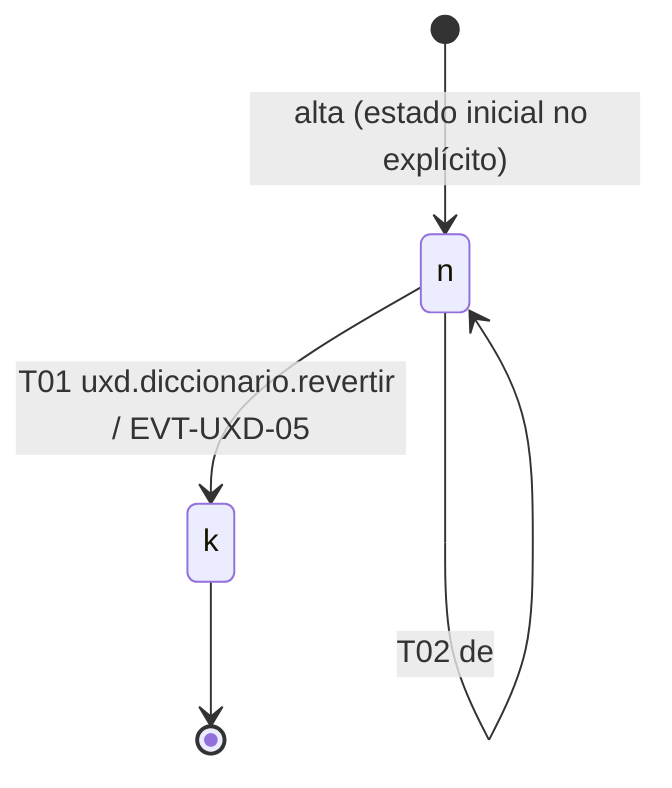

| # | Desde | Hasta | Disparador | Tipo | Guardas | Evento emitido |
|---|---|---|---|---|---|---|
| T01 | `n` | `k` | `uxd.diccionario.revertir` | usuario | `k < n` | EVT-UXD-05 `uxd.dictionary.reverted` |
| T02 | `n` | `n` | de | no especificado | — | — |

### EST-UXD-05 — `screenHelpArticles.status` (COL-UXD-07)

**Colección:** Ayuda contextual por pantalla. **Campos de estado en el §7:** `status` (línea 734; valores: `draft`, `published`).

**Fuente:** T03 §8.7.

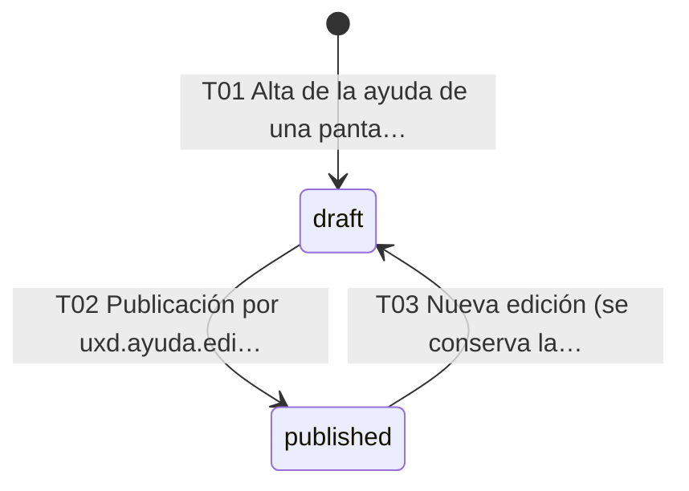

| # | Desde | Hasta | Disparador | Tipo | Guardas | Evento emitido |
|---|---|---|---|---|---|---|
| T01 | (nuevo) | `draft` | Alta de la ayuda de una pantalla por `uxd.ayuda.editar` / — | usuario | `screenId` existe en el mapa del sitio | — |
| T02 | `draft` | `published` | Publicación por `uxd.ayuda.editar` / — | usuario | Las 6 preguntas tienen texto | — |
| T03 | `published` | `draft` | Nueva edición (se conserva la publicada hasta publicar el borrador) / — | no especificado | — | — |

### EST-UXD-06 — Cola offline de la PWA (presentación, sin colección) (fuera del universo)

**Fuente:** T03 §8.5. Estado descripto en el §8 que no se persiste en una colección del catálogo de T05; se diagrama como complemento.

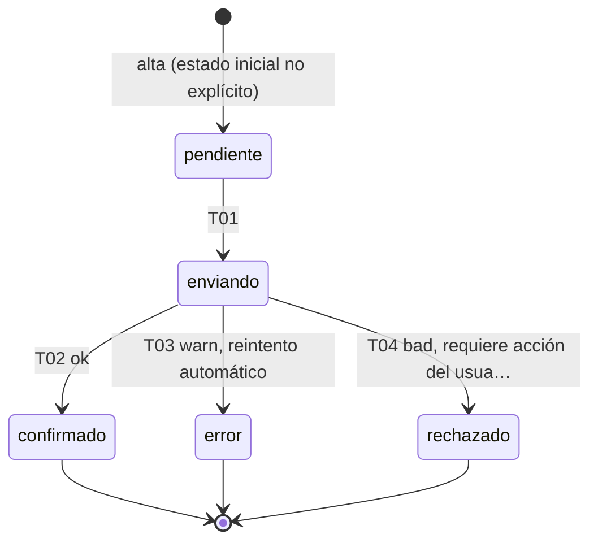

| # | Desde | Hasta | Disparador | Tipo | Guardas | Evento emitido |
|---|---|---|---|---|---|---|
| T01 | `pendiente` | `enviando` | — | no especificado | — | — |
| T02 | `enviando` | `confirmado` | ok | no especificado | — | — |
| T03 | `enviando` | `error` | warn, reintento automático | job | — | — |
| T04 | `enviando` | `rechazado` | bad, requiere acción del usuario con motivo | usuario | — | — |

### EST-UXD-07 — Flags de UI `uiFeatureFlags` (sin colección en T05) (fuera del universo)

**Fuente:** T03 §8.6. Estado descripto en el §8 que no se persiste en una colección del catálogo de T05; se diagrama como complemento.

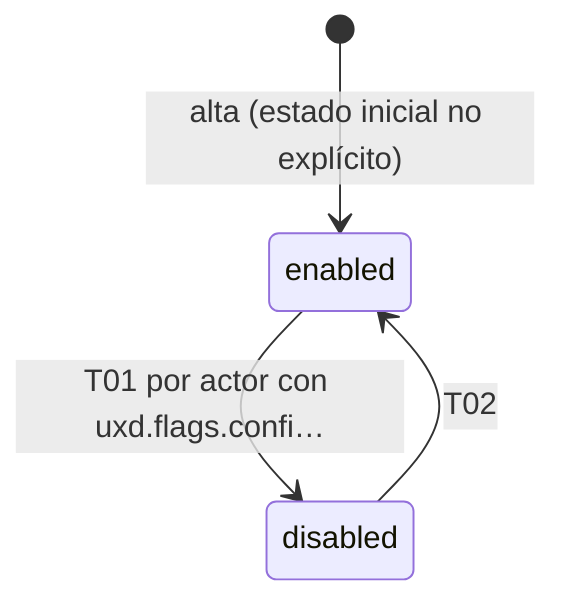

| # | Desde | Hasta | Disparador | Tipo | Guardas | Evento emitido |
|---|---|---|---|---|---|---|
| T01 | `enabled` | `disabled` | por actor con uxd.flags.configurar tenant uxd.plataforma.flags.configurar plataforma antes plt.uxd.flags.configurar, T02 | usuario | — | — |
| T02 | `disabled` | `enabled` | — | no especificado | — | — |

## T04 — CFG Configuración, parámetros y maestros

### EST-CFG-01 — `parameterDefinitions.status` (COL-CFG-01)

**Colección:** Registro tipado de parámetros PRM. **Campos de estado en el §7:** `status` (línea 481; valores: `active`, `deprecated`, `removed`).

**Fuente:** T04 §8.2, T04 §8.11.

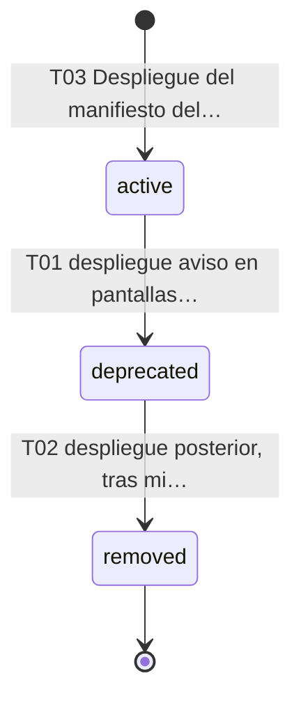

| # | Desde | Hasta | Disparador | Tipo | Guardas | Evento emitido |
|---|---|---|---|---|---|---|
| T01 | `active` | `deprecated` | despliegue aviso en pantallas, replacedBy | no especificado | — | — |
| T02 | `deprecated` | `removed` | despliegue posterior, tras migrar valores | no especificado | — | — |
| T03 | (nuevo) | `active` | Despliegue del manifiesto del módulo que declara la clave / — | no especificado | — | — |

### EST-CFG-02 — `parameterValues.status` (COL-CFG-02)

**Colección:** Valores por ámbito (alias `tenantParameters` de T04b). **Campos de estado en el §7:** `status` (línea 505; valores: `published`, `superseded`, `closed`).

**Fuente:** T04 §8.10.

```mermaid
stateDiagram-v2
    [*] --> published : T01 al recibir EVT-CFG-05
    published --> superseded : T02 al recibir EVT-CFG-07
    published --> closed : T03 al recibir EVT-CFG-07
    superseded --> [*]
    closed --> [*]
```

| # | Desde | Hasta | Disparador | Tipo | Guardas | Evento emitido |
|---|---|---|---|---|---|---|
| T01 | (nuevo) | `published` | Publicación de la `configVersion` que lo contiene (§8.1) / EVT-CFG-05 `cfg.configVersion.published` y `cfg.parameter.changed` | evento | Revalidación OK al publicar | — |
| T02 | `published` | `superseded` | Corrección del mismo ámbito y vigencia por una versión posterior (se completa `supersededAt`) / `cfg.parameter.changed` | evento | — | — |
| T03 | `published` | `closed` | Otra versión fija `validTo` (nuevo valor desde una fecha) / `cfg.parameter.changed` | evento | — | — |

### EST-CFG-03 — `configVersions.status` (COL-CFG-03)

**Colección:** Paquetes de configuración versionados y publicados. **Campos de estado en el §7:** `status` (línea 520; sin valores en el §7).

**Fuente:** T04 §8.1.

```mermaid
stateDiagram-v2
    [*] --> draft : T01 Configurador, M02 (copia), im…
    draft --> validating : T02 Autor / sistema
    validating --> draft : T03 Sistema
    validating --> validated : T04 Sistema
    validated --> inReview : T05 Autor / EVT-CFG-02
    validated --> approved : T06 Sistema / EVT-CFG-03
    inReview --> approved : T07 Revisor ≠ autor / EVT-CFG-03
    inReview --> rejected : T08 Revisor / EVT-CFG-03
    approved --> scheduled : T09 Autor/revisor / EVT-CFG-04
    approved --> published : T10 Revisor/sistema / EVT-CFG-05
    scheduled --> published : T10 Revisor/sistema / EVT-CFG-05
    scheduled --> failed : T11 Sistema / EVT-CFG-06
    approved --> cancelled : T12 Autor/administrador / EVT-CFG-06
    draft --> cancelled : T12 Autor/administrador / EVT-CFG-06
    scheduled --> cancelled : T12 Autor/administrador / EVT-CFG-06
    validated --> cancelled : T12 Autor/administrador / EVT-CFG-06
    published --> superseded : T13 Sistema
    published --> rolledBack : T14 Sistema / EVT-CFG-06
    rejected --> [*]
    failed --> [*]
    cancelled --> [*]
    superseded --> [*]
    rolledBack --> [*]
```

| # | Desde | Hasta | Disparador | Tipo | Guardas | Evento emitido |
|---|---|---|---|---|---|---|
| T01 | (nuevo) | `draft` | Configurador, M02 (copia), importación, semilla, migración, plataforma | no especificado | Capability de crear | — |
| T02 | `draft` | `validating` | Autor / sistema | sistema, usuario | Al menos un ítem | — |
| T03 | `validating` | `draft` | Sistema | sistema | Errores | — |
| T04 | `validating` | `validated` | Sistema | sistema | Sin errores bloqueantes | — |
| T05 | `validated` | `inReview` | Autor | usuario | Política exige revisión | EVT-CFG-02 `cfg.configVersion.submitted` |
| T06 | `validated` | `approved` | Sistema | sistema | Política no exige revisión | EVT-CFG-03 `cfg.configVersion.approved` (inferido por nombre) |
| T07 | `inReview` | `approved` | Revisor ≠ autor | usuario | Capabilities del módulo; simulación vigente | EVT-CFG-03 `cfg.configVersion.approved` (inferido por nombre) |
| T08 | `inReview` | `rejected` | Revisor | usuario | Motivo obligatorio | EVT-CFG-03 `cfg.configVersion.approved` |
| T09 | `approved` | `scheduled` | Autor/revisor | usuario | `effectiveAt` futura | EVT-CFG-04 `cfg.configVersion.scheduled` (inferido por nombre) |
| T10 | `approved`, `scheduled` | `published` | Revisor/sistema | sistema, usuario | Rebase sin conflicto; revalidación OK al momento de publicar | EVT-CFG-05 `cfg.configVersion.published`, EVT-CFG-07 `cfg.parameter.changed` |
| T11 | `scheduled` | `failed` | Sistema | sistema | Revalidación falla al publicar | EVT-CFG-06 `cfg.configVersion.failed` (inferido por nombre) |
| T12 | `approved`, `draft`, `scheduled`, `validated` | `cancelled` | Autor/administrador | usuario | Motivo | EVT-CFG-06 `cfg.configVersion.cancelled` (inferido por nombre) |
| T13 | `published` | `superseded` | Sistema | sistema | Otra versión reemplaza todos sus ítems | — |
| T14 | `published` | `rolledBack` | Sistema | sistema | Versión de reversión publicada | EVT-CFG-06 `cfg.configVersion.rolledBack` (inferido por nombre) |

### EST-CFG-04 — `enumerations.status` (COL-CFG-05)

**Colección:** Enumeraciones configurables (incluye las claves de M01 §7.18). **Campos de estado en el §7:** —.

**Fuente:** T04 §8.3.

```mermaid
stateDiagram-v2
    [*] --> active : T01 Operador / importación / plat…
    active --> inactive : T02 Operador
    inactive --> active : T03 Operador
    active --> merged : T04 Operador con cfg.maestros.uni…
    inactive --> merged : T04 Operador con cfg.maestros.uni…
    active --> closed : T05 Versión/plataforma
    merged --> [*]
    closed --> [*]
```

| # | Desde | Hasta | Disparador | Tipo | Guardas | Evento emitido |
|---|---|---|---|---|---|---|
| T01 | (nuevo) | `active` | Operador / importación / plataforma | usuario | Validación del esquema | — |
| T02 | `active` | `inactive` | Operador | usuario | Motivo; si referenciado, se informa conteo | — |
| T03 | `inactive` | `active` | Operador | usuario | — | — |
| T04 | `active`, `inactive` | `merged` | Operador con `cfg.maestros.unificar` | usuario | Sobreviviente elegido | — |
| T05 | `active` | `closed` | Versión/plataforma | no especificado | `validTo` alcanzada | — |

### EST-CFG-05 — `streets.status` (COL-CFG-12)

**Colección:** Calles con tramos. **Campos de estado en el §7:** `status` (línea 861; valores: `active`, `pendingValidation`, `merged`, `inactive`).

**Fuente:** T04 §8.4, T04 §8.11.

```mermaid
stateDiagram-v2
    inactive
    pendingValidation --> active : T01 validada por el tenant
    proposed --> approved : T02 plataforma crea vincula calle…
    proposed --> rejected : T03 queda local activa con motivo
    proposed --> merged : T04 ya existía
    [*] --> pendingValidation : T05 Alta local de la calle por el…
    [*] --> active : T06 Carga desde Georef o migració…
    active --> [*]
    approved --> [*]
    rejected --> [*]
    merged --> [*]
```

| # | Desde | Hasta | Disparador | Tipo | Guardas | Evento emitido |
|---|---|---|---|---|---|---|
| T01 | `pendingValidation` | `active` | validada por el tenant | no especificado | — | — |
| T02 | `proposed` | `approved` | plataforma crea vincula calle nacional la local pasa a merged con alias | no especificado | — | — |
| T03 | `proposed` | `rejected` | queda local activa con motivo | no especificado | — | — |
| T04 | `proposed` | `merged` | ya existía | no especificado | — | — |
| T05 | (nuevo) | `pendingValidation` | Alta local de la calle por el tenant / — | no especificado | — | — |
| T06 | (nuevo) | `active` | Carga desde Georef o migración validada / — | no especificado | — | — |

### EST-CFG-06 — `streetProposals.status` (COL-CFG-14)

**Colección:** Propuestas de calles nuevas. **Campos de estado en el §7:** `status` (línea 880; sin valores en el §7).

**Máquina compartida.** El §8 del anexo define una sola máquina para este grupo de colecciones; rige la de `streets` (ver su diagrama en esta parte). Valores del §7: sin valores propios.

### EST-CFG-07 — `economicIndexValues.status` (COL-CFG-22)

**Colección:** Valores por fecha o período. **Campos de estado en el §7:** `status` (línea 995; valores: `provisional`, `definitive`).

**Fuente:** T04 §8.10.

```mermaid
stateDiagram-v2
    [*] --> provisional : T01 al recibir EVT-CFG-12
    [*] --> definitive : T02 al recibir EVT-CFG-12
    provisional --> definitive : T03 al recibir EVT-CFG-12
    definitive --> [*]
```

| # | Desde | Hasta | Disparador | Tipo | Guardas | Evento emitido |
|---|---|---|---|---|---|---|
| T01 | (nuevo) | `provisional` | Ingesta o carga de un valor marcado provisorio por la fuente / EVT-CFG-12 `cfg.economicIndex.valuePublished` | evento | — | — |
| T02 | (nuevo) | `definitive` | Ingesta o carga de un valor definitivo / EVT-CFG-12 `cfg.economicIndex.valuePublished` | evento | — | — |
| T03 | `provisional` | `definitive` | La fuente publica el valor definitivo: se crea un registro nuevo con `revisionOf` y el anterior recibe `supersededAt` / EVT-CFG-12 `cfg.economicIndex`… | evento | — | — |

### EST-CFG-08 — `platformTableReleases.status` (COL-CFG-31)

**Colección:** Versiones publicadas de tablas de plataforma no fiscales. **Campos de estado en el §7:** `status` (línea 624; valores: `draft`, `published`, `superseded`).

**Máquina 1: `status`.** Fuente: T04 §8.7, T04 §8.11.

```mermaid
stateDiagram-v2
    draft --> published : T01
    published --> superseded : T02
    [*] --> draft : T03 Plataforma prepara un release…
    superseded --> [*]
```

| # | Desde | Hasta | Disparador | Tipo | Guardas | Evento emitido |
|---|---|---|---|---|---|---|
| T01 | `draft` | `published` | — | no especificado | — | — |
| T02 | `published` | `superseded` | — | no especificado | — | — |
| T03 | (nuevo) | `draft` | Plataforma prepara un release de tabla oficial / — | no especificado | — | — |

**Máquina 2: `status` — Adopción por tenant.** Fuente: T04 §8.7.

```mermaid
stateDiagram-v2
    draft
    published
    superseded
    pendingAcknowledgement --> acknowledged : T01 genera configVersion origin p…
    pendingAcknowledgement --> deferred : T02
    [*] --> pendingAcknowledgement : alta (estado inicial no explícito)
    acknowledged --> [*]
    deferred --> [*]
```

| # | Desde | Hasta | Disparador | Tipo | Guardas | Evento emitido |
|---|---|---|---|---|---|---|
| T01 | `pendingAcknowledgement` | `acknowledged` | genera configVersion origin platform en el tenant que pasa por su política | no especificado | — | — |
| T02 | `pendingAcknowledgement` | `deferred` | — | no especificado | — | — |

### EST-CFG-09 — `customFieldDefinitions.status` (COL-CFG-33)

**Colección:** Campos extra por entidad. **Campos de estado en el §7:** `status` (línea 630; valores: `draft`, `active`, `deprecated`).

**Fuente:** T04 §8.8, T04 §8.11.

```mermaid
stateDiagram-v2
    draft --> active : T01 por versión
    active --> deprecated : T02 deja de pedirse valores conse…
    [*] --> draft : T03 configVersion
    deprecated --> [*]
```

| # | Desde | Hasta | Disparador | Tipo | Guardas | Evento emitido |
|---|---|---|---|---|---|---|
| T01 | `draft` | `active` | por versión | no especificado | — | — |
| T02 | `active` | `deprecated` | deja de pedirse valores conservados | no especificado | — | — |
| T03 | (nuevo) | `draft` | Alta del campo extra en una `configVersion` / — | no especificado | — | — |

### EST-CFG-10 — `formCustomizations.status` (COL-CFG-34)

**Colección:** Personalización de formularios. **Campos de estado en el §7:** `status` (línea 644; valores: `active`, `superseded`).

**Fuente:** T04 §8.10.

```mermaid
stateDiagram-v2
    [*] --> active : T01 al recibir EVT-CFG-05
    active --> superseded : T02 al recibir EVT-CFG-05
    superseded --> [*]
```

| # | Desde | Hasta | Disparador | Tipo | Guardas | Evento emitido |
|---|---|---|---|---|---|---|
| T01 | (nuevo) | `active` | Publicación de la `configVersion` que la contiene / EVT-CFG-05 | evento | El `fieldKey` existe en el registro de formularios del módulo | — |
| T02 | `active` | `superseded` | Otra versión publicada cambia o quita la personalización del campo / EVT-CFG-05 | evento, usuario | — | — |

### EST-CFG-11 — `masterImportJobs.status` (COL-CFG-36)

**Colección:** Importaciones de maestros desde Excel. **Campos de estado en el §7:** `status` (línea 650; sin valores en el §7).

**Fuente:** T04 §8.6, T04 §8.11.

```mermaid
stateDiagram-v2
    uploaded --> validating : T01
    validating --> previewReady : T02 con errores por fila
    previewReady --> confirmed : T03
    confirmed --> processing : T04
    processing --> completed : T05
    processing --> completedWithErrors : T05
    processing --> failed : T05
    [*] --> uploaded : T06 Carga del archivo de importac…
    completed --> [*]
    completedWithErrors --> [*]
    failed --> [*]
```

| # | Desde | Hasta | Disparador | Tipo | Guardas | Evento emitido |
|---|---|---|---|---|---|---|
| T01 | `uploaded` | `validating` | — | no especificado | — | — |
| T02 | `validating` | `previewReady` | con errores por fila | no especificado | — | — |
| T03 | `previewReady` | `confirmed` | — | no especificado | — | — |
| T04 | `confirmed` | `processing` | — | no especificado | — | — |
| T05 | `processing` | `completed`, `completedWithErrors`, `failed` | — | no especificado | — | — |
| T06 | (nuevo) | `uploaded` | Carga del archivo de importación / — | no especificado | Formato admitido | — |

### EST-CFG-12 — `seedApplications.status` (COL-CFG-38)

**Colección:** Paquetes aplicados por tenant. **Campos de estado en el §7:** `status` (línea 652; valores: `applied`, `removed`).

**Fuente:** T04 §8.8, T04 §8.11.

```mermaid
stateDiagram-v2
    applied --> removed : T01 retiro en bloque de lo creado…
    [*] --> applied : T02 Aplicación de la semilla al t…
    removed --> [*]
```

| # | Desde | Hasta | Disparador | Tipo | Guardas | Evento emitido |
|---|---|---|---|---|---|---|
| T01 | `applied` | `removed` | retiro en bloque de lo creado por la semilla | no especificado | — | — |
| T02 | (nuevo) | `applied` | Aplicación de la semilla al tenant / — | no especificado | — | — |

### EST-CFG-13 — `legalEntities.status` (COL-CFG-41)

**Colección:** Entidades jurídicas emisoras del tenant (DEC-064), definida en T04 §7.14: `code`, `legalName`, `tradeName`, `legalForm`, `inaesRegistration`, `fiscal{cuit, ivaConditionCode, iibbRegime, iibbNumber, a`…. **Campos de estado en el §7:** `status` (línea 705; valores: `active`, `inactive`).

**Fuente:** T04 §8.9.

```mermaid
stateDiagram-v2
    [*] --> active : T01 Sistema (alta del tenant) o a… / EVT-CFG-19
    active --> inactive : T02 Administrador / EVT-CFG-19 +1
    inactive --> active : T03 Administrador / EVT-CFG-19
```

| # | Desde | Hasta | Disparador | Tipo | Guardas | Evento emitido |
|---|---|---|---|---|---|---|
| T01 | (nuevo) | `active` | Sistema (alta del tenant) o administrador (`cfg.entidadesJuridicas.editar`) | sistema, usuario | CUIT válido y no repetido en el tenant | EVT-CFG-19 `cfg.legalEntity.created` |
| T02 | `active` | `inactive` | Administrador | usuario | No es la entidad por defecto (RN-CFG-051); sin sucursales activas ni documentos abiertos que la requieran | EVT-CFG-19 `cfg.legalEntity.created` |
| T03 | `inactive` | `active` | Administrador | usuario | — | EVT-CFG-19 `cfg.legalEntity.created` |
| T04 | `active` | `inactive` | Administrador (`cfg.sucursales.editar`) | usuario | Sin cajas abiertas (M07) ni depósitos con stock (M13) | EVT-CFG-20 `cfg.branch.created` |

### EST-CFG-14 — `branches.status` (COL-CFG-42)

**Colección:** Sucursales del tenant, definida en T04 §7.15: `code`, `name`, `legalEntityId`, `localityId`, `address`, `uses[]` (`attention`, `cashier`, `warehouse`, `pointOfSale`, `technicalBase`; los dueños valid…. **Campos de estado en el §7:** `status` (línea 729; valores: `active`, `inactive`).

**Fuente:** el §8 del anexo no detalla esta colección; se aplica el patrón general de T05 §7.1.5 (estados, baja lógica) y T04 §8.3 (registros maestros) sobre los valores del §7.

```mermaid
stateDiagram-v2
    [*] --> active : P01 alta
    active --> inactive : P02 desactivar
    inactive --> active : P03 reactivar
```

| # | Desde | Hasta | Disparador | Tipo | Guardas | Evento emitido |
|---|---|---|---|---|---|---|
| P01 | (nuevo) | `active` | Alta del registro (operador, importación o plataforma) | usuario, sistema | Validación del esquema (T04 §8.3) | — |
| P02 | `active` | `inactive` | Operador | usuario | Si está referenciado se informa el conteo; no se borra (T05 §7.1.5) | — |
| P03 | `inactive` | `active` | Operador | usuario | — | — |

### EST-CFG-15 — `workstations.status` (COL-CFG-43)

**Colección:** Puestos físicos, definida en T04 §7.16: `code`, `name`, `branchId`, `kind` (`counter`, `cashier`, `office`, `kiosk`, `field`), `localAgentId`, `devices[]`, `status`; las cajas de M07 y el turnero de…. **Campos de estado en el §7:** `status` (línea 1166; valores: `active`, `inactive`).

**Fuente:** el §8 del anexo no detalla esta colección; se aplica el patrón general de T05 §7.1.5 (estados, baja lógica) y T04 §8.3 (registros maestros) sobre los valores del §7.

```mermaid
stateDiagram-v2
    [*] --> active : P01 alta
    active --> inactive : P02 desactivar
    inactive --> active : P03 reactivar
```

| # | Desde | Hasta | Disparador | Tipo | Guardas | Evento emitido |
|---|---|---|---|---|---|---|
| P01 | (nuevo) | `active` | Alta del registro (operador, importación o plataforma) | usuario, sistema | Validación del esquema (T04 §8.3) | — |
| P02 | `active` | `inactive` | Operador | usuario | Si está referenciado se informa el conteo; no se borra (T05 §7.1.5) | — |
| P03 | `inactive` | `active` | Operador | usuario | — | — |

### EST-CFG-16 — Subdocumento compartido `geoReference` (embebido en M01, M09, M10) (fuera del universo)

**Fuente:** T04 §8.5. Estado descripto en el §8 que no se persiste en una colección del catálogo de T05; se diagrama como complemento.

```mermaid
stateDiagram-v2
    [*] --> pending : T01 Sistema
    pending --> candidate : T02 Sistema
    pending --> failed : T03 Sistema
    candidate --> confirmed : T04 inReview
    candidate --> approximate : T05 Sistema/usuario
    manualPoint --> inReview : T07 Usuario
    inReview --> approximate : T08 Revisor
    inReview --> confirmed : T08 Revisor
    confirmed --> confirmed : T09 Usuario autorizado
    failed --> pending : T10 Usuario/sistema
    note left of manualPoint : T06 desde cualquier estado previsto
    approximate --> [*]
```

| # | Desde | Hasta | Disparador | Tipo | Guardas | Evento emitido |
|---|---|---|---|---|---|---|
| T01 | (nuevo) | `pending` | Sistema | sistema | Dirección guardada sin geocodificar o proveedor caído | — |
| T02 | `pending` | `candidate` | Sistema | sistema | Proveedor devolvió candidatos | — |
| T03 | `pending` | `failed` | Sistema | sistema | Reintentos agotados | — |
| T04 | `candidate` | `confirmed` | Usuario con `cfg.geo.confirmarPunto` o socio en su solicitud (queda `inReview` si la política lo exige) | usuario | Selección de candidato con precisión ≥ calle | — |
| T05 | `candidate` | `approximate` | Sistema/usuario | sistema, usuario | Precisión solo localidad o calle sin altura | — |
| T06 | cualquiera | `manualPoint` | Usuario | usuario | Punto marcado sin coincidencia; motivo | — |
| T07 | `manualPoint` | `inReview` | Usuario | usuario | Punto marcado sin coincidencia; motivo | — |
| T08 | `inReview` | `approximate`, `confirmed` | Revisor | usuario | Revisión | — |
| T09 | `confirmed` | `confirmed` | Usuario autorizado | usuario | Motivo; se agrega a `history` | — |
| T10 | `failed` | `pending` | Usuario/sistema | sistema, usuario | Reintento manual | — |

## T06 — INT Integraciones

### EST-INT-01 — `integrationProviders.status` (COL-INT-01)

**Colección:** Catálogo de proveedores y adaptadores. **Campos de estado en el §7:** `status` (línea 350; valores: `draft`, `available`, `deprecated`, `retired`).

**Fuente:** T06 §8.12.

```mermaid
stateDiagram-v2
    [*] --> draft : T01 Alta del proveedor en el catá…
    draft --> available : T02 Publicación por int.proveedor…
    available --> deprecated : T03 Anuncio de retiro / —
    deprecated --> retired : T04 Retiro definitivo / —
    retired --> [*]
```

| # | Desde | Hasta | Disparador | Tipo | Guardas | Evento emitido |
|---|---|---|---|---|---|---|
| T01 | (nuevo) | `draft` | Alta del proveedor en el catálogo de plataforma / — | API/integración | — | — |
| T02 | `draft` | `available` | Publicación por `int.proveedores.configurar` / — | API/integración, usuario | Adaptador desplegado y prueba de homologación OK | — |
| T03 | `available` | `deprecated` | Anuncio de retiro / — | no especificado | — | — |
| T04 | `deprecated` | `retired` | Retiro definitivo / — | no especificado | Ninguna conexión `active` lo usa | — |

### EST-INT-02 — `integrationConnections.status` (COL-INT-02)

**Colección:** Conexión del tenant con un proveedor. **Campos de estado en el §7:** `status` (línea 364; sin valores en el §7).

**Fuente:** T06 §8.1.

```mermaid
stateDiagram-v2
    [*] --> draft : T01 Resp. integraciones
    draft --> testing : T02 Resp. integraciones
    testing --> active : T03 production / EVT-INT-01
    active --> degraded : T04 Sistema
    active --> blocked_credential : T05 Sistema / EVT-INT-02
    degraded --> blocked_credential : T05 Sistema / EVT-INT-02
    active --> paused : T06 Resp.
    active --> contingency : T07 Resp. (o sugerido)
    suspended --> retired : T09 Admin tenant
    note left of suspended : T08 desde cualquier estado previsto
    blocked_credential --> [*]
    paused --> [*]
    contingency --> [*]
    retired --> [*]
```

| # | Desde | Hasta | Disparador | Tipo | Guardas | Evento emitido |
|---|---|---|---|---|---|---|
| T01 | (nuevo) | `draft` | Resp. integraciones | no especificado | Licencia del conector | — |
| T02 | `draft` | `testing` | Resp. integraciones | no especificado | Config válida y secretos cargados | — |
| T03 | `testing` | `active` | Resp. + aprobador (si `production` y tipo sensible) | usuario | Prueba OK en el modo elegido | EVT-INT-01 `int.connection.activated` |
| T04 | `active` | `degraded` | Sistema | sistema | Error rate o circuito semiabierto | — |
| T05 | `active`, `degraded` | `blocked_credential` | Sistema | sistema | Error `auth`/`credential_expired`/certificado vencido | EVT-INT-02 `int.connection.blocked` (inferido por nombre) |
| T06 | `active` | `paused` | Resp. | no especificado | — | — |
| T07 | `active` | `contingency` | Resp. (o sugerido) | no especificado | Contingencia declarada | — |
| T08 | cualquiera | `suspended` | Resp./plataforma | no especificado | — | EVT-INT-01 `int.connection.suspended` (inferido por nombre) |
| T09 | `suspended` | `retired` | Admin tenant | usuario | Sin operaciones abiertas | — |

### EST-INT-03 — `integrationSecrets.status` (COL-INT-03)

**Colección:** Bóveda: secretos cifrados por sobre con KMS (DEC-074). **Campos de estado en el §7:** `status` (línea 401; valores: `pending`, `active`, `rotated`, `revoked`, `expired`, `rotating`, `disabled`).

**Fuente:** T06 §8.2, T06 §8.13.

```mermaid
stateDiagram-v2
    rotating
    disabled
    pending --> active : T01 prueba OK +1
    active --> rotated : T02 nueva versión activa gracia P… +1
    rotated --> revoked : T03 +1
    active --> expired : T04 por expiresAt +1
    active --> revoked : T05 incidente la conexión pasa a… +1
    [*] --> pending : T06 Carga del secreto en la bóved…
    revoked --> [*]
    expired --> [*]
```

| # | Desde | Hasta | Disparador | Tipo | Guardas | Evento emitido |
|---|---|---|---|---|---|---|
| T01 | `pending` | `active` | prueba OK | no especificado | — | — |
| T02 | `active` | `rotated` | nueva versión activa gracia PRM-INT-009 | no especificado | — | — |
| T03 | `rotated` | `revoked` | — | no especificado | — | — |
| T04 | `active` | `expired` | por expiresAt | no especificado | — | — |
| T05 | `active` | `revoked` | incidente la conexión pasa a blocked_credential si no hay otra versión activa | no especificado | — | — |
| T06 | (nuevo) | `pending` | Carga del secreto en la bóveda / — | no especificado | — | — |
| T07 | `pending` | `active` | Prueba de conexión correcta / — | no especificado | — | — |
| T08 | `active` | `rotated` | Nueva versión activa (gracia PRM-INT-009) / — | no especificado | — | — |
| T09 | `rotated` | `revoked` | Fin de la gracia de rotación / — | no especificado | — | — |
| T10 | `active` | `expired` | Pasa `expiresAt` / — | no especificado | — | — |
| T11 | `active` | `revoked` | Incidente (la conexión pasa a `blocked_credential` si no hay otra versión activa) / — | no especificado | — | — |

### EST-INT-04 — `integrationCertificates.status` (COL-INT-04)

**Colección:** Metadatos de certificados (vence, emisor, alias). **Campos de estado en el §7:** `status` (línea 422; sin valores en el §7).

**Fuente:** T06 §8.3, T06 §8.13.

```mermaid
stateDiagram-v2
    csr_generated --> pending_upload : T01 CSR descargado +1
    pending_upload --> active : T02 certificado subido y validado +1
    active --> expiring : T03 EVT-INT-05 +1
    expiring --> expired : T04 EVT-INT-05 +1
    active --> superseded : T05 otro certificado activado +1
    expiring --> superseded : T05 otro certificado activado +1
    [*] --> csr_generated : T07 Generación del CSR / —
    csr_generated --> revoked : T14 Revocación / —
    pending_upload --> revoked : T15 Revocación / —
    active --> revoked : T16 Revocación / —
    expiring --> revoked : T17 Revocación / —
    note left of revoked : T06 desde cualquier estado previsto
    expired --> [*]
    superseded --> [*]
    revoked --> [*]
```

| # | Desde | Hasta | Disparador | Tipo | Guardas | Evento emitido |
|---|---|---|---|---|---|---|
| T01 | `csr_generated` | `pending_upload` | CSR descargado | no especificado | — | — |
| T02 | `pending_upload` | `active` | certificado subido y validado | no especificado | — | — |
| T03 | `active` | `expiring` | — | no especificado | — | EVT-INT-05 `int.certificate.expiring` (inferido por nombre) |
| T04 | `expiring` | `expired` | — | no especificado | — | EVT-INT-05 `int.certificate.expiring` (inferido por nombre) |
| T05 | `active`, `expiring` | `superseded` | otro certificado activado | no especificado | — | — |
| T06 | cualquiera | `revoked` | — | no especificado | — | — |
| T07 | (nuevo) | `csr_generated` | Generación del CSR / — | no especificado | — | — |
| T08 | `csr_generated` | `pending_upload` | Descarga del CSR / — | no especificado | — | — |
| T09 | `pending_upload` | `active` | Certificado subido y validado / — | no especificado | — | — |
| T10 | `active` | `expiring` | Faltan 30 días o menos para el vencimiento / — | job | — | EVT-INT-05 `int.certificate.expiring` (inferido por nombre) |
| T11 | `expiring` | `expired` | Vencimiento / — | no especificado | — | EVT-INT-05 `int.certificate.expiring` (inferido por nombre) |
| T12 | `active` | `superseded` | Otro certificado activado / — | no especificado | — | — |
| T13 | `expiring` | `superseded` | Otro certificado activado / — | no especificado | — | — |
| T14 | `csr_generated` | `revoked` | Revocación / — | no especificado | — | — |
| T15 | `pending_upload` | `revoked` | Revocación / — | no especificado | — | — |
| T16 | `active` | `revoked` | Revocación / — | no especificado | — | — |
| T17 | `expiring` | `revoked` | Revocación / — | no especificado | — | — |

### EST-INT-05 — `integrationOperations.status` (COL-INT-06)

**Colección:** Bitácora de operaciones con proveedores. **Campos de estado en el §7:** `status` (línea 453; sin valores en el §7).

**Fuente:** T06 §8.4.

```mermaid
stateDiagram-v2
    [*] --> queued : T01 Outbox
    queued --> in_progress : T02 Worker
    in_progress --> succeeded : T03 Worker / EVT-INT-03
    in_progress --> retry_scheduled : T04 Worker
    retry_scheduled --> in_progress : T05 Worker
    in_progress --> uncertain : T06 Worker / EVT-INT-03
    uncertain --> queued : T07 Worker / EVT-INT-03
    uncertain --> succeeded : T07 Worker / EVT-INT-03
    in_progress --> failed : T08 Worker / EVT-INT-03
    queued --> blocked : T09 Sistema
    retry_scheduled --> blocked : T09 Sistema
    blocked --> queued : T10 Sistema
    failed --> manual_resolved : T11 Usuario con capability (+ apr… / EVT-INT-03
    uncertain --> manual_resolved : T11 Usuario con capability (+ apr… / EVT-INT-03
    failed --> cancelled : T12 Usuario o módulo dueño / EVT-INT-03
    queued --> cancelled : T12 Usuario o módulo dueño / EVT-INT-03
    succeeded --> [*]
    manual_resolved --> [*]
    cancelled --> [*]
```

| # | Desde | Hasta | Disparador | Tipo | Guardas | Evento emitido |
|---|---|---|---|---|---|---|
| T01 | (nuevo) | `queued` | Outbox | no especificado | Cambio de negocio confirmado | — |
| T02 | `queued` | `in_progress` | Worker | API/integración | Circuito cerrado/semiabierto, conexión activa, tasa disponible | — |
| T03 | `in_progress` | `succeeded` | Worker | API/integración | Respuesta válida | EVT-INT-03 `int.operation.succeeded` |
| T04 | `in_progress` | `retry_scheduled` | Worker | API/integración | Error reintentable y quedan intentos | — |
| T05 | `retry_scheduled` | `in_progress` | Worker | API/integración | Llega `nextAttemptAt` | — |
| T06 | `in_progress` | `uncertain` | Worker | API/integración | Timeout/corte sin respuesta en operación con efecto externo | EVT-INT-03 `int.operation.uncertain` (inferido por nombre) |
| T07 | `uncertain` | `queued`, `succeeded` | Worker | API/integración | La consulta confirma aplicado / no aplicado | EVT-INT-03 `int.operation.succeeded` (inferido por nombre) |
| T08 | `in_progress` | `failed` | Worker | API/integración | Error permanente o sin intentos | EVT-INT-03 `int.operation.succeeded` |
| T09 | `queued`, `retry_scheduled` | `blocked` | Sistema | sistema | Conexión `blocked_credential`/`paused`/circuito abierto | — |
| T10 | `blocked` | `queued` | Sistema | sistema | Conexión vuelve a `active` | — |
| T11 | `failed`, `uncertain` | `manual_resolved` | Usuario con capability (+ aprobador) | usuario | Evidencia | EVT-INT-03 `int.operation.succeeded` |
| T12 | `failed`, `queued` | `cancelled` | Usuario o módulo dueño | usuario | La operación ya no aplica | EVT-INT-03 `int.operation.succeeded` |

### EST-INT-06 — `webhookEndpoints.status` (COL-INT-08)

**Colección:** Endpoints de entrada por proveedor. **Campos de estado en el §7:** `status` (línea 605; valores: `active`, `rotating`, `disabled`).

**Fuente:** T06 §8.12.

```mermaid
stateDiagram-v2
    [*] --> active : T01 Alta del endpoint de la conex…
    active --> rotating : T02 al recibir EVT-INT-05
    rotating --> active : T03 previousKeyValidUntil
    active --> disabled : T04 Baja de la conexión o inciden…
    rotating --> disabled : T04 Baja de la conexión o inciden…
    disabled --> [*]
```

| # | Desde | Hasta | Disparador | Tipo | Guardas | Evento emitido |
|---|---|---|---|---|---|---|
| T01 | (nuevo) | `active` | Alta del endpoint de la conexión / — | no especificado | — | — |
| T02 | `active` | `rotating` | Rotación de clave: conviven la nueva y la anterior hasta `previousKeyValidUntil` / `int.credential.rotated` | evento | — | — |
| T03 | `rotating` | `active` | Vence `previousKeyValidUntil` / — | no especificado | — | — |
| T04 | `active`, `rotating` | `disabled` | Baja de la conexión o incidente / — | no especificado | — | — |

### EST-INT-07 — `webhookInbox.status` (COL-INT-09)

**Colección:** Webhooks recibidos crudos; TTL. **Campos de estado en el §7:** `status` (línea 496; sin valores en el §7).

**Fuente:** T06 §8.6, T06 §8.13.

```mermaid
stateDiagram-v2
    received --> rejected : T01 firma IP inválida final +1
    received --> verified : T02 +1
    verified --> processing : T03 +1
    processing --> processed : T04 final +1
    processing --> failed : T05 +1
    failed --> processing : T06 reintento +1
    received --> duplicate : T07 final, si dedupKey ya existe +1
    [*] --> received : T08 API-INT-30
    rejected --> [*]
    processed --> [*]
    duplicate --> [*]
```

| # | Desde | Hasta | Disparador | Tipo | Guardas | Evento emitido |
|---|---|---|---|---|---|---|
| T01 | `received` | `rejected` | firma IP inválida final | no especificado | — | — |
| T02 | `received` | `verified` | — | no especificado | — | — |
| T03 | `verified` | `processing` | — | no especificado | — | — |
| T04 | `processing` | `processed` | final | no especificado | — | — |
| T05 | `processing` | `failed` | — | no especificado | — | — |
| T06 | `failed` | `processing` | reintento | no especificado | — | — |
| T07 | `received` | `duplicate` | final, si dedupKey ya existe | no especificado | — | — |
| T08 | (nuevo) | `received` | Llega el webhook (API-INT-30) / — | API/integración | — | — |
| T09 | `received` | `rejected` | Firma o IP inválida / — | no especificado | — | — |
| T10 | `received` | `verified` | Firma válida / — | no especificado | — | — |
| T11 | `received` | `duplicate` | `dedupKey` ya existente / — | no especificado | — | — |
| T12 | `verified` | `processing` | El worker toma el webhook / — | API/integración | — | — |
| T13 | `processing` | `processed` | Procesamiento correcto / — | no especificado | — | — |
| T14 | `processing` | `failed` | Error de procesamiento / — | no especificado | — | — |
| T15 | `failed` | `processing` | Reintento / — | no especificado | — | — |

### EST-INT-08 — `fileLayouts.status` (COL-INT-10)

**Colección:** Motor declarativo de layouts (canónica; absorbe `fileLayouts` de M07 y `statutoryFileLayouts` de M16). **Campos de estado en el §7:** `status` (línea 515; valores: `draft`, `validated`, `active`, `deprecated`).

**Fuente:** el §8 del anexo no detalla esta colección; se aplica el patrón general de T05 §7.1.5 (versiones publicadas) sobre los valores del §7.

```mermaid
stateDiagram-v2
    [*] --> draft : P01 nueva versión
    draft --> active : P02 publicar
    active --> deprecated : P03 reemplazo o fin de vigencia
    deprecated --> [*]
    validated
    note right of validated : Sin transición en el patrón, ver el anexo
```

| # | Desde | Hasta | Disparador | Tipo | Guardas | Evento emitido |
|---|---|---|---|---|---|---|
| P01 | (nuevo) | `draft` | Configurador | usuario | — | — |
| P02 | `draft` | `active` | Configurador o aprobador | usuario | Versión validada; publicada queda inmutable (T05 §7.1.5) | — |
| P03 | `active` | `deprecated` | Sistema al publicar la sucesora o configurador | sistema, usuario | Existe versión sucesora o fin de vigencia | — |

### EST-INT-09 — `integrationFileExchanges.status` (COL-INT-11)

**Colección:** Archivos enviados/recibidos. **Campos de estado en el §7:** `status` (línea 643; sin valores en el §7).

**Fuente:** T06 §8.7, T06 §8.13.

```mermaid
stateDiagram-v2
    generated --> approved : T01 si exige aprobación +1
    approved --> delivered : T02 descarga registrada o SFTP OK +1
    delivered --> acknowledged : T03 acuse estado del ente, ej SIR… +1
    generated --> superseded : T04 regenerado +1
    received --> parsed : T05 +1
    parsed --> validated : T06 con errores por línea +1
    validated --> applied : T07 +1
    validated --> failed : T07 +1
    validated --> partially_applied : T07 +1
    received --> duplicate : T08 +1
    [*] --> generated : T09 Generación del archivo salien…
    [*] --> received : T10 Recepción del archivo entrant…
    generated --> delivered : T12 Entrega sin aprobación / —
    delivered --> rejected_by_provider : T15 Rechazo del ente / —
    acknowledged --> [*]
    superseded --> [*]
    applied --> [*]
    failed --> [*]
    partially_applied --> [*]
    duplicate --> [*]
    rejected_by_provider --> [*]
```

| # | Desde | Hasta | Disparador | Tipo | Guardas | Evento emitido |
|---|---|---|---|---|---|---|
| T01 | `generated` | `approved` | si exige aprobación | no especificado | — | — |
| T02 | `approved` | `delivered` | descarga registrada o SFTP OK | no especificado | — | — |
| T03 | `delivered` | `acknowledged` | acuse estado del ente, ej SIRO obtener_informacion_base | no especificado | — | — |
| T04 | `generated` | `superseded` | regenerado | no especificado | — | — |
| T05 | `received` | `parsed` | — | no especificado | — | — |
| T06 | `parsed` | `validated` | con errores por línea | no especificado | — | — |
| T07 | `validated` | `applied`, `failed`, `partially_applied` | — | no especificado | — | — |
| T08 | `received` | `duplicate` | — | no especificado | — | — |
| T09 | (nuevo) | `generated` | Generación del archivo saliente / — | no especificado | — | — |
| T10 | (nuevo) | `received` | Recepción del archivo entrante (manual, SFTP o API) / — | API/integración | — | — |
| T11 | `generated` | `approved` | Aprobación (si la ficha la exige) / — | no especificado | — | — |
| T12 | `generated` | `delivered` | Entrega sin aprobación / — | no especificado | — | — |
| T13 | `approved` | `delivered` | Descarga registrada o SFTP correcto / — | no especificado | — | — |
| T14 | `delivered` | `acknowledged` | Acuse del ente / — | no especificado | — | — |
| T15 | `delivered` | `rejected_by_provider` | Rechazo del ente / — | no especificado | — | — |
| T16 | `generated` | `superseded` | Regeneración / — | no especificado | — | — |
| T17 | `received` | `parsed` | Parseo por layout / — | no especificado | — | — |
| T18 | `received` | `duplicate` | Hash ya recibido / — | no especificado | — | — |
| T19 | `parsed` | `validated` | Validación por línea / — | no especificado | — | — |
| T20 | `validated` | `applied` | Confirmación: todas las líneas aplicadas / — | no especificado | — | — |
| T21 | `validated` | `partially_applied` | Confirmación con líneas rechazadas / — | no especificado | — | — |
| T22 | `validated` | `failed` | Error al aplicar / — | no especificado | — | — |

### EST-INT-10 — `integrationReconciliations.status` (COL-INT-12)

**Colección:** Conciliaciones técnicas con proveedores. **Campos de estado en el §7:** `status` (línea 524; sin valores en el §7).

**Fuente:** T06 §8.8, T06 §8.13.

```mermaid
stateDiagram-v2
    open --> in_review : T01 hay diferencias +1
    in_review --> closed : T02 sin diferencias abiertas apro… / EVT-INT-20 +1
    in_review --> open : T03 recalcular +1
    [*] --> open : T04 Apertura de la conciliación d…
    open --> closed : T07 Cierre sin diferencias ( int.… / EVT-INT-20
    in_review --> closed_with_differences : T09 Cierre con diferencias explic… / EVT-INT-20
    closed --> [*]
    closed_with_differences --> [*]
```

| # | Desde | Hasta | Disparador | Tipo | Guardas | Evento emitido |
|---|---|---|---|---|---|---|
| T01 | `open` | `in_review` | hay diferencias | no especificado | — | — |
| T02 | `in_review` | `closed` | sin diferencias abiertas aprobadas con explicación | no especificado | — | EVT-INT-20 `int.reconciliation.closed` (inferido por nombre) |
| T03 | `in_review` | `open` | recalcular | no especificado | — | — |
| T04 | (nuevo) | `open` | Apertura de la conciliación del período / — | no especificado | — | — |
| T05 | `open` | `in_review` | Hay diferencias / — | no especificado | — | — |
| T06 | `in_review` | `open` | Recalcular / — | no especificado | — | — |
| T07 | `open` | `closed` | Cierre sin diferencias (`int.conciliaciones.aprobar`) / — | usuario | — | EVT-INT-20 `int.reconciliation.closed` (inferido por nombre) |
| T08 | `in_review` | `closed` | Cierre sin diferencias abiertas (`int.conciliaciones.aprobar`) / — | usuario | — | EVT-INT-20 `int.reconciliation.closed` (inferido por nombre) |
| T09 | `in_review` | `closed_with_differences` | Cierre con diferencias explicadas (`int.conciliaciones.aprobar`) / — | usuario | — | EVT-INT-20 `int.reconciliation.closed` (inferido por nombre) |

### EST-INT-11 — `integrationAlerts.status` (COL-INT-13)

**Colección:** Alertas de integración. **Campos de estado en el §7:** `status` (línea 528; valores: `open`, `acknowledged`, `resolved`).

**Fuente:** T06 §8.12.

```mermaid
stateDiagram-v2
    [*] --> open : T01 count
    open --> acknowledged : T02 Reconocimiento por int.alerta…
    acknowledged --> resolved : T03 Manual o automático cuando la…
    open --> resolved : T03 Manual o automático cuando la…
    resolved --> [*]
```

| # | Desde | Hasta | Disparador | Tipo | Guardas | Evento emitido |
|---|---|---|---|---|---|---|
| T01 | (nuevo) | `open` | Regla de alerta cumplida (o repetición que suma `count` por `dedupKey`) / — | no especificado | — | — |
| T02 | `open` | `acknowledged` | Reconocimiento por `int.alertas.gestionar` / — | usuario | — | — |
| T03 | `acknowledged`, `open` | `resolved` | Manual o automático cuando la condición deja de cumplirse / — | job | — | — |

### EST-INT-12 — `integrationContingencies.status` (COL-INT-14)

**Colección:** Contingencias declaradas (ARCA caída, pasarela caída). **Campos de estado en el §7:** `status` (línea 705; sin valores en el §7).

**Fuente:** T06 §8.9, T06 §8.13.

```mermaid
stateDiagram-v2
    declared --> active : T01 aprobada si la ficha lo exige +1
    active --> closing : T02 conexión recuperada conciliac… +1
    closing --> closed : T03 +1
    declared --> cancelled : T04 +1
    [*] --> declared : T05 Declaración de la contingenci…
    closed --> [*]
    cancelled --> [*]
```

| # | Desde | Hasta | Disparador | Tipo | Guardas | Evento emitido |
|---|---|---|---|---|---|---|
| T01 | `declared` | `active` | aprobada si la ficha lo exige | no especificado | — | — |
| T02 | `active` | `closing` | conexión recuperada conciliación en curso | no especificado | — | — |
| T03 | `closing` | `closed` | — | no especificado | — | — |
| T04 | `declared` | `cancelled` | — | no especificado | — | — |
| T05 | (nuevo) | `declared` | Declaración de la contingencia / — | no especificado | — | — |
| T06 | `declared` | `active` | Aprobación (si la ficha la exige) / — | no especificado | — | — |
| T07 | `declared` | `cancelled` | Cancelación / — | no especificado | — | — |
| T08 | `active` | `closing` | Conexión recuperada; conciliación en curso / — | no especificado | — | — |
| T09 | `closing` | `closed` | Conciliación de cierre aprobada / — | no especificado | — | — |

### EST-INT-13 — `localAgents.status` (COL-INT-16)

**Colección:** Agentes de hardware local registrados. **Campos de estado en el §7:** `status` (línea 540; sin valores en el §7).

**Fuente:** T06 §8.10, T06 §8.13.

```mermaid
stateDiagram-v2
    pairing --> online : T01 EVT-INT-22 +1
    online --> offline : T02 sin latido por PRM-INT-050 / EVT-INT-22 +1
    offline --> online : T03 EVT-INT-22 +1
    offline --> revoked : T04 final +1
    online --> outdated : T05 versión menor a la mínima +1
    outdated --> online : T06 al actualizar / EVT-INT-22 +1
    [*] --> pairing : T07 API-INT-48
    online --> revoked : T13 Baja del agente / —
    revoked --> [*]
```

| # | Desde | Hasta | Disparador | Tipo | Guardas | Evento emitido |
|---|---|---|---|---|---|---|
| T01 | `pairing` | `online` | — | no especificado | — | EVT-INT-22 `int.agent.online` (inferido por nombre) |
| T02 | `online` | `offline` | sin latido por PRM-INT-050 | no especificado | — | EVT-INT-22 `int.agent.offline` (inferido por nombre) |
| T03 | `offline` | `online` | — | no especificado | — | EVT-INT-22 `int.agent.online` (inferido por nombre) |
| T04 | `offline` | `revoked` | final | no especificado | — | — |
| T05 | `online` | `outdated` | versión menor a la mínima | no especificado | — | — |
| T06 | `outdated` | `online` | al actualizar | no especificado | — | EVT-INT-22 `int.agent.online` (inferido por nombre) |
| T07 | (nuevo) | `pairing` | Alta del agente con código de emparejamiento (API-INT-48) / — | API/integración, usuario | — | — |
| T08 | `pairing` | `online` | Emparejamiento correcto y primer latido / — | no especificado | — | EVT-INT-22 `int.agent.online` (inferido por nombre) |
| T09 | `online` | `offline` | Sin latido por PRM-INT-050 / — | no especificado | — | EVT-INT-22 `int.agent.offline` (inferido por nombre) |
| T10 | `offline` | `online` | Vuelve el latido / — | no especificado | — | EVT-INT-22 `int.agent.online` (inferido por nombre) |
| T11 | `online` | `outdated` | Versión menor a la mínima / — | no especificado | — | — |
| T12 | `outdated` | `online` | Actualización del agente / — | usuario | — | EVT-INT-22 `int.agent.online` (inferido por nombre) |
| T13 | `online` | `revoked` | Baja del agente / — | usuario | — | — |
| T14 | `offline` | `revoked` | Baja del agente / — | usuario | — | — |

## Cobertura de la parte L

| Módulo | Colección | ID propio | Clasificación | Fuente o motivo |
|---|---|---|---|---|
| T02 | COL-IAM-17 `actionTokens` | EST-IAM-12 | Diagramada (transiciones del §8) | T02 §8.11, T02 §8.9 |
| T02 | COL-IAM-19 `authorizationRequests` | EST-IAM-13 | Diagramada (transiciones del §8) | T02 §8.11, T02 §8.6 |
| T02 | COL-IAM-20 `supportAccessGrants` | EST-IAM-14 | Diagramada (transiciones del §8) | T02 §8.11, T02 §8.7 |
| T02 | COL-IAM-21 `identityProviderConfigs` | EST-IAM-15 | Diagramada (transiciones del §8) | T02 §8.11 |
| T02 | COL-IAM-22 `apiClients` | EST-IAM-16 | Diagramada (transiciones del §8) | T02 §8.11 |
| T02 | COL-IAM-23 `apiCredentials` | EST-IAM-17 | Diagramada (transiciones del §8) | T02 §8.11, T02 §8.8 |
| T02 | COL-IAM-27 `auditMessages` | EST-IAM-18 | Diagramada (transiciones del §8) | T02 §8.11 |
| T02 | COL-IAM-28 `auditAi` | EST-IAM-19 | Diagramada (transiciones del §8) | T02 §8.11 |
| T02 | COL-IAM-30 `accessReviews` | EST-IAM-20 | Diagramada (transiciones del §8) | T02 §8.11 |
| T02 | COL-IAM-31 `securityAlerts` | EST-IAM-21 | Diagramada (transiciones del §8) | T02 §8.10, T02 §8.11 |
| T03 | COL-UXD-01 `tenantBrandings` | EST-UXD-01 | Diagramada (transiciones del §8) | T03 §8.1 |
| T03 | COL-UXD-02 `brandAssets` | EST-UXD-02 | Diagramada (transiciones del §8) | T03 §8.2, T03 §8.8 |
| T03 | COL-UXD-04 `tenantDictionaryEntries` | EST-UXD-03 | Diagramada (transiciones del §8) | T03 §8.3, T03 §8.8 |
| T03 | COL-UXD-05 `dictionaryReleases` | EST-UXD-04 | Diagramada (transiciones del §8) | T03 §8.3, T03 §8.8 |
| T03 | COL-UXD-07 `screenHelpArticles` | EST-UXD-05 | Diagramada (transiciones del §8) | T03 §8.7 |
| T03 | COL-UXD-11 `pwaNavConfigs` | — | Excluida | El §7 declara `status` sin valores y el §8 no define su máquina de estados. |
| T04 | COL-CFG-01 `parameterDefinitions` | EST-CFG-01 | Diagramada (transiciones del §8) | T04 §8.11, T04 §8.2 |
| T04 | COL-CFG-02 `parameterValues` | EST-CFG-02 | Diagramada (transiciones del §8) | T04 §8.10 |
| T04 | COL-CFG-03 `configVersions` | EST-CFG-03 | Diagramada (transiciones del §8) | T04 §8.1 |
| T04 | COL-CFG-05 `enumerations` | EST-CFG-04 | Diagramada (transiciones del §8) | T04 §8.3 |
| T04 | COL-CFG-10 `localities` | — | Excluida | El §7 declara `status` sin valores y el §8 no define su máquina de estados. |
| T04 | COL-CFG-12 `streets` | EST-CFG-05 | Diagramada (transiciones del §8) | T04 §8.11, T04 §8.4 |
| T04 | COL-CFG-14 `streetProposals` | EST-CFG-06 | Diagramada (máquina compartida con `streets`) | Máquina común del §8 |
| T04 | COL-CFG-15 `neighborhoods` | — | Excluida | El §7 declara `status` sin valores y el §8 no define su máquina de estados. |
| T04 | COL-CFG-16 `zones` | — | Excluida | El §7 declara `status` sin valores y el §8 no define su máquina de estados. |
| T04 | COL-CFG-18 `geocodeRequests` | — | Excluida | El §7 declara `status` sin valores y el §8 no define su máquina de estados. |
| T04 | COL-CFG-20 `holidays` | — | Excluida | El §7 declara `status` sin valores y el §8 no define su máquina de estados. |
| T04 | COL-CFG-21 `economicIndexSeries` | — | Excluida | El §7 declara `status` sin valores y el §8 no define su máquina de estados. |
| T04 | COL-CFG-22 `economicIndexValues` | EST-CFG-07 | Diagramada (transiciones del §8) | T04 §8.10 |
| T04 | COL-CFG-31 `platformTableReleases` | EST-CFG-08 | Diagramada (transiciones del §8) | T04 §8.11, T04 §8.7 |
| T04 | COL-CFG-33 `customFieldDefinitions` | EST-CFG-09 | Diagramada (transiciones del §8) | T04 §8.11, T04 §8.8 |
| T04 | COL-CFG-34 `formCustomizations` | EST-CFG-10 | Diagramada (transiciones del §8) | T04 §8.10 |
| T04 | COL-CFG-36 `masterImportJobs` | EST-CFG-11 | Diagramada (transiciones del §8) | T04 §8.11, T04 §8.6 |
| T04 | COL-CFG-38 `seedApplications` | EST-CFG-12 | Diagramada (transiciones del §8) | T04 §8.11, T04 §8.8 |
| T04 | COL-CFG-41 `legalEntities` | EST-CFG-13 | Diagramada (transiciones del §8) | T04 §8.9 |
| T04 | COL-CFG-42 `branches` | EST-CFG-14 | Diagramada (patrón general) | T05 §7.1.5 (estados, baja lógica) y T04 §8.3 (registros maestros) |
| T04 | COL-CFG-43 `workstations` | EST-CFG-15 | Diagramada (patrón general) | T05 §7.1.5 (estados, baja lógica) y T04 §8.3 (registros maestros) |
| T06 | COL-INT-01 `integrationProviders` | EST-INT-01 | Diagramada (transiciones del §8) | T06 §8.12 |
| T06 | COL-INT-02 `integrationConnections` | EST-INT-02 | Diagramada (transiciones del §8) | T06 §8.1 |
| T06 | COL-INT-03 `integrationSecrets` | EST-INT-03 | Diagramada (transiciones del §8) | T06 §8.13, T06 §8.2 |
| T06 | COL-INT-04 `integrationCertificates` | EST-INT-04 | Diagramada (transiciones del §8) | T06 §8.13, T06 §8.3 |
| T06 | COL-INT-06 `integrationOperations` | EST-INT-05 | Diagramada (transiciones del §8) | T06 §8.4 |
| T06 | COL-INT-08 `webhookEndpoints` | EST-INT-06 | Diagramada (transiciones del §8) | T06 §8.12 |
| T06 | COL-INT-09 `webhookInbox` | EST-INT-07 | Diagramada (transiciones del §8) | T06 §8.13, T06 §8.6 |
| T06 | COL-INT-10 `fileLayouts` | EST-INT-08 | Diagramada (patrón general) | T05 §7.1.5 (versiones publicadas) |
| T06 | COL-INT-11 `integrationFileExchanges` | EST-INT-09 | Diagramada (transiciones del §8) | T06 §8.13, T06 §8.7 |
| T06 | COL-INT-12 `integrationReconciliations` | EST-INT-10 | Diagramada (transiciones del §8) | T06 §8.13, T06 §8.8 |
| T06 | COL-INT-13 `integrationAlerts` | EST-INT-11 | Diagramada (transiciones del §8) | T06 §8.12 |
| T06 | COL-INT-14 `integrationContingencies` | EST-INT-12 | Diagramada (transiciones del §8) | T06 §8.13, T06 §8.9 |
| T06 | COL-INT-16 `localAgents` | EST-INT-13 | Diagramada (transiciones del §8) | T06 §8.10, T06 §8.13 |
