# GoodApps Cooperativas — Diagramas de estados, parte M (T06-T09)

**Entregable de análisis y diseño — Artefacto 7.4 (diagramas de estados), ampliación a cobertura completa**

| Campo | Valor |
|---|---|
| Documento | `06m-estados-t06-t09.md` |
| Índice del entregable | [`06-secuencias-y-estados.md`](06-secuencias-y-estados.md) (sección 7) y [`06a-indice-cobertura-secuencias-estados.md`](06a-indice-cobertura-secuencias-estados.md) |
| Versión | 1.0 |
| Fecha | 05-11-2026 |
| Estado | Borrador para revisión |
| Fuentes | §7 (modelo de datos) y §8 (estados y transiciones) de los anexos T06, T07, T08, T09; T05 §7 (catálogo de colecciones); T11 §12 (eventos) |
| Generación | Script `_trabajo/gen06_build.py` (extrae de los anexos; revisión manual posterior) |

## 1. Cómo leer esta parte

Cada entidad tiene un identificador propio `EST-<prefijo>-NN`, el nombre de la colección y del campo de estado según T05 y el §7 del anexo dueño, y el ID de colección (`COL-`). Debajo del diagrama, la tabla de transiciones indica:

- **Desde / Hasta:** estados de origen y destino; `(nuevo)` es el alta y `cualquiera` una transición válida desde todo estado no terminal que el anexo habilita.
- **Disparador:** texto del anexo (actor, comando, API, job o evento consumido). **Tipo:** clasificación derivada del texto: `usuario`, `API/integración`, `evento`, `job`, `sistema`.
- **Guardas:** precondición y reglas `RN-` citadas en la fila del §8.
- **Evento emitido:** `EVT-` citado en los efectos; "(inferido por nombre)" cuando el §8 no lo nombra y el catálogo de T11 tiene un evento del mismo agregado cuyo hecho coincide con el estado de destino.

En el diagrama, la etiqueta de cada flecha lleva el número de transición (`T01`…), el disparador principal (API, job, evento o comando) y el evento emitido. "alta (estado inicial no explícito)" marca que el anexo no dice cuál es el estado inicial y se toma el primero del §7 o de la máquina. Clasificación de cobertura: **transiciones del §8**, **máquina compartida** (el §8 define una máquina para un grupo de colecciones), **patrón general** (T05 §7.1.5 o T04 §8.3 aplicados a los valores del §7), **registro inmutable** (el §8 declara que el documento se escribe con su estado final y no cambia), **solo estados** (el §7 enumera valores y el §8 no define transiciones) y **excluida** (campo de estado sin valores ni máquina; figura solo en la tabla de cobertura).

## T06 — INT Integraciones (continuación)

### EST-INT-14 — `localAgentCommands.status` (COL-INT-17)

**Colección:** Comandos al agente local; TTL. **Campos de estado en el §7:** `status` (línea 542; valores: `queued`, `sent`, `acknowledged`, `done`, `failed`, `expired`).

**Fuente:** T06 §8.12.

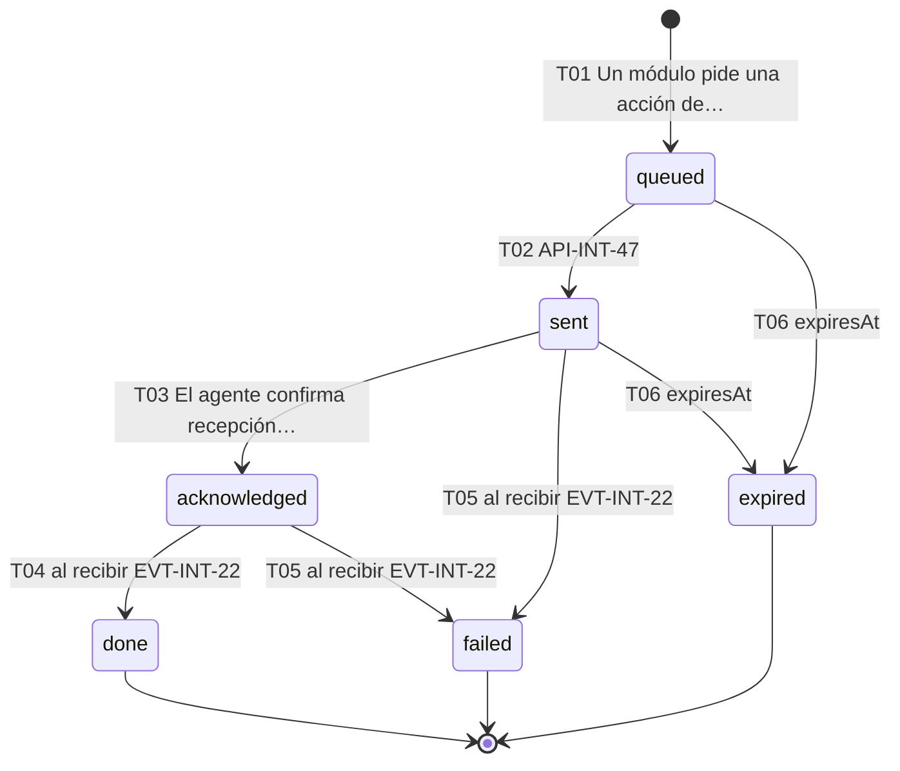

| # | Desde | Hasta | Disparador | Tipo | Guardas | Evento emitido |
|---|---|---|---|---|---|---|
| T01 | (nuevo) | `queued` | Un módulo pide una acción de dispositivo / — | no especificado | Agente `online` o en espera hasta `expiresAt` | — |
| T02 | `queued` | `sent` | Entrega por el canal del agente (API-INT-47) / — | API/integración, usuario | Firma del comando válida | — |
| T03 | `sent` | `acknowledged` | El agente confirma recepción / — | usuario | — | — |
| T04 | `acknowledged` | `done` | Resultado OK / `int.agent.commandResult` | evento | — | — |
| T05 | `acknowledged`, `sent` | `failed` | Error del dispositivo / `int.agent.commandResult` | evento | — | — |
| T06 | `queued`, `sent` | `expired` | Pasa `expiresAt` sin resultado / — | no especificado | — | — |

### EST-INT-15 — `aiUsageLogs.status` (COL-INT-18)

**Colección:** Llamadas a IA por request (costo, modelo, tokens). **Campos de estado en el §7:** `status` (línea 546; valores: `ok`, `error`, `blocked`).

**Fuente:** T06 §8.12. Registro inmutable: cada documento se escribe con su estado final y no cambia; no hay transiciones entre estados.

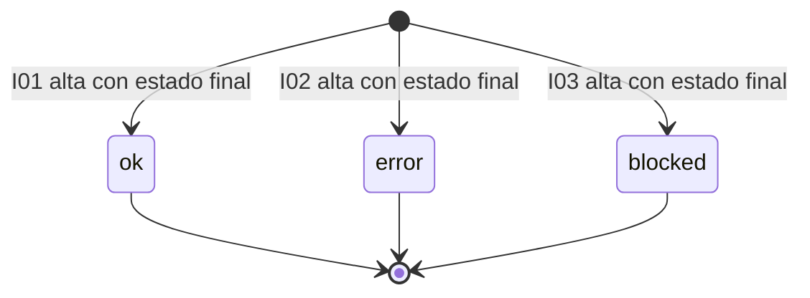

| # | Desde | Hasta | Disparador | Tipo | Guardas | Evento emitido |
|---|---|---|---|---|---|---|
| I01 | (nuevo) | `ok` | Registro de la operación | sistema | Se escribe con su estado final y no cambia | — |
| I02 | (nuevo) | `error` | Registro de la operación | sistema | Se escribe con su estado final y no cambia | — |
| I03 | (nuevo) | `blocked` | Registro de la operación | sistema | Se escribe con su estado final y no cambia | — |

### EST-INT-16 — Circuit breaker por conexión (Redis, sin colección) (fuera del universo)

**Fuente:** T06 §8.11. Estado descripto en el §8 que no se persiste en una colección del catálogo de T05; se diagrama como complemento.

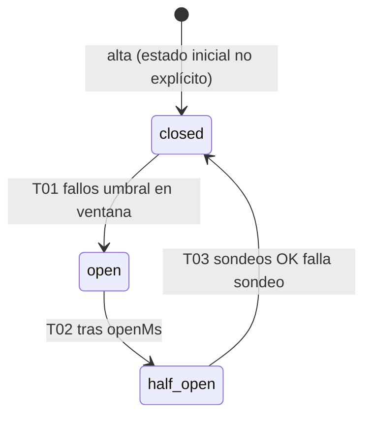

| # | Desde | Hasta | Disparador | Tipo | Guardas | Evento emitido |
|---|---|---|---|---|---|---|
| T01 | `closed` | `open` | fallos umbral en ventana | no especificado | — | — |
| T02 | `open` | `half_open` | tras openMs | no especificado | — | — |
| T03 | `half_open` | `closed` | sondeos OK falla sondeo | no especificado | — | — |

## T07 — MIG Migración desde ProCoop

### EST-MIG-01 — `migrationProjects.status` (COL-MIG-01)

**Colección:** Proyecto de migración por cooperativa. **Campos de estado en el §7:** `status` (línea 322; valores: `draft`, `inventoried`, `mapping`, `rehearsing`, `parallel`, `bypassing`, `cutover`, `live`, `closed`, `cancelled`).

**Máquina 1: `status`.** Fuente: T07 §8.1, T07 §8.8.

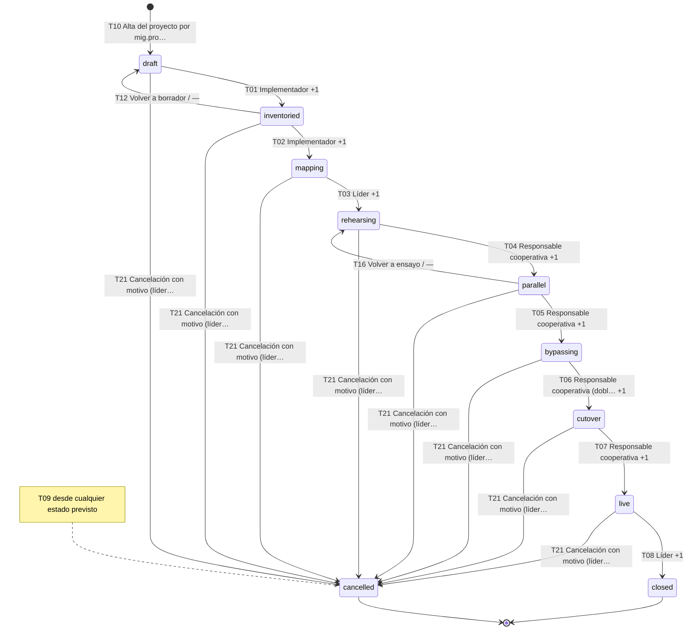

| # | Desde | Hasta | Disparador | Tipo | Guardas | Evento emitido |
|---|---|---|---|---|---|---|
| T01 | `draft` | `inventoried` | Implementador | no especificado | Fuentes registradas, snapshot `full` listo | — |
| T02 | `inventoried` | `mapping` | Implementador | no especificado | Perfilado ejecutado | — |
| T03 | `mapping` | `rehearsing` | Líder | no especificado | Conjunto de mapeo publicado | — |
| T04 | `rehearsing` | `parallel` | Responsable cooperativa | usuario | Ensayo integral con conciliaciones aprobadas de PER, SUM, MED, TAR, DEU | — |
| T05 | `parallel` | `bypassing` | Responsable cooperativa | usuario | Paralelo aprobado (PA-MIG-02) para el primer dominio | — |
| T06 | `bypassing` | `cutover` | Responsable cooperativa (doble aprobación) | usuario | Todos los dominios restantes listos o con convivencia aprobada | — |
| T07 | `cutover` | `live` | Responsable cooperativa | usuario | Acta de aceptación firmada | — |
| T08 | `live` | `closed` | Líder | no especificado | ProCoop apagado, archivo verificado, alias vencidos o programados | — |
| T09 | cualquiera | `cancelled` | Líder + responsable | usuario | Motivo | — |
| T10 | (nuevo) | `draft` | Alta del proyecto por `mig.proyectos.crear` / — | usuario | — | — |
| T11 | `draft` | `inventoried` | Inventario con snapshot `full` listo / — | no especificado | — | — |
| T12 | `inventoried` | `draft` | Volver a borrador / — | no especificado | — | — |
| T13 | `inventoried` | `mapping` | Perfilado ejecutado / — | no especificado | — | — |
| T14 | `mapping` | `rehearsing` | Conjunto de mapeo publicado / — | no especificado | — | — |
| T15 | `rehearsing` | `parallel` | Ensayo integral con conciliaciones aprobadas / — | no especificado | — | — |
| T16 | `parallel` | `rehearsing` | Volver a ensayo / — | no especificado | — | — |
| T17 | `parallel` | `bypassing` | Paralelo aprobado del primer dominio / — | no especificado | — | — |
| T18 | `bypassing` | `cutover` | Doble aprobación del corte / — | no especificado | — | — |
| T19 | `cutover` | `live` | Acta de aceptación firmada / — | no especificado | — | — |
| T20 | `live` | `closed` | ProCoop apagado y archivo verificado / — | no especificado | — | — |
| T21 | `bypassing`, `cutover`, `draft`, `inventoried`, `live`, `mapping`, `parallel`, `rehearsing` | `cancelled` | Cancelación con motivo (líder + responsable) / — | usuario | — | — |

**Máquina 2: `strategy.domains[].coexistenceRole`.** Fuente: T07 §8.5.

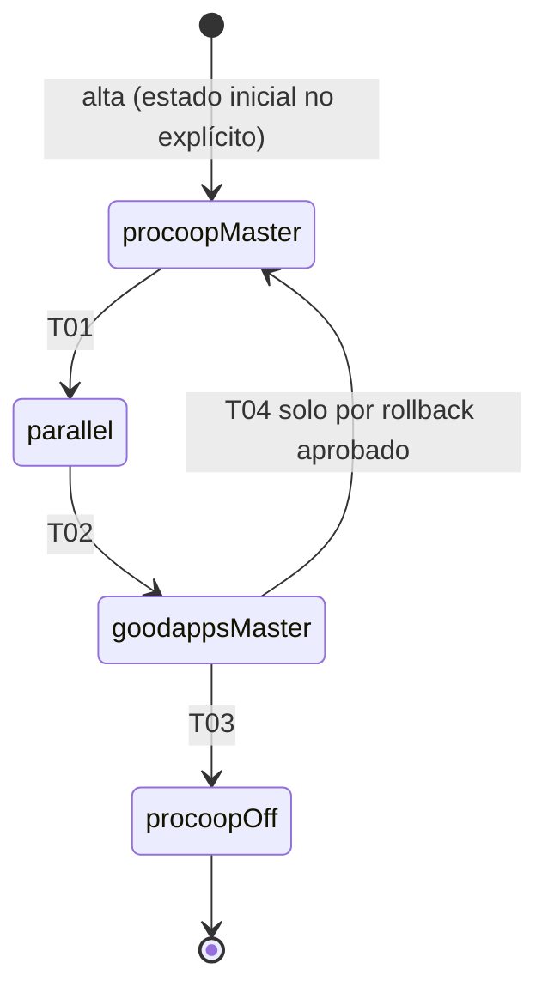

| # | Desde | Hasta | Disparador | Tipo | Guardas | Evento emitido |
|---|---|---|---|---|---|---|
| T01 | `procoopMaster` | `parallel` | — | no especificado | — | — |
| T02 | `parallel` | `goodappsMaster` | — | no especificado | — | — |
| T03 | `goodappsMaster` | `procoopOff` | — | no especificado | — | — |
| T04 | `goodappsMaster` | `procoopMaster` | solo por rollback aprobado | no especificado | — | — |

### EST-MIG-02 — `legacySnapshots.status` (COL-MIG-02)

**Colección:** Copias del origen (metadatos; binarios en almacenamiento privado). **Campos de estado en el §7:** `status` (línea 342; valores: `draft`, `planned`, `go`, `executing`, `completed`, `rolledBack`, `cancelled`).

**Fuente:** T07 §8.7.

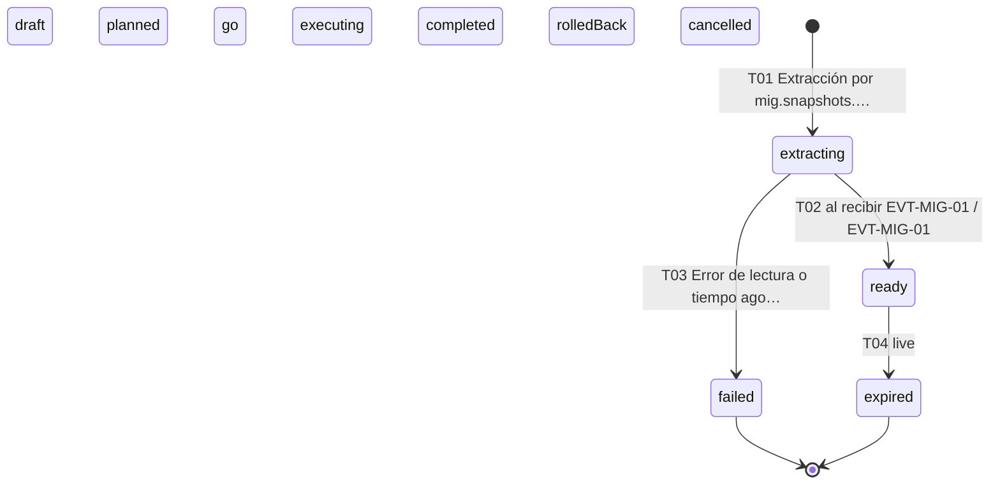

| # | Desde | Hasta | Disparador | Tipo | Guardas | Evento emitido |
|---|---|---|---|---|---|---|
| T01 | (nuevo) | `extracting` | Extracción por `mig.snapshots.crear` / — | usuario | — | — |
| T02 | `extracting` | `ready` | Fin de extracción con manifiesto / EVT-MIG-01 `mig.snapshot.ready` | evento | Checksums del manifiesto OK | EVT-MIG-01 `mig.snapshot.ready` (inferido por nombre) |
| T03 | `extracting` | `failed` | Error de lectura o tiempo agotado / — | no especificado | — | — |
| T04 | `ready` | `expired` | Vence la retención del snapshot (`live` → `closed`, §8.1) [VERIFICAR parámetro de plazo] / — | job | Sin corrida en curso que lo use | — |

### EST-MIG-03 — `migrationMappingSets.status` (COL-MIG-03)

**Colección:** Conjuntos versionados de reglas. **Campos de estado en el §7:** `status` (línea 348; valores: `draft`, `published`, `retired`).

**Fuente:** T07 §8.8.

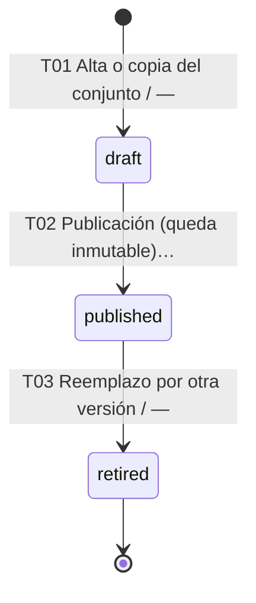

| # | Desde | Hasta | Disparador | Tipo | Guardas | Evento emitido |
|---|---|---|---|---|---|---|
| T01 | (nuevo) | `draft` | Alta o copia del conjunto / — | no especificado | — | — |
| T02 | `draft` | `published` | Publicación (queda inmutable) / — | no especificado | — | — |
| T03 | `published` | `retired` | Reemplazo por otra versión / — | job | — | — |

### EST-MIG-04 — `migrationRuns.status` (COL-MIG-06)

**Colección:** Corridas. **Campos de estado en el §7:** `status` (línea 379; valores: `queued`, `extracting`, `reading`, `transforming`, `validating`, `awaitingApproval`, `loading`, `loaded`, `reconciling`, `accepted`, `rejected`, `cancelled`, `failed`, `purged`).

Ver también el diagrama curado B12 en `06-secuencias-y-estados.md` §4.

**Fuente:** T07 §8.2, T07 §8.8.

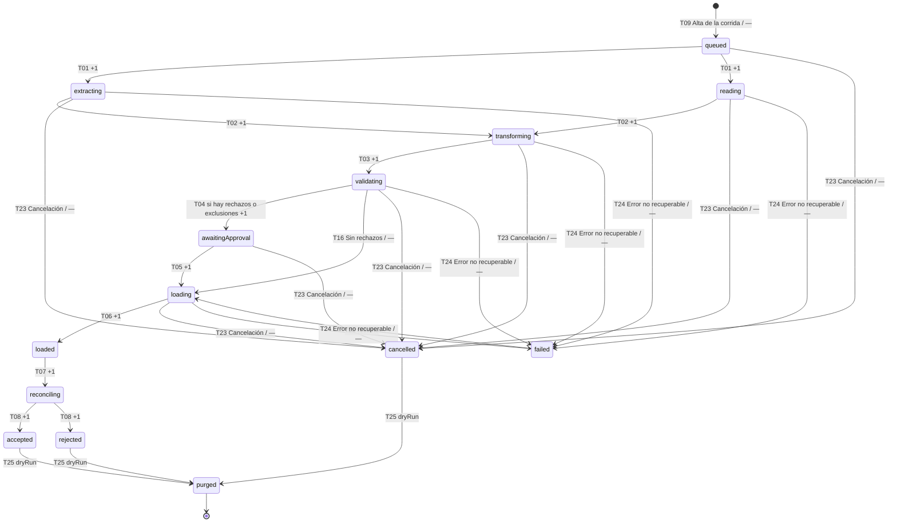

| # | Desde | Hasta | Disparador | Tipo | Guardas | Evento emitido |
|---|---|---|---|---|---|---|
| T01 | `queued` | `extracting`, `reading` | — | no especificado | — | — |
| T02 | `extracting`, `reading` | `transforming` | — | no especificado | — | — |
| T03 | `transforming` | `validating` | — | no especificado | — | — |
| T04 | `validating` | `awaitingApproval` | si hay rechazos o exclusiones | no especificado | — | — |
| T05 | `awaitingApproval` | `loading` | — | no especificado | — | — |
| T06 | `loading` | `loaded` | — | no especificado | — | — |
| T07 | `loaded` | `reconciling` | — | no especificado | — | — |
| T08 | `reconciling` | `accepted`, `rejected` | — | no especificado | — | — |
| T09 | (nuevo) | `queued` | Alta de la corrida / — | no especificado | — | — |
| T10 | `queued` | `extracting` | Inicio con extracción / — | no especificado | — | — |
| T11 | `queued` | `reading` | Inicio leyendo un snapshot existente / — | no especificado | — | — |
| T12 | `extracting` | `transforming` | Fin de extracción / — | no especificado | — | — |
| T13 | `reading` | `transforming` | Fin de lectura / — | no especificado | — | — |
| T14 | `transforming` | `validating` | Fin de transformación / — | no especificado | — | — |
| T15 | `validating` | `awaitingApproval` | Hay rechazos o exclusiones / — | no especificado | — | — |
| T16 | `validating` | `loading` | Sin rechazos / — | no especificado | — | — |
| T17 | `awaitingApproval` | `loading` | Aprobación / — | no especificado | — | — |
| T18 | `loading` | `loaded` | Todos los lotes `committed` / — | no especificado | — | — |
| T19 | `loaded` | `reconciling` | Inicio de conciliación / — | no especificado | — | — |
| T20 | `reconciling` | `accepted` | Conciliaciones aprobadas / — | no especificado | — | — |
| T21 | `reconciling` | `rejected` | Conciliación rechazada / — | no especificado | — | — |
| T22 | `failed` | `loading` | `resume` desde el último lote / — | no especificado | — | — |
| T23 | `awaitingApproval`, `extracting`, `loading`, `queued`, `reading`, `transforming`, `validating` | `cancelled` | Cancelación / — | no especificado | — | — |
| T24 | `extracting`, `loading`, `reading`, `transforming`, `validating` | `failed` | Error no recuperable / — | no especificado | — | — |
| T25 | `accepted`, `cancelled`, `rejected` | `purged` | Purga de una corrida `dryRun` (RF-MIG-046) / — | no especificado | Solo `dryRun`; `accepted` real es inmutable | — |

### EST-MIG-05 — `migrationBatches.status` (COL-MIG-07)

**Colección:** Lotes por tabla y corrida. **Campos de estado en el §7:** `status` (línea 384; valores: `pending`, `running`, `committed`, `failed`).

**Fuente:** T07 §8.7.

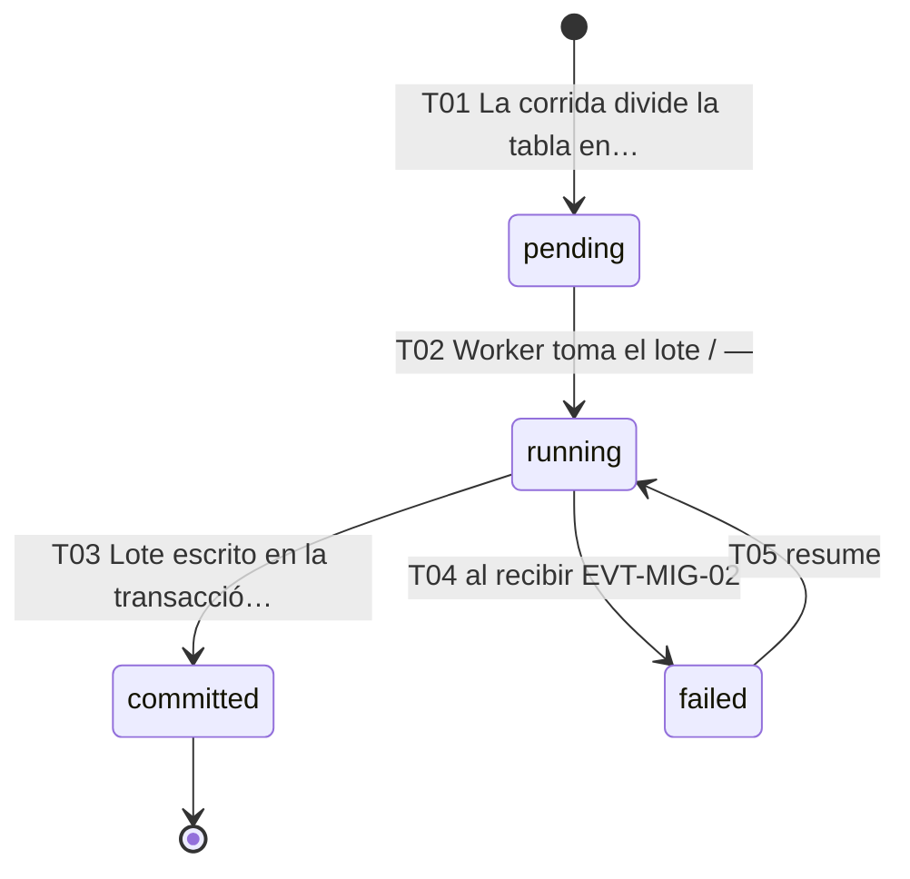

| # | Desde | Hasta | Disparador | Tipo | Guardas | Evento emitido |
|---|---|---|---|---|---|---|
| T01 | (nuevo) | `pending` | La corrida divide la tabla en lotes / — | no especificado | — | — |
| T02 | `pending` | `running` | Worker toma el lote / — | API/integración | — | — |
| T03 | `running` | `committed` | Lote escrito en la transacción / — | no especificado | — | — |
| T04 | `running` | `failed` | Error; suma `attempts` / EVT-MIG-02 `mig.run.failed` si agota intentos | evento | — | — |
| T05 | `failed` | `running` | `resume` de la corrida (§8.2) / — | no especificado | Desde el último `committed` | — |

### EST-MIG-06 — `migStagingRecords.status` (COL-MIG-08)

**Colección:** Registros en staging; TTL. **Campos de estado en el §7:** `status` (línea 395; sin valores en el §7).

**Fuente:** T07 §8.3, T07 §8.8.

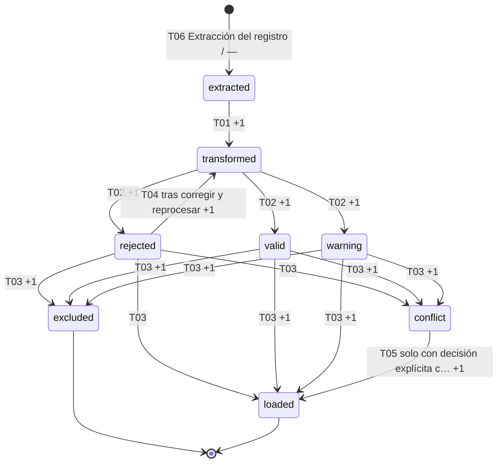

| # | Desde | Hasta | Disparador | Tipo | Guardas | Evento emitido |
|---|---|---|---|---|---|---|
| T01 | `extracted` | `transformed` | — | no especificado | — | — |
| T02 | `transformed` | `rejected`, `valid`, `warning` | — | no especificado | — | — |
| T03 | `rejected`, `valid`, `warning` | `conflict`, `excluded`, `loaded` | — | no especificado | — | — |
| T04 | `rejected` | `transformed` | tras corregir y reprocesar | no especificado | — | — |
| T05 | `conflict` | `loaded` | solo con decisión explícita conservar GoodApps o aplicar origen | no especificado | — | — |
| T06 | (nuevo) | `extracted` | Extracción del registro / — | no especificado | — | — |
| T07 | `extracted` | `transformed` | Transformación / — | no especificado | — | — |
| T08 | `transformed` | `valid` | Validación sin observaciones / — | no especificado | — | — |
| T09 | `transformed` | `warning` | Validación con advertencias / — | no especificado | — | — |
| T10 | `transformed` | `rejected` | Validación con error / — | no especificado | — | — |
| T11 | `rejected` | `transformed` | Corrección y reproceso / — | no especificado | — | — |
| T12 | `valid`, `warning` | `loaded` | Carga / — | no especificado | — | — |
| T13 | `rejected`, `valid`, `warning` | `excluded` | Exclusión / — | no especificado | — | — |
| T14 | `valid`, `warning` | `conflict` | El destino cambió en GoodApps (RN-MIG-042) / — | no especificado | — (RN-MIG-042) | — |
| T15 | `conflict` | `loaded` | Decisión explícita ("conservar GoodApps" o "aplicar origen") / — | no especificado | — | — |

### EST-MIG-07 — `legacyIdMap.status` (COL-MIG-09)

**Colección:** Mapa clave ProCoop → ObjectId. **Campos de estado en el §7:** `status` (línea 415; valores: `merged`).

**Fuente:** T07 §8.7.

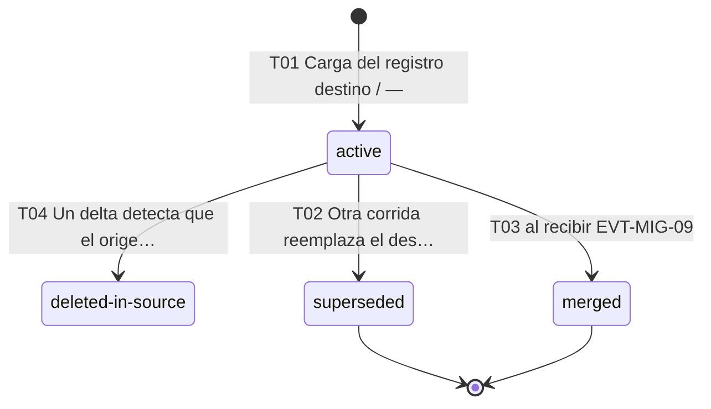

| # | Desde | Hasta | Disparador | Tipo | Guardas | Evento emitido |
|---|---|---|---|---|---|---|
| T01 | (nuevo) | `active` | Carga del registro destino / — | no especificado | — | — |
| T02 | `active` | `superseded` | Otra corrida reemplaza el destino del mismo origen / — | no especificado | `lastSourceHash` distinto | — |
| T03 | `active` | `merged` | Fusión de personas aprobada (`mergedIntoId`) / EVT-MIG-09 `mig.person.merged` | evento | — | — |
| T04 | `active` | `(deleted-in-source)` | Un delta detecta que el origen ya no existe / — | no especificado | RN-MIG-042 si el destino cambió en GoodApps | — |

### EST-MIG-08 — `migrationIssues.status` (COL-MIG-11)

**Colección:** Rechazos y advertencias. **Campos de estado en el §7:** `status` (línea 426; valores: `open`, `fixed`, `excluded`, `accepted`).

**Fuente:** T07 §8.7.

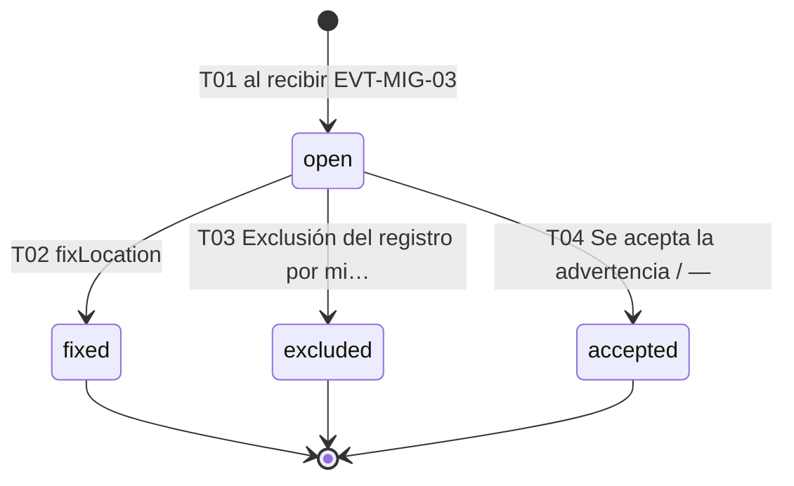

| # | Desde | Hasta | Disparador | Tipo | Guardas | Evento emitido |
|---|---|---|---|---|---|---|
| T01 | (nuevo) | `open` | Validación de la corrida / EVT-MIG-03 `mig.issue.assigned` al asignar | evento | — | — |
| T02 | `open` | `fixed` | Corrección en `fixLocation` y reproceso / — | no especificado | — | — |
| T03 | `open` | `excluded` | Exclusión del registro por `mig.rechazos.editar` / — | usuario | Motivo | — |
| T04 | `open` | `accepted` | Se acepta la advertencia / — | no especificado | Solo `severity` `warning` o `info` | — |

### EST-MIG-09 — `migrationReconciliations.status` (COL-MIG-12)

**Colección:** Conciliaciones origen-destino. **Campos de estado en el §7:** `status` (línea 436; sin valores en el §7).

**Fuente:** T07 §8.4, T07 §8.8.

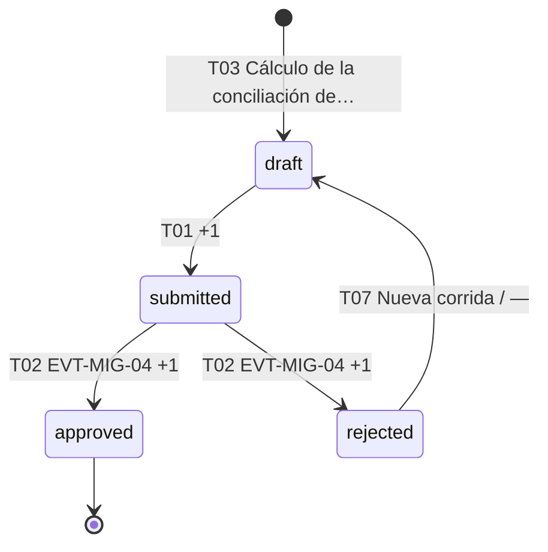

| # | Desde | Hasta | Disparador | Tipo | Guardas | Evento emitido |
|---|---|---|---|---|---|---|
| T01 | `draft` | `submitted` | — | no especificado | — | — |
| T02 | `submitted` | `approved`, `rejected` | — | no especificado | — | EVT-MIG-04 `mig.reconciliation.approved` (inferido por nombre) |
| T03 | (nuevo) | `draft` | Cálculo de la conciliación de la corrida / — | no especificado | — | — |
| T04 | `draft` | `submitted` | Envío a aprobación / — | no especificado | — | — |
| T05 | `submitted` | `approved` | Aprobación / — | no especificado | Aprobador distinto del ejecutor (RN-MIG-041) | EVT-MIG-04 `mig.reconciliation.approved` (inferido por nombre) |
| T06 | `submitted` | `rejected` | Rechazo / — | no especificado | — | EVT-MIG-04 `mig.reconciliation.rejected` (inferido por nombre) |
| T07 | `rejected` | `draft` | Nueva corrida / — | no especificado | — | — |

### EST-MIG-10 — `parallelRuns.status` (COL-MIG-13)

**Colección:** Corrida paralela. **Campos de estado en el §7:** —.

**Fuente:** T07 §8.7.

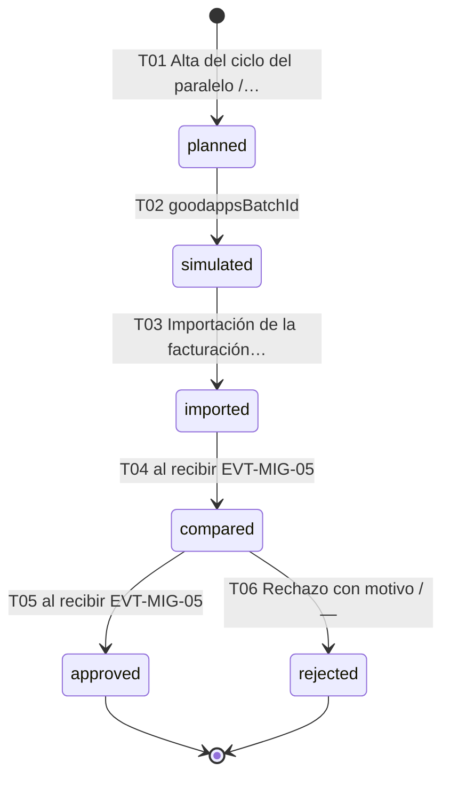

| # | Desde | Hasta | Disparador | Tipo | Guardas | Evento emitido |
|---|---|---|---|---|---|---|
| T01 | (nuevo) | `planned` | Alta del ciclo del paralelo / — | no especificado | Proyecto en `parallel` | — |
| T02 | `planned` | `simulated` | M05 genera el lote simulado (`goodappsBatchId`) / — | no especificado | — | — |
| T03 | `simulated` | `imported` | Importación de la facturación ProCoop del período / — | no especificado | — | — |
| T04 | `imported` | `compared` | Comparación terminada (§8.6) / EVT-MIG-05 `mig.parallel.compared` | evento | — | — |
| T05 | `compared` | `approved` | Aprobación por `mig.paralelo.aprobar` / EVT-MIG-05 `mig.parallel.approved` | evento | Sin diferencias `pending` ni `goodappsDefect` abiertas | — |
| T06 | `compared` | `rejected` | Rechazo con motivo / — | no especificado | — | — |

### EST-MIG-11 — `parallelComparisons.status` (COL-MIG-14)

**Colección:** Comparación ítem a ítem (absorbe `parallelRunComparisons` de M16). **Campos de estado en el §7:** `status` (línea 489; sin valores en el §7).

**Máquina 1: `status`.** Fuente: T07 §8.6.

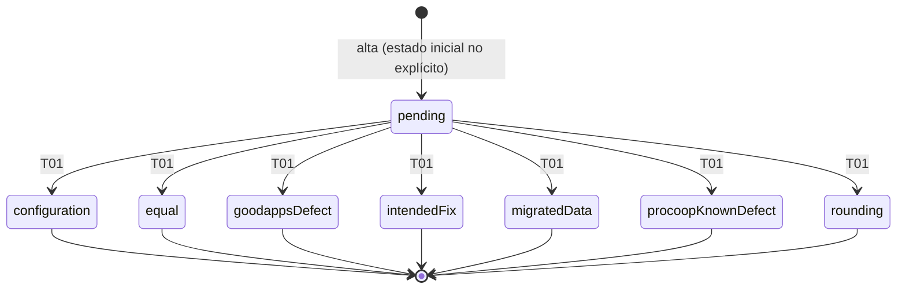

| # | Desde | Hasta | Disparador | Tipo | Guardas | Evento emitido |
|---|---|---|---|---|---|---|
| T01 | `pending` | `configuration`, `equal`, `goodappsDefect`, `intendedFix`, `migratedData`, `procoopKnownDefect`, `rounding` | — | no especificado | — | — |

**Máquina 2: `classification`.** Fuente: T07 §8.8.

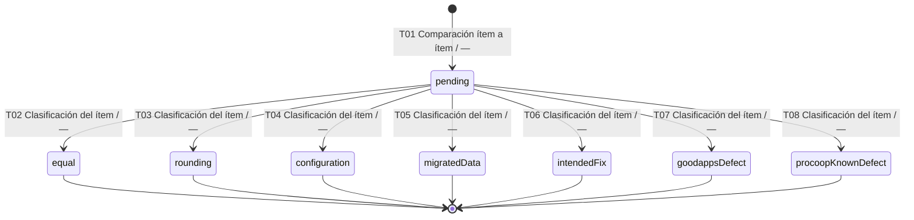

| # | Desde | Hasta | Disparador | Tipo | Guardas | Evento emitido |
|---|---|---|---|---|---|---|
| T01 | (nuevo) | `pending` | Comparación ítem a ítem / — | no especificado | — | — |
| T02 | `pending` | `equal` | Clasificación del ítem / — | no especificado | — | — |
| T03 | `pending` | `rounding` | Clasificación del ítem / — | no especificado | — | — |
| T04 | `pending` | `configuration` | Clasificación del ítem / — | no especificado | Explicación si no es `equal` ni `rounding` | — |
| T05 | `pending` | `migratedData` | Clasificación del ítem / — | no especificado | Explicación si no es `equal` ni `rounding` | — |
| T06 | `pending` | `intendedFix` | Clasificación del ítem / — | no especificado | Explicación si no es `equal` ni `rounding` | — |
| T07 | `pending` | `goodappsDefect` | Clasificación del ítem / — | no especificado | Explicación si no es `equal` ni `rounding` | — |
| T08 | `pending` | `procoopKnownDefect` | Clasificación del ítem / — | no especificado | Explicación si no es `equal` ni `rounding` | — |

### EST-MIG-12 — `bypassPlans.status` (COL-MIG-15)

**Colección:** By-pass por módulo. **Campos de estado en el §7:** `status` (línea 460; valores: `draft`, `approved`, `active`, `closed`, `cancelled`).

**Fuente:** T07 §8.7.

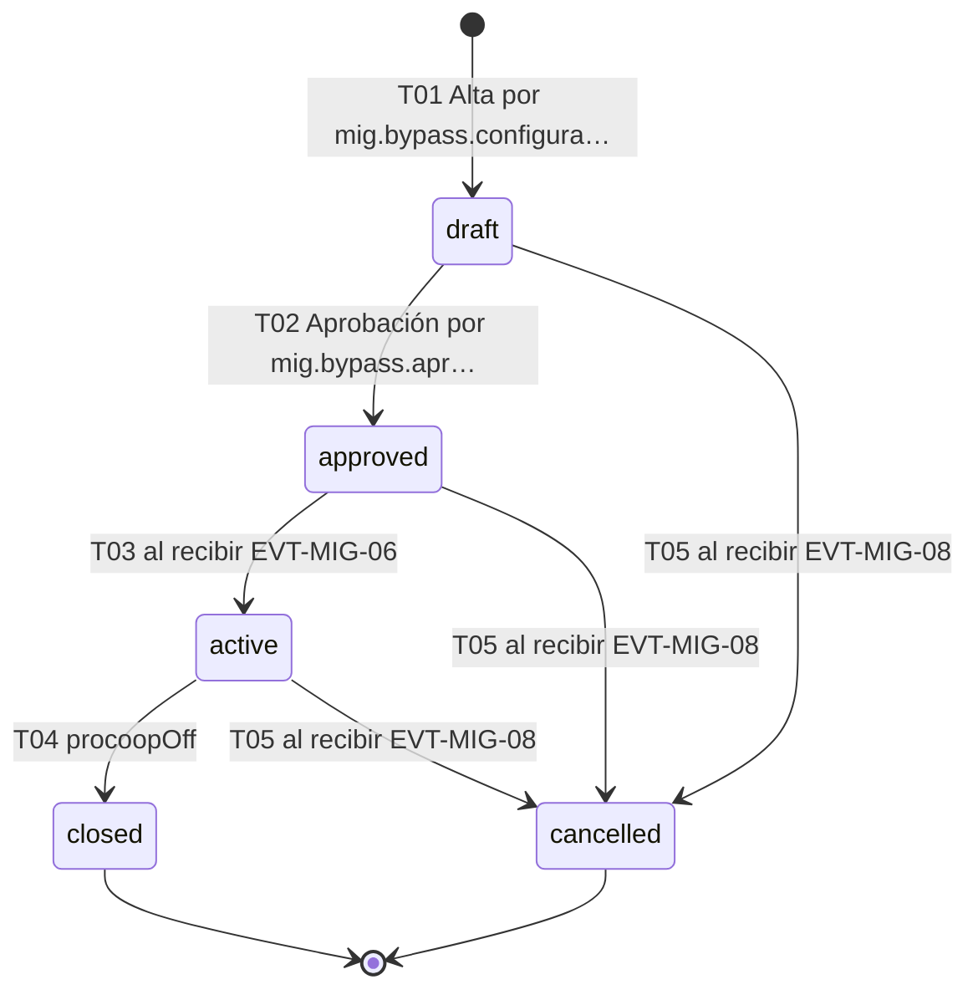

| # | Desde | Hasta | Disparador | Tipo | Guardas | Evento emitido |
|---|---|---|---|---|---|---|
| T01 | (nuevo) | `draft` | Alta por `mig.bypass.configurar` / — | usuario | — | — |
| T02 | `draft` | `approved` | Aprobación por `mig.bypass.aprobar` / — | usuario | Paralelo aprobado del primer dominio | — |
| T03 | `approved` | `active` | Primer dominio con `systemOfRecord = goodapps` / EVT-MIG-06 `mig.domain.switched` | evento | — | — |
| T04 | `active` | `closed` | Todos los dominios en `procoopOff` (§8.5) / — | no especificado | — | — |
| T05 | `active`, `approved`, `draft` | `cancelled` | Cancelación del proyecto o rollback / EVT-MIG-08 si hubo rollback | evento | Motivo | — |

### EST-MIG-13 — `cutoverPlans.status` (COL-MIG-17)

**Colección:** Plan de corte. **Campos de estado en el §7:** `status` (línea 581; valores: `draft`, `planned`, `go`, `executing`, `completed`, `rolledBack`, `cancelled`).

**Fuente:** T07 §8.7.

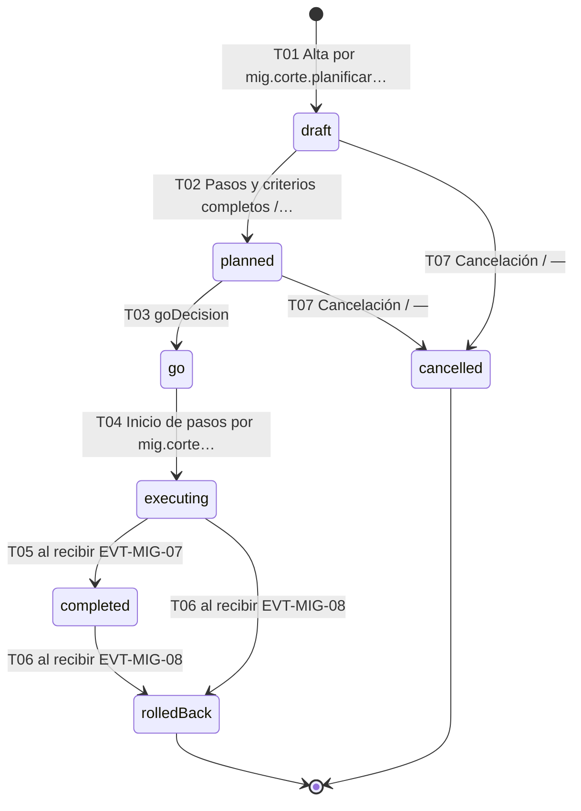

| # | Desde | Hasta | Disparador | Tipo | Guardas | Evento emitido |
|---|---|---|---|---|---|---|
| T01 | (nuevo) | `draft` | Alta por `mig.corte.planificar` / — | usuario | — | — |
| T02 | `draft` | `planned` | Pasos y criterios completos / — | no especificado | — | — |
| T03 | `planned` | `go` | Decisión de avanzar (`goDecision`) por `mig.corte.aprobar` / — | usuario | Doble aprobación (§8.1) | — |
| T04 | `go` | `executing` | Inicio de pasos por `mig.corte.ejecutar` / — | usuario | Congelamiento en `freezeAt` | — |
| T05 | `executing` | `completed` | Último paso OK y acta firmada / EVT-MIG-07 `mig.cutover.completed` | evento | — | — |
| T06 | `completed`, `executing` | `rolledBack` | Rollback por `mig.rollback.ejecutar` / EVT-MIG-08 `mig.rollback.executed` | evento | Antes de `rollbackDeadline` y con `mig.rollback.aprobar` | — |
| T07 | `draft`, `planned` | `cancelled` | Cancelación / — | no especificado | Motivo | — |

### EST-MIG-14 — `anonymizationProfiles.status` (COL-MIG-20)

**Colección:** Perfiles de anonimización para ensayos. **Campos de estado en el §7:** `status` (línea 481; valores: `draft`, `active`, `retired`).

**Fuente:** T07 §8.7.

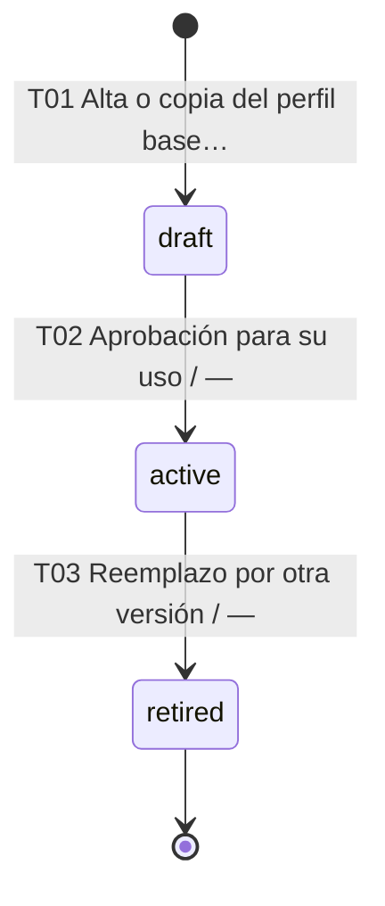

| # | Desde | Hasta | Disparador | Tipo | Guardas | Evento emitido |
|---|---|---|---|---|---|---|
| T01 | (nuevo) | `draft` | Alta o copia del perfil base / — | no especificado | — | — |
| T02 | `draft` | `active` | Aprobación para su uso / — | no especificado | Todas las columnas personales del catálogo tienen método | — |
| T03 | `active` | `retired` | Reemplazo por otra versión / — | job | — | — |

## T08 — NFR No funcionales, seguridad y privacidad

### EST-NFR-01 — `processingActivities.status` (COL-NFR-02)

**Colección:** Registro de tratamientos. **Campos de estado en el §15.1:** `status` (línea 740; valores: `borrador`, `vigente`, `retirada`, `publicado`, `reemplazado`).

**Fuente:** T08 §15.2.

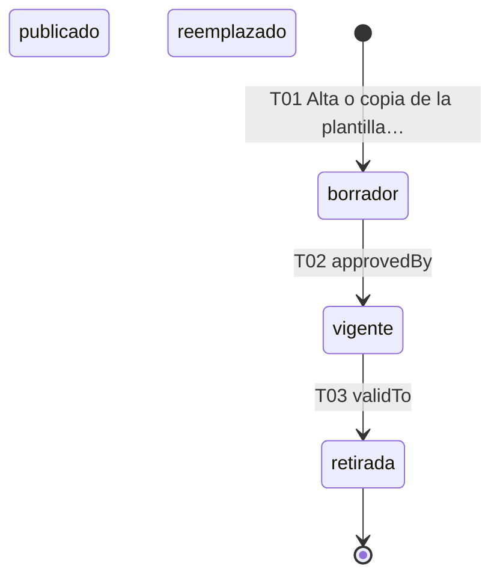

| # | Desde | Hasta | Disparador | Tipo | Guardas | Evento emitido |
|---|---|---|---|---|---|---|
| T01 | (nuevo) | `borrador` | Alta o copia de la plantilla de plataforma / — | no especificado | — | — |
| T02 | `borrador` | `vigente` | Aprobación (`approvedBy`) / — | no especificado | Base legal y plazo informados | — |
| T03 | `vigente` | `retirada` | La finalidad deja de usarse (`validTo`) / — | no especificado | Ningún `privacyNotices` `publicado` la cubre sola | — |

### EST-NFR-02 — `privacyNotices.status` (COL-NFR-03)

**Colección:** Avisos de privacidad versionados. **Campos de estado en el §15.1:** `status` (línea 744; valores: `otorgado`, `revocado`, `vencido`, `borrador`, `publicado`, `reemplazado`).

**Fuente:** T08 §15.2.

```mermaid
stateDiagram-v2
    otorgado
    revocado
    vencido
    [*] --> borrador : T01 Alta de versión por canal / —
    borrador --> publicado : T02 publishedAt / EVT-NFR-01
    publicado --> reemplazado : T03 Se publica una versión nueva…
    reemplazado --> [*]
```

| # | Desde | Hasta | Disparador | Tipo | Guardas | Evento emitido |
|---|---|---|---|---|---|---|
| T01 | (nuevo) | `borrador` | Alta de versión por canal / — | no especificado | — | — |
| T02 | `borrador` | `publicado` | Publicación (`publishedAt`, `contentHash`) / — | no especificado | Cubre todas las finalidades vigentes del canal | EVT-NFR-01 `nfr.privacyNotice.published` (inferido por nombre) |
| T03 | `publicado` | `reemplazado` | Se publica una versión nueva del mismo canal / — | no especificado | — | — |

### EST-NFR-03 — `consentRecords.status` (COL-NFR-04)

**Colección:** Consentimientos (canónica; absorbe `consents` de M01 y `consentRecords` de T09). **Campos de estado en el §15.1:** `status` (línea 832; valores: `otorgado`, `revocado`, `vencido`).

**Fuente:** T08 §15.2.

```mermaid
stateDiagram-v2
    [*] --> otorgado : T01 Otorgamiento (cada otorgamien…
    otorgado --> revocado : T02 Revocación por el titular, en… +1
    otorgado --> vencido : T03 Vencimiento (sistema) / — +1
    revocado --> [*]
    vencido --> [*]
```

| # | Desde | Hasta | Disparador | Tipo | Guardas | Evento emitido |
|---|---|---|---|---|---|---|
| T01 | (nuevo) | `otorgado` | Otorgamiento (cada otorgamiento crea un registro nuevo) / — | no especificado | — | — |
| T02 | `otorgado` | `revocado` | Revocación por el titular, en un paso / — | no especificado | — | — |
| T03 | `otorgado` | `vencido` | Vencimiento (sistema) / — | sistema | — | — |
| T04 | `otorgado` | `revocado` | titular, en un paso | no especificado | — | — |
| T05 | `otorgado` | `vencido` | sistema | sistema | — | — |

### EST-NFR-04 — `dataSubjectRequests.status` (COL-NFR-05)

**Colección:** Solicitudes de derechos (canónica; absorbe la de M01). **Campos de estado en el §15.1:** `status` (línea 746; valores: `recibida`, `enVerificacion`, `verificada`, `rechazada`, `enAnalisis`, `pendienteAprobacion`, `aprobada`, `enEjecucion`, `respondida`, `cerrada`).

**Fuente:** T08 §15.2.

```mermaid
stateDiagram-v2
    [*] --> recibida : T01 Titular, atención, formulario… / EVT-NFR-04
    recibida --> enVerificacion : T02 Responsable de datos
    enVerificacion --> verificada : T03 JOB-NFR-02
    enVerificacion --> rechazada : T04 Responsable de datos
    verificada --> enAnalisis : T05 Sistema
    enAnalisis --> pendienteAprobacion : T06 Responsable de datos
    pendienteAprobacion --> aprobada : T07 Aprobador ( nfr.solicitudesDe…
    aprobada --> enEjecucion : T08 JOB-NFR-03
    enEjecucion --> respondida : T09 Sistema
    respondida --> cerrada : T10 Sistema
    note left of rechazada : T11 desde cualquier estado previsto
    rechazada --> [*]
    cerrada --> [*]
```

| # | Desde | Hasta | Disparador | Tipo | Guardas | Evento emitido |
|---|---|---|---|---|---|---|
| T01 | (nuevo) | `recibida` | Titular, atención, formulario público | no especificado | Datos mínimos | EVT-NFR-04 `nfr.dataSubjectRequest.received` |
| T02 | `recibida` | `enVerificacion` | Responsable de datos | usuario | — | — |
| T03 | `enVerificacion` | `verificada` | Responsable de datos | usuario | Identidad acreditada | — |
| T04 | `enVerificacion` | `rechazada` | Responsable de datos | usuario | Identidad no acreditada tras plazo informado | — |
| T05 | `verificada` | `enAnalisis` | Sistema | sistema | Búsqueda completa | — |
| T06 | `enAnalisis` | `pendienteAprobacion` | Responsable de datos | usuario | Decisiones cargadas | — |
| T07 | `pendienteAprobacion` | `aprobada` | Aprobador (`nfr.solicitudesDerechos.aprobar`) | usuario | Distinto de quien analizó para supresiones | — |
| T08 | `aprobada` | `enEjecucion` | Sistema | sistema | — | — |
| T09 | `enEjecucion` | `respondida` | Sistema | sistema | Ejecución completa | — |
| T10 | `respondida` | `cerrada` | Sistema | sistema | 30 días sin reclamo o confirmación | — |
| T11 | cualquiera | `rechazada` | Responsable de datos | usuario | Fundamento (obligación de conservación, bloqueo, abuso) | — |

### EST-NFR-05 — `retentionPolicies.status` (COL-NFR-06)

**Colección:** Políticas de retención (canónica; absorbe la de T11). **Campos de estado en el §15.1:** `status` (línea 748; valores: `borrador`, `vigente`, `reemplazada`).

**Fuente:** T08 §15.2.

```mermaid
stateDiagram-v2
    [*] --> borrador : T01 Alta por el tenant dentro de…
    borrador --> vigente : T02 validFrom
    vigente --> reemplazada : T03 code
    reemplazada --> [*]
```

| # | Desde | Hasta | Disparador | Tipo | Guardas | Evento emitido |
|---|---|---|---|---|---|---|
| T01 | (nuevo) | `borrador` | Alta por el tenant dentro de los mínimos y máximos de plataforma / — | no especificado | `platformMinMonths` ≤ `durationMonths` ≤ `platformMaxMonths` | — |
| T02 | `borrador` | `vigente` | Aprobación desde `validFrom` / — | no especificado | Validación del asesor antes de la primera ejecución real (PA-NFR-06) | — |
| T03 | `vigente` | `reemplazada` | Otra versión de la misma `code` entra en vigencia / — | no especificado | — | — |

### EST-NFR-06 — `legalHolds.status` (COL-NFR-07)

**Colección:** Retenciones legales (canónica; absorbe la de T11). **Campos de estado en el §15.1:** `status` (línea 750; valores: `propuesto`, `activo`, `liberado`, `anulado`).

**Fuente:** T08 §15.2.

```mermaid
stateDiagram-v2
    propuesto --> anulado : T01 Se desiste antes de aprobar /… +1
    [*] --> propuesto : T02 Alta del bloqueo / —
    propuesto --> activo : T03 Aprobación / — / EVT-NFR-07 +1
    activo --> liberado : T04 Liberación / — +1
    anulado --> [*]
    liberado --> [*]
```

| # | Desde | Hasta | Disparador | Tipo | Guardas | Evento emitido |
|---|---|---|---|---|---|---|
| T01 | `propuesto` | `anulado` | Se desiste antes de aprobar / — | no especificado | Motivo | — |
| T02 | (nuevo) | `propuesto` | Alta del bloqueo / — | no especificado | — | — |
| T03 | `propuesto` | `activo` | Aprobación / — | no especificado | Segundo usuario distinto de quien propuso | EVT-NFR-07 `nfr.legalHold.activated` (inferido por nombre) |
| T04 | `activo` | `liberado` | Liberación / — | no especificado | Motivo | — |
| T05 | `propuesto` | `activo` | aprobación por un segundo usuario | usuario | — | EVT-NFR-07 `nfr.legalHold.activated` (inferido por nombre) |
| T06 | `activo` | `liberado` | motivo | no especificado | — | — |
| T07 | `propuesto` | `anulado` | — | no especificado | — | — |

### EST-NFR-07 — `retentionRuns.status` (COL-NFR-08)

**Colección:** Corridas de supresión. **Campos de estado en el §15.1:** `status` (línea 752; valores: `preparada`, `pendienteAprobacion`, `aprobada`, `enCurso`, `completada`, `fallida`, `cancelada`).

**Fuente:** T08 §15.2.

```mermaid
stateDiagram-v2
    [*] --> preparada : T01 Preparación de la corrida (vi…
    preparada --> pendienteAprobacion : T02 Primera ejecución de la polít… +1
    preparada --> aprobada : T03 Sin aprobación requerida / —
    pendienteAprobacion --> aprobada : T04 Aprobación / — +1
    aprobada --> enCurso : T05 JOB-NFR-04 +1
    enCurso --> completada : T06 Fin sin errores / — / EVT-NFR-08 +1
    enCurso --> fallida : T07 Error / — +1
    fallida --> enCurso : T08 checkpoint
    pendienteAprobacion --> cancelada : T09 Cancelación / — +1
    preparada --> cancelada : T09 Cancelación / — +1
    completada --> [*]
    cancelada --> [*]
```

| # | Desde | Hasta | Disparador | Tipo | Guardas | Evento emitido |
|---|---|---|---|---|---|---|
| T01 | (nuevo) | `preparada` | Preparación de la corrida (vista previa o ejecución) / — | no especificado | — | — |
| T02 | `preparada` | `pendienteAprobacion` | Primera ejecución de la política o más de 1.000 registros / — | no especificado | — | — |
| T03 | `preparada` | `aprobada` | Sin aprobación requerida / — | no especificado | — | — |
| T04 | `pendienteAprobacion` | `aprobada` | Aprobación / — | no especificado | — | — |
| T05 | `aprobada` | `enCurso` | Inicio de JOB-NFR-04 / — | job | — | — |
| T06 | `enCurso` | `completada` | Fin sin errores / — | no especificado | — | EVT-NFR-08 `nfr.retentionRun.completed` (inferido por nombre) |
| T07 | `enCurso` | `fallida` | Error / — | no especificado | — | — |
| T08 | `fallida` | `enCurso` | Reanudación desde `checkpoint` / — | no especificado | — | — |
| T09 | `pendienteAprobacion`, `preparada` | `cancelada` | Cancelación / — | no especificado | — | — |
| T10 | `preparada` | `pendienteAprobacion` | la primera ejecución de cada política y toda ejecución con registros | no especificado | — | — |
| T11 | `pendienteAprobacion` | `aprobada` | — | no especificado | — | — |
| T12 | `aprobada` | `enCurso` | — | no especificado | — | — |
| T13 | `enCurso` | `completada`, `fallida` | reanudable desde checkpoint | no especificado | — | EVT-NFR-08 `nfr.retentionRun.completed` (inferido por nombre) |
| T14 | `pendienteAprobacion`, `preparada` | `cancelada` | — | no especificado | — | — |

### EST-NFR-08 — `securityIncidents.status` (COL-NFR-10)

**Colección:** Incidentes de seguridad y privacidad. **Campos de estado en el §15.1:** `status` (línea 756; valores: `detectado`, `confirmado`, `descartado`, `contenido`, `notificado`, `erradicado`, `recuperado`, `postmortem`, `cerrado`, `programado`, `enCurso`, `resuelto`, `cancelado`).

**Fuente:** T08 §15.2.

```mermaid
stateDiagram-v2
    programado
    enCurso
    resuelto
    cancelado
    [*] --> detectado : T01 Detección o reporte / —
    detectado --> confirmado : T02 Confirmación / — +1
    detectado --> descartado : T03 Descarte (exige motivo) / —
    confirmado --> contenido : T04 Contención / — +1
    confirmado --> notificado : T05 Vence el plazo de aviso antes… / EVT-NFR-09
    contenido --> notificado : T06 Hay tenants afectados / — / EVT-NFR-09 +1
    contenido --> erradicado : T07 Sin tenants afectados / —
    notificado --> contenido : T08 Contención tras el aviso / —
    notificado --> erradicado : T09 Erradicación / — +1
    erradicado --> recuperado : T10 Recuperación / — +1
    recuperado --> postmortem : T11 Análisis posterior / — +1
    postmortem --> cerrado : T12 Cierre / — +1
    descartado --> [*]
    cerrado --> [*]
```

| # | Desde | Hasta | Disparador | Tipo | Guardas | Evento emitido |
|---|---|---|---|---|---|---|
| T01 | (nuevo) | `detectado` | Detección o reporte / — | no especificado | — | — |
| T02 | `detectado` | `confirmado` | Confirmación / — | no especificado | — | — |
| T03 | `detectado` | `descartado` | Descarte (exige motivo) / — | no especificado | — | — |
| T04 | `confirmado` | `contenido` | Contención / — | no especificado | — | — |
| T05 | `confirmado` | `notificado` | Vence el plazo de aviso antes de contener / — | job | Registro por tenant en `notifications` | EVT-NFR-09 `nfr.securityIncident.notified` (inferido por nombre) |
| T06 | `contenido` | `notificado` | Hay tenants afectados / — | no especificado | Registro por tenant en `notifications` | EVT-NFR-09 `nfr.securityIncident.notified` (inferido por nombre) |
| T07 | `contenido` | `erradicado` | Sin tenants afectados / — | no especificado | — | — |
| T08 | `notificado` | `contenido` | Contención tras el aviso / — | no especificado | — | — |
| T09 | `notificado` | `erradicado` | Erradicación / — | no especificado | — | — |
| T10 | `erradicado` | `recuperado` | Recuperación / — | no especificado | — | — |
| T11 | `recuperado` | `postmortem` | Análisis posterior / — | no especificado | — | — |
| T12 | `postmortem` | `cerrado` | Cierre / — | no especificado | — | — |
| T13 | `detectado` | `confirmado` | o descartado | no especificado | — | — |
| T14 | `confirmado` | `contenido` | — | no especificado | — | — |
| T15 | `contenido` | `notificado` | si hay tenants afectados puede ocurrir antes de contenido si el plazo vence | job | — | EVT-NFR-09 `nfr.securityIncident.notified` (inferido por nombre) |
| T16 | `notificado` | `erradicado` | — | no especificado | — | — |
| T17 | `erradicado` | `recuperado` | — | no especificado | — | — |
| T18 | `recuperado` | `postmortem` | — | no especificado | — | — |
| T19 | `postmortem` | `cerrado` | — | no especificado | — | — |

### EST-NFR-09 — `encryptionKeys.status` (COL-NFR-12)

**Colección:** DEK envueltas por categoría y tenant. **Campos de estado en el §15.1:** `status` (línea 760; valores: `activa`, `soloDescifrado`, `retirada`, `comprometida`).

**Fuente:** T08 §15.2.

```mermaid
stateDiagram-v2
    [*] --> activa : T01 Generación de la DEK / —
    activa --> soloDescifrado : T02 Rotación / — +1
    soloDescifrado --> retirada : T03 No quedan datos ni backups qu… +1
    activa --> comprometida : T04 Rotación de emergencia y re-c…
    retirada --> comprometida : T04 Rotación de emergencia y re-c…
    soloDescifrado --> comprometida : T04 Rotación de emergencia y re-c…
    note left of comprometida : T07 desde cualquier estado previsto
    comprometida --> [*]
```

| # | Desde | Hasta | Disparador | Tipo | Guardas | Evento emitido |
|---|---|---|---|---|---|---|
| T01 | (nuevo) | `activa` | Generación de la DEK / — | no especificado | — | — |
| T02 | `activa` | `soloDescifrado` | Rotación / — | no especificado | — | — |
| T03 | `soloDescifrado` | `retirada` | No quedan datos ni backups que la usen / — | no especificado | — | — |
| T04 | `activa`, `retirada`, `soloDescifrado` | `comprometida` | Rotación de emergencia y re-cifrado / — | no especificado | — | — |
| T05 | `activa` | `soloDescifrado` | al rotar | no especificado | — | — |
| T06 | `soloDescifrado` | `retirada` | cuando no quedan datos ni backups que la usen | no especificado | — | — |
| T07 | cualquiera | `comprometida` | rotación de emergencia y re-cifrado | no especificado | — | — |

### EST-NFR-10 — `statusNotices.status` (COL-NFR-21)

**Colección:** Página de estado (incidentes y mantenimientos). **Campos de estado en el §15.1:** `status` (línea 1018; valores: `programado`, `enCurso`, `resuelto`, `cancelado`).

**Fuente:** T08 §15.2.

```mermaid
stateDiagram-v2
    [*] --> programado : T01 Alta del aviso (mantenimiento…
    programado --> enCurso : T02 scheduledFrom
    enCurso --> resuelto : T03 Resolución / —
    programado --> cancelado : T04 Cancelación / —
    resuelto --> [*]
    cancelado --> [*]
```

| # | Desde | Hasta | Disparador | Tipo | Guardas | Evento emitido |
|---|---|---|---|---|---|---|
| T01 | (nuevo) | `programado` | Alta del aviso (mantenimiento o incidente) / — | no especificado | — | — |
| T02 | `programado` | `enCurso` | Llega `scheduledFrom` o se declara el incidente / — | no especificado | — | — |
| T03 | `enCurso` | `resuelto` | Resolución / — | no especificado | — | — |
| T04 | `programado` | `cancelado` | Cancelación / — | no especificado | — | — |

### EST-NFR-11 — `subprocessors.status` (COL-NFR-23)

**Colección:** Registro público de subencargados (DEC-076). **Campos de estado en el §15.1:** `status` (línea 778; valores: `propuesto`, `vigente`, `retirado`).

**Fuente:** T08 §15.2.

```mermaid
stateDiagram-v2
    [*] --> propuesto : T01 Alta del subencargado / —
    propuesto --> vigente : T02 noticeSentAt
    vigente --> retirado : T03 Fin del servicio / —
    retirado --> [*]
```

| # | Desde | Hasta | Disparador | Tipo | Guardas | Evento emitido |
|---|---|---|---|---|---|---|
| T01 | (nuevo) | `propuesto` | Alta del subencargado / — | no especificado | — | — |
| T02 | `propuesto` | `vigente` | Pasan ≥ 30 días desde `noticeSentAt` (RF-NFR-013) / — | no especificado | Aviso enviado a todos los tenants | — |
| T03 | `vigente` | `retirado` | Fin del servicio / — | no especificado | — | — |

### EST-NFR-12 — `alerts.status` (colección de otro dueño o absorbida)

**Fuente:** T08 §15.2. La colección figura en T05 como COL-PLA-16 C (dueño T01); no se crea con este dueño, se conserva el diagrama del §8 de este anexo.

```mermaid
stateDiagram-v2
    activa --> reconocida : T01
    reconocida --> resuelta : T02
    activa --> silenciada : T03 con vencimiento h y motivo
    silenciada --> activa : T04
    [*] --> activa : alta (estado inicial no explícito)
    resuelta --> [*]
```

| # | Desde | Hasta | Disparador | Tipo | Guardas | Evento emitido |
|---|---|---|---|---|---|---|
| T01 | `activa` | `reconocida` | — | no especificado | — | — |
| T02 | `reconocida` | `resuelta` | — | no especificado | — | — |
| T03 | `activa` | `silenciada` | con vencimiento h y motivo | job | — | — |
| T04 | `silenciada` | `activa` | — | no especificado | — | — |

## T09 — COM Comunidad y comunicaciones

### EST-COM-01 — `posts.status` (COL-COM-01)

**Colección:** Publicaciones del muro y novedades. **Campos de estado en el §7:** `status` (línea 489; valores: `draft`, `pending_review`, `scheduled`, `published`, `rejected`, `archived`).

**Fuente:** T09 §8.0, T09 §8.1.

```mermaid
stateDiagram-v2
    [*] --> draft : T01 Editor ( com.posts.crear ), s…
    draft --> pending_review : T02 Editor / EVT-COM-02
    pending_review --> rejected : T03 Aprobador ( com.posts.aprobar…
    draft --> scheduled : T04 JOB-COM-01
    pending_review --> scheduled : T04 JOB-COM-01
    draft --> published : T05 JOB-COM-01 / EVT-COM-01
    pending_review --> published : T05 JOB-COM-01 / EVT-COM-01
    scheduled --> published : T05 JOB-COM-01 / EVT-COM-01
    published --> archived : T06 JOB-COM-02 / EVT-COM-04
    rejected --> [*]
    archived --> [*]
```

| # | Desde | Hasta | Disparador | Tipo | Guardas | Evento emitido |
|---|---|---|---|---|---|---|
| T01 | (nuevo) | `draft` | Editor (`com.posts.crear`), supervisor, sistema (saludos) | sistema, usuario | Audiencia recortada al grant | — |
| T02 | `draft` | `pending_review` | Editor | usuario | Política de aprobación activa o canal `landing` (RN-COM-010) | EVT-COM-02 `com.post.reviewRequested` |
| T03 | `pending_review` | `rejected` | Aprobador (`com.posts.aprobar`) | usuario | Motivo obligatorio | — |
| T04 | `draft`, `pending_review` | `scheduled` | Editor sin política / aprobador | usuario | `scheduledAt` futuro; validación PII resuelta (RF-COM-024) | — |
| T05 | `draft`, `pending_review`, `scheduled` | `published` | Editor sin política / aprobador / JOB-COM-01 | job, usuario | Grant vigente del autor al momento de publicar (se recalcula `clampAudienceToGrant`) | EVT-COM-01 `com.post.published` |
| T06 | `published` | `archived` | Editor, JOB-COM-02 (`expiresAt`) | job, usuario | — | EVT-COM-04 `com.post.archived` (inferido por nombre) |

### EST-COM-02 — `comments.status` (COL-COM-09)

**Colección:** Comentarios moderados. **Campos de estado en el §7:** `status` (línea 621; valores: `pending_review`, `visible`, `hidden`, `rejected`, `deleted_by_author`, `removed`).

**Fuente:** T09 §8.0, T09 §8.2.

```mermaid
stateDiagram-v2
    [*] --> pending_review : T01 Socio/empleado
    [*] --> visible : T02 Socio/empleado
    [*] --> rejected : T03 block
    pending_review --> visible : T04 Moderador
    pending_review --> hidden : T05 Moderador, sistema (umbral de…
    visible --> hidden : T05 Moderador, sistema (umbral de…
    hidden --> deleted_by_author : T06 Autor
    pending_review --> deleted_by_author : T06 Autor
    visible --> deleted_by_author : T06 Autor
    visible --> visible : T08 Autor
    note left of removed : T07 desde cualquier estado previsto
    rejected --> [*]
    deleted_by_author --> [*]
    removed --> [*]
```

| # | Desde | Hasta | Disparador | Tipo | Guardas | Evento emitido |
|---|---|---|---|---|---|---|
| T01 | (nuevo) | `pending_review` | Socio/empleado | usuario | RN-COM-002; modo `pre`, o `ai_assisted` con riesgo `medium`/`high`, regla `review`, o error IA | — |
| T02 | (nuevo) | `visible` | Socio/empleado | usuario | Modo `post`, o `ai_assisted` con riesgo `low` sin reglas `review`/`block` (RN-COM-011) | — |
| T03 | (nuevo) | `rejected` | Sistema (regla `block`) | sistema | Regla `block` | — |
| T04 | `pending_review` | `visible` | Moderador | usuario | Caso decidido `approve`/`ignore_ai` | — |
| T05 | `pending_review`, `visible` | `hidden` | Moderador, sistema (umbral de reportes, RN-COM-005) | sistema, usuario | Motivo (RN-COM-005) | — |
| T06 | `hidden`, `pending_review`, `visible` | `deleted_by_author` | Autor | usuario | — | — |
| T07 | cualquiera | `removed` | Responsable de comunidad | usuario | WFL de eliminación de evidencia aprobado o supresión AGR-033 | — |
| T08 | `visible` | `visible` | Autor | usuario | Sin sanción vigente; dentro de PRM-COM-017 minutos | — |

### EST-COM-03 — `moderationCases.status` (COL-COM-12)

**Colección:** Cola de revisión. **Campos de estado en el §7:** `status` (línea 687; valores: `open`, `assigned`, `decided`, `escalated`, `appealed`, `closed`).

**Fuente:** T09 §8.0, T09 §8.3.

```mermaid
stateDiagram-v2
    [*] --> open : T01 Sistema (IA, regla, reporte,…
    open --> assigned : T02 Moderador (toma) / responsabl…
    assigned --> decided : T03 Moderador
    open --> decided : T03 Moderador
    assigned --> escalated : T04 Moderador
    open --> escalated : T04 Moderador
    decided --> appealed : T05 Sistema
    appealed --> closed : T06 Sistema
    decided --> closed : T06 Sistema
    escalated --> [*]
    closed --> [*]
```

| # | Desde | Hasta | Disparador | Tipo | Guardas | Evento emitido |
|---|---|---|---|---|---|---|
| T01 | (nuevo) | `open` | Sistema (IA, regla, reporte, error IA) / moderador (manual) | sistema, usuario | Sin caso abierto para el mismo sujeto (si existe, se agrega el origen) | — |
| T02 | `open` | `assigned` | Moderador (toma) / responsable (asigna) | usuario | — | — |
| T03 | `assigned`, `open` | `decided` | Moderador | usuario | Acción y motivo | — |
| T04 | `assigned`, `open` | `escalated` | Moderador | usuario | — | — |
| T05 | `decided` | `appealed` | Sistema | sistema | Apelación de sanción ligada | — |
| T06 | `appealed`, `decided` | `closed` | Sistema | sistema | Sin acciones pendientes | — |

### EST-COM-04 — `contentReports.status` (COL-COM-13)

**Colección:** Denuncias de contenido. **Campos de estado en el §7:** `status` (línea 704; valores: `open`, `upheld`, `dismissed`).

**Fuente:** T09 §8.0, T09 §8.3.1.

```mermaid
stateDiagram-v2
    [*] --> open : T01 Socio/empleado ( com.reports.… / EVT-COM-09
    open --> upheld : T02 Moderador ( com.reports.resol… / EVT-COM-10
    open --> dismissed : T03 Moderador ( com.reports.resol… / EVT-COM-10
    upheld --> [*]
    dismissed --> [*]
```

| # | Desde | Hasta | Disparador | Tipo | Guardas | Evento emitido |
|---|---|---|---|---|---|---|
| T01 | (nuevo) | `open` | Socio/empleado (`com.reports.crear`) | usuario | Una denuncia por usuario y comentario; el autor no cuenta (RN-COM-005) | EVT-COM-09 `com.report.created` |
| T02 | `open` | `upheld` | Moderador (`com.reports.resolver`) | usuario | Caso decidido con acción `hide`/`hide_and_reply`/`derive_crm` | EVT-COM-10 `com.report.resolved` |
| T03 | `open` | `dismissed` | Moderador (`com.reports.resolver`) | usuario | Caso decidido con acción `approve`/`ignore_ai` | EVT-COM-10 `com.report.resolved` |

### EST-COM-05 — `communitySanctions.status` (COL-COM-14)

**Colección:** Sanciones de comunidad. **Campos de estado en el §7:** `status` (línea 723; valores: `active`, `expired`, `revoked`, `appeal_pending`, `appeal_upheld`, `appeal_revoked`).

**Fuente:** T09 §8.0, T09 §8.4.

```mermaid
stateDiagram-v2
    [*] --> active : T01 warning / EVT-COM-11
    active --> expired : T02 JOB-COM-05 / EVT-COM-11
    active --> appeal_pending : T03 Sancionado
    appeal_pending --> appeal_revoked : T04 Revisor distinto del que sanc… / EVT-COM-12
    appeal_pending --> appeal_upheld : T04 Revisor distinto del que sanc… / EVT-COM-12
    active --> revoked : T05 Responsable de comunidad ( co… / EVT-COM-11
    expired --> [*]
    appeal_revoked --> [*]
    appeal_upheld --> [*]
    revoked --> [*]
```

| # | Desde | Hasta | Disparador | Tipo | Guardas | Evento emitido |
|---|---|---|---|---|---|---|
| T01 | (nuevo) | `active` | Moderador (`warning`, `mute`) / responsable (todas) | usuario | Caso decidido vinculado | EVT-COM-11 `com.sanction.applied` |
| T02 | `active` | `expired` | JOB-COM-05 | job | `endsAt` pasado | EVT-COM-11 `com.sanction.expired` (inferido por nombre) |
| T03 | `active` | `appeal_pending` | Sancionado | no especificado | Una apelación por sanción; dentro de PRM-COM-018 días | — |
| T04 | `appeal_pending` | `appeal_revoked`, `appeal_upheld` | Revisor distinto del que sancionó | usuario | — | EVT-COM-12 `com.sanction.appealDecided` (inferido por nombre) |
| T05 | `active` | `revoked` | Responsable de comunidad (`com.sanctions.revocar`) | usuario | Motivo obligatorio (`revokeReason`) | EVT-COM-11 `com.sanction.applied` |

### EST-COM-06 — `communityGuidelines.status` (COL-COM-15)

**Colección:** Normas de convivencia versionadas. **Campos de estado en el §7:** `status` (línea 740; valores: `draft`, `published`, `retired`).

**Fuente:** T09 §8.0, T09 §8.4.1.

```mermaid
stateDiagram-v2
    [*] --> draft : T01 Responsable de comunidad ( co…
    draft --> published : T02 Responsable de comunidad
    published --> retired : T03 Sistema
    retired --> [*]
```

| # | Desde | Hasta | Disparador | Tipo | Guardas | Evento emitido |
|---|---|---|---|---|---|---|
| T01 | (nuevo) | `draft` | Responsable de comunidad (`com.moderation.configurar`) | usuario | — | — |
| T02 | `draft` | `published` | Responsable de comunidad | usuario | Versión semver mayor que la vigente | — |
| T03 | `published` | `retired` | Sistema | sistema | Otra versión publicada | — |

### EST-COM-07 — `newsletters.status` (COL-COM-18)

**Colección:** Boletines. **Campos de estado en el §7:** `status` (línea 789; valores: `pending_review`, `approved`, `sending`, `sent`, `rejected`, `cancelled`).

**Fuente:** T09 §8.0, T09 §8.6.

```mermaid
stateDiagram-v2
    [*] --> pending_review : T01 JOB-COM-04
    [*] --> approved : T02 JOB-COM-04
    pending_review --> approved : T03 Revisor +1
    pending_review --> rejected : T04 Revisor +1
    approved --> cancelled : T05 Revisor / gestor +1
    pending_review --> cancelled : T05 Revisor / gestor +1
    approved --> sending : T06 JOB-COM-04 +1
    sending --> sent : T07 JOB-COM-04 / EVT-COM-13 +1
    rejected --> [*]
    cancelled --> [*]
    sent --> [*]
```

| # | Desde | Hasta | Disparador | Tipo | Guardas | Evento emitido |
|---|---|---|---|---|---|---|
| T01 | (nuevo) | `pending_review` | JOB-COM-04 (generación) | job | Regla con `requireReview=true` | — |
| T02 | (nuevo) | `approved` | JOB-COM-04 (generación) | job | Regla con `requireReview=false` | — |
| T03 | `pending_review` | `approved` | Revisor | usuario | — | — |
| T04 | `pending_review` | `rejected` | Revisor | usuario | Motivo obligatorio | — |
| T05 | `approved`, `pending_review` | `cancelled` | Revisor / gestor | usuario | — | — |
| T06 | `approved` | `sending` | JOB-COM-04 | job | Hora de envío | — |
| T07 | `sending` | `sent` | JOB-COM-04 | job | Todos los destinatarios procesados | EVT-COM-13 `com.newsletter.issued` |
| T08 | `pending_review` | `approved` | — | no especificado | — | — |
| T09 | `approved` | `sending` | — | no especificado | — | — |
| T10 | `sending` | `sent` | — | no especificado | — | — |
| T11 | `pending_review` | `rejected` | motivo | no especificado | — | — |
| T12 | `approved`, `pending_review` | `cancelled` | — | no especificado | — | — |

### EST-COM-08 — `newsletterRecipients.deliveryStatus` (COL-COM-19)

**Colección:** Destinatarios del boletín. **Campos de estado en el §7:** `deliveryStatus` (línea 819; valores: `created`, `queued`, `sent_to_provider`, `accepted`, `delivered`, `read`, `opened`, `clicked`, `failed`, `bounced`, `complained`, `undeliverable`, `expired`, `cancelled`, `suppressed`).

**Fuente:** T09 §8.0, T09 §8.6.1.

```mermaid
stateDiagram-v2
    queued
    sent_to_provider
    accepted
    delivered
    read
    opened
    clicked
    failed
    bounced
    complained
    expired
    cancelled
    [*] --> created : T01 Motor (envío del newsletter)
    [*] --> suppressed : T02 Motor
    [*] --> undeliverable : T02 Motor
    created --> [*]
    suppressed --> [*]
    undeliverable --> [*]
```

| # | Desde | Hasta | Disparador | Tipo | Guardas | Evento emitido |
|---|---|---|---|---|---|---|
| T01 | (nuevo) | `created` | Motor (envío del newsletter) | no especificado | Destinatario `included` con canal posible | — |
| T02 | (nuevo) | `suppressed`, `undeliverable` | Motor | no especificado | Sin canal posible o contacto suprimido | — |

### EST-COM-09 — `surveys.status` (COL-COM-20)

**Colección:** Encuestas y votaciones no vinculantes. **Campos de estado en el §7:** `status` (línea 835; valores: `draft`, `published`, `paused`, `closed`, `archived`).

**Fuente:** T09 §8.0, T09 §8.5.

```mermaid
stateDiagram-v2
    [*] --> draft : T01 Gestor
    draft --> published : T02 Gestor ( com.surveys.publicar… / EVT-COM-14
    published --> paused : T03 Gestor
    paused --> closed : T04 JOB-COM-07 / EVT-COM-14
    published --> closed : T04 JOB-COM-07 / EVT-COM-14
    closed --> archived : T05 Gestor
    archived --> [*]
```

| # | Desde | Hasta | Disparador | Tipo | Guardas | Evento emitido |
|---|---|---|---|---|---|---|
| T01 | (nuevo) | `draft` | Gestor | no especificado | — | — |
| T02 | `draft` | `published` | Gestor (`com.surveys.publicar`) | usuario | ≥1 pregunta; consentimiento si hay preguntas `sensitive`; audiencia válida; `startsAt` | EVT-COM-14 `com.survey.published` |
| T03 | `published` | `paused` | Gestor | no especificado | — | — |
| T04 | `paused`, `published` | `closed` | Gestor, JOB-COM-07 (`endsAt`) | job | — | EVT-COM-14 `com.survey.closed` (inferido por nombre) |
| T05 | `closed` | `archived` | Gestor | no especificado | — | — |

### EST-COM-10 — `surveyResponses.status` (COL-COM-21)

**Colección:** Respuestas. **Campos de estado en el §7:** `status` (línea 879; valores: `draft`, `submitted`, `invalidated`).

**Fuente:** T09 §8.0, T09 §8.5.

```mermaid
stateDiagram-v2
    draft --> submitted : T01 Respondente / EVT-COM-15
    submitted --> invalidated : T02 Gestor
    [*] --> draft : alta (estado inicial no explícito)
    invalidated --> [*]
```

| # | Desde | Hasta | Disparador | Tipo | Guardas | Evento emitido |
|---|---|---|---|---|---|---|
| T01 | `draft` | `submitted` | Respondente | no especificado | Validaciones servidor; vigencia | EVT-COM-15 `com.survey.responseSubmitted` |
| T02 | `submitted` | `invalidated` | Gestor | no especificado | Motivo (duplicado, fraude) | — |

### EST-COM-11 — `surveyInvitations.status` (COL-COM-22)

**Colección:** Invitaciones. **Campos de estado en el §7:** `status` (línea 907; valores: `created`, `delivered`, `opened`, `responded`, `expired`, `cancelled`).

**Fuente:** T09 §8.0, T09 §8.5.

```mermaid
stateDiagram-v2
    created --> delivered : T01 Sistema
    delivered --> opened : T02 Sistema
    opened --> responded : T03 Sistema
    created --> cancelled : T04 JOB-COM-07
    created --> expired : T04 JOB-COM-07
    delivered --> cancelled : T04 JOB-COM-07
    delivered --> expired : T04 JOB-COM-07
    opened --> cancelled : T04 JOB-COM-07
    opened --> expired : T04 JOB-COM-07
    [*] --> created : alta (estado inicial no explícito)
    responded --> [*]
    cancelled --> [*]
    expired --> [*]
```

| # | Desde | Hasta | Disparador | Tipo | Guardas | Evento emitido |
|---|---|---|---|---|---|---|
| T01 | `created` | `delivered` | Sistema | sistema | — | — |
| T02 | `delivered` | `opened` | Sistema | sistema | — | — |
| T03 | `opened` | `responded` | Sistema | sistema | — | — |
| T04 | `created`, `delivered`, `opened` | `cancelled`, `expired` | JOB-COM-07 / gestor | job | Vencida o encuesta cerrada | — |

### EST-COM-12 — `events.status` (COL-COM-25)

**Colección:** Eventos de comunidad. **Campos de estado en el §7:** `status` (línea 961; valores: `draft`, `published`, `cancelled`, `finished`).

**Fuente:** T09 §8.0, T09 §8.7.

```mermaid
stateDiagram-v2
    draft --> published : T01 Gestor
    published --> cancelled : T02 Gestor / EVT-COM-18
    published --> finished : T03 JOB-COM-09 / EVT-COM-19
    [*] --> draft : alta (estado inicial no explícito)
    cancelled --> [*]
    finished --> [*]
```

| # | Desde | Hasta | Disparador | Tipo | Guardas | Evento emitido |
|---|---|---|---|---|---|---|
| T01 | `draft` | `published` | Gestor | no especificado | Fechas válidas | — |
| T02 | `published` | `cancelled` | Gestor | no especificado | Motivo | EVT-COM-18 `com.event.changed` |
| T03 | `published` | `finished` | JOB-COM-09 | job | `endsAt` pasado | EVT-COM-19 `com.event.finished` (inferido por nombre) |

### EST-COM-13 — `eventRegistrations.status` (COL-COM-26)

**Colección:** Inscripciones a eventos. **Campos de estado en el §7:** `status` (línea 978; valores: `registered`, `pending_approval`, `waitlisted`, `cancelled`, `rejected`, `checked_in`, `no_show`).

**Fuente:** T09 §8.0, T09 §8.7.

```mermaid
stateDiagram-v2
    [*] --> pending_approval : T01 Socio
    [*] --> registered : T01 Socio
    [*] --> waitlisted : T01 Socio
    waitlisted --> registered : T02 Sistema (RN-COM-052)
    registered --> checked_in : T03 Gestor/validador
    pending_approval --> registered : T04 Gestor ( com.events.gestionar… / EVT-COM-17
    pending_approval --> waitlisted : T04 Gestor ( com.events.gestionar… / EVT-COM-17
    pending_approval --> rejected : T05 Gestor ( com.events.gestionar… / EVT-COM-17
    pending_approval --> cancelled : T06 Socio / sistema (evento cance… / EVT-COM-17
    registered --> cancelled : T06 Socio / sistema (evento cance… / EVT-COM-17
    waitlisted --> cancelled : T06 Socio / sistema (evento cance… / EVT-COM-17
    registered --> no_show : T07 JOB-COM-09 / EVT-COM-19
    checked_in --> [*]
    rejected --> [*]
    cancelled --> [*]
    no_show --> [*]
```

| # | Desde | Hasta | Disparador | Tipo | Guardas | Evento emitido |
|---|---|---|---|---|---|---|
| T01 | (nuevo) | `pending_approval`, `registered`, `waitlisted` | Socio | usuario | Cupo y modo | — |
| T02 | `waitlisted` | `registered` | Sistema (RN-COM-052) | sistema | Liberación de lugar (RN-COM-052) | — |
| T03 | `registered` | `checked_in` | Gestor/validador | no especificado | QR válido, día del evento | — |
| T04 | `pending_approval` | `registered`, `waitlisted` | Gestor (`com.events.gestionar`) | usuario | Modo `approval`; cupo | EVT-COM-17 `com.event.registrationChanged` |
| T05 | `pending_approval` | `rejected` | Gestor (`com.events.gestionar`) | usuario | Motivo | EVT-COM-17 `com.event.registrationChanged` |
| T06 | `pending_approval`, `registered`, `waitlisted` | `cancelled` | Socio / sistema (evento cancelado) | evento, sistema, usuario | Antes del inicio (RN-COM-052) | EVT-COM-17 `com.event.registrationChanged` |
| T07 | `registered` | `no_show` | JOB-COM-09 | job | Evento `finished` sin check-in | EVT-COM-19 `com.event.finished` |

## Cobertura de la parte M

| Módulo | Colección | ID propio | Clasificación | Fuente o motivo |
|---|---|---|---|---|
| T06 | COL-INT-17 `localAgentCommands` | EST-INT-14 | Diagramada (transiciones del §8) | T06 §8.12 |
| T06 | COL-INT-18 `aiUsageLogs` | EST-INT-15 | Diagramada (registro inmutable) | T06 §8.12 |
| T07 | COL-MIG-01 `migrationProjects` | EST-MIG-01 | Diagramada (transiciones del §8) | T07 §8.1, T07 §8.5, T07 §8.8 |
| T07 | COL-MIG-02 `legacySnapshots` | EST-MIG-02 | Diagramada (transiciones del §8) | T07 §8.7 |
| T07 | COL-MIG-03 `migrationMappingSets` | EST-MIG-03 | Diagramada (transiciones del §8) | T07 §8.8 |
| T07 | COL-MIG-06 `migrationRuns` | EST-MIG-04 | Diagramada (transiciones del §8) | T07 §8.2, T07 §8.8 |
| T07 | COL-MIG-07 `migrationBatches` | EST-MIG-05 | Diagramada (transiciones del §8) | T07 §8.7 |
| T07 | COL-MIG-08 `migStagingRecords` | EST-MIG-06 | Diagramada (transiciones del §8) | T07 §8.3, T07 §8.8 |
| T07 | COL-MIG-09 `legacyIdMap` | EST-MIG-07 | Diagramada (transiciones del §8) | T07 §8.7 |
| T07 | COL-MIG-11 `migrationIssues` | EST-MIG-08 | Diagramada (transiciones del §8) | T07 §8.7 |
| T07 | COL-MIG-12 `migrationReconciliations` | EST-MIG-09 | Diagramada (transiciones del §8) | T07 §8.4, T07 §8.8 |
| T07 | COL-MIG-13 `parallelRuns` | EST-MIG-10 | Diagramada (transiciones del §8) | T07 §8.7 |
| T07 | COL-MIG-14 `parallelComparisons` | EST-MIG-11 | Diagramada (transiciones del §8) | T07 §8.6, T07 §8.8 |
| T07 | COL-MIG-15 `bypassPlans` | EST-MIG-12 | Diagramada (transiciones del §8) | T07 §8.7 |
| T07 | COL-MIG-16 `coexistenceSyncs` | — | Excluida | El §7 declara `lastStatus` sin valores y el §8 no define su máquina de estados. |
| T07 | COL-MIG-17 `cutoverPlans` | EST-MIG-13 | Diagramada (transiciones del §8) | T07 §8.7 |
| T07 | COL-MIG-20 `anonymizationProfiles` | EST-MIG-14 | Diagramada (transiciones del §8) | T07 §8.7 |
| T08 | COL-NFR-02 `processingActivities` | EST-NFR-01 | Diagramada (transiciones del §8) | T08 §15.2 |
| T08 | COL-NFR-03 `privacyNotices` | EST-NFR-02 | Diagramada (transiciones del §8) | T08 §15.2 |
| T08 | COL-NFR-04 `consentRecords` | EST-NFR-03 | Diagramada (transiciones del §8) | T08 §15.2 |
| T08 | COL-NFR-05 `dataSubjectRequests` | EST-NFR-04 | Diagramada (transiciones del §8) | T08 §15.2 |
| T08 | COL-NFR-06 `retentionPolicies` | EST-NFR-05 | Diagramada (transiciones del §8) | T08 §15.2 |
| T08 | COL-NFR-07 `legalHolds` | EST-NFR-06 | Diagramada (transiciones del §8) | T08 §15.2 |
| T08 | COL-NFR-08 `retentionRuns` | EST-NFR-07 | Diagramada (transiciones del §8) | T08 §15.2 |
| T08 | COL-NFR-10 `securityIncidents` | EST-NFR-08 | Diagramada (transiciones del §8) | T08 §15.2 |
| T08 | COL-NFR-12 `encryptionKeys` | EST-NFR-09 | Diagramada (transiciones del §8) | T08 §15.2 |
| T08 | COL-NFR-21 `statusNotices` | EST-NFR-10 | Diagramada (transiciones del §8) | T08 §15.2 |
| T08 | COL-NFR-23 `subprocessors` | EST-NFR-11 | Diagramada (transiciones del §8) | T08 §15.2 |
| T09 | COL-COM-01 `posts` | EST-COM-01 | Diagramada (transiciones del §8) | T09 §8.0, T09 §8.1 |
| T09 | COL-COM-09 `comments` | EST-COM-02 | Diagramada (transiciones del §8) | T09 §8.0, T09 §8.2 |
| T09 | COL-COM-12 `moderationCases` | EST-COM-03 | Diagramada (transiciones del §8) | T09 §8.0, T09 §8.3 |
| T09 | COL-COM-13 `contentReports` | EST-COM-04 | Diagramada (transiciones del §8) | T09 §8.0, T09 §8.3.1 |
| T09 | COL-COM-14 `communitySanctions` | EST-COM-05 | Diagramada (transiciones del §8) | T09 §8.0, T09 §8.4 |
| T09 | COL-COM-15 `communityGuidelines` | EST-COM-06 | Diagramada (transiciones del §8) | T09 §8.0, T09 §8.4.1 |
| T09 | COL-COM-18 `newsletters` | EST-COM-07 | Diagramada (transiciones del §8) | T09 §8.0, T09 §8.6 |
| T09 | COL-COM-19 `newsletterRecipients` | EST-COM-08 | Diagramada (transiciones del §8) | T09 §8.0, T09 §8.6.1 |
| T09 | COL-COM-20 `surveys` | EST-COM-09 | Diagramada (transiciones del §8) | T09 §8.0, T09 §8.5 |
| T09 | COL-COM-21 `surveyResponses` | EST-COM-10 | Diagramada (transiciones del §8) | T09 §8.0, T09 §8.5 |
| T09 | COL-COM-22 `surveyInvitations` | EST-COM-11 | Diagramada (transiciones del §8) | T09 §8.0, T09 §8.5 |
| T09 | COL-COM-25 `events` | EST-COM-12 | Diagramada (transiciones del §8) | T09 §8.0, T09 §8.7 |
| T09 | COL-COM-26 `eventRegistrations` | EST-COM-13 | Diagramada (transiciones del §8) | T09 §8.0, T09 §8.7 |
