# GoodApps Cooperativas — Diagramas de estados, parte N (T09-T11)

**Entregable de análisis y diseño — Artefacto 7.4 (diagramas de estados), ampliación a cobertura completa**

| Campo | Valor |
|---|---|
| Documento | `06n-estados-t09-t11.md` |
| Índice del entregable | [`06-secuencias-y-estados.md`](06-secuencias-y-estados.md) (sección 7) y [`06a-indice-cobertura-secuencias-estados.md`](06a-indice-cobertura-secuencias-estados.md) |
| Versión | 1.0 |
| Fecha | 05-11-2026 |
| Estado | Borrador para revisión |
| Fuentes | §7 (modelo de datos) y §8 (estados y transiciones) de los anexos T09, T10, T11; T05 §7 (catálogo de colecciones); T11 §12 (eventos) |
| Generación | Script `_trabajo/gen06_build.py` (extrae de los anexos; revisión manual posterior) |

## 1. Cómo leer esta parte

Cada entidad tiene un identificador propio `EST-<prefijo>-NN`, el nombre de la colección y del campo de estado según T05 y el §7 del anexo dueño, y el ID de colección (`COL-`). Debajo del diagrama, la tabla de transiciones indica:

- **Desde / Hasta:** estados de origen y destino; `(nuevo)` es el alta y `cualquiera` una transición válida desde todo estado no terminal que el anexo habilita.
- **Disparador:** texto del anexo (actor, comando, API, job o evento consumido). **Tipo:** clasificación derivada del texto: `usuario`, `API/integración`, `evento`, `job`, `sistema`.
- **Guardas:** precondición y reglas `RN-` citadas en la fila del §8.
- **Evento emitido:** `EVT-` citado en los efectos; "(inferido por nombre)" cuando el §8 no lo nombra y el catálogo de T11 tiene un evento del mismo agregado cuyo hecho coincide con el estado de destino.

En el diagrama, la etiqueta de cada flecha lleva el número de transición (`T01`…), el disparador principal (API, job, evento o comando) y el evento emitido. "alta (estado inicial no explícito)" marca que el anexo no dice cuál es el estado inicial y se toma el primero del §7 o de la máquina. Clasificación de cobertura: **transiciones del §8**, **máquina compartida** (el §8 define una máquina para un grupo de colecciones), **patrón general** (T05 §7.1.5 o T04 §8.3 aplicados a los valores del §7), **registro inmutable** (el §8 declara que el documento se escribe con su estado final y no cambia), **solo estados** (el §7 enumera valores y el §8 no define transiciones) y **excluida** (campo de estado sin valores ni máquina; figura solo en la tabla de cobertura).

## T09 — COM Comunidad y comunicaciones (continuación)

### EST-COM-14 — `benefits.status` (COL-COM-28)

**Colección:** Beneficios del club (no tarifarios). **Campos de estado en el §7:** `status` (línea 1019; valores: `draft`, `published`, `paused`, `expired`, `cancelled`).

**Fuente:** T09 §8.0, T09 §8.8.

```mermaid
stateDiagram-v2
    [*] --> draft : T01 Gestor ( com.benefits.gestion…
    draft --> published : T02 Gestor +1
    paused --> published : T02 Gestor +1
    published --> expired : T03 JOB-COM-10 +1
    published --> paused : T06 JOB-COM-10 +1
    note left of cancelled : T04 desde cualquier estado previsto
    note left of cancelled : T10 desde cualquier estado previsto
    expired --> [*]
    cancelled --> [*]
```

| # | Desde | Hasta | Disparador | Tipo | Guardas | Evento emitido |
|---|---|---|---|---|---|---|
| T01 | (nuevo) | `draft` | Gestor (`com.benefits.gestionar`) | usuario | — | — |
| T02 | `draft`, `paused` | `published` | Gestor | no especificado | Vigencia y comercio activos | — |
| T03 | `published` | `expired` | JOB-COM-10 | job | `validTo` pasado o cupo total agotado | — |
| T04 | cualquiera | `cancelled` | Gestor | no especificado | Motivo | — |
| T05 | `draft` | `published` | — | no especificado | — | — |
| T06 | `published` | `paused` | — | no especificado | — | — |
| T07 | `paused` | `published` | — | no especificado | — | — |
| T08 | `published` | `paused` | — | no especificado | — | — |
| T09 | `published` | `expired` | JOB-COM-10 al validTo o cupo total agotado | job | — | — |
| T10 | cualquiera | `cancelled` | motivo códigos emitidos pasan a cancelled y se avisa | no especificado | — | — |

### EST-COM-15 — `benefitRedemptions.status` (COL-COM-29)

**Colección:** Canjes. **Campos de estado en el §7:** `status` (línea 1035; valores: `issued`, `redeemed`, `expired`, `cancelled`).

**Fuente:** T09 §8.0, T09 §8.8.

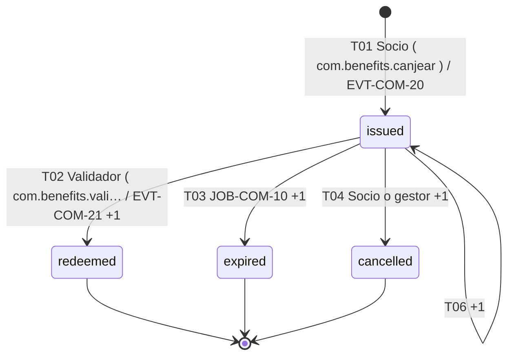

| # | Desde | Hasta | Disparador | Tipo | Guardas | Evento emitido |
|---|---|---|---|---|---|---|
| T01 | (nuevo) | `issued` | Socio (`com.benefits.canjear`) | usuario | Elegible; cupo por persona y total | EVT-COM-20 `com.benefit.redemptionIssued` |
| T02 | `issued` | `redeemed` | Validador (`com.benefits.validarCanje`) o link del comercio | usuario | Código válido y no usado (RN-COM-053) | EVT-COM-21 `com.benefit.redeemed` |
| T03 | `issued` | `expired` | JOB-COM-10 | job | `expiresAt` pasado | — |
| T04 | `issued` | `cancelled` | Socio o gestor | usuario | — | — |
| T05 | `issued` | `redeemed` | validador o link de comercio una sola vez, RN-COM-053 | no especificado | RN-COM-053 | — |
| T06 | `issued` | `issued` | — | no especificado | RN-COM-053 | — |
| T07 | `issued` | `expired` | vencimiento | job | RN-COM-053 | — |
| T08 | `issued` | `issued` | — | no especificado | RN-COM-053 | — |
| T09 | `issued` | `cancelled` | socio o gestor | usuario | RN-COM-053 | — |

### EST-COM-16 — `audienceImportLists.status` (COL-COM-31)

**Colección:** Listas importadas. **Campos de estado en el §7:** `status` (línea 1072; valores: `uploaded`, `validated`, `confirmed`, `discarded`).

**Fuente:** T09 §8.0, T09 §8.8.1.

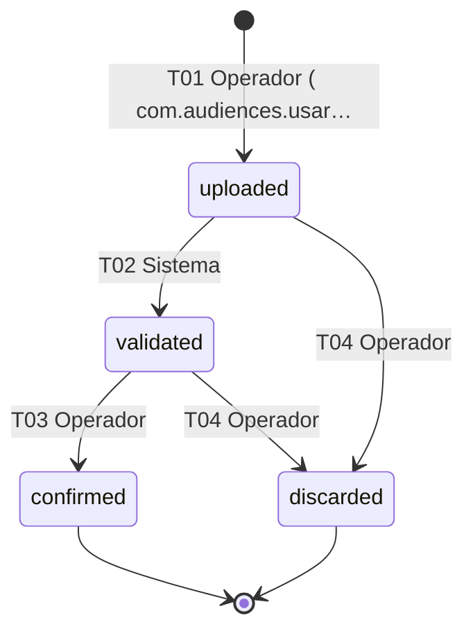

| # | Desde | Hasta | Disparador | Tipo | Guardas | Evento emitido |
|---|---|---|---|---|---|---|
| T01 | (nuevo) | `uploaded` | Operador (`com.audiences.usar`) | usuario | Archivo con columna de cruce `matchBy` | — |
| T02 | `uploaded` | `validated` | Sistema | sistema | Cruce terminado | — |
| T03 | `validated` | `confirmed` | Operador | usuario | Revisión de no cruzadas y ambiguas | — |
| T04 | `uploaded`, `validated` | `discarded` | Operador | usuario | — | — |

### EST-COM-17 — `audienceImportRows.matchStatus` (COL-COM-32)

**Colección:** Filas importadas. **Campos de estado en el §7:** `matchStatus` (línea 1085; valores: `matched`, `unmatched`, `ambiguous`, `duplicate`).

**Fuente:** T09 §8.0, T09 §8.8.2.

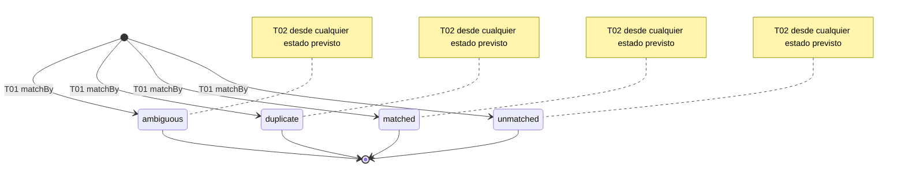

| # | Desde | Hasta | Disparador | Tipo | Guardas | Evento emitido |
|---|---|---|---|---|---|---|
| T01 | (nuevo) | `ambiguous`, `duplicate`, `matched`, `unmatched` | Sistema (cruce por `matchBy`) | sistema | Lista `uploaded` | — |
| T02 | cualquiera | `ambiguous`, `duplicate`, `matched`, `unmatched` | Sistema (revalidación) | sistema | Lista recargada (`validated` → `uploaded`) | — |

### EST-COM-18 — `communicationTypes.status` (COL-COM-35)

**Colección:** Tipos de comunicación (`notifKinds`). **Campos de estado en el §7:** `status` (línea 1143; valores: `active`, `inactive`).

**Fuente:** T09 §8.0, T09 §8.9.1.

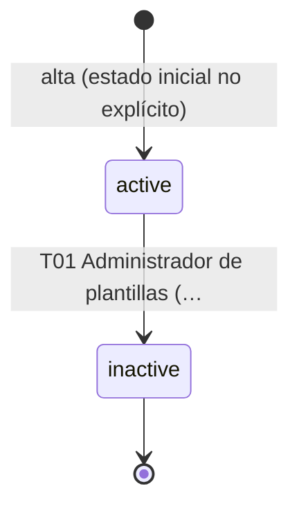

| # | Desde | Hasta | Disparador | Tipo | Guardas | Evento emitido |
|---|---|---|---|---|---|---|
| T01 | `active` | `inactive` | Administrador de plantillas (`com.catalog.configurar`) | usuario | `optOut ≠ never` y finalidad distinta de `security`/`regulatory` | — |

### EST-COM-19 — `messageTemplates.status` (COL-COM-36)

**Colección:** Plantillas de mensaje. **Campos de estado en el §7:** `status` (línea 1159; valores: `active`, `retired`).

**Máquina 1: `status`.** Fuente: T09 §8.0, T09 §8.9.1.

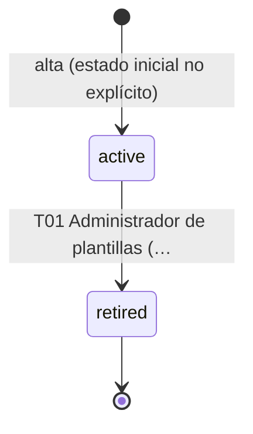

| # | Desde | Hasta | Disparador | Tipo | Guardas | Evento emitido |
|---|---|---|---|---|---|---|
| T01 | `active` | `retired` | Administrador de plantillas (`com.templates.editar`) | usuario | El tipo tiene otra plantilla activa para el canal y el idioma | — |

**Máquina 2: `whatsapp.approvalStatus`.** Fuente: T09 §8.0, T09 §8.9.2.

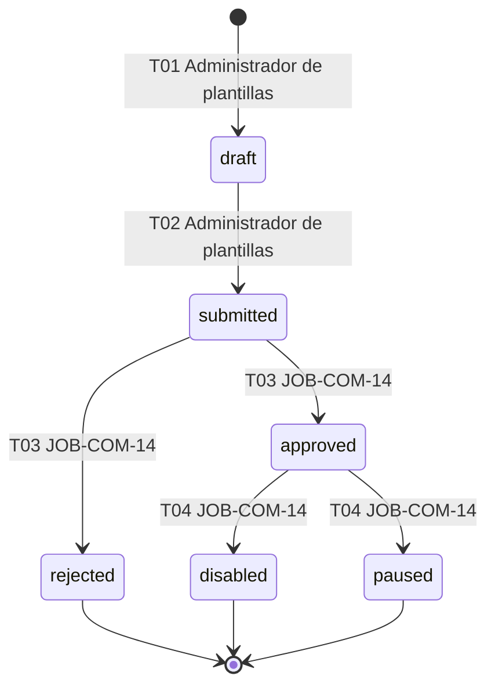

| # | Desde | Hasta | Disparador | Tipo | Guardas | Evento emitido |
|---|---|---|---|---|---|---|
| T01 | (nuevo) | `draft` | Administrador de plantillas | usuario | — | — |
| T02 | `draft` | `submitted` | Administrador de plantillas | usuario | Plantilla con variables del proveedor | — |
| T03 | `submitted` | `approved`, `rejected` | Proveedor (JOB-COM-14) | job, API/integración | Revisión del proveedor | — |
| T04 | `approved` | `disabled`, `paused` | Proveedor (JOB-COM-14) | job, API/integración | Calidad o política del proveedor | — |

### EST-COM-20 — `messageTemplateVersions.status` (COL-COM-37)

**Colección:** Versiones de plantilla. **Campos de estado en el §7:** `status` (línea 1172; valores: `draft`, `published`, `retired`).

**Fuente:** T09 §8.0, T09 §8.9.

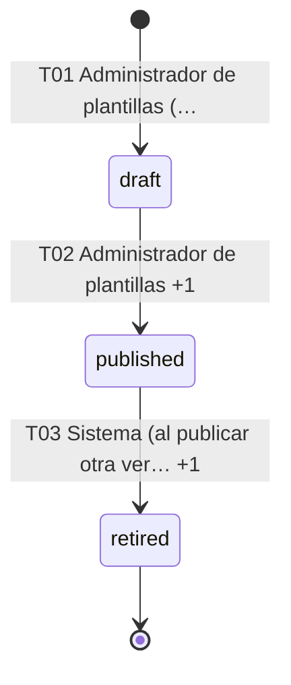

| # | Desde | Hasta | Disparador | Tipo | Guardas | Evento emitido |
|---|---|---|---|---|---|---|
| T01 | (nuevo) | `draft` | Administrador de plantillas (`com.templates.editar`) | usuario | — | — |
| T02 | `draft` | `published` | Administrador de plantillas | usuario | Variables existentes en el registro; prueba de render sin errores; en SMS, segmentos ≤ máximo; en WhatsApp, plantilla del proveedor `approved` (RN-COM-060) | — |
| T03 | `published` | `retired` | Sistema (al publicar otra versión) / administrador | sistema, usuario | Si es manual, el tipo tiene otra plantilla activa | — |
| T04 | `draft` | `published` | administrador de plantillas precondiciones: variables existentes en el registro, prueba de render sin errores, en SMS segmentos máximo, en WhatsApp p… | API/integración, usuario | RN-COM-060 | — |
| T05 | `published` | `retired` | al publicar otra versión o manualmente si el tipo tiene otra plantilla activa | no especificado | RN-COM-060 | — |

### EST-COM-21 — `communications.status` (COL-COM-39)

**Colección:** Comunicación enviada a un destinatario. **Campos de estado en el §7:** `status` (línea 1223; sin valores en el §7).

**Fuente:** T09 §8.0, T09 §8.10.

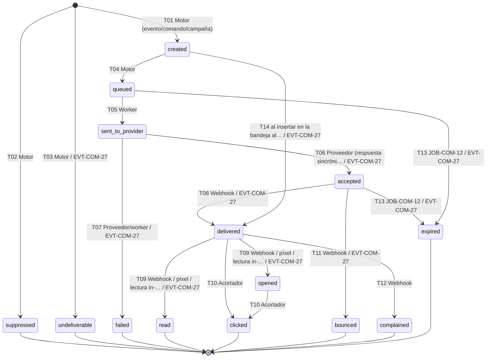

| # | Desde | Hasta | Disparador | Tipo | Guardas | Evento emitido |
|---|---|---|---|---|---|---|
| T01 | (nuevo) | `created` | Motor (evento/comando/campaña) | evento | Tipo activo; idempotencia | — |
| T02 | (nuevo) | `suppressed` | Motor | no especificado | Contacto en supresión, opt-out, o canal no permitido | — |
| T03 | (nuevo) | `undeliverable` | Motor | no especificado | Ningún canal posible | EVT-COM-27 `com.communication.accepted` |
| T04 | `created` | `queued` | Motor | no especificado | Dentro de ventana y horario; si no, `scheduledFor` diferido | — |
| T05 | `queued` | `sent_to_provider` | Worker | API/integración | Throttle disponible; circuit breaker cerrado | — |
| T06 | `sent_to_provider` | `accepted` | Proveedor (respuesta sincrónica) | API/integración | — | EVT-COM-27 `com.communication.accepted` (inferido por nombre) |
| T07 | `sent_to_provider` | `failed` | Proveedor/worker | API/integración | Error no reintentable o intentos agotados | EVT-COM-27 `com.communication.failed` (inferido por nombre) |
| T08 | `accepted` | `delivered` | Webhook | no especificado | — | EVT-COM-27 `com.communication.delivered` (inferido por nombre) |
| T09 | `delivered` | `opened`, `read` | Webhook / píxel / lectura in-app / clic push | no especificado | — | EVT-COM-27 `com.communication.read` (inferido por nombre) |
| T10 | `delivered`, `opened` | `clicked` | Acortador | no especificado | — | — |
| T11 | `accepted` | `bounced` | Webhook | no especificado | — | EVT-COM-27 `com.communication.bounced` (inferido por nombre) |
| T12 | `delivered` | `complained` | Webhook | no especificado | — | — |
| T13 | `accepted`, `queued` | `expired` | JOB-COM-12 | job | `expiresAt` vencido sin entrega | EVT-COM-27 `com.communication.expired` (inferido por nombre) |
| T14 | `created` | `delivered` | al insertar en la bandeja al abrir | no especificado | — | EVT-COM-27 `com.communication.delivered` (inferido por nombre) |

### EST-COM-22 — `senderIdentities.verificationStatus` (COL-COM-43)

**Colección:** Remitentes verificados. **Campos de estado en el §7:** `verificationStatus` (línea 1297; valores: `pending`, `verified`, `failed`).

**Fuente:** T09 §8.9.1.

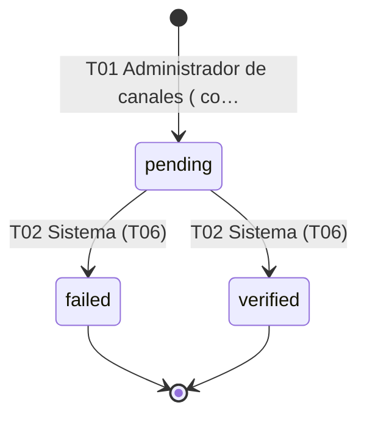

| # | Desde | Hasta | Disparador | Tipo | Guardas | Evento emitido |
|---|---|---|---|---|---|---|
| T01 | (nuevo) | `pending` | Administrador de canales (`com.channels.configurar`) | usuario | — | — |
| T02 | `pending` | `failed`, `verified` | Sistema (T06) | sistema | Resultado del proveedor (RN-COM-020) | — |

### EST-COM-23 — `campaigns.status` (COL-COM-47)

**Colección:** Campañas masivas. **Campos de estado en el §7:** `status` (línea 1379; sin valores en el §7).

**Fuente:** T09 §8.0, T09 §8.11.

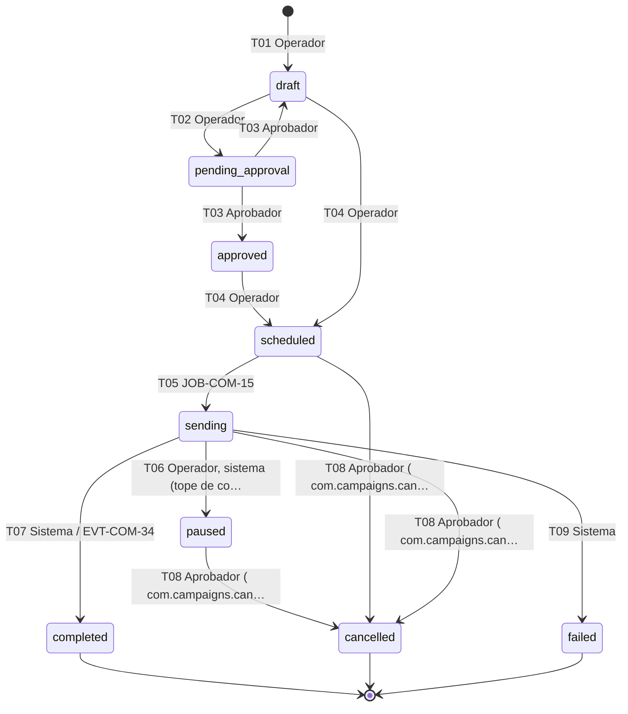

| # | Desde | Hasta | Disparador | Tipo | Guardas | Evento emitido |
|---|---|---|---|---|---|---|
| T01 | (nuevo) | `draft` | Operador | usuario | — | — |
| T02 | `draft` | `pending_approval` | Operador | usuario | Política exige aprobación (finalidad `marketing`, audiencia > PRM-COM-071, costo > PRM-COM-072) | — |
| T03 | `pending_approval` | `approved`, `draft` | Aprobador | usuario | Distinto del creador | — |
| T04 | `approved`, `draft` | `scheduled` | Operador | usuario | Vista previa de alcance confirmada (RF-COM-115) | — |
| T05 | `scheduled` | `sending` | JOB-COM-15 | job | Hora llegada; presupuesto disponible | — |
| T06 | `sending` | `paused` | Operador, sistema (tope de costo, circuit breaker abierto) | sistema, usuario | — | — |
| T07 | `sending` | `completed` | Sistema | sistema | Todas las comunicaciones en estado terminal o `accepted` | EVT-COM-34 `com.campaign.completed` (inferido por nombre) |
| T08 | `paused`, `scheduled`, `sending` | `cancelled` | Aprobador (`com.campaigns.cancelar`) | usuario | — | — |
| T09 | `sending` | `failed` | Sistema | sistema | Error irrecuperable (conector bloqueado `int.connection.blocked`) | — |

### EST-COM-24 — `invoiceMessages.status` (COL-COM-48)

**Colección:** Mensajes a imprimir en factura por segmento. **Campos de estado en el §7:** `status` (línea 1399; valores: `draft`, `approved`, `active`, `expired`, `cancelled`).

**Fuente:** T09 §8.0, T09 §8.11.1.

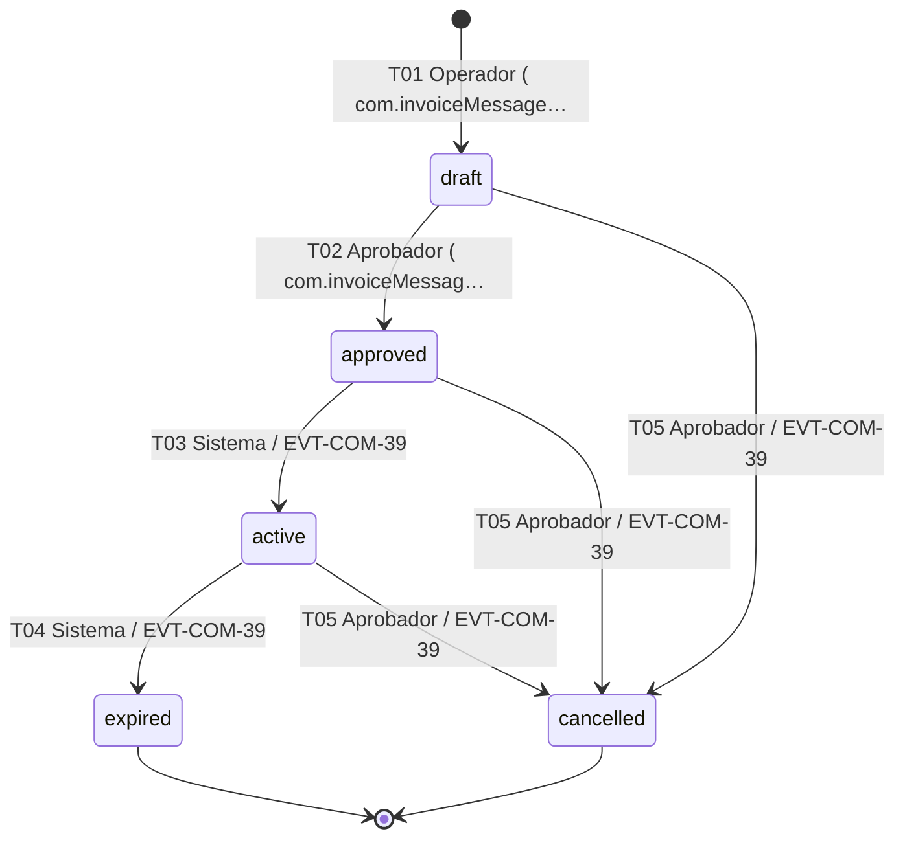

| # | Desde | Hasta | Disparador | Tipo | Guardas | Evento emitido |
|---|---|---|---|---|---|---|
| T01 | (nuevo) | `draft` | Operador (`com.invoiceMessages.crear`) | usuario | Texto ≤ PRM-COM-047 por área | — |
| T02 | `draft` | `approved` | Aprobador (`com.invoiceMessages.aprobar`) | usuario | Distinto del creador | — |
| T03 | `approved` | `active` | Sistema | sistema | Llega `validFrom` o el período de facturación | EVT-COM-39 `com.invoiceMessage.activated` |
| T04 | `active` | `expired` | Sistema | sistema | Pasa `validTo` o el último período | EVT-COM-39 `com.invoiceMessage.activated` |
| T05 | `active`, `approved`, `draft` | `cancelled` | Aprobador | usuario | Motivo | EVT-COM-39 `com.invoiceMessage.activated` |

### EST-COM-25 — `suppressionEntries.status` (COL-COM-51)

**Colección:** Lista de supresión por canal. **Campos de estado en el §7:** `status` (línea 1437; valores: `active`, `lifted`).

**Fuente:** T09 §8.0, T09 §8.13, T09 §8.13.2.

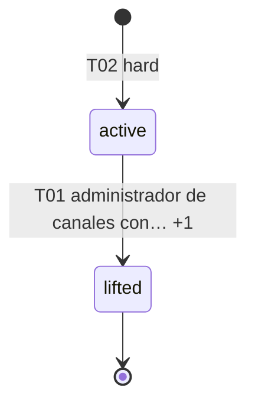

| # | Desde | Hasta | Disparador | Tipo | Guardas | Evento emitido |
|---|---|---|---|---|---|---|
| T01 | `active` | `lifted` | administrador de canales con evidencia: nuevo contacto verificado, pedido del titular, error del proveedor | API/integración, usuario | — | — |
| T02 | (nuevo) | `active` | Sistema (rebote `hard`, número inválido, queja, baja total) / administrador de canales / orden judicial | sistema, usuario | — | — |
| T03 | `active` | `lifted` | Administrador de canales (`com.channels.configurar`) | usuario | Evidencia: nuevo contacto verificado, pedido del titular o error del proveedor; nunca automático | — |

### EST-COM-26 — `appNotifications.status` (COL-COM-52)

**Colección:** Bandeja in-app; TTL. **Campos de estado en el §7:** —.

**Fuente:** T09 §8.0, T09 §8.13, T09 §8.13.2.

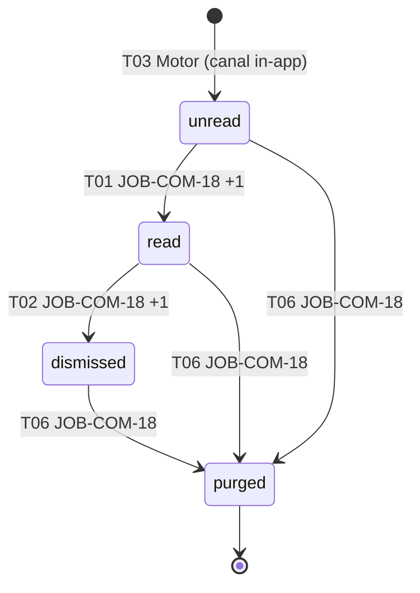

| # | Desde | Hasta | Disparador | Tipo | Guardas | Evento emitido |
|---|---|---|---|---|---|---|
| T01 | `unread` | `read` | — | no especificado | — | — |
| T02 | `read` | `dismissed` | — | no especificado | — | — |
| T03 | (nuevo) | `unread` | Motor (canal in-app) | no especificado | — | — |
| T04 | `unread` | `read` | Usuario (abre) | usuario | — | — |
| T05 | `read` | `dismissed` | Usuario (descarta) | usuario | — | — |
| T06 | `dismissed`, `read`, `unread` | `purged` | JOB-COM-18 | job | Vence `validUntil` y no hay `actionPending` | — |

### EST-COM-27 — `pushSubscriptions.status` (COL-COM-53)

**Colección:** Suscripciones push PWA. **Campos de estado en el §7:** `status` (línea 1480; valores: `active`, `expired`).

**Fuente:** T09 §8.0, T09 §8.13.1.

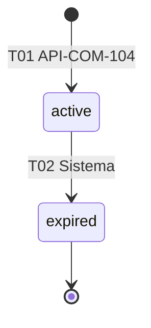

| # | Desde | Hasta | Disparador | Tipo | Guardas | Evento emitido |
|---|---|---|---|---|---|---|
| T01 | (nuevo) | `active` | Usuario (API-COM-104) | API/integración, usuario | Permiso del navegador | — |
| T02 | `active` | `expired` | Sistema | sistema | Respuesta 404/410 del servicio push o baja del usuario | — |

### EST-COM-28 — `platformNotices.status` (COL-COM-54)

**Colección:** Avisos de plataforma a administradores. **Campos de estado en el §7:** `status` (línea 1498; valores: `draft`, `published`, `expired`, `withdrawn`).

**Fuente:** T09 §8.0, T09 §8.13.1.

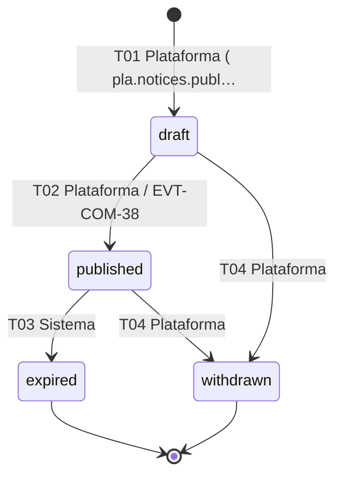

| # | Desde | Hasta | Disparador | Tipo | Guardas | Evento emitido |
|---|---|---|---|---|---|---|
| T01 | (nuevo) | `draft` | Plataforma (`pla.notices.publicar`) | usuario | — | — |
| T02 | `draft` | `published` | Plataforma | no especificado | `startsAt` alcanzado | EVT-COM-38 `com.platformNotice.published` |
| T03 | `published` | `expired` | Sistema | sistema | `endsAt` o permanencia vencida | — |
| T04 | `draft`, `published` | `withdrawn` | Plataforma | no especificado | Motivo | — |

### EST-COM-29 — `outageNotices.status` (COL-COM-56)

**Colección:** Avisos de interrupción por zona. **Campos de estado en el §7:** `status` (línea 1524; valores: `draft`, `published`, `in_progress`, `restored`, `cancelled`, `rescheduled`).

**Fuente:** T09 §8.0, T09 §8.12.

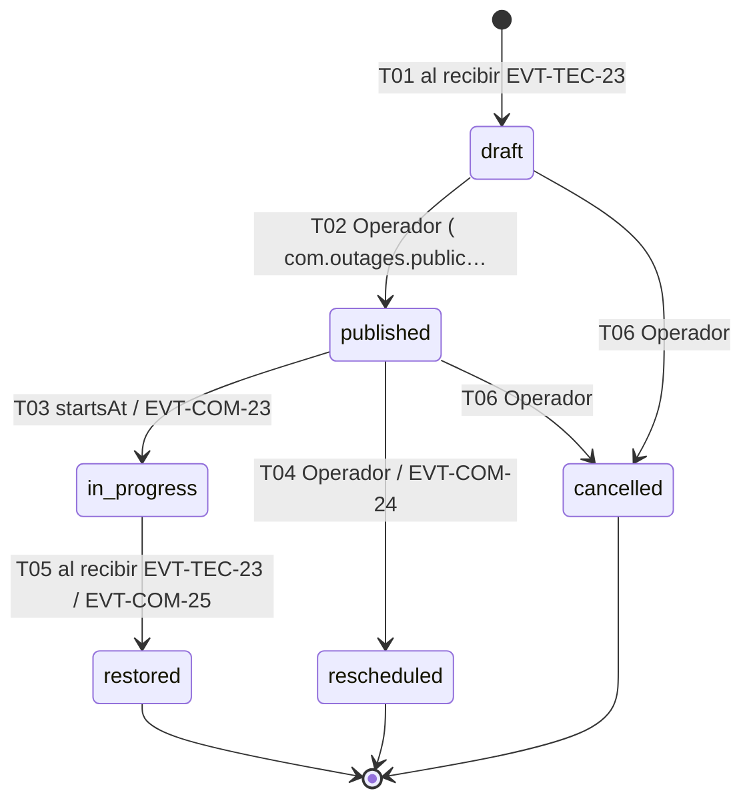

| # | Desde | Hasta | Disparador | Tipo | Guardas | Evento emitido |
|---|---|---|---|---|---|---|
| T01 | (nuevo) | `draft` | Operador COM / sistema desde `tec.outage.notified` o `crm.incident.confirmed` | evento, sistema, usuario | — | — |
| T02 | `draft` | `published` | Operador (`com.outages.publicar`) / automático si el origen es M10 con publicación automática | job, usuario | Área y ventana; anticipación ≥ PRM-COM-060 o confirmación (RF-COM-162) | — |
| T03 | `published` | `in_progress` | Sistema a `startsAt` / M10 / M09 | sistema | — | EVT-COM-23 `com.outage.started` |
| T04 | `published` | `rescheduled` | Operador | usuario | Nueva ventana | EVT-COM-24 `com.outage.rescheduled` |
| T05 | `in_progress` | `restored` | M10 (`tec.outage.finished`), M09 (`crm.incident.restored`), operador | evento, usuario | — | EVT-COM-25 `com.outage.restored` |
| T06 | `draft`, `published` | `cancelled` | Operador | usuario | Motivo | — |

## T10 — BIA Reportes, BI y APIs

### EST-BIA-01 — `reportDefinitions.status` (COL-BIA-01)

**Colección:** Catálogo de reportes. **Campos de estado en el §7:** `status` (línea 388; valores: `draft`, `inReview`, `published`, `deprecated`, `archived`).

**Fuente:** T10 §8.1.

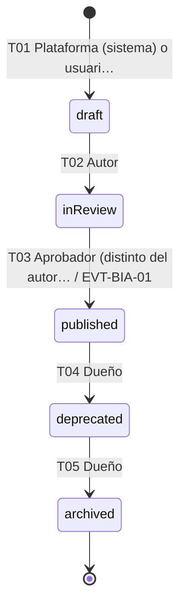

| # | Desde | Hasta | Disparador | Tipo | Guardas | Evento emitido |
|---|---|---|---|---|---|---|
| T01 | (nuevo) | `draft` | Plataforma (sistema) o usuario `bia.disenador.usar` | sistema, usuario | — | — |
| T02 | `draft` | `inReview` | Autor | usuario | Validación de esquema OK | — |
| T03 | `inReview` | `published` | Aprobador (distinto del autor si `PRM-BIA-027`=true) | usuario | Pruebas de permiso y costo OK | EVT-BIA-01 `bia.report.published` |
| T04 | `published` | `deprecated` | Dueño | no especificado | — | — |
| T05 | `deprecated` | `archived` | Dueño | no especificado | Sin programaciones activas | — |

### EST-BIA-02 — `reportRuns.status` (COL-BIA-04)

**Colección:** Ejecuciones; TTL. **Campos de estado en el §7:** `status` (línea 423; valores: `queued`, `running`, `succeeded`, `failed`, `cancelled`, `expired`).

**Fuente:** T10 §8.2.

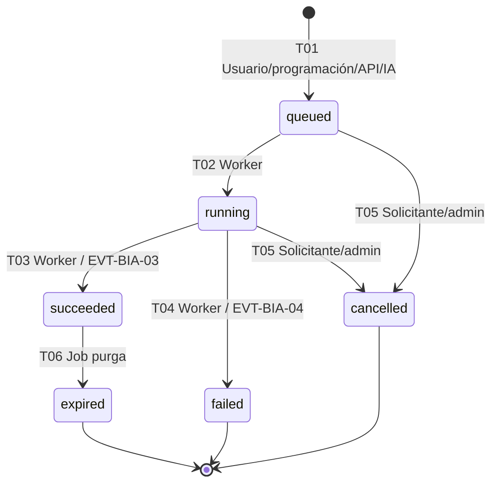

| # | Desde | Hasta | Disparador | Tipo | Guardas | Evento emitido |
|---|---|---|---|---|---|---|
| T01 | (nuevo) | `queued` | Usuario/programación/API/IA | API/integración, usuario | Permiso y parámetros válidos | — |
| T02 | `queued` | `running` | Worker | API/integración | Cuota disponible | — |
| T03 | `running` | `succeeded` | Worker | API/integración | Provider terminó | EVT-BIA-03 `bia.reportRun.completed` |
| T04 | `running` | `failed` | Worker | API/integración | Error | EVT-BIA-04 `bia.reportRun.failed` |
| T05 | `queued`, `running` | `cancelled` | Solicitante/admin | usuario | — | — |
| T06 | `succeeded` | `expired` | Job purga | job | `expiresAt` vencido | — |

### EST-BIA-03 — `reportExports.status` (COL-BIA-05)

**Colección:** Archivos exportados. **Campos de estado en el §7:** `status` (línea 439; valores: `queued`, `generating`, `ready`, `failed`, `expired`, `cancelled`).

**Fuente:** T10 §8.3, T10 §8.12.

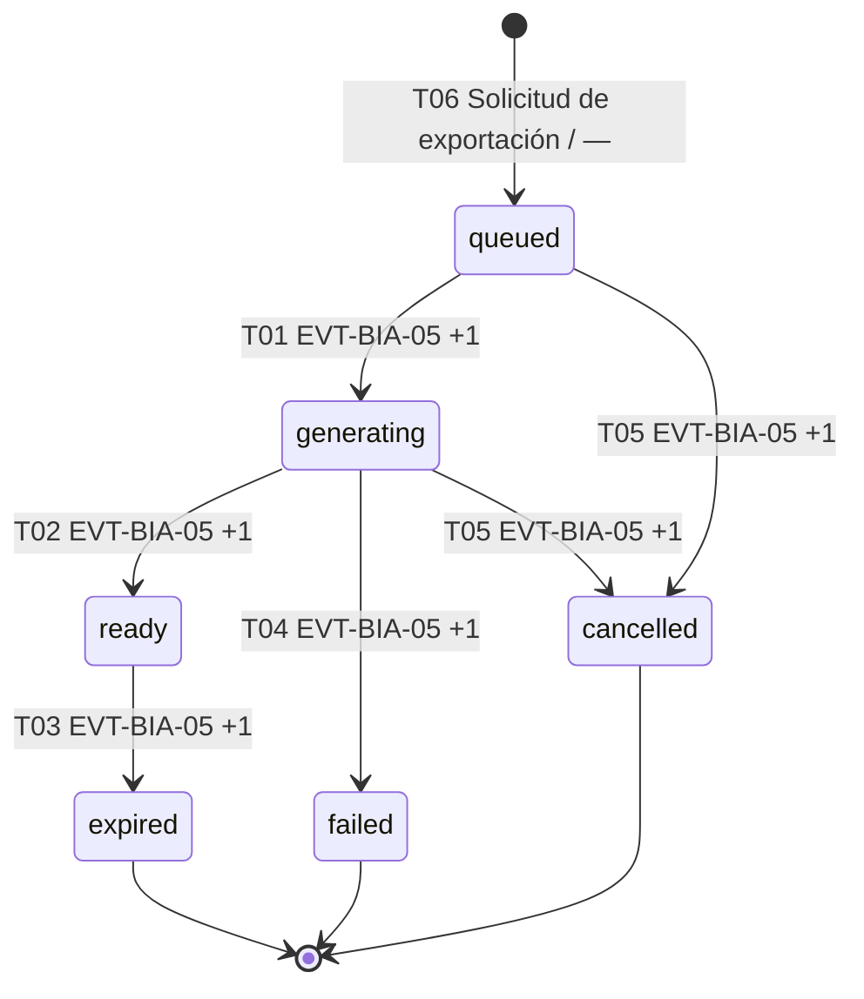

| # | Desde | Hasta | Disparador | Tipo | Guardas | Evento emitido |
|---|---|---|---|---|---|---|
| T01 | `queued` | `generating` | — | no especificado | — | EVT-BIA-05 `bia.export.ready` |
| T02 | `generating` | `ready` | — | no especificado | — | EVT-BIA-05 `bia.export.ready` |
| T03 | `ready` | `expired` | — | no especificado | — | EVT-BIA-05 `bia.export.ready` |
| T04 | `generating` | `failed` | — | no especificado | — | EVT-BIA-05 `bia.export.ready` |
| T05 | `generating`, `queued` | `cancelled` | — | no especificado | — | EVT-BIA-05 `bia.export.ready` |
| T06 | (nuevo) | `queued` | Solicitud de exportación / — | no especificado | — | — |
| T07 | `queued` | `generating` | Worker toma la exportación / — | API/integración | — | — |
| T08 | `generating` | `ready` | Archivo generado / `bia.export.ready` | evento | — | EVT-BIA-05 `bia.export.ready` (inferido por nombre) |
| T09 | `generating` | `failed` | Error / — | no especificado | — | — |
| T10 | `generating`, `queued` | `cancelled` | Cancelación / — | no especificado | — | — |
| T11 | `ready` | `expired` | Pasa `expiresAt` / — | no especificado | — | — |

### EST-BIA-04 — `reportSchedules.status` (COL-BIA-06)

**Colección:** Programaciones. **Campos de estado en el §7:** `status` (línea 443; valores: `active`, `paused`, `suspended`, `disabled`).

**Fuente:** T10 §8.4.

```mermaid
stateDiagram-v2
    [*] --> active : T01 Usuario bia.reportes.programar
    active --> paused : T02 Propietario/admin
    paused --> active : T03 Propietario/admin
    active --> suspended : T04 Sistema / EVT-BIA-07
    suspended --> active : T05 Admin/propietario
    note left of disabled : T06 desde cualquier estado previsto
    disabled --> [*]
```

| # | Desde | Hasta | Disparador | Tipo | Guardas | Evento emitido |
|---|---|---|---|---|---|---|
| T01 | (nuevo) | `active` | Usuario `bia.reportes.programar` | usuario | Destinatarios válidos | — |
| T02 | `active` | `paused` | Propietario/admin | usuario | — | — |
| T03 | `paused` | `active` | Propietario/admin | usuario | Permisos vigentes | — |
| T04 | `active` | `suspended` | Sistema | sistema | `consecutiveFailures` ≥ `PRM-BIA-013` o propietario sin permisos/desactivado | EVT-BIA-07 `bia.schedule.suspended` (inferido por nombre) |
| T05 | `suspended` | `active` | Admin/propietario | usuario | Causa corregida | — |
| T06 | cualquiera | `disabled` | Admin | usuario | — | — |

### EST-BIA-05 — `reportDeliveries.status` (COL-BIA-07)

**Colección:** Entregas programadas. **Campos de estado en el §7:** `status` (línea 445; valores: `pending`, `sent`, `skippedNoPermission`, `failed`, `bounced`).

**Fuente:** T10 §8.11.

```mermaid
stateDiagram-v2
    [*] --> pending : T01 La corrida programada termina…
    pending --> sent : T02 El canal acepta el envío / —
    pending --> skippedNoPermission : T03 El destinatario ya no tiene l…
    pending --> failed : T04 Error del canal / Suma al con…
    sent --> bounced : T05 Rebote informado por T09 / —
    skippedNoPermission --> [*]
    failed --> [*]
    bounced --> [*]
```

| # | Desde | Hasta | Disparador | Tipo | Guardas | Evento emitido |
|---|---|---|---|---|---|---|
| T01 | (nuevo) | `pending` | La corrida programada termina (JOB de programación) / — | job | — | — |
| T02 | `pending` | `sent` | El canal acepta el envío / — | no especificado | — | — |
| T03 | `pending` | `skippedNoPermission` | El destinatario ya no tiene la capability del reporte / — | no especificado | Revalidación al enviar | — |
| T04 | `pending` | `failed` | Error del canal / Suma al contador de fallos de la programación (§8.4) | usuario | — | — |
| T05 | `sent` | `bounced` | Rebote informado por T09 / — | no especificado | — | — |

### EST-BIA-06 — `reportTemplates.status` (COL-BIA-08)

**Colección:** Plantillas de reporte. **Campos de estado en el §7:** `status` (línea 449; valores: `draft`, `active`, `archived`).

**Fuente:** T10 §8.11.

```mermaid
stateDiagram-v2
    [*] --> draft : T01 API-BIA-22
    draft --> active : T02 Activación tras vista previa…
    active --> archived : T03 Otra plantilla activa para el…
    archived --> [*]
```

| # | Desde | Hasta | Disparador | Tipo | Guardas | Evento emitido |
|---|---|---|---|---|---|---|
| T01 | (nuevo) | `draft` | Alta u override por `bia.reportes.configurar` (API-BIA-22) / — | API/integración, usuario | — | — |
| T02 | `draft` | `active` | Activación tras vista previa con datos ficticios / — | no especificado | — | — |
| T03 | `active` | `archived` | Otra plantilla activa para el mismo reporte o baja / — | no especificado | — | — |

### EST-BIA-07 — `exportLayouts.status` (COL-BIA-09)

**Colección:** Diseños de exportación tabular. **Campos de estado en el §7:** `status` (línea 465; valores: `draft`, `active`, `archived`).

**Fuente:** el §8 del anexo no detalla esta colección; se aplica el patrón general de T05 §7.1.5 (versiones publicadas) sobre los valores del §7.

```mermaid
stateDiagram-v2
    [*] --> draft : P01 nueva versión
    draft --> active : P02 publicar
    active --> archived : P03 reemplazo o fin de vigencia
    archived --> [*]
```

| # | Desde | Hasta | Disparador | Tipo | Guardas | Evento emitido |
|---|---|---|---|---|---|---|
| P01 | (nuevo) | `draft` | Configurador | usuario | — | — |
| P02 | `draft` | `active` | Configurador o aprobador | usuario | Versión validada; publicada queda inmutable (T05 §7.1.5) | — |
| P03 | `active` | `archived` | Sistema al publicar la sucesora o configurador | sistema, usuario | Existe versión sucesora o fin de vigencia | — |

### EST-BIA-08 — `indicatorDefinitions.status` (COL-BIA-11)

**Colección:** Indicadores con fórmula. **Campos de estado en el §7:** `status` (línea 493; valores: `draft`, `certified`, `deprecated`, `active`, `paused`).

**Fuente:** T10 §8.5, T10 §8.12.

```mermaid
stateDiagram-v2
    active
    paused
    draft --> certified : T01 bia.cubos.certificar antes bi… +1
    certified --> deprecated : T02 al publicar versión nueva +1
    [*] --> draft : T03 Alta o versión nueva / —
    deprecated --> [*]
```

| # | Desde | Hasta | Disparador | Tipo | Guardas | Evento emitido |
|---|---|---|---|---|---|---|
| T01 | `draft` | `certified` | bia.cubos.certificar antes bia.indicadores.certificar pruebas de reconciliación OK | usuario | — | — |
| T02 | `certified` | `deprecated` | al publicar versión nueva | no especificado | — | — |
| T03 | (nuevo) | `draft` | Alta o versión nueva / — | no especificado | — | — |
| T04 | `draft` | `certified` | Certificación por `bia.cubos.certificar` / — | usuario | Pruebas de reconciliación OK | — |
| T05 | `certified` | `deprecated` | Se publica una versión nueva / — | no especificado | — | — |

### EST-BIA-09 — `dashboards.status` (COL-BIA-13)

**Colección:** Tableros. **Campos de estado en el §7:** `status` (línea 503; valores: `draft`, `published`, `archived`).

**Fuente:** el §8 del anexo no detalla esta colección; se aplica el patrón general de T05 §7.1.5 (versiones publicadas) sobre los valores del §7.

```mermaid
stateDiagram-v2
    [*] --> draft : P01 nueva versión
    draft --> published : P02 publicar
    published --> archived : P03 reemplazo o fin de vigencia
    archived --> [*]
```

| # | Desde | Hasta | Disparador | Tipo | Guardas | Evento emitido |
|---|---|---|---|---|---|---|
| P01 | (nuevo) | `draft` | Configurador | usuario | — | — |
| P02 | `draft` | `published` | Configurador o aprobador | usuario | Versión validada; publicada queda inmutable (T05 §7.1.5) | — |
| P03 | `published` | `archived` | Sistema al publicar la sucesora o configurador | sistema, usuario | Existe versión sucesora o fin de vigencia | — |

### EST-BIA-10 — `kpiAlertRules.status` (COL-BIA-15)

**Colección:** Alertas sobre indicadores. **Campos de estado en el §7:** `status` (línea 511; valores: `open`, `acknowledged`, `resolved`, `muted`, `active`, `paused`).

**Fuente:** T10 §8.11.

```mermaid
stateDiagram-v2
    open
    acknowledged
    resolved
    muted
    [*] --> active : T01 Alta por bia.alertas.configur…
    active --> paused : T02 Pausa por bia.alertas.configu…
    paused --> active : T03 Reanudación / —
```

| # | Desde | Hasta | Disparador | Tipo | Guardas | Evento emitido |
|---|---|---|---|---|---|---|
| T01 | (nuevo) | `active` | Alta por `bia.alertas.configurar` / — | usuario | — | — |
| T02 | `active` | `paused` | Pausa por `bia.alertas.configurar` / — | usuario | — | — |
| T03 | `paused` | `active` | Reanudación / — | no especificado | — | — |

### EST-BIA-11 — `kpiAlerts.status` (COL-BIA-16)

**Colección:** Alertas disparadas. **Campos de estado en el §7:** `status` (línea 819; valores: `open`, `acknowledged`, `resolved`, `muted`).

**Fuente:** T10 §8.9, T10 §8.12.

```mermaid
stateDiagram-v2
    open --> acknowledged : T01 +1
    acknowledged --> resolved : T02 manual o automático cuando la… / EVT-BIA-10 +1
    acknowledged --> muted : T03 con vencimiento +1
    open --> muted : T03 con vencimiento +1
    [*] --> open : T04 Se cumple la condición de la… / EVT-BIA-09
    open --> resolved : T06 forPeriods / EVT-BIA-10
    muted --> open : T08 Vuelve a cumplirse fuera de l… / EVT-BIA-09
    resolved --> open : T08 Vuelve a cumplirse fuera de l… / EVT-BIA-09
```

| # | Desde | Hasta | Disparador | Tipo | Guardas | Evento emitido |
|---|---|---|---|---|---|---|
| T01 | `open` | `acknowledged` | — | no especificado | — | — |
| T02 | `acknowledged` | `resolved` | manual o automático cuando la condición deja de cumplirse forPeriods veces | job | — | EVT-BIA-10 `bia.kpiAlert.resolved` (inferido por nombre) |
| T03 | `acknowledged`, `open` | `muted` | con vencimiento | job | — | — |
| T04 | (nuevo) | `open` | Se cumple la condición de la regla / — | no especificado | — | EVT-BIA-09 `bia.kpiAlert.opened` (inferido por nombre) |
| T05 | `open` | `acknowledged` | Reconocimiento del responsable / — | usuario | — | — |
| T06 | `acknowledged`, `open` | `resolved` | Manual o automático (la condición deja de cumplirse `forPeriods` veces) / — | job | — | EVT-BIA-10 `bia.kpiAlert.resolved` (inferido por nombre) |
| T07 | `acknowledged`, `open` | `muted` | Silencio con vencimiento / — | job | — | — |
| T08 | `muted`, `resolved` | `open` | Vuelve a cumplirse fuera de la ventana de deduplicación / — | no especificado | — | EVT-BIA-09 `bia.kpiAlert.opened` (inferido por nombre) |

### EST-BIA-12 — `analyticsDatasets.status` (COL-BIA-17)

**Colección:** Datasets certificados. **Campos de estado en el §7:** `status` (línea 515; valores: `draft`, `certified`, `deprecated`).

**Fuente:** T10 §8.11.

```mermaid
stateDiagram-v2
    [*] --> draft : T01 Alta del dataset por bia.data…
    draft --> certified : T02 Certificación por bia.dataset…
    certified --> deprecated : T03 Reemplazo por una versión nue…
    deprecated --> [*]
```

| # | Desde | Hasta | Disparador | Tipo | Guardas | Evento emitido |
|---|---|---|---|---|---|---|
| T01 | (nuevo) | `draft` | Alta del dataset por `bia.datasets.configurar` / — | usuario | — | — |
| T02 | `draft` | `certified` | Certificación por `bia.datasets.configurar` / — | usuario | Conciliación con la fuente dentro de tolerancia | — |
| T03 | `certified` | `deprecated` | Reemplazo por una versión nueva / — | job | Aviso a consumidores de API (RF-BIA-076) | — |

### EST-BIA-13 — `customReports.status` (COL-BIA-18)

**Colección:** Generador de reportes del tenant (MER-013). **Campos de estado en el §7:** `status` (línea 554; valores: `draft`, `inReview`, `published`, `deprecated`).

**Fuente:** el §8 del anexo no detalla esta colección; se aplica el patrón general de T05 §7.1.5 (versiones publicadas) sobre los valores del §7.

```mermaid
stateDiagram-v2
    [*] --> draft : P01 nueva versión
    draft --> published : P02 publicar
    published --> deprecated : P03 reemplazo o fin de vigencia
    deprecated --> [*]
    inReview
    note right of inReview : Sin transición en el patrón, ver el anexo
```

| # | Desde | Hasta | Disparador | Tipo | Guardas | Evento emitido |
|---|---|---|---|---|---|---|
| P01 | (nuevo) | `draft` | Configurador | usuario | — | — |
| P02 | `draft` | `published` | Configurador o aprobador | usuario | Versión validada; publicada queda inmutable (T05 §7.1.5) | — |
| P03 | `published` | `deprecated` | Sistema al publicar la sucesora o configurador | sistema, usuario | Existe versión sucesora o fin de vigencia | — |

### EST-BIA-14 — `aiQuestions.status` (COL-BIA-19)

**Colección:** Preguntas analíticas a IA. **Campos de estado en el §7:** `status` (línea 558; valores: `answered`, `refused`, `failed`).

**Fuente:** T10 §8.12.

```mermaid
stateDiagram-v2
    [*] --> answered : T01 Respuesta con citas / —
    [*] --> refused : T02 Pregunta fuera de alcance o c…
    [*] --> failed : T03 Error del proveedor o de la c…
    answered --> [*]
    refused --> [*]
    failed --> [*]
```

| # | Desde | Hasta | Disparador | Tipo | Guardas | Evento emitido |
|---|---|---|---|---|---|---|
| T01 | (nuevo) | `answered` | Respuesta con citas / — | no especificado | — | — |
| T02 | (nuevo) | `refused` | Pregunta fuera de alcance o con datos personales / — | usuario | — | — |
| T03 | (nuevo) | `failed` | Error del proveedor o de la consulta / — | API/integración | — | — |

### EST-BIA-15 — `extWebhookSubscriptions.status` (COL-BIA-24)

**Colección:** Suscripciones de webhooks salientes. **Campos de estado en el §7:** `status` (línea 611; valores: `active`, `paused`, `disabled`).

**Máquina 1: `status`.** Fuente: T10 §8.8, T10 §8.12.

```mermaid
stateDiagram-v2
    active --> paused : T01 cliente admin +1
    paused --> active : T02 +1
    active --> disabled : T03 fallas continuas PRM-BIA-048… / EVT-BIA-12 +1
    disabled --> active : T04 manual tras prueba OK +1
    [*] --> active : T05 Alta de la suscripción / —
```

| # | Desde | Hasta | Disparador | Tipo | Guardas | Evento emitido |
|---|---|---|---|---|---|---|
| T01 | `active` | `paused` | cliente admin | usuario | — | — |
| T02 | `paused` | `active` | — | no especificado | — | — |
| T03 | `active` | `disabled` | fallas continuas PRM-BIA-048 horas aviso al contacto técnico | usuario | — | EVT-BIA-12 `bia.webhookSubscription.disabled` (inferido por nombre) |
| T04 | `disabled` | `active` | manual tras prueba OK | no especificado | — | — |
| T05 | (nuevo) | `active` | Alta de la suscripción / — | no especificado | — | — |
| T06 | `active` | `paused` | Pausa por cliente o admin / — | usuario | — | — |
| T07 | `paused` | `active` | Reanudación / — | no especificado | — | — |
| T08 | `active` | `disabled` | Fallas continuas ≥ `PRM-BIA-048` horas / — | no especificado | — | EVT-BIA-12 `bia.webhookSubscription.disabled` (inferido por nombre) |
| T09 | `disabled` | `active` | Reactivación manual tras prueba OK / — | no especificado | — | — |

**Máquina 2: `status` — Antes.** Fuente: T10 §8.8.

```mermaid
stateDiagram-v2
    active
    paused
    disabled
    pending --> retrying : T01 no xx, timeout PRM-BIA-052 s
    retrying --> retrying : T01 no xx, timeout PRM-BIA-052 s
    retrying --> dead : T02
    [*] --> pending : alta (estado inicial no explícito)
    dead --> [*]
```

| # | Desde | Hasta | Disparador | Tipo | Guardas | Evento emitido |
|---|---|---|---|---|---|---|
| T01 | `pending`, `retrying` | `retrying` | no xx, timeout PRM-BIA-052 s | no especificado | — | — |
| T02 | `retrying` | `dead` | — | no especificado | — | — |

### EST-BIA-16 — `extWebhookDeliveries.status` (COL-BIA-25)

**Colección:** Entregas de webhooks; TTL. **Campos de estado en el §7:** `responseStatus`, `status` (línea 914, 613; valores: `pending`, `delivered`, `failed`, `retrying`, `dead`).

**Fuente:** T10 §8.12, T10 §8.8.

```mermaid
stateDiagram-v2
    pending --> delivered : T01 API-BIA-50 +1
    pending --> failed : T02 API-BIA-50 +1
    retrying --> failed : T02 API-BIA-50 +1
    failed --> retrying : T03 API-BIA-50 +1
    retrying --> delivered : T04 API-BIA-50 +1
    failed --> dead : T05 API-BIA-50 +1
    dead --> pending : T06 API-BIA-50 +1
    [*] --> pending : T07 Evento público emitido para l…
    delivered --> [*]
```

| # | Desde | Hasta | Disparador | Tipo | Guardas | Evento emitido |
|---|---|---|---|---|---|---|
| T01 | `pending` | `delivered` | xx | no especificado | — | — |
| T02 | `pending`, `retrying` | `failed` | intento sin xx o timeout PRM-BIA-052 s registra responseStatus | no especificado | — | — |
| T03 | `failed` | `retrying` | quedan intentos se reintenta en nextAttemptAt | no especificado | — | — |
| T04 | `retrying` | `delivered` | xx | no especificado | — | — |
| T05 | `failed` | `dead` | agotó reintentos | no especificado | — | — |
| T06 | `dead` | `pending` | reenvío manual, API-BIA-50 | API/integración | — | — |
| T07 | (nuevo) | `pending` | Evento público emitido para la suscripción / — | no especificado | — | — |
| T08 | `pending` | `delivered` | Respuesta 2xx / — | no especificado | — | — |
| T09 | `pending`, `retrying` | `failed` | Intento sin 2xx o timeout `PRM-BIA-052` s / — | no especificado | — | — |
| T10 | `failed` | `retrying` | Quedan intentos (`nextAttemptAt`) / — | no especificado | — | — |
| T11 | `retrying` | `delivered` | Respuesta 2xx / — | no especificado | — | — |
| T12 | `failed` | `dead` | Agotó los reintentos / — | no especificado | — | — |
| T13 | `dead` | `pending` | Reenvío manual (API-BIA-50) / — | API/integración | — | — |

### EST-BIA-17 — `extBulkExports.status` (COL-BIA-26)

**Colección:** Exportaciones masivas por API. **Campos de estado en el §7:** `status` (línea 617; valores: `queued`, `running`, `ready`, `failed`, `expired`).

**Fuente:** T10 §8.11.

```mermaid
stateDiagram-v2
    [*] --> queued : T01 Solicitud del cliente o de la…
    queued --> running : T02 Worker toma la exportación / —
    running --> ready : T03 al recibir EVT-BIA-16 / EVT-BIA-05
    running --> failed : T04 Error / —
    ready --> expired : T05 expiresAt
    failed --> [*]
    expired --> [*]
```

| # | Desde | Hasta | Disparador | Tipo | Guardas | Evento emitido |
|---|---|---|---|---|---|---|
| T01 | (nuevo) | `queued` | Solicitud del cliente o de la exportación de salida / — | no especificado | Cuota disponible | — |
| T02 | `queued` | `running` | Worker toma la exportación / — | API/integración | — | — |
| T03 | `running` | `ready` | Partes generadas con SHA-256 / EVT-BIA-16 `bia.bulkExport.ready` | evento | — | EVT-BIA-05 `bia.export.ready` (inferido por nombre) |
| T04 | `running` | `failed` | Error / — | no especificado | — | — |
| T05 | `ready` | `expired` | Pasa `expiresAt` / — | no especificado | — | — |

### EST-BIA-18 — `openDataPublications.status` (COL-BIA-27)

**Colección:** Publicaciones de datos abiertos. **Campos de estado en el §7:** `status` (línea 621; valores: `draft`, `approved`, `published`, `withdrawn`).

**Fuente:** T10 §8.10, T10 §8.12.

```mermaid
stateDiagram-v2
    draft --> approved : T01 bia.datosAbiertos.publicar, c… +1
    approved --> published : T02 +1
    published --> withdrawn : T03 +1
    [*] --> draft : T04 Alta o refresco (versión nuev…
    withdrawn --> [*]
```

| # | Desde | Hasta | Disparador | Tipo | Guardas | Evento emitido |
|---|---|---|---|---|---|---|
| T01 | `draft` | `approved` | bia.datosAbiertos.publicar, control de celdas mínimas | usuario | — | — |
| T02 | `approved` | `published` | — | no especificado | — | — |
| T03 | `published` | `withdrawn` | — | no especificado | — | — |
| T04 | (nuevo) | `draft` | Alta o refresco (versión nueva) / — | no especificado | — | — |
| T05 | `draft` | `approved` | Aprobación por `bia.datosAbiertos.publicar` / — | usuario | Control de celdas mínimas | — |
| T06 | `approved` | `published` | Publicación / — | no especificado | — | — |
| T07 | `published` | `withdrawn` | Retiro / — | no especificado | — | — |

### EST-BIA-19 — `benchmarkParticipations.status` (COL-BIA-28)

**Colección:** Adhesión al benchmarking anónimo. **Campos de estado en el §7:** `status` (línea 625; valores: `optedIn`, `optedOut`).

**Fuente:** T10 §8.11.

```mermaid
stateDiagram-v2
    [*] --> optedIn : T01 Adhesión del tenant ( consent…
    optedIn --> optedOut : T02 withdrawnAt
    optedOut --> optedIn : T03 Nueva adhesión con consentimi…
```

| # | Desde | Hasta | Disparador | Tipo | Guardas | Evento emitido |
|---|---|---|---|---|---|---|
| T01 | (nuevo) | `optedIn` | Adhesión del tenant (`consentBy/At`) por `bia.benchmark.configurar` / — | usuario | — | — |
| T02 | `optedIn` | `optedOut` | Retiro (`withdrawnAt`) / — | no especificado | — | — |
| T03 | `optedOut` | `optedIn` | Nueva adhesión con consentimiento nuevo / — | no especificado | — | — |

### EST-BIA-20 — `apiClients.status` (colección de otro dueño o absorbida)

**Fuente:** T10 §8.6. La colección figura en T05 como COL-IAM-22 C (dueño T02); COL-BIA-20 A→COL-IAM-22 (dueño T10); no se crea con este dueño, se conserva el diagrama del §8 de este anexo.

```mermaid
stateDiagram-v2
    [*] --> pending : T01 bia.api.clientes.crear
    pending --> active : T02 bia.api.clientes.aprobar (≠ c… / EVT-BIA-11
    active --> suspended : T03 Aprobador o sistema (abuso, t… / EVT-BIA-11
    active --> revoked : T04 Aprobador / EVT-BIA-11
    suspended --> revoked : T04 Aprobador / EVT-BIA-11
    revoked --> [*]
```

| # | Desde | Hasta | Disparador | Tipo | Guardas | Evento emitido |
|---|---|---|---|---|---|---|
| T01 | (nuevo) | `pending` | `bia.api.clientes.crear` | usuario | Finalidad y responsable cargados | — |
| T02 | `pending` | `active` | `bia.api.clientes.aprobar` (≠ creador si scopes sensibles) | usuario | Scopes revisados | EVT-BIA-11 `bia.apiClient.activated` |
| T03 | `active` | `suspended` | Aprobador o sistema (abuso, tenant suspendido) | sistema, usuario | — | EVT-BIA-11 `bia.apiClient.suspended` (inferido por nombre) |
| T04 | `active`, `suspended` | `revoked` | Aprobador | usuario | — | EVT-BIA-11 `bia.apiClient.revoked` (inferido por nombre) |

### EST-BIA-21 — `apiCredentials.status` (colección de otro dueño o absorbida)

**Fuente:** T10 §8.7, T10 §8.12. La colección figura en T05 como COL-IAM-23 C (dueño T02); COL-BIA-21 A→COL-IAM-23 (dueño T10); no se crea con este dueño, se conserva el diagrama del §8 de este anexo.

```mermaid
stateDiagram-v2
    active --> rotating : T01 se emitió reemplazo ambas vál… +1
    rotating --> revoked : T02 +1
    active --> expired : T03 job +1
    active --> revoked : T04 manual o por compromiso +1
    [*] --> active : T05 Emisión de la credencial / —
    revoked --> [*]
    expired --> [*]
```

| # | Desde | Hasta | Disparador | Tipo | Guardas | Evento emitido |
|---|---|---|---|---|---|---|
| T01 | `active` | `rotating` | se emitió reemplazo ambas válidas PRM-BIA-042 horas | job | — | — |
| T02 | `rotating` | `revoked` | — | no especificado | — | — |
| T03 | `active` | `expired` | job | job | — | — |
| T04 | `active` | `revoked` | manual o por compromiso | no especificado | — | — |
| T05 | (nuevo) | `active` | Emisión de la credencial / — | no especificado | — | — |
| T06 | `active` | `rotating` | Se emite el reemplazo (ambas válidas `PRM-BIA-042` horas) / — | job | — | — |
| T07 | `rotating` | `revoked` | Fin de la gracia / — | no especificado | — | — |
| T08 | `active` | `expired` | Job de vencimiento / — | job | — | — |
| T09 | `active` | `revoked` | Revocación manual o por compromiso / — | no especificado | — | — |

## T11 — WFL Workflow, eventos y documentos

### EST-WFL-01 — `eventTypes.status` (COL-WFL-01)

**Colección:** Catálogo de eventos de dominio (contrato sobre el outbox de T01). **Campos de estado en el §7:** `status` (línea 553; valores: `active`, `deprecated`, `retired`).

**Fuente:** T11 §8.11.1.

```mermaid
stateDiagram-v2
    [*] --> active : T01 Despliegue que sincroniza el…
    active --> deprecated : T02 schemaVersion
    deprecated --> retired : T03 sunsetAt
    retired --> [*]
```

| # | Desde | Hasta | Disparador | Tipo | Guardas | Evento emitido |
|---|---|---|---|---|---|---|
| T01 | (nuevo) | `active` | Despliegue que sincroniza el esquema / — | no especificado | RN-WFL-003 (nombre canónico) | — |
| T02 | `active` | `deprecated` | Despliegue con nueva `schemaVersion` o versión del contrato / — | no especificado | Convivencia de versiones (RF-WFL-005) | — |
| T03 | `deprecated` | `retired` | Llega `sunsetAt` / — | no especificado | Sin consumidores en la versión vieja (CTR-WFL-03) | — |

### EST-WFL-02 — `operationalInboxItems.status` (COL-WFL-03)

**Colección:** Bandeja operativa unificada. **Campos de estado en el §7:** `status` (línea 586; valores: `open`, `inProgress`, `resolved`, `discarded`).

**Fuente:** T11 §8.9.

```mermaid
stateDiagram-v2
    [*] --> open : T01 al recibir EVT-WFL-046
    open --> inProgress : T02 Lo toma un responsable / — +1
    inProgress --> resolved : T03 al recibir EVT-WFL-046 +1
    open --> resolved : T03 al recibir EVT-WFL-046
    inProgress --> discarded : T04 al recibir EVT-WFL-046 +1
    open --> discarded : T04 al recibir EVT-WFL-046
    resolved --> open : T05 al recibir EVT-WFL-046
    discarded --> [*]
```

| # | Desde | Hasta | Disparador | Tipo | Guardas | Evento emitido |
|---|---|---|---|---|---|---|
| T01 | (nuevo) | `open` | Excepción de un proceso (corrida, operación, render, conector) / EVT-WFL-046 `.itemOpened` | evento, API/integración | `dedupeKey` sin ítem abierto | — |
| T02 | `open` | `inProgress` | Lo toma un responsable / — | usuario | — | — |
| T03 | `inProgress`, `open` | `resolved` | Causa resuelta / EVT-WFL-046 `.itemResolved` | evento | — | — |
| T04 | `inProgress`, `open` | `discarded` | Descarte / EVT-WFL-046 `.itemResolved` | evento | Motivo obligatorio | — |
| T05 | `resolved` | `open` | La misma causa reaparece / EVT-WFL-046 `.itemOpened` | evento | Mismo `dedupeKey` | — |
| T06 | `open` | `inProgress` | lo toma alguien | no especificado | — | — |
| T07 | `inProgress` | `discarded`, `resolved` | con motivo | no especificado | — | — |

### EST-WFL-03 — `jobSchedules.status` (COL-WFL-05)

**Colección:** Programación por tenant. **Campos de estado en el §7:** `lastRunStatus`, `status` (línea 626, 624; valores: `active`, `paused`, `disabled`).

**Fuente:** T11 §8.11.2.

```mermaid
stateDiagram-v2
    [*] --> active : T01 al recibir EVT-PLA-06
    active --> paused : T02 al recibir EVT-PLA-03
    paused --> active : T03 al recibir EVT-PLA-04
    active --> disabled : T04 al recibir EVT-PLA-07
    paused --> disabled : T04 al recibir EVT-PLA-07
    disabled --> active : T05 al recibir EVT-PLA-06
```

| # | Desde | Hasta | Disparador | Tipo | Guardas | Evento emitido |
|---|---|---|---|---|---|---|
| T01 | (nuevo) | `active` | Alta del módulo (EVT-PLA-06) o despliegue / EVT-WFL-047 | evento | Job `trigger` incluye `schedule` | — |
| T02 | `active` | `paused` | Tenant suspendido (EVT-PLA-03) o pausa manual / EVT-WFL-047 | evento | §12.6 regla 7 | — |
| T03 | `paused` | `active` | Tenant reactivado (EVT-PLA-04) o reanudación manual / EVT-WFL-047 | evento | Sin recuperación de disparos salvo `catchUp: true` (§12.6 regla 7) | — |
| T04 | `active`, `paused` | `disabled` | Módulo desactivado (EVT-PLA-07) o tenant cerrado (EVT-PLA-05) / EVT-WFL-047 | evento | — | — |
| T05 | `disabled` | `active` | Módulo reactivado (EVT-PLA-06) / EVT-WFL-047 | evento | — | — |

### EST-WFL-04 — `bulkRuns.status` (COL-WFL-06)

**Colección:** Corridas masivas. **Campos de estado en el §7:** `status` (línea 641; sin valores en el §7).

**Fuente:** T11 §8.3.

```mermaid
stateDiagram-v2
    [*] --> draft : T01 Alta de la corrida por el mód…
    draft --> preparing : T02 Inicio de la preparación / — +1
    preparing --> ready : T03 Universo congelado / — +1
    ready --> running : T04 batch +1
    running --> paused : T05 al recibir EVT-WFL-048 / EVT-WFL-048 +1
    paused --> running : T06 Reanudación desde el cursor /… +1
    running --> succeeded : T07 al recibir EVT-WFL-048 +1
    running --> succeededWithExceptions : T07 al recibir EVT-WFL-048 +1
    running --> failed : T08 al recibir EVT-WFL-048 / EVT-WFL-048 +1
    draft --> cancelled : T09 al recibir EVT-WFL-048 / EVT-WFL-048
    paused --> cancelled : T09 al recibir EVT-WFL-048 / EVT-WFL-048
    preparing --> cancelled : T09 al recibir EVT-WFL-048 / EVT-WFL-048
    ready --> cancelled : T09 al recibir EVT-WFL-048 / EVT-WFL-048
    running --> cancelled : T09 al recibir EVT-WFL-048 / EVT-WFL-048 +1
    succeededWithExceptions --> reprocess : T10 Reproceso de las excepciones… +1
    succeededWithExceptions --> succeededWithExceptions : T10 Reproceso de las excepciones…
    succeeded --> [*]
    failed --> [*]
    cancelled --> [*]
    reprocess --> [*]
```

| # | Desde | Hasta | Disparador | Tipo | Guardas | Evento emitido |
|---|---|---|---|---|---|---|
| T01 | (nuevo) | `draft` | Alta de la corrida por el módulo dueño / — | no especificado | — | — |
| T02 | `draft` | `preparing` | Inicio de la preparación / — | no especificado | — | — |
| T03 | `preparing` | `ready` | Universo congelado / — | no especificado | — | — |
| T04 | `ready` | `running` | Ejecución (job de clase `batch`, §12.8) / — | job | — | — |
| T05 | `running` | `paused` | Pausa `manual`, `systemic` o `threshold` / EVT-WFL-048 `.paused` | evento | Motivo obligatorio | EVT-WFL-048 `wfl.bulkRun.paused` (inferido por nombre) |
| T06 | `paused` | `running` | Reanudación desde el cursor / — | no especificado | — | — |
| T07 | `running` | `succeeded`, `succeededWithExceptions` | Fin del universo / EVT-WFL-048 `.completed` | evento | Con excepciones si hay ítems `failed` | — |
| T08 | `running` | `failed` | Error que impide seguir / EVT-WFL-048 `.failed` | evento | — | EVT-WFL-048 `wfl.bulkRun.failed` (inferido por nombre) |
| T09 | `draft`, `paused`, `preparing`, `ready`, `running` | `cancelled` | Cancelación por el solicitante o un administrador / EVT-WFL-048 `.cancelled` | evento, usuario | Conserva los ítems confirmados | EVT-WFL-048 `wfl.bulkRun.cancelled` (inferido por nombre) |
| T10 | `succeededWithExceptions` | `reprocess`, `succeededWithExceptions` | Reproceso de las excepciones resueltas / — | no especificado | La corrida madre no cambia; la hija nace en `draft` | — |
| T11 | `draft` | `preparing` | congela universo | no especificado | — | — |
| T12 | `preparing` | `ready` | — | no especificado | — | — |
| T13 | `ready` | `running` | — | no especificado | — | — |
| T14 | `running` | `cancelled`, `failed`, `succeeded`, `succeededWithExceptions` | — | no especificado | — | EVT-WFL-048 `wfl.bulkRun.cancelled` (inferido por nombre) |
| T15 | `running` | `paused` | con motivo | no especificado | — | EVT-WFL-048 `wfl.bulkRun.paused` (inferido por nombre) |
| T16 | `paused` | `running` | al reanudar desde el cursor | no especificado | — | — |
| T17 | `succeededWithExceptions` | `reprocess` | que crea una corrida hija con solo las excepciones resueltas | no especificado | — | — |

### EST-WFL-05 — `bulkRunItems.status` (COL-WFL-07)

**Colección:** Ítems de corrida masiva. **Campos de estado en el §7:** `status` (línea 657; valores: `succeeded`, `failed`, `skipped`, `excluded`, `reprocessed`).

**Fuente:** T11 §8.11.3.

```mermaid
stateDiagram-v2
    [*] --> failed : T01 Resultado del procesamiento d…
    [*] --> skipped : T01 Resultado del procesamiento d…
    [*] --> succeeded : T01 Resultado del procesamiento d…
    failed --> excluded : T02 Acción excluir en la bandeja…
    failed --> reprocessed : T03 al recibir EVT-WFL-048
    skipped --> [*]
    succeeded --> [*]
    excluded --> [*]
    reprocessed --> [*]
```

| # | Desde | Hasta | Disparador | Tipo | Guardas | Evento emitido |
|---|---|---|---|---|---|---|
| T01 | (nuevo) | `failed`, `skipped`, `succeeded` | Resultado del procesamiento del ítem / — | no especificado | Solo se guardan ítems con excepción o resultado relevante | — |
| T02 | `failed` | `excluded` | Acción "excluir" en la bandeja / — | no especificado | RF-WFL-028 | — |
| T03 | `failed` | `reprocessed` | Corrida hija `reprocess` (§8.3) / EVT-WFL-048 (de la corrida hija) | evento | Excepción resuelta (RF-WFL-028) | — |

### EST-WFL-06 — `operations.status` (COL-WFL-09)

**Colección:** Operaciones de negocio con pasos. **Campos de estado en el §7:** `status` (línea 754; sin valores en el §7).

**Fuente:** T11 §8.1.

```mermaid
stateDiagram-v2
    [*] --> draft : T01 Usuario
    draft --> pendingApproval : T02 Solicitante o módulo / EVT-WFL-001
    [*] --> approved : T03 Sistema / EVT-WFL-002
    pendingApproval --> approved : T04 Motor de aprobación / EVT-WFL-002
    pendingApproval --> rejected : T05 Motor de aprobación / EVT-WFL-002
    pendingApproval --> expired : T06 wfl vencer-aprobaciones / EVT-WFL-002
    approved --> cancelled : T07 Solicitante / administrador / EVT-WFL-002
    pendingApproval --> cancelled : T07 Solicitante / administrador / EVT-WFL-002
    approved --> executing : T08 Worker / EVT-WFL-003
    executing --> completed : T09 Handler / EVT-WFL-004
    executing --> failed : T10 Handler / EVT-WFL-005
    executing --> uncertain : T11 Handler / EVT-WFL-005
    uncertain --> reconciled : T12 Job o usuario con evidencia / EVT-WFL-006
    failed --> compensated : T13 Worker / EVT-WFL-005
    rejected --> [*]
    expired --> [*]
    cancelled --> [*]
    completed --> [*]
    reconciled --> [*]
    compensated --> [*]
```

| # | Desde | Hasta | Disparador | Tipo | Guardas | Evento emitido |
|---|---|---|---|---|---|---|
| T01 | (nuevo) | `draft` | Usuario | usuario | Tipo activo | — |
| T02 | `draft` | `pendingApproval` | Solicitante o módulo | usuario | Payload válido; evidencia si se exige | EVT-WFL-001 `wfl.operation.submitted` |
| T03 | (nuevo) | `approved` | Sistema | sistema | Política resuelve "sin aprobación" para el tramo (RN-WFL-051) | EVT-WFL-002 `wfl.operation.approved` |
| T04 | `pendingApproval` | `approved` | Motor de aprobación | no especificado | `wfl.approval.decided` = `approved` | EVT-WFL-002 `wfl.operation.approved` |
| T05 | `pendingApproval` | `rejected` | Motor de aprobación | no especificado | Decisión `rejected` | EVT-WFL-002 `wfl.operation.approved` |
| T06 | `pendingApproval` | `expired` | `wfl:vencer-aprobaciones` | job | `decisionDueAt` vencido | EVT-WFL-002 `wfl.operation.approved` |
| T07 | `approved`, `pendingApproval` | `cancelled` | Solicitante / administrador | usuario | No iniciada la ejecución | EVT-WFL-002 `wfl.operation.approved` |
| T08 | `approved` | `executing` | Worker | API/integración | Revalidación de aprobación si superó PRM-WFL-011 | EVT-WFL-003 `wfl.operation.executionStarted` |
| T09 | `executing` | `completed` | Handler | no especificado | Todos los pasos `succeeded` | EVT-WFL-004 `wfl.operation.completed` |
| T10 | `executing` | `failed` | Handler | no especificado | Precondición de dominio no cumplida o paso no compensable fallido | EVT-WFL-005 `wfl.operation.failed` |
| T11 | `executing` | `uncertain` | Handler | no especificado | Efecto externo sin confirmar | EVT-WFL-005 `wfl.operation.failed` |
| T12 | `uncertain` | `reconciled` | Job o usuario con evidencia | job, usuario | Resultado verificado (aplicado o no aplicado) | EVT-WFL-006 `wfl.operation.reconciled` |
| T13 | `failed` | `compensated` | Worker | API/integración | Tipo `compensable` y compensación exitosa | EVT-WFL-005 `wfl.operation.failed` |

### EST-WFL-07 — `operationSteps.status` (COL-WFL-10)

**Colección:** Pasos de operación. **Campos de estado en el §7:** `status` (línea 771; valores: `pending`, `running`, `succeeded`, `failed`, `uncertain`, `compensated`, `skipped`).

**Fuente:** T11 §8.11.4.

```mermaid
stateDiagram-v2
    [*] --> pending : T01 executing
    pending --> running : T02 al recibir EVT-WFL-003
    pending --> skipped : T03 Paso condicional que no aplic…
    running --> succeeded : T04 Handler confirma / —
    running --> failed : T05 al recibir EVT-WFL-005
    running --> uncertain : T06 al recibir EVT-WFL-005
    uncertain --> failed : T07 al recibir EVT-WFL-006
    uncertain --> succeeded : T07 al recibir EVT-WFL-006
    failed --> compensated : T08 al recibir EVT-WFL-005
    skipped --> [*]
    succeeded --> [*]
    compensated --> [*]
```

| # | Desde | Hasta | Disparador | Tipo | Guardas | Evento emitido |
|---|---|---|---|---|---|---|
| T01 | (nuevo) | `pending` | Operación pasa a `executing` / — | no especificado | — | — |
| T02 | `pending` | `running` | Worker toma el paso / EVT-WFL-003 | evento, API/integración | Paso anterior `succeeded` | — |
| T03 | `pending` | `skipped` | Paso condicional que no aplica / — | no especificado | Condición del tipo de operación | — |
| T04 | `running` | `succeeded` | Handler confirma / — | no especificado | — | — |
| T05 | `running` | `failed` | Handler falla / EVT-WFL-005 | evento | Reintentos agotados | — |
| T06 | `running` | `uncertain` | Efecto externo sin confirmar / EVT-WFL-005 | evento | `externalEffect = true` (RF-WFL-031) | — |
| T07 | `uncertain` | `failed`, `succeeded` | Conciliación o resultado verificado / EVT-WFL-006 | evento | RF-WFL-046 | — |
| T08 | `failed` | `compensated` | Compensación ejecutada / EVT-WFL-005 | evento | Tipo `compensable` | — |

### EST-WFL-08 — `workflowDefinitions.status` (COL-WFL-12)

**Colección:** Workflows configurables. **Campos de estado en el §7:** `status` (línea 806; valores: `active`, `retired`).

**Fuente:** T11 §8.11.5.

```mermaid
stateDiagram-v2
    [*] --> active : T01 draft
    active --> retired : T02 al recibir EVT-WFL-018 / EVT-WFL-018
    retired --> [*]
```

| # | Desde | Hasta | Disparador | Tipo | Guardas | Evento emitido |
|---|---|---|---|---|---|---|
| T01 | (nuevo) | `active` | Alta de la definición o plantilla (las versiones nacen en `draft`) / — | no especificado | Código único | — |
| T02 | `active` | `retired` | Retiro por el administrador / EVT-WFL-018 (definición), EVT-WFL-036 `.retired` (plantilla) | evento, usuario | Sin instancias o renders en curso con la versión vigente | EVT-WFL-018 `wfl.definition.retired` (inferido por nombre) |

### EST-WFL-09 — `workflowVersions.status` (COL-WFL-13)

**Colección:** Versiones de workflow. **Campos de estado en el §7:** `status` (línea 814; valores: `draft`, `inReview`, `published`, `retired`).

**Fuente:** T11 §8.11.15.

```mermaid
stateDiagram-v2
    [*] --> draft : T01 Nueva versión de la definició…
    draft --> inReview : T02 al recibir EVT-WFL-007
    inReview --> draft : T03 Aprobación rechazada / —
    draft --> published : T04 al recibir EVT-WFL-018
    inReview --> published : T04 al recibir EVT-WFL-018
    published --> retired : T05 al recibir EVT-WFL-018
    retired --> [*]
```

| # | Desde | Hasta | Disparador | Tipo | Guardas | Evento emitido |
|---|---|---|---|---|---|---|
| T01 | (nuevo) | `draft` | Nueva versión de la definición, plantilla o formulario / — | no especificado | — | — |
| T02 | `draft` | `inReview` | Envío a revisión (solo `workflowVersions` y `templateVersions`) / EVT-WFL-007 | evento | La publicación exige aprobación | — |
| T03 | `inReview` | `draft` | Aprobación rechazada / — | no especificado | — | — |
| T04 | `draft`, `inReview` | `published` | Publicación o aprobación decidida / EVT-WFL-018 `.published` (workflow), EVT-WFL-036 `.published` (plantilla); — (formulario) | evento | Validación sin errores; `formVersions` queda inmutable | — |
| T05 | `published` | `retired` | Se publica otra versión o se retira la definición / EVT-WFL-018 `.retired` (workflow), EVT-WFL-036 `.retired` (plantilla); — (formulario) | evento | Sin instancias, renders ni presentaciones en curso con esa versión | — |

### EST-WFL-10 — `workflowInstances.status` (COL-WFL-14)

**Colección:** Instancias en curso. **Campos de estado en el §7:** `status` (línea 832; sin valores en el §7).

**Fuente:** T11 §8.2.

```mermaid
stateDiagram-v2
    [*] --> draft : T01 Socio o empleado
    draft --> submitted : T02 Solicitante / EVT-WFL-014
    submitted --> inProgress : T03 Motor
    inProgress --> waitingRequester : T04 Responsable
    inProgress --> waitingThirdParty : T05 Motor / responsable
    inProgress --> inApproval : T06 Motor
    inApproval --> completed : T07 Motor / EVT-WFL-016
    inProgress --> completed : T07 Motor / EVT-WFL-016
    inApproval --> rejected : T08 Motor / EVT-WFL-016
    note left of cancelled : T09 desde cualquier estado previsto
    waitingRequester --> [*]
    waitingThirdParty --> [*]
    completed --> [*]
    rejected --> [*]
    cancelled --> [*]
```

| # | Desde | Hasta | Disparador | Tipo | Guardas | Evento emitido |
|---|---|---|---|---|---|---|
| T01 | (nuevo) | `draft` | Socio o empleado | usuario | Definición publicada en el canal | — |
| T02 | `draft` | `submitted` | Solicitante | usuario | Formulario válido; adjuntos obligatorios | EVT-WFL-014 `wfl.instance.started` |
| T03 | `submitted` | `inProgress` | Motor | no especificado | Primer nodo activo | — |
| T04 | `inProgress` | `waitingRequester` | Responsable | usuario | Falta información o documentación | — |
| T05 | `inProgress` | `waitingThirdParty` | Motor / responsable | usuario | Espera de evento externo u otro módulo | — |
| T06 | `inProgress` | `inApproval` | Motor | no especificado | Nodo de aprobación | — |
| T07 | `inApproval`, `inProgress` | `completed` | Motor | no especificado | Nodo fin alcanzado | EVT-WFL-016 `wfl.instance.completed` |
| T08 | `inApproval` | `rejected` | Motor | no especificado | Aprobación rechazada y el diagrama termina en rechazo | EVT-WFL-016 `wfl.instance.completed` |
| T09 | cualquiera | `cancelled` | Solicitante (si permitido) / administrador | usuario | Motivo | EVT-WFL-017 `wfl.instance.cancelled` |

## Cobertura de la parte N

| Módulo | Colección | ID propio | Clasificación | Fuente o motivo |
|---|---|---|---|---|
| T09 | COL-COM-28 `benefits` | EST-COM-14 | Diagramada (transiciones del §8) | T09 §8.0, T09 §8.8 |
| T09 | COL-COM-29 `benefitRedemptions` | EST-COM-15 | Diagramada (transiciones del §8) | T09 §8.0, T09 §8.8 |
| T09 | COL-COM-31 `audienceImportLists` | EST-COM-16 | Diagramada (transiciones del §8) | T09 §8.0, T09 §8.8.1 |
| T09 | COL-COM-32 `audienceImportRows` | EST-COM-17 | Diagramada (transiciones del §8) | T09 §8.0, T09 §8.8.2 |
| T09 | COL-COM-35 `communicationTypes` | EST-COM-18 | Diagramada (transiciones del §8) | T09 §8.0, T09 §8.9.1 |
| T09 | COL-COM-36 `messageTemplates` | EST-COM-19 | Diagramada (transiciones del §8) | T09 §8.0, T09 §8.9.1, T09 §8.9.2 |
| T09 | COL-COM-37 `messageTemplateVersions` | EST-COM-20 | Diagramada (transiciones del §8) | T09 §8.0, T09 §8.9 |
| T09 | COL-COM-39 `communications` | EST-COM-21 | Diagramada (transiciones del §8) | T09 §8.0, T09 §8.10 |
| T09 | COL-COM-43 `senderIdentities` | EST-COM-22 | Diagramada (transiciones del §8) | T09 §8.0, T09 §8.9.1 |
| T09 | COL-COM-47 `campaigns` | EST-COM-23 | Diagramada (transiciones del §8) | T09 §8.0, T09 §8.11 |
| T09 | COL-COM-48 `invoiceMessages` | EST-COM-24 | Diagramada (transiciones del §8) | T09 §8.0, T09 §8.11.1 |
| T09 | COL-COM-51 `suppressionEntries` | EST-COM-25 | Diagramada (transiciones del §8) | T09 §8.0, T09 §8.13, T09 §8.13.2 |
| T09 | COL-COM-52 `appNotifications` | EST-COM-26 | Diagramada (transiciones del §8) | T09 §8.0, T09 §8.13, T09 §8.13.2 |
| T09 | COL-COM-53 `pushSubscriptions` | EST-COM-27 | Diagramada (transiciones del §8) | T09 §8.0, T09 §8.13.1 |
| T09 | COL-COM-54 `platformNotices` | EST-COM-28 | Diagramada (transiciones del §8) | T09 §8.0, T09 §8.13.1 |
| T09 | COL-COM-56 `outageNotices` | EST-COM-29 | Diagramada (transiciones del §8) | T09 §8.0, T09 §8.12 |
| T10 | COL-BIA-01 `reportDefinitions` | EST-BIA-01 | Diagramada (transiciones del §8) | T10 §8.1 |
| T10 | COL-BIA-04 `reportRuns` | EST-BIA-02 | Diagramada (transiciones del §8) | T10 §8.2 |
| T10 | COL-BIA-05 `reportExports` | EST-BIA-03 | Diagramada (transiciones del §8) | T10 §8.12, T10 §8.3 |
| T10 | COL-BIA-06 `reportSchedules` | EST-BIA-04 | Diagramada (transiciones del §8) | T10 §8.4 |
| T10 | COL-BIA-07 `reportDeliveries` | EST-BIA-05 | Diagramada (transiciones del §8) | T10 §8.11 |
| T10 | COL-BIA-08 `reportTemplates` | EST-BIA-06 | Diagramada (transiciones del §8) | T10 §8.11 |
| T10 | COL-BIA-09 `exportLayouts` | EST-BIA-07 | Diagramada (patrón general) | T05 §7.1.5 (versiones publicadas) |
| T10 | COL-BIA-11 `indicatorDefinitions` | EST-BIA-08 | Diagramada (transiciones del §8) | T10 §8.12, T10 §8.5 |
| T10 | COL-BIA-13 `dashboards` | EST-BIA-09 | Diagramada (patrón general) | T05 §7.1.5 (versiones publicadas) |
| T10 | COL-BIA-15 `kpiAlertRules` | EST-BIA-10 | Diagramada (transiciones del §8) | T10 §8.11 |
| T10 | COL-BIA-16 `kpiAlerts` | EST-BIA-11 | Diagramada (transiciones del §8) | T10 §8.12, T10 §8.9 |
| T10 | COL-BIA-17 `analyticsDatasets` | EST-BIA-12 | Diagramada (transiciones del §8) | T10 §8.11 |
| T10 | COL-BIA-18 `customReports` | EST-BIA-13 | Diagramada (patrón general) | T05 §7.1.5 (versiones publicadas) |
| T10 | COL-BIA-19 `aiQuestions` | EST-BIA-14 | Diagramada (transiciones del §8) | T10 §8.12 |
| T10 | COL-BIA-22 `apiUsageLogs` | — | Excluida | El §7 declara `status` sin valores y el §8 no define su máquina de estados. |
| T10 | COL-BIA-23 `apiUsageDaily` | — | Excluida | El §7 declara `status` sin valores y el §8 no define su máquina de estados. |
| T10 | COL-BIA-24 `extWebhookSubscriptions` | EST-BIA-15 | Diagramada (transiciones del §8) | T10 §8.12, T10 §8.8 |
| T10 | COL-BIA-25 `extWebhookDeliveries` | EST-BIA-16 | Diagramada (transiciones del §8) | T10 §8.12, T10 §8.8 |
| T10 | COL-BIA-26 `extBulkExports` | EST-BIA-17 | Diagramada (transiciones del §8) | T10 §8.11 |
| T10 | COL-BIA-27 `openDataPublications` | EST-BIA-18 | Diagramada (transiciones del §8) | T10 §8.10, T10 §8.12 |
| T10 | COL-BIA-28 `benchmarkParticipations` | EST-BIA-19 | Diagramada (transiciones del §8) | T10 §8.11 |
| T11 | COL-WFL-08 `operationTypes` | — | Excluida | El §7 declara `cat.contract.forceStatus` sin valores y el §8 no define su máquina de estados. |
| T11 | COL-WFL-01 `eventTypes` | EST-WFL-01 | Diagramada (transiciones del §8) | T11 §8.11.1 |
| T11 | COL-WFL-03 `operationalInboxItems` | EST-WFL-02 | Diagramada (transiciones del §8) | T11 §8.9 |
| T11 | COL-WFL-05 `jobSchedules` | EST-WFL-03 | Diagramada (transiciones del §8) | T11 §8.11.2 |
| T11 | COL-WFL-06 `bulkRuns` | EST-WFL-04 | Diagramada (transiciones del §8) | T11 §8.3 |
| T11 | COL-WFL-07 `bulkRunItems` | EST-WFL-05 | Diagramada (transiciones del §8) | T11 §8.11.3 |
| T11 | COL-WFL-09 `operations` | EST-WFL-06 | Diagramada (transiciones del §8) | T11 §8.1 |
| T11 | COL-WFL-10 `operationSteps` | EST-WFL-07 | Diagramada (transiciones del §8) | T11 §8.11.4 |
| T11 | COL-WFL-12 `workflowDefinitions` | EST-WFL-08 | Diagramada (transiciones del §8) | T11 §8.11.5 |
| T11 | COL-WFL-13 `workflowVersions` | EST-WFL-09 | Diagramada (transiciones del §8) | T11 §8.11.15 |
| T11 | COL-WFL-14 `workflowInstances` | EST-WFL-10 | Diagramada (transiciones del §8) | T11 §8.2 |
