# GoodApps Cooperativas — Diagramas de estados, parte O (T11)

**Entregable de análisis y diseño — Artefacto 7.4 (diagramas de estados), ampliación a cobertura completa**

| Campo | Valor |
|---|---|
| Documento | `06o-estados-t11.md` |
| Índice del entregable | [`06-secuencias-y-estados.md`](06-secuencias-y-estados.md) (sección 7) y [`06a-indice-cobertura-secuencias-estados.md`](06a-indice-cobertura-secuencias-estados.md) |
| Versión | 1.0 |
| Fecha | 05-11-2026 |
| Estado | Borrador para revisión |
| Fuentes | §7 (modelo de datos) y §8 (estados y transiciones) de los anexos T11; T05 §7 (catálogo de colecciones); T11 §12 (eventos) |
| Generación | Script `_trabajo/gen06_build.py` (extrae de los anexos; revisión manual posterior) |

## 1. Cómo leer esta parte

Cada entidad tiene un identificador propio `EST-<prefijo>-NN`, el nombre de la colección y del campo de estado según T05 y el §7 del anexo dueño, y el ID de colección (`COL-`). Debajo del diagrama, la tabla de transiciones indica:

- **Desde / Hasta:** estados de origen y destino; `(nuevo)` es el alta y `cualquiera` una transición válida desde todo estado no terminal que el anexo habilita.
- **Disparador:** texto del anexo (actor, comando, API, job o evento consumido). **Tipo:** clasificación derivada del texto: `usuario`, `API/integración`, `evento`, `job`, `sistema`.
- **Guardas:** precondición y reglas `RN-` citadas en la fila del §8.
- **Evento emitido:** `EVT-` citado en los efectos; "(inferido por nombre)" cuando el §8 no lo nombra y el catálogo de T11 tiene un evento del mismo agregado cuyo hecho coincide con el estado de destino.

En el diagrama, la etiqueta de cada flecha lleva el número de transición (`T01`…), el disparador principal (API, job, evento o comando) y el evento emitido. "alta (estado inicial no explícito)" marca que el anexo no dice cuál es el estado inicial y se toma el primero del §7 o de la máquina. Clasificación de cobertura: **transiciones del §8**, **máquina compartida** (el §8 define una máquina para un grupo de colecciones), **patrón general** (T05 §7.1.5 o T04 §8.3 aplicados a los valores del §7), **registro inmutable** (el §8 declara que el documento se escribe con su estado final y no cambia), **solo estados** (el §7 enumera valores y el §8 no define transiciones) y **excluida** (campo de estado sin valores ni máquina; figura solo en la tabla de cobertura).

## T11 — WFL Workflow, eventos y documentos (continuación)

### EST-WFL-11 — `slaTimers.status` (COL-WFL-17)

**Colección:** Temporizadores de SLA (también los de M09). **Campos de estado en el §7:** `status` (línea 881; valores: `running`, `paused`, `completed`, `breached`, `cancelled`).

**Fuente:** T11 §8.11.7.

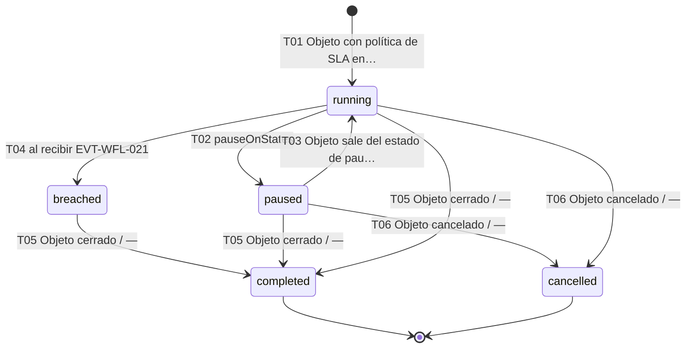

| # | Desde | Hasta | Disparador | Tipo | Guardas | Evento emitido |
|---|---|---|---|---|---|---|
| T01 | (nuevo) | `running` | Objeto con política de SLA entra en un estado medido / — | no especificado | — | — |
| T02 | `running` | `paused` | Objeto entra en un estado de `pauseOnStates` / — | no especificado | — | — |
| T03 | `paused` | `running` | Objeto sale del estado de pausa / — | no especificado | — | — |
| T04 | `running` | `breached` | `wfl:sla-monitor`: vence `dueAt` / EVT-WFL-021 | job, evento | — | — |
| T05 | `breached`, `paused`, `running` | `completed` | Objeto cerrado / — | no especificado | — | — |
| T06 | `paused`, `running` | `cancelled` | Objeto cancelado / — | no especificado | — | — |

### EST-WFL-12 — `formDefinitions.status` (COL-WFL-18)

**Colección:** Formularios dinámicos. **Campos de estado en el §7:** `status` (línea 891; valores: `draft`, `published`, `retired`).

**Fuente:** el §8 del anexo no detalla esta colección; se aplica el patrón general de T05 §7.1.5 (versiones publicadas) sobre los valores del §7.

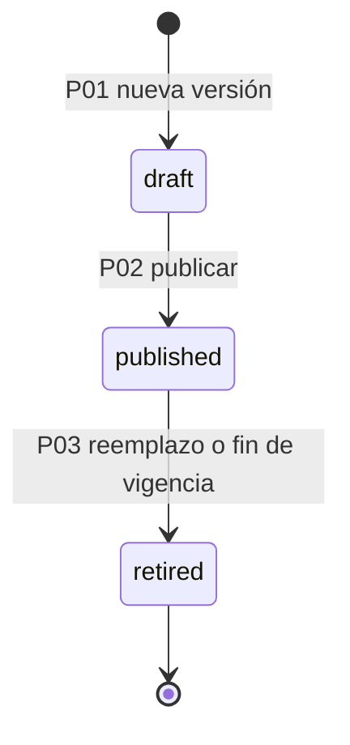

| # | Desde | Hasta | Disparador | Tipo | Guardas | Evento emitido |
|---|---|---|---|---|---|---|
| P01 | (nuevo) | `draft` | Configurador | usuario | — | — |
| P02 | `draft` | `published` | Configurador o aprobador | usuario | Versión validada; publicada queda inmutable (T05 §7.1.5) | — |
| P03 | `published` | `retired` | Sistema al publicar la sucesora o configurador | sistema, usuario | Existe versión sucesora o fin de vigencia | — |

### EST-WFL-13 — `formVersions.status` (COL-WFL-19)

**Colección:** Versiones de formulario (las usan M10 y M19). **Campos de estado en el §7:** `status` (línea 910; valores: `draft`, `published`, `retired`).

**Fuente:** el §8 del anexo no detalla esta colección; se aplica el patrón general de T05 §7.1.5 (versiones publicadas) sobre los valores del §7.


| # | Desde | Hasta | Disparador | Tipo | Guardas | Evento emitido |
|---|---|---|---|---|---|---|
| P01 | (nuevo) | `draft` | Configurador | usuario | — | — |
| P02 | `draft` | `published` | Configurador o aprobador | usuario | Versión validada; publicada queda inmutable (T05 §7.1.5) | — |
| P03 | `published` | `retired` | Sistema al publicar la sucesora o configurador | sistema, usuario | Existe versión sucesora o fin de vigencia | — |

### EST-WFL-14 — `approvalPolicies.status` (COL-WFL-23)

**Colección:** Políticas de aprobación (monto, niveles, SoD). **Campos de estado en el §7:** `status` (línea 970; valores: `draft`, `inReview`, `published`, `retired`).

**Fuente:** T11 §8.11.6.

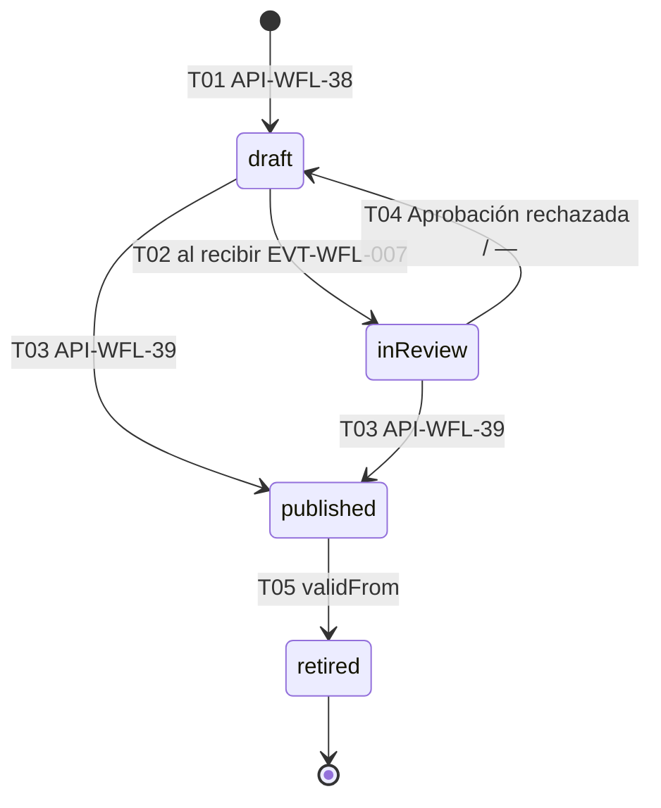

| # | Desde | Hasta | Disparador | Tipo | Guardas | Evento emitido |
|---|---|---|---|---|---|---|
| T01 | (nuevo) | `draft` | Edición (API-WFL-38) / — | API/integración | — | — |
| T02 | `draft` | `inReview` | Publicar con PRM-WFL-030 activo / EVT-WFL-007 (aprobación de la política) | evento | Simulación sin errores | — |
| T03 | `draft`, `inReview` | `published` | Publicación (API-WFL-39) o aprobación decidida / — | API/integración | Aprobada si PRM-WFL-030 | — |
| T04 | `inReview` | `draft` | Aprobación rechazada / — | no especificado | — | — |
| T05 | `published` | `retired` | Se publica otra versión con `validFrom` posterior / — | no especificado | — | — |

### EST-WFL-15 — `approvalRequests.status` (COL-WFL-24)

**Colección:** Pedidos de aprobación. **Campos de estado en el §7:** `status` (línea 988; sin valores en el §7).

**Fuente:** T11 §8.4.

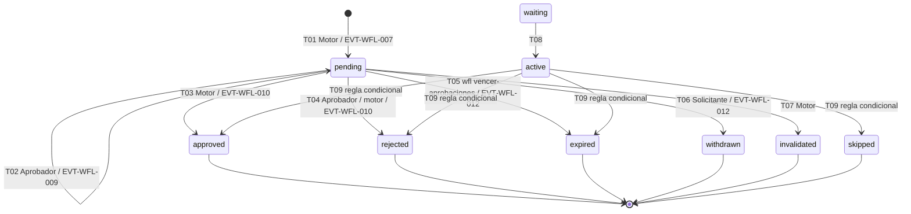

| # | Desde | Hasta | Disparador | Tipo | Guardas | Evento emitido |
|---|---|---|---|---|---|---|
| T01 | (nuevo) | `pending` | Motor | no especificado | Política resuelta con pasos | EVT-WFL-007 `wfl.approval.requested` |
| T02 | `pending` | `pending` | Aprobador | usuario | Paso secuencial aprobado | EVT-WFL-009 `wfl.approval.stepDecided`, EVT-WFL-008 `wfl.approval.stepAssigned` |
| T03 | `pending` | `approved` | Motor | no especificado | Todos los pasos obligatorios cumplidos (quórum) | EVT-WFL-010 `wfl.approval.decided` |
| T04 | `pending` | `rejected` | Aprobador / motor | usuario | Rechazo de paso obligatorio o quórum imposible (RN-WFL-048) | EVT-WFL-010 `wfl.approval.decided` |
| T05 | `pending` | `expired` | `wfl:vencer-aprobaciones` | job | `dueAt` vencido y `onExpire = expire` | EVT-WFL-012 `wfl.approval.expired`, EVT-WFL-010 `wfl.approval.decided` |
| T06 | `pending` | `withdrawn` | Solicitante | usuario | RF-WFL-120 | EVT-WFL-012 `wfl.approval.expired`, EVT-WFL-010 `wfl.approval.decided` |
| T07 | `pending` | `invalidated` | Motor | no especificado | Cambió `contentHash` (RN-WFL-043) | — |
| T08 | `waiting` | `active` | — | no especificado | — | — |
| T09 | `active` | `approved`, `expired`, `rejected`, `skipped` | regla condicional | no especificado | — | — |

### EST-WFL-16 — `approvalSteps.status` (COL-WFL-25)

**Colección:** Pasos de aprobación. **Campos de estado en el §7:** `status` (línea 1004; valores: `waiting`, `active`, `approved`, `rejected`, `expired`, `skipped`).

**Fuente:** T11 §8.11.8.

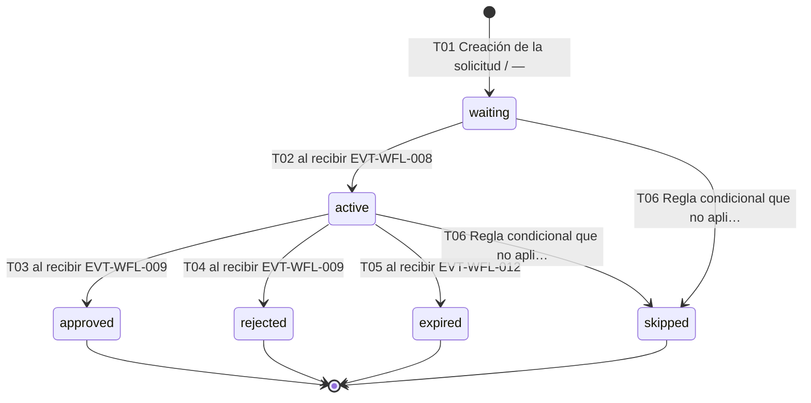

| # | Desde | Hasta | Disparador | Tipo | Guardas | Evento emitido |
|---|---|---|---|---|---|---|
| T01 | (nuevo) | `waiting` | Creación de la solicitud / — | no especificado | — | — |
| T02 | `waiting` | `active` | Paso anterior aprobado o modo paralelo / EVT-WFL-008 | evento | — | — |
| T03 | `active` | `approved` | Quórum alcanzado / EVT-WFL-009 | evento | SoD (RN-WFL-048) | — |
| T04 | `active` | `rejected` | Rechazo de un aprobador obligatorio / EVT-WFL-009 | evento, usuario | — | — |
| T05 | `active` | `expired` | Vence `dueAt` con `onExpire = expire` / EVT-WFL-012 | evento | — | — |
| T06 | `active`, `waiting` | `skipped` | Regla condicional que no aplica / — | no especificado | — | — |

### EST-WFL-17 — `delegations.status` (COL-WFL-27)

**Colección:** Delegaciones de aprobación. **Campos de estado en el §7:** `status` (línea 1038; valores: `scheduled`, `active`, `ended`, `revoked`).

**Fuente:** T11 §8.10.

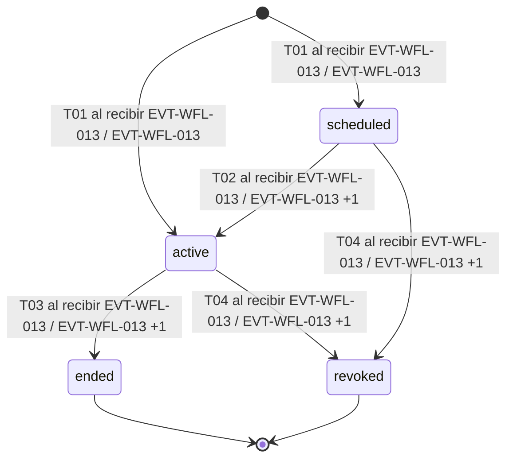

| # | Desde | Hasta | Disparador | Tipo | Guardas | Evento emitido |
|---|---|---|---|---|---|---|
| T01 | (nuevo) | `active`, `scheduled` | Alta de la delegación / EVT-WFL-013 `.activated` (si nace activa) | evento | `active` si `from` ya llegó | EVT-WFL-013 `wfl.delegation.activated` (inferido por nombre) |
| T02 | `scheduled` | `active` | Llega `from` / EVT-WFL-013 `.activated` | evento | — | EVT-WFL-013 `wfl.delegation.activated` (inferido por nombre) |
| T03 | `active` | `ended` | Llega `to` / EVT-WFL-013 `.ended` | evento | — | EVT-WFL-013 `wfl.delegation.ended` (inferido por nombre) |
| T04 | `active`, `scheduled` | `revoked` | Revocación por el delegante o un administrador / EVT-WFL-013 `.revoked` | evento, usuario | — | EVT-WFL-013 `wfl.delegation.revoked` (inferido por nombre) |
| T05 | `scheduled` | `active` | al llegar from | no especificado | — | EVT-WFL-013 `wfl.delegation.activated` (inferido por nombre) |
| T06 | `active` | `ended` | al llegar to | no especificado | — | EVT-WFL-013 `wfl.delegation.ended` (inferido por nombre) |
| T07 | `active`, `scheduled` | `revoked` | por el delegante o un administrador | usuario | — | EVT-WFL-013 `wfl.delegation.revoked` (inferido por nombre) |

### EST-WFL-18 — `tasks.status` (COL-WFL-28)

**Colección:** Tareas. **Campos de estado en el §7:** `status` (línea 1063; sin valores en el §7).

**Fuente:** T11 §8.5.

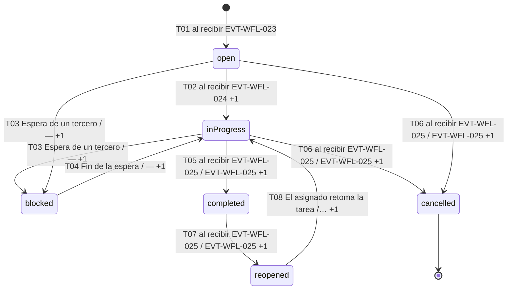

| # | Desde | Hasta | Disparador | Tipo | Guardas | Evento emitido |
|---|---|---|---|---|---|---|
| T01 | (nuevo) | `open` | Creación de la tarea / EVT-WFL-023 | evento | — | — |
| T02 | `open` | `inProgress` | La toma o la inicia el asignado / EVT-WFL-024 `.claimed` | evento | — | — |
| T03 | `inProgress`, `open` | `blocked` | Espera de un tercero / — | no especificado | — | — |
| T04 | `blocked` | `inProgress` | Fin de la espera / — | no especificado | — | — |
| T05 | `inProgress` | `completed` | Cierre por el asignado / EVT-WFL-025 `.completed` | evento | Checklist y evidencias obligatorias (RN-WFL-039) | EVT-WFL-025 `wfl.task.completed` (inferido por nombre) |
| T06 | `inProgress`, `open` | `cancelled` | Cancelación con motivo / EVT-WFL-025 `.cancelled` | evento | Motivo obligatorio | EVT-WFL-025 `wfl.task.cancelled` (inferido por nombre) |
| T07 | `completed` | `reopened` | Reapertura / EVT-WFL-025 `.reopened` | evento | El origen la admite y dentro de PRM-WFL-026 días | EVT-WFL-025 `wfl.task.reopened` (inferido por nombre) |
| T08 | `reopened` | `inProgress` | El asignado retoma la tarea / — | no especificado | — | — |
| T09 | `open` | `inProgress` | tomada o iniciada | no especificado | — | — |
| T10 | `inProgress` | `completed` | — | no especificado | — | EVT-WFL-025 `wfl.task.completed` (inferido por nombre) |
| T11 | `inProgress`, `open` | `blocked` | — | no especificado | — | — |
| T12 | `blocked` | `inProgress` | — | no especificado | — | — |
| T13 | `inProgress`, `open` | `cancelled` | con motivo | no especificado | — | EVT-WFL-025 `wfl.task.cancelled` (inferido por nombre) |
| T14 | `completed` | `reopened` | — | no especificado | — | EVT-WFL-025 `wfl.task.reopened` (inferido por nombre) |
| T15 | `reopened` | `inProgress` | si el origen lo admite y dentro de PRM-WFL-026 días | no especificado | — | — |

### EST-WFL-19 — `workItems.status` (COL-WFL-30)

**Colección:** Ítems de trabajo de bandeja. **Campos de estado en el §7:** `status` (línea 1097; valores: `open`, `snoozed`, `done`, `cancelled`).

**Fuente:** T11 §8.11.9.

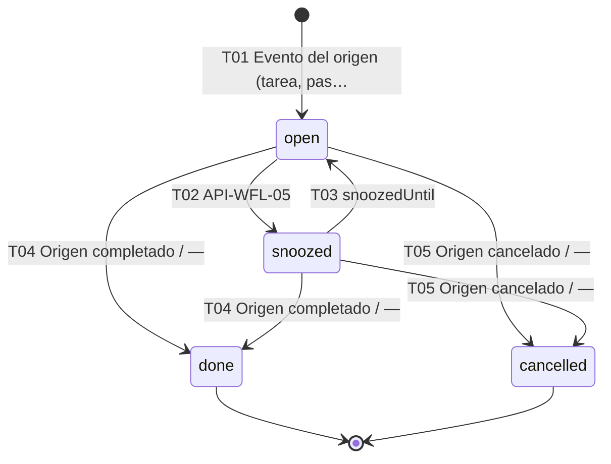

| # | Desde | Hasta | Disparador | Tipo | Guardas | Evento emitido |
|---|---|---|---|---|---|---|
| T01 | (nuevo) | `open` | Evento del origen (tarea, paso de aprobación, caso, orden) / — | no especificado | `sourceVersion` mayor que la guardada | — |
| T02 | `open` | `snoozed` | Usuario pospone (API-WFL-05) / — | API/integración, usuario | — | — |
| T03 | `snoozed` | `open` | Llega `snoozedUntil` / — | no especificado | — | — |
| T04 | `open`, `snoozed` | `done` | Origen completado / — | no especificado | — | — |
| T05 | `open`, `snoozed` | `cancelled` | Origen cancelado / — | no especificado | — | — |

### EST-WFL-20 — `agendaEntries.status` (COL-WFL-31)

**Colección:** Agenda unificada. **Campos de estado en el §7:** `status` (línea 1114; valores: `confirmed`, `tentative`, `cancelled`).

**Fuente:** solo el §7 enumera los estados; el §8 no define transiciones (se lista como inconsistencia).

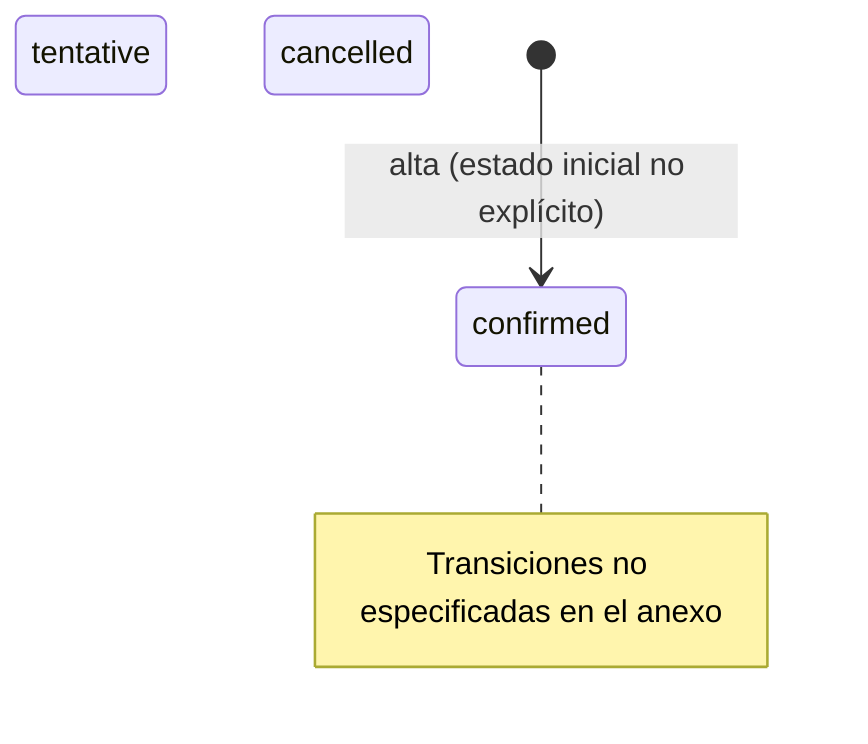

### EST-WFL-21 — `agendaFeeds.status` (COL-WFL-32)

**Colección:** Feeds de calendario externos. **Campos de estado en el §7:** `status` (línea 1128; valores: `active`, `revoked`).

**Fuente:** T11 §8.11.10.

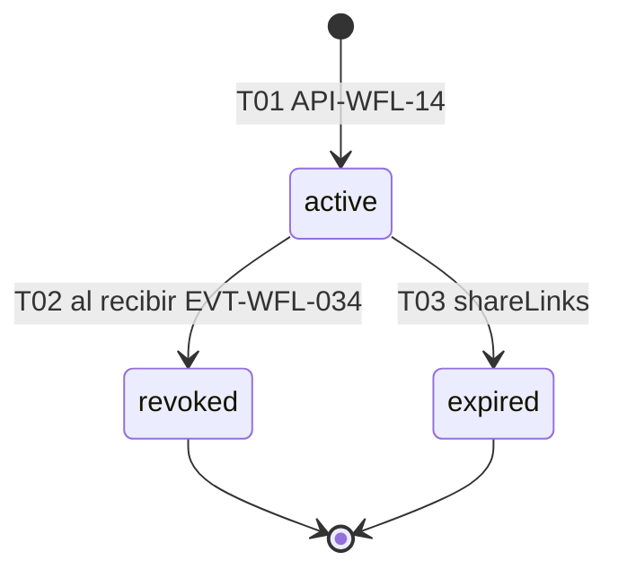

| # | Desde | Hasta | Disparador | Tipo | Guardas | Evento emitido |
|---|---|---|---|---|---|---|
| T01 | (nuevo) | `active` | Alta del feed (API-WFL-14) o del enlace (API-WFL-57) / EVT-WFL-034 (enlace) | evento, API/integración | — | — |
| T02 | `active` | `revoked` | Revocación por el usuario o un administrador / EVT-WFL-034 (enlace) | evento, usuario | — | — |
| T03 | `active` | `expired` | Solo `shareLinks`: vence `expiresAt` o se alcanza `maxDownloads` / — | job | — | — |

### EST-WFL-22 — `documents.status` (COL-WFL-34)

**Colección:** Documentos del expediente. **Campos de estado en el §7:** `status` (línea 1164; sin valores en el §7).

**Fuente:** T11 §8.6.

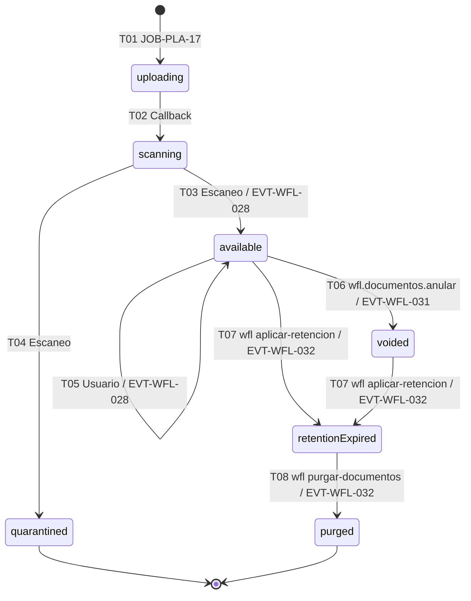

| # | Desde | Hasta | Disparador | Tipo | Guardas | Evento emitido |
|---|---|---|---|---|---|---|
| T01 | (nuevo) | `uploading` | Usuario o sistema | sistema, usuario | URL firmada emitida | — |
| T02 | `uploading` | `scanning` | Callback | no especificado | Objeto confirmado | — |
| T03 | `scanning` | `available` | Escaneo | no especificado | `clean` | EVT-WFL-028 `wfl.document.added` |
| T04 | `scanning` | `quarantined` | Escaneo | no especificado | `infected` o tipo real no admitido | — |
| T05 | `available` | `available` | Usuario | usuario | Tipo no bloqueado por firma (RN-WFL-071) | EVT-WFL-028 `wfl.document.added` |
| T06 | `available` | `voided` | `wfl.documentos.anular` | usuario | Sin legal hold; no es emitido inmutable o la anulación la decide el módulo dueño | EVT-WFL-031 `wfl.document.voided` |
| T07 | `available`, `voided` | `retentionExpired` | `wfl:aplicar-retencion` | job | `retainUntil` cumplido | EVT-WFL-032 `wfl.document.retentionExpired` |
| T08 | `retentionExpired` | `purged` | `wfl:purgar-documentos` | job | Sin hold, sin vínculo económico vigente | EVT-WFL-032 `wfl.document.retentionExpired` |

### EST-WFL-23 — `documentVersions.scanStatus` (COL-WFL-35)

**Colección:** Versiones del documento. **Campos de estado en el §7:** `scanStatus` (línea 1181; valores: `pending`, `clean`, `infected`, `failed`).

**Fuente:** T11 §8.11.16.

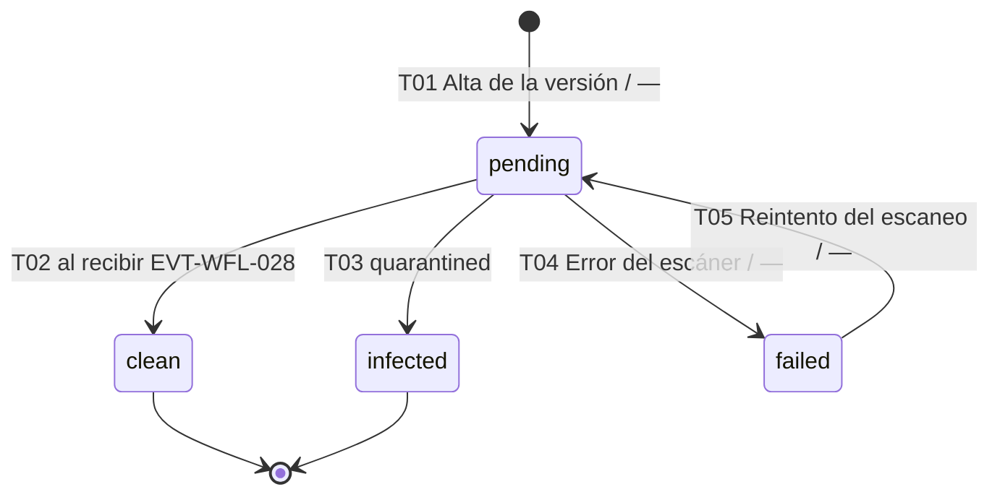

| # | Desde | Hasta | Disparador | Tipo | Guardas | Evento emitido |
|---|---|---|---|---|---|---|
| T01 | (nuevo) | `pending` | Alta de la versión / — | no especificado | — | — |
| T02 | `pending` | `clean` | Escaneo sin hallazgos (`pla:escanear-archivo`) / EVT-WFL-028 | job, evento | — | — |
| T03 | `pending` | `infected` | Escaneo con hallazgos o tipo real no admitido / — (el documento pasa a `quarantined`, §8.6) | no especificado | — | — |
| T04 | `pending` | `failed` | Error del escáner / — | no especificado | Reintentos agotados | — |
| T05 | `failed` | `pending` | Reintento del escaneo / — | no especificado | — | — |

### EST-WFL-24 — `shareLinks.status` (COL-WFL-37)

**Colección:** Enlaces firmados de acceso. **Campos de estado en el §7:** `status` (línea 1214; valores: `active`, `expired`, `revoked`).

**Fuente:** solo el §7 enumera los estados; el §8 no define transiciones (se lista como inconsistencia).

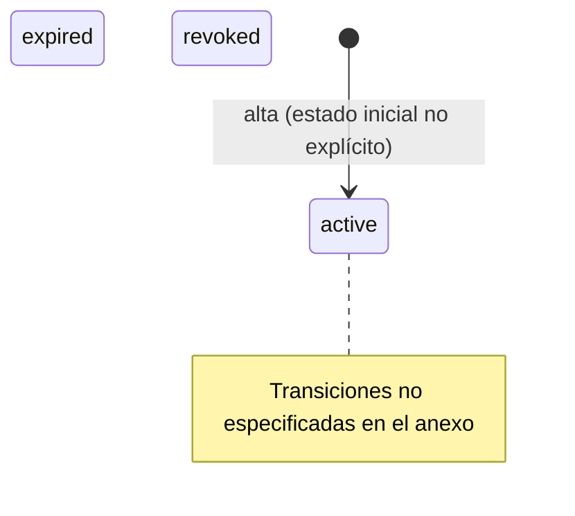

### EST-WFL-25 — `documentTemplates.status` (COL-WFL-41)

**Colección:** Plantillas de documentos (incluye factura: ver CTR-DAT-41). **Campos de estado en el §7:** `status` (línea 1255; valores: `active`, `retired`).

**Fuente:** solo el §7 enumera los estados; el §8 no define transiciones (se lista como inconsistencia).

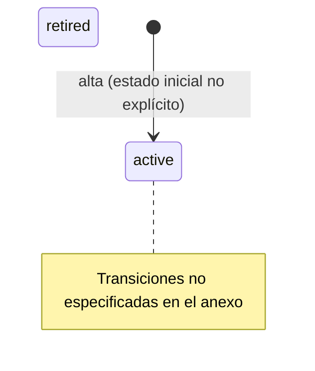

### EST-WFL-26 — `templateVersions.status` (COL-WFL-42)

**Colección:** Versiones de plantilla. **Campos de estado en el §7:** `status` (línea 1265; valores: `draft`, `inReview`, `published`, `retired`).

**Fuente:** el §8 del anexo no detalla esta colección; se aplica el patrón general de T05 §7.1.5 (versiones publicadas) sobre los valores del §7.

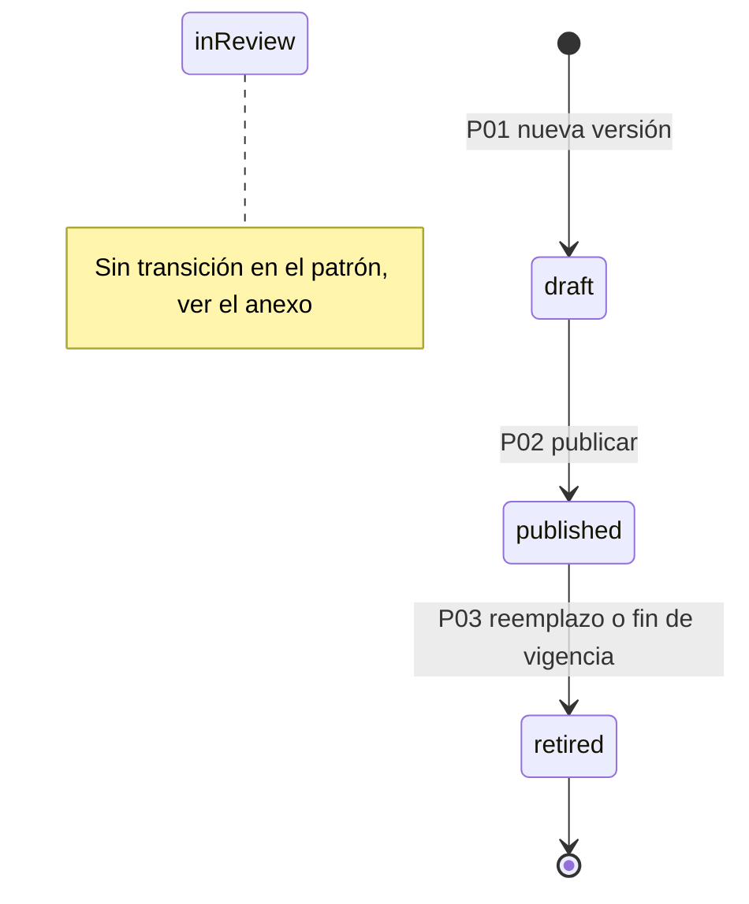

| # | Desde | Hasta | Disparador | Tipo | Guardas | Evento emitido |
|---|---|---|---|---|---|---|
| P01 | (nuevo) | `draft` | Configurador | usuario | — | — |
| P02 | `draft` | `published` | Configurador o aprobador | usuario | Versión validada; publicada queda inmutable (T05 §7.1.5) | — |
| P03 | `published` | `retired` | Sistema al publicar la sucesora o configurador | sistema, usuario | Existe versión sucesora o fin de vigencia | — |

### EST-WFL-27 — `templateDataContracts.status` (COL-WFL-43)

**Colección:** Contratos de datos de plantillas. **Campos de estado en el §7:** `status` (línea 1286; valores: `active`, `deprecated`, `retired`).

**Fuente:** solo el §7 enumera los estados; el §8 no define transiciones (se lista como inconsistencia).

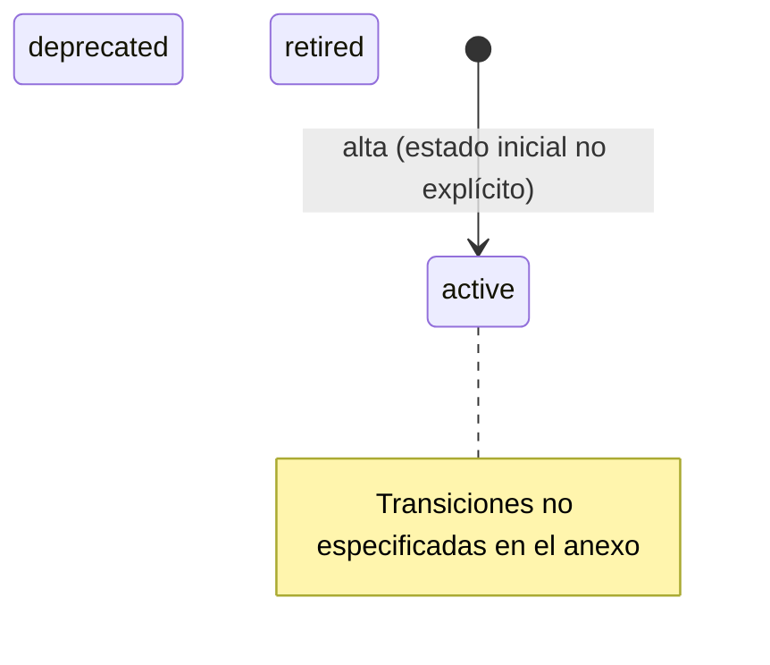

### EST-WFL-28 — `renderRequests.status` (COL-WFL-44)

**Colección:** Pedidos de render HTML→PDF. **Campos de estado en el §7:** `status` (línea 1300; valores: `queued`, `rendering`, `succeeded`, `failed`).

**Fuente:** T11 §8.11.11.

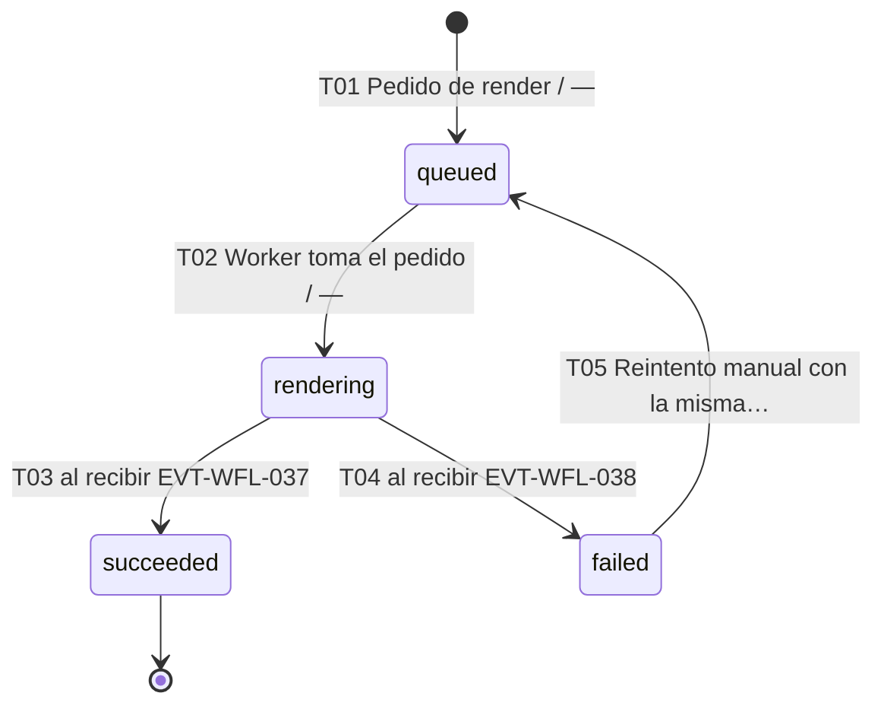

| # | Desde | Hasta | Disparador | Tipo | Guardas | Evento emitido |
|---|---|---|---|---|---|---|
| T01 | (nuevo) | `queued` | Pedido de render / — | no especificado | `idempotencyKey` no usada | — |
| T02 | `queued` | `rendering` | Worker toma el pedido / — | API/integración | — | — |
| T03 | `rendering` | `succeeded` | Documento generado / EVT-WFL-037 | evento | — | — |
| T04 | `rendering` | `failed` | Error de render / EVT-WFL-038 | evento | Reintentos agotados | — |
| T05 | `failed` | `queued` | Reintento manual con la misma clave / — | no especificado | — | — |

### EST-WFL-29 — `numberingSequences.status` (COL-WFL-45)

**Colección:** Numeración no fiscal (canónica; absorbe `sequences` de T04 e `insNumberingSeries` de M17). **Campos de estado en el §7:** `status` (línea 1324; valores: `active`, `closed`).

**Fuente:** T11 §8.11.12.

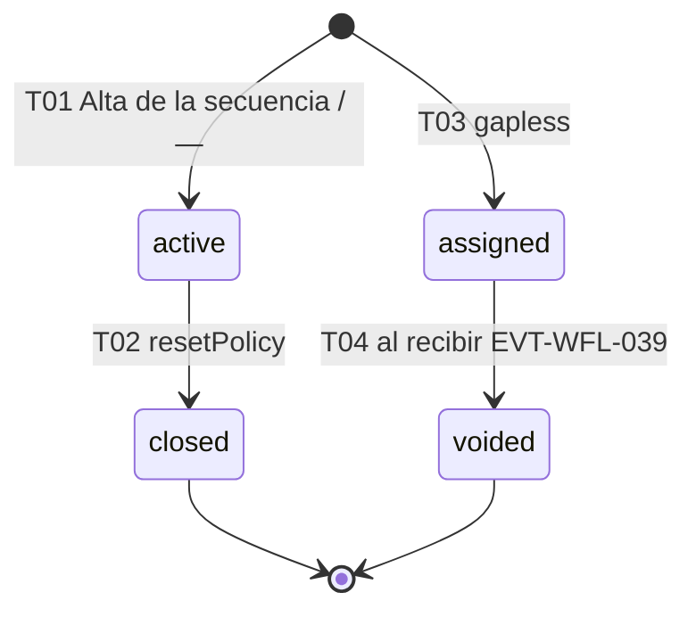

| # | Desde | Hasta | Disparador | Tipo | Guardas | Evento emitido |
|---|---|---|---|---|---|---|
| T01 | (nuevo) | `active` | Alta de la secuencia / — | no especificado | Índice único `{ code, scopeHash }` | — |
| T02 | `active` | `closed` | Cambio de período según `resetPolicy` o cierre manual / — | no especificado | — | — |
| T03 | (nuevo) | `assigned` | Asignación de un número `gapless` o trazable / — | no especificado | — | — |
| T04 | `assigned` | `voided` | Anulación con `voidReason` / EVT-WFL-039 | evento | — | — |

### EST-WFL-30 — `numberingAssignments.status` (COL-WFL-46)

**Colección:** Números asignados. **Campos de estado en el §7:** `status` (línea 1337; valores: `assigned`, `voided`).

**Fuente:** solo el §7 enumera los estados; el §8 no define transiciones (se lista como inconsistencia).

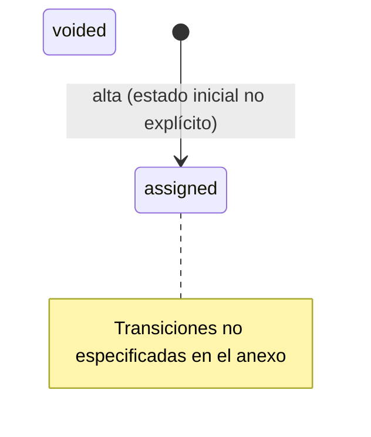

### EST-WFL-31 — `signatureRequests.status` (COL-WFL-48)

**Colección:** Pedidos de firma (convenios M08, recibos M16, conformidad M10). **Campos de estado en el §7:** `status` (línea 1369; sin valores en el §7).

**Fuente:** T11 §8.7.

```mermaid
stateDiagram-v2
    [*] --> draft : T01 Alta del pedido de firma / —
    draft --> sent : T02 al recibir EVT-WFL-041 +1
    sent --> partiallySigned : T03 al recibir EVT-WFL-041 +1
    partiallySigned --> completed : T04 al recibir EVT-WFL-042 +1
    sent --> completed : T04 al recibir EVT-WFL-042
    sent --> providerPending : T05 Firma digital enviada al prov… +1
    providerPending --> completed : T06 al recibir EVT-INT-18 +1
    providerPending --> failed : T06 al recibir EVT-INT-18
    partiallySigned --> rejected : T07 al recibir EVT-WFL-043 +1
    sent --> rejected : T07 al recibir EVT-WFL-043 +1
    partiallySigned --> expired : T08 al recibir EVT-WFL-043 +1
    sent --> expired : T08 al recibir EVT-WFL-043 +1
    draft --> cancelled : T09 al recibir EVT-WFL-043 +1
    sent --> cancelled : T09 al recibir EVT-WFL-043 +1
    completed --> [*]
    failed --> [*]
    rejected --> [*]
    expired --> [*]
    cancelled --> [*]
```

| # | Desde | Hasta | Disparador | Tipo | Guardas | Evento emitido |
|---|---|---|---|---|---|---|
| T01 | (nuevo) | `draft` | Alta del pedido de firma / — | no especificado | — | — |
| T02 | `draft` | `sent` | Envío a los firmantes / EVT-WFL-041 `.requested` | evento, usuario | Al menos un participante | — |
| T03 | `sent` | `partiallySigned` | Firma de un participante sin completar el circuito / EVT-WFL-041 `.participantSigned` | evento | RN-WFL-050 (firmante vigente) | — |
| T04 | `partiallySigned`, `sent` | `completed` | Firma del último participante / EVT-WFL-042 | evento | — | — |
| T05 | `sent` | `providerPending` | Firma digital enviada al proveedor (T06) / — | API/integración | Perfil de firma digital | — |
| T06 | `providerPending` | `completed`, `failed` | `int.signature.completed` / `int.signature.rejected` (EVT-INT-18) / EVT-WFL-042 / EVT-WFL-043 | evento | — | — |
| T07 | `partiallySigned`, `sent` | `rejected` | Un firmante rechaza / EVT-WFL-043 `.rejected` | evento, usuario | Motivo obligatorio | — |
| T08 | `partiallySigned`, `sent` | `expired` | Vence `expiresAt` / EVT-WFL-043 `.expired` | evento | — | — |
| T09 | `draft`, `sent` | `cancelled` | Cancelación por el solicitante / EVT-WFL-043 `.cancelled` | evento, usuario | — | — |
| T10 | `draft` | `sent` | — | no especificado | — | — |
| T11 | `sent` | `partiallySigned` | — | no especificado | — | — |
| T12 | `partiallySigned` | `completed` | — | no especificado | — | — |
| T13 | `partiallySigned`, `sent` | `rejected` | un firmante rechaza | usuario | — | — |
| T14 | `partiallySigned`, `sent` | `expired` | vence expiresAt | job | — | — |
| T15 | `draft`, `sent` | `cancelled` | lo cancela el solicitante | usuario | — | — |
| T16 | `sent` | `providerPending` | — | no especificado | — | — |
| T17 | `providerPending` | `completed` | según int.signature | no especificado | — | — |

### EST-WFL-32 — `signatureParticipants.status` (COL-WFL-49)

**Colección:** Firmantes de un pedido de firma (toma los firmantes vigentes de `treasuryAccountSigners` de M14 cuando la firma es conjunta). **Campos de estado en el §7:** `status` (línea 1387; valores: `pending`, `notified`, `signed`, `rejected`, `expired`).

**Fuente:** T11 §8.11.13.

```mermaid
stateDiagram-v2
    [*] --> pending : T01 Creación del pedido de firma…
    pending --> notified : T02 al recibir EVT-WFL-041
    notified --> signed : T03 al recibir EVT-WFL-041
    notified --> rejected : T04 al recibir EVT-WFL-043
    notified --> expired : T05 al recibir EVT-WFL-043
    pending --> expired : T05 al recibir EVT-WFL-043
    signed --> [*]
    rejected --> [*]
    expired --> [*]
```

| # | Desde | Hasta | Disparador | Tipo | Guardas | Evento emitido |
|---|---|---|---|---|---|---|
| T01 | (nuevo) | `pending` | Creación del pedido de firma / — | no especificado | — | — |
| T02 | `pending` | `notified` | Pedido enviado y turno del participante / EVT-WFL-041 `.requested` | evento | — | — |
| T03 | `notified` | `signed` | Firma válida / EVT-WFL-041 `.participantSigned` | evento | RN-WFL-050 (firmante vigente) | — |
| T04 | `notified` | `rejected` | Rechazo con motivo / EVT-WFL-043 | evento | — | — |
| T05 | `notified`, `pending` | `expired` | Vence `expiresAt` / EVT-WFL-043 | evento | — | — |

### EST-WFL-33 — `dossiers.status` (COL-WFL-51)

**Colección:** Expedientes digitales. **Campos de estado en el §7:** `status` (línea 1420; valores: `open`, `inProgress`, `closed`, `archived`).

**Fuente:** T11 §8.8.

```mermaid
stateDiagram-v2
    [*] --> open : T01 al recibir EVT-WFL-044 / EVT-WFL-044
    open --> inProgress : T02 Primer pase / — +1
    inProgress --> closed : T03 al recibir EVT-WFL-044 / EVT-WFL-044 +1
    closed --> archived : T04 al recibir EVT-WFL-044 / EVT-WFL-044 +1
    closed --> inProgress : T05 Reapertura / — +1
    archived --> inProgress : T06 Reapertura de un archivado / — +1
```

| # | Desde | Hasta | Disparador | Tipo | Guardas | Evento emitido |
|---|---|---|---|---|---|---|
| T01 | (nuevo) | `open` | Apertura del expediente / EVT-WFL-044 `.opened` | evento | — | EVT-WFL-044 `wfl.dossier.opened` (inferido por nombre) |
| T02 | `open` | `inProgress` | Primer pase / — | no especificado | — | — |
| T03 | `inProgress` | `closed` | Respuesta final o resolución / EVT-WFL-044 `.closed` | evento | — | EVT-WFL-044 `wfl.dossier.closed` (inferido por nombre) |
| T04 | `closed` | `archived` | Pasan PRM-WFL-050 días / EVT-WFL-044 `.archived` | evento | — | EVT-WFL-044 `wfl.dossier.archived` (inferido por nombre) |
| T05 | `closed` | `inProgress` | Reapertura / — | no especificado | Motivo obligatorio | — |
| T06 | `archived` | `inProgress` | Reapertura de un archivado / — | no especificado | Operación aprobada (§8.1) | — |
| T07 | `open` | `inProgress` | primer pase | no especificado | — | — |
| T08 | `inProgress` | `closed` | respuesta final o resolución | no especificado | — | EVT-WFL-044 `wfl.dossier.closed` (inferido por nombre) |
| T09 | `closed` | `archived` | tras PRM-WFL-050 días | no especificado | — | EVT-WFL-044 `wfl.dossier.archived` (inferido por nombre) |
| T10 | `closed` | `inProgress` | reapertura con motivo | no especificado | — | — |
| T11 | `archived` | `inProgress` | solo por operación aprobada | no especificado | — | — |

## Cobertura de la parte O

| Módulo | Colección | ID propio | Clasificación | Fuente o motivo |
|---|---|---|---|---|
| T11 | COL-WFL-17 `slaTimers` | EST-WFL-11 | Diagramada (transiciones del §8) | T11 §8.11.7 |
| T11 | COL-WFL-18 `formDefinitions` | EST-WFL-12 | Diagramada (patrón general) | T05 §7.1.5 (versiones publicadas) |
| T11 | COL-WFL-19 `formVersions` | EST-WFL-13 | Diagramada (patrón general) | T05 §7.1.5 (versiones publicadas) |
| T11 | COL-WFL-23 `approvalPolicies` | EST-WFL-14 | Diagramada (transiciones del §8) | T11 §8.11.6 |
| T11 | COL-WFL-24 `approvalRequests` | EST-WFL-15 | Diagramada (transiciones del §8) | T11 §8.4 |
| T11 | COL-WFL-25 `approvalSteps` | EST-WFL-16 | Diagramada (transiciones del §8) | T11 §8.11.8 |
| T11 | COL-WFL-27 `delegations` | EST-WFL-17 | Diagramada (transiciones del §8) | T11 §8.10 |
| T11 | COL-WFL-28 `tasks` | EST-WFL-18 | Diagramada (transiciones del §8) | T11 §8.5 |
| T11 | COL-WFL-30 `workItems` | EST-WFL-19 | Diagramada (transiciones del §8) | T11 §8.11.9 |
| T11 | COL-WFL-31 `agendaEntries` | EST-WFL-20 | Diagramada (solo estados) | Valores del §7 sin transiciones |
| T11 | COL-WFL-32 `agendaFeeds` | EST-WFL-21 | Diagramada (transiciones del §8) | T11 §8.11.10 |
| T11 | COL-WFL-34 `documents` | EST-WFL-22 | Diagramada (transiciones del §8) | T11 §8.6 |
| T11 | COL-WFL-35 `documentVersions` | EST-WFL-23 | Diagramada (transiciones del §8) | T11 §8.11.16 |
| T11 | COL-WFL-37 `shareLinks` | EST-WFL-24 | Diagramada (solo estados) | Valores del §7 sin transiciones |
| T11 | COL-WFL-41 `documentTemplates` | EST-WFL-25 | Diagramada (solo estados) | Valores del §7 sin transiciones |
| T11 | COL-WFL-42 `templateVersions` | EST-WFL-26 | Diagramada (patrón general) | T05 §7.1.5 (versiones publicadas) |
| T11 | COL-WFL-43 `templateDataContracts` | EST-WFL-27 | Diagramada (solo estados) | Valores del §7 sin transiciones |
| T11 | COL-WFL-44 `renderRequests` | EST-WFL-28 | Diagramada (transiciones del §8) | T11 §8.11.11 |
| T11 | COL-WFL-45 `numberingSequences` | EST-WFL-29 | Diagramada (transiciones del §8) | T11 §8.11.12 |
| T11 | COL-WFL-46 `numberingAssignments` | EST-WFL-30 | Diagramada (solo estados) | Valores del §7 sin transiciones |
| T11 | COL-WFL-48 `signatureRequests` | EST-WFL-31 | Diagramada (transiciones del §8) | T11 §8.7 |
| T11 | COL-WFL-49 `signatureParticipants` | EST-WFL-32 | Diagramada (transiciones del §8) | T11 §8.11.13 |
| T11 | COL-WFL-51 `dossiers` | EST-WFL-33 | Diagramada (transiciones del §8) | T11 §8.8 |
