# GoodApps Cooperativas — Diagramas de secuencia por eventos, parte P (M01-M03)

**Entregable de análisis y diseño — Artefacto 7.3 (diagramas de secuencia), ampliación a cobertura completa**

| Campo | Valor |
|---|---|
| Documento | `06p-secuencias-eventos-m01-m03.md` |
| Índice del entregable | [`06-secuencias-y-estados.md`](06-secuencias-y-estados.md) (sección 7) y [`06a-indice-cobertura-secuencias-estados.md`](06a-indice-cobertura-secuencias-estados.md) |
| Versión | 1.0 |
| Fecha | 05-11-2026 |
| Estado | Borrador para revisión |
| Fuentes | T11 §12.2 y §12.3 (catálogo de eventos y consumidores); §12 "Eventos consumidos" y §11 de los anexos M01, M02, M03 |
| Generación | Script `_trabajo/gen06_build.py` (extrae de los anexos; revisión manual posterior) |

## 1. Cómo leer esta parte

Cada diagrama representa un flujo de negocio entre módulos construido a partir del catálogo de eventos de T11 §12.3: un agregado del productor (por ejemplo, `cat.contract.*`) con sus hechos en orden de ID, o un grupo de hechos complementarios del mismo productor cuando el agregado tiene menos de tres eventos. Todos siguen el patrón transversal de `06-secuencias-y-estados.md` §2.2 (outbox en la misma transacción, relay, inbox por consumidor, reintentos y cola de errores), que no se repite en cada diagrama.

- **U** es el origen del hecho: usuario, API o job. Se citan las API y jobs que el anexo productor nombra junto al evento.
- **BUS** es la outbox con el relay y las colas BullMQ; cada consumidor recibe su propio job.
- `par` agrupa consumidores independientes del mismo evento. El texto del mensaje es el efecto que declara el consumidor en el §12 de su anexo; "consume EVT-…" indica que el consumidor figura en T11 pero no describe el efecto. **GEN** representa consumidores genéricos de T11 ("módulo dueño del tipo", "todos").
- Debajo de cada diagrama, la tabla lista los EVT que cubre, sus consumidores externos y los efectos declarados.

## M01 — PER Personas, titulares y cuentas

### SEC-PER-01 — PER: Persona humana o jurídica

**Agregados:** `per.person.*`. **Productor:** M01 Personas, titulares y cuentas (M01 §12; catálogo T11 §12.3).

**Cubre:** EVT-PER-01 `per.person.created`, EVT-PER-02 `per.person.updated`, EVT-PER-03 `per.person.deceased`, EVT-PER-04 `per.person.deathReverted`, EVT-PER-05 `per.person.mergeRequested`, EVT-PER-06 `per.person.merged`, EVT-PER-07 `per.person.anonymized`, EVT-PER-26 `per.person.fiscalLookupRequested`.

**API y jobs disparadores (citados junto al evento en el anexo productor):** JOB-PER-08, JOB-PER-01.

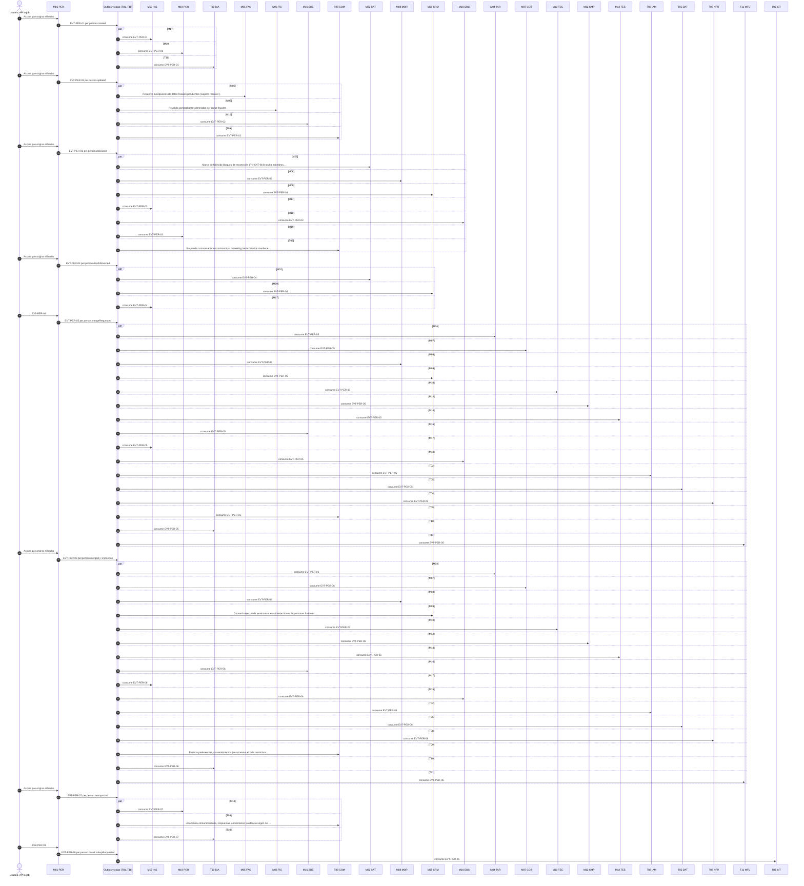

| Evento | Consumidores externos (T11 §12.3) | Efecto declarado por el consumidor (§12 de su anexo) |
|---|---|---|
| EVT-PER-01 `per.person.created` | M17, M19, T10 | No declarado en el §12 del consumidor |
| EVT-PER-02 `per.person.updated` | M05, M06, M16, T09 | M05: Resuelve excepciones de datos fiscales pendientes (sugiere "resolver").; M06: Revalida comprobantes detenidos por datos fiscales |
| EVT-PER-03 `per.person.deceased` | M02, M08, M09, M17, M18, M19, T09 | M02: Marca de fallecido; bloqueo de reconexión (RN-CAT-044); oculta miembros según PRM-CAT-063 (Reemplazado: lo hace M18 con PRM-SOC-007, HUECO-TRV-01); tarea de revisión de titularidad.; T09: Suspende comunicaciones `c`… |
| EVT-PER-04 `per.person.deathReverted` | M02, M09, M17 | No declarado en el §12 del consumidor |
| EVT-PER-05 `per.person.mergeRequested` | M04, M07, M08, M09, M10, M12, M14, M16, M17, M18, T02, T05, T08, T09, T10, T11 | No declarado en el §12 del consumidor |
| EVT-PER-06 `per.person.merged` | M04, M07, M08, M09, M10, M12, M14, M16, M17, M18, T02, T05, T08, T09, T10, T11 | M09: Comando ejecutado; re-vincula casos/interacciones de personas fusionadas; T09: Fusiona preferencias, consentimientos (se conserva el más restrictivo), bandeja y respuestas. |
| EVT-PER-07 `per.person.anonymized` | M19, T09, T10 | T09: Anonimiza comunicaciones, respuestas, comentarios (evidencia según AGR-033). |
| EVT-PER-26 `per.person.fiscalLookupRequested` | T06 | No declarado en el §12 del consumidor |

### SEC-PER-02 — PER: Cuenta de servicios

**Agregados:** `per.account.*`. **Productor:** M01 Personas, titulares y cuentas (M01 §12; catálogo T11 §12.3).

**Cubre:** EVT-PER-11 `per.account.created`, EVT-PER-12 `per.account.updated`, EVT-PER-13 `per.account.principalChanged`, EVT-PER-14 `per.account.closed`.

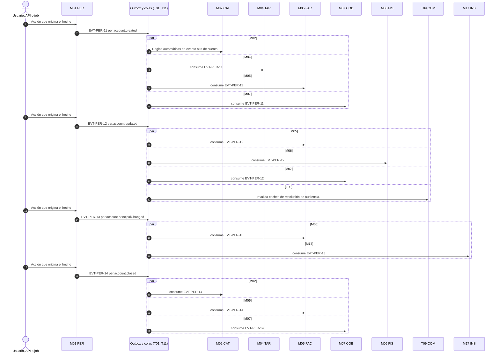

| Evento | Consumidores externos (T11 §12.3) | Efecto declarado por el consumidor (§12 de su anexo) |
|---|---|---|
| EVT-PER-11 `per.account.created` | M02, M04, M05, M07 | M02: Reglas automáticas de evento "alta de cuenta". |
| EVT-PER-12 `per.account.updated` | M05, M06, M07, T09 | T09: Invalida cachés de resolución de audiencia. |
| EVT-PER-13 `per.account.principalChanged` | M05, M17 | No declarado en el §12 del consumidor |
| EVT-PER-14 `per.account.closed` | M02, M05, M07 | No declarado en el §12 del consumidor |

### SEC-PER-03 — PER: hechos complementarios (taxId, Titular, Domicilios normalizados con `geoReference`, premises, Punto de suministro en un inmueble, Vín…)

**Agregados:** `per.taxId.*`, `per.holder.*`, `per.address.*`, `per.premises.*`, `per.servicePoint.*`, `per.relationship.*`, `per.block.*`. **Productor:** M01 Personas, titulares y cuentas (M01 §12; catálogo T11 §12.3).

**Cubre:** EVT-PER-08 `per.taxId.verified`, EVT-PER-09 `per.holder.created`, EVT-PER-10 `per.holder.closed`, EVT-PER-15 `per.address.geoConfirmed`, EVT-PER-16 `per.premises.created`, EVT-PER-17 `per.servicePoint.created`, EVT-PER-18 `per.relationship.granted`, EVT-PER-20 `per.block.applied`.

**API y jobs disparadores (citados junto al evento en el anexo productor):** JOB-PER-01, API-PER-31, JOB-PER-04.

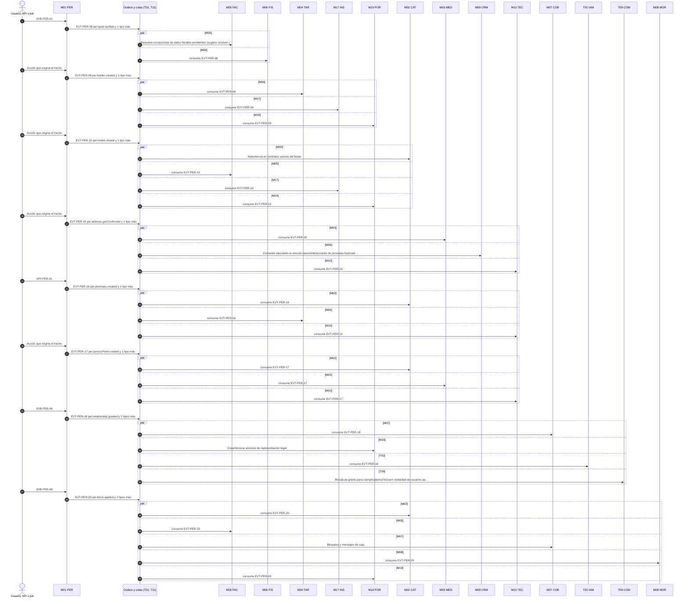

| Evento | Consumidores externos (T11 §12.3) | Efecto declarado por el consumidor (§12 de su anexo) |
|---|---|---|
| EVT-PER-08 `per.taxId.verified` | M05, M06 | M05: Resuelve excepciones de datos fiscales pendientes (sugiere "resolver"). |
| EVT-PER-09 `per.holder.created` | M04, M17, M19 | No declarado en el §12 del consumidor |
| EVT-PER-10 `per.holder.closed` | M02, M05, M17, M19 | M02: Advertencia en contratos activos del titular. |
| EVT-PER-15 `per.address.geoConfirmed` | M03, M09, M10 | M09: Comando ejecutado; re-vincula casos/interacciones de personas fusionadas |
| EVT-PER-16 `per.premises.created` | M02, M04, M10 | No declarado en el §12 del consumidor |
| EVT-PER-17 `per.servicePoint.created` | M02, M03, M10 | No declarado en el §12 del consumidor |
| EVT-PER-18 `per.relationship.granted` | M07, M19, T02, T09 | M19: Crear/revocar accesos de representación legal; T09: Recalcula grants para `clampAudienceToGrant`; visibilidad de usuarios autorizados. |
| EVT-PER-20 `per.block.applied` | M02, M05, M07, M08, M19 | M07: Bloqueos y mensajes de caja. |

### SEC-PER-04 — PER: hechos complementarios (document, Transferencias de titularidad, ownership, (vínculo persona–usuario: `memberships.personId` + eviden…)

**Agregados:** `per.document.*`, `per.transfer.*`, `per.ownership.*`, `per.userLink.*`, `per.contact.*`. **Productor:** M01 Personas, titulares y cuentas (M01 §12; catálogo T11 §12.3).

**Cubre:** EVT-PER-21 `per.document.presented`, EVT-PER-22 `per.transfer.executed`, EVT-PER-23 `per.ownership.changed`, EVT-PER-24 `per.userLink.verified`, EVT-PER-25 `per.contact.changed`.

**API y jobs disparadores (citados junto al evento en el anexo productor):** JOB-PER-04, JOB-PER-07.

Parte de estos hechos también aparece, con el detalle del caso de negocio, en A7 de `06-secuencias-y-estados.md` §3.

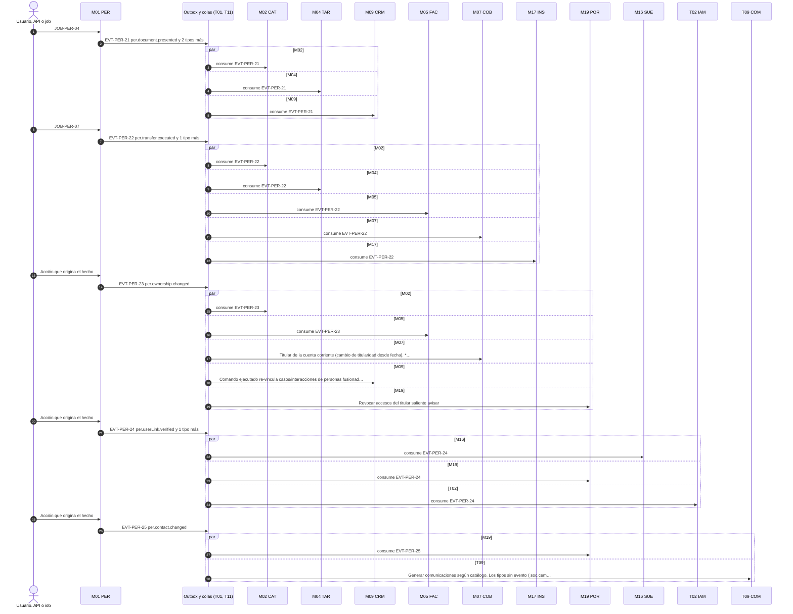

| Evento | Consumidores externos (T11 §12.3) | Efecto declarado por el consumidor (§12 de su anexo) |
|---|---|---|
| EVT-PER-21 `per.document.presented` | M02, M04, M09 | No declarado en el §12 del consumidor |
| EVT-PER-22 `per.transfer.executed` | M02, M04, M05, M07, M17 | No declarado en el §12 del consumidor |
| EVT-PER-23 `per.ownership.changed` | M02, M05, M07, M09, M19 | M07: Titular de la cuenta corriente (cambio de titularidad desde fecha). **Corregido (DEC-045):** no se cambia el titular de la cuenta existente ni se traslada su deuda; se abre una cuenta corriente del nuevo titular (p… |
| EVT-PER-24 `per.userLink.verified` | M16, M19, T02 | No declarado en el §12 del consumidor |
| EVT-PER-25 `per.contact.changed` | M19, T09 | T09: Generar comunicaciones según catálogo. Los tipos sin evento (`soc.cemeteryAct.scheduled`, `soc.loan.overdue`) entran por el comando `com.communications.emit` (§9.7). |

## M02 — CAT Catálogo de servicios y contratos

### SEC-CAT-01 — CAT: Servicio habilitado por el tenant y su perfil

**Agregados:** `cat.tenantService.*`. **Productor:** M02 Catálogo de servicios y contratos (M02 §12; catálogo T11 §12.3).

**Cubre:** EVT-CAT-01 `cat.tenantService.enabled`, EVT-CAT-02 `cat.tenantService.published`, EVT-CAT-03 `cat.tenantService.withdrawn`.

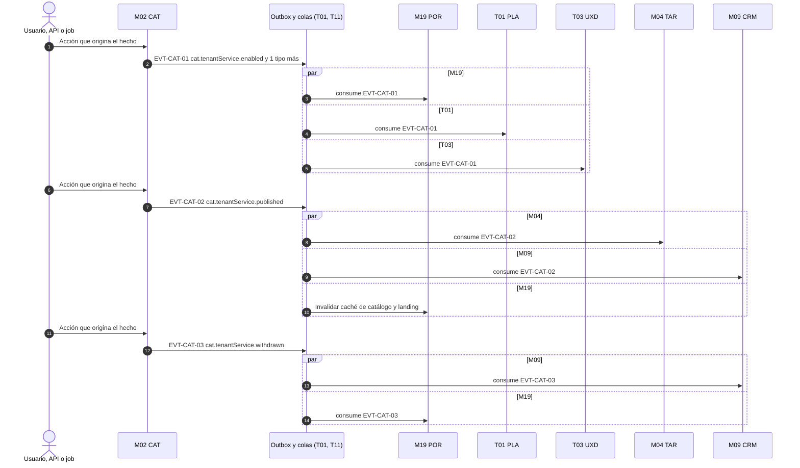

| Evento | Consumidores externos (T11 §12.3) | Efecto declarado por el consumidor (§12 de su anexo) |
|---|---|---|
| EVT-CAT-01 `cat.tenantService.enabled` | M19, T01, T03 | No declarado en el §12 del consumidor |
| EVT-CAT-02 `cat.tenantService.published` | M04, M09, M19 | M19: Invalidar caché de catálogo y landing |
| EVT-CAT-03 `cat.tenantService.withdrawn` | M09, M19 | No declarado en el §12 del consumidor |

### SEC-CAT-02 — CAT: Contrato de servicio (parte 1 de 2)

**Agregados:** `cat.contract.*`. **Productor:** M02 Catálogo de servicios y contratos (M02 §12; catálogo T11 §12.3).

**Cubre:** EVT-CAT-06 `cat.contract.requested`, EVT-CAT-07 `cat.contract.feasibilityRequested`, EVT-CAT-08 `cat.contract.installationRequested`, EVT-CAT-09 `cat.contract.activated`, EVT-CAT-10 `cat.contract.suspended`, EVT-CAT-11 `cat.contract.reactivationRequested`, EVT-CAT-12 `cat.contract.reactivated`, EVT-CAT-13 `cat.contract.terminationRequested`, EVT-CAT-14 `cat.contract.terminationWithdrawn`, EVT-CAT-15 `cat.contract.terminated`.

**API y jobs disparadores (citados junto al evento en el anexo productor):** JOB-CAT-08.

Parte de estos hechos también aparece, con el detalle del caso de negocio, en A4 de `06-secuencias-y-estados.md` §3.

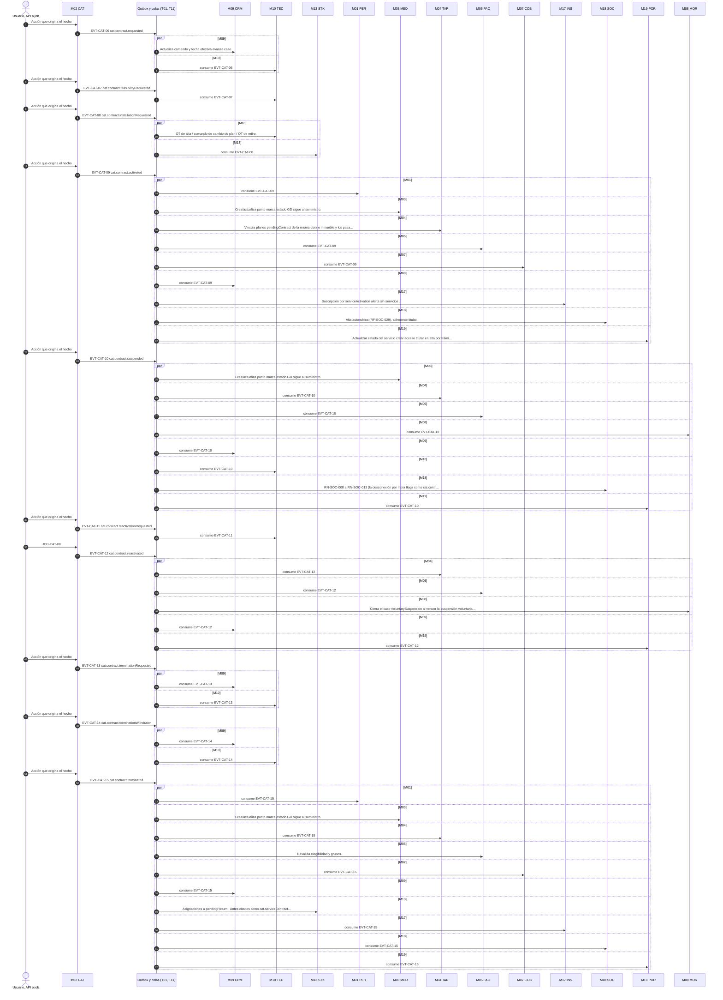

| Evento | Consumidores externos (T11 §12.3) | Efecto declarado por el consumidor (§12 de su anexo) |
|---|---|---|
| EVT-CAT-06 `cat.contract.requested` | M09, M10 | M09: Actualiza comando y fecha efectiva; avanza caso |
| EVT-CAT-07 `cat.contract.feasibilityRequested` | M10 | No declarado en el §12 del consumidor |
| EVT-CAT-08 `cat.contract.installationRequested` | M10, M13 | M10: OT de alta / comando de cambio de plan / OT de retiro. |
| EVT-CAT-09 `cat.contract.activated` | M01, M03, M04, M05, M07, M09, M17, M18, M19 | M03: Crea/actualiza punto; marca estado; GD sigue al suministro.; M04: Vincula planes `pendingContract` de la misma obra e inmueble y los pasa a `active` (RF-TAR-116).; M17: Suscripción por `serviceActivation`; alerta "… |
| EVT-CAT-10 `cat.contract.suspended` | M03, M04, M05, M08, M09, M10, M18, M19 | M03: Crea/actualiza punto; marca estado; GD sigue al suministro.; M18: RN-SOC-008 a RN-SOC-013 (la desconexión por mora llega como `cat.contract.suspended`; M18 usa `contractId`, `reason`, `mode` y `effectiveAt` del pay… |
| EVT-CAT-11 `cat.contract.reactivationRequested` | M10 | No declarado en el §12 del consumidor |
| EVT-CAT-12 `cat.contract.reactivated` | M04, M05, M08, M09, M19 | M08: Cierra el caso `voluntarySuspension` al vencer la suspensión voluntaria (JOB-MOR-08 convertido en manejador; T11 §12.9). |
| EVT-CAT-13 `cat.contract.terminationRequested` | M09, M10 | No declarado en el §12 del consumidor |
| EVT-CAT-14 `cat.contract.terminationWithdrawn` | M09, M10 | No declarado en el §12 del consumidor |
| EVT-CAT-15 `cat.contract.terminated` | M01, M03, M04, M05, M07, M09, M13, M17, M18, M19 | M03: Crea/actualiza punto; marca estado; GD sigue al suministro.; M05: Revalida elegibilidad y grupos.; M13: Asignaciones a `pendingReturn`. Antes citados como `cat.serviceContract.terminated` / `planChanged`; se alinea… |

### SEC-CAT-03 — CAT: Contrato de servicio (parte 2 de 2)

**Agregados:** `cat.contract.*`. **Productor:** M02 Catálogo de servicios y contratos (M02 §12; catálogo T11 §12.3).

**Cubre:** EVT-CAT-16 `cat.contract.cancelled`, EVT-CAT-17 `cat.contract.transferred`, EVT-CAT-18 `cat.contract.planChanged`, EVT-CAT-19 `cat.contract.categoryChanged`, EVT-CAT-20 `cat.contract.addressChanged`, EVT-CAT-21 `cat.contract.flagChanged`, EVT-CAT-22 `cat.contract.equipmentAssigned`, EVT-CAT-28 `cat.contract.meteringRegimeChanged`.

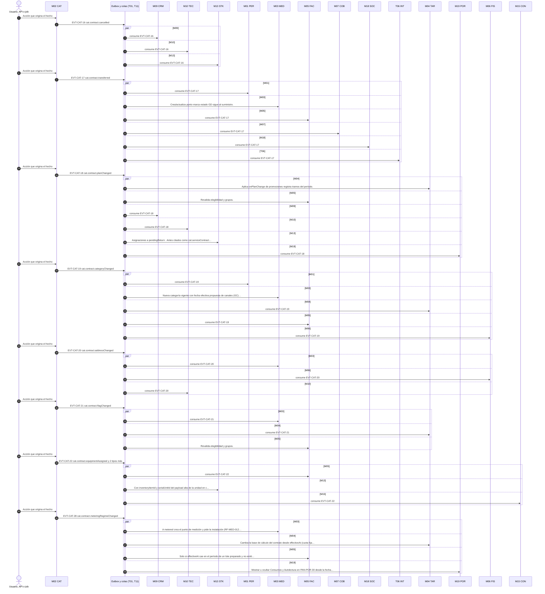

| Evento | Consumidores externos (T11 §12.3) | Efecto declarado por el consumidor (§12 de su anexo) |
|---|---|---|
| EVT-CAT-16 `cat.contract.cancelled` | M09, M10, M13 | No declarado en el §12 del consumidor |
| EVT-CAT-17 `cat.contract.transferred` | M01, M03, M05, M07, M18, T06 | M03: Crea/actualiza punto; marca estado; GD sigue al suministro. |
| EVT-CAT-18 `cat.contract.planChanged` | M04, M05, M09, M10, M13, M19 | M04: Aplica `onPlanChange` de promociones; registra tramos del período.; M05: Revalida elegibilidad y grupos.; M13: Asignaciones a `pendingReturn`. Antes citados como `cat.serviceContract.terminated` / `planChanged`; se… |
| EVT-CAT-19 `cat.contract.categoryChanged` | M01, M03, M04, M05, M06 | M03: Nueva categoría vigente con fecha efectiva; propuesta de canales (GC); prepago. |
| EVT-CAT-20 `cat.contract.addressChanged` | M03, M06, M10 | No declarado en el §12 del consumidor |
| EVT-CAT-21 `cat.contract.flagChanged` | M03, M04, M05 | M05: Revalida elegibilidad y grupos. |
| EVT-CAT-22 `cat.contract.equipmentAssigned` | M05, M13, M15 | M13: Con `inventoryItemId` y `serialUnitId` del payload: alta de la unidad en custodia del contrato (comodato, DEC-013), recepción a depósito o paso a "no recuperada" con propuesta de cargo (RN-STK-037, RN-STK-038). La… |
| EVT-CAT-28 `cat.contract.meteringRegimeChanged` | M03, M04, M05, M19 | M03: A `metered`: crea el punto de medición y pide la instalación (RF-MED-012); a `unmetered`: retiro con lectura final a `effectiveAt` (RF-MED-022). Idempotente por `commandId` (RF-MED-128; HUE-AG-03).; M04: Cambia la… |

### SEC-CAT-04 — CAT: hechos complementarios (Paquete versionado publicable del servicio, plan, bulkOperation, serviceCopy, command)

**Agregados:** `cat.configVersion.*`, `cat.plan.*`, `cat.bulkOperation.*`, `cat.serviceCopy.*`, `cat.command.*`. **Productor:** M02 Catálogo de servicios y contratos (M02 §12; catálogo T11 §12.3).

**Cubre:** EVT-CAT-04 `cat.configVersion.published`, EVT-CAT-05 `cat.plan.published`, EVT-CAT-24 `cat.bulkOperation.completed`, EVT-CAT-25 `cat.serviceCopy.completed`, EVT-CAT-26 `cat.serviceCopy.prepared`, EVT-CAT-27 `cat.command.rejected`.

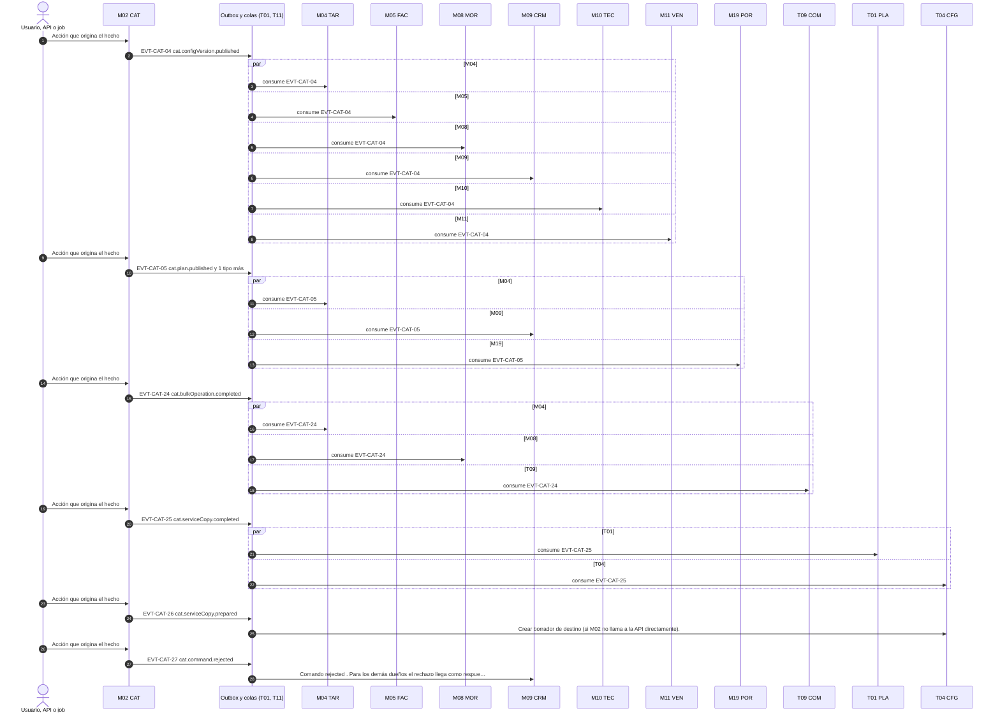

| Evento | Consumidores externos (T11 §12.3) | Efecto declarado por el consumidor (§12 de su anexo) |
|---|---|---|
| EVT-CAT-04 `cat.configVersion.published` | M04, M05, M08, M09, M10, M11 | No declarado en el §12 del consumidor |
| EVT-CAT-05 `cat.plan.published` | M04, M09, M19 | No declarado en el §12 del consumidor |
| EVT-CAT-24 `cat.bulkOperation.completed` | M04, M08, T09 | No declarado en el §12 del consumidor |
| EVT-CAT-25 `cat.serviceCopy.completed` | T01, T04 | No declarado en el §12 del consumidor |
| EVT-CAT-26 `cat.serviceCopy.prepared` | T04 | T04: Crear borrador de destino (si M02 no llama a la API directamente). |
| EVT-CAT-27 `cat.command.rejected` | M09 | M09: Comando `rejected`. Para los demás dueños el rechazo llega como respuesta síncrona del comando (API-CRM-80) hasta que declaren su evento. |

## M03 — MED Medición y consumos

### SEC-MED-01 — MED: readingBatch

**Agregados:** `med.readingBatch.*`. **Productor:** M03 Medición y consumos (M03 §12; catálogo T11 §12.3).

**Cubre:** EVT-MED-05 `med.readingBatch.generated`, EVT-MED-06 `med.readingBatch.confirmed`, EVT-MED-07 `med.readingBatch.closed`.

Parte de estos hechos también aparece, con el detalle del caso de negocio, en A6 de `06-secuencias-y-estados.md` §3.

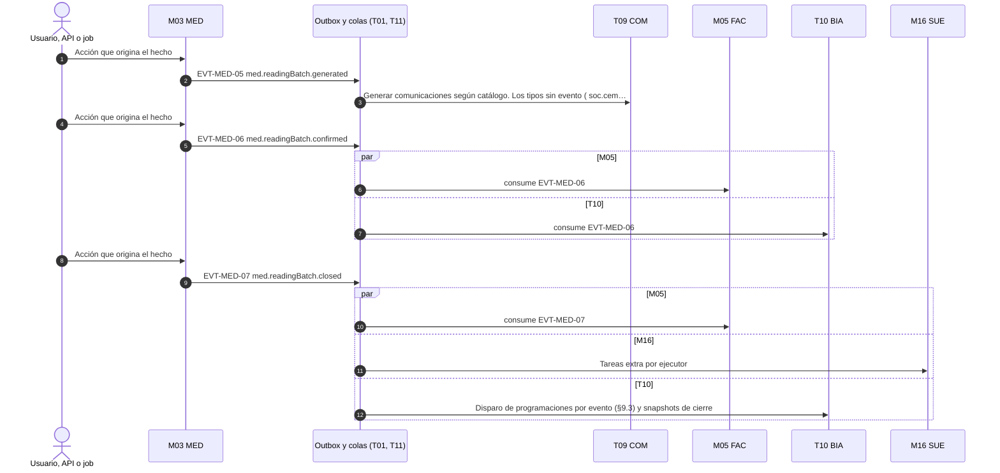

| Evento | Consumidores externos (T11 §12.3) | Efecto declarado por el consumidor (§12 de su anexo) |
|---|---|---|
| EVT-MED-05 `med.readingBatch.generated` | T09 | T09: Generar comunicaciones según catálogo. Los tipos sin evento (`soc.cemeteryAct.scheduled`, `soc.loan.overdue`) entran por el comando `com.communications.emit` (§9.7). |
| EVT-MED-06 `med.readingBatch.confirmed` | M05, T10 | No declarado en el §12 del consumidor |
| EVT-MED-07 `med.readingBatch.closed` | M05, M16, T10 | M16: Tareas extra por ejecutor; T10: Disparo de programaciones por evento (§9.3) y snapshots de cierre |

### SEC-MED-02 — MED: Consumos por canal e intervalo

**Agregados:** `med.consumption.*`. **Productor:** M03 Medición y consumos (M03 §12; catálogo T11 §12.3).

**Cubre:** EVT-MED-11 `med.consumption.approved`, EVT-MED-12 `med.consumption.blocked`, EVT-MED-13 `med.consumption.voided`.

Parte de estos hechos también aparece, con el detalle del caso de negocio, en A6 de `06-secuencias-y-estados.md` §3.

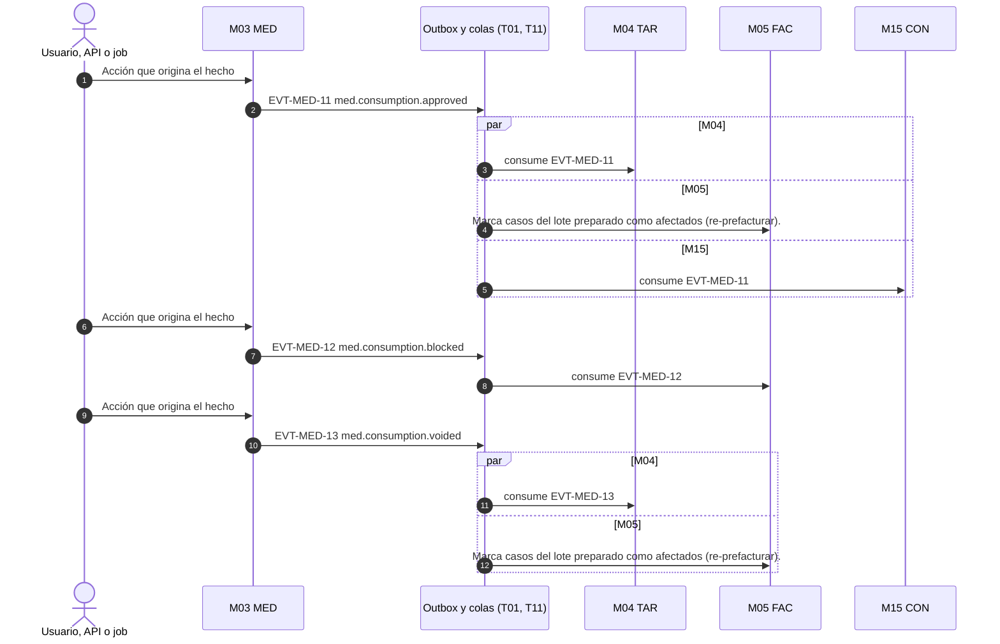

| Evento | Consumidores externos (T11 §12.3) | Efecto declarado por el consumidor (§12 de su anexo) |
|---|---|---|
| EVT-MED-11 `med.consumption.approved` | M04, M05, M15 | M05: Marca casos del lote preparado como afectados (re-prefacturar). |
| EVT-MED-12 `med.consumption.blocked` | M05 | No declarado en el §12 del consumidor |
| EVT-MED-13 `med.consumption.voided` | M04, M05 | M05: Marca casos del lote preparado como afectados (re-prefacturar). |

### SEC-MED-03 — MED: hechos complementarios (Ficha metrológica, Colocación y retiro, Lecturas, readingObservation, Excepciones de consumo)

**Agregados:** `med.meter.*`, `med.installation.*`, `med.reading.*`, `med.readingObservation.*`, `med.consumptionException.*`. **Productor:** M03 Medición y consumos (M03 §12; catálogo T11 §12.3).

**Cubre:** EVT-MED-01 `med.meter.installed`, EVT-MED-02 `med.meter.removed`, EVT-MED-03 `med.installation.voided`, EVT-MED-04 `med.installation.categoryChangeRequested`, EVT-MED-08 `med.reading.captured`, EVT-MED-09 `med.reading.corrected`, EVT-MED-10 `med.readingObservation.workOrderRequested`, EVT-MED-14 `med.consumptionException.raised`.

Parte de estos hechos también aparece, con el detalle del caso de negocio, en A6 de `06-secuencias-y-estados.md` §3.

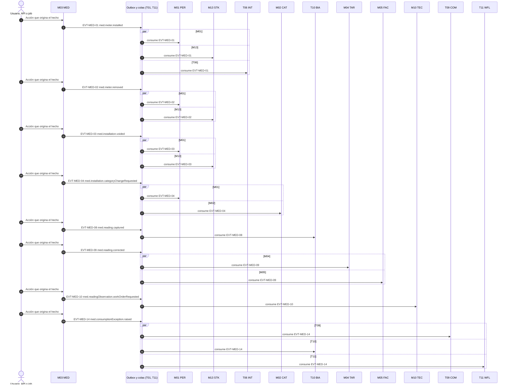

| Evento | Consumidores externos (T11 §12.3) | Efecto declarado por el consumidor (§12 de su anexo) |
|---|---|---|
| EVT-MED-01 `med.meter.installed` | M01, M13, T06 | No declarado en el §12 del consumidor |
| EVT-MED-02 `med.meter.removed` | M01, M13 | No declarado en el §12 del consumidor |
| EVT-MED-03 `med.installation.voided` | M01, M13 | No declarado en el §12 del consumidor |
| EVT-MED-04 `med.installation.categoryChangeRequested` | M01, M02 | No declarado en el §12 del consumidor |
| EVT-MED-08 `med.reading.captured` | T10 | No declarado en el §12 del consumidor |
| EVT-MED-09 `med.reading.corrected` | M04, M05 | No declarado en el §12 del consumidor |
| EVT-MED-10 `med.readingObservation.workOrderRequested` | M10 | No declarado en el §12 del consumidor |
| EVT-MED-14 `med.consumptionException.raised` | T09, T10, T11 | No declarado en el §12 del consumidor |

### SEC-MED-04 — MED: hechos complementarios (Ajustes y regularizaciones, Punto de medición, demand, Balance de energía inyectada por período, dgContract,…)

**Agregados:** `med.consumptionAdjustment.*`, `med.point.*`, `med.demand.*`, `med.injectionBalance.*`, `med.dgContract.*`, `med.remoteOperation.*`. **Productor:** M03 Medición y consumos (M03 §12; catálogo T11 §12.3).

**Cubre:** EVT-MED-15 `med.consumptionAdjustment.approved`, EVT-MED-16 `med.point.inspectionRequested`, EVT-MED-17 `med.point.suspicionRaised`, EVT-MED-18 `med.demand.transgressionDetected`, EVT-MED-19 `med.injectionBalance.approved`, EVT-MED-20 `med.dgContract.statusChanged`, EVT-MED-21 `med.remoteOperation.succeeded`, EVT-MED-22 `med.remoteOperation.failed`.

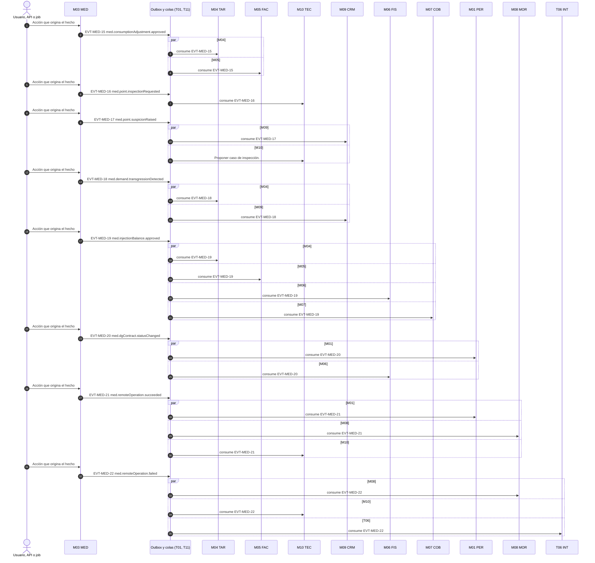

| Evento | Consumidores externos (T11 §12.3) | Efecto declarado por el consumidor (§12 de su anexo) |
|---|---|---|
| EVT-MED-15 `med.consumptionAdjustment.approved` | M04, M05 | No declarado en el §12 del consumidor |
| EVT-MED-16 `med.point.inspectionRequested` | M10 | No declarado en el §12 del consumidor |
| EVT-MED-17 `med.point.suspicionRaised` | M09, M10 | M10: Proponer caso de inspección. |
| EVT-MED-18 `med.demand.transgressionDetected` | M04, M09 | No declarado en el §12 del consumidor |
| EVT-MED-19 `med.injectionBalance.approved` | M04, M05, M06, M07 | No declarado en el §12 del consumidor |
| EVT-MED-20 `med.dgContract.statusChanged` | M01, M06 | No declarado en el §12 del consumidor |
| EVT-MED-21 `med.remoteOperation.succeeded` | M01, M08, M10 | No declarado en el §12 del consumidor |
| EVT-MED-22 `med.remoteOperation.failed` | M08, M10, T06 | No declarado en el §12 del consumidor |

### SEC-MED-05 — MED: hechos complementarios (Recargas prepagas, Cuenta prepaga técnica del punto, selfReadingWindow, selfReading, syncConflict, Sistemas d…)

**Agregados:** `med.prepaidTopUp.*`, `med.prepaidAccount.*`, `med.selfReadingWindow.*`, `med.selfReading.*`, `med.syncConflict.*`, `med.meteringSystem.*`, `med.readingRoute.*`. **Productor:** M03 Medición y consumos (M03 §12; catálogo T11 §12.3).

**Cubre:** EVT-MED-23 `med.prepaidTopUp.delivered`, EVT-MED-24 `med.prepaidTopUp.failed`, EVT-MED-25 `med.prepaidAccount.lowBalance`, EVT-MED-26 `med.selfReadingWindow.opened`, EVT-MED-27 `med.selfReading.accepted`, EVT-MED-28 `med.syncConflict.raised`, EVT-MED-29 `med.meteringSystem.healthChanged`, EVT-MED-30 `med.readingRoute.published`.

**API y jobs disparadores (citados junto al evento en el anexo productor):** JOB-MED-16.

Parte de estos hechos también aparece, con el detalle del caso de negocio, en A6 de `06-secuencias-y-estados.md` §3.

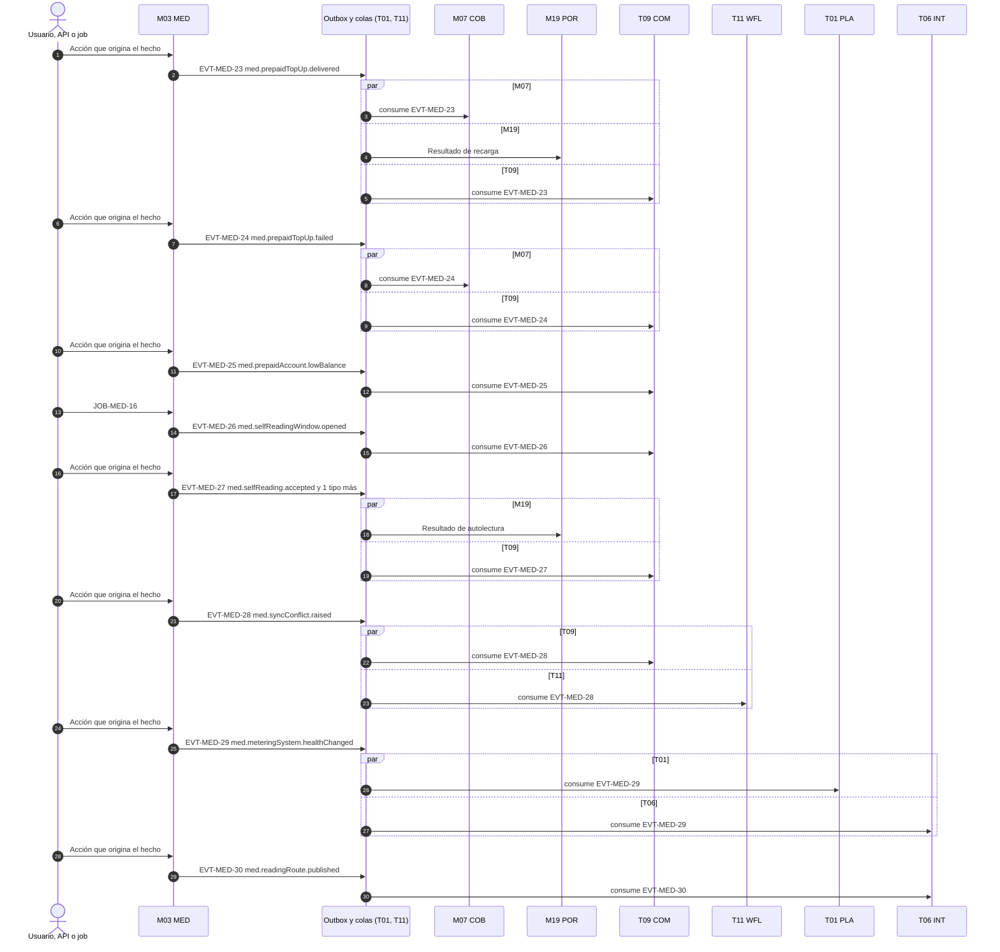

| Evento | Consumidores externos (T11 §12.3) | Efecto declarado por el consumidor (§12 de su anexo) |
|---|---|---|
| EVT-MED-23 `med.prepaidTopUp.delivered` | M07, M19, T09 | M19: Resultado de recarga |
| EVT-MED-24 `med.prepaidTopUp.failed` | M07, T09 | No declarado en el §12 del consumidor |
| EVT-MED-25 `med.prepaidAccount.lowBalance` | T09 | No declarado en el §12 del consumidor |
| EVT-MED-26 `med.selfReadingWindow.opened` | T09 | No declarado en el §12 del consumidor |
| EVT-MED-27 `med.selfReading.accepted` | M19, T09 | M19: Resultado de autolectura |
| EVT-MED-28 `med.syncConflict.raised` | T09, T11 | No declarado en el §12 del consumidor |
| EVT-MED-29 `med.meteringSystem.healthChanged` | T01, T06 | No declarado en el §12 del consumidor |
| EVT-MED-30 `med.readingRoute.published` | T06 | No declarado en el §12 del consumidor |

## Cobertura de la parte P

| Evento | Productor | Secuencia | También en |
|---|---|---|---|
| EVT-PER-01 | M01 | SEC-PER-01 | — |
| EVT-PER-02 | M01 | SEC-PER-01 | — |
| EVT-PER-03 | M01 | SEC-PER-01 | — |
| EVT-PER-04 | M01 | SEC-PER-01 | — |
| EVT-PER-05 | M01 | SEC-PER-01 | — |
| EVT-PER-06 | M01 | SEC-PER-01 | — |
| EVT-PER-07 | M01 | SEC-PER-01 | — |
| EVT-PER-26 | M01 | SEC-PER-01 | — |
| EVT-PER-11 | M01 | SEC-PER-02 | — |
| EVT-PER-12 | M01 | SEC-PER-02 | — |
| EVT-PER-13 | M01 | SEC-PER-02 | — |
| EVT-PER-14 | M01 | SEC-PER-02 | — |
| EVT-PER-08 | M01 | SEC-PER-03 | — |
| EVT-PER-09 | M01 | SEC-PER-03 | — |
| EVT-PER-10 | M01 | SEC-PER-03 | — |
| EVT-PER-15 | M01 | SEC-PER-03 | — |
| EVT-PER-16 | M01 | SEC-PER-03 | — |
| EVT-PER-17 | M01 | SEC-PER-03 | — |
| EVT-PER-18 | M01 | SEC-PER-03 | — |
| EVT-PER-20 | M01 | SEC-PER-03 | — |
| EVT-PER-21 | M01 | SEC-PER-04 | — |
| EVT-PER-22 | M01 | SEC-PER-04 | — |
| EVT-PER-23 | M01 | SEC-PER-04 | — |
| EVT-PER-24 | M01 | SEC-PER-04 | A7 (`06-secuencias-y-estados.md`) |
| EVT-PER-25 | M01 | SEC-PER-04 | — |
| EVT-CAT-01 | M02 | SEC-CAT-01 | — |
| EVT-CAT-02 | M02 | SEC-CAT-01 | — |
| EVT-CAT-03 | M02 | SEC-CAT-01 | — |
| EVT-CAT-06 | M02 | SEC-CAT-02 | — |
| EVT-CAT-07 | M02 | SEC-CAT-02 | — |
| EVT-CAT-08 | M02 | SEC-CAT-02 | — |
| EVT-CAT-09 | M02 | SEC-CAT-02 | — |
| EVT-CAT-10 | M02 | SEC-CAT-02 | A4 (`06-secuencias-y-estados.md`) |
| EVT-CAT-11 | M02 | SEC-CAT-02 | A4 (`06-secuencias-y-estados.md`) |
| EVT-CAT-12 | M02 | SEC-CAT-02 | A4 (`06-secuencias-y-estados.md`) |
| EVT-CAT-13 | M02 | SEC-CAT-02 | — |
| EVT-CAT-14 | M02 | SEC-CAT-02 | — |
| EVT-CAT-15 | M02 | SEC-CAT-02 | — |
| EVT-CAT-16 | M02 | SEC-CAT-03 | — |
| EVT-CAT-17 | M02 | SEC-CAT-03 | — |
| EVT-CAT-18 | M02 | SEC-CAT-03 | — |
| EVT-CAT-19 | M02 | SEC-CAT-03 | — |
| EVT-CAT-20 | M02 | SEC-CAT-03 | — |
| EVT-CAT-21 | M02 | SEC-CAT-03 | — |
| EVT-CAT-22 | M02 | SEC-CAT-03 | — |
| EVT-CAT-28 | M02 | SEC-CAT-03 | — |
| EVT-CAT-04 | M02 | SEC-CAT-04 | — |
| EVT-CAT-05 | M02 | SEC-CAT-04 | — |
| EVT-CAT-24 | M02 | SEC-CAT-04 | — |
| EVT-CAT-25 | M02 | SEC-CAT-04 | — |
| EVT-CAT-26 | M02 | SEC-CAT-04 | — |
| EVT-CAT-27 | M02 | SEC-CAT-04 | — |
| EVT-MED-05 | M03 | SEC-MED-01 | A6 (`06-secuencias-y-estados.md`) |
| EVT-MED-06 | M03 | SEC-MED-01 | A6 (`06-secuencias-y-estados.md`) |
| EVT-MED-07 | M03 | SEC-MED-01 | — |
| EVT-MED-11 | M03 | SEC-MED-02 | A6 (`06-secuencias-y-estados.md`) |
| EVT-MED-12 | M03 | SEC-MED-02 | — |
| EVT-MED-13 | M03 | SEC-MED-02 | — |
| EVT-MED-01 | M03 | SEC-MED-03 | — |
| EVT-MED-02 | M03 | SEC-MED-03 | — |
| EVT-MED-03 | M03 | SEC-MED-03 | — |
| EVT-MED-04 | M03 | SEC-MED-03 | — |
| EVT-MED-08 | M03 | SEC-MED-03 | A6 (`06-secuencias-y-estados.md`) |
| EVT-MED-09 | M03 | SEC-MED-03 | — |
| EVT-MED-10 | M03 | SEC-MED-03 | A6 (`06-secuencias-y-estados.md`) |
| EVT-MED-14 | M03 | SEC-MED-03 | — |
| EVT-MED-15 | M03 | SEC-MED-04 | — |
| EVT-MED-16 | M03 | SEC-MED-04 | — |
| EVT-MED-17 | M03 | SEC-MED-04 | — |
| EVT-MED-18 | M03 | SEC-MED-04 | — |
| EVT-MED-19 | M03 | SEC-MED-04 | — |
| EVT-MED-20 | M03 | SEC-MED-04 | — |
| EVT-MED-21 | M03 | SEC-MED-04 | — |
| EVT-MED-22 | M03 | SEC-MED-04 | — |
| EVT-MED-23 | M03 | SEC-MED-05 | — |
| EVT-MED-24 | M03 | SEC-MED-05 | — |
| EVT-MED-25 | M03 | SEC-MED-05 | — |
| EVT-MED-26 | M03 | SEC-MED-05 | — |
| EVT-MED-27 | M03 | SEC-MED-05 | — |
| EVT-MED-28 | M03 | SEC-MED-05 | A6 (`06-secuencias-y-estados.md`) |
| EVT-MED-29 | M03 | SEC-MED-05 | — |
| EVT-MED-30 | M03 | SEC-MED-05 | — |
