# GoodApps Cooperativas — Diagramas de secuencia por eventos, parte Q (M04-M07)

**Entregable de análisis y diseño — Artefacto 7.3 (diagramas de secuencia), ampliación a cobertura completa**

| Campo | Valor |
|---|---|
| Documento | `06q-secuencias-eventos-m04-m07.md` |
| Índice del entregable | [`06-secuencias-y-estados.md`](06-secuencias-y-estados.md) (sección 7) y [`06a-indice-cobertura-secuencias-estados.md`](06a-indice-cobertura-secuencias-estados.md) |
| Versión | 1.0 |
| Fecha | 05-11-2026 |
| Estado | Borrador para revisión |
| Fuentes | T11 §12.2 y §12.3 (catálogo de eventos y consumidores); §12 "Eventos consumidos" y §11 de los anexos M04, M05, M06, M07 |
| Generación | Script `_trabajo/gen06_build.py` (extrae de los anexos; revisión manual posterior) |

## 1. Cómo leer esta parte

Cada diagrama representa un flujo de negocio entre módulos construido a partir del catálogo de eventos de T11 §12.3: un agregado del productor (por ejemplo, `cat.contract.*`) con sus hechos en orden de ID, o un grupo de hechos complementarios del mismo productor cuando el agregado tiene menos de tres eventos. Todos siguen el patrón transversal de `06-secuencias-y-estados.md` §2.2 (outbox en la misma transacción, relay, inbox por consumidor, reintentos y cola de errores), que no se repite en cada diagrama.

- **U** es el origen del hecho: usuario, API o job. Se citan las API y jobs que el anexo productor nombra junto al evento.
- **BUS** es la outbox con el relay y las colas BullMQ; cada consumidor recibe su propio job.
- `par` agrupa consumidores independientes del mismo evento. El texto del mensaje es el efecto que declara el consumidor en el §12 de su anexo; "consume EVT-…" indica que el consumidor figura en T11 pero no describe el efecto. **GEN** representa consumidores genéricos de T11 ("módulo dueño del tipo", "todos").
- Debajo de cada diagrama, la tabla lista los EVT que cubre, sus consumidores externos y los efectos declarados.

## M04 — TAR Tarifas y motor de cálculo

### SEC-TAR-01 — TAR: Versión de cuadro tarifario

**Agregados:** `tar.schedule.*`. **Productor:** M04 Tarifas y motor de cálculo (M04 §12; catálogo T11 §12.3).

**Cubre:** EVT-TAR-001 `tar.schedule.submitted`, EVT-TAR-002 `tar.schedule.approved`, EVT-TAR-003 `tar.schedule.rejected`, EVT-TAR-004 `tar.schedule.published`, EVT-TAR-005 `tar.schedule.activated`, EVT-TAR-006 `tar.schedule.superseded`.

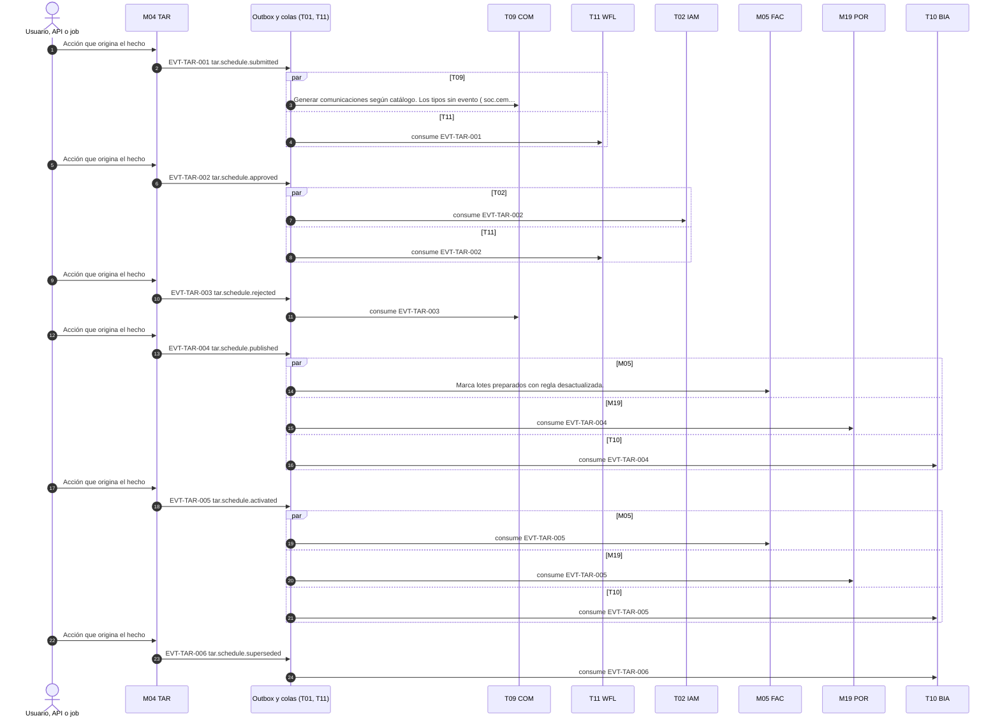

| Evento | Consumidores externos (T11 §12.3) | Efecto declarado por el consumidor (§12 de su anexo) |
|---|---|---|
| EVT-TAR-001 `tar.schedule.submitted` | T09, T11 | T09: Generar comunicaciones según catálogo. Los tipos sin evento (`soc.cemeteryAct.scheduled`, `soc.loan.overdue`) entran por el comando `com.communications.emit` (§9.7). |
| EVT-TAR-002 `tar.schedule.approved` | T02, T11 | No declarado en el §12 del consumidor |
| EVT-TAR-003 `tar.schedule.rejected` | T09 | No declarado en el §12 del consumidor |
| EVT-TAR-004 `tar.schedule.published` | M05, M19, T10 | M05: Marca lotes preparados con regla desactualizada. |
| EVT-TAR-005 `tar.schedule.activated` | M05, M19, T10 | No declarado en el §12 del consumidor |
| EVT-TAR-006 `tar.schedule.superseded` | T10 | No declarado en el §12 del consumidor |

### SEC-TAR-02 — TAR: Promociones

**Agregados:** `tar.promotion.*`. **Productor:** M04 Tarifas y motor de cálculo (M04 §12; catálogo T11 §12.3).

**Cubre:** EVT-TAR-010 `tar.promotion.assigned`, EVT-TAR-011 `tar.promotion.consumed`, EVT-TAR-012 `tar.promotion.ended`.

**API y jobs disparadores (citados junto al evento en el anexo productor):** JOB-TAR-11.

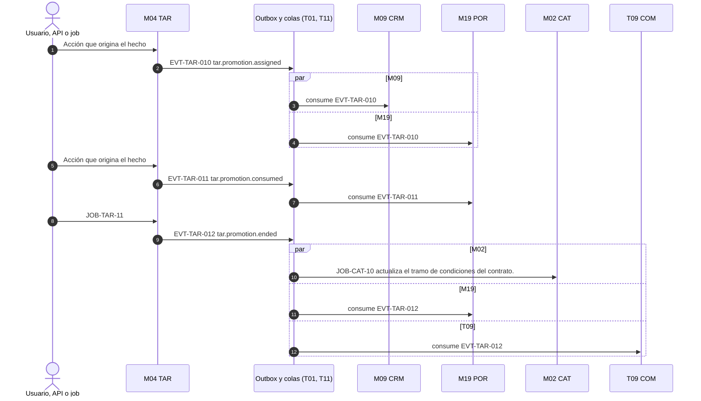

| Evento | Consumidores externos (T11 §12.3) | Efecto declarado por el consumidor (§12 de su anexo) |
|---|---|---|
| EVT-TAR-010 `tar.promotion.assigned` | M09, M19 | No declarado en el §12 del consumidor |
| EVT-TAR-011 `tar.promotion.consumed` | M19 | No declarado en el §12 del consumidor |
| EVT-TAR-012 `tar.promotion.ended` | M02, M19, T09 | M02: JOB-CAT-10 actualiza el tramo de condiciones del contrato. |

### SEC-TAR-03 — TAR: hechos complementarios (rule, Resultado de cálculo por cuenta con traza, simulation, subsidyRoll, Inscripciones a subsidio, retroacti…)

**Agregados:** `tar.rule.*`, `tar.calculation.*`, `tar.simulation.*`, `tar.subsidyRoll.*`, `tar.enrollment.*`, `tar.retroactiveDiff.*`, `tar.contractedDemand.*`. **Productor:** M04 Tarifas y motor de cálculo (M04 §12; catálogo T11 §12.3).

**Cubre:** EVT-TAR-007 `tar.rule.published`, EVT-TAR-008 `tar.calculation.completed`, EVT-TAR-009 `tar.simulation.completed`, EVT-TAR-013 `tar.subsidyRoll.imported`, EVT-TAR-014 `tar.enrollment.changed`, EVT-TAR-015 `tar.retroactiveDiff.computed`, EVT-TAR-016 `tar.retroactiveDiff.approved`, EVT-TAR-017 `tar.contractedDemand.updateProposed`.

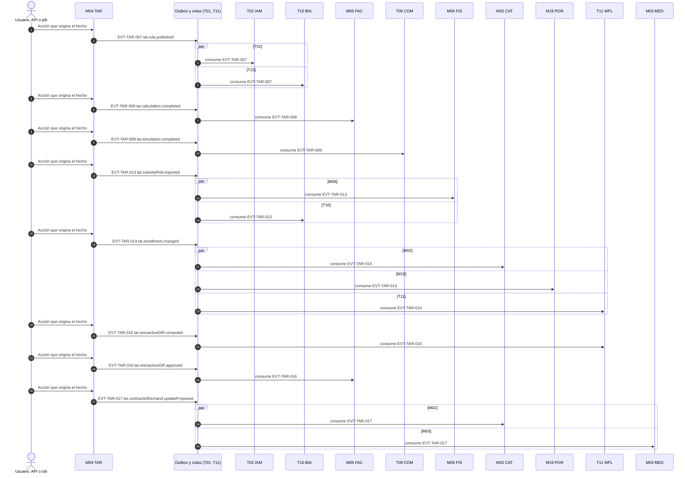

| Evento | Consumidores externos (T11 §12.3) | Efecto declarado por el consumidor (§12 de su anexo) |
|---|---|---|
| EVT-TAR-007 `tar.rule.published` | T02, T10 | No declarado en el §12 del consumidor |
| EVT-TAR-008 `tar.calculation.completed` | M05 | No declarado en el §12 del consumidor |
| EVT-TAR-009 `tar.simulation.completed` | T09 | No declarado en el §12 del consumidor |
| EVT-TAR-013 `tar.subsidyRoll.imported` | M06, T10 | No declarado en el §12 del consumidor |
| EVT-TAR-014 `tar.enrollment.changed` | M02, M19, T11 | No declarado en el §12 del consumidor |
| EVT-TAR-015 `tar.retroactiveDiff.computed` | T11 | No declarado en el §12 del consumidor |
| EVT-TAR-016 `tar.retroactiveDiff.approved` | M05 | No declarado en el §12 del consumidor |
| EVT-TAR-017 `tar.contractedDemand.updateProposed` | M02, M03 | No declarado en el §12 del consumidor |

### SEC-TAR-04 — TAR: hechos complementarios (category, calls, roundingCarry, injectedCredit)

**Agregados:** `tar.category.*`, `tar.calls.*`, `tar.roundingCarry.*`, `tar.injectedCredit.*`. **Productor:** M04 Tarifas y motor de cálculo (M04 §12; catálogo T11 §12.3).

**Cubre:** EVT-TAR-018 `tar.category.changeProposed`, EVT-TAR-019 `tar.calls.rated`, EVT-TAR-020 `tar.roundingCarry.confirmed`, EVT-TAR-021 `tar.injectedCredit.recorded`.

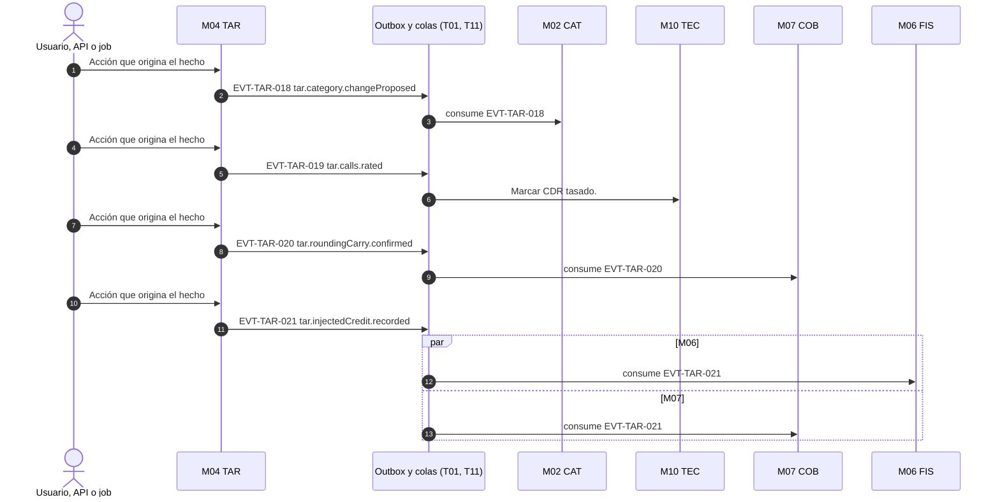

| Evento | Consumidores externos (T11 §12.3) | Efecto declarado por el consumidor (§12 de su anexo) |
|---|---|---|
| EVT-TAR-018 `tar.category.changeProposed` | M02 | No declarado en el §12 del consumidor |
| EVT-TAR-019 `tar.calls.rated` | M10 | M10: Marcar CDR tasado. |
| EVT-TAR-020 `tar.roundingCarry.confirmed` | M07 | No declarado en el §12 del consumidor |
| EVT-TAR-021 `tar.injectedCredit.recorded` | M06, M07 | No declarado en el §12 del consumidor |

## M05 — FAC Facturación

### SEC-FAC-01 — FAC: Lote de facturación

**Agregados:** `fac.billingRun.*`. **Productor:** M05 Facturación (M05 §12; catálogo T11 §12.3).

**Cubre:** EVT-FAC-01 `fac.billingRun.prepared`, EVT-FAC-02 `fac.billingRun.prebilled`, EVT-FAC-03 `fac.billingRun.approved`, EVT-FAC-04 `fac.billingRun.paused`, EVT-FAC-05 `fac.billingRun.issued`, EVT-FAC-06 `fac.billingRun.closed`, EVT-FAC-21 `fac.billingRun.discarded`.

Parte de estos hechos también aparece, con el detalle del caso de negocio, en A1 de `06-secuencias-y-estados.md` §3.

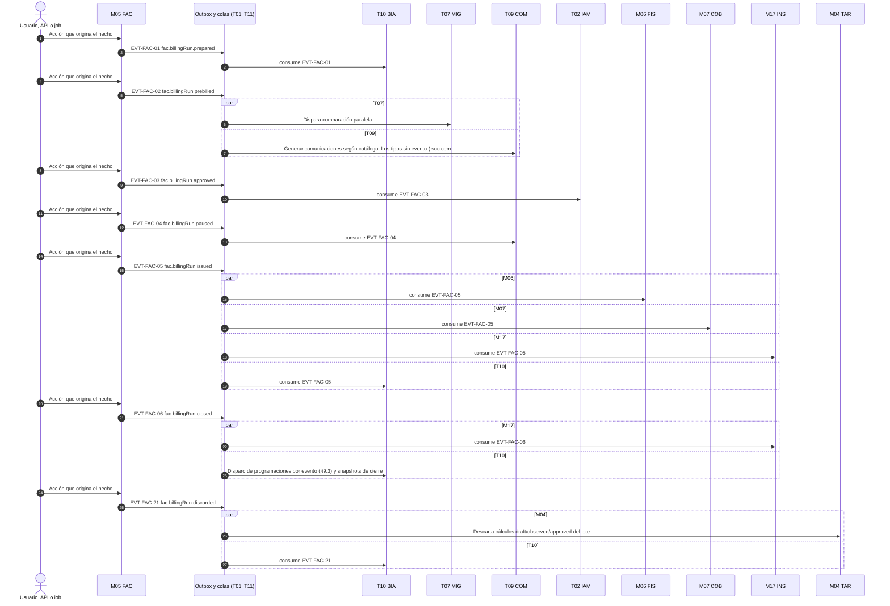

| Evento | Consumidores externos (T11 §12.3) | Efecto declarado por el consumidor (§12 de su anexo) |
|---|---|---|
| EVT-FAC-01 `fac.billingRun.prepared` | T10 | No declarado en el §12 del consumidor |
| EVT-FAC-02 `fac.billingRun.prebilled` | T07, T09 | T07: Dispara comparación paralela; T09: Generar comunicaciones según catálogo. Los tipos sin evento (`soc.cemeteryAct.scheduled`, `soc.loan.overdue`) entran por el comando `com.communications.emit` (§9.7). |
| EVT-FAC-03 `fac.billingRun.approved` | T02 | No declarado en el §12 del consumidor |
| EVT-FAC-04 `fac.billingRun.paused` | T09 | No declarado en el §12 del consumidor |
| EVT-FAC-05 `fac.billingRun.issued` | M06, M07, M17, T10 | No declarado en el §12 del consumidor |
| EVT-FAC-06 `fac.billingRun.closed` | M17, T10 | T10: Disparo de programaciones por evento (§9.3) y snapshots de cierre |
| EVT-FAC-21 `fac.billingRun.discarded` | M04, T10 | M04: Descarta cálculos `draft/observed/approved` del lote. |

### SEC-FAC-02 — FAC: Comprobante emitido con renglones embebidos

**Agregados:** `fac.invoice.*`. **Productor:** M05 Facturación (M05 §12; catálogo T11 §12.3).

**Cubre:** EVT-FAC-07 `fac.invoice.issued`, EVT-FAC-08 `fac.invoice.annulled`, EVT-FAC-09 `fac.invoice.reversed`, EVT-FAC-12 `fac.invoice.blocked`, EVT-FAC-13 `fac.invoice.dueDatesChanged`, EVT-FAC-14 `fac.invoice.published`, EVT-FAC-15 `fac.invoice.delivered`.

**API y jobs disparadores (citados junto al evento en el anexo productor):** JOB-FAC-03, JOB-FAC-08, API-FAC-023.

Parte de estos hechos también aparece, con el detalle del caso de negocio, en A1 de `06-secuencias-y-estados.md` §3.

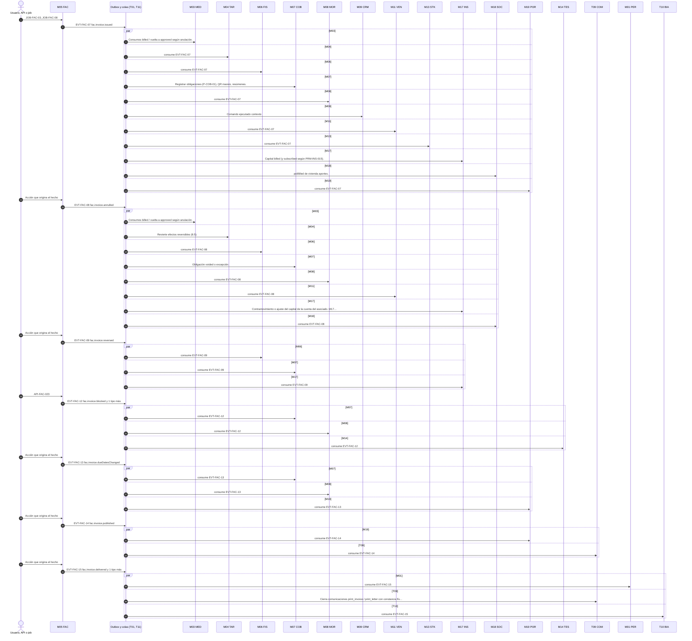

| Evento | Consumidores externos (T11 §12.3) | Efecto declarado por el consumidor (§12 de su anexo) |
|---|---|---|
| EVT-FAC-07 `fac.invoice.issued` | M03, M04, M06, M07, M08, M09, M11, M13, M17, M18, M19 | M03: Consumos `billed` / vuelta a `approved` según anulación.; M07: Registrar obligaciones (P-COB-01), QR masivo, resúmenes.; M09: Comando ejecutado; contexto; M17: Capital `billed` (y `subscribed` según PRM-INS-015).;… |
| EVT-FAC-08 `fac.invoice.annulled` | M03, M04, M06, M07, M08, M11, M17, M18 | M03: Consumos `billed` / vuelta a `approved` según anulación.; M04: Revierte efectos reversibles (8.5).; M07: Obligación `voided` o excepción.; M17: Contramovimiento o ajuste del capital de la cuenta del asociado. M17 s… |
| EVT-FAC-09 `fac.invoice.reversed` | M06, M07, M17 | No declarado en el §12 del consumidor |
| EVT-FAC-12 `fac.invoice.blocked` | M07, M08, M14 | No declarado en el §12 del consumidor |
| EVT-FAC-13 `fac.invoice.dueDatesChanged` | M07, M08, M19 | No declarado en el §12 del consumidor |
| EVT-FAC-14 `fac.invoice.published` | M19, T09 | No declarado en el §12 del consumidor |
| EVT-FAC-15 `fac.invoice.delivered` | M01, T09, T10 | T09: Cierra comunicaciones `print_invoice`/`print_letter` con constancia física. |

### SEC-FAC-03 — FAC: hechos complementarios (creditNote, debitNote, Bandeja de excepciones, Ciclo de facturación por servicio y universo, Talones sumados…)

**Agregados:** `fac.creditNote.*`, `fac.debitNote.*`, `fac.billingException.*`, `fac.billingCycle.*`, `fac.paymentSlip.*`, `fac.recategorization.*`, `fac.billableItem.*`. **Productor:** M05 Facturación (M05 §12; catálogo T11 §12.3).

**Cubre:** EVT-FAC-10 `fac.creditNote.issued`, EVT-FAC-11 `fac.debitNote.issued`, EVT-FAC-16 `fac.billingException.opened`, EVT-FAC-17 `fac.billingCycle.closed`, EVT-FAC-18 `fac.paymentSlip.generated`, EVT-FAC-19 `fac.recategorization.confirmed`, EVT-FAC-20 `fac.billableItem.billed`.

**API y jobs disparadores (citados junto al evento en el anexo productor):** JOB-FAC-15.

Parte de estos hechos también aparece, con el detalle del caso de negocio, en A5 de `06-secuencias-y-estados.md` §3.

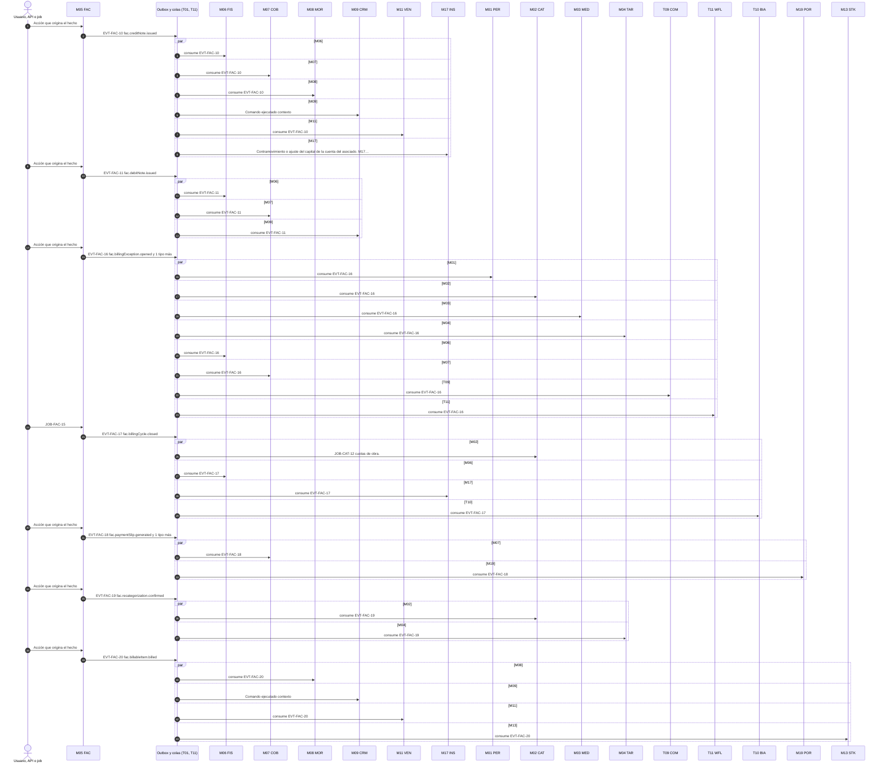

| Evento | Consumidores externos (T11 §12.3) | Efecto declarado por el consumidor (§12 de su anexo) |
|---|---|---|
| EVT-FAC-10 `fac.creditNote.issued` | M06, M07, M08, M09, M11, M17 | M09: Comando ejecutado; contexto; M17: Contramovimiento o ajuste del capital de la cuenta del asociado. M17 se suscribe directamente a `fac.debitNote.issued` (EVT-FAC-11) para el ajuste en contra: el alias `fac.invoice.`… |
| EVT-FAC-11 `fac.debitNote.issued` | M06, M07, M09 | No declarado en el §12 del consumidor |
| EVT-FAC-16 `fac.billingException.opened` | M01, M02, M03, M04, M06, M07, T09, T11 | No declarado en el §12 del consumidor |
| EVT-FAC-17 `fac.billingCycle.closed` | M02, M06, M17, T10 | M02: JOB-CAT-12 cuotas de obra. |
| EVT-FAC-18 `fac.paymentSlip.generated` | M07, M19 | No declarado en el §12 del consumidor |
| EVT-FAC-19 `fac.recategorization.confirmed` | M02, M04 | No declarado en el §12 del consumidor |
| EVT-FAC-20 `fac.billableItem.billed` | M08, M09, M11, M13 | M09: Comando ejecutado; contexto |

## M06 — FIS Fiscal e impuestos

### SEC-FIS-01 — FIS: Cola de autorización CAE/CAEA/CAI/CESP

**Agregados:** `fis.authorization.*`. **Productor:** M06 Fiscal e impuestos (M06 §12; catálogo T11 §12.3).

**Cubre:** EVT-FIS-02 `fis.authorization.rejected`, EVT-FIS-03 `fis.authorization.detained`, EVT-FIS-04 `fis.authorization.uncertain`, EVT-FIS-05 `fis.authorization.reconciled`, EVT-FIS-21 `fis.authorization.globalFailure`.

**API y jobs disparadores (citados junto al evento en el anexo productor):** JOB-FIS-04.

Parte de estos hechos también aparece, con el detalle del caso de negocio, en A1 de `06-secuencias-y-estados.md` §3.

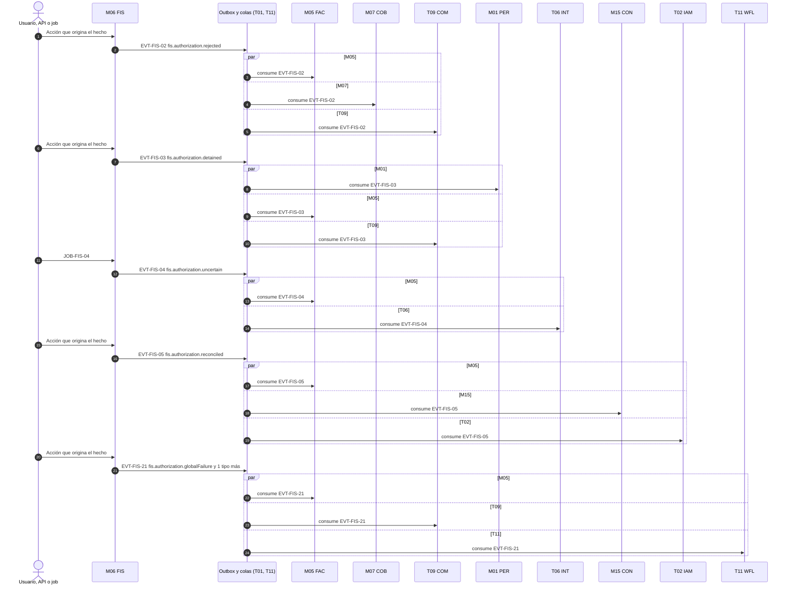

| Evento | Consumidores externos (T11 §12.3) | Efecto declarado por el consumidor (§12 de su anexo) |
|---|---|---|
| EVT-FIS-02 `fis.authorization.rejected` | M05, M07, T09 | No declarado en el §12 del consumidor |
| EVT-FIS-03 `fis.authorization.detained` | M01, M05, T09 | No declarado en el §12 del consumidor |
| EVT-FIS-04 `fis.authorization.uncertain` | M05, T06 | No declarado en el §12 del consumidor |
| EVT-FIS-05 `fis.authorization.reconciled` | M05, M15, T02 | No declarado en el §12 del consumidor |
| EVT-FIS-21 `fis.authorization.globalFailure` | M05, T09, T11 | No declarado en el §12 del consumidor |

### SEC-FIS-02 — FIS: hechos complementarios (invoice, caea, contingency, Metadatos de certificado ARCA, normativeVersion, Adopción por tenant con filas pr…)

**Agregados:** `fis.invoice.*`, `fis.caea.*`, `fis.contingency.*`, `fis.credential.*`, `fis.normativeVersion.*`, `fis.normativeAdoption.*`, `fis.registry.*`, `fis.withholding.*`. **Productor:** M06 Fiscal e impuestos (M06 §12; catálogo T11 §12.3).

**Cubre:** EVT-FIS-01 `fis.invoice.authorized`, EVT-FIS-06 `fis.caea.obtained`, EVT-FIS-07 `fis.contingency.activated`, EVT-FIS-08 `fis.credential.expiring`, EVT-FIS-09 `fis.normativeVersion.published`, EVT-FIS-10 `fis.normativeAdoption.approved`, EVT-FIS-11 `fis.registry.activated`, EVT-FIS-12 `fis.withholding.confirmed`.

Parte de estos hechos también aparece, con el detalle del caso de negocio, en A1 de `06-secuencias-y-estados.md` §3.

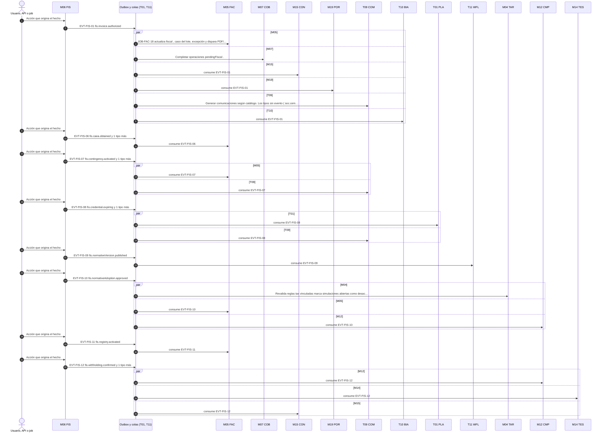

| Evento | Consumidores externos (T11 §12.3) | Efecto declarado por el consumidor (§12 de su anexo) |
|---|---|---|
| EVT-FIS-01 `fis.invoice.authorized` | M05, M07, M15, M19, T09, T10 | M05: JOB-FAC-18: actualiza `fiscal`, caso del lote, excepción y dispara PDF/distribución.; M07: Completar operaciones `pendingFiscal`.; T09: Generar comunicaciones según catálogo. Los tipos sin evento (`soc.cemeteryAct.`… |
| EVT-FIS-06 `fis.caea.obtained` | M05 | No declarado en el §12 del consumidor |
| EVT-FIS-07 `fis.contingency.activated` | M05, T09 | No declarado en el §12 del consumidor |
| EVT-FIS-08 `fis.credential.expiring` | T01, T09 | No declarado en el §12 del consumidor |
| EVT-FIS-09 `fis.normativeVersion.published` | T11 | No declarado en el §12 del consumidor |
| EVT-FIS-10 `fis.normativeAdoption.approved` | M04, M05, M12 | M04: Revalida reglas `tax` vinculadas; marca simulaciones abiertas como desactualizadas. |
| EVT-FIS-11 `fis.registry.activated` | M05 | No declarado en el §12 del consumidor |
| EVT-FIS-12 `fis.withholding.confirmed` | M12, M14, M15 | No declarado en el §12 del consumidor |

### SEC-FIS-03 — FIS: hechos complementarios (Obligaciones fiscales a pagar, Presentaciones de regímenes, Libros IVA por período, Cargos de terceros factur…)

**Agregados:** `fis.obligation.*`, `fis.filing.*`, `fis.vatLedger.*`, `fis.thirdPartyCharge.*`, `fis.remittance.*`, `fis.regulatoryReport.*`, `fis.padron.*`, `fis.taxCalculation.*`. **Productor:** M06 Fiscal e impuestos (M06 §12; catálogo T11 §12.3).

**Cubre:** EVT-FIS-13 `fis.obligation.created`, EVT-FIS-14 `fis.filing.generated`, EVT-FIS-15 `fis.vatLedger.closed`, EVT-FIS-16 `fis.thirdPartyCharge.collected`, EVT-FIS-17 `fis.remittance.approved`, EVT-FIS-18 `fis.regulatoryReport.generated`, EVT-FIS-19 `fis.padron.differenceDetected`, EVT-FIS-20 `fis.taxCalculation.blocked`.

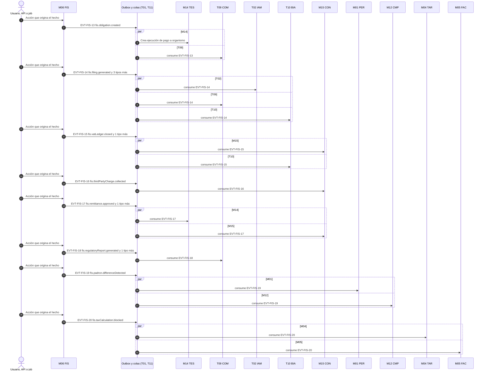

| Evento | Consumidores externos (T11 §12.3) | Efecto declarado por el consumidor (§12 de su anexo) |
|---|---|---|
| EVT-FIS-13 `fis.obligation.created` | M14, T09 | M14: Crea ejecución de pago a organismo |
| EVT-FIS-14 `fis.filing.generated` | T02, T09, T10 | No declarado en el §12 del consumidor |
| EVT-FIS-15 `fis.vatLedger.closed` | M15, T10 | No declarado en el §12 del consumidor |
| EVT-FIS-16 `fis.thirdPartyCharge.collected` | M15 | No declarado en el §12 del consumidor |
| EVT-FIS-17 `fis.remittance.approved` | M14, M15 | No declarado en el §12 del consumidor |
| EVT-FIS-18 `fis.regulatoryReport.generated` | T09 | No declarado en el §12 del consumidor |
| EVT-FIS-19 `fis.padron.differenceDetected` | M01, M12 | No declarado en el §12 del consumidor |
| EVT-FIS-20 `fis.taxCalculation.blocked` | M04, M05 | No declarado en el §12 del consumidor |

### SEC-FIS-04 — FIS: hechos complementarios (misComprobantes, withholdingComputation, Convenios de cobro por cuenta de terceros, regimeFile)

**Agregados:** `fis.misComprobantes.*`, `fis.withholdingComputation.*`, `fis.thirdPartyAgreement.*`, `fis.regimeFile.*`. **Productor:** M06 Fiscal e impuestos (M06 §12; catálogo T11 §12.3).

**Cubre:** EVT-FIS-22 `fis.misComprobantes.reconciled`, EVT-FIS-23 `fis.withholdingComputation.updated`, EVT-FIS-24 `fis.thirdPartyAgreement.published`, EVT-FIS-25 `fis.regimeFile.requested`.

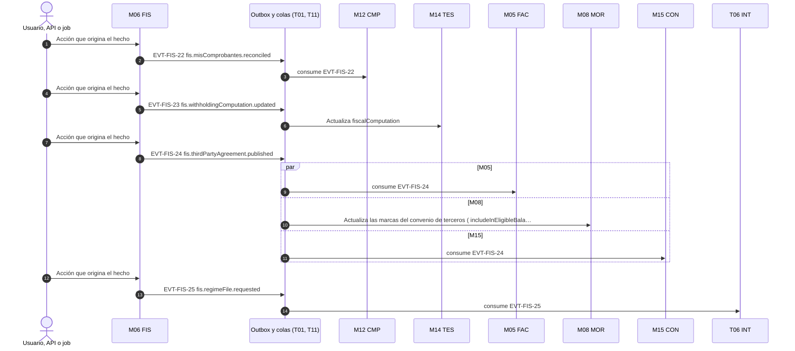

| Evento | Consumidores externos (T11 §12.3) | Efecto declarado por el consumidor (§12 de su anexo) |
|---|---|---|
| EVT-FIS-22 `fis.misComprobantes.reconciled` | M12 | No declarado en el §12 del consumidor |
| EVT-FIS-23 `fis.withholdingComputation.updated` | M14 | M14: Actualiza `fiscalComputation` |
| EVT-FIS-24 `fis.thirdPartyAgreement.published` | M05, M08, M15 | M08: Actualiza las marcas del convenio de terceros (`includeInEligibleBalance`, `surcharge`, `allowServiceCut`, `cutNormativeRef.validationStatus`): saldo elegible y recargos (RN-MOR-142) y restricción `thirdPartyDebtNo`… |
| EVT-FIS-25 `fis.regimeFile.requested` | T06 | No declarado en el §12 del consumidor |

## M07 — COB Cuenta corriente y cobranza

### SEC-COB-01 — COB: Obligaciones exigibles por bloque de servicio

**Agregados:** `cob.obligation.*`. **Productor:** M07 Cuenta corriente y cobranza (M07 §12; catálogo T11 §12.3).

**Cubre:** EVT-COB-01 `cob.obligation.registered`, EVT-COB-02 `cob.obligation.settled`, EVT-COB-03 `cob.obligation.reopened`.

**API y jobs disparadores (citados junto al evento en el anexo productor):** JOB-COB-01, JOB-COB-22.

Parte de estos hechos también aparece, con el detalle del caso de negocio, en A1 de `06-secuencias-y-estados.md` §3.

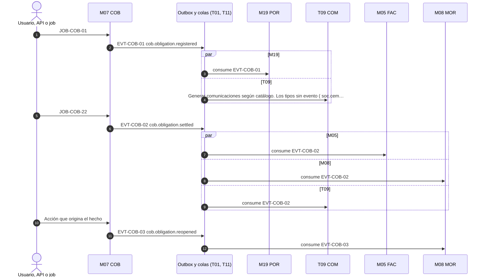

| Evento | Consumidores externos (T11 §12.3) | Efecto declarado por el consumidor (§12 de su anexo) |
|---|---|---|
| EVT-COB-01 `cob.obligation.registered` | M19, T09 | T09: Generar comunicaciones según catálogo. Los tipos sin evento (`soc.cemeteryAct.scheduled`, `soc.loan.overdue`) entran por el comando `com.communications.emit` (§9.7). |
| EVT-COB-02 `cob.obligation.settled` | M05, M08, T09 | No declarado en el §12 del consumidor |
| EVT-COB-03 `cob.obligation.reopened` | M08 | No declarado en el §12 del consumidor |

### SEC-COB-02 — COB: hechos complementarios (payment, Cobros no identificados, Imputaciones, surcharge, minimumPayment, Saldos a favor y anticipos, retent…)

**Agregados:** `cob.payment.*`, `cob.receipt.*`, `cob.allocation.*`, `cob.surcharge.*`, `cob.minimumPayment.*`, `cob.creditBalance.*`, `cob.retention.*`. **Productor:** M07 Cuenta corriente y cobranza (M07 §12; catálogo T11 §12.3).

**Cubre:** EVT-COB-04 `cob.payment.confirmed`, EVT-COB-24 `cob.payment.informed`, EVT-COB-05 `cob.receipt.voided`, EVT-COB-06 `cob.allocation.reversed`, EVT-COB-07 `cob.surcharge.deferred`, EVT-COB-08 `cob.minimumPayment.evaluated`, EVT-COB-09 `cob.creditBalance.created`, EVT-COB-10 `cob.retention.received`.

Parte de estos hechos también aparece, con el detalle del caso de negocio, en A2 de `06-secuencias-y-estados.md` §3.

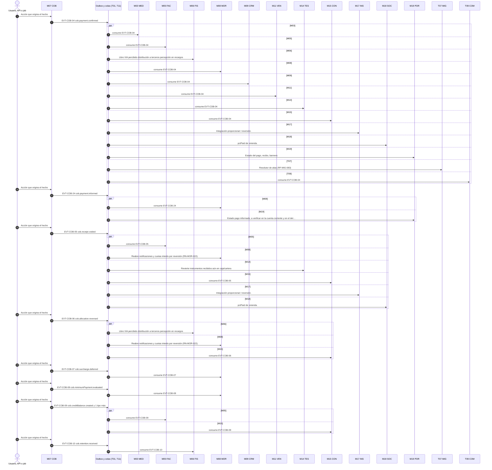

| Evento | Consumidores externos (T11 §12.3) | Efecto declarado por el consumidor (§12 de su anexo) |
|---|---|---|
| EVT-COB-04 `cob.payment.confirmed` | M03, M05, M06, M08, M09, M11, M14, M15, M17, M18, M19, T07, T09 | M06: Libro IVA percibido; distribución a terceros; percepción en recargos; M17: Integración proporcional / reversión.; M18: `pctPaid` de vivienda.; M19: Estado del pago, recibo, banners; T07: Resolutor de alias (RF-MIG-… |
| EVT-COB-24 `cob.payment.informed` | M08, M19 | M19: Estado "pago informado, a verificar" en la cuenta corriente y en el detalle de la deuda |
| EVT-COB-05 `cob.receipt.voided` | M05, M08, M14, M15, M17, M18 | M08: Reabre notificaciones y cuotas; interés por reversión (RN-MOR-022).; M14: Revierte instrumentos recibidos aún en caja/cartera; M17: Integración proporcional / reversión.; M18: `pctPaid` de vivienda. |
| EVT-COB-06 `cob.allocation.reversed` | M06, M08, M15 | M06: Libro IVA percibido; distribución a terceros; percepción en recargos; M08: Reabre notificaciones y cuotas; interés por reversión (RN-MOR-022). |
| EVT-COB-07 `cob.surcharge.deferred` | M08 | No declarado en el §12 del consumidor |
| EVT-COB-08 `cob.minimumPayment.evaluated` | M08 | No declarado en el §12 del consumidor |
| EVT-COB-09 `cob.creditBalance.created` | M05, M15 | No declarado en el §12 del consumidor |
| EVT-COB-10 `cob.retention.received` | M06 | No declarado en el §12 del consumidor |

### SEC-COB-03 — COB: hechos complementarios (Rendiciones de cobradores, Turnos de caja, Entrega de fondos de caja a tesorería, cashDifference, agencyFee,…)

**Agregados:** `cob.settlement.*`, `cob.cashSession.*`, `cob.treasuryHandover.*`, `cob.cashDifference.*`, `cob.agencyFee.*`, `cob.directDebit.*`. **Productor:** M07 Cuenta corriente y cobranza (M07 §12; catálogo T11 §12.3).

**Cubre:** EVT-COB-11 `cob.settlement.expected`, EVT-COB-12 `cob.cashSession.closed`, EVT-COB-25 `cob.cashSession.reopened`, EVT-COB-13 `cob.treasuryHandover.delivered`, EVT-COB-14 `cob.cashDifference.recorded`, EVT-COB-15 `cob.agencyFee.recorded`, EVT-COB-16 `cob.directDebit.rejected`, EVT-COB-30 `cob.directDebit.batchRequested`.

Parte de estos hechos también aparece, con el detalle del caso de negocio, en A2 de `06-secuencias-y-estados.md` §3.

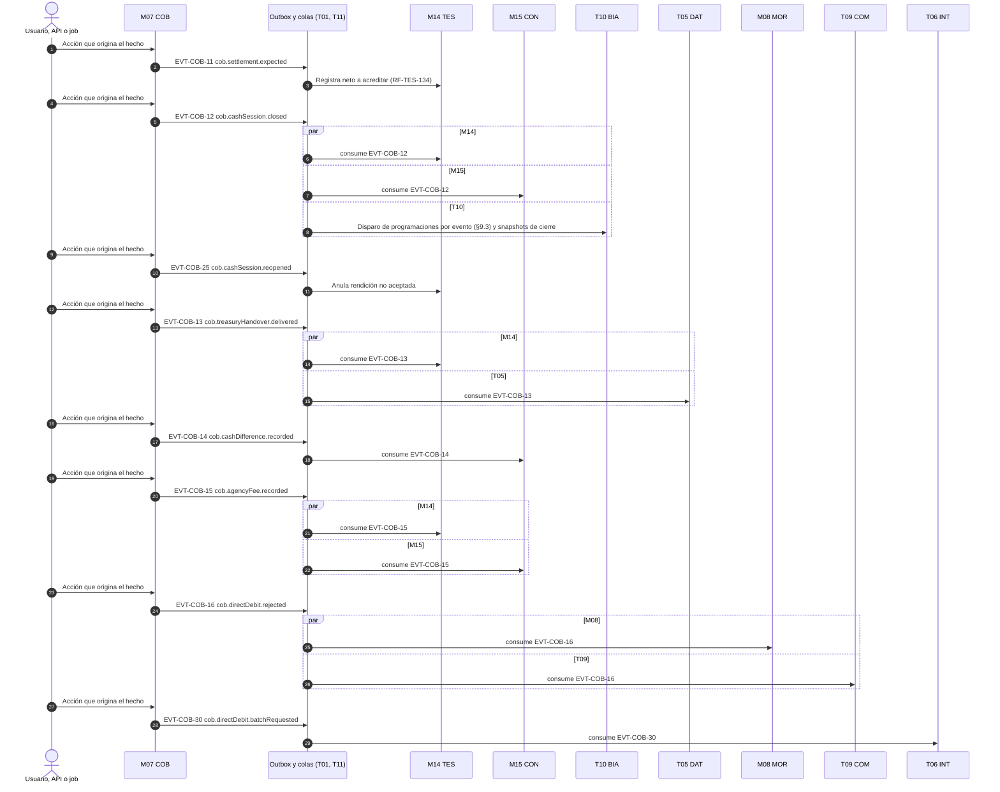

| Evento | Consumidores externos (T11 §12.3) | Efecto declarado por el consumidor (§12 de su anexo) |
|---|---|---|
| EVT-COB-11 `cob.settlement.expected` | M14 | M14: Registra neto a acreditar (RF-TES-134) |
| EVT-COB-12 `cob.cashSession.closed` | M14, M15, T10 | T10: Disparo de programaciones por evento (§9.3) y snapshots de cierre |
| EVT-COB-25 `cob.cashSession.reopened` | M14 | M14: Anula rendición no aceptada |
| EVT-COB-13 `cob.treasuryHandover.delivered` | M14, T05 | No declarado en el §12 del consumidor |
| EVT-COB-14 `cob.cashDifference.recorded` | M15 | No declarado en el §12 del consumidor |
| EVT-COB-15 `cob.agencyFee.recorded` | M14, M15 | No declarado en el §12 del consumidor |
| EVT-COB-16 `cob.directDebit.rejected` | M08, T09 | No declarado en el §12 del consumidor |
| EVT-COB-30 `cob.directDebit.batchRequested` | T06 | No declarado en el §12 del consumidor |

### SEC-COB-04 — COB: hechos complementarios (Adhesiones a débito automático, Contracargos, refund, Intenciones de pago, Cobros de terceros, Excepciones de…)

**Agregados:** `cob.directDebitMandate.*`, `cob.chargeback.*`, `cob.refund.*`, `cob.paymentIntent.*`, `cob.thirdPartyCollection.*`, `cob.exception.*`. **Productor:** M07 Cuenta corriente y cobranza (M07 §12; catálogo T11 §12.3).

**Cubre:** EVT-COB-17 `cob.directDebitMandate.changed`, EVT-COB-18 `cob.chargeback.applied`, EVT-COB-19 `cob.refund.executed`, EVT-COB-27 `cob.refund.approved`, EVT-COB-20 `cob.paymentIntent.statusChanged`, EVT-COB-28 `cob.paymentIntent.requested`, EVT-COB-21 `cob.thirdPartyCollection.recorded`, EVT-COB-22 `cob.exception.opened`.

Parte de estos hechos también aparece, con el detalle del caso de negocio, en A2 de `06-secuencias-y-estados.md` §3.

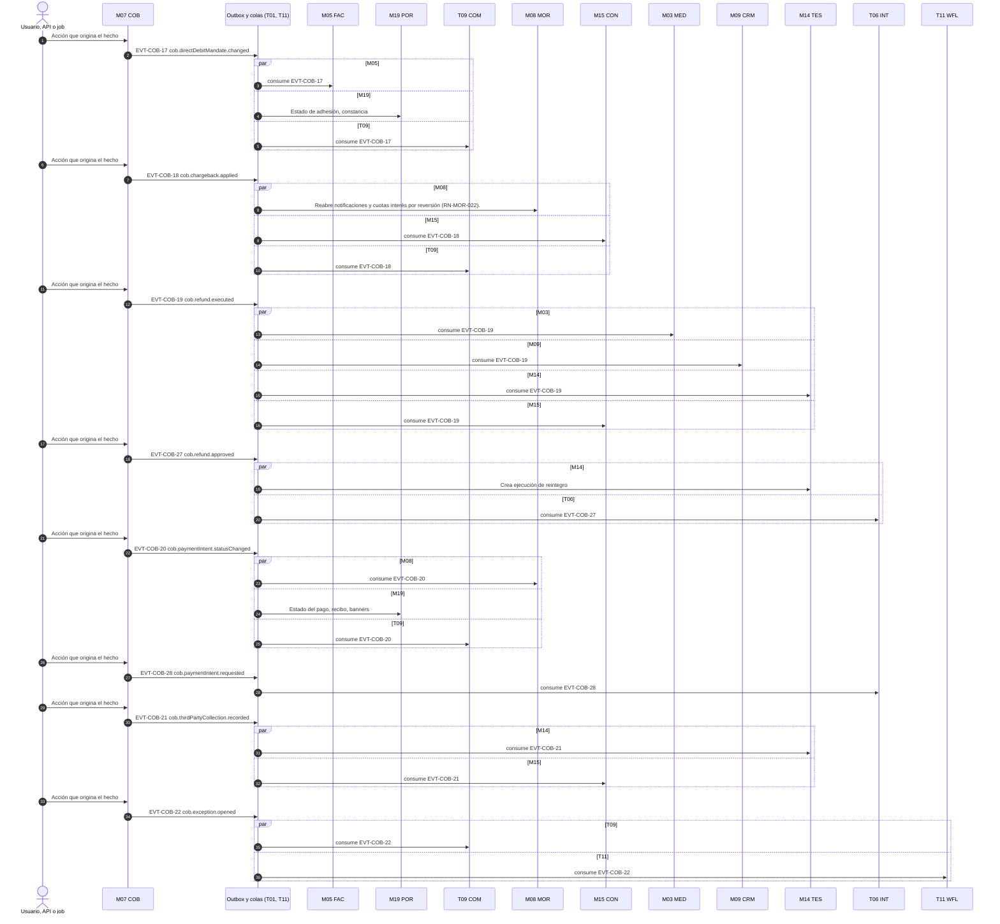

| Evento | Consumidores externos (T11 §12.3) | Efecto declarado por el consumidor (§12 de su anexo) |
|---|---|---|
| EVT-COB-17 `cob.directDebitMandate.changed` | M05, M19, T09 | M19: Estado de adhesión, constancia |
| EVT-COB-18 `cob.chargeback.applied` | M08, M15, T09 | M08: Reabre notificaciones y cuotas; interés por reversión (RN-MOR-022). |
| EVT-COB-19 `cob.refund.executed` | M03, M09, M14, M15 | No declarado en el §12 del consumidor |
| EVT-COB-27 `cob.refund.approved` | M14, T06 | M14: Crea ejecución de reintegro |
| EVT-COB-20 `cob.paymentIntent.statusChanged` | M08, M19, T09 | M19: Estado del pago, recibo, banners |
| EVT-COB-28 `cob.paymentIntent.requested` | T06 | No declarado en el §12 del consumidor |
| EVT-COB-21 `cob.thirdPartyCollection.recorded` | M14, M15 | No declarado en el §12 del consumidor |
| EVT-COB-22 `cob.exception.opened` | T09, T11 | No declarado en el §12 del consumidor |

### SEC-COB-05 — COB: hechos complementarios (otros, unidentified, debtPublication)

**Agregados:** `cob.otros.*`, `cob.unidentified.*`, `cob.debtPublication.*`. **Productor:** M07 Cuenta corriente y cobranza (M07 §12; catálogo T11 §12.3).

**Cubre:** EVT-COB-23 `cob.audit.*`, EVT-COB-26 `cob.unidentified.resolved`, EVT-COB-29 `cob.debtPublication.requested`.

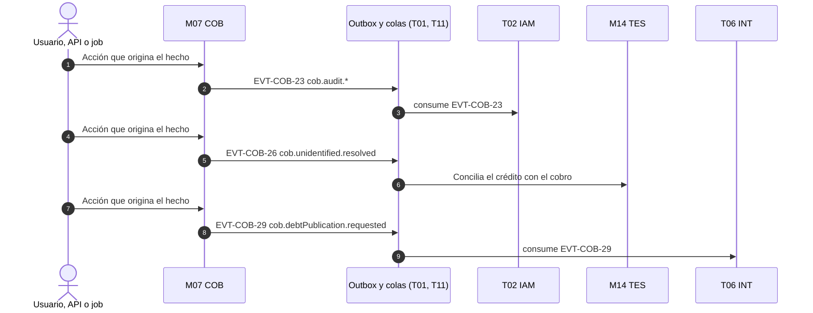

| Evento | Consumidores externos (T11 §12.3) | Efecto declarado por el consumidor (§12 de su anexo) |
|---|---|---|
| EVT-COB-23 `cob.audit.*` | T02 | No declarado en el §12 del consumidor |
| EVT-COB-26 `cob.unidentified.resolved` | M14 | M14: Concilia el crédito con el cobro |
| EVT-COB-29 `cob.debtPublication.requested` | T06 | No declarado en el §12 del consumidor |

## Cobertura de la parte Q

| Evento | Productor | Secuencia | También en |
|---|---|---|---|
| EVT-TAR-001 | M04 | SEC-TAR-01 | — |
| EVT-TAR-002 | M04 | SEC-TAR-01 | — |
| EVT-TAR-003 | M04 | SEC-TAR-01 | — |
| EVT-TAR-004 | M04 | SEC-TAR-01 | — |
| EVT-TAR-005 | M04 | SEC-TAR-01 | — |
| EVT-TAR-006 | M04 | SEC-TAR-01 | — |
| EVT-TAR-010 | M04 | SEC-TAR-02 | — |
| EVT-TAR-011 | M04 | SEC-TAR-02 | — |
| EVT-TAR-012 | M04 | SEC-TAR-02 | — |
| EVT-TAR-007 | M04 | SEC-TAR-03 | — |
| EVT-TAR-008 | M04 | SEC-TAR-03 | — |
| EVT-TAR-009 | M04 | SEC-TAR-03 | — |
| EVT-TAR-013 | M04 | SEC-TAR-03 | — |
| EVT-TAR-014 | M04 | SEC-TAR-03 | — |
| EVT-TAR-015 | M04 | SEC-TAR-03 | — |
| EVT-TAR-016 | M04 | SEC-TAR-03 | — |
| EVT-TAR-017 | M04 | SEC-TAR-03 | — |
| EVT-TAR-018 | M04 | SEC-TAR-04 | — |
| EVT-TAR-019 | M04 | SEC-TAR-04 | — |
| EVT-TAR-020 | M04 | SEC-TAR-04 | — |
| EVT-TAR-021 | M04 | SEC-TAR-04 | — |
| EVT-FAC-01 | M05 | SEC-FAC-01 | — |
| EVT-FAC-02 | M05 | SEC-FAC-01 | — |
| EVT-FAC-03 | M05 | SEC-FAC-01 | — |
| EVT-FAC-04 | M05 | SEC-FAC-01 | A1 (`06-secuencias-y-estados.md`) |
| EVT-FAC-05 | M05 | SEC-FAC-01 | A1 (`06-secuencias-y-estados.md`) |
| EVT-FAC-06 | M05 | SEC-FAC-01 | — |
| EVT-FAC-21 | M05 | SEC-FAC-01 | — |
| EVT-FAC-07 | M05 | SEC-FAC-02 | A1 (`06-secuencias-y-estados.md`) |
| EVT-FAC-08 | M05 | SEC-FAC-02 | — |
| EVT-FAC-09 | M05 | SEC-FAC-02 | — |
| EVT-FAC-12 | M05 | SEC-FAC-02 | — |
| EVT-FAC-13 | M05 | SEC-FAC-02 | — |
| EVT-FAC-14 | M05 | SEC-FAC-02 | — |
| EVT-FAC-15 | M05 | SEC-FAC-02 | — |
| EVT-FAC-10 | M05 | SEC-FAC-03 | — |
| EVT-FAC-11 | M05 | SEC-FAC-03 | — |
| EVT-FAC-16 | M05 | SEC-FAC-03 | — |
| EVT-FAC-17 | M05 | SEC-FAC-03 | — |
| EVT-FAC-18 | M05 | SEC-FAC-03 | — |
| EVT-FAC-19 | M05 | SEC-FAC-03 | — |
| EVT-FAC-20 | M05 | SEC-FAC-03 | A5 (`06-secuencias-y-estados.md`) |
| EVT-FIS-02 | M06 | SEC-FIS-01 | A1 (`06-secuencias-y-estados.md`) |
| EVT-FIS-03 | M06 | SEC-FIS-01 | A1 (`06-secuencias-y-estados.md`) |
| EVT-FIS-04 | M06 | SEC-FIS-01 | A1 (`06-secuencias-y-estados.md`) |
| EVT-FIS-05 | M06 | SEC-FIS-01 | — |
| EVT-FIS-21 | M06 | SEC-FIS-01 | — |
| EVT-FIS-01 | M06 | SEC-FIS-02 | A1 (`06-secuencias-y-estados.md`) |
| EVT-FIS-06 | M06 | SEC-FIS-02 | — |
| EVT-FIS-07 | M06 | SEC-FIS-02 | — |
| EVT-FIS-08 | M06 | SEC-FIS-02 | — |
| EVT-FIS-09 | M06 | SEC-FIS-02 | — |
| EVT-FIS-10 | M06 | SEC-FIS-02 | — |
| EVT-FIS-11 | M06 | SEC-FIS-02 | — |
| EVT-FIS-12 | M06 | SEC-FIS-02 | — |
| EVT-FIS-13 | M06 | SEC-FIS-03 | — |
| EVT-FIS-14 | M06 | SEC-FIS-03 | — |
| EVT-FIS-15 | M06 | SEC-FIS-03 | — |
| EVT-FIS-16 | M06 | SEC-FIS-03 | — |
| EVT-FIS-17 | M06 | SEC-FIS-03 | — |
| EVT-FIS-18 | M06 | SEC-FIS-03 | — |
| EVT-FIS-19 | M06 | SEC-FIS-03 | — |
| EVT-FIS-20 | M06 | SEC-FIS-03 | — |
| EVT-FIS-22 | M06 | SEC-FIS-04 | — |
| EVT-FIS-23 | M06 | SEC-FIS-04 | — |
| EVT-FIS-24 | M06 | SEC-FIS-04 | — |
| EVT-FIS-25 | M06 | SEC-FIS-04 | — |
| EVT-COB-01 | M07 | SEC-COB-01 | A1 (`06-secuencias-y-estados.md`) |
| EVT-COB-02 | M07 | SEC-COB-01 | — |
| EVT-COB-03 | M07 | SEC-COB-01 | — |
| EVT-COB-04 | M07 | SEC-COB-02 | A2 (`06-secuencias-y-estados.md`) |
| EVT-COB-24 | M07 | SEC-COB-02 | — |
| EVT-COB-05 | M07 | SEC-COB-02 | — |
| EVT-COB-06 | M07 | SEC-COB-02 | — |
| EVT-COB-07 | M07 | SEC-COB-02 | — |
| EVT-COB-08 | M07 | SEC-COB-02 | — |
| EVT-COB-09 | M07 | SEC-COB-02 | — |
| EVT-COB-10 | M07 | SEC-COB-02 | — |
| EVT-COB-11 | M07 | SEC-COB-03 | A2 (`06-secuencias-y-estados.md`) |
| EVT-COB-12 | M07 | SEC-COB-03 | — |
| EVT-COB-25 | M07 | SEC-COB-03 | — |
| EVT-COB-13 | M07 | SEC-COB-03 | — |
| EVT-COB-14 | M07 | SEC-COB-03 | — |
| EVT-COB-15 | M07 | SEC-COB-03 | — |
| EVT-COB-16 | M07 | SEC-COB-03 | — |
| EVT-COB-30 | M07 | SEC-COB-03 | — |
| EVT-COB-17 | M07 | SEC-COB-04 | — |
| EVT-COB-18 | M07 | SEC-COB-04 | — |
| EVT-COB-19 | M07 | SEC-COB-04 | — |
| EVT-COB-27 | M07 | SEC-COB-04 | — |
| EVT-COB-20 | M07 | SEC-COB-04 | A2 (`06-secuencias-y-estados.md`) |
| EVT-COB-28 | M07 | SEC-COB-04 | — |
| EVT-COB-21 | M07 | SEC-COB-04 | — |
| EVT-COB-22 | M07 | SEC-COB-04 | — |
| EVT-COB-23 | M07 | SEC-COB-05 | — |
| EVT-COB-26 | M07 | SEC-COB-05 | — |
| EVT-COB-29 | M07 | SEC-COB-05 | — |
