# GoodApps Cooperativas — Diagramas de secuencia por eventos, parte R (M08-M10)

**Entregable de análisis y diseño — Artefacto 7.3 (diagramas de secuencia), ampliación a cobertura completa**

| Campo | Valor |
|---|---|
| Documento | `06r-secuencias-eventos-m08-m10.md` |
| Índice del entregable | [`06-secuencias-y-estados.md`](06-secuencias-y-estados.md) (sección 7) y [`06a-indice-cobertura-secuencias-estados.md`](06a-indice-cobertura-secuencias-estados.md) |
| Versión | 1.0 |
| Fecha | 05-11-2026 |
| Estado | Borrador para revisión |
| Fuentes | T11 §12.2 y §12.3 (catálogo de eventos y consumidores); §12 "Eventos consumidos" y §11 de los anexos M08, M09, M10 |
| Generación | Script `_trabajo/gen06_build.py` (extrae de los anexos; revisión manual posterior) |

## 1. Cómo leer esta parte

Cada diagrama representa un flujo de negocio entre módulos construido a partir del catálogo de eventos de T11 §12.3: un agregado del productor (por ejemplo, `cat.contract.*`) con sus hechos en orden de ID, o un grupo de hechos complementarios del mismo productor cuando el agregado tiene menos de tres eventos. Todos siguen el patrón transversal de `06-secuencias-y-estados.md` §2.2 (outbox en la misma transacción, relay, inbox por consumidor, reintentos y cola de errores), que no se repite en cada diagrama.

- **U** es el origen del hecho: usuario, API o job. Se citan las API y jobs que el anexo productor nombra junto al evento.
- **BUS** es la outbox con el relay y las colas BullMQ; cada consumidor recibe su propio job.
- `par` agrupa consumidores independientes del mismo evento. El texto del mensaje es el efecto que declara el consumidor en el §12 de su anexo; "consume EVT-…" indica que el consumidor figura en T11 pero no describe el efecto. **GEN** representa consumidores genéricos de T11 ("módulo dueño del tipo", "todos").
- Debajo de cada diagrama, la tabla lista los EVT que cubre, sus consumidores externos y los efectos declarados.

## M08 — MOR Mora y financiación

### SEC-MOR-01 — MOR: Notificaciones de mora con promesa embebida

**Agregados:** `mor.notice.*`. **Productor:** M08 Mora y financiación (M08 §12; catálogo T11 §12.3).

**Cubre:** EVT-MOR-08 `mor.notice.created`, EVT-MOR-09 `mor.notice.dispatchRequested`, EVT-MOR-10 `mor.notice.evidenceMissing`.

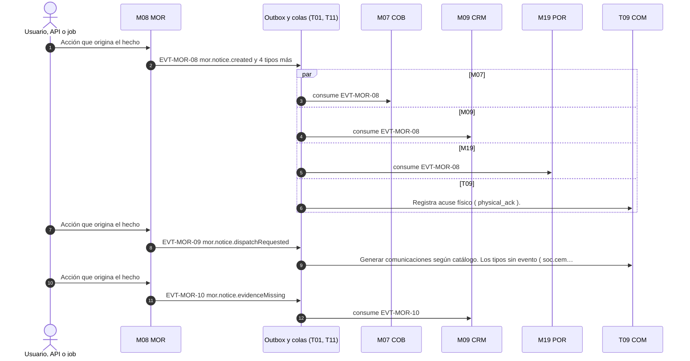

| Evento | Consumidores externos (T11 §12.3) | Efecto declarado por el consumidor (§12 de su anexo) |
|---|---|---|
| EVT-MOR-08 `mor.notice.created` | M07, M09, M19, T09 | T09: Registra acuse físico (`physical_ack`). |
| EVT-MOR-09 `mor.notice.dispatchRequested` | T09 | T09: Generar comunicaciones según catálogo. Los tipos sin evento (`soc.cemeteryAct.scheduled`, `soc.loan.overdue`) entran por el comando `com.communications.emit` (§9.7). |
| EVT-MOR-10 `mor.notice.evidenceMissing` | M09 | No declarado en el §12 del consumidor |

### SEC-MOR-02 — MOR: hechos complementarios (Políticas de interés, Intereses diferidos, interestRun, hold, Evaluaciones de mora, batch, promise)

**Agregados:** `mor.policy.*`, `mor.interest.*`, `mor.deferredInterest.*`, `mor.interestRun.*`, `mor.hold.*`, `mor.evaluation.*`, `mor.batch.*`, `mor.promise.*`. **Productor:** M08 Mora y financiación (M08 §12; catálogo T11 §12.3).

**Cubre:** EVT-MOR-01 `mor.policy.published`, EVT-MOR-02 `mor.interest.settled`, EVT-MOR-03 `mor.deferredInterest.created`, EVT-MOR-04 `mor.interestRun.completed`, EVT-MOR-05 `mor.hold.applied`, EVT-MOR-06 `mor.evaluation.closed`, EVT-MOR-07 `mor.batch.generated`, EVT-MOR-11 `mor.promise.registered`.

Parte de estos hechos también aparece, con el detalle del caso de negocio, en A2 de `06-secuencias-y-estados.md` §3.

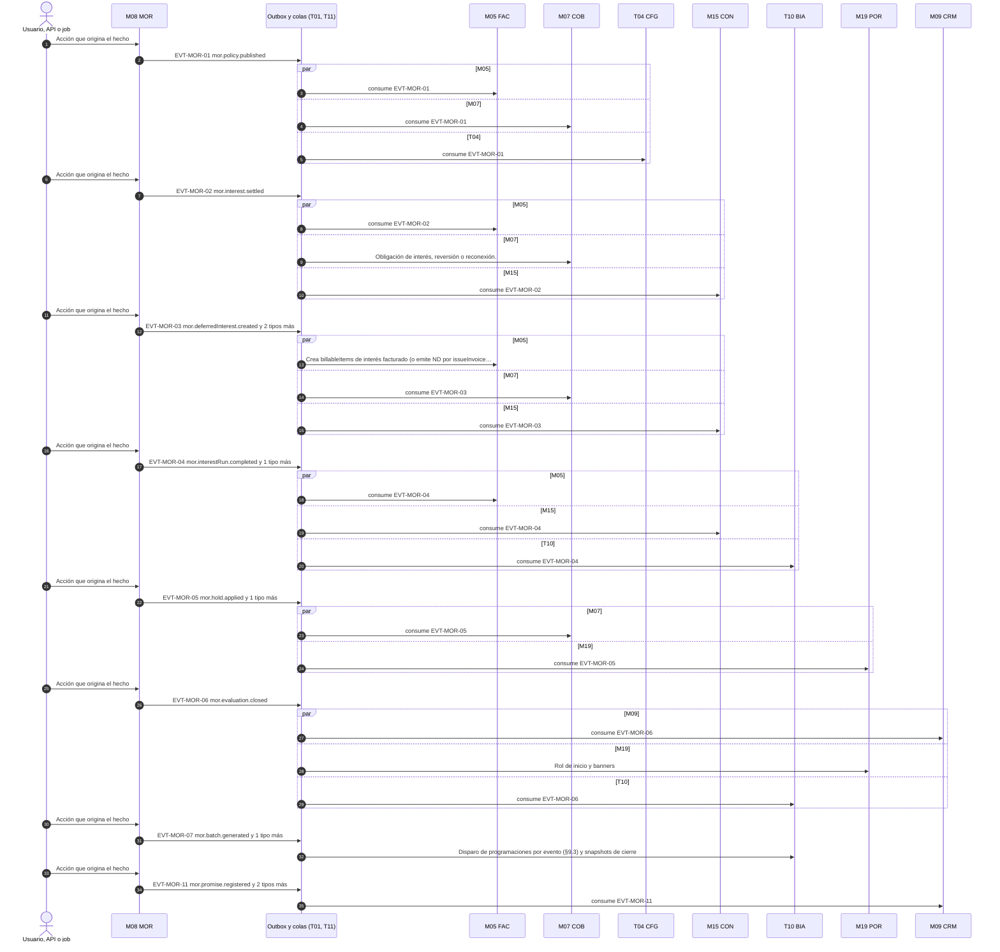

| Evento | Consumidores externos (T11 §12.3) | Efecto declarado por el consumidor (§12 de su anexo) |
|---|---|---|
| EVT-MOR-01 `mor.policy.published` | M05, M07, T04 | No declarado en el §12 del consumidor |
| EVT-MOR-02 `mor.interest.settled` | M05, M07, M15 | M07: Obligación de interés, reversión o reconexión. |
| EVT-MOR-03 `mor.deferredInterest.created` | M05, M07, M15 | M05: Crea `billableItems` de interés facturado (o emite ND por `issueInvoice`). |
| EVT-MOR-04 `mor.interestRun.completed` | M05, M15, T10 | No declarado en el §12 del consumidor |
| EVT-MOR-05 `mor.hold.applied` | M07, M19 | No declarado en el §12 del consumidor |
| EVT-MOR-06 `mor.evaluation.closed` | M09, M19, T10 | M19: Rol de inicio y banners |
| EVT-MOR-07 `mor.batch.generated` | T10 | T10: Disparo de programaciones por evento (§9.3) y snapshots de cierre |
| EVT-MOR-11 `mor.promise.registered` | M09 | No declarado en el §12 del consumidor |

### SEC-MOR-03 — MOR: hechos complementarios (interruption, Convenios con firmantes embebidos, Cuotas de convenio, Garantías y garantes, Expedientes de ges…)

**Agregados:** `mor.interruption.*`, `mor.agreement.*`, `mor.installment.*`, `mor.guarantee.*`, `mor.collectionCase.*`, `mor.writeOff.*`, `mor.prescription.*`. **Productor:** M08 Mora y financiación (M08 §12; catálogo T11 §12.3).

**Cubre:** EVT-MOR-12 `mor.interruption.requested`, EVT-MOR-13 `mor.interruption.executed`, EVT-MOR-14 `mor.agreement.created`, EVT-MOR-15 `mor.installment.due`, EVT-MOR-16 `mor.guarantee.executed`, EVT-MOR-17 `mor.collectionCase.opened`, EVT-MOR-18 `mor.writeOff.approved`, EVT-MOR-19 `mor.prescription.executed`.

**API y jobs disparadores (citados junto al evento en el anexo productor):** JOB-MOR-07.

Parte de estos hechos también aparece, con el detalle del caso de negocio, en A4 de `06-secuencias-y-estados.md` §3.

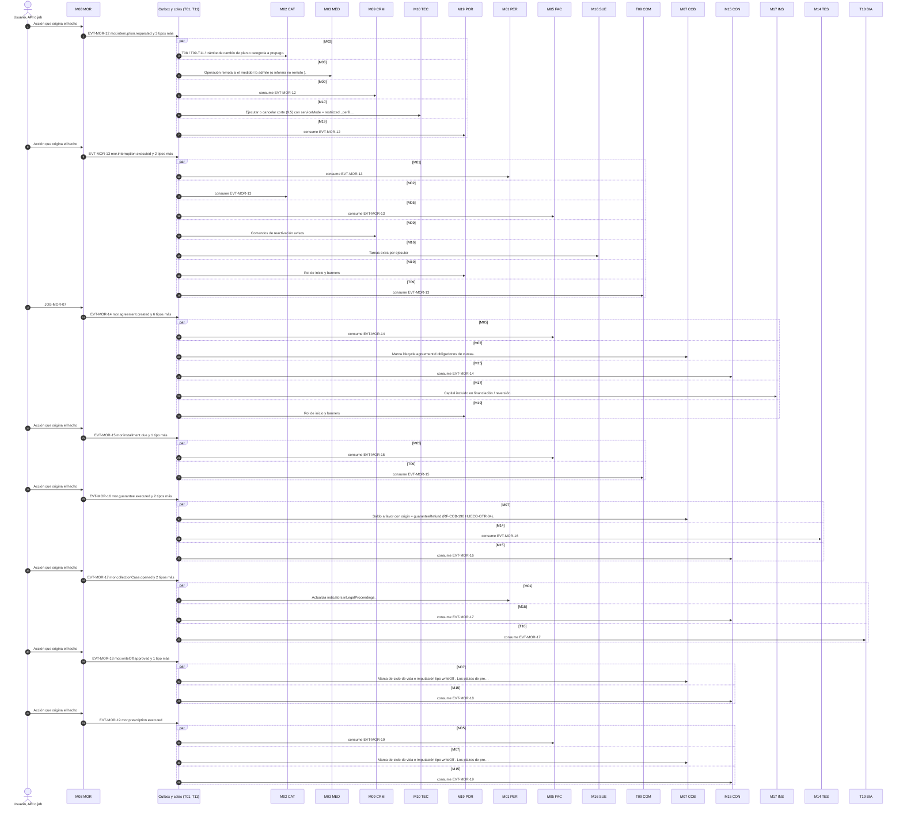

| Evento | Consumidores externos (T11 §12.3) | Efecto declarado por el consumidor (§12 de su anexo) |
|---|---|---|
| EVT-MOR-12 `mor.interruption.requested` | M02, M03, M09, M10, M19 | M02: T08 / T09-T11 / trámite de cambio de plan o categoría a prepago.; M03: Operación remota si el medidor lo admite (o informa "no remoto").; M10: Ejecutar o cancelar corte (9.5); con `serviceMode = restricted`, perfil… |
| EVT-MOR-13 `mor.interruption.executed` | M01, M02, M05, M09, M16, M19, T09 | M09: Comandos de reactivación; avisos; M16: Tareas extra por ejecutor; M19: Rol de inicio y banners |
| EVT-MOR-14 `mor.agreement.created` | M05, M07, M15, M17, M19 | M07: Marca `lifecycle.agreementId`; obligaciones de cuotas.; M17: Capital incluido en financiación / reversión.; M19: Rol de inicio y banners |
| EVT-MOR-15 `mor.installment.due` | M05, T09 | No declarado en el §12 del consumidor |
| EVT-MOR-16 `mor.guarantee.executed` | M07, M14, M15 | M07: Saldo a favor con `origin = guaranteeRefund` (RF-COB-190; HUECO-OTR-04). |
| EVT-MOR-17 `mor.collectionCase.opened` | M01, M15, T10 | M01: Actualiza `indicators.inLegalProceedings`. |
| EVT-MOR-18 `mor.writeOff.approved` | M07, M15 | M07: Marca de ciclo de vida e imputación tipo `writeOff`. Los plazos de prescripción (24 meses para facturas periódicas, 60 para el resto, con validación legal) los define M08 en `prescriptionRules` (DEC-052); M07 no ca… |
| EVT-MOR-19 `mor.prescription.executed` | M05, M07, M15 | M07: Marca de ciclo de vida e imputación tipo `writeOff`. Los plazos de prescripción (24 meses para facturas periódicas, 60 para el resto, con validación legal) los define M08 en `prescriptionRules` (DEC-052); M07 no ca… |

### SEC-MOR-04 — MOR: hechos complementarios (Protecciones normativas acreditadas, socialCoverage)

**Agregados:** `mor.protection.*`, `mor.socialCoverage.*`. **Productor:** M08 Mora y financiación (M08 §12; catálogo T11 §12.3).

**Cubre:** EVT-MOR-20 `mor.protection.expiring`, EVT-MOR-21 `mor.socialCoverage.suspended`.

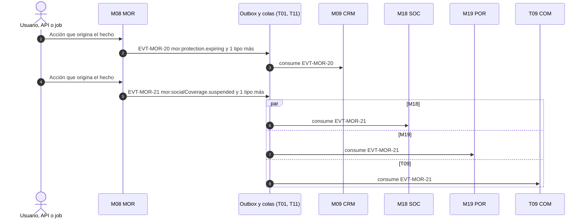

| Evento | Consumidores externos (T11 §12.3) | Efecto declarado por el consumidor (§12 de su anexo) |
|---|---|---|
| EVT-MOR-20 `mor.protection.expiring` | M09 | No declarado en el §12 del consumidor |
| EVT-MOR-21 `mor.socialCoverage.suspended` | M18, M19, T09 | No declarado en el §12 del consumidor |

## M09 — CRM Atención (CRM)

### SEC-CRM-01 — CRM: case (parte 1 de 2)

**Agregados:** `crm.case.*`. **Productor:** M09 Atención (CRM) (M09 §12; catálogo T11 §12.3).

**Cubre:** EVT-CRM-01 `crm.case.created`, EVT-CRM-02 `crm.case.classified`, EVT-CRM-03 `crm.case.derived`, EVT-CRM-04 `crm.case.assigned`, EVT-CRM-05 `crm.case.statusChanged`, EVT-CRM-06 `crm.case.slaWarning`, EVT-CRM-07 `crm.case.slaBreached`, EVT-CRM-08 `crm.case.resolved`, EVT-CRM-09 `crm.case.closed`, EVT-CRM-10 `crm.case.reopened`.

**API y jobs disparadores (citados junto al evento en el anexo productor):** JOB-CRM-01.

Parte de estos hechos también aparece, con el detalle del caso de negocio, en A5 de `06-secuencias-y-estados.md` §3.

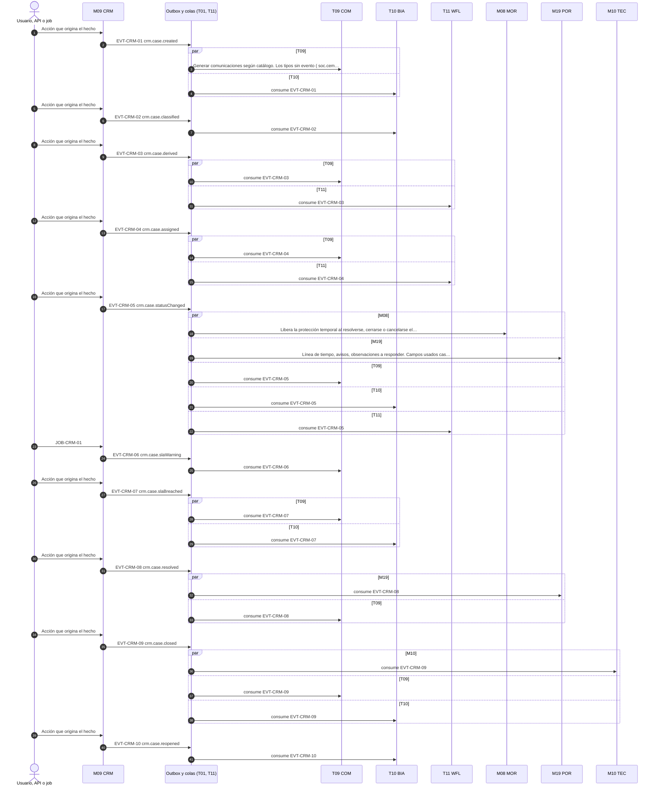

| Evento | Consumidores externos (T11 §12.3) | Efecto declarado por el consumidor (§12 de su anexo) |
|---|---|---|
| EVT-CRM-01 `crm.case.created` | T09, T10 | T09: Generar comunicaciones según catálogo. Los tipos sin evento (`soc.cemeteryAct.scheduled`, `soc.loan.overdue`) entran por el comando `com.communications.emit` (§9.7). |
| EVT-CRM-02 `crm.case.classified` | T10 | No declarado en el §12 del consumidor |
| EVT-CRM-03 `crm.case.derived` | T09, T11 | No declarado en el §12 del consumidor |
| EVT-CRM-04 `crm.case.assigned` | T09, T11 | No declarado en el §12 del consumidor |
| EVT-CRM-05 `crm.case.statusChanged` | M08, M19, T09, T10, T11 | M08: Libera la protección temporal al resolverse, cerrarse o cancelarse el reclamo.; M19: Línea de tiempo, avisos, observaciones a responder. Campos usados: `caseId`, `from`, `to`, `publicStatusKey` (EVT-CRM-05); `caseI`… |
| EVT-CRM-06 `crm.case.slaWarning` | T09 | No declarado en el §12 del consumidor |
| EVT-CRM-07 `crm.case.slaBreached` | T09, T10 | No declarado en el §12 del consumidor |
| EVT-CRM-08 `crm.case.resolved` | M19, T09 | No declarado en el §12 del consumidor |
| EVT-CRM-09 `crm.case.closed` | M10, T09, T10 | No declarado en el §12 del consumidor |
| EVT-CRM-10 `crm.case.reopened` | T10 | No declarado en el §12 del consumidor |

### SEC-CRM-02 — CRM: case (parte 2 de 2)

**Agregados:** `crm.case.*`. **Productor:** M09 Atención (CRM) (M09 §12; catálogo T11 §12.3).

**Cubre:** EVT-CRM-11 `crm.case.cancelled`, EVT-CRM-12 `crm.case.merged`.

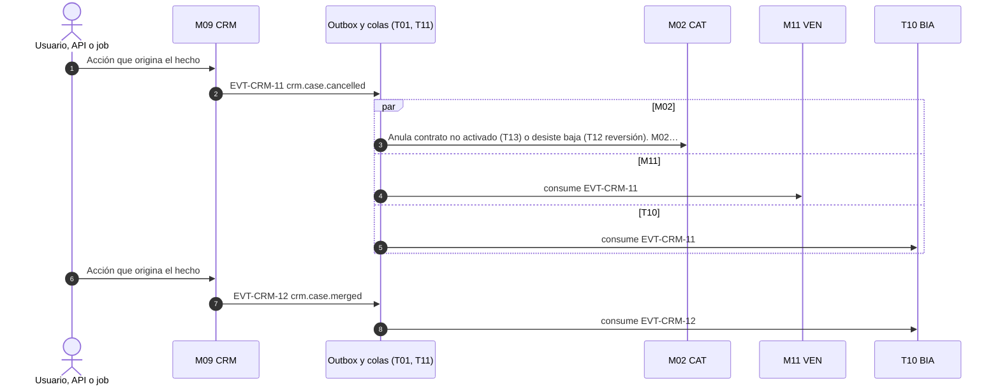

| Evento | Consumidores externos (T11 §12.3) | Efecto declarado por el consumidor (§12 de su anexo) |
|---|---|---|
| EVT-CRM-11 `crm.case.cancelled` | M02, M11, T10 | M02: Anula contrato no activado (T13) o desiste baja (T12 reversión). M02 lo consume aunque T11 no lo lista como consumidor (se informa a T11, 05-11-2026). |
| EVT-CRM-12 `crm.case.merged` | T10 | No declarado en el §12 del consumidor |

### SEC-CRM-03 — CRM: hechos complementarios (Comandos a módulos dueños, cancellationRequest, Incidentes comunes por zona, Mensajes y notas, Hilos por cana…)

**Agregados:** `crm.commandRequest.*`, `crm.cancellationRequest.*`, `crm.incident.*`, `crm.message.*`, `crm.conversation.*`, `crm.aiSuggestion.*`, `crm.queueTicket.*`. **Productor:** M09 Atención (CRM) (M09 §12; catálogo T11 §12.3).

**Cubre:** EVT-CRM-13 `crm.commandRequest.requested`, EVT-CRM-14 `crm.cancellationRequest.received`, EVT-CRM-15 `crm.cancellationRequest.receiptDelivered`, EVT-CRM-16 `crm.incident.confirmed`, EVT-CRM-17 `crm.message.received`, EVT-CRM-18 `crm.conversation.handedOff`, EVT-CRM-19 `crm.aiSuggestion.recorded`, EVT-CRM-20 `crm.queueTicket.issued`.

Parte de estos hechos también aparece, con el detalle del caso de negocio, en A5 de `06-secuencias-y-estados.md` §3.

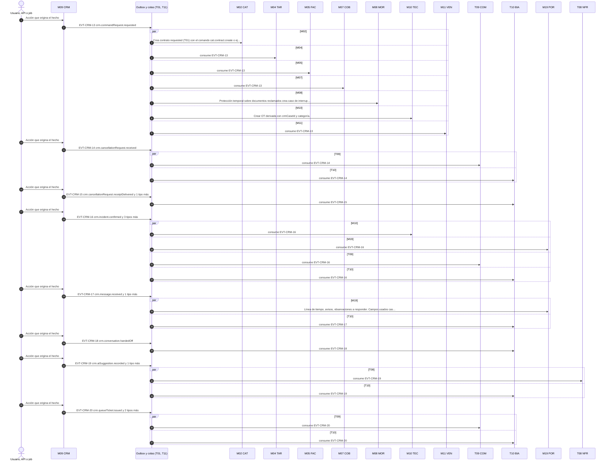

| Evento | Consumidores externos (T11 §12.3) | Efecto declarado por el consumidor (§12 de su anexo) |
|---|---|---|
| EVT-CRM-13 `crm.commandRequest.requested` | M02, M04, M05, M07, M08, M10, M11 | M02: Crea contrato `requested` (T01) con el comando `cat.contract.create` o ejecuta el comando pedido (baja, suspensión, cambio). Si no puede ejecutarlo publica EVT-CAT-27 `cat.command.rejected`.; M08: Protección tempor… |
| EVT-CRM-14 `crm.cancellationRequest.received` | T09, T10 | No declarado en el §12 del consumidor |
| EVT-CRM-15 `crm.cancellationRequest.receiptDelivered` | T10 | No declarado en el §12 del consumidor |
| EVT-CRM-16 `crm.incident.confirmed` | M10, M19, T09, T10 | No declarado en el §12 del consumidor |
| EVT-CRM-17 `crm.message.received` | M19, T10 | M19: Línea de tiempo, avisos, observaciones a responder. Campos usados: `caseId`, `from`, `to`, `publicStatusKey` (EVT-CRM-05); `caseId`, `resolutionCode` (EVT-CRM-08); `messageId`, `conversationId`, `channel` (EVT-CRM-… |
| EVT-CRM-18 `crm.conversation.handedOff` | T10 | No declarado en el §12 del consumidor |
| EVT-CRM-19 `crm.aiSuggestion.recorded` | T08, T10 | No declarado en el §12 del consumidor |
| EVT-CRM-20 `crm.queueTicket.issued` | T09, T10 | No declarado en el §12 del consumidor |

### SEC-CRM-04 — CRM: hechos complementarios (Ocurrencias de actividades, deskEntry, Trámites presentados, Corridas de circulares, survey)

**Agregados:** `crm.activityOccurrence.*`, `crm.deskEntry.*`, `crm.procedureRecord.*`, `crm.circularRun.*`, `crm.survey.*`. **Productor:** M09 Atención (CRM) (M09 §12; catálogo T11 §12.3).

**Cubre:** EVT-CRM-21 `crm.activityOccurrence.generated`, EVT-CRM-22 `crm.deskEntry.registered`, EVT-CRM-23 `crm.procedureRecord.expired`, EVT-CRM-24 `crm.circularRun.generated`, EVT-CRM-25 `crm.survey.negativeReceived`.

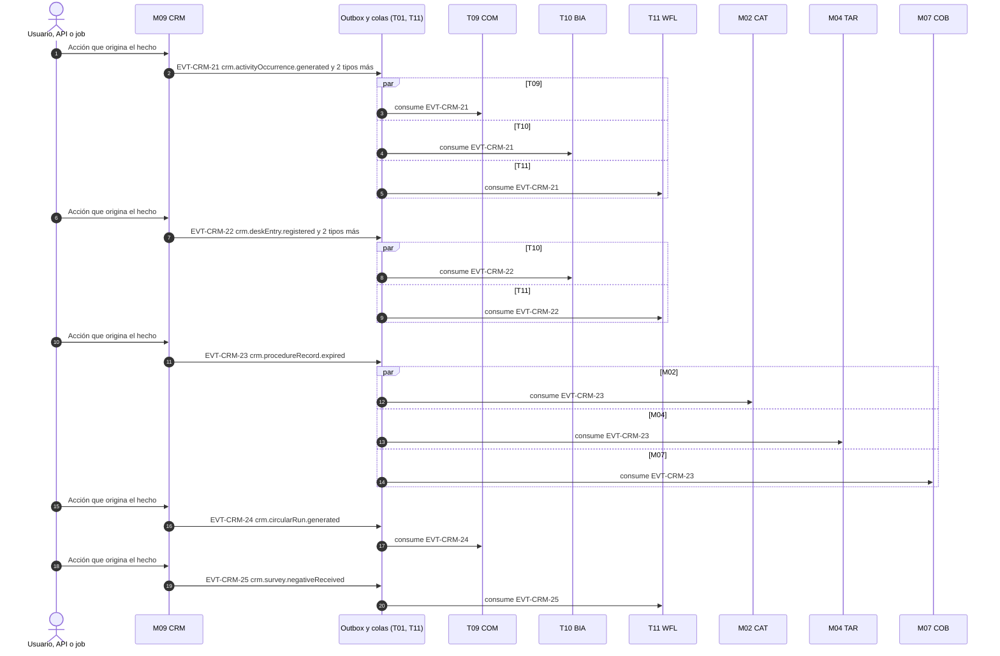

| Evento | Consumidores externos (T11 §12.3) | Efecto declarado por el consumidor (§12 de su anexo) |
|---|---|---|
| EVT-CRM-21 `crm.activityOccurrence.generated` | T09, T10, T11 | No declarado en el §12 del consumidor |
| EVT-CRM-22 `crm.deskEntry.registered` | T10, T11 | No declarado en el §12 del consumidor |
| EVT-CRM-23 `crm.procedureRecord.expired` | M02, M04, M07 | No declarado en el §12 del consumidor |
| EVT-CRM-24 `crm.circularRun.generated` | T09 | No declarado en el §12 del consumidor |
| EVT-CRM-25 `crm.survey.negativeReceived` | T11 | No declarado en el §12 del consumidor |

## M10 — TEC Técnica, campo y redes

### SEC-TEC-01 — TEC: feasibility

**Agregados:** `tec.feasibility.*`. **Productor:** M10 Técnica, campo y redes (M10 §12; catálogo T11 §12.3).

**Cubre:** EVT-TEC-01 `tec.feasibility.requested`, EVT-TEC-02 `tec.feasibility.verdictIssued`, EVT-TEC-03 `tec.feasibility.cancelled`.

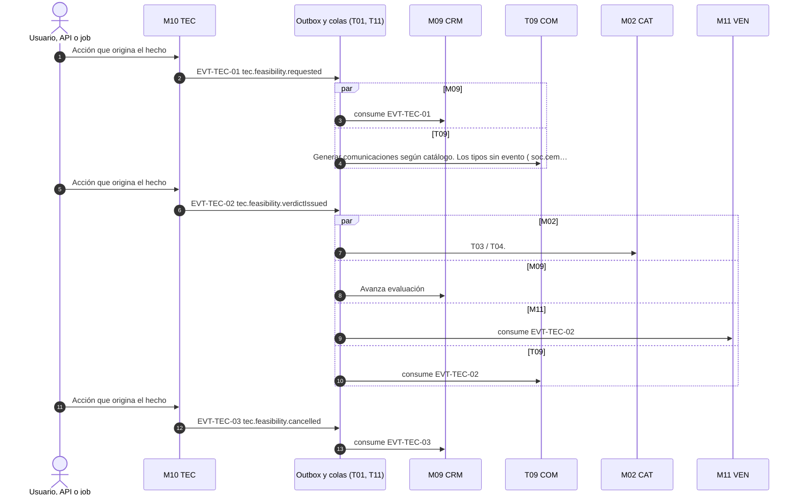

| Evento | Consumidores externos (T11 §12.3) | Efecto declarado por el consumidor (§12 de su anexo) |
|---|---|---|
| EVT-TEC-01 `tec.feasibility.requested` | M09, T09 | T09: Generar comunicaciones según catálogo. Los tipos sin evento (`soc.cemeteryAct.scheduled`, `soc.loan.overdue`) entran por el comando `com.communications.emit` (§9.7). |
| EVT-TEC-02 `tec.feasibility.verdictIssued` | M02, M09, M11, T09 | M02: T03 / T04.; M09: Avanza evaluación |
| EVT-TEC-03 `tec.feasibility.cancelled` | M09 | No declarado en el §12 del consumidor |

### SEC-TEC-02 — TEC: Órdenes de trabajo

**Agregados:** `tec.workOrder.*`. **Productor:** M10 Técnica, campo y redes (M10 §12; catálogo T11 §12.3).

**Cubre:** EVT-TEC-04 `tec.workOrder.created`, EVT-TEC-05 `tec.workOrder.statusChanged`, EVT-TEC-06 `tec.workOrder.executed`, EVT-TEC-07 `tec.workOrder.closed`, EVT-TEC-08 `tec.workOrder.cancelled`, EVT-TEC-09 `tec.workOrder.reopened`.

Parte de estos hechos también aparece, con el detalle del caso de negocio, en A4, A5 de `06-secuencias-y-estados.md` §3.

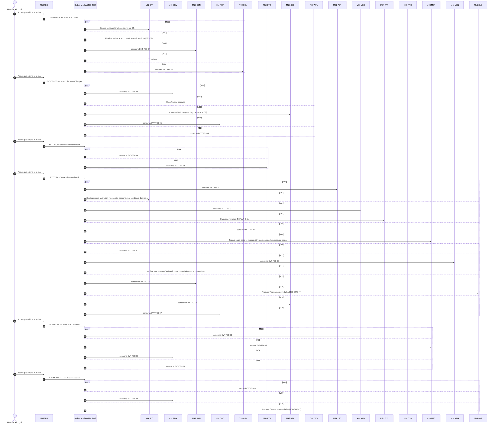

| Evento | Consumidores externos (T11 §12.3) | Efecto declarado por el consumidor (§12 de su anexo) |
|---|---|---|
| EVT-TEC-04 `tec.workOrder.created` | M02, M09, M15, M19, T09 | M02: Dispara reglas automáticas de evento OT.; M09: Timeline, avisos al socio, conformidad, conflicto (ESC-03); M19: OT visibles |
| EVT-TEC-05 `tec.workOrder.statusChanged` | M09, M13, M18, M19, T11 | M13: Crear/ajustar reservas.; M18: Usos de vehículo (asignación y cierre de la OT). |
| EVT-TEC-06 `tec.workOrder.executed` | M09, M13 | No declarado en el §12 del consumidor |
| EVT-TEC-07 `tec.workOrder.closed` | M01, M02, M03, M04, M05, M08, M09, M11, M13, M15, M16, M18, M19 | M02: Según `purpose`: activación, reconexión, desconexión, cambio de domicilio, cambio de categoría diferido.; M04: Categoría histórica (RN-TAR-045).; M08: Transición del caso de interrupción. `tec.disconnection.execute`… |
| EVT-TEC-08 `tec.workOrder.cancelled` | M03, M08, M09, M13 | No declarado en el §12 del consumidor |
| EVT-TEC-09 `tec.workOrder.reopened` | M05, M09, M16 | M16: Proponer / actualizar novedades (JOB-SUE-07) |

### SEC-TEC-03 — TEC: hechos complementarios (charge, Materiales y necesidades, equipment, Visitas, Conformidad y firma, installation, survey)

**Agregados:** `tec.charge.*`, `tec.material.*`, `tec.equipment.*`, `tec.visit.*`, `tec.conformity.*`, `tec.installation.*`, `tec.survey.*`. **Productor:** M10 Técnica, campo y redes (M10 §12; catálogo T11 §12.3).

**Cubre:** EVT-TEC-10 `tec.charge.proposed`, EVT-TEC-11 `tec.material.requested`, EVT-TEC-12 `tec.equipment.installed`, EVT-TEC-13 `tec.visit.statusChanged`, EVT-TEC-14 `tec.visit.failed`, EVT-TEC-15 `tec.conformity.signed`, EVT-TEC-16 `tec.installation.activationConfirmed`, EVT-TEC-17 `tec.survey.requested`.

**API y jobs disparadores (citados junto al evento en el anexo productor):** JOB-TEC-08, API-TEC-40.

Parte de estos hechos también aparece, con el detalle del caso de negocio, en A5 de `06-secuencias-y-estados.md` §3.

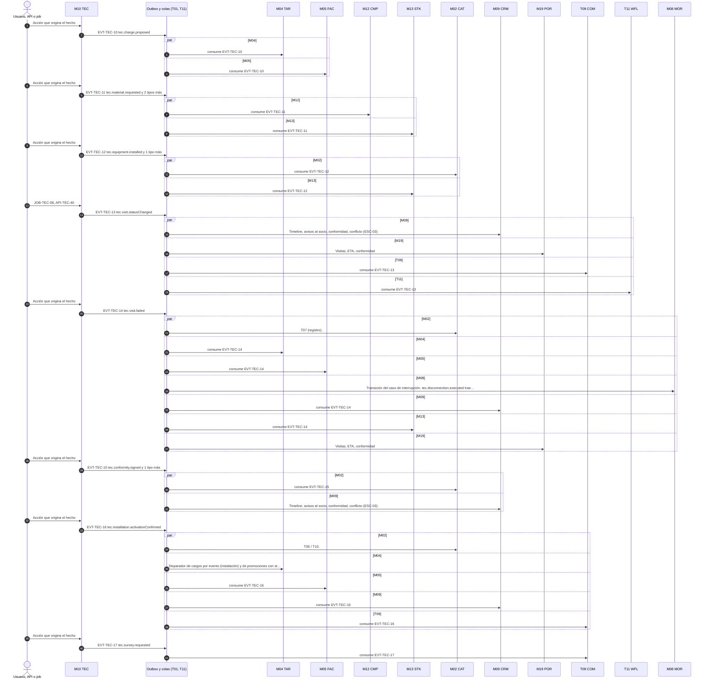

| Evento | Consumidores externos (T11 §12.3) | Efecto declarado por el consumidor (§12 de su anexo) |
|---|---|---|
| EVT-TEC-10 `tec.charge.proposed` | M04, M05 | No declarado en el §12 del consumidor |
| EVT-TEC-11 `tec.material.requested` | M12, M13 | No declarado en el §12 del consumidor |
| EVT-TEC-12 `tec.equipment.installed` | M02, M13 | No declarado en el §12 del consumidor |
| EVT-TEC-13 `tec.visit.statusChanged` | M09, M19, T09, T11 | M09: Timeline, avisos al socio, conformidad, conflicto (ESC-03); M19: Visitas, ETA, conformidad |
| EVT-TEC-14 `tec.visit.failed` | M02, M04, M05, M08, M09, M13, M19 | M02: T07 (registro).; M08: Transición del caso de interrupción. `tec.disconnection.executed` trae `mode` (`restricted`/`interrupted`): M08 lo compara con el `serviceMode` del caso; si difiere, registra la diferencia en… |
| EVT-TEC-15 `tec.conformity.signed` | M02, M09 | M09: Timeline, avisos al socio, conformidad, conflicto (ESC-03) |
| EVT-TEC-16 `tec.installation.activationConfirmed` | M02, M04, M05, M09, T09 | M02: T06 / T10.; M04: Disparador de cargos por evento (instalación) y de promociones con `startTrigger = installation`. |
| EVT-TEC-17 `tec.survey.requested` | T09 | No declarado en el §12 del consumidor |

### SEC-TEC-04 — TEC: hechos complementarios (disconnection, reconnection, dependentDisconnection, provisioning, meter, outage, Equipos de red)

**Agregados:** `tec.disconnection.*`, `tec.reconnection.*`, `tec.dependentDisconnection.*`, `tec.provisioning.*`, `tec.meter.*`, `tec.outage.*`, `tec.networkDevice.*`. **Productor:** M10 Técnica, campo y redes (M10 §12; catálogo T11 §12.3).

**Cubre:** EVT-TEC-18 `tec.disconnection.executed`, EVT-TEC-19 `tec.reconnection.executed`, EVT-TEC-20 `tec.dependentDisconnection.requested`, EVT-TEC-21 `tec.provisioning.confirmed`, EVT-TEC-33 `tec.provisioning.requested`, EVT-TEC-22 `tec.meter.changed`, EVT-TEC-23 `tec.outage.notified`, EVT-TEC-24 `tec.networkDevice.down`.

Parte de estos hechos también aparece, con el detalle del caso de negocio, en A4 de `06-secuencias-y-estados.md` §3.

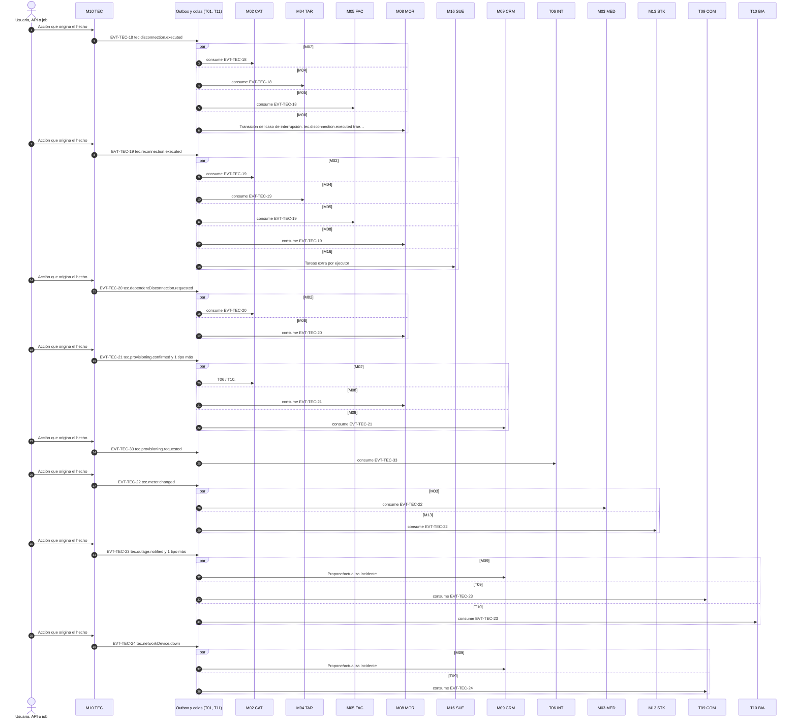

| Evento | Consumidores externos (T11 §12.3) | Efecto declarado por el consumidor (§12 de su anexo) |
|---|---|---|
| EVT-TEC-18 `tec.disconnection.executed` | M02, M04, M05, M08 | M08: Transición del caso de interrupción. `tec.disconnection.executed` trae `mode` (`restricted`/`interrupted`): M08 lo compara con el `serviceMode` del caso; si difiere, registra la diferencia en el caso y aplica los c… |
| EVT-TEC-19 `tec.reconnection.executed` | M02, M04, M05, M08, M16 | M16: Tareas extra por ejecutor |
| EVT-TEC-20 `tec.dependentDisconnection.requested` | M02, M08 | No declarado en el §12 del consumidor |
| EVT-TEC-21 `tec.provisioning.confirmed` | M02, M08, M09 | M02: T06 / T10. |
| EVT-TEC-33 `tec.provisioning.requested` | T06 | No declarado en el §12 del consumidor |
| EVT-TEC-22 `tec.meter.changed` | M03, M13 | No declarado en el §12 del consumidor |
| EVT-TEC-23 `tec.outage.notified` | M09, T09, T10 | M09: Propone/actualiza incidente |
| EVT-TEC-24 `tec.networkDevice.down` | M09, T09 | M09: Propone/actualiza incidente |

### SEC-TEC-05 — TEC: hechos complementarios (levy, inspection, cdr, mobileUsage, Conflictos de sincronización, geo, Líneas, crewTimesheet)

**Agregados:** `tec.levy.*`, `tec.inspection.*`, `tec.cdr.*`, `tec.mobileUsage.*`, `tec.syncConflict.*`, `tec.geo.*`, `tec.phoneLine.*`, `tec.crewTimesheet.*`. **Productor:** M10 Técnica, campo y redes (M10 §12; catálogo T11 §12.3).

**Cubre:** EVT-TEC-25 `tec.levy.approved`, EVT-TEC-26 `tec.inspection.recoveryApproved`, EVT-TEC-27 `tec.cdr.attributed`, EVT-TEC-28 `tec.mobileUsage.imported`, EVT-TEC-29 `tec.syncConflict.opened`, EVT-TEC-30 `tec.geo.pointUpdated`, EVT-TEC-31 `tec.phoneLine.changed`, EVT-TEC-32 `tec.crewTimesheet.approved`.

**API y jobs disparadores (citados junto al evento en el anexo productor):** JOB-TEC-09.

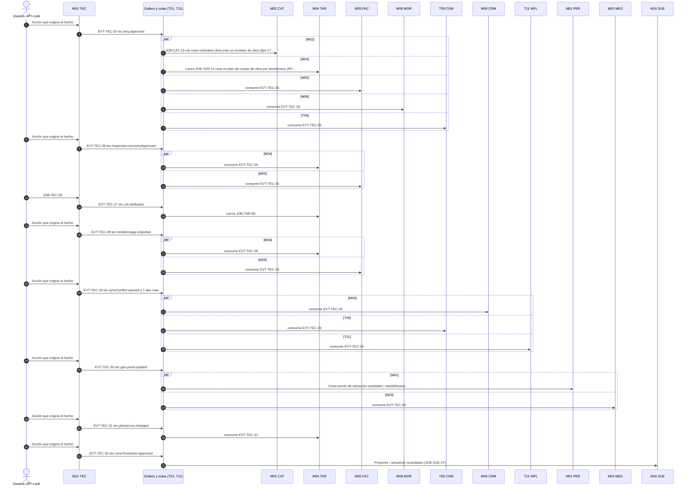

| Evento | Consumidores externos (T11 §12.3) | Efecto declarado por el consumidor (§12 de su anexo) |
|---|---|---|
| EVT-TEC-25 `tec.levy.approved` | M02, M04, M05, M08, T09 | M02: JOB-CAT-13 `cat:crear-contratos-obra`: crea un contrato de obra (tipo 17) por beneficiario con API-CAT-33, idempotente por obra + inmueble (RF-CAT-115, HUECO-OBR-01).; M04: Lanza JOB-TAR-14: crea un plan de cuotas… |
| EVT-TEC-26 `tec.inspection.recoveryApproved` | M04, M05 | No declarado en el §12 del consumidor |
| EVT-TEC-27 `tec.cdr.attributed` | M04 | M04: Lanza JOB-TAR-09. |
| EVT-TEC-28 `tec.mobileUsage.imported` | M04, M05 | No declarado en el §12 del consumidor |
| EVT-TEC-29 `tec.syncConflict.opened` | M09, T09, T11 | No declarado en el §12 del consumidor |
| EVT-TEC-30 `tec.geo.pointUpdated` | M01, M03 | M01: Crea evento de ubicación `candidate`/`needsReview`. |
| EVT-TEC-31 `tec.phoneLine.changed` | M04 | No declarado en el §12 del consumidor |
| EVT-TEC-32 `tec.crewTimesheet.approved` | M16 | M16: Proponer / actualizar novedades (JOB-SUE-07) |

### SEC-TEC-06 — TEC: hechos complementarios (Obras y contribución por mejoras, emergency, onCall, Muestras, cadena de custodia, resultados por parámetro y…)

**Agregados:** `tec.work.*`, `tec.emergency.*`, `tec.onCall.*`, `tec.waterSample.*`, `tec.quotaUsage.*`. **Productor:** M10 Técnica, campo y redes (M10 §12; catálogo T11 §12.3).

**Cubre:** EVT-TEC-34 `tec.work.completed`, EVT-TEC-35 `tec.emergency.declared`, EVT-TEC-36 `tec.onCall.escalated`, EVT-TEC-37 `tec.waterSample.outOfLimit`, EVT-TEC-38 `tec.quotaUsage.reported`.

**API y jobs disparadores (citados junto al evento en el anexo productor):** API-TEC-51, JOB-TEC-17, API-TEC-54, API-TEC-56.

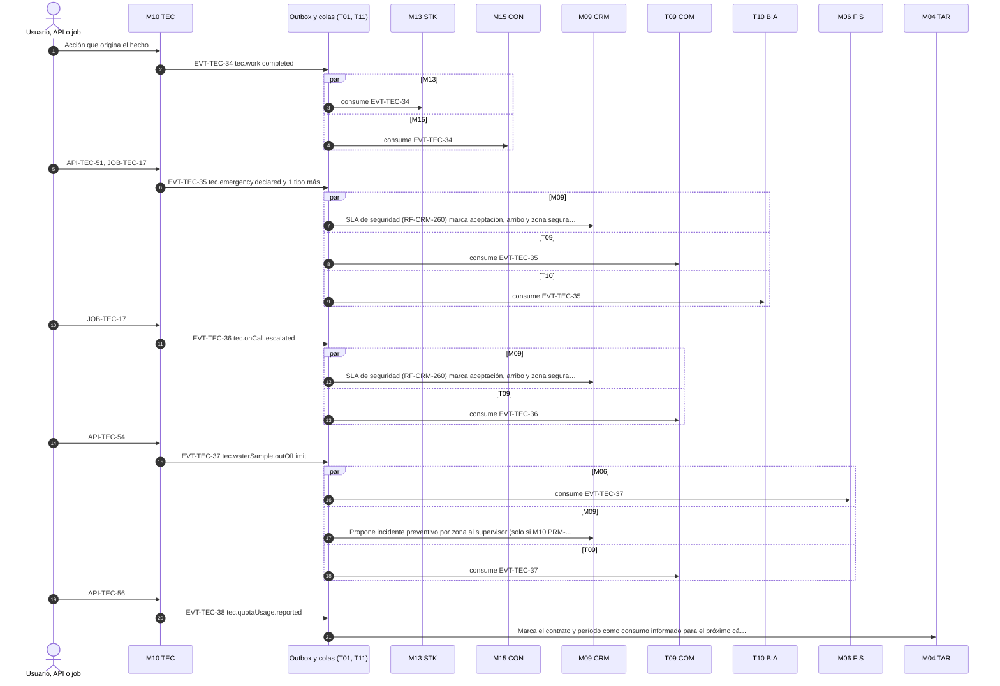

| Evento | Consumidores externos (T11 §12.3) | Efecto declarado por el consumidor (§12 de su anexo) |
|---|---|---|
| EVT-TEC-34 `tec.work.completed` | M13, M15 | No declarado en el §12 del consumidor |
| EVT-TEC-35 `tec.emergency.declared` | M09, T09, T10 | M09: SLA de seguridad (RF-CRM-260): marca aceptación, arribo y zona segura; muestra el escalamiento de guardia en el caso (HUE-GAS-05) |
| EVT-TEC-36 `tec.onCall.escalated` | M09, T09 | M09: SLA de seguridad (RF-CRM-260): marca aceptación, arribo y zona segura; muestra el escalamiento de guardia en el caso (HUE-GAS-05) |
| EVT-TEC-37 `tec.waterSample.outOfLimit` | M06, M09, T09 | M09: Propone incidente preventivo por zona al supervisor (solo si M10 PRM-TEC-157 está activo) |
| EVT-TEC-38 `tec.quotaUsage.reported` | M04 | M04: Marca el contrato y período como "consumo informado" para el próximo cálculo de correo o pack SMS; si el período ya está facturado, solo registra la revisión en la traza (RN-TAR-251; DEC-084). El dato se lee con AP… |

## Cobertura de la parte R

| Evento | Productor | Secuencia | También en |
|---|---|---|---|
| EVT-MOR-08 | M08 | SEC-MOR-01 | — |
| EVT-MOR-09 | M08 | SEC-MOR-01 | — |
| EVT-MOR-10 | M08 | SEC-MOR-01 | — |
| EVT-MOR-01 | M08 | SEC-MOR-02 | — |
| EVT-MOR-02 | M08 | SEC-MOR-02 | A2 (`06-secuencias-y-estados.md`) |
| EVT-MOR-03 | M08 | SEC-MOR-02 | — |
| EVT-MOR-04 | M08 | SEC-MOR-02 | — |
| EVT-MOR-05 | M08 | SEC-MOR-02 | — |
| EVT-MOR-06 | M08 | SEC-MOR-02 | — |
| EVT-MOR-07 | M08 | SEC-MOR-02 | — |
| EVT-MOR-11 | M08 | SEC-MOR-02 | — |
| EVT-MOR-12 | M08 | SEC-MOR-03 | A4 (`06-secuencias-y-estados.md`) |
| EVT-MOR-13 | M08 | SEC-MOR-03 | A4 (`06-secuencias-y-estados.md`) |
| EVT-MOR-14 | M08 | SEC-MOR-03 | — |
| EVT-MOR-15 | M08 | SEC-MOR-03 | — |
| EVT-MOR-16 | M08 | SEC-MOR-03 | — |
| EVT-MOR-17 | M08 | SEC-MOR-03 | — |
| EVT-MOR-18 | M08 | SEC-MOR-03 | — |
| EVT-MOR-19 | M08 | SEC-MOR-03 | — |
| EVT-MOR-20 | M08 | SEC-MOR-04 | — |
| EVT-MOR-21 | M08 | SEC-MOR-04 | — |
| EVT-CRM-01 | M09 | SEC-CRM-01 | A5 (`06-secuencias-y-estados.md`) |
| EVT-CRM-02 | M09 | SEC-CRM-01 | — |
| EVT-CRM-03 | M09 | SEC-CRM-01 | A5 (`06-secuencias-y-estados.md`) |
| EVT-CRM-04 | M09 | SEC-CRM-01 | A5 (`06-secuencias-y-estados.md`) |
| EVT-CRM-05 | M09 | SEC-CRM-01 | — |
| EVT-CRM-06 | M09 | SEC-CRM-01 | — |
| EVT-CRM-07 | M09 | SEC-CRM-01 | — |
| EVT-CRM-08 | M09 | SEC-CRM-01 | A5 (`06-secuencias-y-estados.md`) |
| EVT-CRM-09 | M09 | SEC-CRM-01 | A5 (`06-secuencias-y-estados.md`) |
| EVT-CRM-10 | M09 | SEC-CRM-01 | — |
| EVT-CRM-11 | M09 | SEC-CRM-02 | — |
| EVT-CRM-12 | M09 | SEC-CRM-02 | — |
| EVT-CRM-13 | M09 | SEC-CRM-03 | A5 (`06-secuencias-y-estados.md`) |
| EVT-CRM-14 | M09 | SEC-CRM-03 | — |
| EVT-CRM-15 | M09 | SEC-CRM-03 | — |
| EVT-CRM-16 | M09 | SEC-CRM-03 | — |
| EVT-CRM-17 | M09 | SEC-CRM-03 | — |
| EVT-CRM-18 | M09 | SEC-CRM-03 | — |
| EVT-CRM-19 | M09 | SEC-CRM-03 | — |
| EVT-CRM-20 | M09 | SEC-CRM-03 | — |
| EVT-CRM-21 | M09 | SEC-CRM-04 | — |
| EVT-CRM-22 | M09 | SEC-CRM-04 | — |
| EVT-CRM-23 | M09 | SEC-CRM-04 | — |
| EVT-CRM-24 | M09 | SEC-CRM-04 | — |
| EVT-CRM-25 | M09 | SEC-CRM-04 | — |
| EVT-TEC-01 | M10 | SEC-TEC-01 | — |
| EVT-TEC-02 | M10 | SEC-TEC-01 | — |
| EVT-TEC-03 | M10 | SEC-TEC-01 | — |
| EVT-TEC-04 | M10 | SEC-TEC-02 | A5 (`06-secuencias-y-estados.md`) |
| EVT-TEC-05 | M10 | SEC-TEC-02 | — |
| EVT-TEC-06 | M10 | SEC-TEC-02 | A5 (`06-secuencias-y-estados.md`) |
| EVT-TEC-07 | M10 | SEC-TEC-02 | A4 (`06-secuencias-y-estados.md`) |
| EVT-TEC-08 | M10 | SEC-TEC-02 | — |
| EVT-TEC-09 | M10 | SEC-TEC-02 | — |
| EVT-TEC-10 | M10 | SEC-TEC-03 | A5 (`06-secuencias-y-estados.md`) |
| EVT-TEC-11 | M10 | SEC-TEC-03 | — |
| EVT-TEC-12 | M10 | SEC-TEC-03 | — |
| EVT-TEC-13 | M10 | SEC-TEC-03 | — |
| EVT-TEC-14 | M10 | SEC-TEC-03 | — |
| EVT-TEC-15 | M10 | SEC-TEC-03 | — |
| EVT-TEC-16 | M10 | SEC-TEC-03 | — |
| EVT-TEC-17 | M10 | SEC-TEC-03 | — |
| EVT-TEC-18 | M10 | SEC-TEC-04 | A4 (`06-secuencias-y-estados.md`) |
| EVT-TEC-19 | M10 | SEC-TEC-04 | A4 (`06-secuencias-y-estados.md`) |
| EVT-TEC-20 | M10 | SEC-TEC-04 | — |
| EVT-TEC-21 | M10 | SEC-TEC-04 | A4 (`06-secuencias-y-estados.md`) |
| EVT-TEC-33 | M10 | SEC-TEC-04 | A4 (`06-secuencias-y-estados.md`) |
| EVT-TEC-22 | M10 | SEC-TEC-04 | — |
| EVT-TEC-23 | M10 | SEC-TEC-04 | — |
| EVT-TEC-24 | M10 | SEC-TEC-04 | — |
| EVT-TEC-25 | M10 | SEC-TEC-05 | — |
| EVT-TEC-26 | M10 | SEC-TEC-05 | — |
| EVT-TEC-27 | M10 | SEC-TEC-05 | — |
| EVT-TEC-28 | M10 | SEC-TEC-05 | — |
| EVT-TEC-29 | M10 | SEC-TEC-05 | — |
| EVT-TEC-30 | M10 | SEC-TEC-05 | — |
| EVT-TEC-31 | M10 | SEC-TEC-05 | — |
| EVT-TEC-32 | M10 | SEC-TEC-05 | — |
| EVT-TEC-34 | M10 | SEC-TEC-06 | — |
| EVT-TEC-35 | M10 | SEC-TEC-06 | — |
| EVT-TEC-36 | M10 | SEC-TEC-06 | — |
| EVT-TEC-37 | M10 | SEC-TEC-06 | — |
| EVT-TEC-38 | M10 | SEC-TEC-06 | — |
