# GoodApps Cooperativas — Diagramas de secuencia por eventos, parte S (M11-M14)

**Entregable de análisis y diseño — Artefacto 7.3 (diagramas de secuencia), ampliación a cobertura completa**

| Campo | Valor |
|---|---|
| Documento | `06s-secuencias-eventos-m11-m14.md` |
| Índice del entregable | [`06-secuencias-y-estados.md`](06-secuencias-y-estados.md) (sección 7) y [`06a-indice-cobertura-secuencias-estados.md`](06a-indice-cobertura-secuencias-estados.md) |
| Versión | 1.0 |
| Fecha | 05-11-2026 |
| Estado | Borrador para revisión |
| Fuentes | T11 §12.2 y §12.3 (catálogo de eventos y consumidores); §12 "Eventos consumidos" y §11 de los anexos M11, M12, M13, M14 |
| Generación | Script `_trabajo/gen06_build.py` (extrae de los anexos; revisión manual posterior) |

## 1. Cómo leer esta parte

Cada diagrama representa un flujo de negocio entre módulos construido a partir del catálogo de eventos de T11 §12.3: un agregado del productor (por ejemplo, `cat.contract.*`) con sus hechos en orden de ID, o un grupo de hechos complementarios del mismo productor cuando el agregado tiene menos de tres eventos. Todos siguen el patrón transversal de `06-secuencias-y-estados.md` §2.2 (outbox en la misma transacción, relay, inbox por consumidor, reintentos y cola de errores), que no se repite en cada diagrama.

- **U** es el origen del hecho: usuario, API o job. Se citan las API y jobs que el anexo productor nombra junto al evento.
- **BUS** es la outbox con el relay y las colas BullMQ; cada consumidor recibe su propio job.
- `par` agrupa consumidores independientes del mismo evento. El texto del mensaje es el efecto que declara el consumidor en el §12 de su anexo; "consume EVT-…" indica que el consumidor figura en T11 pero no describe el efecto. **GEN** representa consumidores genéricos de T11 ("módulo dueño del tipo", "todos").
- Debajo de cada diagrama, la tabla lista los EVT que cubre, sus consumidores externos y los efectos declarados.

## M11 — VEN Ventas y presupuestos

### SEC-VEN-01 — VEN: Cargos por operación con titulares

**Agregados:** `ven.operationCharge.*`. **Productor:** M11 Ventas y presupuestos (M11 §12; catálogo T11 §12.3).

**Cubre:** EVT-VEN-01 `ven.operationCharge.created`, EVT-VEN-02 `ven.operationCharge.cancelled`, EVT-VEN-03 `ven.operationCharge.invoiced`.

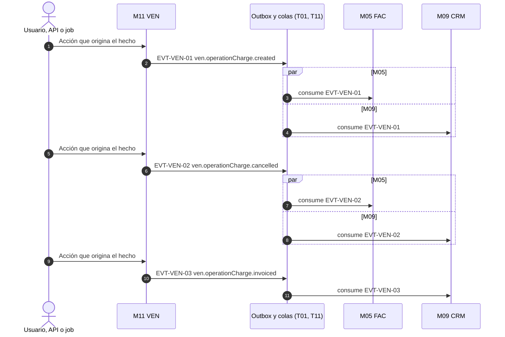

| Evento | Consumidores externos (T11 §12.3) | Efecto declarado por el consumidor (§12 de su anexo) |
|---|---|---|
| EVT-VEN-01 `ven.operationCharge.created` | M05, M09 | No declarado en el §12 del consumidor |
| EVT-VEN-02 `ven.operationCharge.cancelled` | M05, M09 | No declarado en el §12 del consumidor |
| EVT-VEN-03 `ven.operationCharge.invoiced` | M09 | No declarado en el §12 del consumidor |

### SEC-VEN-02 — VEN: Presupuestos con versiones, ítems y notas

**Agregados:** `ven.quote.*`. **Productor:** M11 Ventas y presupuestos (M11 §12; catálogo T11 §12.3).

**Cubre:** EVT-VEN-04 `ven.quote.created`, EVT-VEN-05 `ven.quote.accepted`, EVT-VEN-06 `ven.quote.rejected`.

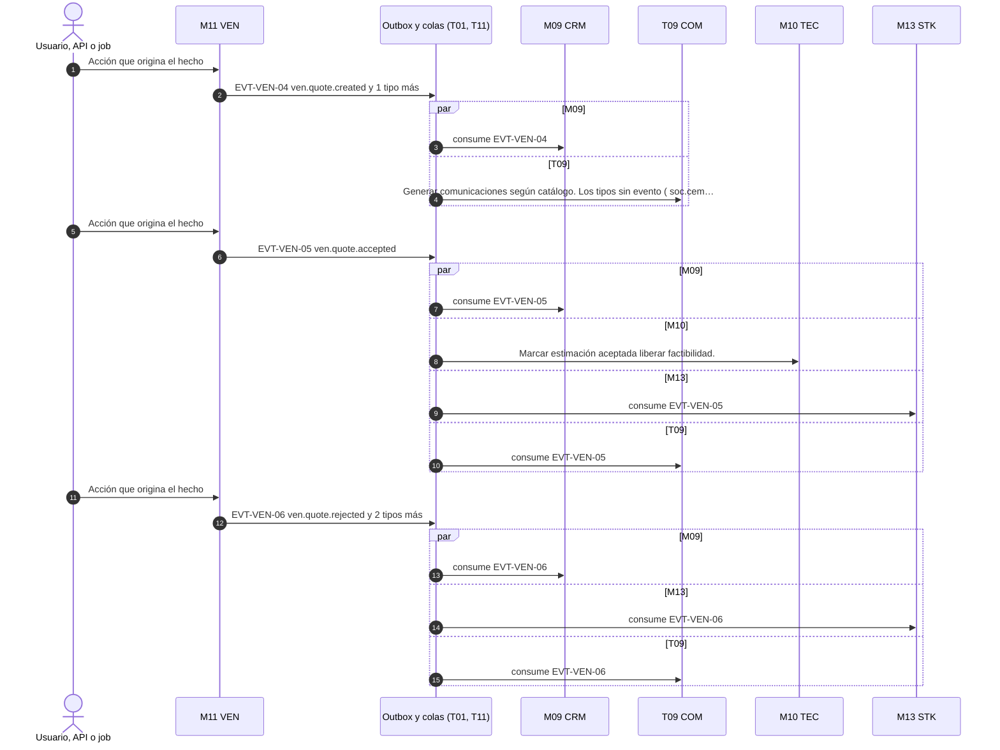

| Evento | Consumidores externos (T11 §12.3) | Efecto declarado por el consumidor (§12 de su anexo) |
|---|---|---|
| EVT-VEN-04 `ven.quote.created` | M09, T09 | T09: Generar comunicaciones según catálogo. Los tipos sin evento (`soc.cemeteryAct.scheduled`, `soc.loan.overdue`) entran por el comando `com.communications.emit` (§9.7). |
| EVT-VEN-05 `ven.quote.accepted` | M09, M10, M13, T09 | M10: Marcar estimación aceptada; liberar factibilidad. |
| EVT-VEN-06 `ven.quote.rejected` | M09, M13, T09 | No declarado en el §12 del consumidor |

### SEC-VEN-03 — VEN: Ventas de productos y servicios adicionales

**Agregados:** `ven.salesOrder.*`. **Productor:** M11 Ventas y presupuestos (M11 §12; catálogo T11 §12.3).

**Cubre:** EVT-VEN-07 `ven.salesOrder.confirmed`, EVT-VEN-08 `ven.salesOrder.delivered`, EVT-VEN-09 `ven.salesOrder.returned`, EVT-VEN-10 `ven.salesOrder.cancelled`, EVT-VEN-15 `ven.salesOrder.invoiced`.

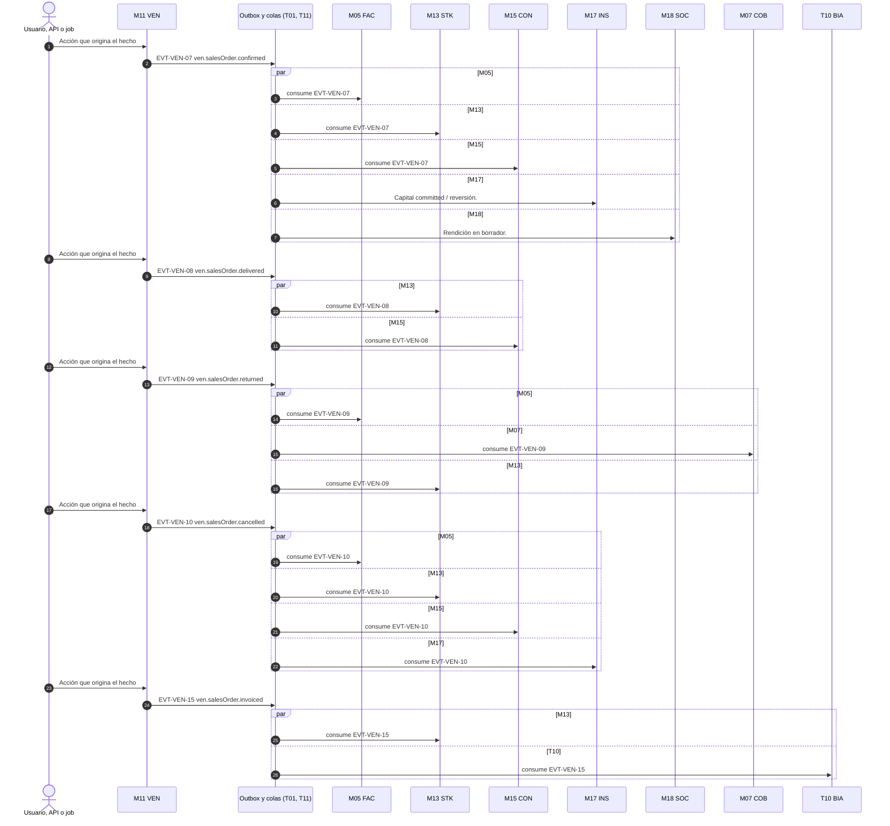

| Evento | Consumidores externos (T11 §12.3) | Efecto declarado por el consumidor (§12 de su anexo) |
|---|---|---|
| EVT-VEN-07 `ven.salesOrder.confirmed` | M05, M13, M15, M17, M18 | M17: Capital `committed` / reversión.; M18: Rendición en borrador. |
| EVT-VEN-08 `ven.salesOrder.delivered` | M13, M15 | No declarado en el §12 del consumidor |
| EVT-VEN-09 `ven.salesOrder.returned` | M05, M07, M13 | No declarado en el §12 del consumidor |
| EVT-VEN-10 `ven.salesOrder.cancelled` | M05, M13, M15, M17 | No declarado en el §12 del consumidor |
| EVT-VEN-15 `ven.salesOrder.invoiced` | M13, T10 | No declarado en el §12 del consumidor |

### SEC-VEN-04 — VEN: hechos complementarios (installmentPlan, Cuotas de venta, Sesiones de punto de venta, Listas de precios de productos)

**Agregados:** `ven.installmentPlan.*`, `ven.installment.*`, `ven.posSession.*`, `ven.priceList.*`. **Productor:** M11 Ventas y presupuestos (M11 §12; catálogo T11 §12.3).

**Cubre:** EVT-VEN-11 `ven.installmentPlan.created`, EVT-VEN-12 `ven.installment.updated`, EVT-VEN-13 `ven.posSession.closed`, EVT-VEN-14 `ven.priceList.updated`.

**API y jobs disparadores (citados junto al evento en el anexo productor):** API-VEN-006.

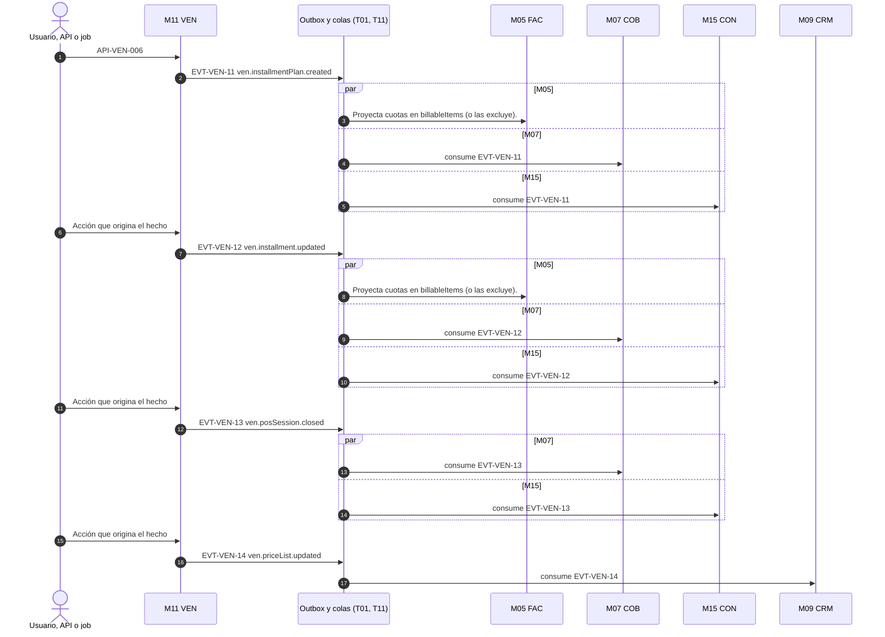

| Evento | Consumidores externos (T11 §12.3) | Efecto declarado por el consumidor (§12 de su anexo) |
|---|---|---|
| EVT-VEN-11 `ven.installmentPlan.created` | M05, M07, M15 | M05: Proyecta cuotas en `billableItems` (o las excluye). |
| EVT-VEN-12 `ven.installment.updated` | M05, M07, M15 | M05: Proyecta cuotas en `billableItems` (o las excluye). |
| EVT-VEN-13 `ven.posSession.closed` | M07, M15 | No declarado en el §12 del consumidor |
| EVT-VEN-14 `ven.priceList.updated` | M09 | No declarado en el §12 del consumidor |

## M12 — CMP Compras y proveedores

### SEC-CMP-01 — CMP: Órdenes de pago a proveedores

**Agregados:** `cmp.paymentOrder.*`. **Productor:** M12 Compras y proveedores (M12 §12; catálogo T11 §12.3).

**Cubre:** EVT-CMP-11 `cmp.paymentOrder.approved`, EVT-CMP-12 `cmp.paymentOrder.cancelled`, EVT-CMP-13 `cmp.paymentOrder.paid`, EVT-CMP-15 `cmp.paymentOrder.prepared`.

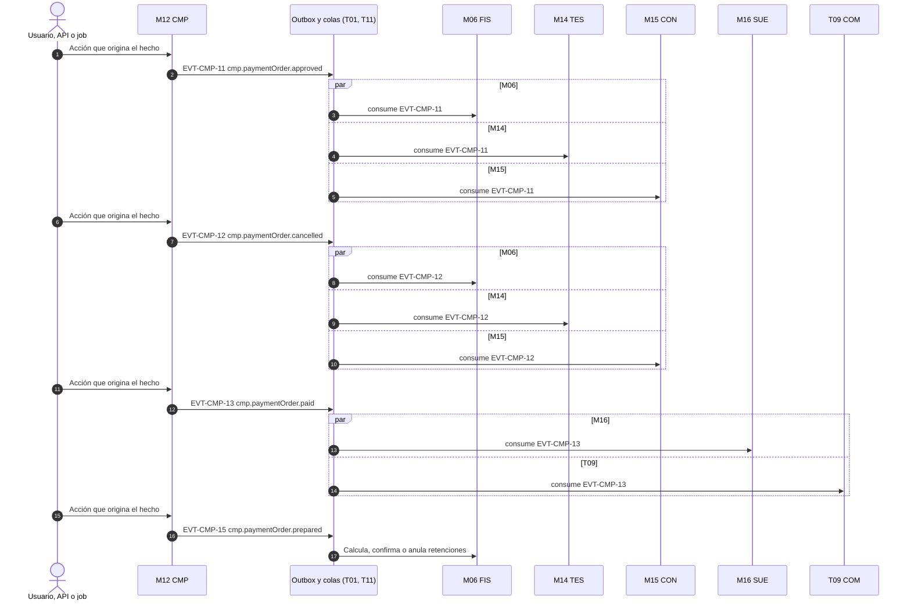

| Evento | Consumidores externos (T11 §12.3) | Efecto declarado por el consumidor (§12 de su anexo) |
|---|---|---|
| EVT-CMP-11 `cmp.paymentOrder.approved` | M06, M14, M15 | No declarado en el §12 del consumidor |
| EVT-CMP-12 `cmp.paymentOrder.cancelled` | M06, M14, M15 | No declarado en el §12 del consumidor |
| EVT-CMP-13 `cmp.paymentOrder.paid` | M16, T09 | No declarado en el §12 del consumidor |
| EVT-CMP-15 `cmp.paymentOrder.prepared` | M06 | M06: Calcula, confirma o anula retenciones |

### SEC-CMP-02 — CMP: hechos complementarios (Proveedores, Solicitudes de abastecimiento, Órdenes de compra, Recepciones de bienes y servicios)

**Agregados:** `cmp.supplier.*`, `cmp.supplyRequest.*`, `cmp.purchaseOrder.*`, `cmp.receipt.*`. **Productor:** M12 Compras y proveedores (M12 §12; catálogo T11 §12.3).

**Cubre:** EVT-CMP-01 `cmp.supplier.created`, EVT-CMP-02 `cmp.supplier.bankAccountApproved`, EVT-CMP-03 `cmp.supplyRequest.approved`, EVT-CMP-04 `cmp.purchaseOrder.approved`, EVT-CMP-05 `cmp.purchaseOrder.cancelled`, EVT-CMP-06 `cmp.receipt.confirmed`, EVT-CMP-07 `cmp.receipt.voided`.

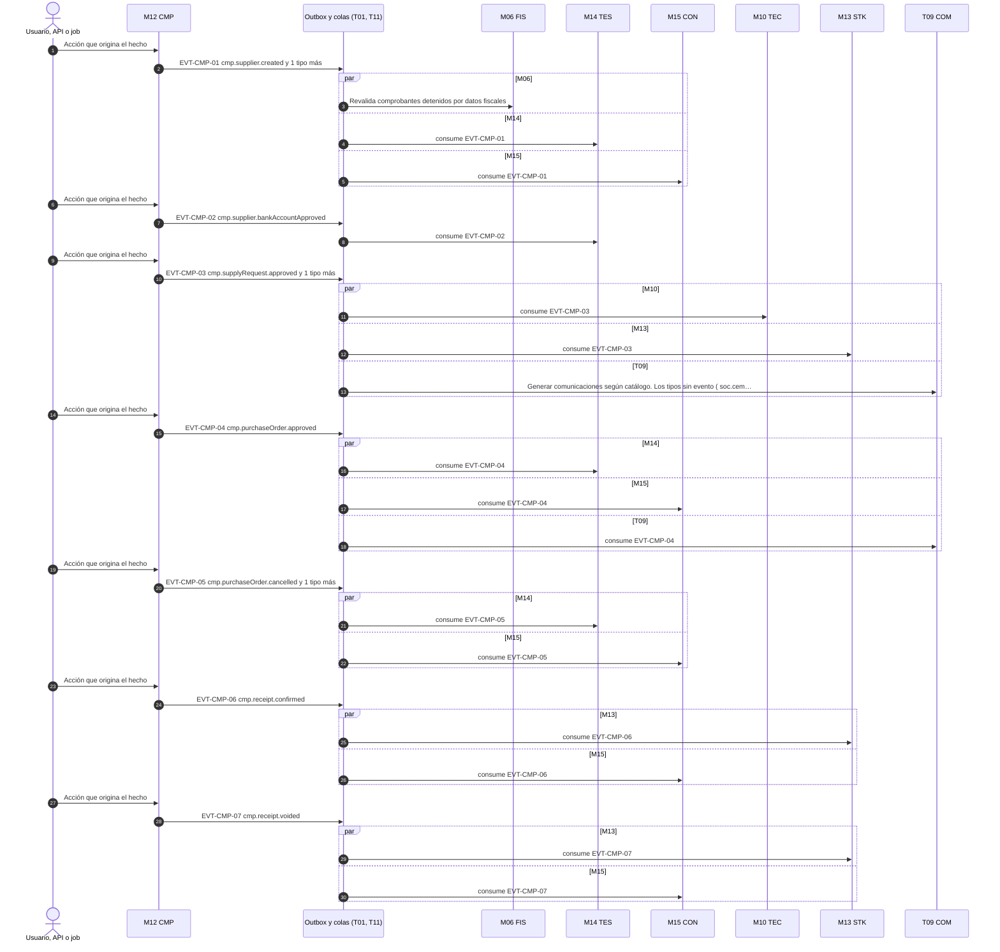

| Evento | Consumidores externos (T11 §12.3) | Efecto declarado por el consumidor (§12 de su anexo) |
|---|---|---|
| EVT-CMP-01 `cmp.supplier.created` | M06, M14, M15 | M06: Revalida comprobantes detenidos por datos fiscales |
| EVT-CMP-02 `cmp.supplier.bankAccountApproved` | M14 | No declarado en el §12 del consumidor |
| EVT-CMP-03 `cmp.supplyRequest.approved` | M10, M13, T09 | T09: Generar comunicaciones según catálogo. Los tipos sin evento (`soc.cemeteryAct.scheduled`, `soc.loan.overdue`) entran por el comando `com.communications.emit` (§9.7). |
| EVT-CMP-04 `cmp.purchaseOrder.approved` | M14, M15, T09 | No declarado en el §12 del consumidor |
| EVT-CMP-05 `cmp.purchaseOrder.cancelled` | M14, M15 | No declarado en el §12 del consumidor |
| EVT-CMP-06 `cmp.receipt.confirmed` | M13, M15 | No declarado en el §12 del consumidor |
| EVT-CMP-07 `cmp.receipt.voided` | M13, M15 | No declarado en el §12 del consumidor |

### SEC-CMP-03 — CMP: hechos complementarios (Comprobantes de proveedor, Excepciones de conciliación de tres vías, Comprobantes cargados por proveedores en…)

**Agregados:** `cmp.supplierInvoice.*`, `cmp.matchException.*`, `cmp.portalSubmission.*`, `cmp.supplyBalance.*`, `cmp.signalRightsSettlement.*`. **Productor:** M12 Compras y proveedores (M12 §12; catálogo T11 §12.3).

**Cubre:** EVT-CMP-08 `cmp.supplierInvoice.registered`, EVT-CMP-09 `cmp.supplierInvoice.released`, EVT-CMP-10 `cmp.matchException.raised`, EVT-CMP-14 `cmp.portalSubmission.received`, EVT-CMP-16 `cmp.supplyBalance.approved`, EVT-CMP-17 `cmp.signalRightsSettlement.approved`.

**API y jobs disparadores (citados junto al evento en el anexo productor):** JOB-CMP-10, JOB-CMP-09.

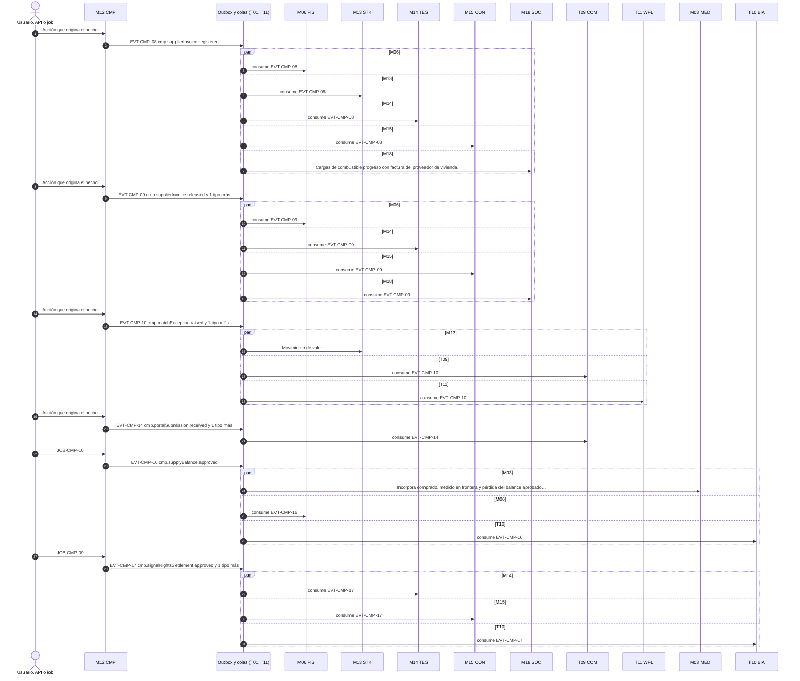

| Evento | Consumidores externos (T11 §12.3) | Efecto declarado por el consumidor (§12 de su anexo) |
|---|---|---|
| EVT-CMP-08 `cmp.supplierInvoice.registered` | M06, M13, M14, M15, M18 | M18: Cargas de combustible; progreso con factura del proveedor de vivienda. |
| EVT-CMP-09 `cmp.supplierInvoice.released` | M06, M14, M15, M18 | No declarado en el §12 del consumidor |
| EVT-CMP-10 `cmp.matchException.raised` | M13, T09, T11 | M13: Movimiento de valor. |
| EVT-CMP-14 `cmp.portalSubmission.received` | T09 | No declarado en el §12 del consumidor |
| EVT-CMP-16 `cmp.supplyBalance.approved` | M03, M06, T10 | M03: Incorpora comprado, medido en frontera y pérdida del balance aprobado al informe de pérdidas del período y zona (RF-MED-101); idempotente por `balanceId`. |
| EVT-CMP-17 `cmp.signalRightsSettlement.approved` | M14, M15, T10 | No declarado en el §12 del consumidor |

## M13 — STK Stock, bienes de uso y fabricación

### SEC-STK-01 — STK: equipment

**Agregados:** `stk.equipment.*`. **Productor:** M13 Stock, bienes de uso y fabricación (M13 §12; catálogo T11 §12.3).

**Cubre:** EVT-STK-04 `stk.equipment.applied`, EVT-STK-05 `stk.equipment.retrieved`, EVT-STK-06 `stk.equipment.swapped`, EVT-STK-07 `stk.equipment.returnOverdue`, EVT-STK-08 `stk.equipment.chargeProposed`, EVT-STK-09 `stk.equipment.sold`.

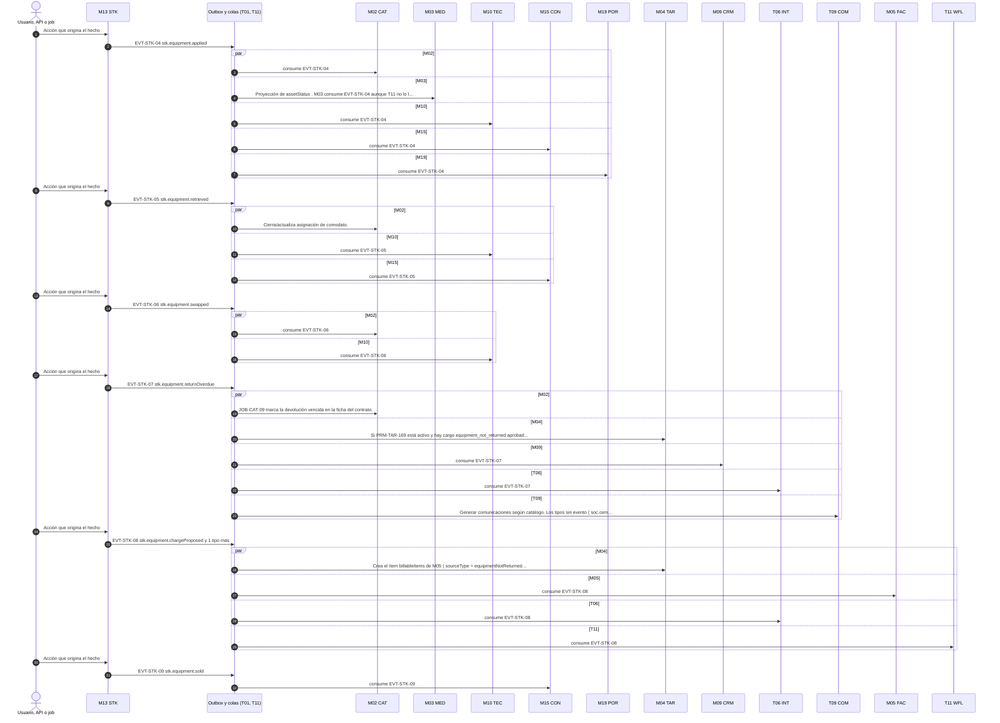

| Evento | Consumidores externos (T11 §12.3) | Efecto declarado por el consumidor (§12 de su anexo) |
|---|---|---|
| EVT-STK-04 `stk.equipment.applied` | M02, M03, M10, M15, M19 | M03: Proyección de `assetStatus`. M03 consume EVT-STK-04 aunque T11 no lo lista como consumidor (se informa a T11, 05-11-2026). |
| EVT-STK-05 `stk.equipment.retrieved` | M02, M10, M15 | M02: Cierra/actualiza asignación de comodato. |
| EVT-STK-06 `stk.equipment.swapped` | M02, M10 | No declarado en el §12 del consumidor |
| EVT-STK-07 `stk.equipment.returnOverdue` | M02, M04, M09, T06, T09 | M02: JOB-CAT-09 marca la devolución vencida en la ficha del contrato.; M04: Si PRM-TAR-169 está activo y hay cargo `equipment_not_returned` aprobado: cotiza el cargo por equipo no devuelto (RN-TAR-246); si no, sin efect… |
| EVT-STK-08 `stk.equipment.chargeProposed` | M04, M05, T06, T11 | M04: Crea el ítem `billableItems` de M05 (`sourceType = equipmentNotReturned`, vía `fac.service.upsertBillableItem`; antes ~~`preloadedCharges`~~, CTR-DAT-38) idempotente por `assignmentId` (RN-TAR-246). `stk.equipment.`… |
| EVT-STK-09 `stk.equipment.sold` | M15 | No declarado en el §12 del consumidor |

### SEC-STK-02 — STK: hechos complementarios (goods, materials, custody, Reservas, adjustment, item)

**Agregados:** `stk.goods.*`, `stk.materials.*`, `stk.custody.*`, `stk.reservation.*`, `stk.adjustment.*`, `stk.item.*`. **Productor:** M13 Stock, bienes de uso y fabricación (M13 §12; catálogo T11 §12.3).

**Cubre:** EVT-STK-01 `stk.goods.received`, EVT-STK-24 `stk.goods.rejected`, EVT-STK-02 `stk.materials.consumed`, EVT-STK-03 `stk.custody.transferred`, EVT-STK-10 `stk.reservation.created`, EVT-STK-23 `stk.reservation.failed`, EVT-STK-11 `stk.adjustment.posted`, EVT-STK-12 `stk.item.belowMinimum`.

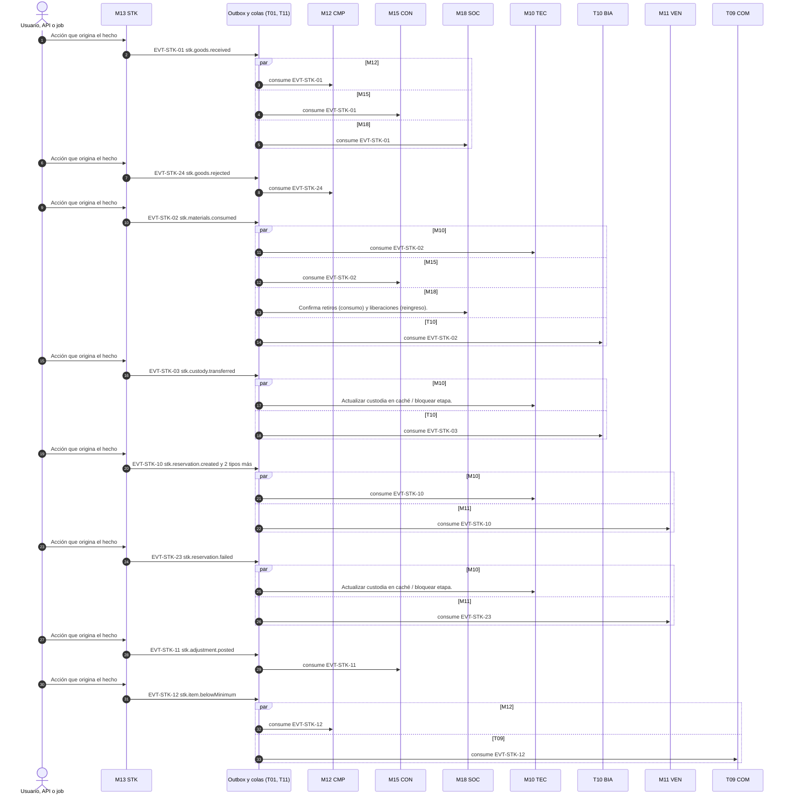

| Evento | Consumidores externos (T11 §12.3) | Efecto declarado por el consumidor (§12 de su anexo) |
|---|---|---|
| EVT-STK-01 `stk.goods.received` | M12, M15, M18 | No declarado en el §12 del consumidor |
| EVT-STK-24 `stk.goods.rejected` | M12 | No declarado en el §12 del consumidor |
| EVT-STK-02 `stk.materials.consumed` | M10, M15, M18, T10 | M18: Confirma retiros (consumo) y liberaciones (reingreso). |
| EVT-STK-03 `stk.custody.transferred` | M10, T10 | M10: Actualizar custodia en caché / bloquear etapa. |
| EVT-STK-10 `stk.reservation.created` | M10, M11 | No declarado en el §12 del consumidor |
| EVT-STK-23 `stk.reservation.failed` | M10, M11 | M10: Actualizar custodia en caché / bloquear etapa. |
| EVT-STK-11 `stk.adjustment.posted` | M15 | No declarado en el §12 del consumidor |
| EVT-STK-12 `stk.item.belowMinimum` | M12, T09 | No declarado en el §12 del consumidor |

### SEC-STK-03 — STK: hechos complementarios (reorder, valuation, period, Inventarios físicos, Bienes de uso, Amortizaciones por bien, rma, manufacturing)

**Agregados:** `stk.reorder.*`, `stk.valuation.*`, `stk.period.*`, `stk.physicalCount.*`, `stk.fixedAsset.*`, `stk.depreciation.*`, `stk.rma.*`, `stk.manufacturing.*`. **Productor:** M13 Stock, bienes de uso y fabricación (M13 §12; catálogo T11 §12.3).

**Cubre:** EVT-STK-13 `stk.reorder.suggested`, EVT-STK-14 `stk.valuation.changed`, EVT-STK-15 `stk.period.closed`, EVT-STK-16 `stk.physicalCount.closed`, EVT-STK-17 `stk.fixedAsset.registered`, EVT-STK-18 `stk.depreciation.posted`, EVT-STK-19 `stk.rma.statusChanged`, EVT-STK-20 `stk.manufacturing.inProcess`.

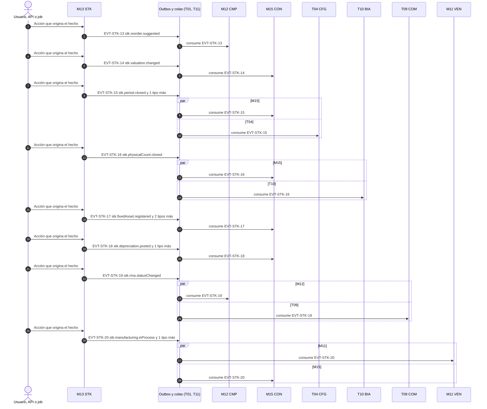

| Evento | Consumidores externos (T11 §12.3) | Efecto declarado por el consumidor (§12 de su anexo) |
|---|---|---|
| EVT-STK-13 `stk.reorder.suggested` | M12 | No declarado en el §12 del consumidor |
| EVT-STK-14 `stk.valuation.changed` | M15 | No declarado en el §12 del consumidor |
| EVT-STK-15 `stk.period.closed` | M15, T04 | No declarado en el §12 del consumidor |
| EVT-STK-16 `stk.physicalCount.closed` | M15, T10 | No declarado en el §12 del consumidor |
| EVT-STK-17 `stk.fixedAsset.registered` | M15 | No declarado en el §12 del consumidor |
| EVT-STK-18 `stk.depreciation.posted` | M15 | No declarado en el §12 del consumidor |
| EVT-STK-19 `stk.rma.statusChanged` | M12, T09 | No declarado en el §12 del consumidor |
| EVT-STK-20 `stk.manufacturing.inProcess` | M11, M15 | No declarado en el §12 del consumidor |

### SEC-STK-04 — STK: hechos complementarios (fieldConflict, Rendiciones de material de cuadrilla)

**Agregados:** `stk.fieldConflict.*`, `stk.crewSettlement.*`. **Productor:** M13 Stock, bienes de uso y fabricación (M13 §12; catálogo T11 §12.3).

**Cubre:** EVT-STK-21 `stk.fieldConflict.raised`, EVT-STK-22 `stk.crewSettlement.closed`.

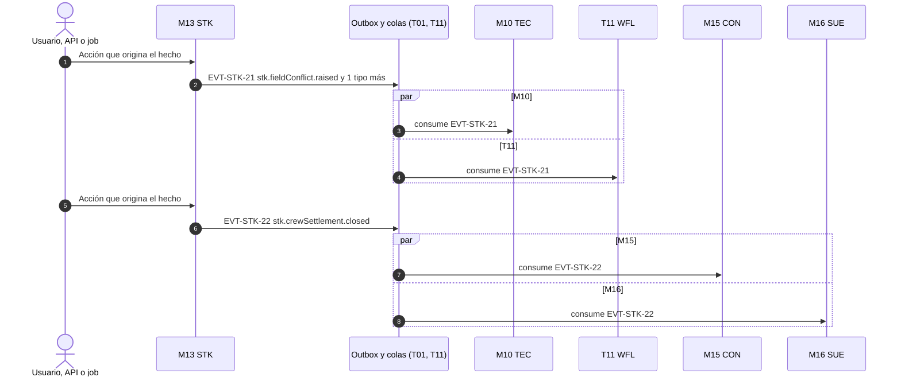

| Evento | Consumidores externos (T11 §12.3) | Efecto declarado por el consumidor (§12 de su anexo) |
|---|---|---|
| EVT-STK-21 `stk.fieldConflict.raised` | M10, T11 | No declarado en el §12 del consumidor |
| EVT-STK-22 `stk.crewSettlement.closed` | M15, M16 | No declarado en el §12 del consumidor |

## M14 — TES Tesorería y bancos

### SEC-TES-01 — TES: hechos complementarios (Operaciones de tesorería, Cuentas financieras, Conciliaciones bancarias, Líneas de extracto, gatewayCredit, R…)

**Agregados:** `tes.operation.*`, `tes.account.*`, `tes.reconciliation.*`, `tes.statementLine.*`, `tes.gatewayCredit.*`, `tes.cashRemittance.*`, `tes.deposit.*`. **Productor:** M14 Tesorería y bancos (M14 §12; catálogo T11 §12.3).

**Cubre:** EVT-TES-01 `tes.operation.posted`, EVT-TES-02 `tes.operation.voided`, EVT-TES-03 `tes.account.created`, EVT-TES-05 `tes.reconciliation.closed`, EVT-TES-06 `tes.statementLine.unidentified`, EVT-TES-07 `tes.gatewayCredit.reconciled`, EVT-TES-08 `tes.cashRemittance.accepted`, EVT-TES-09 `tes.deposit.registered`.

Parte de estos hechos también aparece, con el detalle del caso de negocio, en A2, A8 de `06-secuencias-y-estados.md` §3.

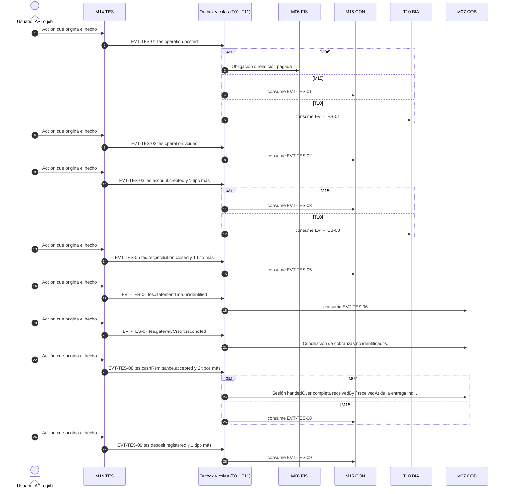

| Evento | Consumidores externos (T11 §12.3) | Efecto declarado por el consumidor (§12 de su anexo) |
|---|---|---|
| EVT-TES-01 `tes.operation.posted` | M06, M15, T10 | M06: Obligación o rendición pagada |
| EVT-TES-02 `tes.operation.voided` | M15 | No declarado en el §12 del consumidor |
| EVT-TES-03 `tes.account.created` | M15, T10 | No declarado en el §12 del consumidor |
| EVT-TES-05 `tes.reconciliation.closed` | M15 | No declarado en el §12 del consumidor |
| EVT-TES-06 `tes.statementLine.unidentified` | M07 | No declarado en el §12 del consumidor |
| EVT-TES-07 `tes.gatewayCredit.reconciled` | M07 | M07: Conciliación de cobranzas; no identificados. |
| EVT-TES-08 `tes.cashRemittance.accepted` | M07, M15 | M07: Sesión `handedOver`; completa `receivedBy`/`receivedAt` de la entrega indicada por `treasuryHandoverId` (CTR-DAT-64). |
| EVT-TES-09 `tes.deposit.registered` | M15 | No declarado en el §12 del consumidor |

### SEC-TES-02 — TES: hechos complementarios (Cheques y eCheq de terceros, Cheques propios, echeq, Cupones de tarjeta, Retenciones sufridas en cartera, Eje…)

**Agregados:** `tes.thirdPartyCheck.*`, `tes.ownCheck.*`, `tes.echeq.*`, `tes.cardVoucher.*`, `tes.receivedWithholding.*`, `tes.paymentExecution.*`, `tes.paymentFile.*`. **Productor:** M14 Tesorería y bancos (M14 §12; catálogo T11 §12.3).

**Cubre:** EVT-TES-10 `tes.thirdPartyCheck.stateChanged`, EVT-TES-11 `tes.ownCheck.issued`, EVT-TES-12 `tes.echeq.stateChanged`, EVT-TES-13 `tes.cardVoucher.presented`, EVT-TES-14 `tes.receivedWithholding.registered`, EVT-TES-15 `tes.paymentExecution.signed`, EVT-TES-16 `tes.paymentFile.generated`, EVT-TES-25 `tes.paymentFile.requested`.

**API y jobs disparadores (citados junto al evento en el anexo productor):** JOB-TES-05.

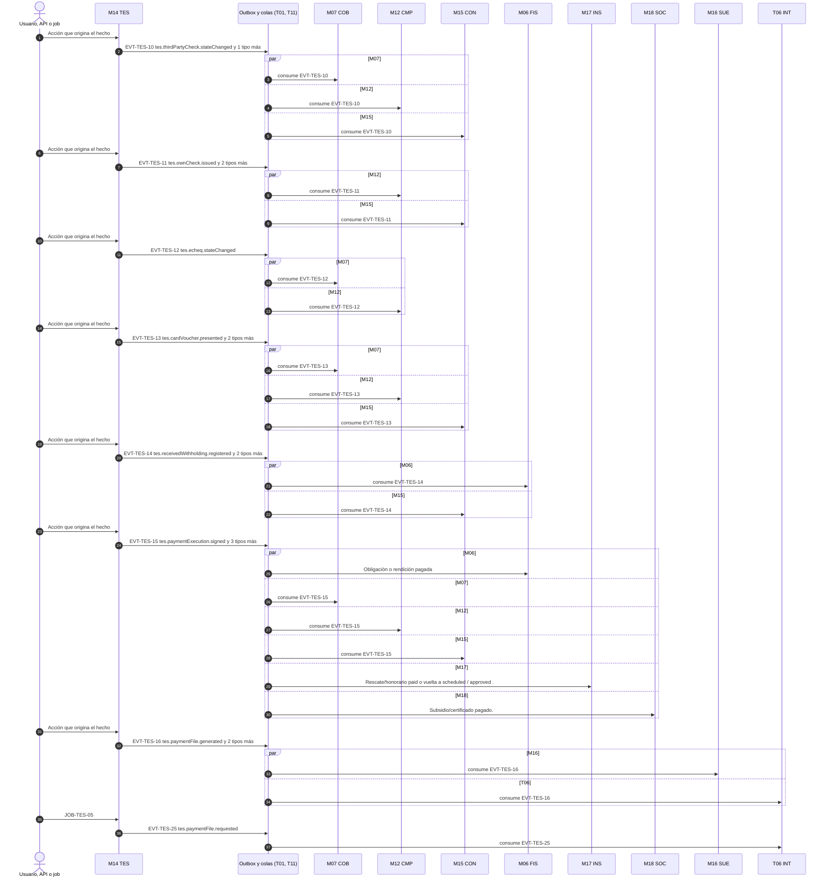

| Evento | Consumidores externos (T11 §12.3) | Efecto declarado por el consumidor (§12 de su anexo) |
|---|---|---|
| EVT-TES-10 `tes.thirdPartyCheck.stateChanged` | M07, M12, M15 | No declarado en el §12 del consumidor |
| EVT-TES-11 `tes.ownCheck.issued` | M12, M15 | No declarado en el §12 del consumidor |
| EVT-TES-12 `tes.echeq.stateChanged` | M07, M12 | No declarado en el §12 del consumidor |
| EVT-TES-13 `tes.cardVoucher.presented` | M07, M12, M15 | No declarado en el §12 del consumidor |
| EVT-TES-14 `tes.receivedWithholding.registered` | M06, M15 | No declarado en el §12 del consumidor |
| EVT-TES-15 `tes.paymentExecution.signed` | M06, M07, M12, M15, M17, M18 | M06: Obligación o rendición pagada; M17: Rescate/honorario `paid` o vuelta a `scheduled`/`approved`.; M18: Subsidio/certificado pagado. |
| EVT-TES-16 `tes.paymentFile.generated` | M16, T06 | No declarado en el §12 del consumidor |
| EVT-TES-25 `tes.paymentFile.requested` | T06 | No declarado en el §12 del consumidor |

### SEC-TES-03 — TES: hechos complementarios (payrollPayment, Arqueos de caja de tesorería, Cotizaciones, Compromisos de fondos, cashFlow, period, advance,…)

**Agregados:** `tes.payrollPayment.*`, `tes.cashClosing.*`, `tes.exchangeRate.*`, `tes.commitment.*`, `tes.cashFlow.*`, `tes.period.*`, `tes.advance.*`, `tes.bankSync.*`. **Productor:** M14 Tesorería y bancos (M14 §12; catálogo T11 §12.3).

**Cubre:** EVT-TES-17 `tes.payrollPayment.confirmed`, EVT-TES-18 `tes.cashClosing.closed`, EVT-TES-19 `tes.exchangeRate.published`, EVT-TES-20 `tes.commitment.created`, EVT-TES-21 `tes.cashFlow.alertRaised`, EVT-TES-22 `tes.period.closed`, EVT-TES-23 `tes.advance.paid`, EVT-TES-24 `tes.bankSync.requested`.

**API y jobs disparadores (citados junto al evento en el anexo productor):** JOB-TES-04.

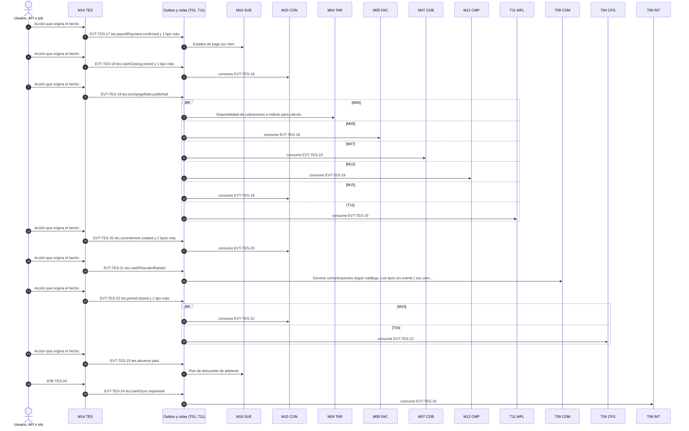

| Evento | Consumidores externos (T11 §12.3) | Efecto declarado por el consumidor (§12 de su anexo) |
|---|---|---|
| EVT-TES-17 `tes.payrollPayment.confirmed` | M16 | M16: Estados de pago por ítem |
| EVT-TES-18 `tes.cashClosing.closed` | M15 | No declarado en el §12 del consumidor |
| EVT-TES-19 `tes.exchangeRate.published` | M04, M05, M07, M12, M15, T11 | M04: Disponibilidad de cotizaciones e índices para cálculo. |
| EVT-TES-20 `tes.commitment.created` | M15 | No declarado en el §12 del consumidor |
| EVT-TES-21 `tes.cashFlow.alertRaised` | T09 | T09: Generar comunicaciones según catálogo. Los tipos sin evento (`soc.cemeteryAct.scheduled`, `soc.loan.overdue`) entran por el comando `com.communications.emit` (§9.7). |
| EVT-TES-22 `tes.period.closed` | M15, T04 | No declarado en el §12 del consumidor |
| EVT-TES-23 `tes.advance.paid` | M16 | M16: Plan de descuento de adelanto |
| EVT-TES-24 `tes.bankSync.requested` | T06 | No declarado en el §12 del consumidor |

## Cobertura de la parte S

| Evento | Productor | Secuencia | También en |
|---|---|---|---|
| EVT-VEN-01 | M11 | SEC-VEN-01 | — |
| EVT-VEN-02 | M11 | SEC-VEN-01 | — |
| EVT-VEN-03 | M11 | SEC-VEN-01 | — |
| EVT-VEN-04 | M11 | SEC-VEN-02 | — |
| EVT-VEN-05 | M11 | SEC-VEN-02 | — |
| EVT-VEN-06 | M11 | SEC-VEN-02 | — |
| EVT-VEN-07 | M11 | SEC-VEN-03 | — |
| EVT-VEN-08 | M11 | SEC-VEN-03 | — |
| EVT-VEN-09 | M11 | SEC-VEN-03 | — |
| EVT-VEN-10 | M11 | SEC-VEN-03 | — |
| EVT-VEN-15 | M11 | SEC-VEN-03 | — |
| EVT-VEN-11 | M11 | SEC-VEN-04 | — |
| EVT-VEN-12 | M11 | SEC-VEN-04 | — |
| EVT-VEN-13 | M11 | SEC-VEN-04 | — |
| EVT-VEN-14 | M11 | SEC-VEN-04 | — |
| EVT-CMP-11 | M12 | SEC-CMP-01 | — |
| EVT-CMP-12 | M12 | SEC-CMP-01 | — |
| EVT-CMP-13 | M12 | SEC-CMP-01 | — |
| EVT-CMP-15 | M12 | SEC-CMP-01 | — |
| EVT-CMP-01 | M12 | SEC-CMP-02 | — |
| EVT-CMP-02 | M12 | SEC-CMP-02 | — |
| EVT-CMP-03 | M12 | SEC-CMP-02 | — |
| EVT-CMP-04 | M12 | SEC-CMP-02 | — |
| EVT-CMP-05 | M12 | SEC-CMP-02 | — |
| EVT-CMP-06 | M12 | SEC-CMP-02 | — |
| EVT-CMP-07 | M12 | SEC-CMP-02 | — |
| EVT-CMP-08 | M12 | SEC-CMP-03 | — |
| EVT-CMP-09 | M12 | SEC-CMP-03 | — |
| EVT-CMP-10 | M12 | SEC-CMP-03 | — |
| EVT-CMP-14 | M12 | SEC-CMP-03 | — |
| EVT-CMP-16 | M12 | SEC-CMP-03 | — |
| EVT-CMP-17 | M12 | SEC-CMP-03 | — |
| EVT-STK-04 | M13 | SEC-STK-01 | — |
| EVT-STK-05 | M13 | SEC-STK-01 | — |
| EVT-STK-06 | M13 | SEC-STK-01 | — |
| EVT-STK-07 | M13 | SEC-STK-01 | — |
| EVT-STK-08 | M13 | SEC-STK-01 | — |
| EVT-STK-09 | M13 | SEC-STK-01 | — |
| EVT-STK-01 | M13 | SEC-STK-02 | — |
| EVT-STK-24 | M13 | SEC-STK-02 | — |
| EVT-STK-02 | M13 | SEC-STK-02 | — |
| EVT-STK-03 | M13 | SEC-STK-02 | — |
| EVT-STK-10 | M13 | SEC-STK-02 | — |
| EVT-STK-23 | M13 | SEC-STK-02 | — |
| EVT-STK-11 | M13 | SEC-STK-02 | — |
| EVT-STK-12 | M13 | SEC-STK-02 | — |
| EVT-STK-13 | M13 | SEC-STK-03 | — |
| EVT-STK-14 | M13 | SEC-STK-03 | — |
| EVT-STK-15 | M13 | SEC-STK-03 | — |
| EVT-STK-16 | M13 | SEC-STK-03 | — |
| EVT-STK-17 | M13 | SEC-STK-03 | — |
| EVT-STK-18 | M13 | SEC-STK-03 | — |
| EVT-STK-19 | M13 | SEC-STK-03 | — |
| EVT-STK-20 | M13 | SEC-STK-03 | — |
| EVT-STK-21 | M13 | SEC-STK-04 | — |
| EVT-STK-22 | M13 | SEC-STK-04 | — |
| EVT-TES-01 | M14 | SEC-TES-01 | — |
| EVT-TES-02 | M14 | SEC-TES-01 | — |
| EVT-TES-03 | M14 | SEC-TES-01 | — |
| EVT-TES-05 | M14 | SEC-TES-01 | — |
| EVT-TES-06 | M14 | SEC-TES-01 | — |
| EVT-TES-07 | M14 | SEC-TES-01 | A2 (`06-secuencias-y-estados.md`) |
| EVT-TES-08 | M14 | SEC-TES-01 | A8 (`06-secuencias-y-estados.md`) |
| EVT-TES-09 | M14 | SEC-TES-01 | — |
| EVT-TES-10 | M14 | SEC-TES-02 | — |
| EVT-TES-11 | M14 | SEC-TES-02 | — |
| EVT-TES-12 | M14 | SEC-TES-02 | — |
| EVT-TES-13 | M14 | SEC-TES-02 | — |
| EVT-TES-14 | M14 | SEC-TES-02 | — |
| EVT-TES-15 | M14 | SEC-TES-02 | — |
| EVT-TES-16 | M14 | SEC-TES-02 | — |
| EVT-TES-25 | M14 | SEC-TES-02 | — |
| EVT-TES-17 | M14 | SEC-TES-03 | — |
| EVT-TES-18 | M14 | SEC-TES-03 | — |
| EVT-TES-19 | M14 | SEC-TES-03 | — |
| EVT-TES-20 | M14 | SEC-TES-03 | — |
| EVT-TES-21 | M14 | SEC-TES-03 | — |
| EVT-TES-22 | M14 | SEC-TES-03 | — |
| EVT-TES-23 | M14 | SEC-TES-03 | — |
| EVT-TES-24 | M14 | SEC-TES-03 | — |
