# GoodApps Cooperativas — Diagramas de secuencia por eventos, parte T (M15-M18)

**Entregable de análisis y diseño — Artefacto 7.3 (diagramas de secuencia), ampliación a cobertura completa**

| Campo | Valor |
|---|---|
| Documento | `06t-secuencias-eventos-m15-m18.md` |
| Índice del entregable | [`06-secuencias-y-estados.md`](06-secuencias-y-estados.md) (sección 7) y [`06a-indice-cobertura-secuencias-estados.md`](06a-indice-cobertura-secuencias-estados.md) |
| Versión | 1.0 |
| Fecha | 05-11-2026 |
| Estado | Borrador para revisión |
| Fuentes | T11 §12.2 y §12.3 (catálogo de eventos y consumidores); §12 "Eventos consumidos" y §11 de los anexos M15, M16, M17, M18 |
| Generación | Script `_trabajo/gen06_build.py` (extrae de los anexos; revisión manual posterior) |

## 1. Cómo leer esta parte

Cada diagrama representa un flujo de negocio entre módulos construido a partir del catálogo de eventos de T11 §12.3: un agregado del productor (por ejemplo, `cat.contract.*`) con sus hechos en orden de ID, o un grupo de hechos complementarios del mismo productor cuando el agregado tiene menos de tres eventos. Todos siguen el patrón transversal de `06-secuencias-y-estados.md` §2.2 (outbox en la misma transacción, relay, inbox por consumidor, reintentos y cola de errores), que no se repite en cada diagrama.

- **U** es el origen del hecho: usuario, API o job. Se citan las API y jobs que el anexo productor nombra junto al evento.
- **BUS** es la outbox con el relay y las colas BullMQ; cada consumidor recibe su propio job.
- `par` agrupa consumidores independientes del mismo evento. El texto del mensaje es el efecto que declara el consumidor en el §12 de su anexo; "consume EVT-…" indica que el consumidor figura en T11 pero no describe el efecto. **GEN** representa consumidores genéricos de T11 ("módulo dueño del tipo", "todos").
- Debajo de cada diagrama, la tabla lista los EVT que cubre, sus consumidores externos y los efectos declarados.

## M15 — CON Contabilidad

### SEC-CON-01 — CON: Asientos

**Agregados:** `con.entry.*`. **Productor:** M15 Contabilidad (M15 §12; catálogo T11 §12.3).

**Cubre:** EVT-CON-01 `con.entry.posted`, EVT-CON-02 `con.entry.reversed`, EVT-CON-03 `con.entry.voided`.

**API y jobs disparadores (citados junto al evento en el anexo productor):** JOB-CON-10.

Parte de estos hechos también aparece, con el detalle del caso de negocio, en A8 de `06-secuencias-y-estados.md` §3.

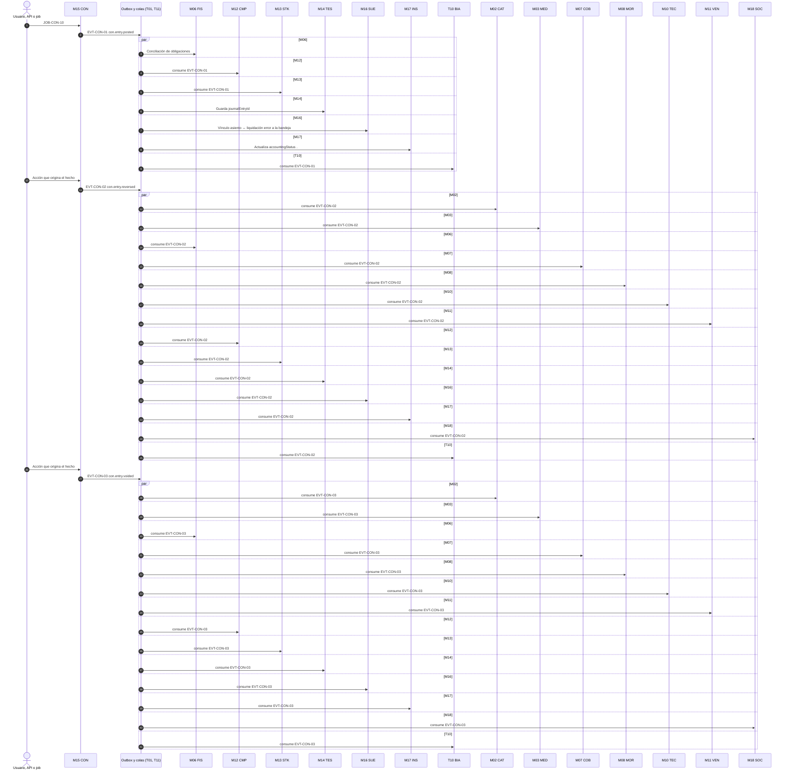

| Evento | Consumidores externos (T11 §12.3) | Efecto declarado por el consumidor (§12 de su anexo) |
|---|---|---|
| EVT-CON-01 `con.entry.posted` | M06, M12, M13, M14, M16, M17, T10 | M06: Conciliación de obligaciones; M14: Guarda `journalEntryId`; M16: Vínculo asiento ↔ liquidación; error a la bandeja; M17: Actualiza `accountingStatus`. |
| EVT-CON-02 `con.entry.reversed` | M02, M03, M06, M07, M08, M10, M11, M12, M13, M14, M16, M17, M18, T10 | No declarado en el §12 del consumidor |
| EVT-CON-03 `con.entry.voided` | M02, M03, M06, M07, M08, M10, M11, M12, M13, M14, M16, M17, M18, T10 | No declarado en el §12 del consumidor |

### SEC-CON-02 — CON: Períodos contables

**Agregados:** `con.period.*`. **Productor:** M15 Contabilidad (M15 §12; catálogo T11 §12.3).

**Cubre:** EVT-CON-06 `con.period.locked`, EVT-CON-07 `con.period.closed`, EVT-CON-08 `con.period.reopened`.

Parte de estos hechos también aparece, con el detalle del caso de negocio, en A8 de `06-secuencias-y-estados.md` §3.

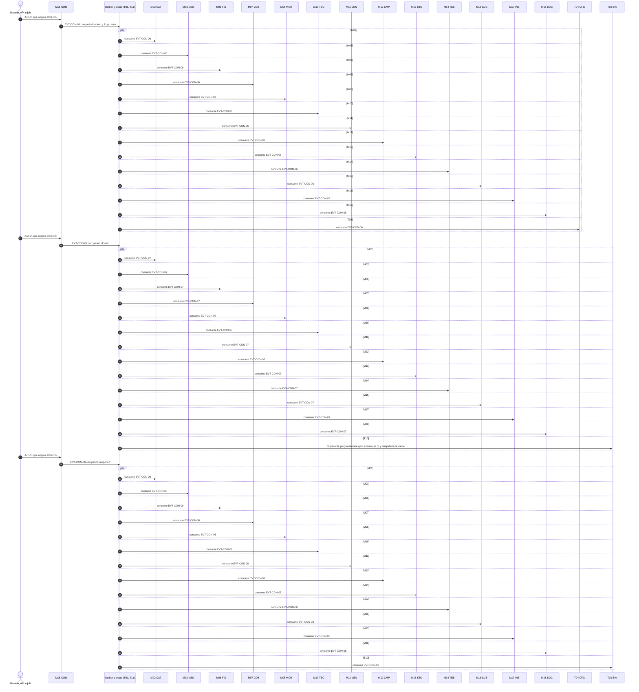

| Evento | Consumidores externos (T11 §12.3) | Efecto declarado por el consumidor (§12 de su anexo) |
|---|---|---|
| EVT-CON-06 `con.period.locked` | M02, M03, M06, M07, M08, M10, M11, M12, M13, M14, M16, M17, M18, T04 | No declarado en el §12 del consumidor |
| EVT-CON-07 `con.period.closed` | M02, M03, M06, M07, M08, M10, M11, M12, M13, M14, M16, M17, M18, T10 | T10: Disparo de programaciones por evento (§9.3) y snapshots de cierre |
| EVT-CON-08 `con.period.reopened` | M02, M03, M06, M07, M08, M10, M11, M12, M13, M14, M16, M17, M18, T10 | No declarado en el §12 del consumidor |

### SEC-CON-03 — CON: hechos complementarios (Bandeja de eventos a contabilizar, Ejercicios, chart, inflationAdjustment, reconciliation, Presupuestos, Comp…)

**Agregados:** `con.event.*`, `con.fiscalYear.*`, `con.chart.*`, `con.inflationAdjustment.*`, `con.reconciliation.*`, `con.budget.*`, `con.commitment.*`. **Productor:** M15 Contabilidad (M15 §12; catálogo T11 §12.3).

**Cubre:** EVT-CON-04 `con.event.pendingConfiguration`, EVT-CON-05 `con.event.failed`, EVT-CON-09 `con.fiscalYear.closed`, EVT-CON-10 `con.chart.approved`, EVT-CON-12 `con.inflationAdjustment.posted`, EVT-CON-13 `con.reconciliation.differenceDetected`, EVT-CON-14 `con.budget.approved`, EVT-CON-15 `con.commitment.exceeded`.

**API y jobs disparadores (citados junto al evento en el anexo productor):** JOB-CON-03.

Parte de estos hechos también aparece, con el detalle del caso de negocio, en A8 de `06-secuencias-y-estados.md` §3.

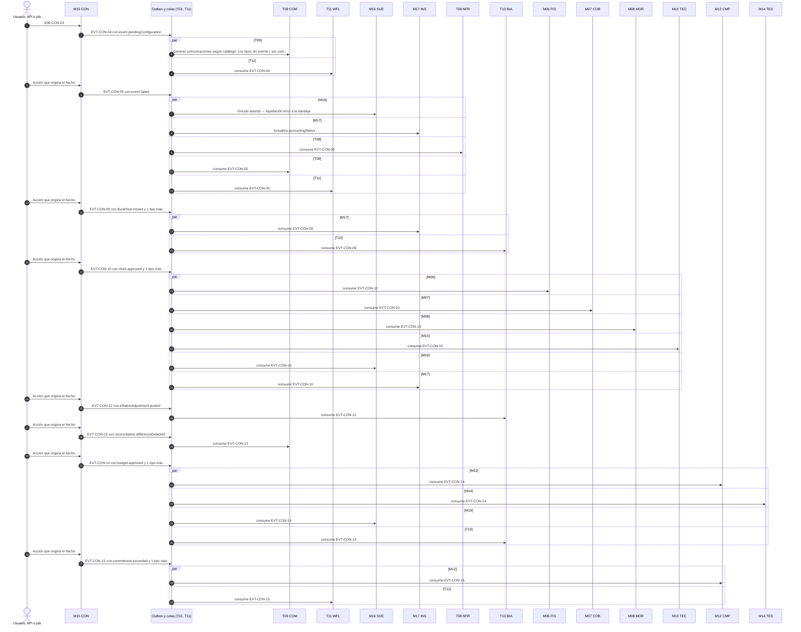

| Evento | Consumidores externos (T11 §12.3) | Efecto declarado por el consumidor (§12 de su anexo) |
|---|---|---|
| EVT-CON-04 `con.event.pendingConfiguration` | T09, T11 | T09: Generar comunicaciones según catálogo. Los tipos sin evento (`soc.cemeteryAct.scheduled`, `soc.loan.overdue`) entran por el comando `com.communications.emit` (§9.7). |
| EVT-CON-05 `con.event.failed` | M16, M17, T08, T09, T11 | M16: Vínculo asiento ↔ liquidación; error a la bandeja; M17: Actualiza `accountingStatus`. |
| EVT-CON-09 `con.fiscalYear.closed` | M17, T10 | No declarado en el §12 del consumidor |
| EVT-CON-10 `con.chart.approved` | M06, M07, M08, M10, M16, M17 | No declarado en el §12 del consumidor |
| EVT-CON-12 `con.inflationAdjustment.posted` | T10 | No declarado en el §12 del consumidor |
| EVT-CON-13 `con.reconciliation.differenceDetected` | T09 | No declarado en el §12 del consumidor |
| EVT-CON-14 `con.budget.approved` | M12, M14, M16, T10 | No declarado en el §12 del consumidor |
| EVT-CON-15 `con.commitment.exceeded` | M12, T11 | No declarado en el §12 del consumidor |

### SEC-CON-04 — CON: hechos complementarios (simulation, export, statements)

**Agregados:** `con.simulation.*`, `con.export.*`, `con.statements.*`. **Productor:** M15 Contabilidad (M15 §12; catálogo T11 §12.3).

**Cubre:** EVT-CON-16 `con.simulation.completed`, EVT-CON-17 `con.export.completed`, EVT-CON-18 `con.statements.issued`.

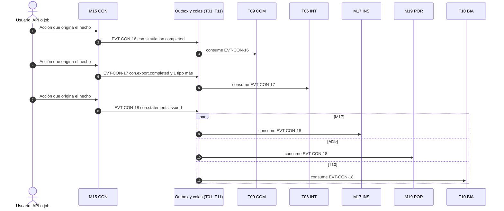

| Evento | Consumidores externos (T11 §12.3) | Efecto declarado por el consumidor (§12 de su anexo) |
|---|---|---|
| EVT-CON-16 `con.simulation.completed` | T09 | No declarado en el §12 del consumidor |
| EVT-CON-17 `con.export.completed` | T06 | No declarado en el §12 del consumidor |
| EVT-CON-18 `con.statements.issued` | M17, M19, T10 | No declarado en el §12 del consumidor |

## M16 — SUE Personal y sueldos

### SEC-SUE-01 — SUE: Legajos

**Agregados:** `sue.employee.*`. **Productor:** M16 Personal y sueldos (M16 §12; catálogo T11 §12.3).

**Cubre:** EVT-SUE-01 `sue.employee.hired`, EVT-SUE-02 `sue.employee.assignmentChanged`, EVT-SUE-03 `sue.employee.terminated`, EVT-SUE-04 `sue.employee.reinstated`.

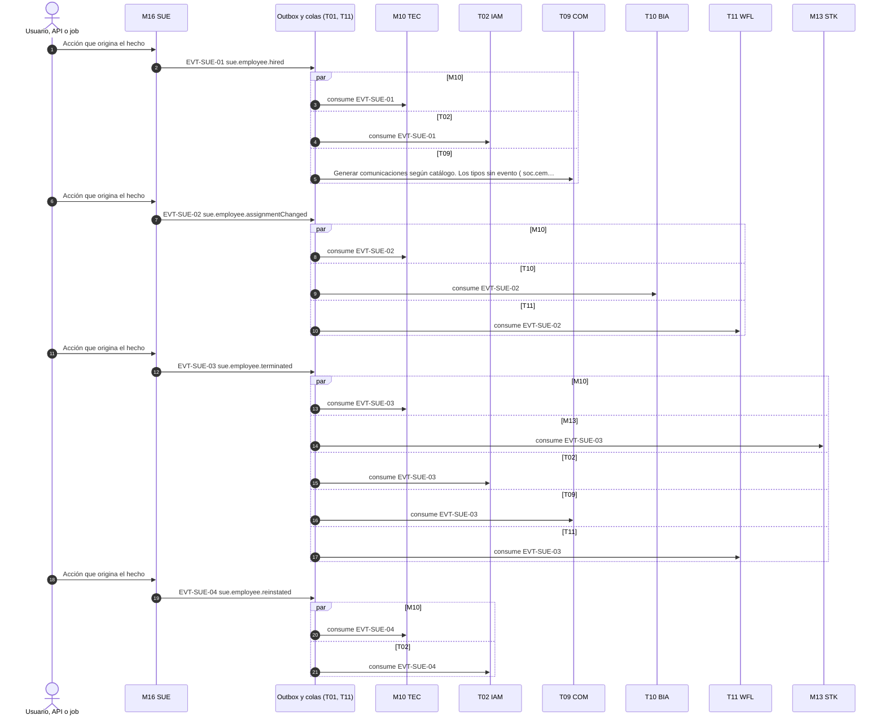

| Evento | Consumidores externos (T11 §12.3) | Efecto declarado por el consumidor (§12 de su anexo) |
|---|---|---|
| EVT-SUE-01 `sue.employee.hired` | M10, T02, T09 | T09: Generar comunicaciones según catálogo. Los tipos sin evento (`soc.cemeteryAct.scheduled`, `soc.loan.overdue`) entran por el comando `com.communications.emit` (§9.7). |
| EVT-SUE-02 `sue.employee.assignmentChanged` | M10, T10, T11 | No declarado en el §12 del consumidor |
| EVT-SUE-03 `sue.employee.terminated` | M10, M13, T02, T09, T11 | No declarado en el §12 del consumidor |
| EVT-SUE-04 `sue.employee.reinstated` | M10, T02 | No declarado en el §12 del consumidor |

### SEC-SUE-02 — SUE: Liquidaciones

**Agregados:** `sue.payrollRun.*`. **Productor:** M16 Personal y sueldos (M16 §12; catálogo T11 §12.3).

**Cubre:** EVT-SUE-09 `sue.payrollRun.calculated`, EVT-SUE-10 `sue.payrollRun.submitted`, EVT-SUE-11 `sue.payrollRun.approved`, EVT-SUE-12 `sue.payrollRun.voided`, EVT-SUE-13 `sue.payrollRun.closed`.

**API y jobs disparadores (citados junto al evento en el anexo productor):** JOB-SUE-03, JOB-SUE-04.

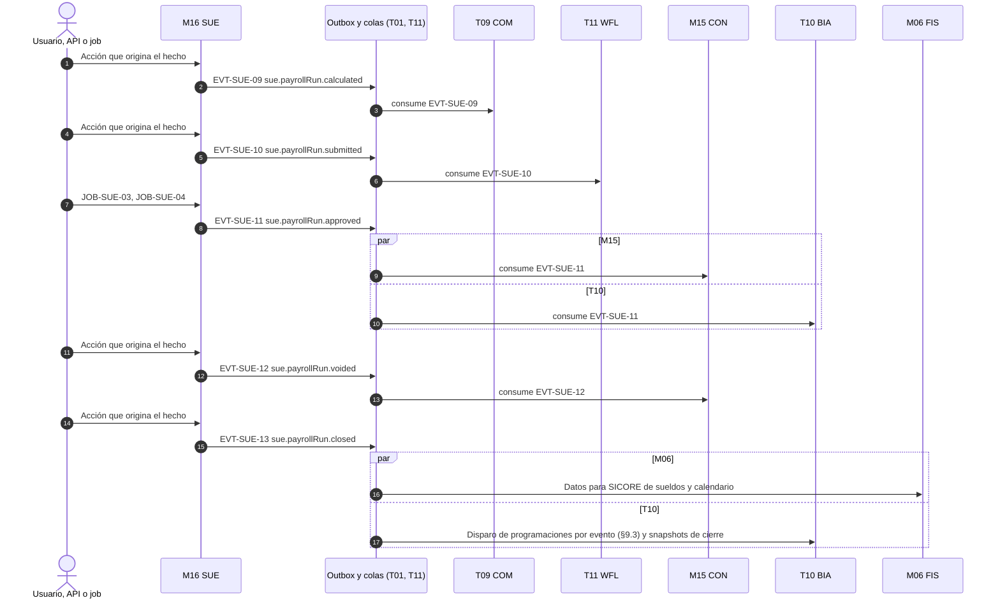

| Evento | Consumidores externos (T11 §12.3) | Efecto declarado por el consumidor (§12 de su anexo) |
|---|---|---|
| EVT-SUE-09 `sue.payrollRun.calculated` | T09 | No declarado en el §12 del consumidor |
| EVT-SUE-10 `sue.payrollRun.submitted` | T11 | No declarado en el §12 del consumidor |
| EVT-SUE-11 `sue.payrollRun.approved` | M15, T10 | No declarado en el §12 del consumidor |
| EVT-SUE-12 `sue.payrollRun.voided` | M15 | No declarado en el §12 del consumidor |
| EVT-SUE-13 `sue.payrollRun.closed` | M06, T10 | M06: Datos para SICORE de sueldos y calendario; T10: Disparo de programaciones por evento (§9.3) y snapshots de cierre |

### SEC-SUE-03 — SUE: Recibos de sueldo

**Agregados:** `sue.payslip.*`. **Productor:** M16 Personal y sueldos (M16 §12; catálogo T11 §12.3).

**Cubre:** EVT-SUE-14 `sue.payslip.issued`, EVT-SUE-15 `sue.payslip.acknowledged`, EVT-SUE-16 `sue.payslip.voided`.

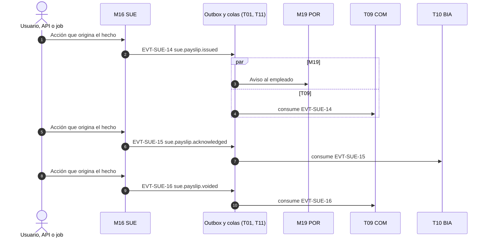

| Evento | Consumidores externos (T11 §12.3) | Efecto declarado por el consumidor (§12 de su anexo) |
|---|---|---|
| EVT-SUE-14 `sue.payslip.issued` | M19, T09 | M19: Aviso al empleado |
| EVT-SUE-15 `sue.payslip.acknowledged` | T10 | No declarado en el §12 del consumidor |
| EVT-SUE-16 `sue.payslip.voided` | T09 | No declarado en el §12 del consumidor |

### SEC-SUE-04 — SUE: hechos complementarios (payrollConfig, Escalas salariales, Novedades, leave, Solicitudes de pago a M14, Presentaciones, incomeTax)

**Agregados:** `sue.payrollConfig.*`, `sue.salaryScale.*`, `sue.novelty.*`, `sue.leave.*`, `sue.paymentRequest.*`, `sue.filing.*`, `sue.incomeTax.*`. **Productor:** M16 Personal y sueldos (M16 §12; catálogo T11 §12.3).

**Cubre:** EVT-SUE-05 `sue.payrollConfig.published`, EVT-SUE-06 `sue.salaryScale.published`, EVT-SUE-07 `sue.novelty.approved`, EVT-SUE-08 `sue.leave.requested`, EVT-SUE-17 `sue.paymentRequest.created`, EVT-SUE-27 `sue.paymentRequest.cancelled`, EVT-SUE-18 `sue.filing.generated`, EVT-SUE-19 `sue.incomeTax.annualSettled`.

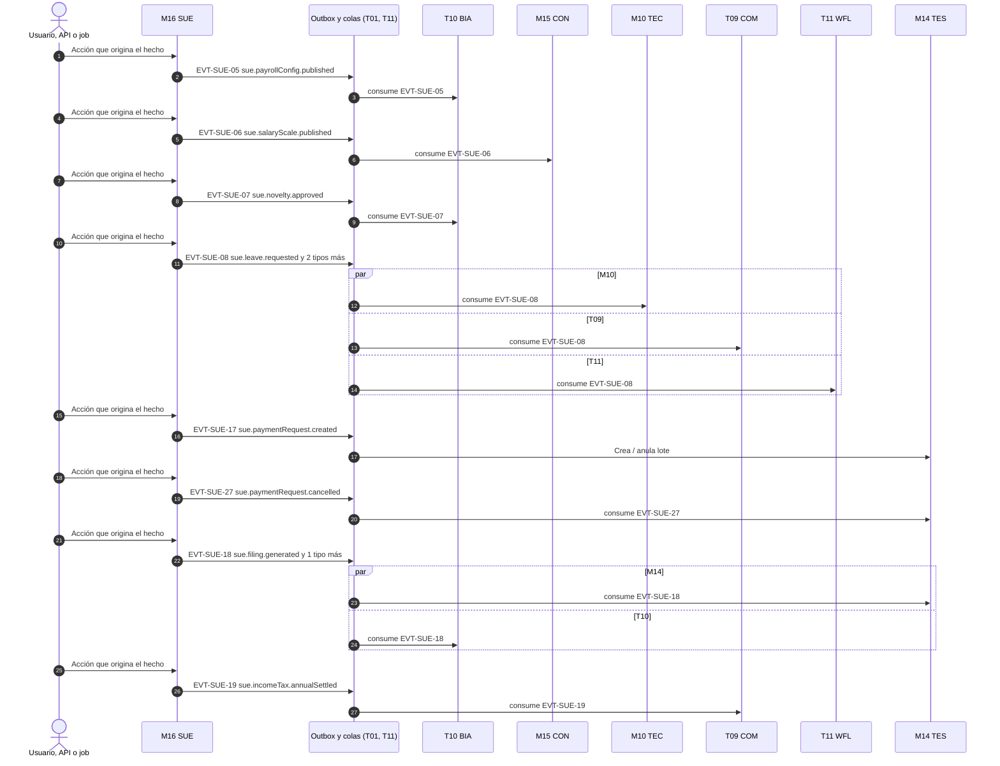

| Evento | Consumidores externos (T11 §12.3) | Efecto declarado por el consumidor (§12 de su anexo) |
|---|---|---|
| EVT-SUE-05 `sue.payrollConfig.published` | T10 | No declarado en el §12 del consumidor |
| EVT-SUE-06 `sue.salaryScale.published` | M15 | No declarado en el §12 del consumidor |
| EVT-SUE-07 `sue.novelty.approved` | T10 | No declarado en el §12 del consumidor |
| EVT-SUE-08 `sue.leave.requested` | M10, T09, T11 | No declarado en el §12 del consumidor |
| EVT-SUE-17 `sue.paymentRequest.created` | M14 | M14: Crea / anula lote |
| EVT-SUE-27 `sue.paymentRequest.cancelled` | M14 | No declarado en el §12 del consumidor |
| EVT-SUE-18 `sue.filing.generated` | M14, T10 | No declarado en el §12 del consumidor |
| EVT-SUE-19 `sue.incomeTax.annualSettled` | T09 | No declarado en el §12 del consumidor |

### SEC-SUE-05 — SUE: hechos complementarios (Egresos y liquidación final, Certificados de trabajo, Accidentes de trabajo, Juicios laborales, externalPayro…)

**Agregados:** `sue.termination.*`, `sue.certificate.*`, `sue.accident.*`, `sue.lawsuit.*`, `sue.externalPayroll.*`, `sue.laborCost.*`, `sue.serviceDebt.*`, `sue.payrollFiles.*`. **Productor:** M16 Personal y sueldos (M16 §12; catálogo T11 §12.3).

**Cubre:** EVT-SUE-20 `sue.termination.approved`, EVT-SUE-21 `sue.certificate.issued`, EVT-SUE-22 `sue.accident.reported`, EVT-SUE-23 `sue.lawsuit.provisionChanged`, EVT-SUE-24 `sue.externalPayroll.approved`, EVT-SUE-25 `sue.laborCost.projected`, EVT-SUE-26 `sue.serviceDebt.deducted`, EVT-SUE-28 `sue.payrollFiles.requested`.

**API y jobs disparadores (citados junto al evento en el anexo productor):** API-SUE-75, JOB-SUE-20, API-SUE-63, JOB-SUE-10.

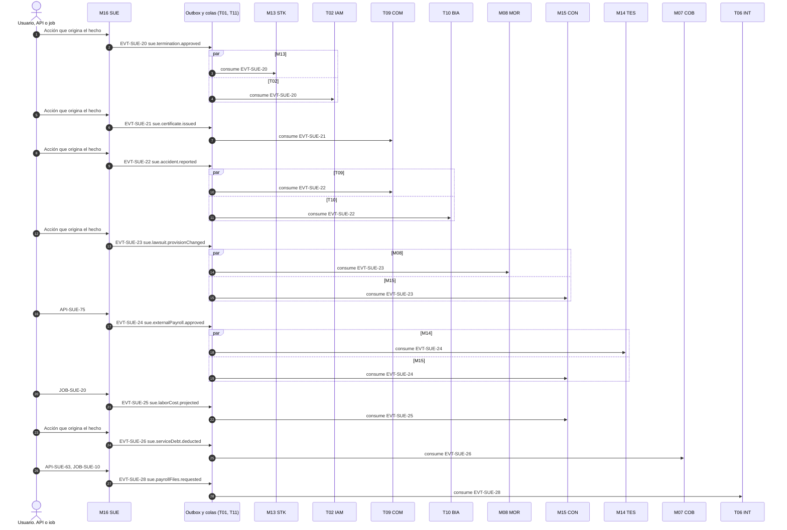

| Evento | Consumidores externos (T11 §12.3) | Efecto declarado por el consumidor (§12 de su anexo) |
|---|---|---|
| EVT-SUE-20 `sue.termination.approved` | M13, T02 | No declarado en el §12 del consumidor |
| EVT-SUE-21 `sue.certificate.issued` | T09 | No declarado en el §12 del consumidor |
| EVT-SUE-22 `sue.accident.reported` | T09, T10 | No declarado en el §12 del consumidor |
| EVT-SUE-23 `sue.lawsuit.provisionChanged` | M08, M15 | No declarado en el §12 del consumidor |
| EVT-SUE-24 `sue.externalPayroll.approved` | M14, M15 | No declarado en el §12 del consumidor |
| EVT-SUE-25 `sue.laborCost.projected` | M15 | No declarado en el §12 del consumidor |
| EVT-SUE-26 `sue.serviceDebt.deducted` | M07 | No declarado en el §12 del consumidor |
| EVT-SUE-28 `sue.payrollFiles.requested` | T06 | No declarado en el §12 del consumidor |

## M17 — INS Institucional

### SEC-INS-01 — INS: Relación institucional del asociado

**Agregados:** `ins.membership.*`. **Productor:** M17 Institucional (M17 §12; catálogo T11 §12.3).

**Cubre:** EVT-INS-01 `ins.membership.requested`, EVT-INS-02 `ins.membership.approved`, EVT-INS-03 `ins.membership.rejected`, EVT-INS-04 `ins.membership.suspended`, EVT-INS-05 `ins.membership.exitRequested`, EVT-INS-06 `ins.membership.exited`.

**API y jobs disparadores (citados junto al evento en el anexo productor):** JOB-INS-07.

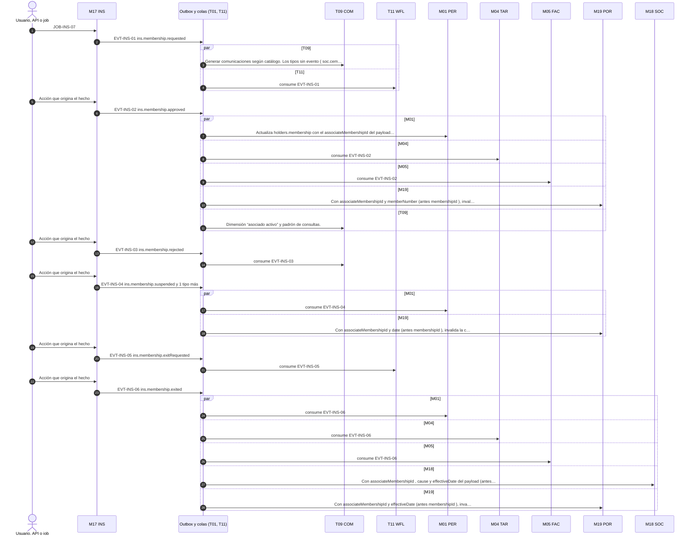

| Evento | Consumidores externos (T11 §12.3) | Efecto declarado por el consumidor (§12 de su anexo) |
|---|---|---|
| EVT-INS-01 `ins.membership.requested` | T09, T11 | T09: Generar comunicaciones según catálogo. Los tipos sin evento (`soc.cemeteryAct.scheduled`, `soc.loan.overdue`) entran por el comando `com.communications.emit` (§9.7). |
| EVT-INS-02 `ins.membership.approved` | M01, M04, M05, M19, T09 | M01: Actualiza `holders.membership` con el `associateMembershipId` del payload (antes `membershipId`; PA-INS-12).; M19: Con `associateMembershipId` y `memberNumber` (antes `membershipId`), invalida la caché de "Mi asoci… |
| EVT-INS-03 `ins.membership.rejected` | T09 | No declarado en el §12 del consumidor |
| EVT-INS-04 `ins.membership.suspended` | M01, M19 | M19: Con `associateMembershipId` y `date` (antes `membershipId`), invalida la caché de "Mi asociación" (PAN-POR-102) y actualiza el estado de asociado mostrado. Consumo declarado en T11 §12 |
| EVT-INS-05 `ins.membership.exitRequested` | T11 | No declarado en el §12 del consumidor |
| EVT-INS-06 `ins.membership.exited` | M01, M04, M05, M18, M19 | M18: Con `associateMembershipId`, `cause` y `effectiveDate` del payload (antes `membershipId`), registra con fecha efectiva que el titular dejó de ser asociado y abre una tarea de revisión de elegibilidad para los benef… |

### SEC-INS-02 — INS: hechos complementarios (member, Libro mayor de capital, Transferencias de capital, Reembolsos de capital, Distribución de excedentes)

**Agregados:** `ins.member.*`, `ins.capitalMovement.*`, `ins.capitalTransfer.*`, `ins.capitalRefund.*`, `ins.surplusDistribution.*`. **Productor:** M17 Institucional (M17 §12; catálogo T11 §12.3).

**Cubre:** EVT-INS-07 `ins.member.withoutServices`, EVT-INS-08 `ins.capitalMovement.recorded`, EVT-INS-09 `ins.capitalMovement.reversed`, EVT-INS-10 `ins.capitalTransfer.executed`, EVT-INS-11 `ins.capitalRefund.approved`, EVT-INS-12 `ins.capitalRefund.paid`, EVT-INS-13 `ins.surplusDistribution.approved`.

**API y jobs disparadores (citados junto al evento en el anexo productor):** JOB-INS-07, JOB-INS-01.

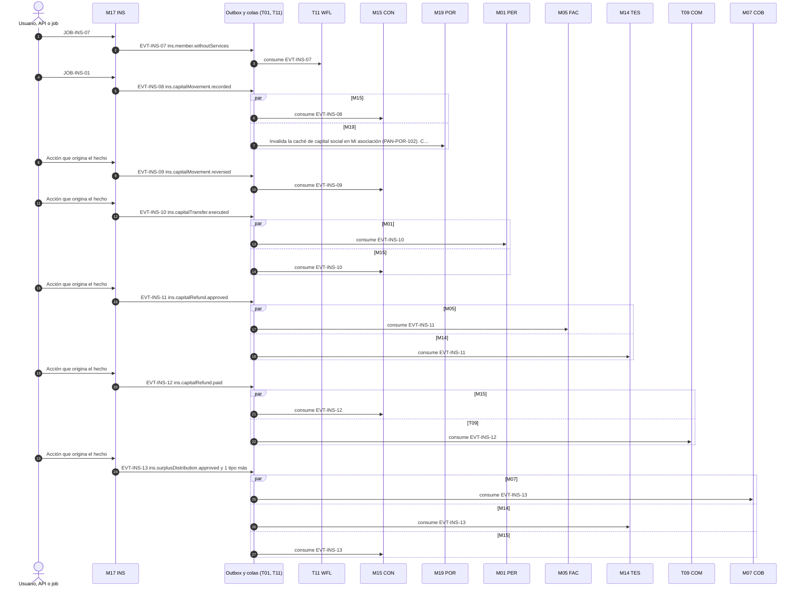

| Evento | Consumidores externos (T11 §12.3) | Efecto declarado por el consumidor (§12 de su anexo) |
|---|---|---|
| EVT-INS-07 `ins.member.withoutServices` | T11 | No declarado en el §12 del consumidor |
| EVT-INS-08 `ins.capitalMovement.recorded` | M15, M19 | M19: Invalida la caché de capital social en "Mi asociación" (PAN-POR-102). Consumo declarado en T11 §12 |
| EVT-INS-09 `ins.capitalMovement.reversed` | M15 | No declarado en el §12 del consumidor |
| EVT-INS-10 `ins.capitalTransfer.executed` | M01, M15 | No declarado en el §12 del consumidor |
| EVT-INS-11 `ins.capitalRefund.approved` | M05, M14 | No declarado en el §12 del consumidor |
| EVT-INS-12 `ins.capitalRefund.paid` | M15, T09 | No declarado en el §12 del consumidor |
| EVT-INS-13 `ins.surplusDistribution.approved` | M07, M14, M15 | No declarado en el §12 del consumidor |

### SEC-INS-03 — INS: hechos complementarios (Reuniones y asambleas, Actas, Resoluciones, Padrones, Mandatos, fee, Presentaciones INAES)

**Agregados:** `ins.meeting.*`, `ins.minute.*`, `ins.resolution.*`, `ins.roster.*`, `ins.mandate.*`, `ins.fee.*`, `ins.inaesReport.*`. **Productor:** M17 Institucional (M17 §12; catálogo T11 §12.3).

**Cubre:** EVT-INS-14 `ins.meeting.convened`, EVT-INS-15 `ins.meeting.closed`, EVT-INS-16 `ins.minute.signed`, EVT-INS-17 `ins.resolution.created`, EVT-INS-18 `ins.roster.finalized`, EVT-INS-19 `ins.mandate.started`, EVT-INS-20 `ins.fee.settled`, EVT-INS-21 `ins.inaesReport.submitted`.

**API y jobs disparadores (citados junto al evento en el anexo productor):** JOB-INS-10.

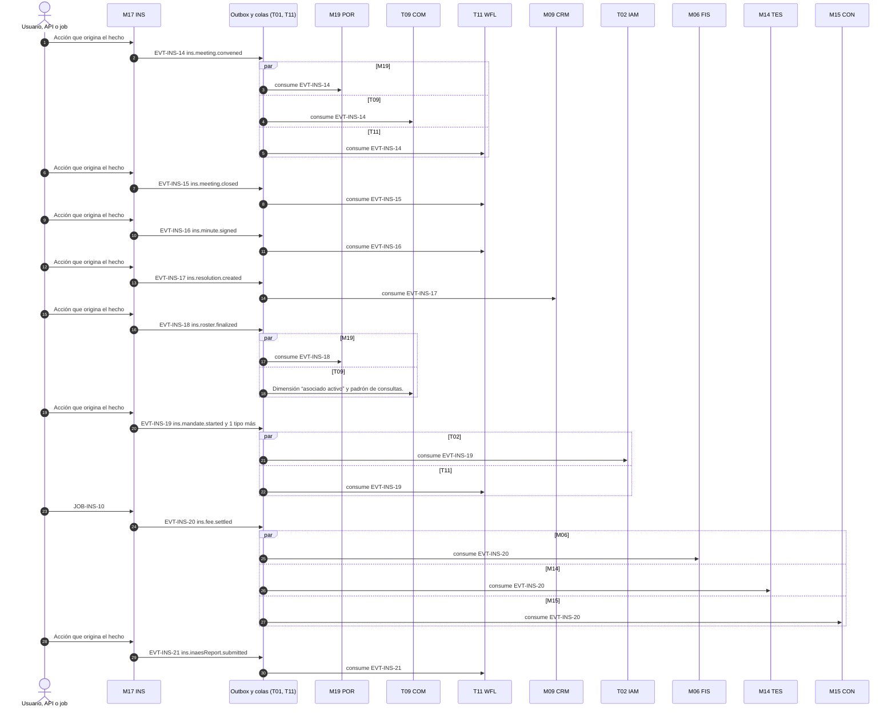

| Evento | Consumidores externos (T11 §12.3) | Efecto declarado por el consumidor (§12 de su anexo) |
|---|---|---|
| EVT-INS-14 `ins.meeting.convened` | M19, T09, T11 | No declarado en el §12 del consumidor |
| EVT-INS-15 `ins.meeting.closed` | T11 | No declarado en el §12 del consumidor |
| EVT-INS-16 `ins.minute.signed` | T11 | No declarado en el §12 del consumidor |
| EVT-INS-17 `ins.resolution.created` | M09 | No declarado en el §12 del consumidor |
| EVT-INS-18 `ins.roster.finalized` | M19, T09 | T09: Dimensión “asociado activo” y padrón de consultas. |
| EVT-INS-19 `ins.mandate.started` | T02, T11 | No declarado en el §12 del consumidor |
| EVT-INS-20 `ins.fee.settled` | M06, M14, M15 | No declarado en el §12 del consumidor |
| EVT-INS-21 `ins.inaesReport.submitted` | T11 | No declarado en el §12 del consumidor |

## M18 — SOC Servicios sociales y flota

### SEC-SOC-01 — SOC: housing

**Agregados:** `soc.housing.*`. **Productor:** M18 Servicios sociales y flota (M18 §12; catálogo T11 §12.3).

**Cubre:** EVT-SOC-08 `soc.housing.allocated`, EVT-SOC-09 `soc.housing.materialWithdrawn`, EVT-SOC-10 `soc.housing.certificateLiquidated`, EVT-SOC-11 `soc.housing.priceUpdated`.

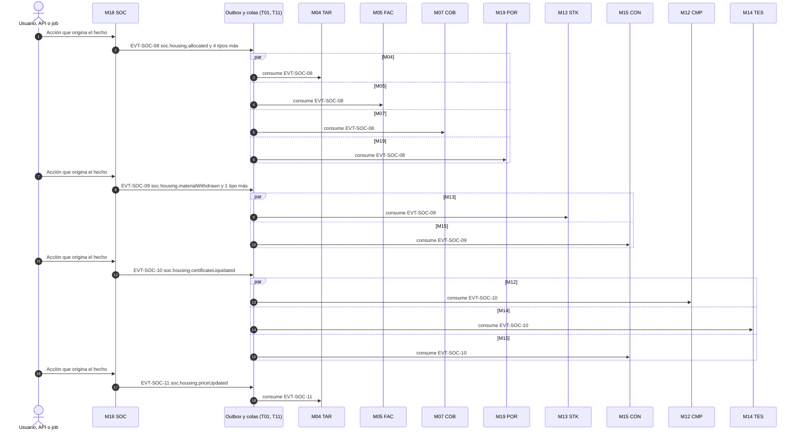

| Evento | Consumidores externos (T11 §12.3) | Efecto declarado por el consumidor (§12 de su anexo) |
|---|---|---|
| EVT-SOC-08 `soc.housing.allocated` | M04, M05, M07, M19 | No declarado en el §12 del consumidor |
| EVT-SOC-09 `soc.housing.materialWithdrawn` | M13, M15 | No declarado en el §12 del consumidor |
| EVT-SOC-10 `soc.housing.certificateLiquidated` | M12, M14, M15 | No declarado en el §12 del consumidor |
| EVT-SOC-11 `soc.housing.priceUpdated` | M04 | No declarado en el §12 del consumidor |

### SEC-SOC-02 — SOC: Vehículos

**Agregados:** `soc.vehicle.*`. **Productor:** M18 Servicios sociales y flota (M18 §12; catálogo T11 §12.3).

**Cubre:** EVT-SOC-12 `soc.vehicle.usageRecorded`, EVT-SOC-13 `soc.vehicle.unfit`, EVT-SOC-17 `soc.vehicle.usageVoided`.

**API y jobs disparadores (citados junto al evento en el anexo productor):** JOB-SOC-08, JOB-SOC-09.

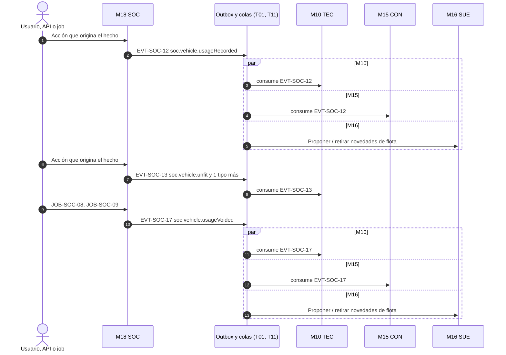

| Evento | Consumidores externos (T11 §12.3) | Efecto declarado por el consumidor (§12 de su anexo) |
|---|---|---|
| EVT-SOC-12 `soc.vehicle.usageRecorded` | M10, M15, M16 | M16: Proponer / retirar novedades de flota |
| EVT-SOC-13 `soc.vehicle.unfit` | M10 | No declarado en el §12 del consumidor |
| EVT-SOC-17 `soc.vehicle.usageVoided` | M10, M15, M16 | M16: Proponer / retirar novedades de flota |

### SEC-SOC-03 — SOC: hechos complementarios (Adherentes, Solicitudes de prestación, deathSubsidy, Derechos de sepultura, Inhumaciones, exhumaciones, trasl…)

**Agregados:** `soc.dependent.*`, `soc.benefitRequest.*`, `soc.deathSubsidy.*`, `soc.burialRight.*`, `soc.cemeteryAct.*`, `soc.trip.*`, `soc.tripSettlement.*`. **Productor:** M18 Servicios sociales y flota (M18 §12; catálogo T11 §12.3).

**Cubre:** EVT-SOC-01 `soc.dependent.added`, EVT-SOC-02 `soc.dependent.majorityReached`, EVT-SOC-03 `soc.benefitRequest.decided`, EVT-SOC-04 `soc.deathSubsidy.approved`, EVT-SOC-05 `soc.burialRight.formalized`, EVT-SOC-06 `soc.cemeteryAct.performed`, EVT-SOC-07 `soc.trip.completed`, EVT-SOC-14 `soc.tripSettlement.approved`.

**API y jobs disparadores (citados junto al evento en el anexo productor):** JOB-SOC-01, API-SOC-006.

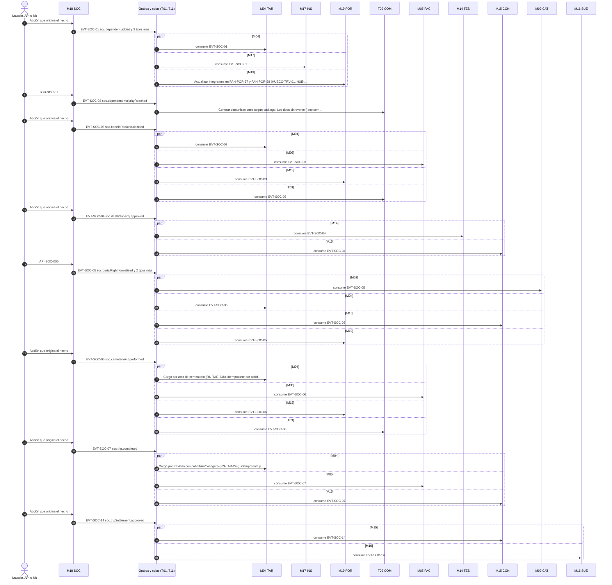

| Evento | Consumidores externos (T11 §12.3) | Efecto declarado por el consumidor (§12 de su anexo) |
|---|---|---|
| EVT-SOC-01 `soc.dependent.added` | M04, M17, M19 | M19: Actualizar integrantes en PAN-POR-67 y PAN-POR-98 (HUECO-TRV-01, HUE-SRV-04) |
| EVT-SOC-02 `soc.dependent.majorityReached` | T09 | T09: Generar comunicaciones según catálogo. Los tipos sin evento (`soc.cemeteryAct.scheduled`, `soc.loan.overdue`) entran por el comando `com.communications.emit` (§9.7). |
| EVT-SOC-03 `soc.benefitRequest.decided` | M04, M05, M19, T09 | No declarado en el §12 del consumidor |
| EVT-SOC-04 `soc.deathSubsidy.approved` | M14, M15 | No declarado en el §12 del consumidor |
| EVT-SOC-05 `soc.burialRight.formalized` | M02, M04, M15, M19 | No declarado en el §12 del consumidor |
| EVT-SOC-06 `soc.cemeteryAct.performed` | M04, M05, M19, T09 | M04: Cargo por acto de cementerio (RN-TAR-248), idempotente por `actId`. |
| EVT-SOC-07 `soc.trip.completed` | M04, M05, M15 | M04: Cargo por traslado con cobertura/coseguro (RN-TAR-249), idempotente por `tripId`. |
| EVT-SOC-14 `soc.tripSettlement.approved` | M15, M16 | No declarado en el §12 del consumidor |

### SEC-SOC-04 — SOC: hechos complementarios (Choferes, agreementCost)

**Agregados:** `soc.driver.*`, `soc.agreementCost.*`. **Productor:** M18 Servicios sociales y flota (M18 §12; catálogo T11 §12.3).

**Cubre:** EVT-SOC-15 `soc.driver.timeReported`, EVT-SOC-16 `soc.agreementCost.recorded`.

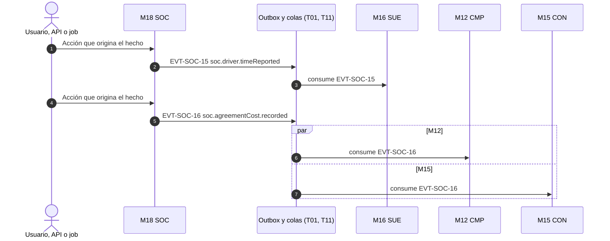

| Evento | Consumidores externos (T11 §12.3) | Efecto declarado por el consumidor (§12 de su anexo) |
|---|---|---|
| EVT-SOC-15 `soc.driver.timeReported` | M16 | No declarado en el §12 del consumidor |
| EVT-SOC-16 `soc.agreementCost.recorded` | M12, M15 | No declarado en el §12 del consumidor |

## Cobertura de la parte T

| Evento | Productor | Secuencia | También en |
|---|---|---|---|
| EVT-CON-01 | M15 | SEC-CON-01 | A8 (`06-secuencias-y-estados.md`) |
| EVT-CON-02 | M15 | SEC-CON-01 | — |
| EVT-CON-03 | M15 | SEC-CON-01 | — |
| EVT-CON-06 | M15 | SEC-CON-02 | A8 (`06-secuencias-y-estados.md`) |
| EVT-CON-07 | M15 | SEC-CON-02 | A8 (`06-secuencias-y-estados.md`) |
| EVT-CON-08 | M15 | SEC-CON-02 | A8 (`06-secuencias-y-estados.md`) |
| EVT-CON-04 | M15 | SEC-CON-03 | A8 (`06-secuencias-y-estados.md`) |
| EVT-CON-05 | M15 | SEC-CON-03 | A8 (`06-secuencias-y-estados.md`) |
| EVT-CON-09 | M15 | SEC-CON-03 | — |
| EVT-CON-10 | M15 | SEC-CON-03 | — |
| EVT-CON-12 | M15 | SEC-CON-03 | — |
| EVT-CON-13 | M15 | SEC-CON-03 | — |
| EVT-CON-14 | M15 | SEC-CON-03 | — |
| EVT-CON-15 | M15 | SEC-CON-03 | — |
| EVT-CON-16 | M15 | SEC-CON-04 | — |
| EVT-CON-17 | M15 | SEC-CON-04 | — |
| EVT-CON-18 | M15 | SEC-CON-04 | — |
| EVT-SUE-01 | M16 | SEC-SUE-01 | — |
| EVT-SUE-02 | M16 | SEC-SUE-01 | — |
| EVT-SUE-03 | M16 | SEC-SUE-01 | — |
| EVT-SUE-04 | M16 | SEC-SUE-01 | — |
| EVT-SUE-09 | M16 | SEC-SUE-02 | — |
| EVT-SUE-10 | M16 | SEC-SUE-02 | — |
| EVT-SUE-11 | M16 | SEC-SUE-02 | — |
| EVT-SUE-12 | M16 | SEC-SUE-02 | — |
| EVT-SUE-13 | M16 | SEC-SUE-02 | — |
| EVT-SUE-14 | M16 | SEC-SUE-03 | — |
| EVT-SUE-15 | M16 | SEC-SUE-03 | — |
| EVT-SUE-16 | M16 | SEC-SUE-03 | — |
| EVT-SUE-05 | M16 | SEC-SUE-04 | — |
| EVT-SUE-06 | M16 | SEC-SUE-04 | — |
| EVT-SUE-07 | M16 | SEC-SUE-04 | — |
| EVT-SUE-08 | M16 | SEC-SUE-04 | — |
| EVT-SUE-17 | M16 | SEC-SUE-04 | — |
| EVT-SUE-27 | M16 | SEC-SUE-04 | — |
| EVT-SUE-18 | M16 | SEC-SUE-04 | — |
| EVT-SUE-19 | M16 | SEC-SUE-04 | — |
| EVT-SUE-20 | M16 | SEC-SUE-05 | — |
| EVT-SUE-21 | M16 | SEC-SUE-05 | — |
| EVT-SUE-22 | M16 | SEC-SUE-05 | — |
| EVT-SUE-23 | M16 | SEC-SUE-05 | — |
| EVT-SUE-24 | M16 | SEC-SUE-05 | — |
| EVT-SUE-25 | M16 | SEC-SUE-05 | — |
| EVT-SUE-26 | M16 | SEC-SUE-05 | — |
| EVT-SUE-28 | M16 | SEC-SUE-05 | — |
| EVT-INS-01 | M17 | SEC-INS-01 | — |
| EVT-INS-02 | M17 | SEC-INS-01 | — |
| EVT-INS-03 | M17 | SEC-INS-01 | — |
| EVT-INS-04 | M17 | SEC-INS-01 | — |
| EVT-INS-05 | M17 | SEC-INS-01 | — |
| EVT-INS-06 | M17 | SEC-INS-01 | — |
| EVT-INS-07 | M17 | SEC-INS-02 | — |
| EVT-INS-08 | M17 | SEC-INS-02 | — |
| EVT-INS-09 | M17 | SEC-INS-02 | — |
| EVT-INS-10 | M17 | SEC-INS-02 | — |
| EVT-INS-11 | M17 | SEC-INS-02 | — |
| EVT-INS-12 | M17 | SEC-INS-02 | — |
| EVT-INS-13 | M17 | SEC-INS-02 | — |
| EVT-INS-14 | M17 | SEC-INS-03 | — |
| EVT-INS-15 | M17 | SEC-INS-03 | — |
| EVT-INS-16 | M17 | SEC-INS-03 | — |
| EVT-INS-17 | M17 | SEC-INS-03 | — |
| EVT-INS-18 | M17 | SEC-INS-03 | — |
| EVT-INS-19 | M17 | SEC-INS-03 | — |
| EVT-INS-20 | M17 | SEC-INS-03 | — |
| EVT-INS-21 | M17 | SEC-INS-03 | — |
| EVT-SOC-08 | M18 | SEC-SOC-01 | — |
| EVT-SOC-09 | M18 | SEC-SOC-01 | — |
| EVT-SOC-10 | M18 | SEC-SOC-01 | — |
| EVT-SOC-11 | M18 | SEC-SOC-01 | — |
| EVT-SOC-12 | M18 | SEC-SOC-02 | — |
| EVT-SOC-13 | M18 | SEC-SOC-02 | — |
| EVT-SOC-17 | M18 | SEC-SOC-02 | — |
| EVT-SOC-01 | M18 | SEC-SOC-03 | — |
| EVT-SOC-02 | M18 | SEC-SOC-03 | — |
| EVT-SOC-03 | M18 | SEC-SOC-03 | — |
| EVT-SOC-04 | M18 | SEC-SOC-03 | — |
| EVT-SOC-05 | M18 | SEC-SOC-03 | — |
| EVT-SOC-06 | M18 | SEC-SOC-03 | — |
| EVT-SOC-07 | M18 | SEC-SOC-03 | — |
| EVT-SOC-14 | M18 | SEC-SOC-03 | — |
| EVT-SOC-15 | M18 | SEC-SOC-04 | — |
| EVT-SOC-16 | M18 | SEC-SOC-04 | — |
