# GoodApps Cooperativas — Diagramas de secuencia por eventos, parte U (M19-T04)

**Entregable de análisis y diseño — Artefacto 7.3 (diagramas de secuencia), ampliación a cobertura completa**

| Campo | Valor |
|---|---|
| Documento | `06u-secuencias-eventos-m19-t04.md` |
| Índice del entregable | [`06-secuencias-y-estados.md`](06-secuencias-y-estados.md) (sección 7) y [`06a-indice-cobertura-secuencias-estados.md`](06a-indice-cobertura-secuencias-estados.md) |
| Versión | 1.0 |
| Fecha | 05-11-2026 |
| Estado | Borrador para revisión |
| Fuentes | T11 §12.2 y §12.3 (catálogo de eventos y consumidores); §12 "Eventos consumidos" y §11 de los anexos M19, T01, T02, T03, T04 |
| Generación | Script `_trabajo/gen06_build.py` (extrae de los anexos; revisión manual posterior) |

## 1. Cómo leer esta parte

Cada diagrama representa un flujo de negocio entre módulos construido a partir del catálogo de eventos de T11 §12.3: un agregado del productor (por ejemplo, `cat.contract.*`) con sus hechos en orden de ID, o un grupo de hechos complementarios del mismo productor cuando el agregado tiene menos de tres eventos. Todos siguen el patrón transversal de `06-secuencias-y-estados.md` §2.2 (outbox en la misma transacción, relay, inbox por consumidor, reintentos y cola de errores), que no se repite en cada diagrama.

- **U** es el origen del hecho: usuario, API o job. Se citan las API y jobs que el anexo productor nombra junto al evento.
- **BUS** es la outbox con el relay y las colas BullMQ; cada consumidor recibe su propio job.
- `par` agrupa consumidores independientes del mismo evento. El texto del mensaje es el efecto que declara el consumidor en el §12 de su anexo; "consume EVT-…" indica que el consumidor figura en T11 pero no describe el efecto. **GEN** representa consumidores genéricos de T11 ("módulo dueño del tipo", "todos").
- Debajo de cada diagrama, la tabla lista los EVT que cubre, sus consumidores externos y los efectos declarados.

## M19 — POR Portal del socio y landing

### SEC-POR-01 — POR: Vínculo usuario del portal–cuenta

**Agregados:** `por.accountAccess.*`. **Productor:** M19 Portal del socio y landing (M19 §12; catálogo T11 §12.3).

**Cubre:** EVT-POR-01 `por.accountAccess.granted`, EVT-POR-02 `por.accountAccess.revoked`, EVT-POR-03 `por.accountAccess.expired`, EVT-POR-04 `por.accountAccess.suspended`.

Parte de estos hechos también aparece, con el detalle del caso de negocio, en A7 de `06-secuencias-y-estados.md` §3.

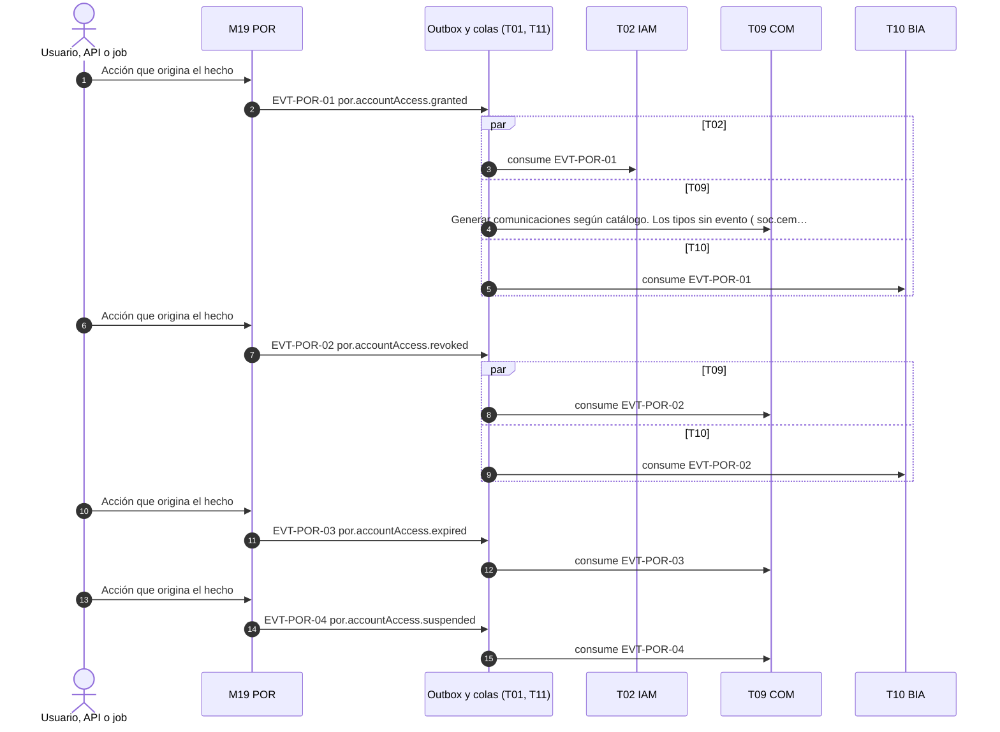

| Evento | Consumidores externos (T11 §12.3) | Efecto declarado por el consumidor (§12 de su anexo) |
|---|---|---|
| EVT-POR-01 `por.accountAccess.granted` | T02, T09, T10 | T09: Generar comunicaciones según catálogo. Los tipos sin evento (`soc.cemeteryAct.scheduled`, `soc.loan.overdue`) entran por el comando `com.communications.emit` (§9.7). |
| EVT-POR-02 `por.accountAccess.revoked` | T09, T10 | No declarado en el §12 del consumidor |
| EVT-POR-03 `por.accountAccess.expired` | T09 | No declarado en el §12 del consumidor |
| EVT-POR-04 `por.accountAccess.suspended` | T09 | No declarado en el §12 del consumidor |

### SEC-POR-02 — POR: Envíos públicos sin sesión

**Agregados:** `por.publicSubmission.*`. **Productor:** M19 Portal del socio y landing (M19 §12; catálogo T11 §12.3).

**Cubre:** EVT-POR-09 `por.publicSubmission.received`, EVT-POR-10 `por.publicSubmission.receiptIssued`, EVT-POR-11 `por.publicSubmission.deadlineAtRisk`.

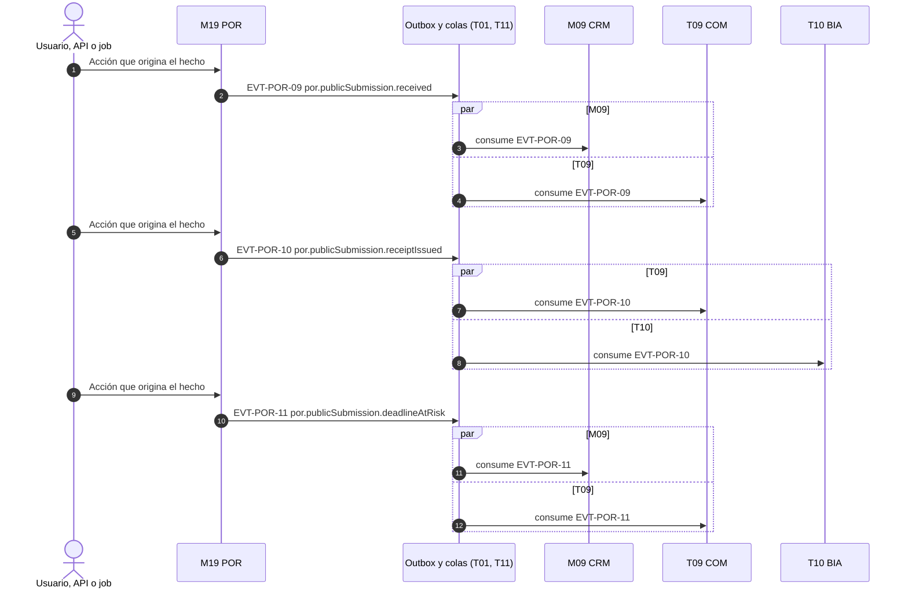

| Evento | Consumidores externos (T11 §12.3) | Efecto declarado por el consumidor (§12 de su anexo) |
|---|---|---|
| EVT-POR-09 `por.publicSubmission.received` | M09, T09 | No declarado en el §12 del consumidor |
| EVT-POR-10 `por.publicSubmission.receiptIssued` | T09, T10 | No declarado en el §12 del consumidor |
| EVT-POR-11 `por.publicSubmission.deadlineAtRisk` | M09, T09 | No declarado en el §12 del consumidor |

### SEC-POR-03 — POR: hechos complementarios (Intentos de vinculación, delegation, Envíos de formularios, landing, legacyImport, legacyUser, memberView)

**Agregados:** `por.linkAttempt.*`, `por.delegation.*`, `por.formSubmission.*`, `por.landing.*`, `por.legacyImport.*`, `por.legacyUser.*`, `por.memberView.*`. **Productor:** M19 Portal del socio y landing (M19 §12; catálogo T11 §12.3).

**Cubre:** EVT-POR-05 `por.linkAttempt.blocked`, EVT-POR-06 `por.delegation.invited`, EVT-POR-07 `por.formSubmission.submitted`, EVT-POR-08 `por.formSubmission.accepted`, EVT-POR-12 `por.landing.published`, EVT-POR-13 `por.legacyImport.completed`, EVT-POR-14 `por.legacyUser.activated`, EVT-POR-15 `por.memberView.opened`.

Parte de estos hechos también aparece, con el detalle del caso de negocio, en A7 de `06-secuencias-y-estados.md` §3.

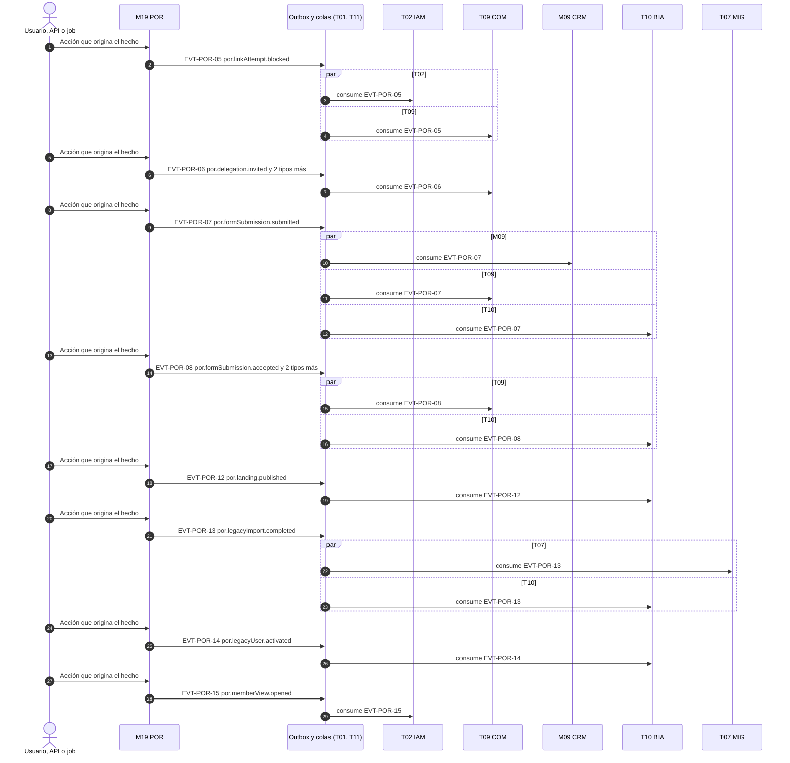

| Evento | Consumidores externos (T11 §12.3) | Efecto declarado por el consumidor (§12 de su anexo) |
|---|---|---|
| EVT-POR-05 `por.linkAttempt.blocked` | T02, T09 | No declarado en el §12 del consumidor |
| EVT-POR-06 `por.delegation.invited` | T09 | No declarado en el §12 del consumidor |
| EVT-POR-07 `por.formSubmission.submitted` | M09, T09, T10 | No declarado en el §12 del consumidor |
| EVT-POR-08 `por.formSubmission.accepted` | T09, T10 | No declarado en el §12 del consumidor |
| EVT-POR-12 `por.landing.published` | T10 | No declarado en el §12 del consumidor |
| EVT-POR-13 `por.legacyImport.completed` | T07, T10 | No declarado en el §12 del consumidor |
| EVT-POR-14 `por.legacyUser.activated` | T10 | No declarado en el §12 del consumidor |
| EVT-POR-15 `por.memberView.opened` | T02 | No declarado en el §12 del consumidor |

### SEC-POR-04 — POR: hechos complementarios (kiosk)

**Agregados:** `por.kiosk.*`. **Productor:** M19 Portal del socio y landing (M19 §12; catálogo T11 §12.3).

**Cubre:** EVT-POR-16 `por.kiosk.statusChanged`.

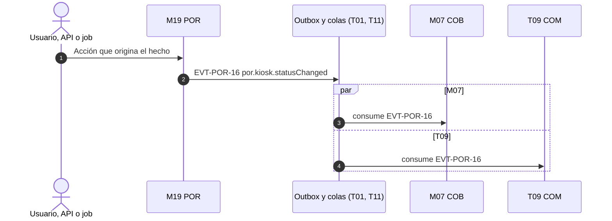

| Evento | Consumidores externos (T11 §12.3) | Efecto declarado por el consumidor (§12 de su anexo) |
|---|---|---|
| EVT-POR-16 `por.kiosk.statusChanged` | M07, T09 | No declarado en el §12 del consumidor |

## T01 — PLA Plataforma SaaS

### SEC-PLA-01 — PLA: Registro del tenant, ciclo de vida, dominios, zona horaria

**Agregados:** `pla.tenant.*`. **Productor:** T01 Plataforma SaaS (T01 §12; catálogo T11 §12.3).

**Cubre:** EVT-PLA-01 `pla.tenant.created`, EVT-PLA-02 `pla.tenant.statusChanged`, EVT-PLA-03 `pla.tenant.suspended`, EVT-PLA-04 `pla.tenant.reactivated`, EVT-PLA-05 `pla.tenant.closed`.

**API y jobs disparadores (citados junto al evento en el anexo productor):** JOB-PLA-02, JOB-PLA-14.

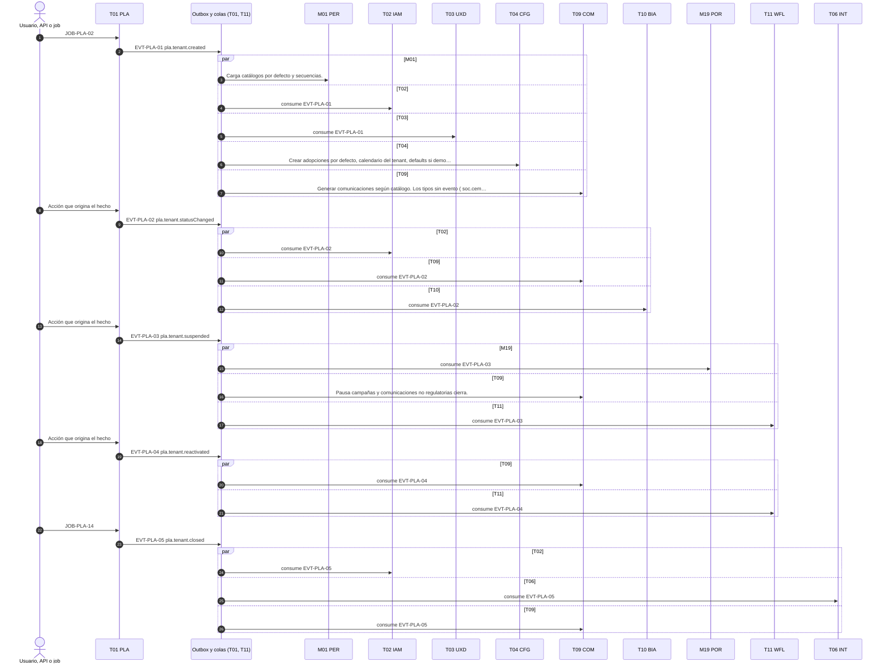

| Evento | Consumidores externos (T11 §12.3) | Efecto declarado por el consumidor (§12 de su anexo) |
|---|---|---|
| EVT-PLA-01 `pla.tenant.created` | M01, T02, T03, T04, T09 | M01: Carga catálogos por defecto y secuencias.; T04: Crear adopciones por defecto, calendario del tenant, defaults; si demo, ofrecer semilla. Crear la entidad jurídica por defecto y la sucursal casa central (§9.16, RF-C… |
| EVT-PLA-02 `pla.tenant.statusChanged` | T02, T09, T10 | No declarado en el §12 del consumidor |
| EVT-PLA-03 `pla.tenant.suspended` | M19, T09, T11 | T09: Pausa campañas y comunicaciones no regulatorias; cierra. |
| EVT-PLA-04 `pla.tenant.reactivated` | T09, T11 | No declarado en el §12 del consumidor |
| EVT-PLA-05 `pla.tenant.closed` | T02, T06, T09 | No declarado en el §12 del consumidor |

### SEC-PLA-02 — PLA: hechos complementarios (capability, Licencia vigente y cupos, Contrato SaaS GoodApps–cooperativa, Consumo agregado de IA por tenant y…)

**Agregados:** `pla.capability.*`, `pla.license.*`, `pla.saasContract.*`, `pla.usage.*`, `pla.supportCase.*`, `pla.supportGrant.*`, `pla.restore.*`. **Productor:** T01 Plataforma SaaS (T01 §12; catálogo T11 §12.3).

**Cubre:** EVT-PLA-06 `pla.capability.activated`, EVT-PLA-07 `pla.capability.deactivated`, EVT-PLA-08 `pla.license.updated`, EVT-PLA-09 `pla.saasContract.approved`, EVT-PLA-10 `pla.usage.thresholdReached`, EVT-PLA-11 `pla.supportCase.opened`, EVT-PLA-12 `pla.supportGrant.requested`, EVT-PLA-14 `pla.restore.requested`.

**API y jobs disparadores (citados junto al evento en el anexo productor):** JOB-PLA-03, JOB-PLA-04.

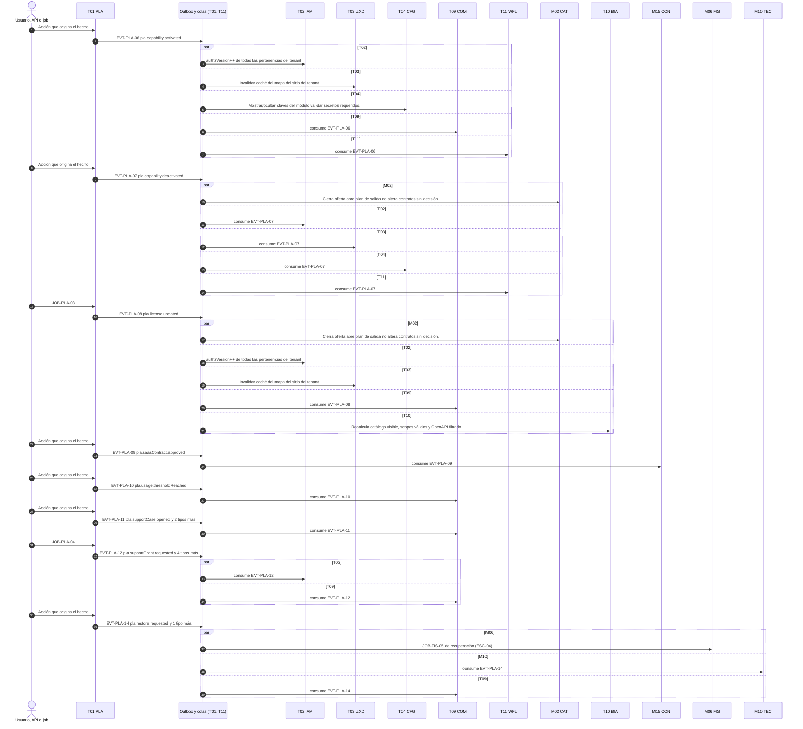

| Evento | Consumidores externos (T11 §12.3) | Efecto declarado por el consumidor (§12 de su anexo) |
|---|---|---|
| EVT-PLA-06 `pla.capability.activated` | T02, T03, T04, T09, T11 | T02: `authzVersion++` de todas las pertenencias del tenant; T03: Invalidar caché del mapa del sitio del tenant; T04: Mostrar/ocultar claves del módulo; validar secretos requeridos. |
| EVT-PLA-07 `pla.capability.deactivated` | M02, T02, T03, T04, T11 | M02: Cierra oferta; abre plan de salida; no altera contratos sin decisión. |
| EVT-PLA-08 `pla.license.updated` | M02, T02, T03, T09, T10 | M02: Cierra oferta; abre plan de salida; no altera contratos sin decisión.; T02: `authzVersion++` de todas las pertenencias del tenant; T03: Invalidar caché del mapa del sitio del tenant; T10: Recalcula catálogo visible… |
| EVT-PLA-09 `pla.saasContract.approved` | M15 | No declarado en el §12 del consumidor |
| EVT-PLA-10 `pla.usage.thresholdReached` | T09 | No declarado en el §12 del consumidor |
| EVT-PLA-11 `pla.supportCase.opened` | T09 | No declarado en el §12 del consumidor |
| EVT-PLA-12 `pla.supportGrant.requested` | T02, T09 | No declarado en el §12 del consumidor |
| EVT-PLA-14 `pla.restore.requested` | M06, M10, T09 | M06: JOB-FIS-05 de recuperación (ESC-04) |

### SEC-PLA-03 — PLA: hechos complementarios (sandbox, Versiones desplegadas y notas, Alertas disparadas, Exportaciones completas del tenant, Incidentes op…)

**Agregados:** `pla.sandbox.*`, `pla.release.*`, `pla.alert.*`, `pla.tenantExport.*`, `pla.incident.*`, `pla.checklist.*`, `pla.tenantProfile.*`. **Productor:** T01 Plataforma SaaS (T01 §12; catálogo T11 §12.3).

**Cubre:** EVT-PLA-15 `pla.sandbox.created`, EVT-PLA-16 `pla.release.deployed`, EVT-PLA-17 `pla.alert.raised`, EVT-PLA-18 `pla.tenantExport.ready`, EVT-PLA-19 `pla.incident.updated`, EVT-PLA-20 `pla.checklist.changed`, EVT-PLA-22 `pla.tenantProfile.updated`.

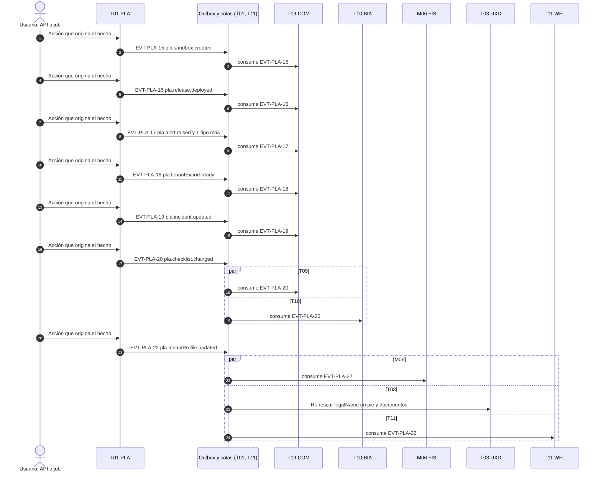

| Evento | Consumidores externos (T11 §12.3) | Efecto declarado por el consumidor (§12 de su anexo) |
|---|---|---|
| EVT-PLA-15 `pla.sandbox.created` | T09 | No declarado en el §12 del consumidor |
| EVT-PLA-16 `pla.release.deployed` | T09 | No declarado en el §12 del consumidor |
| EVT-PLA-17 `pla.alert.raised` | T09 | No declarado en el §12 del consumidor |
| EVT-PLA-18 `pla.tenantExport.ready` | T09 | No declarado en el §12 del consumidor |
| EVT-PLA-19 `pla.incident.updated` | T09 | No declarado en el §12 del consumidor |
| EVT-PLA-20 `pla.checklist.changed` | T09, T10 | No declarado en el §12 del consumidor |
| EVT-PLA-22 `pla.tenantProfile.updated` | M06, T03, T11 | T03: Refrescar `legalName` en pie y documentos |

## T02 — IAM Identidad, roles y auditoría

### SEC-IAM-01 — IAM: hechos complementarios (Identidad de inicio de sesión, Identidad dentro del tenant, Roles con capabilities, Sesiones y refresh rotati…)

**Agregados:** `iam.identity.*`, `iam.membership.*`, `iam.role.*`, `iam.session.*`, `iam.login.*`, `iam.mfa.*`. **Productor:** T02 Identidad, roles y auditoría (T02 §12; catálogo T11 §12.3).

**Cubre:** EVT-IAM-01 `iam.identity.created`, EVT-IAM-02 `iam.identity.locked`, EVT-IAM-03 `iam.membership.invited`, EVT-IAM-04 `iam.role.assigned`, EVT-IAM-05 `iam.role.changed`, EVT-IAM-06 `iam.session.started`, EVT-IAM-07 `iam.login.failed`, EVT-IAM-08 `iam.mfa.enrolled`.

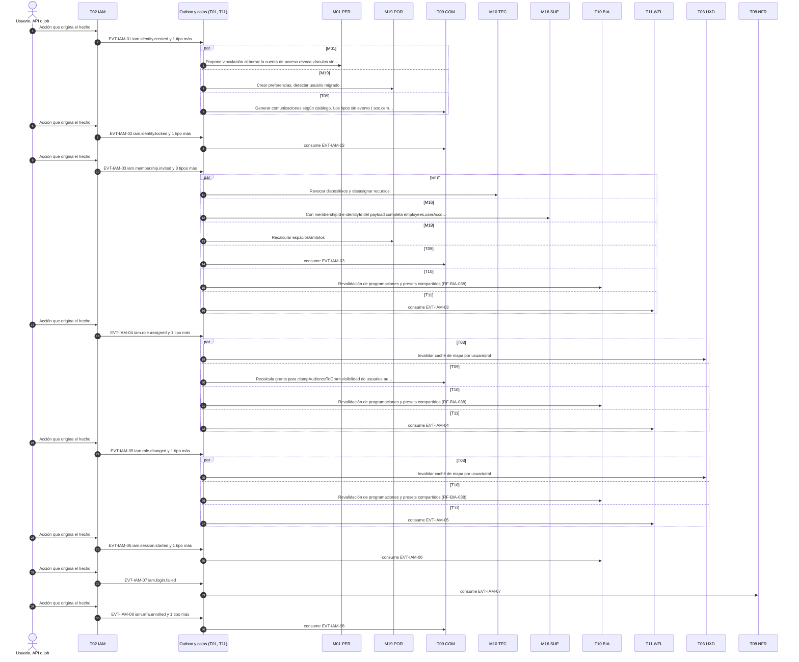

| Evento | Consumidores externos (T11 §12.3) | Efecto declarado por el consumidor (§12 de su anexo) |
|---|---|---|
| EVT-IAM-01 `iam.identity.created` | M01, M19, T09 | M01: Propone vinculación; al borrar la cuenta de acceso revoca vínculos sin borrar datos de negocio (RN-PER-116).; M19: Crear preferencias, detectar usuario migrado; T09: Generar comunicaciones según catálogo. Los tipos… |
| EVT-IAM-02 `iam.identity.locked` | T09 | No declarado en el §12 del consumidor |
| EVT-IAM-03 `iam.membership.invited` | M10, M16, M19, T09, T10, T11 | M10: Revocar dispositivos y desasignar recursos.; M16: Con `membershipId` e `identityId` del payload completa `employees.userAccountId` del empleado vinculado (antes el efecto decía solo `employees.userAccountId`).; M19… |
| EVT-IAM-04 `iam.role.assigned` | T03, T09, T10, T11 | T03: Invalidar caché de mapa por usuario/rol; T09: Recalcula grants para `clampAudienceToGrant`; visibilidad de usuarios autorizados.; T10: Revalidación de programaciones y presets compartidos (RF-BIA-038) |
| EVT-IAM-05 `iam.role.changed` | T03, T10, T11 | T03: Invalidar caché de mapa por usuario/rol; T10: Revalidación de programaciones y presets compartidos (RF-BIA-038) |
| EVT-IAM-06 `iam.session.started` | T10 | No declarado en el §12 del consumidor |
| EVT-IAM-07 `iam.login.failed` | T08 | No declarado en el §12 del consumidor |
| EVT-IAM-08 `iam.mfa.enrolled` | T09 | No declarado en el §12 del consumidor |

### SEC-IAM-02 — IAM: hechos complementarios (password, authorization, supportAccess, Clientes API de terceros, idp, Alertas de seguridad de identidad, por…)

**Agregados:** `iam.password.*`, `iam.authorization.*`, `iam.supportAccess.*`, `iam.apiClient.*`, `iam.idp.*`, `iam.securityAlert.*`, `iam.portal.*`, `iam.audit.*`. **Productor:** T02 Identidad, roles y auditoría (T02 §12; catálogo T11 §12.3).

**Cubre:** EVT-IAM-09 `iam.password.changed`, EVT-IAM-10 `iam.authorization.requested`, EVT-IAM-11 `iam.supportAccess.requested`, EVT-IAM-12 `iam.apiClient.created`, EVT-IAM-13 `iam.idp.activated`, EVT-IAM-14 `iam.securityAlert.raised`, EVT-IAM-15 `iam.portal.accountLinked`, EVT-IAM-16 `iam.audit.integrityFailed`.

**API y jobs disparadores (citados junto al evento en el anexo productor):** API-IAM-49, API-IAM-50, JOB-IAM-05.

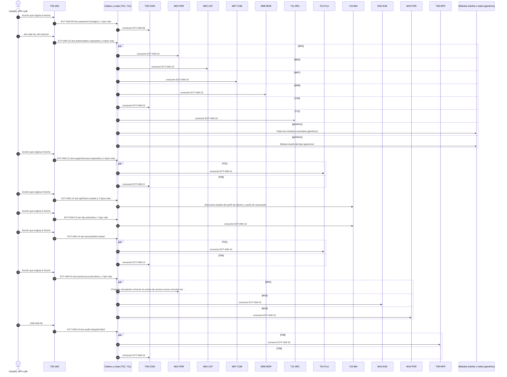

| Evento | Consumidores externos (T11 §12.3) | Efecto declarado por el consumidor (§12 de su anexo) |
|---|---|---|
| EVT-IAM-09 `iam.password.changed` | T09 | No declarado en el §12 del consumidor |
| EVT-IAM-10 `iam.authorization.requested` | M01, M02, M07, M08, T09, T11, (todos), (dueño) | No declarado en el §12 del consumidor |
| EVT-IAM-11 `iam.supportAccess.requested` | T01, T09 | No declarado en el §12 del consumidor |
| EVT-IAM-12 `iam.apiClient.created` | T10 | T10: Sincroniza estado del perfil de cliente y caché de revocación |
| EVT-IAM-13 `iam.idp.activated` | T10 | No declarado en el §12 del consumidor |
| EVT-IAM-14 `iam.securityAlert.raised` | T01, T09 | No declarado en el §12 del consumidor |
| EVT-IAM-15 `iam.portal.accountLinked` | M01, M16, M19 | M01: Propone vinculación; al borrar la cuenta de acceso revoca vínculos sin borrar datos de negocio (RN-PER-116). |
| EVT-IAM-16 `iam.audit.integrityFailed` | T08, T09 | No declarado en el §12 del consumidor |

## T03 — UXD Experiencia, marca y diccionario

### SEC-UXD-01 — UXD: dictionary

**Agregados:** `uxd.dictionary.*`. **Productor:** T03 Experiencia, marca y diccionario (T03 §12; catálogo T11 §12.3).

**Cubre:** EVT-UXD-04 `uxd.dictionary.published`, EVT-UXD-05 `uxd.dictionary.reverted`, EVT-UXD-06 `uxd.dictionary.missingKeyDetected`.

**API y jobs disparadores (citados junto al evento en el anexo productor):** JOB-UXD-03.

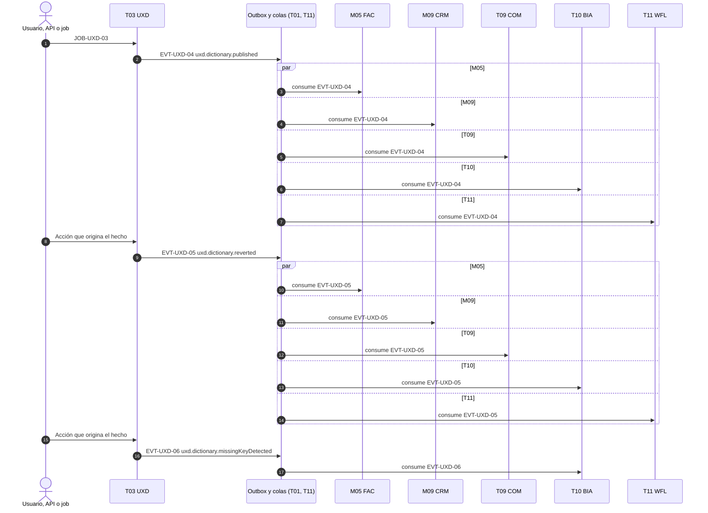

| Evento | Consumidores externos (T11 §12.3) | Efecto declarado por el consumidor (§12 de su anexo) |
|---|---|---|
| EVT-UXD-04 `uxd.dictionary.published` | M05, M09, T09, T10, T11 | No declarado en el §12 del consumidor |
| EVT-UXD-05 `uxd.dictionary.reverted` | M05, M09, T09, T10, T11 | No declarado en el §12 del consumidor |
| EVT-UXD-06 `uxd.dictionary.missingKeyDetected` | T10 | No declarado en el §12 del consumidor |

### SEC-UXD-02 — UXD: hechos complementarios (Marca publicada por canal, Recursos de marca, flag)

**Agregados:** `uxd.branding.*`, `uxd.asset.*`, `uxd.flag.*`. **Productor:** T03 Experiencia, marca y diccionario (T03 §12; catálogo T11 §12.3).

**Cubre:** EVT-UXD-01 `uxd.branding.published`, EVT-UXD-02 `uxd.branding.reverted`, EVT-UXD-03 `uxd.asset.processed`, EVT-UXD-07 `uxd.flag.changed`.

**API y jobs disparadores (citados junto al evento en el anexo productor):** JOB-UXD-02, JOB-UXD-01.

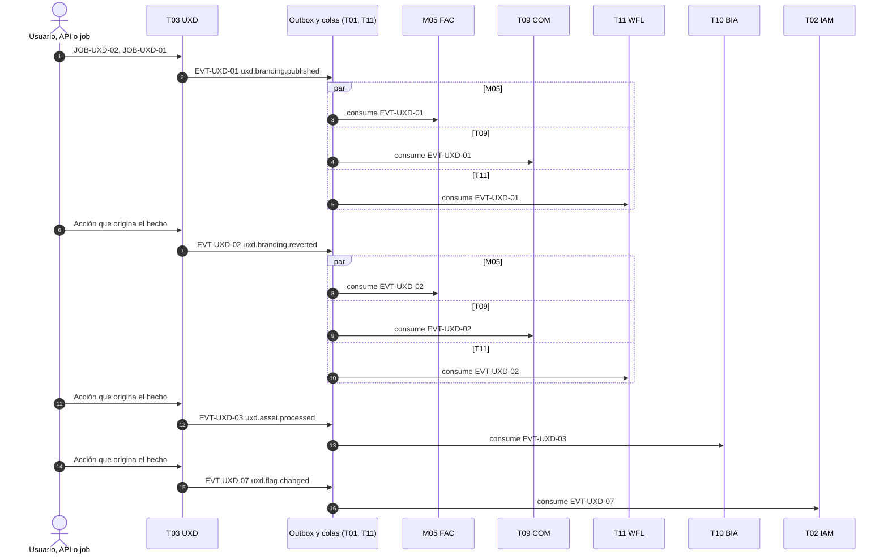

| Evento | Consumidores externos (T11 §12.3) | Efecto declarado por el consumidor (§12 de su anexo) |
|---|---|---|
| EVT-UXD-01 `uxd.branding.published` | M05, T09, T11 | No declarado en el §12 del consumidor |
| EVT-UXD-02 `uxd.branding.reverted` | M05, T09, T11 | No declarado en el §12 del consumidor |
| EVT-UXD-03 `uxd.asset.processed` | T10 | No declarado en el §12 del consumidor |
| EVT-UXD-07 `uxd.flag.changed` | T02 | No declarado en el §12 del consumidor |

## T04 — CFG Configuración, parámetros y maestros

### SEC-CFG-01 — CFG: Paquetes de configuración versionados y publicados

**Agregados:** `cfg.configVersion.*`. **Productor:** T04 Configuración, parámetros y maestros (T04 §12; catálogo T11 §12.3).

**Cubre:** EVT-CFG-01 `cfg.configVersion.created`, EVT-CFG-02 `cfg.configVersion.submitted`, EVT-CFG-03 `cfg.configVersion.approved`, EVT-CFG-04 `cfg.configVersion.scheduled`, EVT-CFG-05 `cfg.configVersion.published`, EVT-CFG-06 `cfg.configVersion.failed`.

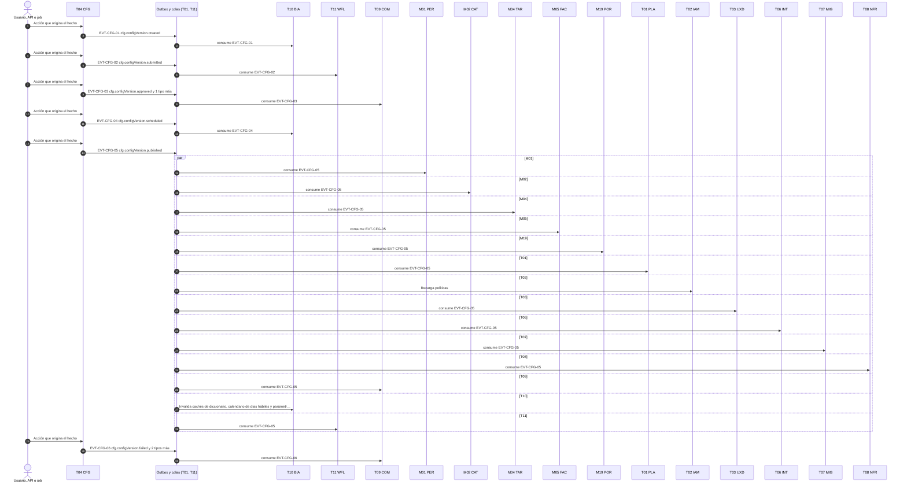

| Evento | Consumidores externos (T11 §12.3) | Efecto declarado por el consumidor (§12 de su anexo) |
|---|---|---|
| EVT-CFG-01 `cfg.configVersion.created` | T10 | No declarado en el §12 del consumidor |
| EVT-CFG-02 `cfg.configVersion.submitted` | T11 | No declarado en el §12 del consumidor |
| EVT-CFG-03 `cfg.configVersion.approved` | T09 | No declarado en el §12 del consumidor |
| EVT-CFG-04 `cfg.configVersion.scheduled` | T10 | No declarado en el §12 del consumidor |
| EVT-CFG-05 `cfg.configVersion.published` | M01, M02, M04, M05, M19, T01, T02, T03, T06, T07, T08, T09, T10, T11 | T02: Recarga políticas; T10: Invalida cachés de diccionario, calendario de días hábiles y parámetros PRM-BIA |
| EVT-CFG-06 `cfg.configVersion.failed` | T09 | No declarado en el §12 del consumidor |

### SEC-CFG-02 — CFG: hechos complementarios (Parámetros de la ley de contrato de trabajo, masterRecord, platformTable, Feriados nacionales, provinciales y…)

**Agregados:** `cfg.parameter.*`, `cfg.masterRecord.*`, `cfg.platformTable.*`, `cfg.holiday.*`, `cfg.economicIndex.*`, `cfg.taxRegistry.*`, `cfg.geo.*`. **Productor:** T04 Configuración, parámetros y maestros (T04 §12; catálogo T11 §12.3).

**Cubre:** EVT-CFG-07 `cfg.parameter.changed`, EVT-CFG-08 `cfg.masterRecord.changed`, EVT-CFG-09 `cfg.masterRecord.merged`, EVT-CFG-10 `cfg.platformTable.updated`, EVT-CFG-11 `cfg.holiday.changed`, EVT-CFG-12 `cfg.economicIndex.valuePublished`, EVT-CFG-13 `cfg.taxRegistry.imported`, EVT-CFG-14 `cfg.geo.streetProposed`.

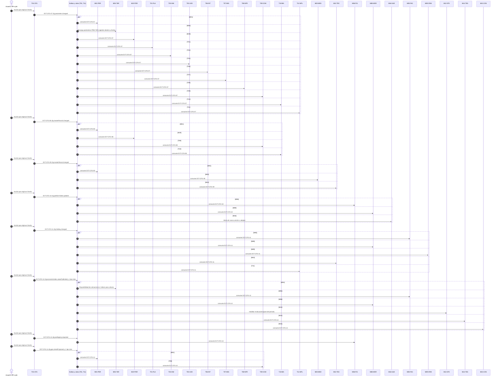

| Evento | Consumidores externos (T11 §12.3) | Efecto declarado por el consumidor (§12 de su anexo) |
|---|---|---|
| EVT-CFG-07 `cfg.parameter.changed` | M01, M04, M19, T01, T02, T03, T06, T07, T08, T09, T10, T11 | M04: Recarga parámetros PRM-TAR (vigentes desde su fecha). |
| EVT-CFG-08 `cfg.masterRecord.changed` | M01, M19, T09, T10 | No declarado en el §12 del consumidor |
| EVT-CFG-09 `cfg.masterRecord.merged` | M01, M03, M10 | No declarado en el §12 del consumidor |
| EVT-CFG-10 `cfg.platformTable.updated` | M06, M08, M16 | M16: Alerta de nueva versión a adoptar |
| EVT-CFG-11 `cfg.holiday.changed` | M05, M08, M09, M10, T11 | No declarado en el §12 del consumidor |
| EVT-CFG-12 `cfg.economicIndex.valuePublished` | M04, M05, M08, M13, M14, M15 | M04: Disponibilidad de cotizaciones e índices para cálculo.; M13: Habilitar revaluación/ajuste del período. |
| EVT-CFG-13 `cfg.taxRegistry.imported` | M06 | No declarado en el §12 del consumidor |
| EVT-CFG-14 `cfg.geo.streetProposed` | M01, T09 | No declarado en el §12 del consumidor |

### SEC-CFG-03 — CFG: hechos complementarios (geoReference, customField, Paquetes de precarga de demostración, integrity, Entidades jurídicas emisoras del…)

**Agregados:** `cfg.geoReference.*`, `cfg.customField.*`, `cfg.seedPack.*`, `cfg.integrity.*`, `cfg.legalEntity.*`, `cfg.branch.*`. **Productor:** T04 Configuración, parámetros y maestros (T04 §12; catálogo T11 §12.3).

**Cubre:** EVT-CFG-15 `cfg.geoReference.updated`, EVT-CFG-16 `cfg.customField.defined`, EVT-CFG-17 `cfg.seedPack.applied`, EVT-CFG-18 `cfg.integrity.issueDetected`, EVT-CFG-19 `cfg.legalEntity.created`, EVT-CFG-20 `cfg.branch.created`.

**API y jobs disparadores (citados junto al evento en el anexo productor):** JOB-CFG-13, API-CFG-55.

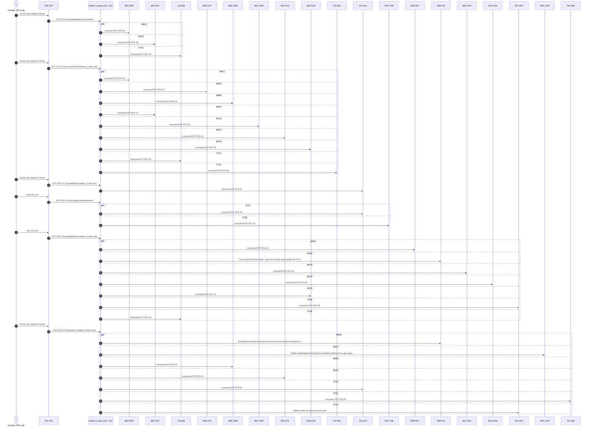

| Evento | Consumidores externos (T11 §12.3) | Efecto declarado por el consumidor (§12 de su anexo) |
|---|---|---|
| EVT-CFG-15 `cfg.geoReference.updated` | M01, M10, T10 | No declarado en el §12 del consumidor |
| EVT-CFG-16 `cfg.customField.defined` | M01, M02, M09, M10, M12, M13, M16, T10, T11 | No declarado en el §12 del consumidor |
| EVT-CFG-17 `cfg.seedPack.applied` | T01 | No declarado en el §12 del consumidor |
| EVT-CFG-18 `cfg.integrity.issueDetected` | T01, T09 | No declarado en el §12 del consumidor |
| EVT-CFG-19 `cfg.legalEntity.created` | M05, M06, M14, M15, M16, T03, T10 | M06: Crea el perfil fiscal en `draft`, pone en revisión ante cambio de CUIT o razón social, o cierra la vigencia (RN-FIS-131) |
| EVT-CFG-20 `cfg.branch.created` | M06, M07, M09, M13, T01, T02, T03 | M06: Revalida los puntos de venta de la sucursal; una sucursal inactiva no puede tener puntos de venta `active` sin reasignación (aviso en PAN-FIS-08); M07: Valida `cashRegisters.branchId` y la entidad jurídica de la ca… |

## Cobertura de la parte U

| Evento | Productor | Secuencia | También en |
|---|---|---|---|
| EVT-POR-01 | M19 | SEC-POR-01 | A7 (`06-secuencias-y-estados.md`) |
| EVT-POR-02 | M19 | SEC-POR-01 | — |
| EVT-POR-03 | M19 | SEC-POR-01 | — |
| EVT-POR-04 | M19 | SEC-POR-01 | — |
| EVT-POR-09 | M19 | SEC-POR-02 | — |
| EVT-POR-10 | M19 | SEC-POR-02 | — |
| EVT-POR-11 | M19 | SEC-POR-02 | — |
| EVT-POR-05 | M19 | SEC-POR-03 | A7 (`06-secuencias-y-estados.md`) |
| EVT-POR-06 | M19 | SEC-POR-03 | — |
| EVT-POR-07 | M19 | SEC-POR-03 | — |
| EVT-POR-08 | M19 | SEC-POR-03 | — |
| EVT-POR-12 | M19 | SEC-POR-03 | — |
| EVT-POR-13 | M19 | SEC-POR-03 | — |
| EVT-POR-14 | M19 | SEC-POR-03 | — |
| EVT-POR-15 | M19 | SEC-POR-03 | — |
| EVT-POR-16 | M19 | SEC-POR-04 | — |
| EVT-PLA-01 | T01 | SEC-PLA-01 | — |
| EVT-PLA-02 | T01 | SEC-PLA-01 | — |
| EVT-PLA-03 | T01 | SEC-PLA-01 | — |
| EVT-PLA-04 | T01 | SEC-PLA-01 | — |
| EVT-PLA-05 | T01 | SEC-PLA-01 | — |
| EVT-PLA-06 | T01 | SEC-PLA-02 | — |
| EVT-PLA-07 | T01 | SEC-PLA-02 | — |
| EVT-PLA-08 | T01 | SEC-PLA-02 | — |
| EVT-PLA-09 | T01 | SEC-PLA-02 | — |
| EVT-PLA-10 | T01 | SEC-PLA-02 | — |
| EVT-PLA-11 | T01 | SEC-PLA-02 | — |
| EVT-PLA-12 | T01 | SEC-PLA-02 | — |
| EVT-PLA-14 | T01 | SEC-PLA-02 | — |
| EVT-PLA-15 | T01 | SEC-PLA-03 | — |
| EVT-PLA-16 | T01 | SEC-PLA-03 | — |
| EVT-PLA-17 | T01 | SEC-PLA-03 | — |
| EVT-PLA-18 | T01 | SEC-PLA-03 | — |
| EVT-PLA-19 | T01 | SEC-PLA-03 | — |
| EVT-PLA-20 | T01 | SEC-PLA-03 | — |
| EVT-PLA-22 | T01 | SEC-PLA-03 | — |
| EVT-IAM-01 | T02 | SEC-IAM-01 | — |
| EVT-IAM-02 | T02 | SEC-IAM-01 | — |
| EVT-IAM-03 | T02 | SEC-IAM-01 | — |
| EVT-IAM-04 | T02 | SEC-IAM-01 | — |
| EVT-IAM-05 | T02 | SEC-IAM-01 | — |
| EVT-IAM-06 | T02 | SEC-IAM-01 | — |
| EVT-IAM-07 | T02 | SEC-IAM-01 | — |
| EVT-IAM-08 | T02 | SEC-IAM-01 | — |
| EVT-IAM-09 | T02 | SEC-IAM-02 | — |
| EVT-IAM-10 | T02 | SEC-IAM-02 | — |
| EVT-IAM-11 | T02 | SEC-IAM-02 | — |
| EVT-IAM-12 | T02 | SEC-IAM-02 | — |
| EVT-IAM-13 | T02 | SEC-IAM-02 | — |
| EVT-IAM-14 | T02 | SEC-IAM-02 | — |
| EVT-IAM-15 | T02 | SEC-IAM-02 | — |
| EVT-IAM-16 | T02 | SEC-IAM-02 | — |
| EVT-UXD-04 | T03 | SEC-UXD-01 | — |
| EVT-UXD-05 | T03 | SEC-UXD-01 | — |
| EVT-UXD-06 | T03 | SEC-UXD-01 | — |
| EVT-UXD-01 | T03 | SEC-UXD-02 | — |
| EVT-UXD-02 | T03 | SEC-UXD-02 | — |
| EVT-UXD-03 | T03 | SEC-UXD-02 | — |
| EVT-UXD-07 | T03 | SEC-UXD-02 | — |
| EVT-CFG-01 | T04 | SEC-CFG-01 | — |
| EVT-CFG-02 | T04 | SEC-CFG-01 | — |
| EVT-CFG-03 | T04 | SEC-CFG-01 | — |
| EVT-CFG-04 | T04 | SEC-CFG-01 | — |
| EVT-CFG-05 | T04 | SEC-CFG-01 | — |
| EVT-CFG-06 | T04 | SEC-CFG-01 | — |
| EVT-CFG-07 | T04 | SEC-CFG-02 | — |
| EVT-CFG-08 | T04 | SEC-CFG-02 | — |
| EVT-CFG-09 | T04 | SEC-CFG-02 | — |
| EVT-CFG-10 | T04 | SEC-CFG-02 | — |
| EVT-CFG-11 | T04 | SEC-CFG-02 | — |
| EVT-CFG-12 | T04 | SEC-CFG-02 | — |
| EVT-CFG-13 | T04 | SEC-CFG-02 | — |
| EVT-CFG-14 | T04 | SEC-CFG-02 | — |
| EVT-CFG-15 | T04 | SEC-CFG-03 | — |
| EVT-CFG-16 | T04 | SEC-CFG-03 | — |
| EVT-CFG-17 | T04 | SEC-CFG-03 | — |
| EVT-CFG-18 | T04 | SEC-CFG-03 | — |
| EVT-CFG-19 | T04 | SEC-CFG-03 | — |
| EVT-CFG-20 | T04 | SEC-CFG-03 | — |
