# GoodApps Cooperativas — Diagramas de secuencia por eventos, parte V (T06-T10)

**Entregable de análisis y diseño — Artefacto 7.3 (diagramas de secuencia), ampliación a cobertura completa**

| Campo | Valor |
|---|---|
| Documento | `06v-secuencias-eventos-t06-t10.md` |
| Índice del entregable | [`06-secuencias-y-estados.md`](06-secuencias-y-estados.md) (sección 7) y [`06a-indice-cobertura-secuencias-estados.md`](06a-indice-cobertura-secuencias-estados.md) |
| Versión | 1.0 |
| Fecha | 05-11-2026 |
| Estado | Borrador para revisión |
| Fuentes | T11 §12.2 y §12.3 (catálogo de eventos y consumidores); §12 "Eventos consumidos" y §11 de los anexos T06, T07, T08, T09, T10 |
| Generación | Script `_trabajo/gen06_build.py` (extrae de los anexos; revisión manual posterior) |

## 1. Cómo leer esta parte

Cada diagrama representa un flujo de negocio entre módulos construido a partir del catálogo de eventos de T11 §12.3: un agregado del productor (por ejemplo, `cat.contract.*`) con sus hechos en orden de ID, o un grupo de hechos complementarios del mismo productor cuando el agregado tiene menos de tres eventos. Todos siguen el patrón transversal de `06-secuencias-y-estados.md` §2.2 (outbox en la misma transacción, relay, inbox por consumidor, reintentos y cola de errores), que no se repite en cada diagrama.

- **U** es el origen del hecho: usuario, API o job. Se citan las API y jobs que el anexo productor nombra junto al evento.
- **BUS** es la outbox con el relay y las colas BullMQ; cada consumidor recibe su propio job.
- `par` agrupa consumidores independientes del mismo evento. El texto del mensaje es el efecto que declara el consumidor en el §12 de su anexo; "consume EVT-…" indica que el consumidor figura en T11 pero no describe el efecto. **GEN** representa consumidores genéricos de T11 ("módulo dueño del tipo", "todos").
- Debajo de cada diagrama, la tabla lista los EVT que cubre, sus consumidores externos y los efectos declarados.

## T06 — INT Integraciones

### SEC-INT-01 — INT: hechos complementarios (Conexión del tenant con un proveedor, Bitácora de operaciones con proveedores, circuit, Metadatos de certific…)

**Agregados:** `int.connection.*`, `int.operation.*`, `int.circuit.*`, `int.certificate.*`, `int.arca.*`, `int.padron.*`, `int.paymentIntent.*`. **Productor:** T06 Integraciones (T06 §12; catálogo T11 §12.3).

**Cubre:** EVT-INT-01 `int.connection.activated`, EVT-INT-02 `int.connection.blocked`, EVT-INT-03 `int.operation.succeeded`, EVT-INT-04 `int.circuit.opened`, EVT-INT-05 `int.certificate.expiring`, EVT-INT-06 `int.arca.caeObtained`, EVT-INT-07 `int.padron.personaRetrieved`, EVT-INT-08 `int.paymentIntent.created`.

**API y jobs disparadores (citados junto al evento en el anexo productor):** JOB-INT-19.

Parte de estos hechos también aparece, con el detalle del caso de negocio, en A2 de `06-secuencias-y-estados.md` §3.

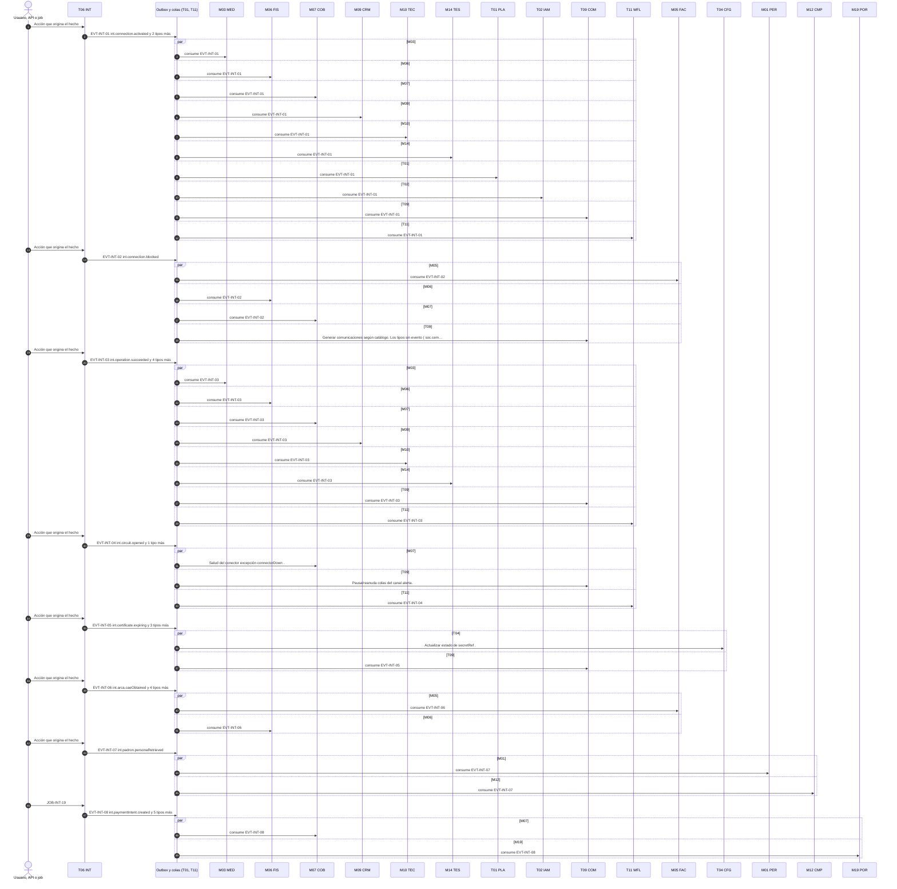

| Evento | Consumidores externos (T11 §12.3) | Efecto declarado por el consumidor (§12 de su anexo) |
|---|---|---|
| EVT-INT-01 `int.connection.activated` | M03, M06, M07, M09, M10, M14, T01, T02, T09, T11 | No declarado en el §12 del consumidor |
| EVT-INT-02 `int.connection.blocked` | M05, M06, M07, T09 | T09: Generar comunicaciones según catálogo. Los tipos sin evento (`soc.cemeteryAct.scheduled`, `soc.loan.overdue`) entran por el comando `com.communications.emit` (§9.7). |
| EVT-INT-03 `int.operation.succeeded` | M03, M06, M07, M09, M10, M14, T09, T11 | No declarado en el §12 del consumidor |
| EVT-INT-04 `int.circuit.opened` | M07, T09, T11 | M07: Salud del conector; excepción `connectorDown`.; T09: Pausa/reanuda colas del canal; alerta. |
| EVT-INT-05 `int.certificate.expiring` | T04, T09 | T04: Actualizar estado de `secretRef`. |
| EVT-INT-06 `int.arca.caeObtained` | M05, M06 | No declarado en el §12 del consumidor |
| EVT-INT-07 `int.padron.personaRetrieved` | M01, M12 | No declarado en el §12 del consumidor |
| EVT-INT-08 `int.paymentIntent.created` | M07, M19 | No declarado en el §12 del consumidor |

### SEC-INT-02 — INT: hechos complementarios (debtPublication, remittance, directDebit, bank, Mensajes saneados de request/response, meter, network, cdr)

**Agregados:** `int.debtPublication.*`, `int.remittance.*`, `int.directDebit.*`, `int.bank.*`, `int.message.*`, `int.meter.*`, `int.network.*`, `int.cdr.*`. **Productor:** T06 Integraciones (T06 §12; catálogo T11 §12.3).

**Cubre:** EVT-INT-09 `int.debtPublication.acknowledged`, EVT-INT-10 `int.remittance.lineReceived`, EVT-INT-11 `int.directDebit.adhesionUpdated`, EVT-INT-12 `int.bank.movementsReceived`, EVT-INT-13 `int.message.sent`, EVT-INT-14 `int.meter.readingReceived`, EVT-INT-15 `int.network.provisioningResult`, EVT-INT-16 `int.cdr.batchReceived`.

**API y jobs disparadores (citados junto al evento en el anexo productor):** JOB-INT-23.

Parte de estos hechos también aparece, con el detalle del caso de negocio, en A4 de `06-secuencias-y-estados.md` §3.

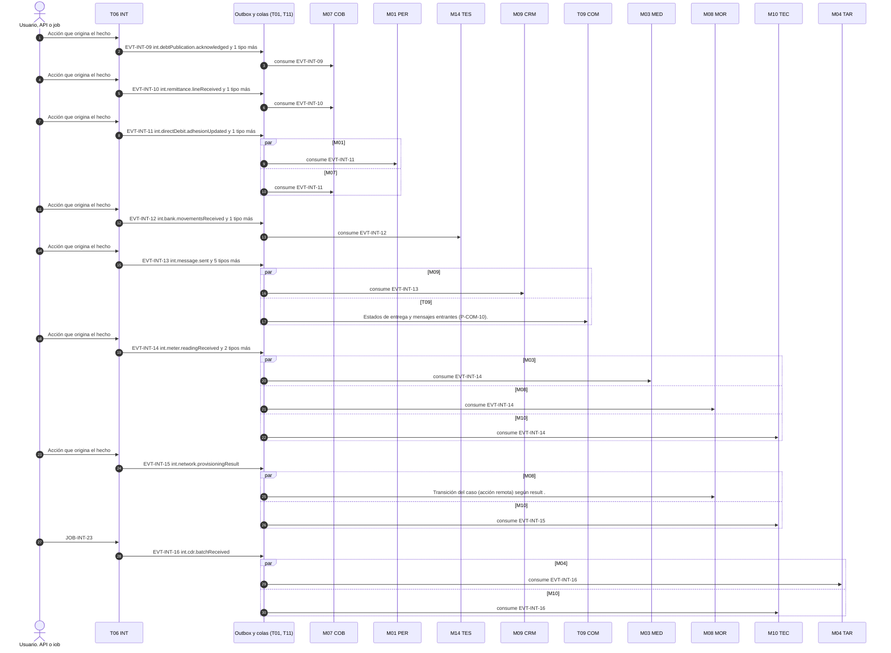

| Evento | Consumidores externos (T11 §12.3) | Efecto declarado por el consumidor (§12 de su anexo) |
|---|---|---|
| EVT-INT-09 `int.debtPublication.acknowledged` | M07 | No declarado en el §12 del consumidor |
| EVT-INT-10 `int.remittance.lineReceived` | M07 | No declarado en el §12 del consumidor |
| EVT-INT-11 `int.directDebit.adhesionUpdated` | M01, M07 | No declarado en el §12 del consumidor |
| EVT-INT-12 `int.bank.movementsReceived` | M14 | No declarado en el §12 del consumidor |
| EVT-INT-13 `int.message.sent` | M09, T09 | T09: Estados de entrega y mensajes entrantes (P-COM-10). |
| EVT-INT-14 `int.meter.readingReceived` | M03, M08, M10 | No declarado en el §12 del consumidor |
| EVT-INT-15 `int.network.provisioningResult` | M08, M10 | M08: Transición del caso (acción remota) según `result`. |
| EVT-INT-16 `int.cdr.batchReceived` | M04, M10 | No declarado en el §12 del consumidor |

### SEC-INT-03 — INT: hechos complementarios (fleet, signature, file, Conciliaciones técnicas con proveedores, Contingencias declaradas, Agentes de hardwar…)

**Agregados:** `int.fleet.*`, `int.signature.*`, `int.file.*`, `int.reconciliation.*`, `int.contingency.*`, `int.agent.*`, `int.ai.*`, `int.serviceUsage.*`. **Productor:** T06 Integraciones (T06 §12; catálogo T11 §12.3).

**Cubre:** EVT-INT-17 `int.fleet.positionsReceived`, EVT-INT-18 `int.signature.completed`, EVT-INT-19 `int.file.generated`, EVT-INT-20 `int.reconciliation.closed`, EVT-INT-21 `int.contingency.started`, EVT-INT-22 `int.agent.online`, EVT-INT-23 `int.ai.completionReady`, EVT-INT-24 `int.serviceUsage.received`.

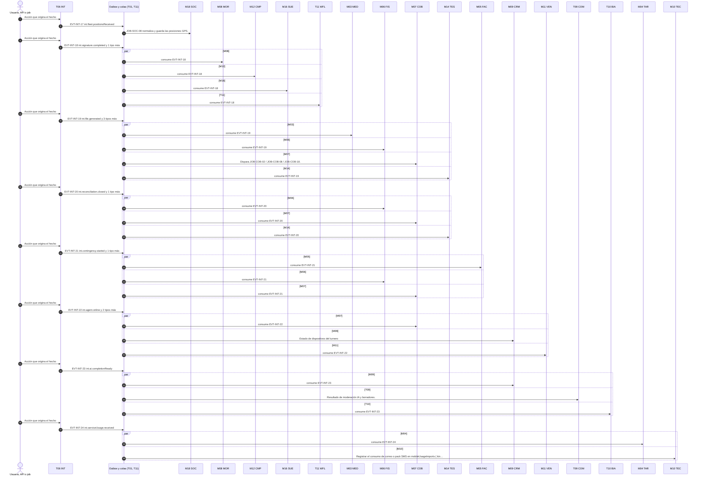

| Evento | Consumidores externos (T11 §12.3) | Efecto declarado por el consumidor (§12 de su anexo) |
|---|---|---|
| EVT-INT-17 `int.fleet.positionsReceived` | M18 | M18: JOB-SOC-08 normaliza y guarda las posiciones GPS. |
| EVT-INT-18 `int.signature.completed` | M08, M12, M16, T11 | No declarado en el §12 del consumidor |
| EVT-INT-19 `int.file.generated` | M03, M06, M07, M14 | M07: Dispara JOB-COB-02 / JOB-COB-08 / JOB-COB-18. |
| EVT-INT-20 `int.reconciliation.closed` | M06, M07, M14 | No declarado en el §12 del consumidor |
| EVT-INT-21 `int.contingency.started` | M05, M06, M07 | No declarado en el §12 del consumidor |
| EVT-INT-22 `int.agent.online` | M07, M09, M11 | M09: Estado de dispositivos del turnero |
| EVT-INT-23 `int.ai.completionReady` | M09, T09, T10 | T09: Resultado de moderación IA y borradores. |
| EVT-INT-24 `int.serviceUsage.received` | M04, M10 | M10: Registrar el consumo de correo o pack SMS en `mobileUsageImports` (`kind = ticQuota`), atribuirlo al contrato por la referencia externa y publicar EVT-TEC-38 por contrato (RF-TEC-195; DEC-084). Idempotente por `mes`… |

## T07 — MIG Migración desde ProCoop

### SEC-MIG-01 — MIG: hechos complementarios (Copias del origen, run, Rechazos y advertencias, Conciliaciones origen-destino, parallel, domain, cutover, ro…)

**Agregados:** `mig.snapshot.*`, `mig.run.*`, `mig.issue.*`, `mig.reconciliation.*`, `mig.parallel.*`, `mig.domain.*`, `mig.cutover.*`, `mig.rollback.*`. **Productor:** T07 Migración desde ProCoop (T07 §12; catálogo T11 §12.3).

**Cubre:** EVT-MIG-01 `mig.snapshot.ready`, EVT-MIG-02 `mig.run.started`, EVT-MIG-03 `mig.issue.assigned`, EVT-MIG-04 `mig.reconciliation.approved`, EVT-MIG-05 `mig.parallel.compared`, EVT-MIG-06 `mig.domain.switched`, EVT-MIG-07 `mig.cutover.completed`, EVT-MIG-08 `mig.rollback.executed`.

Parte de estos hechos también aparece, con el detalle del caso de negocio, en A9 de `06-secuencias-y-estados.md` §3.

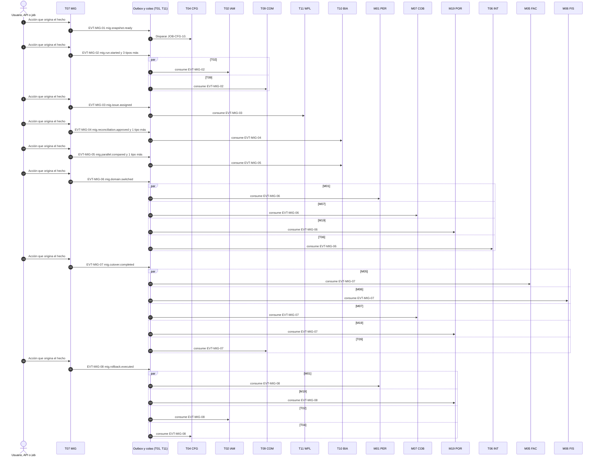

| Evento | Consumidores externos (T11 §12.3) | Efecto declarado por el consumidor (§12 de su anexo) |
|---|---|---|
| EVT-MIG-01 `mig.snapshot.ready` | T04 | T04: Disparar JOB-CFG-10. |
| EVT-MIG-02 `mig.run.started` | T02, T09 | No declarado en el §12 del consumidor |
| EVT-MIG-03 `mig.issue.assigned` | T11 | No declarado en el §12 del consumidor |
| EVT-MIG-04 `mig.reconciliation.approved` | T10 | No declarado en el §12 del consumidor |
| EVT-MIG-05 `mig.parallel.compared` | T10 | No declarado en el §12 del consumidor |
| EVT-MIG-06 `mig.domain.switched` | M01, M07, M19, T06 | No declarado en el §12 del consumidor |
| EVT-MIG-07 `mig.cutover.completed` | M05, M06, M07, M19, T09 | No declarado en el §12 del consumidor |
| EVT-MIG-08 `mig.rollback.executed` | M01, M19, T02, T04 | No declarado en el §12 del consumidor |

### SEC-MIG-02 — MIG: hechos complementarios (person)

**Agregados:** `mig.person.*`. **Productor:** T07 Migración desde ProCoop (T07 §12; catálogo T11 §12.3).

**Cubre:** EVT-MIG-09 `mig.person.merged`.

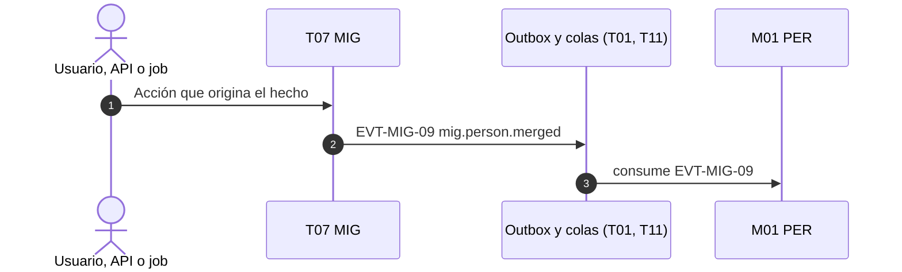

| Evento | Consumidores externos (T11 §12.3) | Efecto declarado por el consumidor (§12 de su anexo) |
|---|---|---|
| EVT-MIG-09 `mig.person.merged` | M01 | No declarado en el §12 del consumidor |

## T08 — NFR No funcionales, seguridad y privacidad

### SEC-NFR-01 — NFR: hechos complementarios (Avisos de privacidad versionados, consent, Solicitudes de derechos, personData, Retenciones legales, Corridas…)

**Agregados:** `nfr.privacyNotice.*`, `nfr.consent.*`, `nfr.dataSubjectRequest.*`, `nfr.personData.*`, `nfr.legalHold.*`, `nfr.retentionRun.*`. **Productor:** T08 No funcionales, seguridad y privacidad (T08 §12; catálogo T11 §12.3).

**Cubre:** EVT-NFR-01 `nfr.privacyNotice.published`, EVT-NFR-02 `nfr.consent.granted`, EVT-NFR-03 `nfr.consent.revoked`, EVT-NFR-04 `nfr.dataSubjectRequest.received`, EVT-NFR-05 `nfr.dataSubjectRequest.completed`, EVT-NFR-06 `nfr.personData.erasureRequested`, EVT-NFR-07 `nfr.legalHold.activated`, EVT-NFR-08 `nfr.retentionRun.completed`.

**API y jobs disparadores (citados junto al evento en el anexo productor):** JOB-NFR-03.

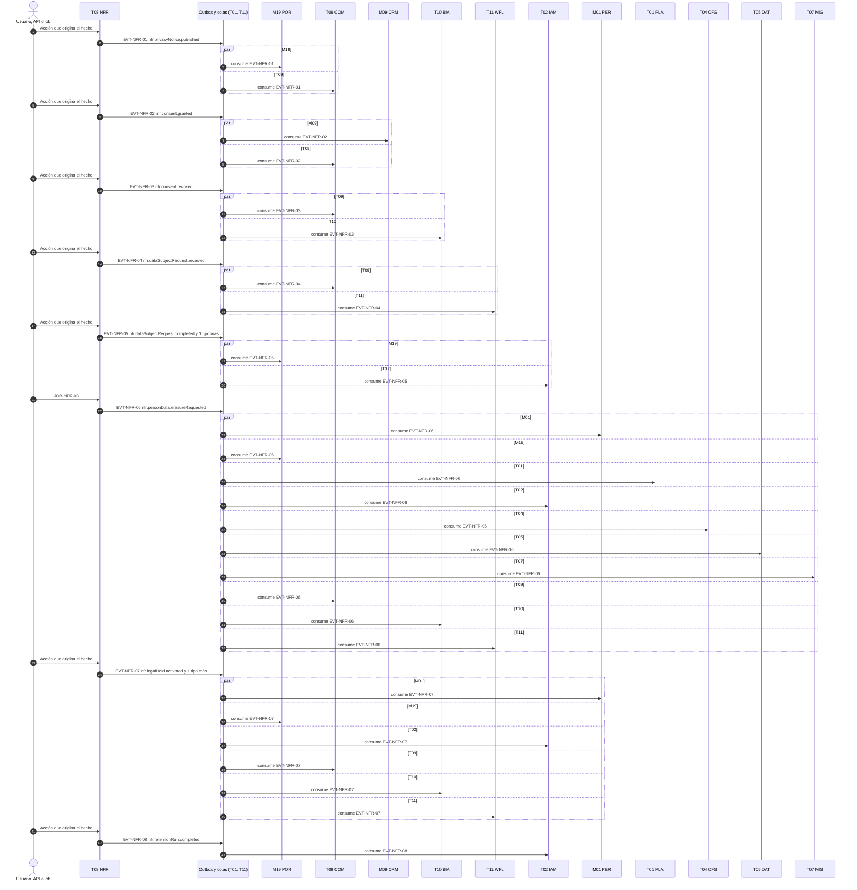

| Evento | Consumidores externos (T11 §12.3) | Efecto declarado por el consumidor (§12 de su anexo) |
|---|---|---|
| EVT-NFR-01 `nfr.privacyNotice.published` | M19, T09 | No declarado en el §12 del consumidor |
| EVT-NFR-02 `nfr.consent.granted` | M09, T09 | No declarado en el §12 del consumidor |
| EVT-NFR-03 `nfr.consent.revoked` | T09, T10 | No declarado en el §12 del consumidor |
| EVT-NFR-04 `nfr.dataSubjectRequest.received` | T09, T11 | No declarado en el §12 del consumidor |
| EVT-NFR-05 `nfr.dataSubjectRequest.completed` | M19, T02 | No declarado en el §12 del consumidor |
| EVT-NFR-06 `nfr.personData.erasureRequested` | M01, M19, T01, T02, T04, T05, T07, T09, T10, T11 | No declarado en el §12 del consumidor |
| EVT-NFR-07 `nfr.legalHold.activated` | M01, M19, T02, T09, T10, T11 | No declarado en el §12 del consumidor |
| EVT-NFR-08 `nfr.retentionRun.completed` | T02 | No declarado en el §12 del consumidor |

### SEC-NFR-02 — NFR: hechos complementarios (Incidentes de seguridad y privacidad, (duplicada con `restoreTests`), alert, invariant, quota, Registro públi…)

**Agregados:** `nfr.securityIncident.*`, `nfr.restoreDrill.*`, `nfr.alert.*`, `nfr.invariant.*`, `nfr.quota.*`, `nfr.subprocessor.*`, `nfr.file.*`, `nfr.auditChain.*`. **Productor:** T08 No funcionales, seguridad y privacidad (T08 §12; catálogo T11 §12.3).

**Cubre:** EVT-NFR-09 `nfr.securityIncident.notified`, EVT-NFR-10 `nfr.restoreDrill.completed`, EVT-NFR-12 `nfr.alert.fired`, EVT-NFR-13 `nfr.invariant.violated`, EVT-NFR-14 `nfr.quota.exceeded`, EVT-NFR-15 `nfr.subprocessor.added`, EVT-NFR-16 `nfr.file.infected`, EVT-NFR-17 `nfr.auditChain.broken`.

**API y jobs disparadores (citados junto al evento en el anexo productor):** JOB-NFR-06, JOB-NFR-21, JOB-NFR-05.

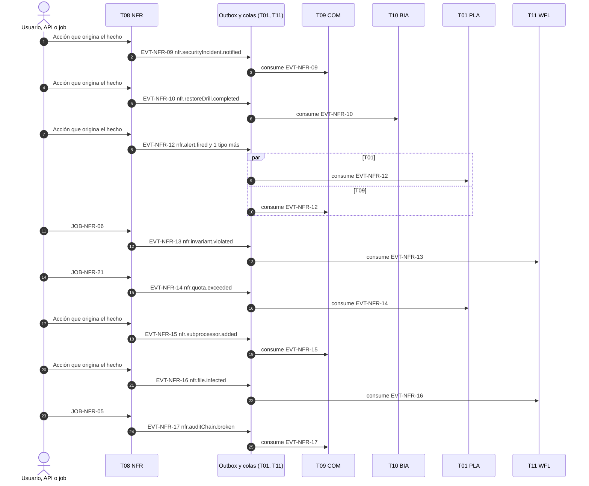

| Evento | Consumidores externos (T11 §12.3) | Efecto declarado por el consumidor (§12 de su anexo) |
|---|---|---|
| EVT-NFR-09 `nfr.securityIncident.notified` | T09 | No declarado en el §12 del consumidor |
| EVT-NFR-10 `nfr.restoreDrill.completed` | T10 | No declarado en el §12 del consumidor |
| EVT-NFR-12 `nfr.alert.fired` | T01, T09 | No declarado en el §12 del consumidor |
| EVT-NFR-13 `nfr.invariant.violated` | T11 | No declarado en el §12 del consumidor |
| EVT-NFR-14 `nfr.quota.exceeded` | T01 | No declarado en el §12 del consumidor |
| EVT-NFR-15 `nfr.subprocessor.added` | T09 | No declarado en el §12 del consumidor |
| EVT-NFR-16 `nfr.file.infected` | T11 | No declarado en el §12 del consumidor |
| EVT-NFR-17 `nfr.auditChain.broken` | T09 | No declarado en el §12 del consumidor |

## T09 — COM Comunidad y comunicaciones

### SEC-COM-01 — COM: Publicaciones del muro y novedades

**Agregados:** `com.post.*`. **Productor:** T09 Comunidad y comunicaciones (T09 §12; catálogo T11 §12.3).

**Cubre:** EVT-COM-01 `com.post.published`, EVT-COM-02 `com.post.reviewRequested`, EVT-COM-04 `com.post.archived`.

**API y jobs disparadores (citados junto al evento en el anexo productor):** JOB-COM-01.

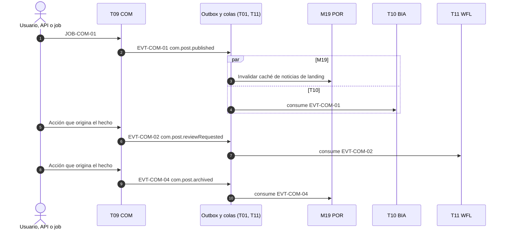

| Evento | Consumidores externos (T11 §12.3) | Efecto declarado por el consumidor (§12 de su anexo) |
|---|---|---|
| EVT-COM-01 `com.post.published` | M19, T10 | M19: Invalidar caché de noticias de landing |
| EVT-COM-02 `com.post.reviewRequested` | T11 | No declarado en el §12 del consumidor |
| EVT-COM-04 `com.post.archived` | M19 | No declarado en el §12 del consumidor |

### SEC-COM-02 — COM: Comentarios moderados

**Agregados:** `com.comment.*`. **Productor:** T09 Comunidad y comunicaciones (T09 §12; catálogo T11 §12.3).

**Cubre:** EVT-COM-05 `com.comment.created`, EVT-COM-07 `com.comment.moderated`, EVT-COM-37 `com.comment.derivedToCrm`.

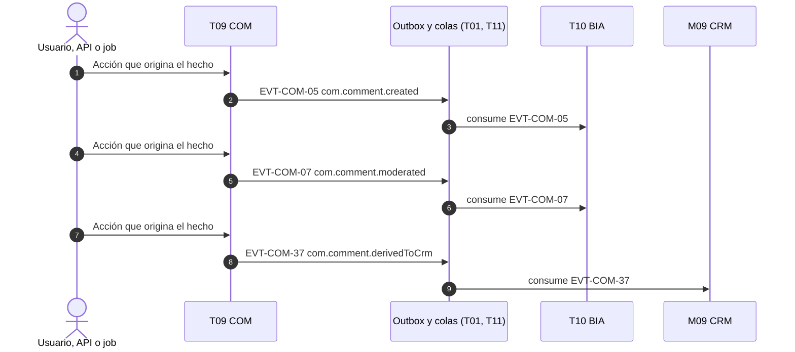

| Evento | Consumidores externos (T11 §12.3) | Efecto declarado por el consumidor (§12 de su anexo) |
|---|---|---|
| EVT-COM-05 `com.comment.created` | T10 | No declarado en el §12 del consumidor |
| EVT-COM-07 `com.comment.moderated` | T10 | No declarado en el §12 del consumidor |
| EVT-COM-37 `com.comment.derivedToCrm` | M09 | No declarado en el §12 del consumidor |

### SEC-COM-03 — COM: Encuestas y votaciones no vinculantes

**Agregados:** `com.survey.*`. **Productor:** T09 Comunidad y comunicaciones (T09 §12; catálogo T11 §12.3).

**Cubre:** EVT-COM-14 `com.survey.published`, EVT-COM-15 `com.survey.responseSubmitted`, EVT-COM-16 `com.survey.criticalAlertRaised`.

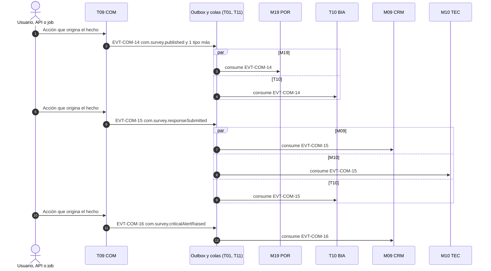

| Evento | Consumidores externos (T11 §12.3) | Efecto declarado por el consumidor (§12 de su anexo) |
|---|---|---|
| EVT-COM-14 `com.survey.published` | M19, T10 | No declarado en el §12 del consumidor |
| EVT-COM-15 `com.survey.responseSubmitted` | M09, M10, T10 | No declarado en el §12 del consumidor |
| EVT-COM-16 `com.survey.criticalAlertRaised` | M09 | No declarado en el §12 del consumidor |

### SEC-COM-04 — COM: Eventos de comunidad

**Agregados:** `com.event.*`. **Productor:** T09 Comunidad y comunicaciones (T09 §12; catálogo T11 §12.3).

**Cubre:** EVT-COM-17 `com.event.registrationChanged`, EVT-COM-18 `com.event.changed`, EVT-COM-19 `com.event.finished`.

**API y jobs disparadores (citados junto al evento en el anexo productor):** JOB-COM-09.

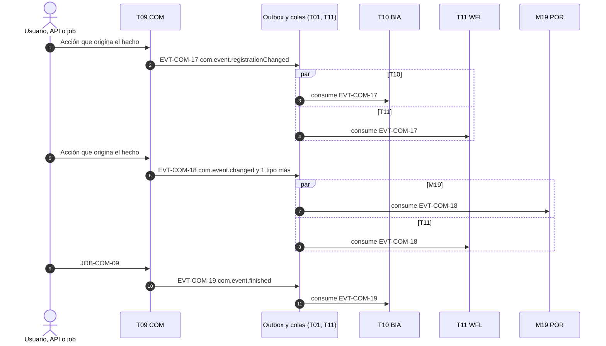

| Evento | Consumidores externos (T11 §12.3) | Efecto declarado por el consumidor (§12 de su anexo) |
|---|---|---|
| EVT-COM-17 `com.event.registrationChanged` | T10, T11 | No declarado en el §12 del consumidor |
| EVT-COM-18 `com.event.changed` | M19, T11 | No declarado en el §12 del consumidor |
| EVT-COM-19 `com.event.finished` | T10 | No declarado en el §12 del consumidor |

### SEC-COM-05 — COM: outage

**Agregados:** `com.outage.*`. **Productor:** T09 Comunidad y comunicaciones (T09 §12; catálogo T11 §12.3).

**Cubre:** EVT-COM-22 `com.outage.published`, EVT-COM-23 `com.outage.started`, EVT-COM-24 `com.outage.rescheduled`, EVT-COM-25 `com.outage.restored`, EVT-COM-26 `com.outage.criticalAffected`.

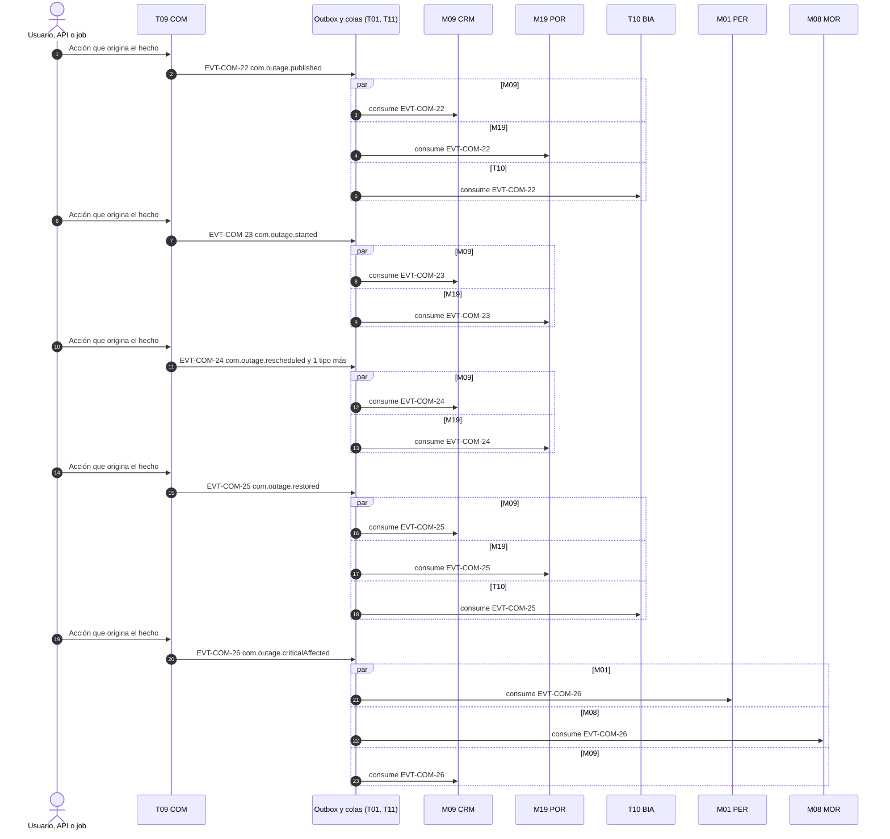

| Evento | Consumidores externos (T11 §12.3) | Efecto declarado por el consumidor (§12 de su anexo) |
|---|---|---|
| EVT-COM-22 `com.outage.published` | M09, M19, T10 | No declarado en el §12 del consumidor |
| EVT-COM-23 `com.outage.started` | M09, M19 | No declarado en el §12 del consumidor |
| EVT-COM-24 `com.outage.rescheduled` | M09, M19 | No declarado en el §12 del consumidor |
| EVT-COM-25 `com.outage.restored` | M09, M19, T10 | No declarado en el §12 del consumidor |
| EVT-COM-26 `com.outage.criticalAffected` | M01, M08, M09 | No declarado en el §12 del consumidor |

### SEC-COM-06 — COM: Comunicación enviada a un destinatario

**Agregados:** `com.communication.*`. **Productor:** T09 Comunidad y comunicaciones (T09 §12; catálogo T11 §12.3).

**Cubre:** EVT-COM-27 `com.communication.accepted`, EVT-COM-28 `com.communication.milestoneReached`, EVT-COM-29 `com.communication.allChannelsFailed`.

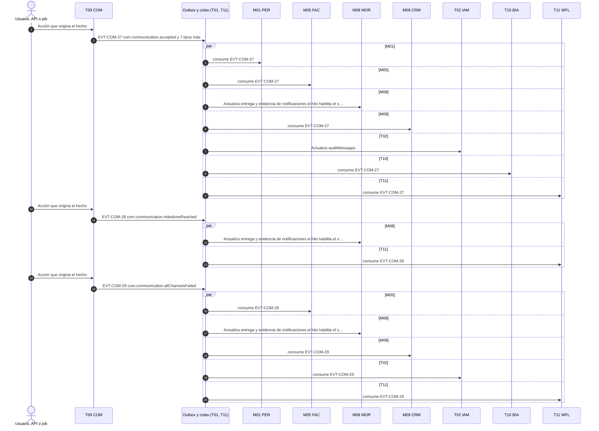

| Evento | Consumidores externos (T11 §12.3) | Efecto declarado por el consumidor (§12 de su anexo) |
|---|---|---|
| EVT-COM-27 `com.communication.accepted` | M01, M05, M08, M09, T02, T10, T11 | M08: Actualiza entrega y evidencia de notificaciones; el hito habilita el siguiente paso; el fallo total crea la tarea "canal alternativo".; T02: Actualiza `auditMessages` |
| EVT-COM-28 `com.communication.milestoneReached` | M08, T11 | M08: Actualiza entrega y evidencia de notificaciones; el hito habilita el siguiente paso; el fallo total crea la tarea "canal alternativo". |
| EVT-COM-29 `com.communication.allChannelsFailed` | M05, M08, M09, T02, T11 | M08: Actualiza entrega y evidencia de notificaciones; el hito habilita el siguiente paso; el fallo total crea la tarea "canal alternativo". |

### SEC-COM-07 — COM: hechos complementarios (Sanciones de comunidad, Boletines, Beneficios del club, consent, Preferencias de canal por persona, suppressi…)

**Agregados:** `com.sanction.*`, `com.newsletter.*`, `com.benefit.*`, `com.consent.*`, `com.preference.*`, `com.suppression.*`. **Productor:** T09 Comunidad y comunicaciones (T09 §12; catálogo T11 §12.3).

**Cubre:** EVT-COM-11 `com.sanction.applied`, EVT-COM-13 `com.newsletter.issued`, EVT-COM-20 `com.benefit.redemptionIssued`, EVT-COM-21 `com.benefit.redeemed`, EVT-COM-30 `com.consent.changed`, EVT-COM-31 `com.preference.changed`, EVT-COM-32 `com.suppression.added`.

**API y jobs disparadores (citados junto al evento en el anexo productor):** JOB-COM-04.

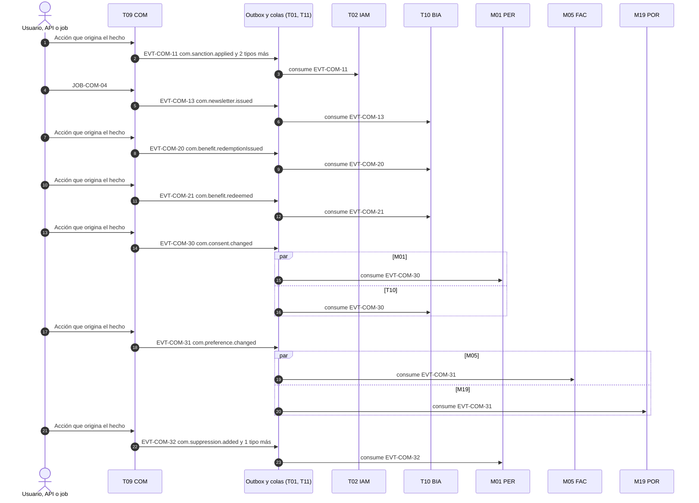

| Evento | Consumidores externos (T11 §12.3) | Efecto declarado por el consumidor (§12 de su anexo) |
|---|---|---|
| EVT-COM-11 `com.sanction.applied` | T02 | No declarado en el §12 del consumidor |
| EVT-COM-13 `com.newsletter.issued` | T10 | No declarado en el §12 del consumidor |
| EVT-COM-20 `com.benefit.redemptionIssued` | T10 | No declarado en el §12 del consumidor |
| EVT-COM-21 `com.benefit.redeemed` | T10 | No declarado en el §12 del consumidor |
| EVT-COM-30 `com.consent.changed` | M01, T10 | No declarado en el §12 del consumidor |
| EVT-COM-31 `com.preference.changed` | M05, M19 | No declarado en el §12 del consumidor |
| EVT-COM-32 `com.suppression.added` | M01 | No declarado en el §12 del consumidor |

### SEC-COM-08 — COM: hechos complementarios (Campañas masivas, Plantillas de publicación, Consumo de mensajería por período, Avisos de plataforma a admini…)

**Agregados:** `com.campaign.*`, `com.template.*`, `com.messagingUsage.*`, `com.platformNotice.*`, `com.invoiceMessage.*`, `com.message.*`. **Productor:** T09 Comunidad y comunicaciones (T09 §12; catálogo T11 §12.3).

**Cubre:** EVT-COM-33 `com.campaign.statusChanged`, EVT-COM-34 `com.campaign.completed`, EVT-COM-35 `com.template.published`, EVT-COM-36 `com.messagingUsage.thresholdReached`, EVT-COM-38 `com.platformNotice.published`, EVT-COM-39 `com.invoiceMessage.activated`, EVT-COM-40 `com.message.dispatchRequested`.

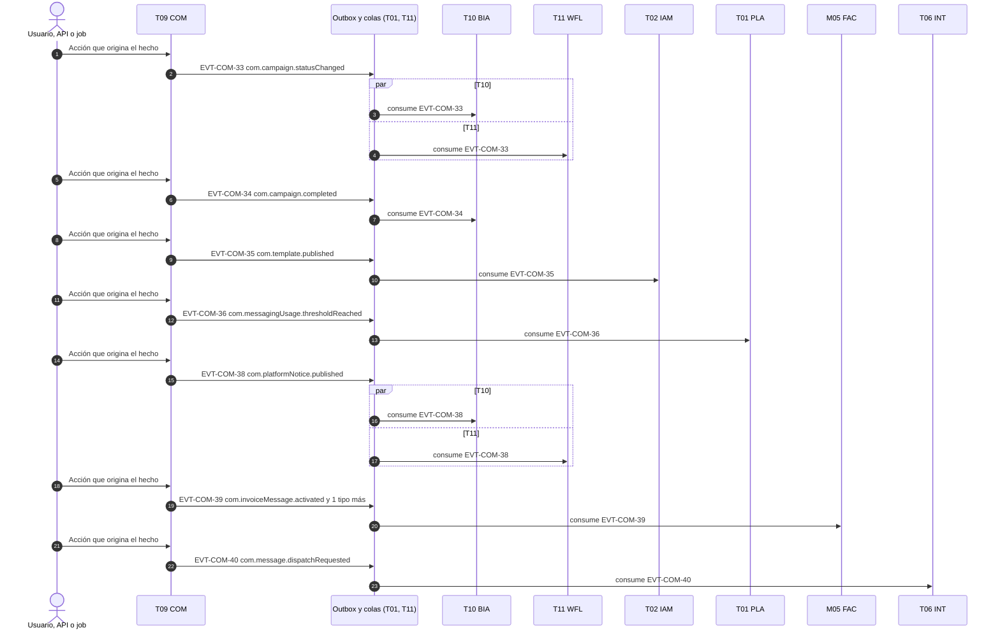

| Evento | Consumidores externos (T11 §12.3) | Efecto declarado por el consumidor (§12 de su anexo) |
|---|---|---|
| EVT-COM-33 `com.campaign.statusChanged` | T10, T11 | No declarado en el §12 del consumidor |
| EVT-COM-34 `com.campaign.completed` | T10 | No declarado en el §12 del consumidor |
| EVT-COM-35 `com.template.published` | T02 | No declarado en el §12 del consumidor |
| EVT-COM-36 `com.messagingUsage.thresholdReached` | T01 | No declarado en el §12 del consumidor |
| EVT-COM-38 `com.platformNotice.published` | T10, T11 | No declarado en el §12 del consumidor |
| EVT-COM-39 `com.invoiceMessage.activated` | M05 | No declarado en el §12 del consumidor |
| EVT-COM-40 `com.message.dispatchRequested` | T06 | No declarado en el §12 del consumidor |

## T10 — BIA Reportes, BI y APIs

### SEC-BIA-01 — BIA: hechos complementarios (Generador de reportes del tenant, Ejecuciones, Archivos exportados, Programaciones)

**Agregados:** `bia.report.*`, `bia.reportRun.*`, `bia.export.*`, `bia.schedule.*`. **Productor:** T10 Reportes, BI y APIs (T10 §12; catálogo T11 §12.3).

**Cubre:** EVT-BIA-01 `bia.report.published`, EVT-BIA-02 `bia.report.deprecated`, EVT-BIA-03 `bia.reportRun.completed`, EVT-BIA-04 `bia.reportRun.failed`, EVT-BIA-05 `bia.export.ready`, EVT-BIA-06 `bia.export.downloaded`, EVT-BIA-07 `bia.schedule.suspended`.

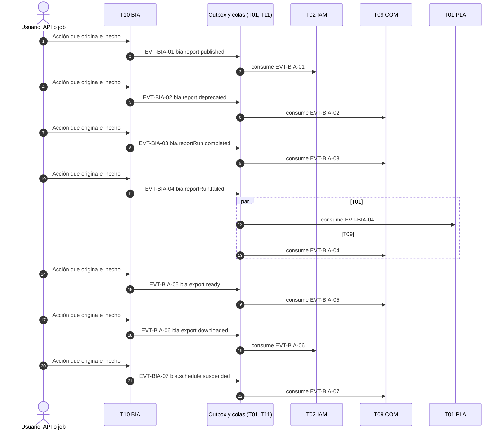

| Evento | Consumidores externos (T11 §12.3) | Efecto declarado por el consumidor (§12 de su anexo) |
|---|---|---|
| EVT-BIA-01 `bia.report.published` | T02 | No declarado en el §12 del consumidor |
| EVT-BIA-02 `bia.report.deprecated` | T09 | No declarado en el §12 del consumidor |
| EVT-BIA-03 `bia.reportRun.completed` | T09 | No declarado en el §12 del consumidor |
| EVT-BIA-04 `bia.reportRun.failed` | T01, T09 | No declarado en el §12 del consumidor |
| EVT-BIA-05 `bia.export.ready` | T09 | No declarado en el §12 del consumidor |
| EVT-BIA-06 `bia.export.downloaded` | T02 | No declarado en el §12 del consumidor |
| EVT-BIA-07 `bia.schedule.suspended` | T09 | No declarado en el §12 del consumidor |

### SEC-BIA-02 — BIA: hechos complementarios (Alertas disparadas, (duplicada con T02), Suscripciones de webhooks salientes, Datasets certificados, reconcil…)

**Agregados:** `bia.kpiAlert.*`, `bia.apiClient.*`, `bia.webhookSubscription.*`, `bia.dataset.*`, `bia.reconciliation.*`, `bia.customReport.*`, `bia.bulkExport.*`. **Productor:** T10 Reportes, BI y APIs (T10 §12; catálogo T11 §12.3).

**Cubre:** EVT-BIA-09 `bia.kpiAlert.opened`, EVT-BIA-10 `bia.kpiAlert.resolved`, EVT-BIA-11 `bia.apiClient.activated`, EVT-BIA-12 `bia.webhookSubscription.disabled`, EVT-BIA-13 `bia.dataset.freshnessBreached`, EVT-BIA-14 `bia.reconciliation.mismatch`, EVT-BIA-15 `bia.customReport.submitted`, EVT-BIA-16 `bia.bulkExport.ready`.

**API y jobs disparadores (citados junto al evento en el anexo productor):** JOB-BIA-11, JOB-BIA-12.

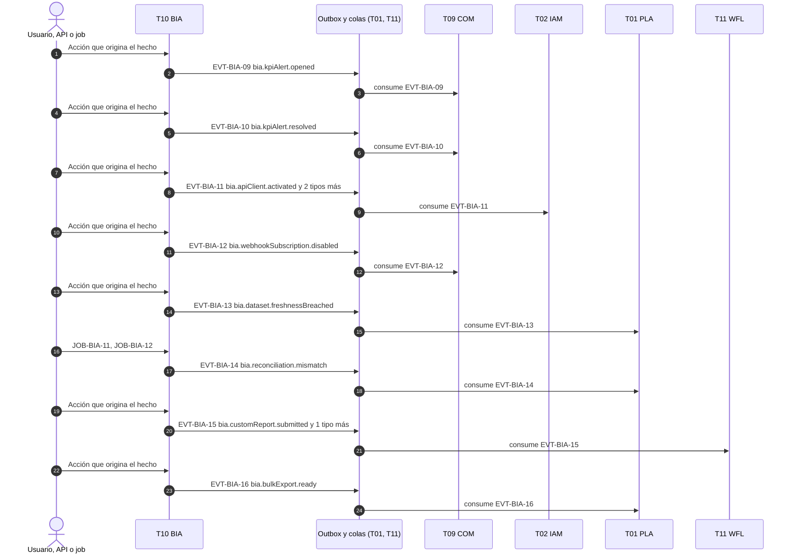

| Evento | Consumidores externos (T11 §12.3) | Efecto declarado por el consumidor (§12 de su anexo) |
|---|---|---|
| EVT-BIA-09 `bia.kpiAlert.opened` | T09 | No declarado en el §12 del consumidor |
| EVT-BIA-10 `bia.kpiAlert.resolved` | T09 | No declarado en el §12 del consumidor |
| EVT-BIA-11 `bia.apiClient.activated` | T02 | No declarado en el §12 del consumidor |
| EVT-BIA-12 `bia.webhookSubscription.disabled` | T09 | No declarado en el §12 del consumidor |
| EVT-BIA-13 `bia.dataset.freshnessBreached` | T01 | No declarado en el §12 del consumidor |
| EVT-BIA-14 `bia.reconciliation.mismatch` | T01 | No declarado en el §12 del consumidor |
| EVT-BIA-15 `bia.customReport.submitted` | T11 | No declarado en el §12 del consumidor |
| EVT-BIA-16 `bia.bulkExport.ready` | T01 | No declarado en el §12 del consumidor |

### SEC-BIA-03 — BIA: hechos complementarios (openData, exitExport)

**Agregados:** `bia.openData.*`, `bia.exitExport.*`. **Productor:** T10 Reportes, BI y APIs (T10 §12; catálogo T11 §12.3).

**Cubre:** EVT-BIA-17 `bia.openData.published`, EVT-BIA-18 `bia.exitExport.delivered`.

**API y jobs disparadores (citados junto al evento en el anexo productor):** JOB-BIA-21.

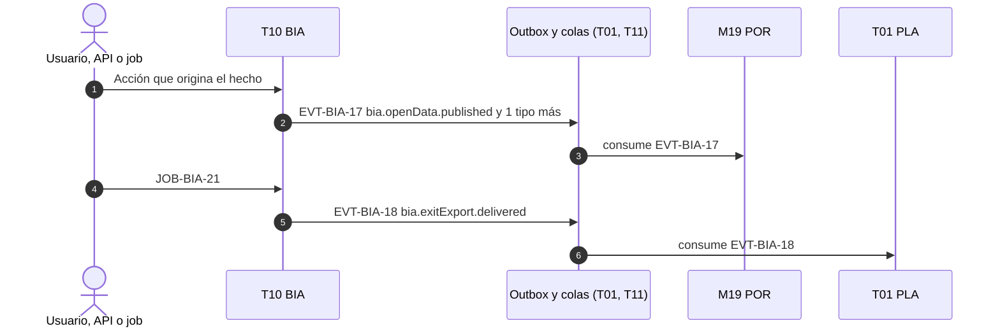

| Evento | Consumidores externos (T11 §12.3) | Efecto declarado por el consumidor (§12 de su anexo) |
|---|---|---|
| EVT-BIA-17 `bia.openData.published` | M19 | No declarado en el §12 del consumidor |
| EVT-BIA-18 `bia.exitExport.delivered` | T01 | No declarado en el §12 del consumidor |

## Cobertura de la parte V

| Evento | Productor | Secuencia | También en |
|---|---|---|---|
| EVT-INT-01 | T06 | SEC-INT-01 | — |
| EVT-INT-02 | T06 | SEC-INT-01 | — |
| EVT-INT-03 | T06 | SEC-INT-01 | — |
| EVT-INT-04 | T06 | SEC-INT-01 | — |
| EVT-INT-05 | T06 | SEC-INT-01 | — |
| EVT-INT-06 | T06 | SEC-INT-01 | — |
| EVT-INT-07 | T06 | SEC-INT-01 | — |
| EVT-INT-08 | T06 | SEC-INT-01 | A2 (`06-secuencias-y-estados.md`) |
| EVT-INT-09 | T06 | SEC-INT-02 | — |
| EVT-INT-10 | T06 | SEC-INT-02 | — |
| EVT-INT-11 | T06 | SEC-INT-02 | — |
| EVT-INT-12 | T06 | SEC-INT-02 | — |
| EVT-INT-13 | T06 | SEC-INT-02 | — |
| EVT-INT-14 | T06 | SEC-INT-02 | — |
| EVT-INT-15 | T06 | SEC-INT-02 | A4 (`06-secuencias-y-estados.md`) |
| EVT-INT-16 | T06 | SEC-INT-02 | — |
| EVT-INT-17 | T06 | SEC-INT-03 | — |
| EVT-INT-18 | T06 | SEC-INT-03 | — |
| EVT-INT-19 | T06 | SEC-INT-03 | — |
| EVT-INT-20 | T06 | SEC-INT-03 | — |
| EVT-INT-21 | T06 | SEC-INT-03 | — |
| EVT-INT-22 | T06 | SEC-INT-03 | — |
| EVT-INT-23 | T06 | SEC-INT-03 | — |
| EVT-INT-24 | T06 | SEC-INT-03 | — |
| EVT-MIG-01 | T07 | SEC-MIG-01 | A9 (`06-secuencias-y-estados.md`) |
| EVT-MIG-02 | T07 | SEC-MIG-01 | A9 (`06-secuencias-y-estados.md`) |
| EVT-MIG-03 | T07 | SEC-MIG-01 | — |
| EVT-MIG-04 | T07 | SEC-MIG-01 | A9 (`06-secuencias-y-estados.md`) |
| EVT-MIG-05 | T07 | SEC-MIG-01 | — |
| EVT-MIG-06 | T07 | SEC-MIG-01 | — |
| EVT-MIG-07 | T07 | SEC-MIG-01 | — |
| EVT-MIG-08 | T07 | SEC-MIG-01 | — |
| EVT-MIG-09 | T07 | SEC-MIG-02 | — |
| EVT-NFR-01 | T08 | SEC-NFR-01 | — |
| EVT-NFR-02 | T08 | SEC-NFR-01 | — |
| EVT-NFR-03 | T08 | SEC-NFR-01 | — |
| EVT-NFR-04 | T08 | SEC-NFR-01 | — |
| EVT-NFR-05 | T08 | SEC-NFR-01 | — |
| EVT-NFR-06 | T08 | SEC-NFR-01 | — |
| EVT-NFR-07 | T08 | SEC-NFR-01 | — |
| EVT-NFR-08 | T08 | SEC-NFR-01 | — |
| EVT-NFR-09 | T08 | SEC-NFR-02 | — |
| EVT-NFR-10 | T08 | SEC-NFR-02 | — |
| EVT-NFR-12 | T08 | SEC-NFR-02 | — |
| EVT-NFR-13 | T08 | SEC-NFR-02 | — |
| EVT-NFR-14 | T08 | SEC-NFR-02 | — |
| EVT-NFR-15 | T08 | SEC-NFR-02 | — |
| EVT-NFR-16 | T08 | SEC-NFR-02 | — |
| EVT-NFR-17 | T08 | SEC-NFR-02 | — |
| EVT-COM-01 | T09 | SEC-COM-01 | — |
| EVT-COM-02 | T09 | SEC-COM-01 | — |
| EVT-COM-04 | T09 | SEC-COM-01 | — |
| EVT-COM-05 | T09 | SEC-COM-02 | — |
| EVT-COM-07 | T09 | SEC-COM-02 | — |
| EVT-COM-37 | T09 | SEC-COM-02 | — |
| EVT-COM-14 | T09 | SEC-COM-03 | — |
| EVT-COM-15 | T09 | SEC-COM-03 | — |
| EVT-COM-16 | T09 | SEC-COM-03 | — |
| EVT-COM-17 | T09 | SEC-COM-04 | — |
| EVT-COM-18 | T09 | SEC-COM-04 | — |
| EVT-COM-19 | T09 | SEC-COM-04 | — |
| EVT-COM-22 | T09 | SEC-COM-05 | — |
| EVT-COM-23 | T09 | SEC-COM-05 | — |
| EVT-COM-24 | T09 | SEC-COM-05 | — |
| EVT-COM-25 | T09 | SEC-COM-05 | — |
| EVT-COM-26 | T09 | SEC-COM-05 | — |
| EVT-COM-27 | T09 | SEC-COM-06 | — |
| EVT-COM-28 | T09 | SEC-COM-06 | — |
| EVT-COM-29 | T09 | SEC-COM-06 | — |
| EVT-COM-11 | T09 | SEC-COM-07 | — |
| EVT-COM-13 | T09 | SEC-COM-07 | — |
| EVT-COM-20 | T09 | SEC-COM-07 | — |
| EVT-COM-21 | T09 | SEC-COM-07 | — |
| EVT-COM-30 | T09 | SEC-COM-07 | — |
| EVT-COM-31 | T09 | SEC-COM-07 | — |
| EVT-COM-32 | T09 | SEC-COM-07 | — |
| EVT-COM-33 | T09 | SEC-COM-08 | — |
| EVT-COM-34 | T09 | SEC-COM-08 | — |
| EVT-COM-35 | T09 | SEC-COM-08 | — |
| EVT-COM-36 | T09 | SEC-COM-08 | — |
| EVT-COM-38 | T09 | SEC-COM-08 | — |
| EVT-COM-39 | T09 | SEC-COM-08 | — |
| EVT-COM-40 | T09 | SEC-COM-08 | — |
| EVT-BIA-01 | T10 | SEC-BIA-01 | — |
| EVT-BIA-02 | T10 | SEC-BIA-01 | — |
| EVT-BIA-03 | T10 | SEC-BIA-01 | — |
| EVT-BIA-04 | T10 | SEC-BIA-01 | — |
| EVT-BIA-05 | T10 | SEC-BIA-01 | — |
| EVT-BIA-06 | T10 | SEC-BIA-01 | — |
| EVT-BIA-07 | T10 | SEC-BIA-01 | — |
| EVT-BIA-09 | T10 | SEC-BIA-02 | — |
| EVT-BIA-10 | T10 | SEC-BIA-02 | — |
| EVT-BIA-11 | T10 | SEC-BIA-02 | — |
| EVT-BIA-12 | T10 | SEC-BIA-02 | — |
| EVT-BIA-13 | T10 | SEC-BIA-02 | — |
| EVT-BIA-14 | T10 | SEC-BIA-02 | — |
| EVT-BIA-15 | T10 | SEC-BIA-02 | — |
| EVT-BIA-16 | T10 | SEC-BIA-02 | — |
| EVT-BIA-17 | T10 | SEC-BIA-03 | — |
| EVT-BIA-18 | T10 | SEC-BIA-03 | — |
