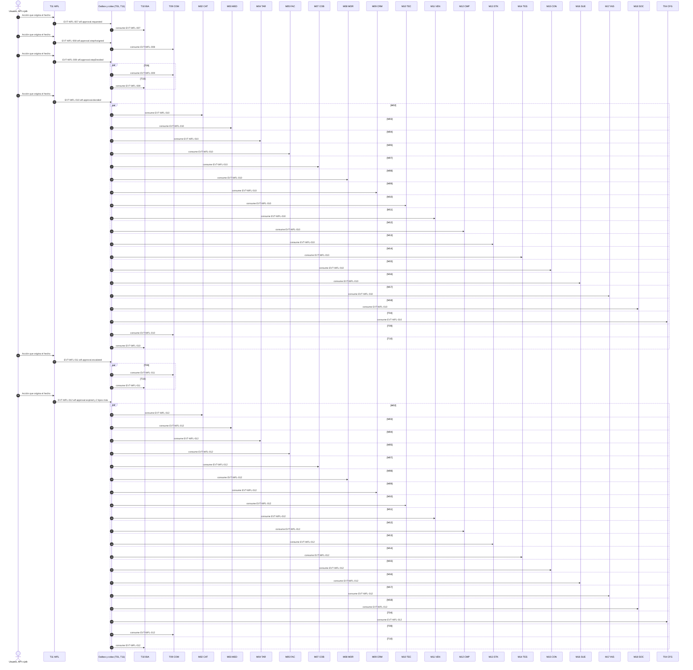
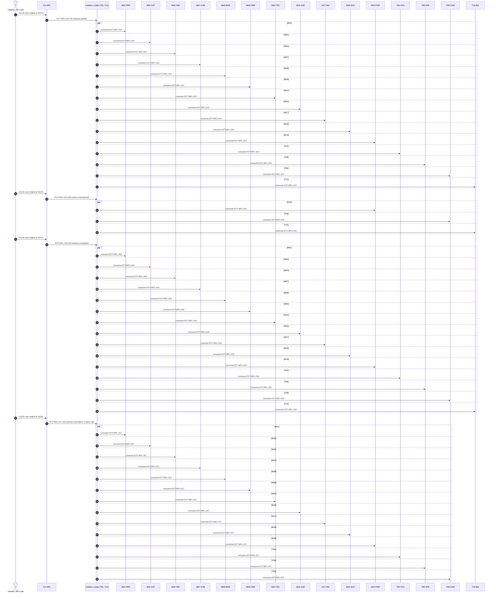
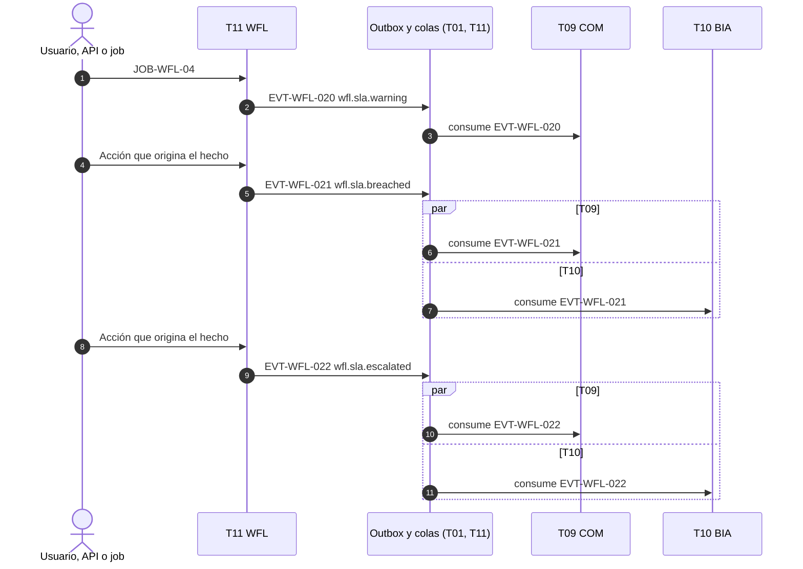
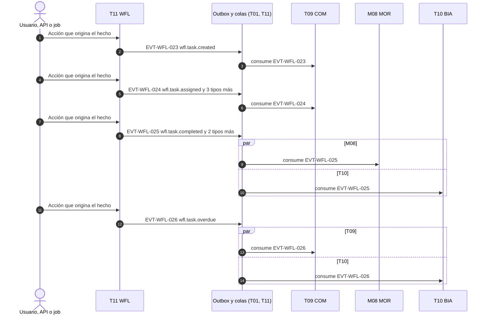
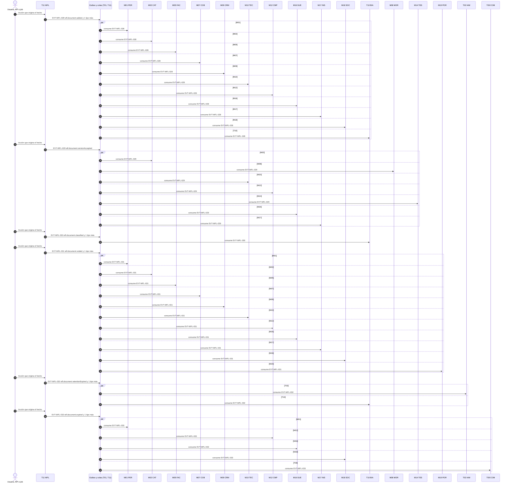
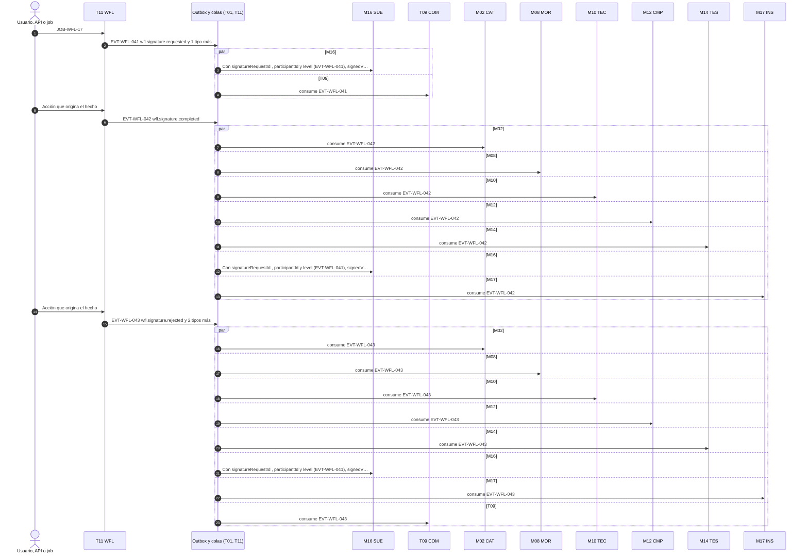
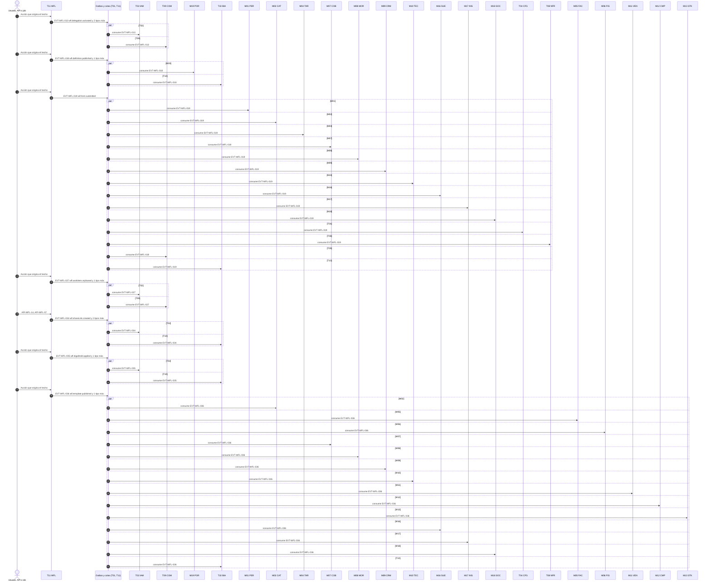
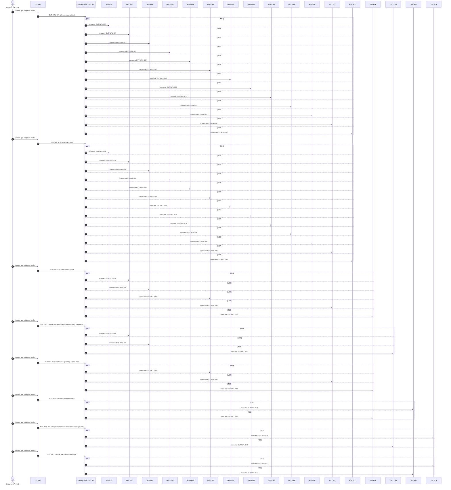
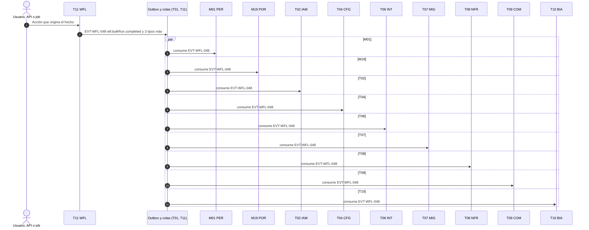

# GoodApps Cooperativas — Diagramas de secuencia por eventos, parte W (T11)

**Entregable de análisis y diseño — Artefacto 7.3 (diagramas de secuencia), ampliación a cobertura completa**

| Campo | Valor |
|---|---|
| Documento | `06w-secuencias-eventos-t11.md` |
| Índice del entregable | [`06-secuencias-y-estados.md`](06-secuencias-y-estados.md) (sección 7) y [`06a-indice-cobertura-secuencias-estados.md`](06a-indice-cobertura-secuencias-estados.md) |
| Versión | 1.0 |
| Fecha | 05-11-2026 |
| Estado | Borrador para revisión |
| Fuentes | T11 §12.2 y §12.3 (catálogo de eventos y consumidores); §12 "Eventos consumidos" y §11 de los anexos T11 |
| Generación | Script `_trabajo/gen06_build.py` (extrae de los anexos; revisión manual posterior) |

## 1. Cómo leer esta parte

Cada diagrama representa un flujo de negocio entre módulos construido a partir del catálogo de eventos de T11 §12.3: un agregado del productor (por ejemplo, `cat.contract.*`) con sus hechos en orden de ID, o un grupo de hechos complementarios del mismo productor cuando el agregado tiene menos de tres eventos. Todos siguen el patrón transversal de `06-secuencias-y-estados.md` §2.2 (outbox en la misma transacción, relay, inbox por consumidor, reintentos y cola de errores), que no se repite en cada diagrama.

- **U** es el origen del hecho: usuario, API o job. Se citan las API y jobs que el anexo productor nombra junto al evento.
- **BUS** es la outbox con el relay y las colas BullMQ; cada consumidor recibe su propio job.
- `par` agrupa consumidores independientes del mismo evento. El texto del mensaje es el efecto que declara el consumidor en el §12 de su anexo; "consume EVT-…" indica que el consumidor figura en T11 pero no describe el efecto. **GEN** representa consumidores genéricos de T11 ("módulo dueño del tipo", "todos").
- Debajo de cada diagrama, la tabla lista los EVT que cubre, sus consumidores externos y los efectos declarados.

## T11 — WFL Workflow, eventos y documentos

### SEC-WFL-01 — WFL: Operaciones de negocio con pasos

**Agregados:** `wfl.operation.*`. **Productor:** T11 Workflow, eventos y documentos (T11 §12; catálogo T11 §12.3).

**Cubre:** EVT-WFL-001 `wfl.operation.submitted`, EVT-WFL-002 `wfl.operation.approved`, EVT-WFL-003 `wfl.operation.executionStarted`, EVT-WFL-004 `wfl.operation.completed`, EVT-WFL-005 `wfl.operation.failed`, EVT-WFL-006 `wfl.operation.reconciled`.

**API y jobs disparadores (citados junto al evento en el anexo productor):** JOB-WFL-01.

```mermaid
sequenceDiagram
    autonumber
    actor U as Usuario, API o job
    participant PT11 as T11 WFL
    participant BUS as Outbox y colas (T01, T11)
    participant PM01 as M01 PER
    participant PM02 as M02 CAT
    participant PM03 as M03 MED
    participant PM04 as M04 TAR
    participant PM05 as M05 FAC
    participant PM06 as M06 FIS
    participant PM07 as M07 COB
    participant PM08 as M08 MOR
    participant PM09 as M09 CRM
    participant PM10 as M10 TEC
    participant PM11 as M11 VEN
    participant PM12 as M12 CMP
    participant PM13 as M13 STK
    participant PM14 as M14 TES
    participant PM15 as M15 CON
    participant PM16 as M16 SUE
    participant PM17 as M17 INS
    participant PM18 as M18 SOC
    participant PT01 as T01 PLA
    participant PT02 as T02 IAM
    participant PT04 as T04 CFG
    participant PT07 as T07 MIG
    participant PT09 as T09 COM
    participant PT10 as T10 BIA
    U->>PT11: Acción que origina el hecho
    PT11->>BUS: EVT-WFL-001 wfl.operation.submitted
    par M01
        BUS->>PM01: consume EVT-WFL-001
    and M02
        BUS->>PM02: consume EVT-WFL-001
    and M03
        BUS->>PM03: consume EVT-WFL-001
    and M04
        BUS->>PM04: consume EVT-WFL-001
    and M05
        BUS->>PM05: consume EVT-WFL-001
    and M06
        BUS->>PM06: consume EVT-WFL-001
    and M07
        BUS->>PM07: consume EVT-WFL-001
    and M08
        BUS->>PM08: consume EVT-WFL-001
    and M09
        BUS->>PM09: consume EVT-WFL-001
    and M10
        BUS->>PM10: consume EVT-WFL-001
    and M11
        BUS->>PM11: consume EVT-WFL-001
    and M12
        BUS->>PM12: consume EVT-WFL-001
    and M13
        BUS->>PM13: consume EVT-WFL-001
    and M14
        BUS->>PM14: consume EVT-WFL-001
    and M15
        BUS->>PM15: consume EVT-WFL-001
    and M16
        BUS->>PM16: consume EVT-WFL-001
    and M17
        BUS->>PM17: consume EVT-WFL-001
    and M18
        BUS->>PM18: consume EVT-WFL-001
    and T01
        BUS->>PT01: consume EVT-WFL-001
    and T02
        BUS->>PT02: consume EVT-WFL-001
    and T04
        BUS->>PT04: consume EVT-WFL-001
    and T07
        BUS->>PT07: consume EVT-WFL-001
    and T09
        BUS->>PT09: consume EVT-WFL-001
    and T10
        BUS->>PT10: consume EVT-WFL-001
    end
    U->>PT11: JOB-WFL-01
    PT11->>BUS: EVT-WFL-002 wfl.operation.approved y 3 tipos más
    par M01
        BUS->>PM01: consume EVT-WFL-002
    and M02
        BUS->>PM02: consume EVT-WFL-002
    and M03
        BUS->>PM03: consume EVT-WFL-002
    and M04
        BUS->>PM04: consume EVT-WFL-002
    and M05
        BUS->>PM05: consume EVT-WFL-002
    and M06
        BUS->>PM06: consume EVT-WFL-002
    and M07
        BUS->>PM07: consume EVT-WFL-002
    and M08
        BUS->>PM08: consume EVT-WFL-002
    and M09
        BUS->>PM09: consume EVT-WFL-002
    and M10
        BUS->>PM10: consume EVT-WFL-002
    and M11
        BUS->>PM11: consume EVT-WFL-002
    and M12
        BUS->>PM12: consume EVT-WFL-002
    and M13
        BUS->>PM13: consume EVT-WFL-002
    and M14
        BUS->>PM14: consume EVT-WFL-002
    and M15
        BUS->>PM15: consume EVT-WFL-002
    and M16
        BUS->>PM16: consume EVT-WFL-002
    and M17
        BUS->>PM17: consume EVT-WFL-002
    and M18
        BUS->>PM18: consume EVT-WFL-002
    and T01
        BUS->>PT01: consume EVT-WFL-002
    and T02
        BUS->>PT02: consume EVT-WFL-002
    and T04
        BUS->>PT04: consume EVT-WFL-002
    and T07
        BUS->>PT07: consume EVT-WFL-002
    and T09
        BUS->>PT09: consume EVT-WFL-002
    and T10
        BUS->>PT10: consume EVT-WFL-002
    end
    U->>PT11: Acción que origina el hecho
    PT11->>BUS: EVT-WFL-003 wfl.operation.executionStarted
    BUS->>PT10: consume EVT-WFL-003
    U->>PT11: Acción que origina el hecho
    PT11->>BUS: EVT-WFL-004 wfl.operation.completed
    par M01
        BUS->>PM01: consume EVT-WFL-004
    and M02
        BUS->>PM02: consume EVT-WFL-004
    and M03
        BUS->>PM03: consume EVT-WFL-004
    and M04
        BUS->>PM04: consume EVT-WFL-004
    and M05
        BUS->>PM05: consume EVT-WFL-004
    and M06
        BUS->>PM06: consume EVT-WFL-004
    and M07
        BUS->>PM07: consume EVT-WFL-004
    and M08
        BUS->>PM08: consume EVT-WFL-004
    and M09
        BUS->>PM09: consume EVT-WFL-004
    and M10
        BUS->>PM10: consume EVT-WFL-004
    and M11
        BUS->>PM11: consume EVT-WFL-004
    and M12
        BUS->>PM12: consume EVT-WFL-004
    and M13
        BUS->>PM13: consume EVT-WFL-004
    and M14
        BUS->>PM14: consume EVT-WFL-004
    and M15
        BUS->>PM15: consume EVT-WFL-004
    and M16
        BUS->>PM16: consume EVT-WFL-004
    and M17
        BUS->>PM17: consume EVT-WFL-004
    and M18
        BUS->>PM18: consume EVT-WFL-004
    and T01
        BUS->>PT01: consume EVT-WFL-004
    and T02
        BUS->>PT02: consume EVT-WFL-004
    and T04
        BUS->>PT04: consume EVT-WFL-004
    and T07
        BUS->>PT07: consume EVT-WFL-004
    and T09
        BUS->>PT09: consume EVT-WFL-004
    and T10
        BUS->>PT10: consume EVT-WFL-004
    end
    U->>PT11: Acción que origina el hecho
    PT11->>BUS: EVT-WFL-005 wfl.operation.failed y 2 tipos más
    par T09
        BUS->>PT09: consume EVT-WFL-005
    and T10
        BUS->>PT10: consume EVT-WFL-005
    end
    U->>PT11: Acción que origina el hecho
    PT11->>BUS: EVT-WFL-006 wfl.operation.reconciled
    par M01
        BUS->>PM01: consume EVT-WFL-006
    and M02
        BUS->>PM02: consume EVT-WFL-006
    and M03
        BUS->>PM03: consume EVT-WFL-006
    and M04
        BUS->>PM04: consume EVT-WFL-006
    and M05
        BUS->>PM05: consume EVT-WFL-006
    and M06
        BUS->>PM06: consume EVT-WFL-006
    and M07
        BUS->>PM07: consume EVT-WFL-006
    and M08
        BUS->>PM08: consume EVT-WFL-006
    and M09
        BUS->>PM09: consume EVT-WFL-006
    and M10
        BUS->>PM10: consume EVT-WFL-006
    and M11
        BUS->>PM11: consume EVT-WFL-006
    and M12
        BUS->>PM12: consume EVT-WFL-006
    and M13
        BUS->>PM13: consume EVT-WFL-006
    and M14
        BUS->>PM14: consume EVT-WFL-006
    and M15
        BUS->>PM15: consume EVT-WFL-006
    and M16
        BUS->>PM16: consume EVT-WFL-006
    and M17
        BUS->>PM17: consume EVT-WFL-006
    and M18
        BUS->>PM18: consume EVT-WFL-006
    and T01
        BUS->>PT01: consume EVT-WFL-006
    and T02
        BUS->>PT02: consume EVT-WFL-006
    and T04
        BUS->>PT04: consume EVT-WFL-006
    and T07
        BUS->>PT07: consume EVT-WFL-006
    and T10
        BUS->>PT10: consume EVT-WFL-006
    end
```

| Evento | Consumidores externos (T11 §12.3) | Efecto declarado por el consumidor (§12 de su anexo) |
|---|---|---|
| EVT-WFL-001 `wfl.operation.submitted` | M01, M02, M03, M04, M05, M06, M07, M08, M09, M10, M11, M12, M13, M14, M15, M16, M17, M18, T01, T02, T04, T07, T09, T10 | No declarado en el §12 del consumidor |
| EVT-WFL-002 `wfl.operation.approved` | M01, M02, M03, M04, M05, M06, M07, M08, M09, M10, M11, M12, M13, M14, M15, M16, M17, M18, T01, T02, T04, T07, T09, T10 | No declarado en el §12 del consumidor |
| EVT-WFL-003 `wfl.operation.executionStarted` | T10 | No declarado en el §12 del consumidor |
| EVT-WFL-004 `wfl.operation.completed` | M01, M02, M03, M04, M05, M06, M07, M08, M09, M10, M11, M12, M13, M14, M15, M16, M17, M18, T01, T02, T04, T07, T09, T10 | No declarado en el §12 del consumidor |
| EVT-WFL-005 `wfl.operation.failed` | T09, T10 | No declarado en el §12 del consumidor |
| EVT-WFL-006 `wfl.operation.reconciled` | M01, M02, M03, M04, M05, M06, M07, M08, M09, M10, M11, M12, M13, M14, M15, M16, M17, M18, T01, T02, T04, T07, T10 | No declarado en el §12 del consumidor |

### SEC-WFL-02 — WFL: approval

**Agregados:** `wfl.approval.*`. **Productor:** T11 Workflow, eventos y documentos (T11 §12; catálogo T11 §12.3).

**Cubre:** EVT-WFL-007 `wfl.approval.requested`, EVT-WFL-008 `wfl.approval.stepAssigned`, EVT-WFL-009 `wfl.approval.stepDecided`, EVT-WFL-010 `wfl.approval.decided`, EVT-WFL-011 `wfl.approval.escalated`, EVT-WFL-012 `wfl.approval.expired`.

| Evento | Consumidores externos (T11 §12.3) | Efecto declarado por el consumidor (§12 de su anexo) |
|---|---|---|
| EVT-WFL-007 `wfl.approval.requested` | T10 | No declarado en el §12 del consumidor |
| EVT-WFL-008 `wfl.approval.stepAssigned` | T09 | No declarado en el §12 del consumidor |
| EVT-WFL-009 `wfl.approval.stepDecided` | T09, T10 | No declarado en el §12 del consumidor |
| EVT-WFL-010 `wfl.approval.decided` | M02, M03, M04, M05, M07, M08, M09, M10, M11, M12, M13, M14, M15, M16, M17, M18, T04, T09, T10 | No declarado en el §12 del consumidor |
| EVT-WFL-011 `wfl.approval.escalated` | T09, T10 | No declarado en el §12 del consumidor |
| EVT-WFL-012 `wfl.approval.expired` | M02, M03, M04, M05, M07, M08, M09, M10, M11, M12, M13, M14, M15, M16, M17, M18, T04, T09, T10 | No declarado en el §12 del consumidor |

### SEC-WFL-03 — WFL: Instancias en curso

**Agregados:** `wfl.instance.*`. **Productor:** T11 Workflow, eventos y documentos (T11 §12; catálogo T11 §12.3).

**Cubre:** EVT-WFL-014 `wfl.instance.started`, EVT-WFL-015 `wfl.instance.transitioned`, EVT-WFL-016 `wfl.instance.completed`, EVT-WFL-017 `wfl.instance.cancelled`.

| Evento | Consumidores externos (T11 §12.3) | Efecto declarado por el consumidor (§12 de su anexo) |
|---|---|---|
| EVT-WFL-014 `wfl.instance.started` | M01, M02, M04, M07, M08, M09, M10, M16, M17, M18, M19, T04, T08, T09, T10 | No declarado en el §12 del consumidor |
| EVT-WFL-015 `wfl.instance.transitioned` | M19, T09, T10 | No declarado en el §12 del consumidor |
| EVT-WFL-016 `wfl.instance.completed` | M01, M02, M04, M07, M08, M09, M10, M16, M17, M18, M19, T04, T08, T09, T10 | No declarado en el §12 del consumidor |
| EVT-WFL-017 `wfl.instance.cancelled` | M01, M02, M04, M07, M08, M09, M10, M16, M17, M18, M19, T04, T08, T09 | No declarado en el §12 del consumidor |

### SEC-WFL-04 — WFL: sla

**Agregados:** `wfl.sla.*`. **Productor:** T11 Workflow, eventos y documentos (T11 §12; catálogo T11 §12.3).

**Cubre:** EVT-WFL-020 `wfl.sla.warning`, EVT-WFL-021 `wfl.sla.breached`, EVT-WFL-022 `wfl.sla.escalated`.

**API y jobs disparadores (citados junto al evento en el anexo productor):** JOB-WFL-04.

| Evento | Consumidores externos (T11 §12.3) | Efecto declarado por el consumidor (§12 de su anexo) |
|---|---|---|
| EVT-WFL-020 `wfl.sla.warning` | T09 | No declarado en el §12 del consumidor |
| EVT-WFL-021 `wfl.sla.breached` | T09, T10 | No declarado en el §12 del consumidor |
| EVT-WFL-022 `wfl.sla.escalated` | T09, T10 | No declarado en el §12 del consumidor |

### SEC-WFL-05 — WFL: Tareas

**Agregados:** `wfl.task.*`. **Productor:** T11 Workflow, eventos y documentos (T11 §12; catálogo T11 §12.3).

**Cubre:** EVT-WFL-023 `wfl.task.created`, EVT-WFL-024 `wfl.task.assigned`, EVT-WFL-025 `wfl.task.completed`, EVT-WFL-026 `wfl.task.overdue`.

| Evento | Consumidores externos (T11 §12.3) | Efecto declarado por el consumidor (§12 de su anexo) |
|---|---|---|
| EVT-WFL-023 `wfl.task.created` | T09 | No declarado en el §12 del consumidor |
| EVT-WFL-024 `wfl.task.assigned` | T09 | No declarado en el §12 del consumidor |
| EVT-WFL-025 `wfl.task.completed` | M08, T10 | No declarado en el §12 del consumidor |
| EVT-WFL-026 `wfl.task.overdue` | T09, T10 | No declarado en el §12 del consumidor |

### SEC-WFL-06 — WFL: Documentos del expediente

**Agregados:** `wfl.document.*`. **Productor:** T11 Workflow, eventos y documentos (T11 §12; catálogo T11 §12.3).

**Cubre:** EVT-WFL-028 `wfl.document.added`, EVT-WFL-029 `wfl.document.versionAccepted`, EVT-WFL-030 `wfl.document.classified`, EVT-WFL-031 `wfl.document.voided`, EVT-WFL-032 `wfl.document.retentionExpired`, EVT-WFL-033 `wfl.document.expired`.

| Evento | Consumidores externos (T11 §12.3) | Efecto declarado por el consumidor (§12 de su anexo) |
|---|---|---|
| EVT-WFL-028 `wfl.document.added` | M01, M02, M05, M07, M09, M10, M12, M16, M17, M18, T10 | No declarado en el §12 del consumidor |
| EVT-WFL-029 `wfl.document.versionAccepted` | M02, M08, M10, M12, M14, M16, M17 | No declarado en el §12 del consumidor |
| EVT-WFL-030 `wfl.document.classified` | T10 | No declarado en el §12 del consumidor |
| EVT-WFL-031 `wfl.document.voided` | M01, M02, M05, M07, M09, M10, M12, M16, M17, M18, M19 | No declarado en el §12 del consumidor |
| EVT-WFL-032 `wfl.document.retentionExpired` | T02, T10 | No declarado en el §12 del consumidor |
| EVT-WFL-033 `wfl.document.expired` | M01, M12, M16, M18, T09 | No declarado en el §12 del consumidor |

### SEC-WFL-07 — WFL: signature

**Agregados:** `wfl.signature.*`. **Productor:** T11 Workflow, eventos y documentos (T11 §12; catálogo T11 §12.3).

**Cubre:** EVT-WFL-041 `wfl.signature.requested`, EVT-WFL-042 `wfl.signature.completed`, EVT-WFL-043 `wfl.signature.rejected`.

**API y jobs disparadores (citados junto al evento en el anexo productor):** JOB-WFL-17.

| Evento | Consumidores externos (T11 §12.3) | Efecto declarado por el consumidor (§12 de su anexo) |
|---|---|---|
| EVT-WFL-041 `wfl.signature.requested` | M16, T09 | M16: Con `signatureRequestId`, `participantId` y `level` (EVT-WFL-041), `signedVersionId` y `sourceRef` (EVT-WFL-042) o `reason` (EVT-WFL-043) actualiza el estado de firma del recibo; con la firma del empleado publica E… |
| EVT-WFL-042 `wfl.signature.completed` | M02, M08, M10, M12, M14, M16, M17 | M16: Con `signatureRequestId`, `participantId` y `level` (EVT-WFL-041), `signedVersionId` y `sourceRef` (EVT-WFL-042) o `reason` (EVT-WFL-043) actualiza el estado de firma del recibo; con la firma del empleado publica E… |
| EVT-WFL-043 `wfl.signature.rejected` | M02, M08, M10, M12, M14, M16, M17, T09 | M16: Con `signatureRequestId`, `participantId` y `level` (EVT-WFL-041), `signedVersionId` y `sourceRef` (EVT-WFL-042) o `reason` (EVT-WFL-043) actualiza el estado de firma del recibo; con la firma del empleado publica E… |

### SEC-WFL-08 — WFL: hechos complementarios (Delegaciones de aprobación, Catálogo de jobs, form, Ítems de trabajo de bandeja, Enlaces firmados de acceso,…)

**Agregados:** `wfl.delegation.*`, `wfl.definition.*`, `wfl.form.*`, `wfl.workItem.*`, `wfl.shareLink.*`, `wfl.legalHold.*`, `wfl.template.*`. **Productor:** T11 Workflow, eventos y documentos (T11 §12; catálogo T11 §12.3).

**Cubre:** EVT-WFL-013 `wfl.delegation.activated`, EVT-WFL-018 `wfl.definition.published`, EVT-WFL-019 `wfl.form.submitted`, EVT-WFL-027 `wfl.workItem.orphaned`, EVT-WFL-034 `wfl.shareLink.created`, EVT-WFL-035 `wfl.legalHold.applied`, EVT-WFL-036 `wfl.template.published`.

**API y jobs disparadores (citados junto al evento en el anexo productor):** API-WFL-14, API-WFL-57.

| Evento | Consumidores externos (T11 §12.3) | Efecto declarado por el consumidor (§12 de su anexo) |
|---|---|---|
| EVT-WFL-013 `wfl.delegation.activated` | T02, T09 | No declarado en el §12 del consumidor |
| EVT-WFL-018 `wfl.definition.published` | M19, T10 | No declarado en el §12 del consumidor |
| EVT-WFL-019 `wfl.form.submitted` | M01, M02, M04, M07, M08, M09, M10, M16, M17, M18, T04, T08, T09, T10 | No declarado en el §12 del consumidor |
| EVT-WFL-027 `wfl.workItem.orphaned` | T02, T09 | No declarado en el §12 del consumidor |
| EVT-WFL-034 `wfl.shareLink.created` | T02, T10 | No declarado en el §12 del consumidor |
| EVT-WFL-035 `wfl.legalHold.applied` | T02, T10 | No declarado en el §12 del consumidor |
| EVT-WFL-036 `wfl.template.published` | M02, M05, M06, M07, M08, M09, M10, M11, M12, M13, M16, M17, M18, T10 | No declarado en el §12 del consumidor |

### SEC-WFL-09 — WFL: hechos complementarios (render, number, Numeración no fiscal, Expedientes digitales, operationalInbox, Programación por tenant)

**Agregados:** `wfl.render.*`, `wfl.number.*`, `wfl.sequence.*`, `wfl.dossier.*`, `wfl.operationalInbox.*`, `wfl.jobSchedule.*`. **Productor:** T11 Workflow, eventos y documentos (T11 §12; catálogo T11 §12.3).

**Cubre:** EVT-WFL-037 `wfl.render.completed`, EVT-WFL-038 `wfl.render.failed`, EVT-WFL-039 `wfl.number.voided`, EVT-WFL-040 `wfl.sequence.thresholdReached`, EVT-WFL-044 `wfl.dossier.opened`, EVT-WFL-045 `wfl.dossier.exported`, EVT-WFL-046 `wfl.operationalInbox.itemOpened`, EVT-WFL-047 `wfl.jobSchedule.changed`.

| Evento | Consumidores externos (T11 §12.3) | Efecto declarado por el consumidor (§12 de su anexo) |
|---|---|---|
| EVT-WFL-037 `wfl.render.completed` | M02, M05, M06, M07, M08, M09, M10, M11, M12, M13, M16, M17, M18 | No declarado en el §12 del consumidor |
| EVT-WFL-038 `wfl.render.failed` | M02, M05, M06, M07, M08, M09, M10, M11, M12, M13, M16, M17, M18 | No declarado en el §12 del consumidor |
| EVT-WFL-039 `wfl.number.voided` | M05, M06, M09, M17, T10 | No declarado en el §12 del consumidor |
| EVT-WFL-040 `wfl.sequence.thresholdReached` | M05, M06, T09 | No declarado en el §12 del consumidor |
| EVT-WFL-044 `wfl.dossier.opened` | M09, M17, T10 | No declarado en el §12 del consumidor |
| EVT-WFL-045 `wfl.dossier.exported` | T02, T10 | No declarado en el §12 del consumidor |
| EVT-WFL-046 `wfl.operationalInbox.itemOpened` | T01, T09 | No declarado en el §12 del consumidor |
| EVT-WFL-047 `wfl.jobSchedule.changed` | T01, T02 | No declarado en el §12 del consumidor |

### SEC-WFL-10 — WFL: hechos complementarios (Corridas masivas)

**Agregados:** `wfl.bulkRun.*`. **Productor:** T11 Workflow, eventos y documentos (T11 §12; catálogo T11 §12.3).

**Cubre:** EVT-WFL-048 `wfl.bulkRun.completed`.

| Evento | Consumidores externos (T11 §12.3) | Efecto declarado por el consumidor (§12 de su anexo) |
|---|---|---|
| EVT-WFL-048 `wfl.bulkRun.completed` | M01, M19, T02, T04, T06, T07, T08, T09, T10 | No declarado en el §12 del consumidor |

## Cobertura de la parte W

| Evento | Productor | Secuencia | También en |
|---|---|---|---|
| EVT-WFL-001 | T11 | SEC-WFL-01 | — |
| EVT-WFL-002 | T11 | SEC-WFL-01 | — |
| EVT-WFL-003 | T11 | SEC-WFL-01 | — |
| EVT-WFL-004 | T11 | SEC-WFL-01 | — |
| EVT-WFL-005 | T11 | SEC-WFL-01 | — |
| EVT-WFL-006 | T11 | SEC-WFL-01 | — |
| EVT-WFL-007 | T11 | SEC-WFL-02 | — |
| EVT-WFL-008 | T11 | SEC-WFL-02 | — |
| EVT-WFL-009 | T11 | SEC-WFL-02 | — |
| EVT-WFL-010 | T11 | SEC-WFL-02 | — |
| EVT-WFL-011 | T11 | SEC-WFL-02 | — |
| EVT-WFL-012 | T11 | SEC-WFL-02 | — |
| EVT-WFL-014 | T11 | SEC-WFL-03 | — |
| EVT-WFL-015 | T11 | SEC-WFL-03 | — |
| EVT-WFL-016 | T11 | SEC-WFL-03 | — |
| EVT-WFL-017 | T11 | SEC-WFL-03 | — |
| EVT-WFL-020 | T11 | SEC-WFL-04 | — |
| EVT-WFL-021 | T11 | SEC-WFL-04 | — |
| EVT-WFL-022 | T11 | SEC-WFL-04 | — |
| EVT-WFL-023 | T11 | SEC-WFL-05 | — |
| EVT-WFL-024 | T11 | SEC-WFL-05 | — |
| EVT-WFL-025 | T11 | SEC-WFL-05 | — |
| EVT-WFL-026 | T11 | SEC-WFL-05 | — |
| EVT-WFL-028 | T11 | SEC-WFL-06 | — |
| EVT-WFL-029 | T11 | SEC-WFL-06 | — |
| EVT-WFL-030 | T11 | SEC-WFL-06 | — |
| EVT-WFL-031 | T11 | SEC-WFL-06 | — |
| EVT-WFL-032 | T11 | SEC-WFL-06 | — |
| EVT-WFL-033 | T11 | SEC-WFL-06 | — |
| EVT-WFL-041 | T11 | SEC-WFL-07 | — |
| EVT-WFL-042 | T11 | SEC-WFL-07 | — |
| EVT-WFL-043 | T11 | SEC-WFL-07 | — |
| EVT-WFL-013 | T11 | SEC-WFL-08 | — |
| EVT-WFL-018 | T11 | SEC-WFL-08 | — |
| EVT-WFL-019 | T11 | SEC-WFL-08 | — |
| EVT-WFL-027 | T11 | SEC-WFL-08 | — |
| EVT-WFL-034 | T11 | SEC-WFL-08 | — |
| EVT-WFL-035 | T11 | SEC-WFL-08 | — |
| EVT-WFL-036 | T11 | SEC-WFL-08 | — |
| EVT-WFL-037 | T11 | SEC-WFL-09 | — |
| EVT-WFL-038 | T11 | SEC-WFL-09 | — |
| EVT-WFL-039 | T11 | SEC-WFL-09 | — |
| EVT-WFL-040 | T11 | SEC-WFL-09 | — |
| EVT-WFL-044 | T11 | SEC-WFL-09 | — |
| EVT-WFL-045 | T11 | SEC-WFL-09 | — |
| EVT-WFL-046 | T11 | SEC-WFL-09 | — |
| EVT-WFL-047 | T11 | SEC-WFL-09 | — |
| EVT-WFL-048 | T11 | SEC-WFL-10 | — |
