# GoodApps Cooperativas — Diagramas de secuencia de servicios internos, parte X

**Entregable de análisis y diseño — Artefacto 7.3 (diagramas de secuencia), servicios internos síncronos**

| Campo | Valor |
|---|---|
| Documento | `06x-secuencias-servicios.md` |
| Índice del entregable | [`06-secuencias-y-estados.md`](06-secuencias-y-estados.md) (sección 7) y [`06a-indice-cobertura-secuencias-estados.md`](06a-indice-cobertura-secuencias-estados.md) |
| Versión | 1.0 |
| Fecha | 05-11-2026 |
| Estado | Borrador para revisión |
| Fuentes | §11 (servicios internos) de los anexos |
| Generación | Script `_trabajo/gen06_build.py` (extrae de los anexos; revisión manual posterior) |

## 1. Cómo leer esta parte

La sección 2 agrupa por módulo proveedor los servicios internos síncronos (`<mod>.service.<nombre>` y las llamadas de aplicación declaradas en el §11 de cada anexo, por ejemplo `per.getHolderSnapshot`). Son llamadas dentro del monolito modular: no pasan por la outbox y devuelven el resultado en la misma petición (maestra §5.3, ARQ-01). Las integraciones externas (fichas FI-INT de T06) están en [`06y-secuencias-integraciones-fi-int.md`](06y-secuencias-integraciones-fi-int.md) y [`06z-secuencias-integraciones-fi-int-2.md`](06z-secuencias-integraciones-fi-int-2.md).

## 2. Servicios internos síncronos

### SEC-SVC-01 — Servicios internos síncronos de M01 PER

**Cubre:** `per.checkAuthorization`, `per.checkBlocks`, `per.getHolderSnapshot`, `per.getNotificationTarget`, `per.matchIdentifiers`, `per.personas.findByDocument`, `per.resolveServicePoint`.

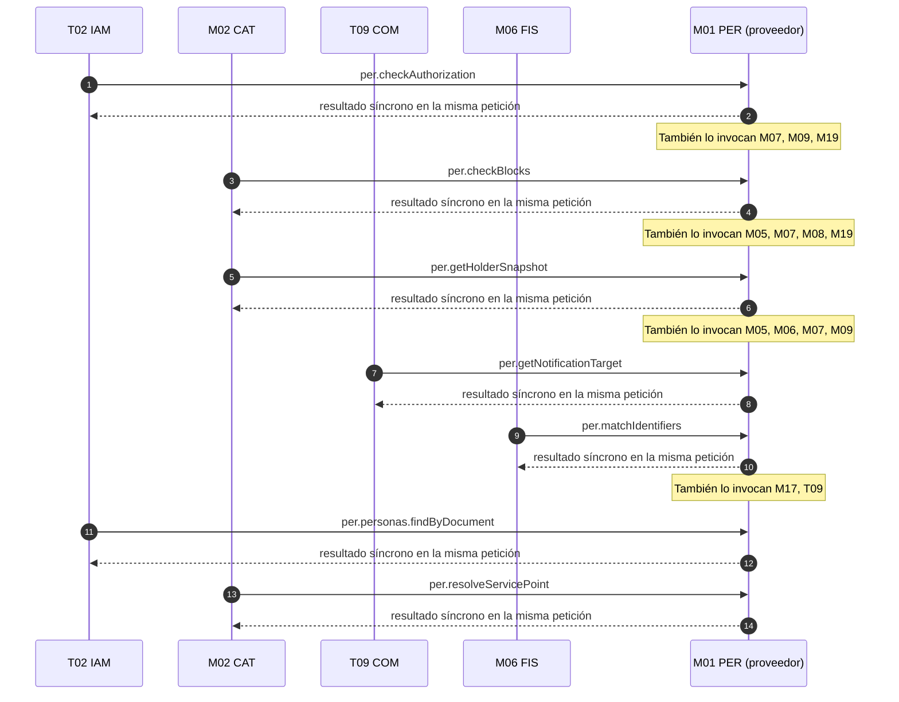

| Servicio | Invocado por | Citas en la especificación |
|---|---|---|
| `per.checkAuthorization` | T02, M07, M09, M19 | M01 L1582 |
| `per.checkBlocks` | M02, M05, M07, M08, M19 | M01 L1581 |
| `per.getHolderSnapshot` | M02, M05, M06, M07, M09 | M01 L1580 |
| `per.getNotificationTarget` | T09 | M01 L1585 |
| `per.matchIdentifiers` | M06, M17, T09 | M01 L1584 |
| `per.personas.findByDocument` | T02 | T02 L3962 |
| `per.resolveServicePoint` | M02 | M01 L1583 |

### SEC-SVC-02 — Servicios internos síncronos de M02 CAT

**Cubre:** `cat.services.mainServiceForMembership`.

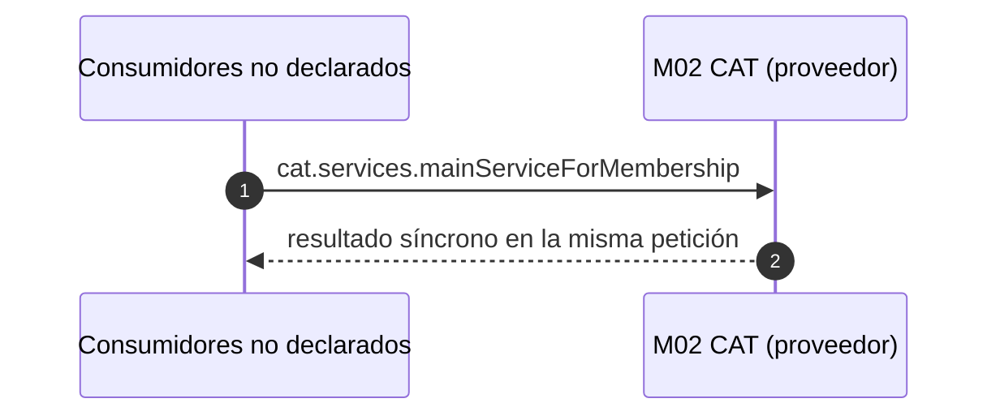

| Servicio | Invocado por | Citas en la especificación |
|---|---|---|
| `cat.services.mainServiceForMembership` | No declarado | M02 L1676 |

### SEC-SVC-03 — Servicios internos síncronos de M04 TAR

**Cubre:** `tar.calculate`, `tar.getRatedCalls`, `tar.quote`, `tar.rateCalls`.

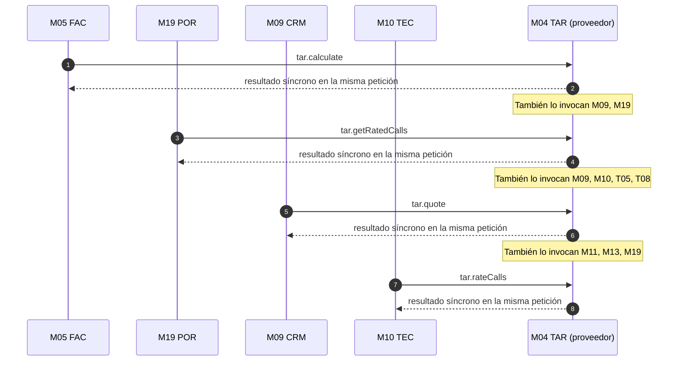

| Servicio | Invocado por | Citas en la especificación |
|---|---|---|
| `tar.calculate` | M05, M09, M19 | M04 L1884, M05 L45 |
| `tar.getRatedCalls` | M19, M09, M10, T05, T08 | M04 L1887 |
| `tar.quote` | M09, M11, M13, M19 | M04 L1886 |
| `tar.rateCalls` | M10 | M04 L1885 |

### SEC-SVC-04 — Servicios internos síncronos de M05 FAC

**Cubre:** `fac.service.cancelBillableItem`, `fac.service.getInvoiceForPayment`, `fac.service.isPeriodBilled`, `fac.service.issueInvoice`, `fac.service.nextNumber`, `fac.service.reserveNumberRange`, `fac.service.resolveVoucher`, `fac.service.upsertBillableItem`, `fac.services.billAlone`.

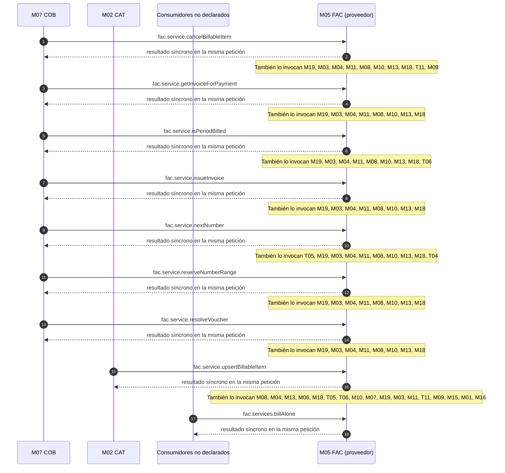

| Servicio | Invocado por | Citas en la especificación |
|---|---|---|
| `fac.service.cancelBillableItem` | M07, M19, M03, M04, M11, M08, M10, M13, M18, T11, M09 | M05 L1911, M10 L241, M11 L687, M11 L689, M11 L1042, T11 L2553 |
| `fac.service.getInvoiceForPayment` | M07, M19, M03, M04, M11, M08, M10, M13, M18 | M05 L1911 |
| `fac.service.isPeriodBilled` | M07, M19, M03, M04, M11, M08, M10, M13, M18, T06 | M05 L1911, M10 L989, M10 L2113 |
| `fac.service.issueInvoice` | M07, M19, M03, M04, M11, M08, M10, M13, M18 | M05 L1911 |
| `fac.service.nextNumber` | M07, T05, M19, M03, M04, M11, M08, M10, M13, M18, T04 | M05 L338, M05 L1911, M05 L2220, M07 L269, M07 L790, M07 L2098 |
| `fac.service.reserveNumberRange` | M07, M19, M03, M04, M11, M08, M10, M13, M18 | M05 L1911 |
| `fac.service.resolveVoucher` | M07, M19, M03, M04, M11, M08, M10, M13, M18 | M05 L1911 |
| `fac.service.upsertBillableItem` | M02, M08, M04, M13, M06, M18, T05, T06, M10, M07, M19, M03, M11, T11, M09, M15, M01, M16 | M04 L279, M04 L641, M04 L643, M04 L644, M04 L1371, M04 L1936 |
| `fac.services.billAlone` | No declarado | M05 L2050 |

### SEC-SVC-05 — Servicios internos síncronos de M06 FIS

**Cubre:** `fis.service.calculateTaxes`, `fis.service.calculateWithholdings`, `fis.service.cancelWithholdings`, `fis.service.checkRegistryCoverage`, `fis.service.confirmWithholdings`, `fis.service.resolveDocumentClass`.

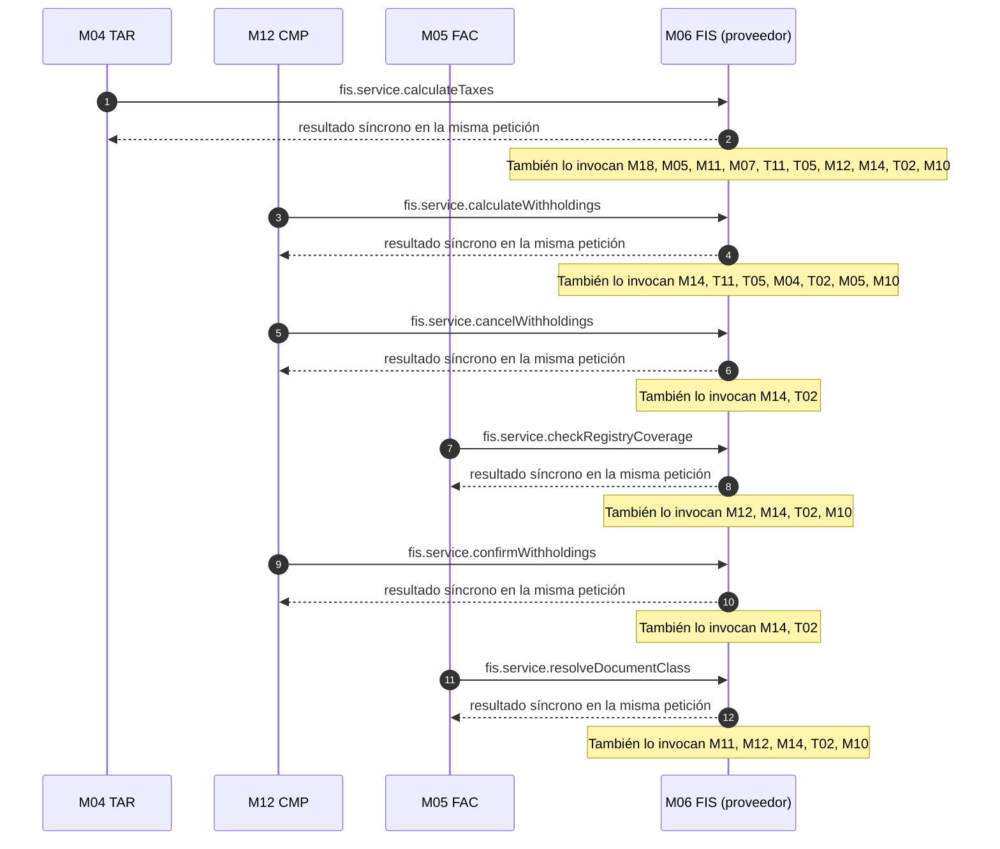

| Servicio | Invocado por | Citas en la especificación |
|---|---|---|
| `fis.service.calculateTaxes` | M04, M18, M05, M11, M07, T11, T05, M12, M14, T02, M10 | M04 L532, M04 L1259, M04 L1540, M04 L2596, M04 L2598, M06 L1689 |
| `fis.service.calculateWithholdings` | M12, M14, T11, T05, M04, T02, M05, M10 | M06 L1624, M06 L1707, M06 L1879, M06 L1923, M06 L2176, M06 L2659 |
| `fis.service.cancelWithholdings` | M12, M14, T02 | M06 L1881, M06 L1921, M14 L50, M14 L2560, T02 L1662 |
| `fis.service.checkRegistryCoverage` | M05, M12, M14, T02, M10 | M06 L1705, M06 L1874, M06 L1919, T02 L1662, T02 L4827 |
| `fis.service.confirmWithholdings` | M12, M14, T02 | M06 L1880, M06 L1920, M14 L50, M14 L2560, T02 L1662 |
| `fis.service.resolveDocumentClass` | M05, M11, M12, M14, T02, M10 | M06 L1871, M06 L1918, T02 L1662, T02 L4827 |

### SEC-SVC-06 — Servicios internos síncronos de M08 MOR

**Cubre:** `mor.interestEngine.dueDateSchedule`, `mor.service.applyHold`, `mor.service.computeDueDateSurcharge`, `mor.service.releaseHold`, `mor.surcharge.quote`.

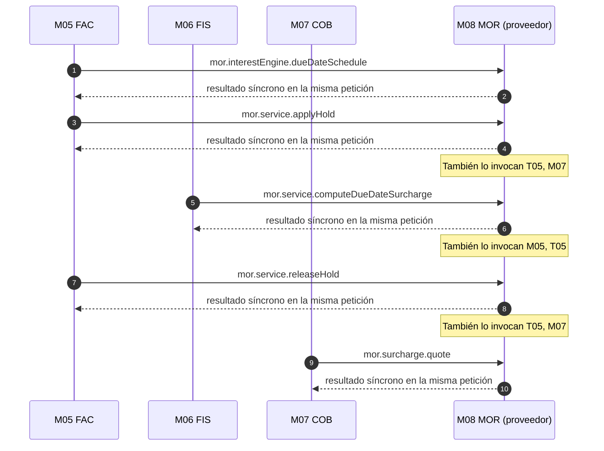

| Servicio | Invocado por | Citas en la especificación |
|---|---|---|
| `mor.interestEngine.dueDateSchedule` | M05 | M08 L1921 |
| `mor.service.applyHold` | M05, T05, M07 | M05 L1916, M08 L825 |
| `mor.service.computeDueDateSurcharge` | M06, M05, T05 | M05 L1915, M08 L779 |
| `mor.service.releaseHold` | M05, T05, M07 | M05 L1916, M08 L825 |
| `mor.surcharge.quote` | M07 | M07 L49 |

### SEC-SVC-07 — Servicios internos síncronos de M09 CRM

**Cubre:** `crm.openCase`.

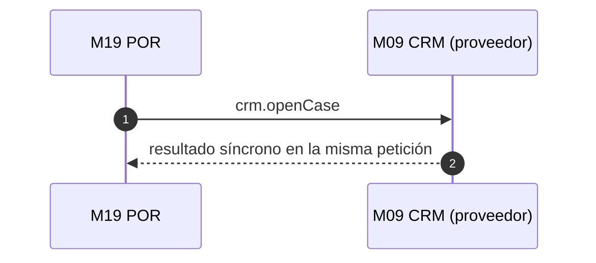

| Servicio | Invocado por | Citas en la especificación |
|---|---|---|
| `crm.openCase` | M19 | M19 L1009 |

### SEC-SVC-08 — Servicios internos síncronos de M10 TEC

**Cubre:** `tec.getQuotaUsage`.

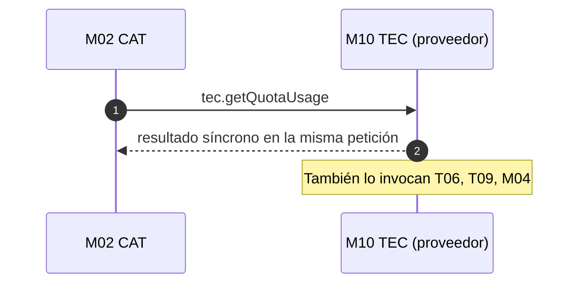

| Servicio | Invocado por | Citas en la especificación |
|---|---|---|
| `tec.getQuotaUsage` | M02, T06, T09, M04 | M04 L646 |

### SEC-SVC-09 — Servicios internos síncronos de M13 STK

**Cubre:** `stk.services.noCommercialStock`.

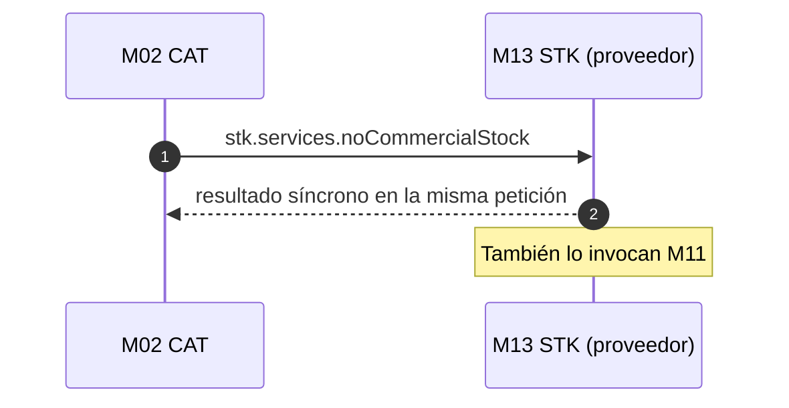

| Servicio | Invocado por | Citas en la especificación |
|---|---|---|
| `stk.services.noCommercialStock` | M02, M11 | M13 L1937 |

### SEC-SVC-10 — Servicios internos síncronos de M14 TES

**Cubre:** `tes.registerReceivedInstrument`.

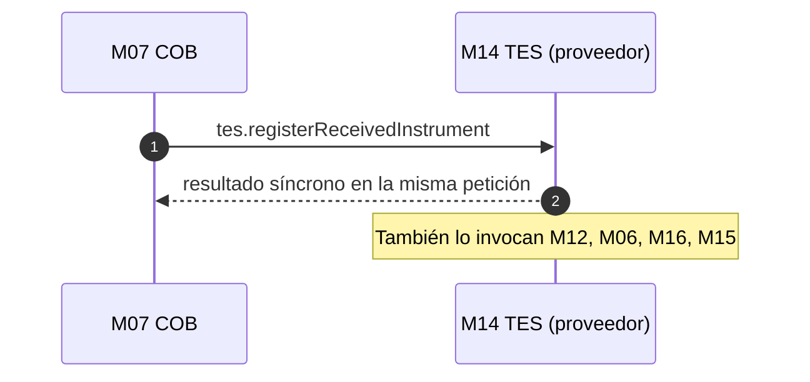

| Servicio | Invocado por | Citas en la especificación |
|---|---|---|
| `tes.registerReceivedInstrument` | M07, M12, M06, M16, M15 | M14 L1912 |

### SEC-SVC-11 — Servicios internos síncronos de M17 INS

**Cubre:** `ins.service.requiresActiveMembership`.

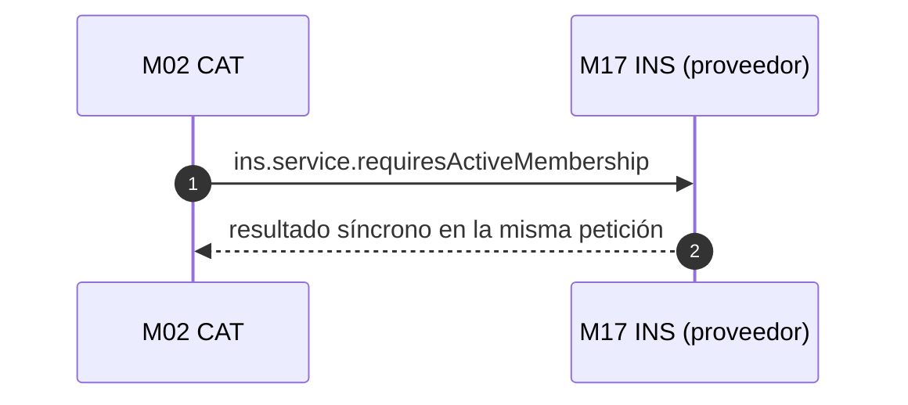

| Servicio | Invocado por | Citas en la especificación |
|---|---|---|
| `ins.service.requiresActiveMembership` | M02 | M17 L1511 |

### SEC-SVC-12 — Servicios internos síncronos de T02 IAM

**Cubre:** `iam.services.inviteTenantAdmin`.

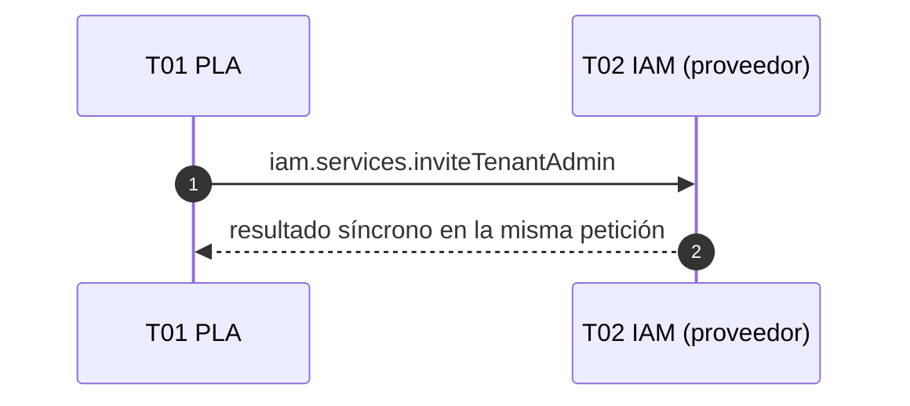

| Servicio | Invocado por | Citas en la especificación |
|---|---|---|
| `iam.services.inviteTenantAdmin` | T01 | T01 L78 |

### SEC-SVC-13 — Servicios internos síncronos de T03 UXD

**Cubre:** `uxd.services.applyBrandingProposal`.

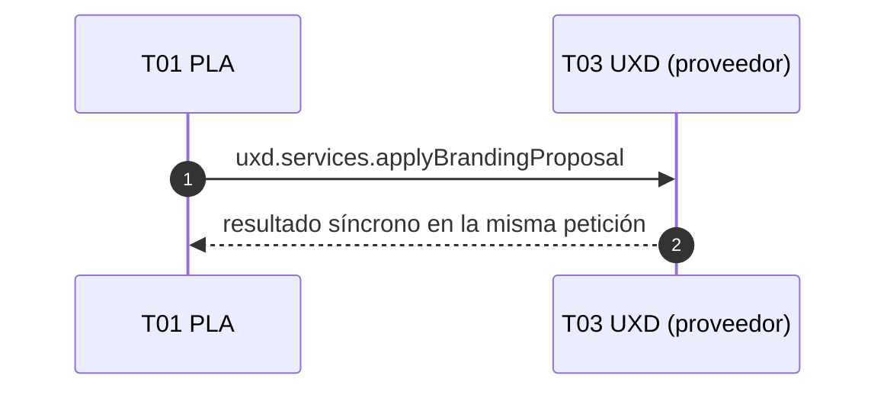

| Servicio | Invocado por | Citas en la especificación |
|---|---|---|
| `uxd.services.applyBrandingProposal` | T01 | T01 L81 |

### SEC-SVC-14 — Servicios internos síncronos de T04 CFG

**Cubre:** `cfg.services.exportPackage`.

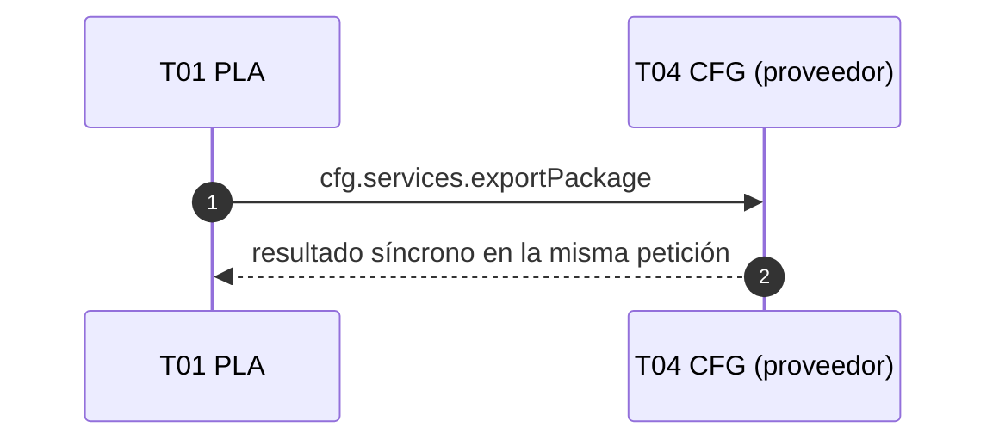

| Servicio | Invocado por | Citas en la especificación |
|---|---|---|
| `cfg.services.exportPackage` | T01 | T01 L82 |

### SEC-SVC-15 — Servicios internos síncronos de T09 COM

**Cubre:** `com.notify`, `com.services.notify`.

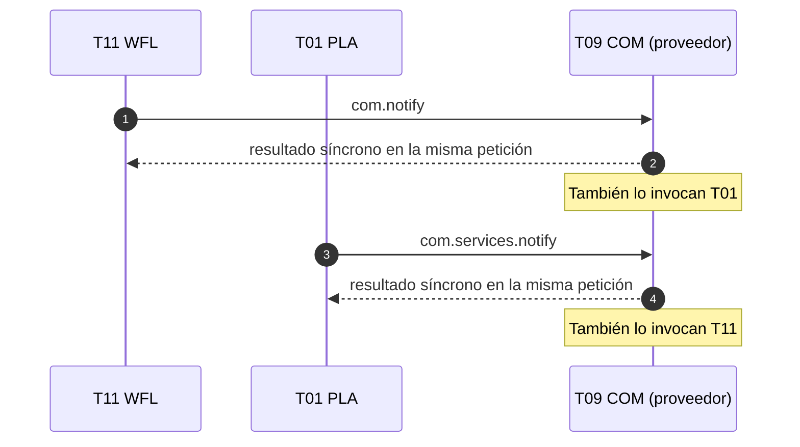

| Servicio | Invocado por | Citas en la especificación |
|---|---|---|
| `com.notify` | T11, T01 | T09 L2510, T11 L4148, T11 L4149 |
| `com.services.notify` | T01, T11 | T01 L88, T09 L2508, T09 L2510 |

### SEC-SVC-16 — Servicios internos síncronos de T11 WFL

**Cubre:** `wfl.documents.attach`, `wfl.dossier.timeline`, `wfl.events.define`, `wfl.numbering.next`, `wfl.operations.registerHandler`, `wfl.operations.request`, `wfl.services.requestApproval`, `wfl.signatures.request`, `wfl.tasks.create`, `wfl.templates.render`, `wfl.workflow.start`.

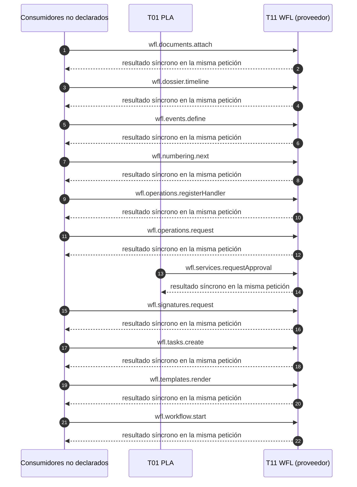

| Servicio | Invocado por | Citas en la especificación |
|---|---|---|
| `wfl.documents.attach` | No declarado | T11 L79 |
| `wfl.dossier.timeline` | No declarado | T11 L83 |
| `wfl.events.define` | No declarado | T11 L72 |
| `wfl.numbering.next` | No declarado | T11 L81 |
| `wfl.operations.registerHandler` | No declarado | T11 L74 |
| `wfl.operations.request` | No declarado | T11 L73 |
| `wfl.services.requestApproval` | T01 | T01 L87, T11 L75, T11 L3709 |
| `wfl.signatures.request` | No declarado | T11 L82 |
| `wfl.tasks.create` | No declarado | T11 L78 |
| `wfl.templates.render` | No declarado | T11 L80 |
| `wfl.workflow.start` | No declarado | T11 L77 |
