# GoodApps Cooperativas — Diagramas de secuencia de integraciones externas, parte Y

**Entregable de análisis y diseño — Artefacto 7.3 (diagramas de secuencia), fichas FI-INT de T06**

| Campo | Valor |
|---|---|
| Documento | `06y-secuencias-integraciones-fi-int.md` |
| Índice del entregable | [`06-secuencias-y-estados.md`](06-secuencias-y-estados.md) (sección 7) y [`06a-indice-cobertura-secuencias-estados.md`](06a-indice-cobertura-secuencias-estados.md) |
| Versión | 1.0 |
| Fecha | 05-11-2026 |
| Estado | Borrador para revisión |
| Fuentes | T06 §12.3 a §12.18 (fichas FI-INT-01 a FI-INT-115) |
| Generación | Script `_trabajo/gen06_build.py` (extrae de los anexos; revisión manual posterior) |

## 1. Cómo leer esta parte

Cada ficha FI-INT de T06 se dibuja con el mismo molde: el módulo dueño encola la operación, T06 la ejecuta con credenciales de la bóveda, idempotencia, circuito y bitácora, y devuelve el resultado o publica un evento de integración. En las fichas entrantes el proveedor inicia el intercambio (webhook o archivo). La nota a la derecha resume "Errores y contingencia" de la ficha. Cuando el dueño es T06 sin otro módulo, el intercambio empieza y termina en T06.

## 2. Integraciones externas (fichas FI-INT de T06)

### SEC-INT-01 — Fiscal nacional — ARCA (1)

**Fuente:** T06 §12.4. **Cubre:** FI-INT-01, FI-INT-02, FI-INT-03, FI-INT-04, FI-INT-05, FI-INT-06.

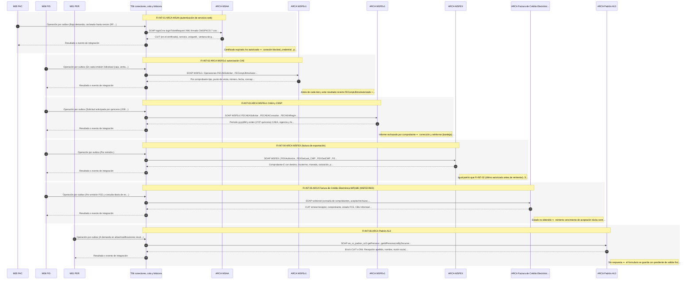

| Ficha | Módulo dueño | Dirección | Ola / prioridad | Estado de la investigación |
|---|---|---|---|---|
| FI-INT-01 ARCA WSAA (autenticación de servicios web) | T06 (transversal); consumidores M05, M06, M01, M12, M16. | Saliente con respuesta inmediata. | O4 / Núcleo. | Confirmado en LAG (FE en uso; 727 = espera CAE en caja; 271… |
| FI-INT-02 ARCA WSFEv1: autorización CAE | M06 FIS (contenido fiscal) y M05 FAC (emisión); T06 transporta. | Saliente con respuesta inmediata. | O4 / Núcleo. | Confirmado en LAG (puntos de venta vistos 0022, 0028, 0097;… |
| FI-INT-03 ARCA WSFEv1: CAEA y CESP | M06 FIS; M05 los asigna al emitir. | Saliente. | O4 / Núcleo (si el tenant usa… | Soportado por ProCoop (informe en tandas de 100; "sin movim… |
| FI-INT-04 ARCA WSFEX (factura de exportación) | M06/M11. | Saliente. | O8 / Extensión. | Nuevo (no existe en ProCoop). |
| FI-INT-05 ARCA Factura de Crédito Electrónica MiPyME (WSFECRED) | M06 (emisión FCE vía WSFEv1) y M07/M12 (aceptación/rechazo y cobranza). | Bidireccional (consulta de estados y ac… | O8 / Estándar. | Soportado parcialmente por ProCoop (parámetro 2515: importe… |
| FI-INT-06 ARCA Padrón A13 | M01 PER (alta/modificación de personas), M12 CMP (proveedores). | Saliente (consulta). | O4 / Núcleo (en O2 la persona… | Soportado por ProCoop (proxy existe pero sin llamadas encon… |

### SEC-INT-02 — Fiscal nacional — ARCA (2)

**Fuente:** T06 §12.4. **Cubre:** FI-INT-07, FI-INT-08, FI-INT-09, FI-INT-10, FI-INT-11, FI-INT-12.

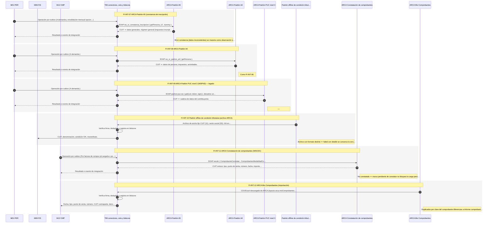

| Ficha | Módulo dueño | Dirección | Ola / prioridad | Estado de la investigación |
|---|---|---|---|---|
| FI-INT-07 ARCA Padrón A5 (constancia de inscripción) | M01, M06, M12. | Saliente (consulta). | O4 / Núcleo. | Nuevo (no existe en ProCoop, RN-03 §5). |
| FI-INT-08 ARCA Padrón A4 | M01, M12. | Saliente. | O4 / Extensión. | Nuevo. [VERIFICAR] vigencia del servicio A4 en ARCA; si est… |
| FI-INT-09 ARCA Padrón PUC nivel 3 (WSPN3) — legado | M01. | Saliente. | — / Reemplazado por FI-INT-06… | Soportado por ProCoop (único padrón efectivamente invocado). |
| FI-INT-10 Padrón offline de condición tributaria (archivo ARCA) | M06 (tabla de condición), M01/M12 (cruces). | Entrante. | O4 / Estándar. | Soportado por ProCoop (`EMPAFIP`, `clsImportacionArchivos`,… |
| FI-INT-11 ARCA Constatación de comprobantes (WSCDC) | M12 CMP. | Saliente. | O8 / Estándar. | Nuevo. |
| FI-INT-12 ARCA Mis Comprobantes (importación) | M12 (compras) y M15/M06 (libros IVA). | Entrante. | O8 / Estándar. | Soportado por ProCoop (`clsLibroIVAdigital.Importar_Comprob`… |

### SEC-INT-03 — Fiscal nacional — ARCA (3)

**Fuente:** T06 §12.4. **Cubre:** FI-INT-13, FI-INT-14, FI-INT-15, FI-INT-16, FI-INT-17.

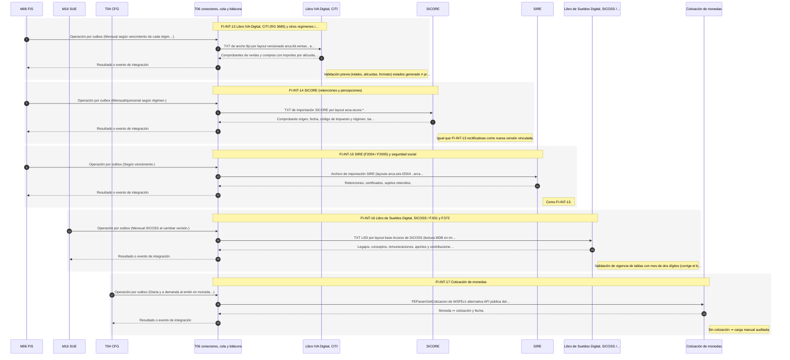

| Ficha | Módulo dueño | Dirección | Ola / prioridad | Estado de la investigación |
|---|---|---|---|---|
| FI-INT-13 Libro IVA Digital, CITI (RG 3685) y otros regímenes informa… | M06 (contenido) / M15. | Saliente. | O8 / Estándar. | Soportado por ProCoop (`Facturacion.Archivos`: `RG3685`, `R`… |
| FI-INT-14 SICORE (retenciones y percepciones) | M06 (régimen de agente de retención/percepción, BASE §61); M12/M16 originan. | Saliente. | O8 / Estándar. | Soportado por ProCoop (`PercepcionSICORE`, `Exportar_Sueldo`… |
| FI-INT-15 SIRE (F2004 / F2005) y seguridad social | M06. | Saliente. | O8 / Estándar. | Soportado por ProCoop (`clsSIRE`). [VERIFICAR] disponibilid… |
| FI-INT-16 Libro de Sueldos Digital, SICOSS / F.931 y F.572 | M16 SUE. | Saliente (LSD, F.931) y entrante (tabla… | O9 / Estándar. | Soportado por ProCoop (`LibroSueldoDigital`, `Importar_Sico`… |
| FI-INT-17 Cotización de monedas | T04 (tabla de cotizaciones) / M06. | Saliente. | O8 / Extensión. | Soportado por ProCoop (`clsTipMon.GetCotizacion`; el método… |

### SEC-INT-04 — Fiscal provincial y municipal

**Fuente:** T06 §12.5. **Cubre:** FI-INT-18, FI-INT-19, FI-INT-20, FI-INT-21, FI-INT-22, FI-INT-23.

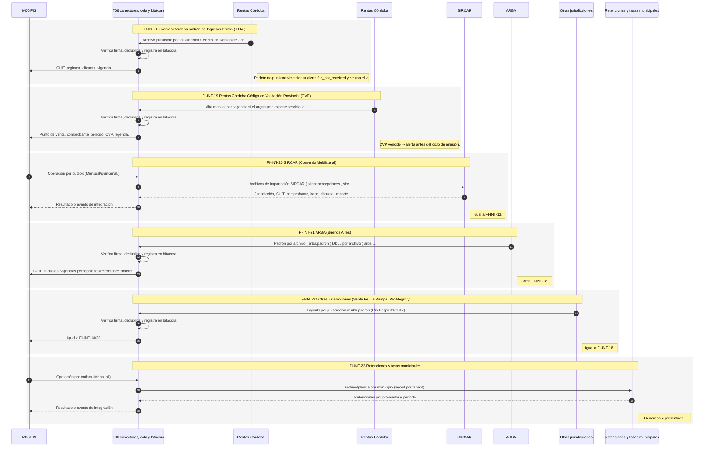

| Ficha | Módulo dueño | Dirección | Ola / prioridad | Estado de la investigación |
|---|---|---|---|---|
| FI-INT-18 Rentas Córdoba: padrón de Ingresos Brutos ("LUA") | M06 FIS. | Entrante. | O4 / Núcleo. | Soportado por ProCoop (`IIBB_LUA`, `GetCondicionIIBB_LUA`,… |
| FI-INT-19 Rentas Córdoba: Código de Validación Provincial (CVP) | M06 / M05 (impresión). | Entrante (código otorgado por el organi… | O4 / Núcleo (si la cooperativ… | Soportado por ProCoop (`CVPIIBB`, `Get_CVP`). |
| FI-INT-20 SIRCAR (Convenio Multilateral) | M06. | Saliente. | O8 / Estándar (O4 si la perce… | Soportado por ProCoop (`SIRCAR.Exportar_ArchivoPercepciones`… |
| FI-INT-21 ARBA (Buenos Aires) | M06. | Entrante (padrón) y saliente (DDJJ). | O8 / Extensión (C en la base… | Soportado por ProCoop (`ImportarIIBB_BsAs`, `Exportar_Ingre`… |
| FI-INT-22 Otras jurisdicciones (Santa Fe, La Pampa, Río Negro y demás) | M06. | Entrante y saliente. | O8 / Extensión. | Soportado por ProCoop (`ImportarIIBB_RN_012017`, `Exportar_`… |
| FI-INT-23 Retenciones y tasas municipales | M06. | Saliente. | O8 / Extensión. | Soportado por ProCoop (`RetencionesMunicipales`). |

### SEC-INT-05 — Reguladores, subsidios y terceros (1)

**Fuente:** T06 §12.6. **Cubre:** FI-INT-24, FI-INT-25, FI-INT-26, FI-INT-27, FI-INT-28, FI-INT-29.

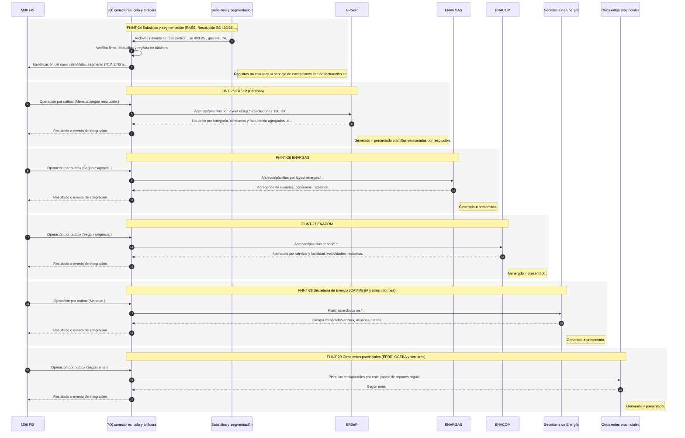

| Ficha | Módulo dueño | Dirección | Ola / prioridad | Estado de la investigación |
|---|---|---|---|---|
| FI-INT-24 Subsidios y segmentación (RASE, Resolución SE 493/25, gas S… | M06 FIS (padrones de terceros) / M04 TAR (reglas de subsidio) / M05 (aplicación… | Entrante (padrones) y saliente (informe… | O7 / Núcleo (servicios medido… | Soportado por ProCoop (`ImportarExcelResol493_25`, `Importa`… |
| FI-INT-25 ERSeP (Córdoba) | M06 FIS (reguladores); datos de M04/M05; reportes con el motor de T10. | Saliente (informes) y entrante (padrone… | O7 / Estándar. | Soportado por ProCoop (`clsERSeP`, `ERSEP_166`, `TarifaSoci`… |
| FI-INT-26 ENARGAS | M06 FIS (reguladores); reportes con el motor de T10. | Saliente. | O7 / Extensión. | Soportado por ProCoop (`ENARGAS_Informes`). Uso en LAG a co… |
| FI-INT-27 ENACOM | M06 FIS (reguladores); datos de M10 (servicios TIC). | Saliente. | O7 / Extensión. | Soportado por ProCoop (`ENACOM_Informes`). |
| FI-INT-28 Secretaría de Energía (CAMMESA y otros informes) | M06 FIS (reguladores); reportes con el motor de T10. | Bidireccional (archivos). | O7 / Extensión. | Soportado por ProCoop (`SE_Informes`). |
| FI-INT-29 Otros entes provinciales (EPRE, OCEBA y similares) | M06 FIS (reguladores); reportes con el motor de T10. | Saliente. | O7 / Extensión. | Soportado por ProCoop (`OCEBA_Informes`). |

### SEC-INT-06 — Reguladores, subsidios y terceros (2)

**Fuente:** T06 §12.6. **Cubre:** FI-INT-30, FI-INT-31, FI-INT-32, FI-INT-33.

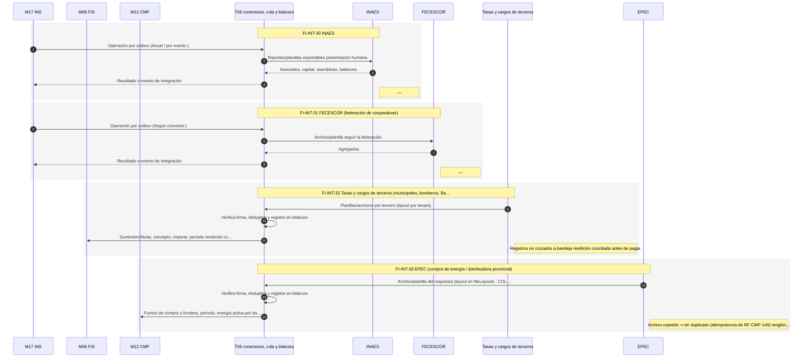

| Ficha | Módulo dueño | Dirección | Ola / prioridad | Estado de la investigación |
|---|---|---|---|---|
| FI-INT-30 INAES | M17 INS. | Saliente. | O10 / Extensión. | Nuevo (no hay conector en ProCoop; BASE lo menciona en soci… |
| FI-INT-31 FECESCOR (federación de cooperativas) | M17 INS. | Saliente. | O10 / Extensión. | Soportado por ProCoop (referencias en informes); uso en LAG… |
| FI-INT-32 Tasas y cargos de terceros (municipales, bomberos, Banco de… | M06 FIS (terceros) / M05 (facturación por cuenta de terceros) / M07 (rendición)… | Entrante (padrón/importes) y saliente (… | O5 / Estándar. | Soportado por ProCoop (conceptos de terceros; `BancoSangre`… |
| FI-INT-33 EPEC (compra de energía / distribuidora provincial) | M12 (RF-CMP-149 a RF-CMP-153) / M03 (medición de frontera y balance energético). | Entrante. | O8 / Núcleo (servicio ELE; al… | Resuelto el significado (CTR-INT-18): factura de compra may… |

### SEC-INT-07 — Redes de cobranza extrabancaria (1)

**Fuente:** T06 §12.7. **Cubre:** FI-INT-34, FI-INT-35, FI-INT-36, FI-INT-37, FI-INT-38, FI-INT-39.

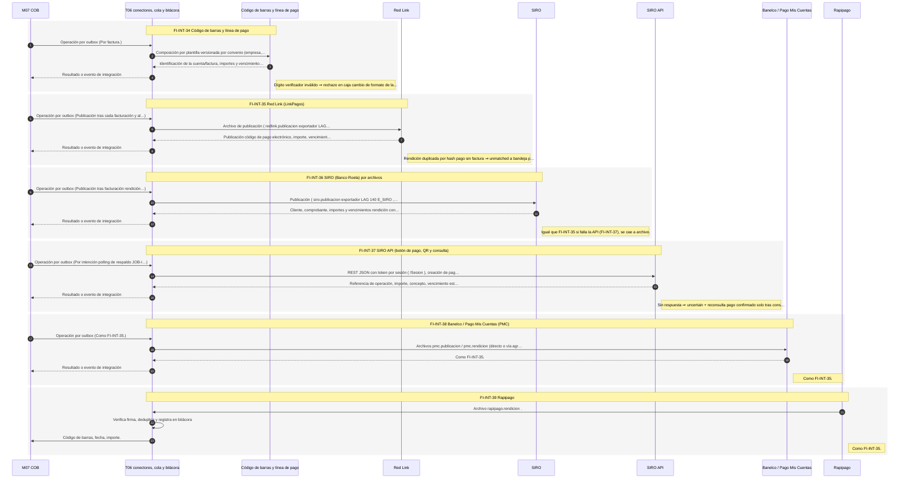

| Ficha | Módulo dueño | Dirección | Ola / prioridad | Estado de la investigación |
|---|---|---|---|---|
| FI-INT-34 Código de barras y línea de pago | M07 COB (formato por convenio) / M05 (impresión). | Interna (generación) + lectura física. | O4 / Núcleo. | Confirmado en LAG (SIRO con "0" antepuesto). |
| FI-INT-35 Red Link (LinkPagos) | M07. | Saliente (publicación) y entrante (rend… | O5 / Núcleo. | Confirmado en LAG. |
| FI-INT-36 SIRO (Banco Roela) por archivos | M07. | Saliente y entrante. | O5 / Núcleo. | Confirmado en LAG (128.776 solicitudes, todas SIRO; ~70 % p… |
| FI-INT-37 SIRO API (botón de pago, QR y consulta) | M07 / M19. | Bidireccional. | O5 / Núcleo. | Soportado por ProCoop (`clsSiro`); uso de API en LAG a conf… |
| FI-INT-38 Banelco / Pago Mis Cuentas (PMC) | M07. | Saliente y entrante. | O5 / Estándar. | Soportado por ProCoop; en LAG llega vía SIRO (no directo). |
| FI-INT-39 Rapipago | M07. | Entrante (y publicación si el convenio… | O5 / Estándar. | Soportado por ProCoop; en LAG vía SIRO. |

### SEC-INT-08 — Redes de cobranza extrabancaria (2)

**Fuente:** T06 §12.7. **Cubre:** FI-INT-40, FI-INT-41, FI-INT-42.

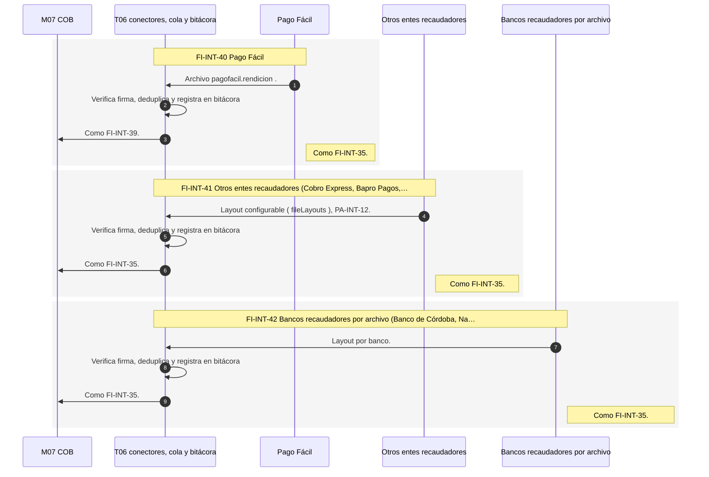

| Ficha | Módulo dueño | Dirección | Ola / prioridad | Estado de la investigación |
|---|---|---|---|---|
| FI-INT-40 Pago Fácil | M07. | Entrante. | O5 / Estándar. | Soportado por ProCoop; en LAG vía SIRO. |
| FI-INT-41 Otros entes recaudadores (Cobro Express, Bapro Pagos, Provi… | M07. | Entrante/saliente. | O5 / Extensión. | Soportado por ProCoop (catálogo de importadores/exportadore… |
| FI-INT-42 Bancos recaudadores por archivo (Banco de Córdoba, Nación,… | M07. | Entrante (y publicación si aplica). | O5 / Estándar. | Soportado por ProCoop (importadores por banco); uso en LAG… |

### SEC-INT-09 — Pasarelas de pago y QR (1)

**Fuente:** T06 §12.8. **Cubre:** FI-INT-43, FI-INT-44, FI-INT-45, FI-INT-46, FI-INT-47, FI-INT-48.

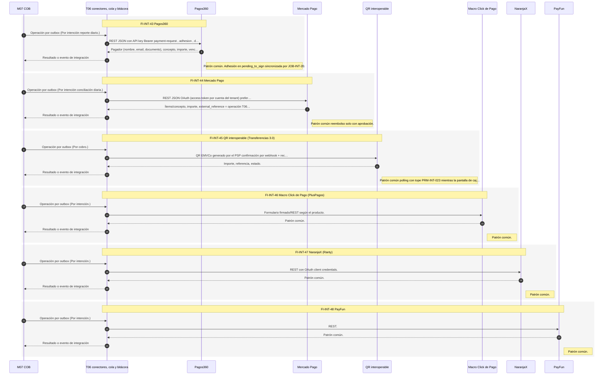

| Ficha | Módulo dueño | Dirección | Ola / prioridad | Estado de la investigación |
|---|---|---|---|---|
| FI-INT-43 Pagos360 | M07 / M19. | Bidireccional. | O5 / Estándar. | Confirmado no usado en LAG (credenciales vacías). |
| FI-INT-44 Mercado Pago | M07 / M19 / M11 (POS). | Bidireccional. | O5 / Estándar. | Soportado por ProCoop; confirmado no usado en LAG. |
| FI-INT-45 QR interoperable (Transferencias 3.0) | M07 / M11. | Bidireccional. | O5 / Estándar. | Nuevo (ProCoop usa QR de cada pasarela). |
| FI-INT-46 Macro Click de Pago (PlusPagos) | M07 / M19. | Bidireccional. | Extensión bajo demanda: se ad… | Soportado por ProCoop; no usado en LAG; nombre de producto… |
| FI-INT-47 NaranjaX (Ranty) | M07. | Bidireccional. | Extensión bajo demanda: se ad… | Soportado por ProCoop; no usado en LAG. |
| FI-INT-48 PayFun | M07. | Bidireccional. | Extensión bajo demanda: se ad… | Soportado por ProCoop; no usado en LAG. |

### SEC-INT-10 — Pasarelas de pago y QR (2)

**Fuente:** T06 §12.8. **Cubre:** FI-INT-49, FI-INT-50, FI-INT-51, FI-INT-52, FI-INT-53, FI-INT-54.

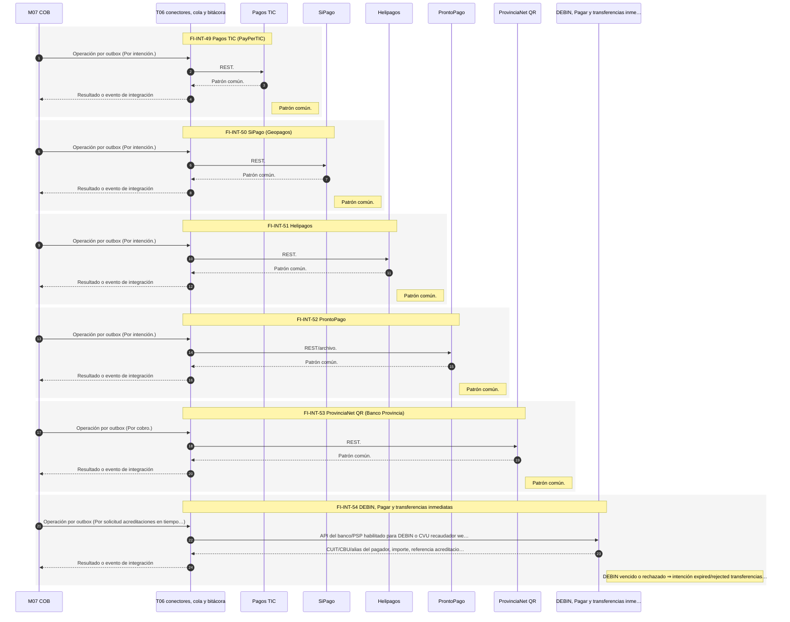

| Ficha | Módulo dueño | Dirección | Ola / prioridad | Estado de la investigación |
|---|---|---|---|---|
| FI-INT-49 Pagos TIC (PayPerTIC) | M07. | Bidireccional. | Extensión bajo demanda: se ad… | Soportado por ProCoop; no usado en LAG. |
| FI-INT-50 SiPago (Geopagos) | M07. | Bidireccional. | Extensión bajo demanda: se ad… | Soportado por ProCoop; no usado en LAG. |
| FI-INT-51 Helipagos | M07. | Bidireccional. | Extensión bajo demanda: se ad… | Soportado por ProCoop; no usado en LAG. |
| FI-INT-52 ProntoPago | M07. | Bidireccional. | Extensión bajo demanda: se ad… | Soportado por ProCoop; no usado en LAG. |
| FI-INT-53 ProvinciaNet QR (Banco Provincia) | M07. | Bidireccional. | Extensión bajo demanda: se ad… | Soportado por ProCoop; no usado en LAG. |
| FI-INT-54 DEBIN, "Pagar" y transferencias inmediatas | M07 / M14 (cuentas recaudadoras). | Bidireccional. | O5 / Extensión. | A validar: "Pagar" figura en la lista de la tarea sin defin… |

### SEC-INT-11 — Pasarelas de pago y QR (3)

**Fuente:** T06 §12.8. **Cubre:** FI-INT-55.

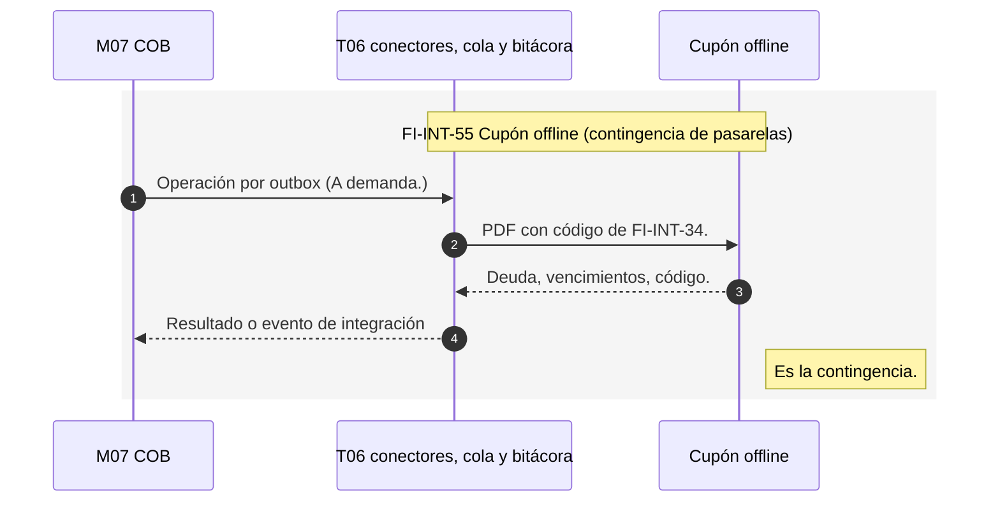

| Ficha | Módulo dueño | Dirección | Ola / prioridad | Estado de la investigación |
|---|---|---|---|---|
| FI-INT-55 Cupón offline (contingencia de pasarelas) | M07 / M19. | Interna. | O5 / Núcleo. | Soportado por ProCoop (`Offline`). |

### SEC-INT-12 — Débito automático

**Fuente:** T06 §12.9. **Cubre:** FI-INT-56, FI-INT-57.

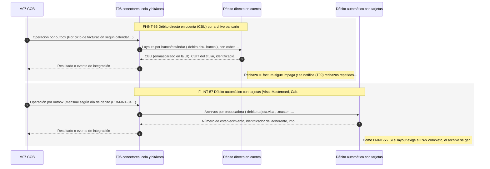

| Ficha | Módulo dueño | Dirección | Ola / prioridad | Estado de la investigación |
|---|---|---|---|---|
| FI-INT-56 Débito directo en cuenta (CBU) por archivo bancario | M07 (lote y aplicación), M01 (adhesión y mandato). | Saliente (presentación) y entrante (res… | O5 / Estándar. | Soportado por ProCoop; uso en LAG a confirmar (CTR-INT-21). |
| FI-INT-57 Débito automático con tarjetas (Visa, Mastercard, Cabal, Na… | M07 / M01. | Saliente y entrante. | O5 / Estándar. | Soportado por ProCoop (guarda números de tarjeta en tabla:… |

### SEC-INT-13 — Bancos

**Fuente:** T06 §12.10. **Cubre:** FI-INT-58, FI-INT-59, FI-INT-60.

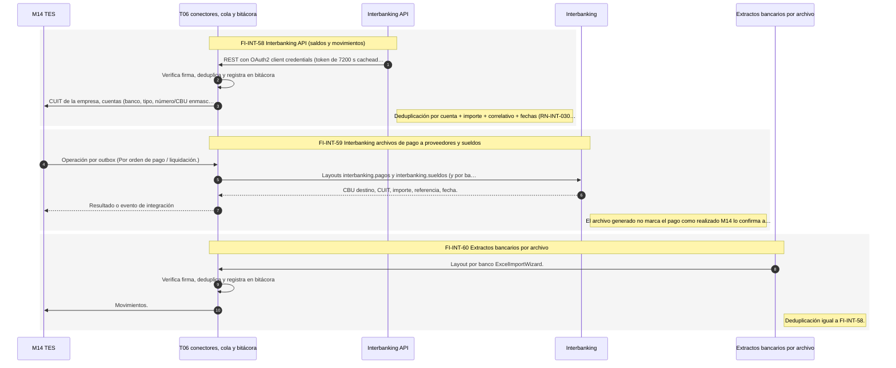

| Ficha | Módulo dueño | Dirección | Ola / prioridad | Estado de la investigación |
|---|---|---|---|---|
| FI-INT-58 Interbanking API (saldos y movimientos) | M14 TES. | Entrante (consulta). | O8 / Estándar. | Soportado por ProCoop (`clsInterbanking`, `RESBAN_MOVINT`);… |
| FI-INT-59 Interbanking: archivos de pago a proveedores y sueldos | M14 (proveedores), M16 (sueldos). | Saliente. | O8 / Estándar. | Soportado por ProCoop; DFA lo menciona como "transferencias… |
| FI-INT-60 Extractos bancarios por archivo | M14. | Entrante. | O5 / Núcleo (DEC-059: extract… | Soportado por ProCoop. |

### SEC-INT-14 — Comunicaciones

**Fuente:** T06 §12.11. **Cubre:** FI-INT-61, FI-INT-62, FI-INT-63, FI-INT-64, FI-INT-65, FI-INT-66.

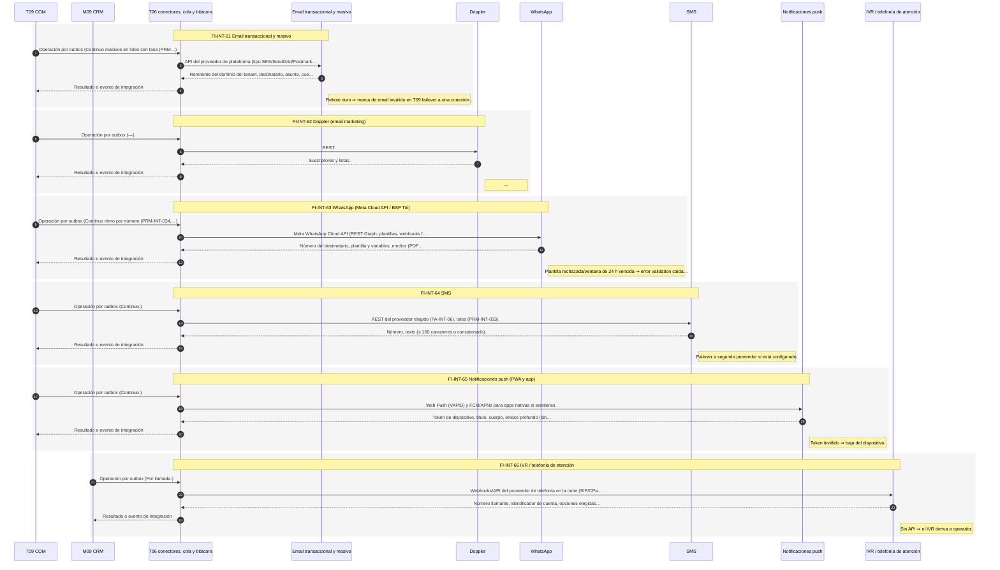

| Ficha | Módulo dueño | Dirección | Ola / prioridad | Estado de la investigación |
|---|---|---|---|---|
| FI-INT-61 Email transaccional y masivo | T09 COM (contenido); T06 (entrega). | Saliente + webhooks de estado; entrante… | O0–O2 / Núcleo. | Confirmado en LAG (`AUDIT_MAIL`, SES del proveedor comparti… |
| FI-INT-62 Doppler (email marketing) | T09. | Saliente. | — / Reemplazado por FI-INT-61… | Soportado por ProCoop; no usado en LAG. |
| FI-INT-63 WhatsApp (Meta Cloud API / BSP; Trii) | T09 / M09. | Bidireccional. | O2 / Estándar. | Soportado por ProCoop (parámetros 2870–2874, 3105; 2824/305… |
| FI-INT-64 SMS | T09; T02 (códigos OTP). | Saliente + estados. | O2 / Estándar. | Soportado por ProCoop (proveedor local con lotes de 50); CT… |
| FI-INT-65 Notificaciones push (PWA y app) | T09; M19, M10 (app de campo). | Saliente. | O2 / Estándar. | Nuevo (ProCoop usa Firebase para sincronizar, no para push… |
| FI-INT-66 IVR / telefonía de atención | M09 CRM; T09. | Bidireccional (el IVR consulta la API i… | O10 / Extensión. | Soportado por ProCoop (tabla `IVR`); uso en LAG a confirmar. |

### SEC-INT-15 — Identidad, mapas y geografía

**Fuente:** T06 §12.12. **Cubre:** FI-INT-67, FI-INT-68, FI-INT-69, FI-INT-70, FI-INT-71, FI-INT-72.

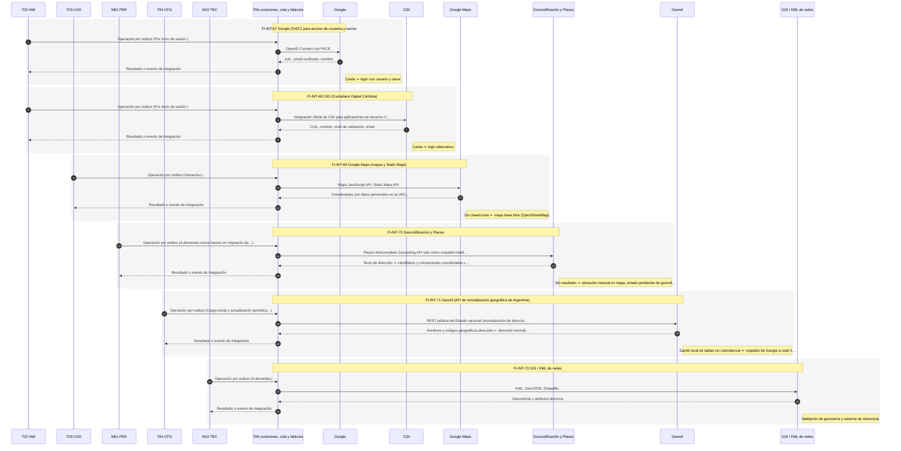

| Ficha | Módulo dueño | Dirección | Ola / prioridad | Estado de la investigación |
|---|---|---|---|---|
| FI-INT-67 Google (OIDC) para acceso de usuarios y socios | T02 IAM. | Bidireccional (OIDC). | O1 / Estándar. | Nuevo. |
| FI-INT-68 CiDi (Ciudadano Digital Córdoba) | T02 / M19. | Bidireccional. | O1 mecanismo genérico de prov… | Nuevo (pedido de la tarea). |
| FI-INT-69 Google Maps (mapas y Static Maps) | T03 (componente de mapa); consumidores M10, M03, M09, M18. | Saliente. | O3 / Estándar. | Confirmado en LAG (parámetro 2251; clave por defecto hardco… |
| FI-INT-70 Geocodificación y Places | M01 / M03. | Saliente. | O3 / Estándar. | Soportado por ProCoop (solo Google); el reparto con Georef… |
| FI-INT-71 Georef (API de normalización geográfica de Argentina) | T04 (tablas geográficas) / M01 (domicilios). | Saliente. | O1 / Estándar (tablas); O3 /… | Nuevo. |
| FI-INT-72 GIS / KML de redes | M10 TEC (GIS/redes); M03. | Bidireccional (archivos). | O3 / Extensión. | Soportado por ProCoop (exportación KML). |

### SEC-INT-16 — Medición, telemedición y prepago

**Fuente:** T06 §12.13. **Cubre:** FI-INT-73, FI-INT-74, FI-INT-75, FI-INT-76, FI-INT-77, FI-INT-78.

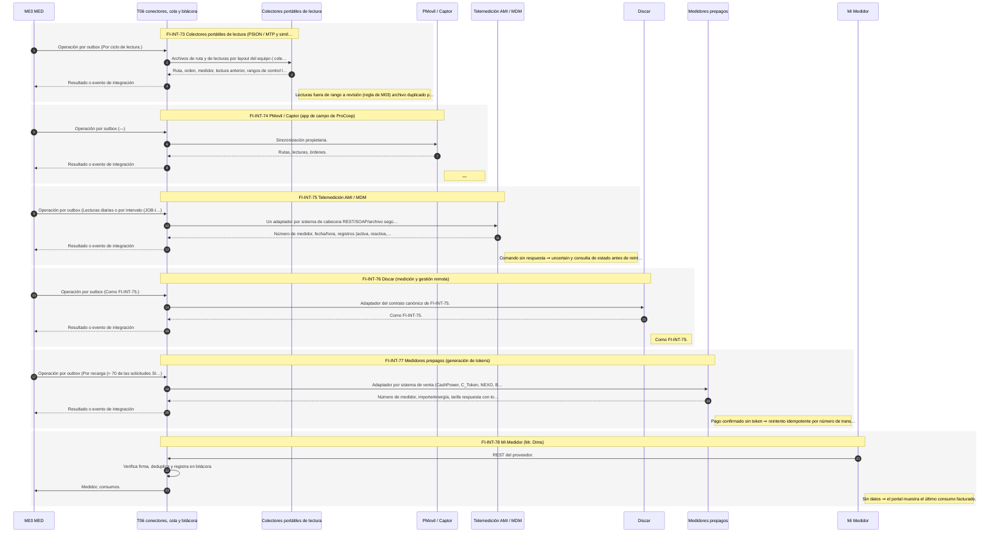

| Ficha | Módulo dueño | Dirección | Ola / prioridad | Estado de la investigación |
|---|---|---|---|---|
| FI-INT-73 Colectores portátiles de lectura (PSION / MTP y similares) | M03 MED. | Bidireccional (archivos). | O7 / Estándar (solo si la coo… | Soportado por ProCoop; uso en LAG a confirmar. |
| FI-INT-74 PMovil / Captor (app de campo de ProCoop) | M03 / M10. | Bidireccional. | — / Reemplazado por la PWA de… | Soportado por ProCoop. |
| FI-INT-75 Telemedición AMI / MDM | M03 MED (lecturas); M08 (corte/reconexión decididos); M10 (operación técnica). | Bidireccional. | O7 / Estándar (primer adaptad… | Soportado por ProCoop (`TELEMED_COMM`, `AUDITORIA_TELEMEDIC`… |
| FI-INT-76 Discar (medición y gestión remota) | M03. | Bidireccional. | O7 / Extensión. | Soportado por ProCoop. |
| FI-INT-77 Medidores prepagos (generación de tokens) | M03 (saldo prepago) / M07 (cobro). | Saliente con respuesta inmediata. | O7 / Núcleo (la base relevada… | Confirmado en LAG (uso de prepago); sistema de tokens exact… |
| FI-INT-78 Mi Medidor (Mr. Dims) | M03 / M19. | Entrante. | O7 / Extensión. | Soportado por ProCoop; uso en LAG a confirmar. |

### SEC-INT-17 — Red, aprovisionamiento y telefonía (servicios TIC) (1)

**Fuente:** T06 §12.14. **Cubre:** FI-INT-79, FI-INT-80, FI-INT-81, FI-INT-82, FI-INT-83, FI-INT-84.

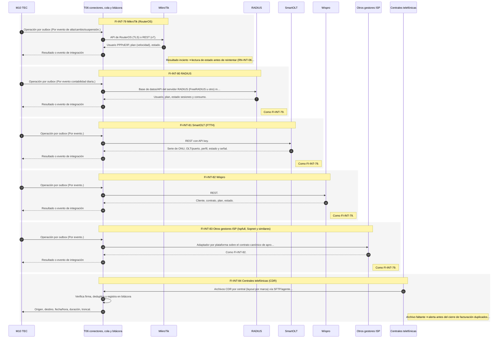

| Ficha | Módulo dueño | Dirección | Ola / prioridad | Estado de la investigación |
|---|---|---|---|---|
| FI-INT-79 MikroTik (RouterOS) | M10 TEC (aprovisionamiento); M08 decide suspensión/reconexión. | Saliente. | O3 / Núcleo (piloto Internet). | Soportado por ProCoop; uso en LAG a confirmar. |
| FI-INT-80 RADIUS | M10. | Saliente (ABM) y entrante (contabilidad… | O3 / Estándar. | Soportado por ProCoop. |
| FI-INT-81 SmartOLT (FTTH) | M10. | Saliente + consulta. | O3 / Estándar. | Soportado por ProCoop. |
| FI-INT-82 Wispro | M10. | Bidireccional. | O3 / Extensión. | Soportado por ProCoop. |
| FI-INT-83 Otros gestores ISP (Ispfull, Sopnet y similares) | M10. | Bidireccional. | O3 / Extensión (bajo demanda). | Soportado por ProCoop. |
| FI-INT-84 Centrales telefónicas (CDR) | M10 (telefonía) / M03 (consumo) / M05 (facturación). | Entrante. | O10 / Extensión (si presta te… | Soportado por ProCoop. |

### SEC-INT-18 — Red, aprovisionamiento y telefonía (servicios TIC) (2)

**Fuente:** T06 §12.14. **Cubre:** FI-INT-85, FI-INT-86, FI-INT-87.

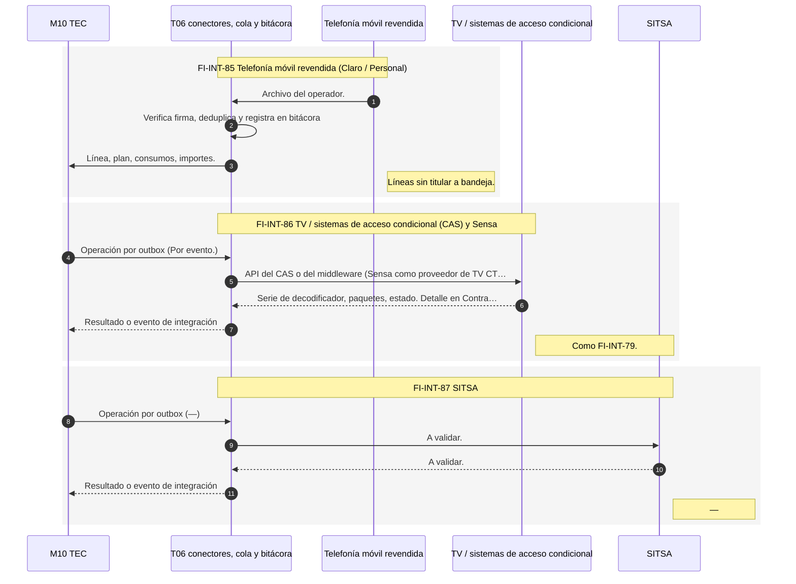

| Ficha | Módulo dueño | Dirección | Ola / prioridad | Estado de la investigación |
|---|---|---|---|---|
| FI-INT-85 Telefonía móvil revendida (Claro / Personal) | M10 / M05. | Entrante. | O10 / Extensión. | Soportado por ProCoop. |
| FI-INT-86 TV / sistemas de acceso condicional (CAS) y Sensa | M10 / M02 (paquetes). | Saliente. | O10 / Extensión. | Soportado por ProCoop. |
| FI-INT-87 SITSA | M10. | A validar. | O10 / Extensión. | Soportado por ProCoop; [VERIFICAR] qué es SITSA y si LAG lo… |

### SEC-INT-19 — Flota, firma e inteligencia artificial

**Fuente:** T06 §12.15. **Cubre:** FI-INT-88, FI-INT-89, FI-INT-90.

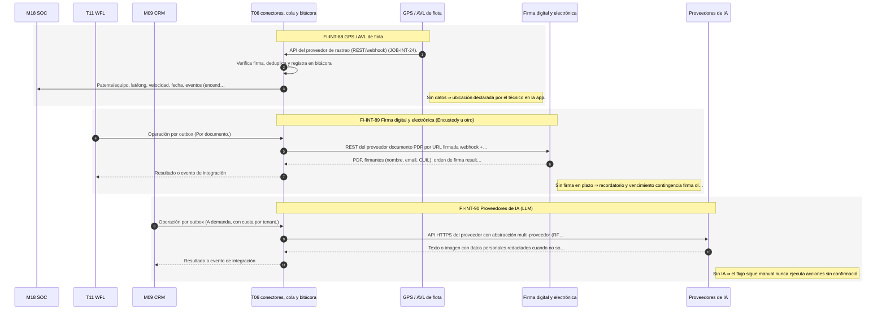

| Ficha | Módulo dueño | Dirección | Ola / prioridad | Estado de la investigación |
|---|---|---|---|---|
| FI-INT-88 GPS / AVL de flota | M18 (flota); M10 (despacho de cuadrillas). | Entrante. | O10 / Extensión. | Nuevo (pedido de la tarea). |
| FI-INT-89 Firma digital y electrónica (Encustody u otro) | T11 (expediente documental); consumidores M01, M08, M16, M17. | Bidireccional (envío del documento y we… | O3 / Estándar (firma de la in… | Soportado por ProCoop (Encustody); uso en LAG a confirmar. |
| FI-INT-90 Proveedores de IA (LLM) | T06 (conector); consumidores M09, M12, T10. | Saliente. | O6 / Estándar para clasificar… | Soportado por ProCoop (`AUDIT_IA`); uso en LAG a confirmar. |

### SEC-INT-20 — Hardware local

**Fuente:** T06 §12.16. **Cubre:** FI-INT-91, FI-INT-92, FI-INT-93, FI-INT-94, FI-INT-95.

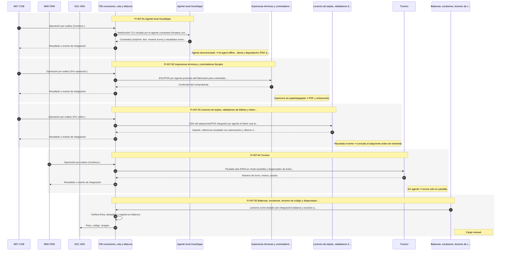

| Ficha | Módulo dueño | Dirección | Ola / prioridad | Estado de la investigación |
|---|---|---|---|---|
| FI-INT-91 Agente local GoodApps | T06; consumidores M07, M09, M11, M03, M10. | Bidireccional por canal saliente desde… | O10 / Estándar (O5 si una suc… | Nuevo; reemplaza el Agente/Integra de ProCoop (RN-10 §12). |
| FI-INT-92 Impresoras térmicas y controladores fiscales | M07 (caja), M11 (POS). | Saliente. | O10 / Estándar. | Soportado por ProCoop. |
| FI-INT-93 Lectores de tarjeta, validadores de billetes y tótem de aut… | M07. | Bidireccional. | O10 / Extensión. | Soportado por ProCoop (tótem con HTML local que pedía datos… |
| FI-INT-94 Turnero | M09 CRM. | Bidireccional. | O10 / Extensión. | Soportado por ProCoop. |
| FI-INT-95 Balanzas, escáneres, lectores de código y dispensadores | M11, M13, T11 (digitalización). | Entrante. | O10 / Extensión. | Soportado por ProCoop. |

### SEC-INT-21 — Datos, legado y servicios de plataforma (1)

**Fuente:** T06 §12.17. **Cubre:** FI-INT-96, FI-INT-97, FI-INT-98, FI-INT-99, FI-INT-100, FI-INT-101.

```mermaid
sequenceDiagram
    autonumber
    participant PT07 as T07 MIG
    participant PT10 as T10 BIA
    participant PM15 as M15 CON
    participant PM19 as M19 POR
    participant INT as T06 conectores, cola y bitácora
    participant X0 as Importación de planillas y archivos
    participant X1 as Migración desde ProCoop
    participant X2 as Power BI y herramientas de análisis
    participant X3 as Sistema contable externo
    participant X4 as API para terceros
    participant X5 as CoopOnline
    rect rgb(245, 245, 245)
    Note over INT,X0: FI-INT-96 Importación de planillas y archivos (Excel, CSV, DBF,…
    X0->>INT: XLSX/CSV DBF y MDB solo en importación controlada en servid…
    INT->>INT: Verifica firma, deduplica y registra en bitácora
    Note right of X0: Vista previa con errores por línea, aplicación idempotente.
    end
    rect rgb(245, 245, 245)
    Note over INT,X1: FI-INT-97 Migración desde ProCoop
    X1->>INT: Ver T07. T06 aporta externalReferences (RF-INT-078) y la re…
    INT->>INT: Verifica firma, deduplica y registra en bitácora
    INT->>PT07: Ver T07.
    Note right of X1: Ver T07.
    end
    rect rgb(245, 245, 245)
    Note over INT,X2: FI-INT-98 Power BI y herramientas de análisis
    PT10->>INT: Operación por outbox (—)
    INT->>X2: Ver T10 (API de lectura / exportación).
    X2-->>INT: Ver T10.
    INT-->>PT10: Resultado o evento de integración
    Note right of X2: —
    end
    rect rgb(245, 245, 245)
    Note over INT,X3: FI-INT-99 Sistema contable externo (SISCONT y similares)
    PM15->>INT: Operación por outbox (Mensual/diaria.)
    INT->>X3: Archivo por layout del sistema destino.
    X3-->>INT: Asientos, cuentas, centros de costo.
    INT-->>PM15: Resultado o evento de integración
    Note right of X3: Generado ≠ importado reexportación versionada.
    end
    rect rgb(245, 245, 245)
    Note over INT,X4: FI-INT-100 API para terceros (Integra / WS_KEYS)
    X4->>INT: Ver T10 ( /api/v1/ext/... , token por cliente, alcance, lím…
    INT->>INT: Verifica firma, deduplica y registra en bitácora
    INT->>PT10: Ver T10.
    Note right of X4: —
    end
    rect rgb(245, 245, 245)
    Note over INT,X5: FI-INT-101 CoopOnline (portal y app sincronizados por Firebase/…
    PM19->>INT: Operación por outbox (—)
    INT->>X5: —
    X5-->>INT: —
    INT-->>PM19: Resultado o evento de integración
    Note right of X5: Redirecciones de links viejos durante la transición (PA-INT-17).
    end
```

| Ficha | Módulo dueño | Dirección | Ola / prioridad | Estado de la investigación |
|---|---|---|---|---|
| FI-INT-96 Importación de planillas y archivos (Excel, CSV, DBF, Acces… | T06 (motor); dueño = módulo destino. | Entrante. | O1 / Núcleo. | Soportado por ProCoop (`clsImportacionArchivos`). |
| FI-INT-97 Migración desde ProCoop | T07 MIG. | Entrante. | O0–O11 / Núcleo. | Ver T07. |
| FI-INT-98 Power BI y herramientas de análisis | T10 BIA. | Saliente. | Ver T10. | Soportado por ProCoop. |
| FI-INT-99 Sistema contable externo (SISCONT y similares) | M15 CON. | Saliente. | O8 / Extensión. | Soportado por ProCoop. |
| FI-INT-100 API para terceros (Integra / WS_KEYS) | T10 BIA. | Entrante. | Ver T10. | Soportado por ProCoop (Integra). |
| FI-INT-101 CoopOnline (portal y app sincronizados por Firebase/MySQL/F… | M19. | — | — / Reemplazado por M19 sobre… | Confirmado en LAG. |
