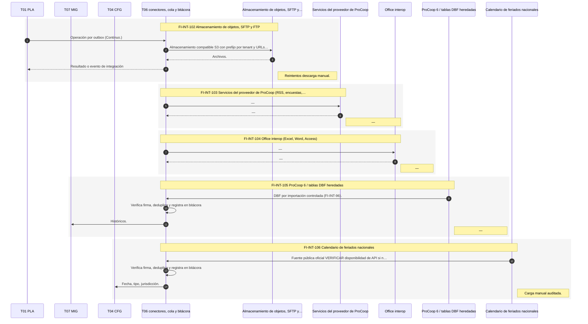
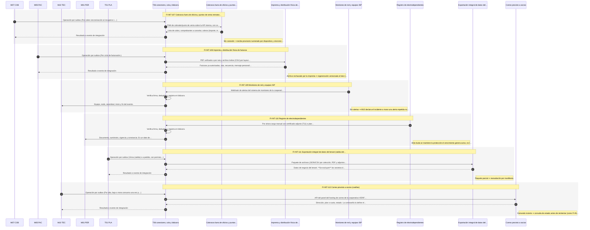
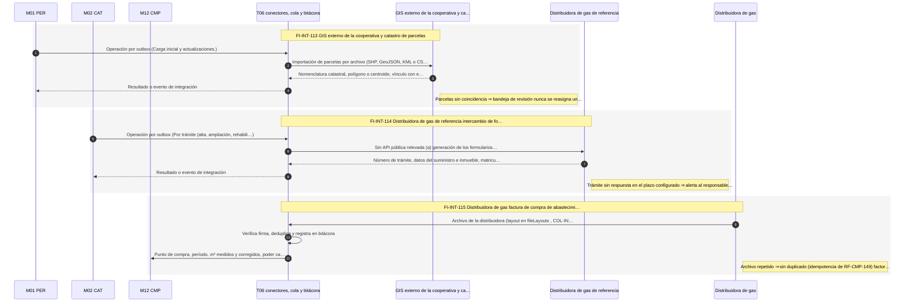

# GoodApps Cooperativas — Diagramas de secuencia de integraciones externas, parte Z

**Entregable de análisis y diseño — Artefacto 7.3 (diagramas de secuencia), fichas FI-INT de T06**

| Campo | Valor |
|---|---|
| Documento | `06z-secuencias-integraciones-fi-int-2.md` |
| Índice del entregable | [`06-secuencias-y-estados.md`](06-secuencias-y-estados.md) (sección 7) y [`06a-indice-cobertura-secuencias-estados.md`](06a-indice-cobertura-secuencias-estados.md) |
| Versión | 1.0 |
| Fecha | 05-11-2026 |
| Estado | Borrador para revisión |
| Fuentes | T06 §12.3 a §12.18 (fichas FI-INT-01 a FI-INT-115) |
| Generación | Script `_trabajo/gen06_build.py` (extrae de los anexos; revisión manual posterior) |

## 1. Cómo leer esta parte

Cada ficha FI-INT de T06 se dibuja con el mismo molde: el módulo dueño encola la operación, T06 la ejecuta con credenciales de la bóveda, idempotencia, circuito y bitácora, y devuelve el resultado o publica un evento de integración. En las fichas entrantes el proveedor inicia el intercambio (webhook o archivo). La nota a la derecha resume "Errores y contingencia" de la ficha. Cuando el dueño es T06 sin otro módulo, el intercambio empieza y termina en T06.

## 2. Integraciones externas (fichas FI-INT de T06)

### SEC-INT-22 — Datos, legado y servicios de plataforma (2)

**Fuente:** T06 §12.17. **Cubre:** FI-INT-102, FI-INT-103, FI-INT-104, FI-INT-105, FI-INT-106.

| Ficha | Módulo dueño | Dirección | Ola / prioridad | Estado de la investigación |
|---|---|---|---|---|
| FI-INT-102 Almacenamiento de objetos, SFTP y FTP | T01 (almacenamiento) / T06 (transporte). | Bidireccional. | O0 / Núcleo. | Soportado por ProCoop (`TransferirFTP`, S3 del proveedor). |
| FI-INT-103 Servicios del proveedor de ProCoop (RSS, encuestas, soporte… | — | — | — / Descartado (no aplica a u… | Soportado por ProCoop. |
| FI-INT-104 Office interop (Excel, Word, Access) | — | — | — / Reemplazado por exportaci… | Soportado por ProCoop. |
| FI-INT-105 ProCoop 6 / tablas DBF heredadas | T07. | Entrante (una sola vez). | Según T07 / Extensión. | Soportado por ProCoop; existencia de históricos DBF en LAG… |
| FI-INT-106 Calendario de feriados nacionales | T04 CFG. | Entrante. | O1 / Estándar. | Nuevo. |

### SEC-INT-23 — Integraciones adicionales de la BASE y de las fuentes de ProCoop (1)

**Fuente:** T06 §12.18. **Cubre:** FI-INT-107, FI-INT-108, FI-INT-109, FI-INT-110, FI-INT-111, FI-INT-112.

| Ficha | Módulo dueño | Dirección | Ola / prioridad | Estado de la investigación |
|---|---|---|---|---|
| FI-INT-107 Cobranza fuera de oficina y puntos de venta remotos de prep… | M07 COB (cobranza y rendición); M03 MED (venta de prepago); T06 aporta el canal… | Bidireccional. | O5 / Extensión (cobrador); O7… | Soportado por ProCoop (R-Pos, según BASE [MER1]); uso en LA… |
| FI-INT-108 Imprenta y distribución física de facturas | M05 FAC (lote y orden de impresión); T09 COM (constancia de entrega). | Bidireccional. | O5 / Estándar. | Nuevo (BASE); ProCoop imprime en la cooperativa. |
| FI-INT-109 Monitoreo de red y equipos ISP | M10 TEC (incidentes de zona); M09 CRM (aviso a los afectados). | Entrante. | O10 / Extensión. | Nuevo (BASE; el benchmark lo atribuye a otro proveedor). |
| FI-INT-110 Registro de electrodependientes | M01 PER / M03 (marca del suministro); M08 MOR (bloqueo de corte). | Entrante. | O7 / Estándar (carga manual);… | Nuevo (BASE §87 cita regímenes nacionales y provinciales). |
| FI-INT-111 Exportación integral de datos del tenant (salida del client… | T01 PLA (proceso de salida); T10 BIA (formatos); T06 aporta el transporte. | Saliente. | O11 / Estándar. | Nuevo. |
| FI-INT-112 Correo provisto a socios (casillas) | M10 TEC (servicio); T06 (conector). | Saliente. | O10 / Extensión. | Soportado por ProCoop (`CORREOSINT`, que guarda contraseñas… |

### SEC-INT-24 — Integraciones adicionales de la BASE y de las fuentes de ProCoop (2)

**Fuente:** T06 §12.18. **Cubre:** FI-INT-113, FI-INT-114, FI-INT-115.

| Ficha | Módulo dueño | Dirección | Ola / prioridad | Estado de la investigación |
|---|---|---|---|---|
| FI-INT-113 GIS externo de la cooperativa y catastro de parcelas | M01 / M03 (inmueble y suministro); M10 (redes, con FI-INT-72). | Bidireccional. | O3 / Extensión. | Soportado por ProCoop (`Import_Parcelas`, GIS por cooperati… |
| FI-INT-114 Distribuidora de gas de referencia: intercambio de formular… | M02 (legajo y documentos del contrato GAS); M10 (factibilidad, inspección y OT… | Bidireccional. | O7 / Extensión (solo tenants… | A relevar con la distribuidora del tenant piloto (formulari… |
| FI-INT-115 Distribuidora de gas: factura de compra de abastecimiento | M12 (comprobante y control); M03 (volumen medido en el punto de compra, API-MED… | Entrante. | O8 / Estándar (solo tenants s… | A relevar con la distribuidora del tenant piloto (layout y… |
