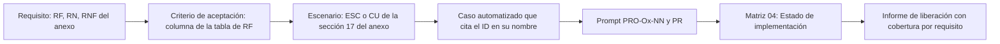

# GoodApps Cooperativas

## Estrategia de pruebas y plan de pruebas de rendimiento y seguridad

**Entregable de Análisis y Diseño Detallado — Artefactos 9.1 (Estrategia de pruebas) y 9.4 (Plan de pruebas de rendimiento y seguridad)**

| Dato | Valor |
|---|---|
| Producto | GoodApps Cooperativas: plataforma de gestión en la nube (SaaS multi-tenant) para cooperativas de servicios públicos y sociales |
| Documento | Estrategia de pruebas, criterios de aceptación y plan de pruebas no funcionales |
| Destinatarios | Equipo de desarrollo, responsables de calidad y seguridad de la plataforma, responsables funcionales y usuarios clave de la cooperativa piloto, Laguna Larga (`LAG`, DEC-088) |
| Carácter | Documento derivado de la especificación vigente; no la reemplaza. Ante cualquier diferencia prevalecen la especificación maestra (`00`), sus anexos (en particular T08) y el registro de decisiones (`01`) |
| Versión | 1.0 |
| Fecha | 05-11-2026 |

> **Norma stack CoopApps (C-10, DEC-111–113, DEC-110).** Los niveles, suites y trazabilidad RF→CP de este documento siguen vigentes. Donde se exija MongoDB/Redis/replica set o drivers Node, leer como **redacción previa a DEC-111**: la verificación en GoodApps usa **integración contra Azure SQL** (Testcontainers o entorno dedicado), **Azure Queue** donde aplique colas, **Playwright** en front React y contratos alineados a `18-openapi/`. No se reescriben masivamente los 5.710 CP; se alinea la estrategia y los nuevos CP nacen con la norma Azure. Impacto: `06-impacto-adaptacion-stack-goodapps.md` §12.3.

### Control de versiones

| Versión | Fecha | Descripción del cambio | Autor |
|---|---|---|---|
| 1.0 | 05-11-2026 | Versión inicial de la estrategia de pruebas (9.1) y del plan de pruebas de rendimiento y seguridad (9.4). Actualizada el mismo día por DEC-088 (cooperativa piloto: Laguna Larga), que reemplaza a DEC-081: se agregan los casos de aceptación de la migración de LAG | |

### Aprobaciones

| Rol | Nombre | Firma | Fecha |
|---|---|---|---|
| Elaboró | | | |
| Revisó | | | |
| Aprobó | | | |

---

## Índice

1. Propósito, alcance y fuentes
2. Objetivos de las pruebas
3. Principios
4. Niveles de prueba
5. Pruebas específicas del dominio
6. Plan de pruebas no funcionales (artefacto 9.4)
7. Pruebas de migración desde ProCoop
8. Datos de prueba
9. Ambientes de prueba
10. Automatización en integración continua
11. Criterios de entrada y salida por ola y definición de terminado
12. Gestión de defectos
13. Trazabilidad requisito → caso de prueba
14. Roles y responsabilidades
15. Casos de aceptación del piloto (Internet con datos sintéticos y migración de LAG)
16. Puntos a definir y observaciones sobre las fuentes

---

## 1. Propósito, alcance y fuentes

Este documento establece cómo se verifica que GoodApps Cooperativas cumple su especificación, desde la primera ola de construcción (O0) hasta el corte de ProCoop (O11). Ordena en una sola estrategia lo que la especificación ya exige de forma dispersa: la estrategia de pruebas obligatoria en CI de T08 §12, los criterios de aceptación y escenarios de la sección 17 de cada anexo, los criterios de salida de cada ola del plan `03` y la definición de terminado de la maestra §16.

Alcance: todas las aplicaciones (admin, PWA del socio, PWA de campo, landing, consola de plataforma), la API, los workers, las integraciones (T06) y la migración desde ProCoop (T07).

Fuentes utilizadas:

| Fuente | Contenido que se toma |
|---|---|
| `00-ESPECIFICACION-MAESTRA.md` §13, §14, §15, §16 | Convenciones (pruebas de permisos negativos y de aislamiento obligatorias), resumen de RNF, olas e hitos, definición de terminado |
| `anexos/T08-NFR-no-funcionales-seguridad.md` §7 a §14 y §17 | RNF medibles con su criterio verificable, estrategia de pruebas en CI, escenarios ESC-01 a ESC-05 y criterios transversales por ola |
| `anexos/T07-MIG-migracion-procoop.md` §9, §17 | Conciliación, muestreo, corrida paralela y escenarios ESC-MIG |
| `anexos/T01-PLA-plataforma-saas.md` §5.J, §7.10 | Ambientes, juego canónico de datos, pipeline y matriz de verificación por entrega |
| `03-plan-de-olas-y-prompts.md` §2, §4 a §15 | Reglas R1–R20, scripts estándar, criterios de salida y pruebas extremo a extremo por ola |
| Anexos M01–M19, T01–T12, sección 17 | Escenarios ESC-xxx y criterios de aceptación por requisito |
| `04-matriz-trazabilidad.md` §15 | Trazabilidad RF y RNF → prompt |

---

## 2. Objetivos de las pruebas

| N.º | Objetivo | Requisitos de referencia |
|---|---|---|
| OBJ-1 | Demostrar que cada requisito funcional cumple su criterio de aceptación (última columna de la tabla de RF de su anexo) con una prueba automatizada que cita su ID | Maestra §16; `03` R15, R16 |
| OBJ-2 | Garantizar el aislamiento entre cooperativas: ninguna ruta, job, archivo, evento ni caché expone datos de otro tenant | RNF-NFR-148, RNF-NFR-238; maestra §14 |
| OBJ-3 | Garantizar la exactitud monetaria: cero diferencias de centavos entre comprobante, cuenta corriente y contabilidad | RNF-NFR-200 a 209, RNF-NFR-229; maestra §14 |
| OBJ-4 | Asegurar que reintentos, interrupciones y duplicados no producen efectos repetidos | RNF-NFR-151, RNF-NFR-212 a 215 |
| OBJ-5 | Verificar las metas de rendimiento, capacidad, disponibilidad y recuperación sobre el perfil de referencia | T08 §7, §8; DEC-063; DEC-075 |
| OBJ-6 | Verificar los controles de seguridad (OWASP ASVS 5.0 nivel 2) y de privacidad (Ley 25.326) | T08 §9, §10 |
| OBJ-7 | Verificar la accesibilidad WCAG 2.2 AA y el funcionamiento sin conexión de la PWA de campo | RNF-NFR-180, RNF-NFR-186 a 191 |
| OBJ-8 | Demostrar que la migración desde ProCoop es repetible, conciliada y sin pérdida de saldos ni documentos | T07 §17; RNF-NFR-153, RNF-NFR-154 |
| OBJ-9 | Aprobar el recorrido completo del servicio Internet con datos sintéticos y obtener la aceptación formal de la cooperativa piloto, Laguna Larga (`LAG`), sobre su migración de electricidad, gas y prepago | DEC-005; DEC-088; T12 parte 1 §1.7; PA-MIG-17 |
| OBJ-10 | Bloquear la promoción a producción de toda versión sin evidencia completa | RF-NFR-022, RNF-NFR-165, RF-PLA-114 |

---

## 3. Principios

1. **La prueba es parte del requisito.** Ningún RF se considera implementado sin prueba automatizada que cite su ID en el nombre (`03` R15, R19).
2. **Pruebas contra infraestructura real.** Las pruebas de integración usan MongoDB 7 en replica set, Redis y almacenamiento S3 compatible reales; está prohibido simular la base de datos en ellas (RNF-NFR-142).
3. **Suites que nunca se ponen en cuarentena.** Aislamiento, permisos negativos e idempotencia no admiten excepciones por inestabilidad (RNF-NFR-162).
4. **Datos 100 % ficticios.** Ningún dato real de socios, empleados ni de la DEMO de ProCoop se usa en repositorio, fixtures ni ambientes no productivos (RN-NFR-014, RNF-NFR-160).
5. **Metas internas medibles.** Las metas numéricas de T08 son objetivos de ingeniería verificados en CI y en pruebas de carga; el compromiso contractual se deriva de ellas (T08 §5.2, CTR-NFR-01).
6. **Un fallo relevante impide promover.** Los gates del pipeline son vinculantes (RNF-NFR-165, RF-PLA-114).

---

## 4. Niveles de prueba

### 4.1 Pirámide obligatoria

T08 fija qué se ejecuta en cada momento (RNF-NFR-140):

| Momento | Suites |
|---|---|
| Cada PR | Unitarias, integración con Mongo y Redis reales, contrato, aislamiento multitenant, permisos negativos, seguridad estática y extremo a extremo de humo |
| Nocturno | Extremo a extremo completo, fuzzing desde OpenAPI, DAST de línea base, accesibilidad, propiedades con ≥ 10.000 casos |
| Semanal o por ola | Carga, resistencia, caos, restauración, mutación |

### 4.2 Detalle por nivel

| Nivel | Qué verifica | Herramientas (según fuentes) | Meta o criterio | Requisitos |
|---|---|---|---|---|
| Unitarias | Lógica pura en `lib/` y `packages/shared` (dinero, fechas, cálculo tarifario, fiscal, imputación, mora) sin red | `node --test` y c8 en backend; Vitest y Vue Test Utils en front y paquetes | Suite completa ≤ 5 min; cobertura global líneas ≥ 80 % y ramas ≥ 70 %; módulos críticos líneas ≥ 95 % y ramas ≥ 90 %; líneas modificadas en el PR ≥ 85 % | RNF-NFR-141, RNF-NFR-158 |
| Integración por módulo | Repositorios, servicios, transacciones, índices únicos, plugin de tenancy, outbox, jobs | Supertest; MongoDB 7 en replica set, Redis y S3 compatible en contenedor; antivirus en contenedor | 100 % de repositorios y servicios con pruebas de integración; 0 simulaciones del driver en `*.int.test.js` | RNF-NFR-142; `03` R15 |
| Contrato de API | OpenAPI generado desde los esquemas Zod; diff semántico de cambios incompatibles; importes como cadena decimal | `zod-to-openapi` o equivalente; linter de OpenAPI | 0 cambios incompatibles no versionados; 0 importes numéricos en OpenAPI | RNF-NFR-143, RNF-NFR-175, RNF-NFR-201, RNF-NFR-247 |
| Contrato de eventos | Esquemas de eventos validados por productor y consumidor, con `schemaVersion` | Gate de diff de esquemas de eventos | 0 consumidores rotos por un cambio de evento | RNF-NFR-143, RNF-NFR-178 |
| Contrato de conectores | Conectores de T06 contra contratos grabados del proveedor y, en nocturno, contra homologación o sandbox (ARCA homologación, pasarelas en modo prueba) | Simulador de conectores (RF-INT-031) | 0 rechazos por codificación en archivos de intercambio | RNF-NFR-143, RNF-NFR-198 |
| Extremo a extremo | Recorridos críticos por ola en admin y PWA | Playwright en Chromium, Firefox y WebKit más emulación móvil (Android de gama baja e iPhone) | Humo ≤ 10 min por PR; completo nocturno con éxito ≥ 99 % sin reintentos; recorrido del piloto Internet (escenario 37 de BASE §34) obligatorio desde O6 | RNF-NFR-144 |
| Aceptación de usuario | Recorridos de negocio ejecutados por usuarios clave de la cooperativa piloto en `staging` o `sandbox`, sobre los escenarios de la sección 17 de cada anexo; cierre con acta | Ambiente `sandbox` con tenant gemelo (RF-PLA-111) | Criterios de salida de la ola cumplidos y acta de aceptación firmada (AGR §7 etapa F) | `03` §4 a §15; T07 RF-MIG-087 |
| Regresión | Conjuntos dorados de cálculo tarifario, fiscal y de mora; reproducción de liquidaciones históricas; comparación línea base de rendimiento | Suite de conjuntos dorados; job de comparación (T07); resultados k6 en `qualityEvidence` | 0 diferencias no explicadas; regresión de rendimiento > 20 % bloquea la liberación | RNF-NFR-153, RNF-NFR-179, RNF-NFR-145 |

### 4.3 Suites transversales obligatorias

| Suite | Alcance | Meta | Requisitos |
|---|---|---|---|
| Aislamiento multitenant | Recorre el registro de rutas (`admin`, socio, `platform`, `public`, `ext`) con datos en TEN-001 y TEN-002 con el mismo código interno; incluye webhooks, sincronización offline, URLs firmadas, eventos, jobs, cachés, colas, notificaciones push, logs y métricas | 100 % de rutas y jobs cubiertos; 0 fugas; una ruta nueva sin caso hace fallar el build | RNF-NFR-148, RNF-NFR-238; `npm run test:isolation` |
| Permisos negativos | Generada desde el catálogo de capabilities (T02): sin capability → 403 sin efectos; con capability fuera de alcance → sin efectos | 100 % de capabilities con caso negativo | RNF-NFR-150 |
| Idempotencia e interrupción | Falla a mitad y reintento, doble `Idempotency-Key`, doble webhook | 100 % de jobs y rutas económicas | RNF-NFR-151 |
| Propiedades | `money`, prorrateos, intereses, redondeos y fechas de negocio | ≥ 10.000 casos por propiedad en nocturno | RNF-NFR-152 |
| Mutación | `money`, motor tarifario, fiscal, imputación | Puntaje ≥ 70 % semanal | RNF-NFR-159 |

---

## 5. Pruebas específicas del dominio

### 5.1 Cálculo tarifario y exactitud monetaria con Decimal128

| Qué se prueba | Cómo | Meta | Requisitos y escenarios |
|---|---|---|---|
| Uso exclusivo de `Decimal128`/`decimal.js` | Regla SAST/ESLint que detecta aritmética, `parseFloat`, `toFixed` o `Math.round` sobre campos monetarios fuera de `packages/shared/money` | 0 hallazgos al fusionar | RN-NFR-005, RNF-NFR-200, RNF-NFR-206 |
| Precisión y redondeo por concepto | Validación de catálogo; conjunto dorado fiscal | Precisión declarada para el 100 % de los conceptos; 0 rechazos ARCA por redondeo | RNF-NFR-202, RNF-NFR-203 |
| Suma de partes igual al total | Propiedades con fast-check: "no se crea ni se pierde un centavo", resultado independiente del orden y del huso horario del servidor | 10.000 casos por propiedad | RN-NFR-006, RNF-NFR-152, RNF-NFR-204; escenario 72 de BASE §34 |
| Reproducibilidad | Reejecutar una liquidación de 24 meses atrás con la versión de tarifa y reglas aplicada en su momento | Resultado idéntico al original | RNF-NFR-179, RNF-NFR-223; escenario 5 de BASE §34 |
| Simulación sin efectos | Contar escrituras en colecciones productivas durante una simulación tarifaria | 0 escrituras | RNF-NFR-223; escenarios 39 y 73 de BASE §34 |
| Período parcialmente procesado | Lote con cambio tarifario a mitad; reejecución | Mantiene universo y versiones; no reescribe documentos | ESC-05 (T08 §17.1); RNF-NFR-215 |
| Cálculo del piloto | Primer comprobante de Internet con abono, promoción e instalación | Resultado del ejemplo de M04 §9.3.9 (ver observación OBS-01 en la sección 16) | ESC-TAR-03 (M04); ESC-SRV-INT-01 (T12 parte 1) |
| Intereses y recargos por días | Conjunto dorado de fin de mes y año bisiesto | En verde | RNF-NFR-208 |

### 5.2 Numeración fiscal

| Qué se prueba | Cómo | Meta | Requisitos y escenarios |
|---|---|---|---|
| Correlatividad sin huecos ni duplicados por punto de venta y tipo | 10.000 emisiones con fallos inyectados, contra homologación y simulador | 0 huecos y 0 duplicados | RNF-NFR-217 |
| Resultado incierto ante timeout | Conector que confirma después del timeout; consulta del último autorizado antes de reintentar | 0 reintentos ciegos; 0 duplicados | RNF-NFR-011, RNF-NFR-221; M06 §17.4 escenario 32 |
| Reintento fiscal sin duplicar retenciones | Reintento de una emisión con retenciones | Sin duplicados | RNF-NFR-212; escenario 50 de BASE §34 |
| Observaciones de ARCA | Autorización con observaciones | No se reemite | Escenario 61 de BASE §34 |
| Restauración posterior a emisiones | Restaurar a un punto anterior a una emisión confirmada | Se concilia con ARCA antes de reanudar; no se reemite ni se renumera | RNF-NFR-044; ESC-04; M06 §17.5 |
| Continuidad al corte de ProCoop | Último número autorizado consultado a ARCA al corte | Prevalece ARCA si difiere de ProCoop | RN-MIG-028; PA-MIG-08 (asumida, DEC-072) |

### 5.3 Idempotencia

| Qué se prueba | Meta | Requisitos y escenarios |
|---|---|---|
| `Idempotency-Key` obligatorio en todo `POST`/`PATCH` económico o de integración: mismo cuerpo → misma respuesta; cuerpo distinto → 422; en curso → 409; sin clave → 400 | 100 % de rutas económicas | RNF-NFR-212 |
| Claves naturales únicas como segunda barrera (obligaciones del ciclo, pagos externos, comprobantes, series de equipos, turnos, mutaciones offline) | Inserción duplicada rechazada en el 100 % de las pruebas | RNF-NFR-213 |
| Webhooks y archivos de rendición deduplicados | Reprocesar dos veces el mismo archivo: 0 cobros nuevos; webhook triplicado: un cobro | RNF-NFR-018, RNF-NFR-218; ESC-COB-R01 (M07) |
| Jobs reanudables con checkpoint | `kill -9` del worker durante un lote: mismo resultado que sin caída (hash de documentos) | RNF-NFR-013, RNF-NFR-215; escenarios 6 y 59 de BASE §34 |
| Doble clic en la UI | Doble clic en "Cobrar": un recibo | RNF-NFR-226 |
| Exclusión mutua de lotes | Dos lanzamientos simultáneos del mismo lote: uno se ejecuta y otro se rechaza | RNF-NFR-216 |

### 5.4 Aislamiento multitenant

| Qué se prueba | Meta | Requisitos y escenarios |
|---|---|---|
| Suite genérica de aislamiento por ruta y job (sección 4.3) | 100 % cubierto; 0 fugas | RNF-NFR-148; escenarios 16, 19, 21, 29, 43, 45, 86 de BASE §34 |
| Plugin de tenancy: consulta, `aggregate`, `update`, `delete`, `bulkWrite`, `$lookup`, `$unionWith`, `$graphLookup` sin `tenantId` lanzan error; prueba de mutación del plugin | 0 consultas sin tenant; deshabilitar el plugin rompe la suite | RNF-NFR-149, RNF-NFR-238 |
| Índices compuestos que empiezan por `tenantId` | 0 índices fuera de convención (script `check-indexes`) | RNF-NFR-025, RNF-NFR-149 |
| Aislamiento criptográfico: un valor cifrado de TEN-001 copiado a TEN-002 no descifra | Falla al descifrar | RNF-NFR-056 |
| Escenarios del piloto y de módulos | 404 sin revelar existencia | ESC-SRV-INT-06 (T12), ESC-TEC-25 (M10), ESC-COB-T01 (M07), M06 §17.3 escenarios 27 a 29 |

### 5.5 Outbox y eventos

| Qué se prueba | Meta | Requisitos |
|---|---|---|
| Auditoría y evento de outbox en la misma transacción que el cambio | Verificado en prueba de integración de escritura | RN-NFR-020, RNF-NFR-004 |
| Atomicidad: falla forzada después de crear el recibo y antes del outbox | La base queda sin cambios | M07 §17.1 criterio 3; RNF-NFR-211 |
| Latencia de publicación | p95 ≤ 5 s y p99 ≤ 30 s; alerta si el pendiente más antiguo supera 60 s (prueba con 10.000 eventos) | RNF-NFR-014 |
| Consumidores idempotentes (`inboxReceipts`) | Entregar tres veces el mismo evento produce un solo efecto | RNF-NFR-214 |
| Pérdida total de Redis | Recuperación de colas ≤ 15 min reencolando desde Mongo, sin duplicar efectos | RNF-NFR-041 |
| Cargas de migración silenciosas | Una carga en modo `migration` no envía correos ni SMS ni publica deuda a entes | RF-MIG-040, RN-MIG-043 |

### 5.6 Funcionamiento sin conexión de la PWA de campo

| Qué se prueba | Meta | Requisitos y escenarios |
|---|---|---|
| App shell disponible sin red; datos de `/api` no cacheados por HTTP | Prueba Playwright sin conexión | RNF-NFR-186 |
| Motor único de cola en IndexedDB con `clientMutationId` | Una sola implementación; 0 usos de `localStorage` para datos de negocio | RNF-NFR-187 |
| Sincronización idempotente | Lote de 200 mutaciones ≤ 10 s p95; tres reintentos del mismo lote producen un solo efecto | RNF-NFR-017, RNF-NFR-219; ESC-TEC-09 |
| Capacidad sin conexión | ≥ 7 días, ≥ 1.000 tareas y ≥ 300 fotos en dispositivo de referencia | RNF-NFR-188 |
| Conflicto de sincronización | Se conserva la evidencia, se abre el conflicto, no se duplica salida de equipo ni activación | RNF-NFR-190; ESC-03 (T08) / ESC-TEC-08 (M10); escenario 70 de BASE §34 |
| Red intermitente y cierre de la app con cola pendiente | Casos en verde | RNF-NFR-156 |
| Seguridad de datos locales | 0 datos de tareas no asignadas en el dispositivo (inspección de IndexedDB) | RNF-NFR-189 (A validar, PA-NFR-14) |
| Operaciones que no se encolan (login, cobros, anulaciones, configuración) | Botones deshabilitados sin red | RNF-NFR-191 |
| Actualización de la PWA con cola pendiente | Un técnico con 20 operaciones en cola actualiza y sincroniza sin pérdida | RF-PLA-150, RNF-NFR-174 |

---

## 6. Plan de pruebas no funcionales (artefacto 9.4)

### 6.1 Perfil de carga de referencia

Las pruebas de rendimiento usan el perfil de referencia de T08 §7.1 (adoptado por DEC-075): tenant estándar de 25.000 suministros y tenant grande de 150.000, con diseño para 100 tenants y escala hasta 300 sin rediseño. El dataset sintético de tenant grande (150.000 suministros y 5 años de movimientos) se genera con `seed:carga --perfil=grande` y existe solo en `staging` (T08 §18). El perfil se recalibra con las mediciones de la cooperativa piloto, LAG (AGR-020; DEC-088), tomadas en el perfilado de su migración.

### 6.2 Rendimiento interactivo

Herramienta: k6 (RNF-NFR-145), medición en servidor al 100 % de la carga pico.

| Escenario k6 | Requisito | Meta |
|---|---|---|
| `read-by-id` | RNF-NFR-001 | p95 ≤ 200 ms; p99 ≤ 500 ms |
| `list-paginated` | RNF-NFR-002 | p95 ≤ 400 ms; p99 ≤ 1 s; `size` máximo 100 |
| `search` | RNF-NFR-003 | p95 ≤ 500 ms en tenant grande; sin `COLLSCAN` |
| `write-simple` | RNF-NFR-004 | p95 ≤ 500 ms; p99 ≤ 1,2 s |
| `cash-payment` (30 cajas concurrentes por tenant grande) | RNF-NFR-005, RNF-NFR-224 | p95 ≤ 800 ms; recibo listo para imprimir ≤ 2 s medido en cliente (DEC-063 fija p95 interactivo ≤ 800 ms) |
| `account-360` | RNF-NFR-006 | p95 ≤ 1 s |
| `dashboards` | RNF-NFR-007 | Tableros p95 ≤ 2 s; reportes sincrónicos ≤ 5 s; exportación de más de 10.000 filas siempre asíncrona |
| `bi-extract` en paralelo con `cash-payment` | RNF-NFR-019 | p95 ≤ 800 ms por página; se mantienen las metas de RNF-NFR-005 |
| `spike-2x` | RNF-NFR-029 | Con 2× la carga pico: 5xx < 1 %; rutas críticas dentro de meta |
| Carga mixta (exportación de un tenant mientras otro cobra) | RNF-NFR-020, RNF-NFR-021 | Cola `bulk` saturada no aumenta más de 10 % el p95 interactivo; cuota de 4 lotes concurrentes por tenant |
| Lighthouse CI móvil (landing, login, "Mis servicios", "Mis facturas", "Pagar", "Nuevo reclamo") | RNF-NFR-008, RNF-NFR-185 | LCP ≤ 2,5 s; INP ≤ 200 ms; CLS ≤ 0,1; puntaje ≥ 85 en gama baja |
| Lighthouse CI escritorio (AdminShell, DataTable, ficha 360) | RNF-NFR-009 | LCP ≤ 3 s; puntaje ≥ 80 |
| Autoescalado | RNF-NFR-023 | Escala de 2 a 6 réplicas en ≤ 5 min |

### 6.3 Carga de facturación masiva y procesos batch

| Proceso | Requisito | Meta | Estado en la fuente |
|---|---|---|---|
| `fac:emitir-lote` (cálculo, comprobantes, asientos y cuenta corriente) | RNF-NFR-010 | 50.000 suministros ≤ 60 min (≥ 14 comprobantes/s) con 4 workers; 150.000 ≤ 3 h; sin duplicados al matar un worker al 50 % | A validar (PA-NFR-04, asumida por DEC-072) |
| Autorización ARCA del lote | RNF-NFR-011 | ≥ 10 comprobantes/s; lote de 50.000 ≤ 2 h con ARCA normal; prueba de caos con timeouts | A validar (PA-NFR-04) |
| PDF y distribución | RNF-NFR-012 | PDF 50.000 ≤ 60 min; distribución 50.000 ≤ 4 h; PDF individual p95 ≤ 3 s | Adoptado |
| Importaciones | RNF-NFR-015 | Vista previa de 10.000 filas ≤ 60 s; confirmación de 50.000 registros ≤ 15 min | Adoptado |
| Otros batch (mora, débitos, rendiciones, asientos, sueldos, exportación) | RNF-NFR-016 | Metas por proceso en O5, O6, O8, O9 y O11 | A validar (PA-NFR-04) |
| Capacidad del tenant grande con 5 años de historia | RNF-NFR-024 | Metas interactivas de T08 §7.2 cumplidas; prueba trimestral y antes de cerrar O4, O5, O6, O7 y O11 | Adoptado |

**Cuándo:** obligatorias antes de cerrar O0 (línea base), O4, O5, O6, O7 y O11, y semanalmente en `staging` desde O4 (RNF-NFR-145).

### 6.4 Resistencia y caos

| Prueba | Requisito | Meta |
|---|---|---|
| Resistencia de 8 h al 70 % del pico | RNF-NFR-146 | Memoria estable (± 10 %); degradación ≤ 10 % |
| Caída de worker, de primario de Mongo y de Redis | RNF-NFR-013, RNF-NFR-041, RNF-NFR-048 | Reanudación sin duplicados; sin pérdida de escrituras confirmadas |
| Conector lento o caído | RNF-NFR-027, RNF-NFR-047 | Ninguna ruta interactiva espera más de 15 s; circuit breaker tras 5 fallas en 60 s; tablero muestra el conector degradado en ≤ 2 min |
| Tormenta de reintentos | RNF-NFR-227 | Picos ≤ 2× el tráfico normal |

### 6.5 Seguridad (OWASP ASVS 5.0 nivel 2)

| Prueba | Frecuencia | Meta | Requisitos |
|---|---|---|---|
| Lista ASVS L2 en el repositorio con estado por requisito | Revisión en cada ola (gate de cierre) | 100 % con estado; ningún "no cumple" en autenticación, sesión, autorización, validación, criptografía, archivos y API al cerrar O1 | RNF-NFR-050 |
| Modelado de amenazas por módulo e integración | Antes de construir cada módulo | Un modelo por anexo y por ficha de integración | RNF-NFR-051 |
| SAST (Semgrep/CodeQL con reglas propias) y escaneo de secretos con historial | Cada PR | 0 hallazgos altos sin resolver | RNF-NFR-094, RNF-NFR-147 |
| SCA de dependencias | Cada PR | Bloquea vulnerabilidades altas o críticas con corrección; remediación crítica ≤ 7 días, alta ≤ 30, media ≤ 90 | RNF-NFR-092 |
| SBOM, escaneo y firma de imágenes | Cada versión | 100 % de versiones con SBOM y firma | RNF-NFR-093, RNF-NFR-236 |
| Suite de inyección NoSQL, SSRF, XSS, cargas de archivos, CORS y encabezados | Cada PR | 0 hallazgos | RNF-NFR-147, RNF-NFR-235 |
| Fuzzing desde OpenAPI | Nocturno | 0 hallazgos altos abiertos al liberar | RNF-NFR-147 |
| DAST (OWASP ZAP) | Línea base por liberación; completo mensual autenticado con dos tenants | 0 críticos o altos abiertos | RNF-NFR-095 |
| Pruebas de penetración externas | Antes del go-live del piloto, anual y tras cambios mayores de autenticación, pagos o multitenancy | 0 hallazgos críticos o altos abiertos al go-live | RNF-NFR-095 (A validar, PA-NFR-17 asumida por DEC-072) |
| Tokens y sesión: algoritmo o `kid` inválido, tokens fuera del almacenamiento web, CSRF, revocación ≤ 60 s | Cada PR (e2e y contrato) | 0 tokens aceptados inválidos; 0 tokens en almacenamiento web | RNF-NFR-062 a 065 |
| Credential stuffing simulado (10.000 intentos) | Por ola de IAM | 0 cuentas comprometidas | RNF-NFR-066 |
| Batería adversarial de IA (inyección de instrucciones en fotos, mensajes y PDF) | Cada función de IA | 0 éxitos | RNF-NFR-098 |
| Alertas de seguridad (acceso cruzado entre tenants, picos de login fallido, etc.) | Simulacro trimestral | Detección ≤ 5 min | RNF-NFR-133 |
| Datos personales en telemetría y logs | Muestreo semanal y escaneo diario | 0 coincidencias de PII o secretos | RNF-NFR-121, RNF-NFR-139 |

### 6.6 Accesibilidad

| Prueba | Meta | Requisitos |
|---|---|---|
| axe-core dentro de Playwright en recorridos esenciales | 0 violaciones `serious` o `critical` por PR | RNF-NFR-155 |
| Auditoría manual por ola con teclado y lectores de pantalla (NVDA, TalkBack, VoiceOver), zoom 200 % y reflujo a 320 px | Informe por ola sin bloqueantes | RNF-NFR-181 |
| Contraste del branding del tenant | 0 combinaciones publicadas bajo 4,5:1 (texto) o 3:1 (componentes) | RNF-NFR-182 |
| Objetivo general | WCAG 2.2 AA; 100 % de recorridos esenciales operables solo con teclado; no se declara conformidad sin verificación | RNF-NFR-180 (AGR-032) |

### 6.7 Respaldo y restauración

| Prueba | Frecuencia | Meta | Requisitos |
|---|---|---|---|
| Restauración de plataforma a T−5 min en ambiente aislado con comparación de conteos y hashes | Mensual automática | RPO comprometido ≤ 15 min (DEC-063); objetivo interno ≤ 5 min | RNF-NFR-035, RNF-NFR-043, RNF-NFR-157 |
| Restauración selectiva de un tenant | Trimestral con tenant piloto y TEN-001/TEN-002 | RTO por tenant ≤ 4 h (DEC-063); los demás tenants no se afectan | RNF-NFR-037; escenario 15 de BASE §34 |
| Restauración con operaciones externas posteriores a la copia | Simulacro con emisión y pago confirmados después del punto de restauración | 0 emisiones o cobros duplicados | RNF-NFR-044; ESC-04 |
| Reaplicación de supresiones posteriores | En cada simulacro | 100 % reaplicadas antes de habilitar el acceso | RNF-NFR-045 |
| Restauración completa de plataforma con cronómetro | Anual | RTO comprometido ≤ 8 h; objetivo interno ≤ 4 h | RNF-NFR-036 |
| Caída de zona | Semestral | ≤ 15 min | RNF-NFR-036 |
| Backup de 12 meses restaurable con sus claves | Anual | 100 % restaurable | RNF-NFR-042 |
| Recuperación de objetos (100 al azar) | Trimestral | Recuperación ≤ 1 h | RNF-NFR-039 |
| Recuperación ante desastre regional | Anual (desde O11) | RPO ≤ 1 h; RTO ≤ 24 h | RNF-NFR-046 |
| Runbooks de restauración, DR, rotación de claves, caída de conector y fuga de credenciales | Al menos una prueba anual por runbook | 100 % con última prueba ≤ 12 meses | RNF-NFR-049 |

Los resultados se registran en `restoreTests` con RPO y RTO medidos y acta (RF-NFR-015).

---

## 7. Pruebas de migración desde ProCoop

### 7.1 Criterios transversales (T07 §17.1)

- Conteo de filas extraídas igual al conteo de origen por tabla, según el manifiesto del snapshot.
- 0 rechazos bloqueantes no excluidos; exclusiones aprobadas y listadas (RN-MIG-039).
- 100 % de los documentos migrados con `legacy` y entrada en `legacyIdMap`.
- Reproceso del mismo snapshot y conjunto de mapeo: 0 cambios (RF-MIG-043; ESC-MIG-01).
- Una corrida del tenant A no lee ni escribe documentos del tenant B.
- Quien ejecuta una corrida no aprueba su conciliación (RN-MIG-041).
- Ninguna credencial de ProCoop aparece en snapshots, staging, logs ni informes (RN-MIG-013).
- Corrida reanudada tras corte forzado del worker sin duplicados (RF-MIG-044).

### 7.2 Conciliación de saldos y conteos

| Control | Regla | Requisitos |
|---|---|---|
| Deuda por titular y servicio | Σ saldos de documentos abiertos migrados = Σ saldos ProCoop; total = cuenta contable de deudores por servicios a la fecha de corte | RF-MIG-054; T07 §9.8 |
| Fondos | Suma de cajas, valores, cupones y bancos = saldo contable de disponibilidades | RF-MIG-055 |
| Stock y comodatos | Cada equipo serializado en un depósito o en una cuenta, nunca en ambos | RF-MIG-056 |
| Contabilidad | Balance de sumas y saldos a la fecha de corte con diferencia 0 por cuenta | RF-MIG-057 |
| Tolerancias | Cantidades 0; importes 0,00 por documento salvo redondeo explicado ≤ 0,01 (PRM-MIG-040); totales por dominio 0,00 explicados | RN-MIG-040 |
| Importes | Conversión a `Decimal128` sin redondeo: la suma por tabla coincide al centavo con el origen | RF-MIG-036 |

### 7.3 Muestreo por dominio

T07 §17.2 fija el muestreo mínimo; se ejecuta en cada ensayo integral:

| Dominio | Muestreo | Aprueba |
|---|---|---|
| Personas y cuentas (M01) | 50 fichas al azar comparadas campo por campo | Responsable de atención o titulares |
| Cuadros tarifarios (M04) | Recalcular 100 facturas del último período cerrado con la versión migrada: mismo resultado | Responsable de tarifas |
| Deuda y cuenta corriente (M07) | 100 cuentas al azar con estado de cuenta idéntico | Contador y cobranzas |
| Cobranzas (M07) | Imputación idéntica en 100 recibos | Cobranzas |
| Financiaciones (M08) | Próximo vencimiento y cuota de 30 convenios | Cobranzas y contador |
| Stock (M13) | 30 equipos en comodato verificados en campo o por llamada | Depósito y contador |
| Proveedores (M12) | 30 proveedores (CUIT, condición IVA, CBU enmascarado) | Compras y contador |
| Sueldos (M16) | Reliquidar un período cerrado: mismo neto en el 100 % de los legajos o diferencia explicada | RRHH y contador |
| Técnica y CRM (M10/M09) | Estado y responsable de 30 abiertos | Responsable técnico o de atención |
| Portal y usuarios (M19/T02) | Un socio de prueba activa su cuenta y ve sus cuentas | Atención |

### 7.4 Corrida paralela con ProCoop

- GoodApps simula el ciclo sin CAE, sin numeración fiscal, sin publicar deuda y sin notificar (RF-MIG-070, RN-MIG-030).
- Se comparan factura por factura cantidades, importes por concepto, impuestos, totales, vencimientos y apertura por servicio (RF-MIG-072), y en forma complementaria mora, cobranzas imputadas y asientos simulados (RF-MIG-074).
- Cada diferencia se clasifica (`equal`, `rounding`, `configuration`, `migratedData`, `intendedFix`, `goodappsDefect`, `procoopKnownDefect`); `goodappsDefect` obliga a ticket y nueva simulación (T07 §8.6).
- **Criterio de aprobación** (T07 §17.4): coincidencia o diferencia explicada en el 100 % de las facturas; 2 ciclos consecutivos aprobados por servicio (PRM-MIG-041; PA-MIG-02 asumida por DEC-072); 0 diferencias sin explicar (PRM-MIG-042); emparejamiento ≥ 99,9 % con los no emparejados justificados.

### 7.5 Escenarios de migración

ESC-MIG-01 a ESC-MIG-10 de T07 §17.3 (repetición de lote, factura agrupada que mezcla titulares, pago parcial histórico, identificadores de 10 dígitos, códigos SIRO extendidos, comprobantes ambiguos en rendición, reproceso con conflicto, snapshot real en `test`, rollback posterior a la primera emisión fiscal y usuario del portal con correo duplicado). El criterio de salida de O11 exige además repetir la migración completa dos veces con el mismo resultado y probar el rollback (`03` §15.2).

### 7.6 Anonimización de copias para ensayo

- Los ensayos con copia de ProCoop se ejecutan solo en un ambiente aislado de migración autorizado por la cooperativa, nunca en `local`, `ci`, `staging` ni `demo`, con constancia de eliminación al terminar (RNF-NFR-154; T08 §19; PA-NFR-19 asumida por DEC-072).
- Verificación posterior a la anonimización: búsqueda de patrones de DNI, CUIT, correo y teléfono del origen en el destino con 0 coincidencias (T07 §9.10).
- Un snapshot no anonimizado se rechaza en ambientes de prueba (RF-MIG-096; ESC-MIG-08).

---

## 8. Datos de prueba

| Regla | Contenido | Requisitos |
|---|---|---|
| Origen | Datos 100 % ficticios y generados; prohibido usar datos reales o de la DEMO de ProCoop | RN-NFR-014, RNF-NFR-160, RN-PLA-050 |
| Generación | Fábricas en `packages/shared/testing` con generador determinista por semilla: personas, domicilios, DNI y CUIT con dígito verificador válido en rangos ficticios, CBU de prueba, teléfonos de rango reservado, correos en dominio de prueba | RNF-NFR-160 |
| Marcado | Tenants y personas de prueba marcados como ficticios (ver observación OBS-03) | RNF-NFR-160; `03` R13 |
| Juego canónico | TEN-001 "Cooperativa Ejemplo A" y TEN-002 "Cooperativa Ejemplo B" con códigos internos iguales, titulares hermanos con domicilio compartido, socio con dos servicios, agrupación y separación, casos ESC-01 a ESC-05 y terminologías Socio/Asociado; script idempotente bloqueado en producción | RNF-NFR-161, RF-PLA-113 |
| Volumen | Dataset sintético de tenant grande solo en `staging` | T08 §18 |
| Datos demo por anexo | Sección 18 de cada anexo; para el piloto, los datos de T12 parte 1 (Ana Demo, INT-100, ONT-DEMO-0001) | `03` R14 |
| Control | Escaneo en CI de patrones de DNI/CUIT reales conocidos y de dominios reales en fixtures | RNF-NFR-160 |
| Integraciones | Conectores en modo prueba con simulador; ARCA solo en homologación con certificado generado para pruebas; sin envíos a destinatarios reales | `03` R13; RN-NFR-015; DEC-053 |

---

## 9. Ambientes de prueba

El detalle de ambientes es de T01 §7.10 (RNF-NFR-170 remite a T01; ver observación OBS-02).

| Ambiente | Uso en la estrategia | Datos | Integraciones |
|---|---|---|---|
| `local` | Pruebas del desarrollador | Juego canónico ficticio | Simuladas |
| `ci` | Pruebas automáticas efímeras por PR | Juego canónico | Simuladas |
| `dev` | Integración continua del equipo | Canónico y datos de desarrollo | Simuladas u homologación |
| `staging` | Preproducción: e2e completo, aceptación, carga, DAST, simulacros | Canónico más volumen sintético | Homologación |
| `sandbox` | Pruebas de configuración de cada cooperativa (tenant gemelo) y aceptación de usuario | Ficticios o copia anonimizada aprobada (PA-PLA-07) | Solo homologación |
| `demo` | Demostraciones | Precarga de demostración | Simuladas |
| `prod` | Monitoreo sintético con tenant de prueba aislado, no facturable y sin emisión real | — | Producción, sin efectos reales para el tenant de prueba | 
| Ambiente aislado de migración | Ensayos con copia de ProCoop autorizada | Copia tratada, eliminada al terminar | — |

Notas: los ambientes no productivos muestran una banda visible ("PRUEBA", "DEMO") y no tienen credenciales productivas (RN-PLA-034, RNF-NFR-099); el monitoreo sintético en producción está definido en RNF-NFR-137.

---

## 10. Automatización en integración continua

### 10.1 Pipeline por PR

Secuencia de RNF-NFR-164 (duración p50 ≤ 15 min, p95 ≤ 25 min), alineada con el pipeline de T01 §7.10:

```mermaid
flowchart LR
    A["Instalación reproducible (npm ci)"] --> B["Lint y formato"]
    B --> C["Chequeos estáticos: SAST, secretos, SCA, licencias"]
    C --> D["Unitarias"]
    D --> E["Integración con Mongo y Redis reales"]
    E --> F["Aislamiento y permisos negativos"]
    F --> G["Contrato: OpenAPI y eventos"]
    G --> H["Build de imágenes"]
    H --> I["Escaneo de imágenes y SBOM"]
    I --> J["E2E de humo"]
    J --> K["Informe y trazabilidad"]
```

### 10.2 Scripts estándar

Definidos en `03` §2.5: `npm run lint`, `npm run check:structure`, `npm test`, `npm run test:isolation`, `npm run test:e2e -- --grep @Ox`, `npm run seed:demo` (se niega a correr en producción) y `npm run trace:check` (falla si un RF del prompt no tiene prueba que lo cite o si una prueba cita un ID inexistente).

### 10.3 Gates de promoción

| Transición | Condición | Requisitos |
|---|---|---|
| `main` → `staging` | Automática con CI verde | RNF-NFR-165 |
| `staging` → producción | Evidencia completa (pruebas, cobertura, SCA, SAST, DAST, imágenes escaneadas, SBOM, carga cuando corresponde, aprobaciones); DAST de línea base sin altos; e2e completo verde; aprobación del responsable de la liberación | RF-NFR-022, RNF-NFR-165, RF-PLA-114 |
| Producción por anillos | Interno, piloto y general, con feature flags por tenant | RF-PLA-149 (PA-PLA-13 asumida), RNF-NFR-169 |
| Rollback de despliegue | ≤ 15 min, probado en cada ola | RNF-NFR-167 |
| Migraciones de esquema | Expandir/contraer, idempotentes, como paso del despliegue; prueba N−1 → N con tráfico | RNF-NFR-168, RN-NFR-022 |

### 10.4 Protección de ramas y pruebas inestables

- `main` protegida, PR obligatorio, ≥ 1 revisión (≥ 2 y del dueño de código para paquetes compartidos, tenancy, autorización, bóveda, pagos, fiscal e IaC) (RNF-NFR-166).
- Una prueba inestable va a cuarentena con ticket y responsable en ≤ 24 h y se corrige o elimina en ≤ 7 días; ≤ 1 % de ejecuciones con reintentos (RNF-NFR-162).

---

## 11. Criterios de entrada y salida por ola y definición de terminado

### 11.1 Criterios de entrada de una ola

1. La ola anterior cumple su criterio de salida y su prompt de integración está verde (`03` R1).
2. Arranque de sesión con PRO-GEN-01 y lectura de las secciones indicadas (`03` §3, R3).
3. Modelo de amenazas del módulo o integración disponible antes de construirlo (RNF-NFR-051).
4. Huecos de `05-registro-huecos.md` y PA asumidas de la ola identificados (`03` R8, R9).
5. Juego canónico de datos ampliado con la precarga de la sección 18 de los anexos de la ola (`03` R14).

### 11.2 Criterios de salida comunes (T08 §17.3)

1. Aislamiento: la suite cubre el 100 % de rutas y jobs nuevos, sin fallas (RNF-NFR-148).
2. Permisos negativos: cada capability nueva tiene su caso (RNF-NFR-150).
3. Reintentos e interrupción: cada job y operación económica nueva tiene prueba de falla a mitad y doble envío (RNF-NFR-151).
4. Conciliación: desde O5, JOB-NFR-06 sin diferencias en el dataset canónico tras el recorrido de la ola.
5. Rendimiento: metas de T08 §7 aplicables a la ola cumplidas en `staging` (RNF-NFR-145).
6. Seguridad: matriz ASVS actualizada y 0 hallazgos altos abiertos (RNF-NFR-050, RNF-NFR-092, RNF-NFR-095).
7. Privacidad: campos nuevos con `x-pii`; inventario y registro de tratamientos actualizados (RF-NFR-001, RF-NFR-002).
8. Accesibilidad: 0 violaciones `serious` o `critical` (RNF-NFR-155).
9. Observabilidad: métricas, logs y trazas de los procesos nuevos visibles; alertas con runbook (RNF-NFR-125, RNF-NFR-132).
10. Evidencia: liberación de cierre de ola con `qualityEvidence` completa y aprobada (RF-NFR-022).
11. Cierre formal con PRO-GEN-02: todos los RF de la ola `Implementado` o `Parcial` con la parte de la ola cumplida, y evidencia en `docs/evidencias/Ox/` (`03` §3, R20).

### 11.3 Criterio de salida específico por ola

| Ola | Hito demostrable (resumen de `03`) | Pruebas extremo a extremo de referencia | Carga obligatoria |
|---|---|---|---|
| O0 | Tenant demo con login, menú vacío filtrado por capability y suite de aislamiento verde | ESC-01..05 de T01 y T08 en lo aplicable; ESC-UXD-01..25; TST-IAM; CA-WFL; CA-INT | Sí (línea base) |
| O1 | Alta asistida de una cooperativa con usuarios, roles, 2FA y configuración publicada | CU-MT-01; TST-IAM; ESC-CFG-01..30; CA-INT-01..15; ESC-MIG de proyecto y corrida; ESC-04 | — |
| O2 | Un socio se registra y solicita Internet; el contrato queda `requested` | ESC-SRV-INT-01 hasta la creación del contrato; CU de M01, M02, M09, T09, M19 | — |
| O3 | Servicio instalado con ONT en comodato, sincronización offline sin duplicar y aprovisionamiento confirmado | ESC-SRV-INT-01 hasta la activación; CU de M10, M13, M09 | — |
| O4 | Primera factura electrónica con CAE | ESC-SRV-INT-01; CU de M04, M05, M06 | Sí |
| O5 | Pago online imputado, rendido y asentado | ESC-COB-R01 y ESC-01 (M07 §17; ver OBS-05); CU de M07, M14, M15, M17 | Sí |
| O6 | Piloto Internet completo de punta a punta (DEC-005) | ESC-SRV-INT-01..07 en un solo recorrido | Sí |
| O7 | Facturación de energía con lecturas | ESC de energía y agua de T12 parte 1 §4.7 y §5.7 (antes citaba parte 2); CU de M03, M04, M06, M10; para habilitar la migración de LAG, AC-16 a AC-19 (sección 15.2) | Sí |
| O8 | Cierre contable mensual | CU de M12, M14, M15, M06, M16 (CU-28) | — |
| O9 | Liquidación mensual con F.931 y LSD, dos períodos en paralelo | CU de M16 | — |
| O10 | Asamblea y servicios sociales operativos | CU de M17, M18, M09; ESC de telefonía y TV de T12 parte 1 §2.7 y §3.7 (antes citaba parte 2) | — |
| O11 | Migración repetida dos veces con el mismo resultado; paralelo con diferencias explicadas; ensayos de corte comercial y administrativo con rollback probado | ESC de T07 §17 y de T10 §17; AC-20 para el paralelo de LAG | Sí |

La columna "Carga obligatoria" refleja RNF-NFR-145; RNF-NFR-024 exige además la prueba de capacidad del tenant grande antes de cerrar O4, O5, O6, O7 y O11.

### 11.4 Definición de terminado

Se aplica la definición común de `03` R16, coherente con la maestra §16:

1. Todos los RF del prompt cumplen su criterio de aceptación con prueba automatizada que cita el ID.
2. Pruebas de permisos negativos y aislamiento verdes.
3. Sin textos fijos en la interfaz (todo por diccionario).
4. Auditoría y eventos emitidos en cada cambio persistente.
5. Esquemas Zod y OpenAPI actualizados.
6. Seeds idempotentes y seeds de demostración bloqueados en producción.
7. `lint`, `check:structure`, `test`, `test:isolation` y el e2e del prompt en verde.
8. Matriz de trazabilidad actualizada (`03` R19).
9. PR con la plantilla de `03` R18.

---

## 12. Gestión de defectos

### 12.1 Severidades

La especificación define severidades para incidentes de operación (SEV1 a SEV4, RNF-NFR-134) y para tickets de soporte (Crítica, Alta, Media, Baja, RNF-NFR-252), pero no una escala específica para defectos detectados en pruebas. Este documento propone aplicar a los defectos la misma escala de cuatro niveles, para que un defecto y el incidente que causaría en producción se clasifiquen igual:

| Severidad | Criterio para un defecto | Efecto sobre la ola o la liberación |
|---|---|---|
| S1 — Crítica | Fuga entre tenants; diferencia monetaria no explicada; duplicado de cobro, comprobante o numeración fiscal; pérdida de datos; vulnerabilidad crítica; operación de facturación, cobranza o emisión imposible | Bloquea el cierre de la ola y la promoción a producción |
| S2 — Alta | Función principal degradada sin alternativa; falla de una suite obligatoria (aislamiento, permisos, idempotencia); vulnerabilidad alta; violación `serious` o `critical` de accesibilidad; meta de rendimiento incumplida en una ruta crítica | Bloquea el cierre de la ola (T08 §17.3) |
| S3 — Media | Función secundaria con alternativa; desvío de una meta no crítica; texto o etiqueta incorrecta | No bloquea si tiene ticket, responsable y ola de corrección |
| S4 — Baja | Cosmético o de mejora | No bloquea |

Plazos de corrección por severidad: **a definir**, salvo los que fija la especificación para vulnerabilidades (crítica ≤ 7 días, alta ≤ 30 días, media ≤ 90 días; RNF-NFR-092) y para pruebas inestables (RNF-NFR-162).

### 12.2 Flujo

1. Registro del defecto con los IDs afectados (RF, RN, RNF, ESC) y la evidencia (salida de la prueba, capturas con datos ficticios). La herramienta de registro de defectos es **a definir**.
2. Corrección con el prompt PRO-GEN-03: primero se escribe la prueba que reproduce la falla, con el ID en el nombre; luego se corrige; no se amplía el alcance (`03` §3).
3. Si la corrección exige cambiar la especificación, se registra una PA nueva en `02-preguntas-abiertas.md` y se detiene (`03` R6).
4. Cierre con la matriz actualizada y PR `fix(<mod>): ...` con los IDs.
5. En producción, los incidentes siguen el circuito de RNF-NFR-134 (post-mortem obligatorio para SEV1 y SEV2).

---

## 13. Trazabilidad requisito → caso de prueba

### 13.1 Cadena de trazabilidad

### 13.2 Cómo se usan las fuentes

| Fuente | Uso en la trazabilidad |
|---|---|
| Columna "Criterio de aceptación" de la tabla de RF (sección 5 de cada anexo) | Cada RF tiene al menos un caso automatizado que verifica ese criterio |
| Sección 17 de cada anexo (ESC-`<COD>`-NN, CU, CA, TST, criterios por dominio) | Casos de integración y extremo a extremo; se nombran con el ID del escenario |
| ESC-01 a ESC-05 (AGR) y escenarios numerados de BASE §34 | Casos transversales; T08 §17.1 y §17.2 indican qué RNF los verifican |
| RNF de T08 (columna "Criterio verificable") | Casos de CI, carga, seguridad y simulacros |
| Fichas de T12 (ESC-SRV-INT y equivalentes por servicio) | Recorridos extremo a extremo de cada vertical |
| `04-matriz-trazabilidad.md` §15 (RF y RNF → prompt) | Indica qué prompt construye y prueba cada requisito |
| Sección "Estado de implementación" de la matriz 04 (creada por R19) | Fila por RF con prompt, estado, PR, archivos de prueba y fecha |

### 13.3 Reglas

- Cada caso declara en su nombre los IDs que verifica (por ejemplo `RF-PER-001 crea persona física...` o `ESC-SRV-INT-01 ...`) (`03` R15; RNF-NFR-163).
- El 100 % de los requisitos `Núcleo` de la ola tiene al menos una prueba; el informe de liberación lista la cobertura por requisito (RNF-NFR-163; IND-NFR-09).
- `npm run trace:check` falla si un RF no tiene prueba o si una prueba cita un ID inexistente (`03` R19).

---

## 14. Roles y responsabilidades

| Rol | Responsabilidad en las pruebas | Fuente |
|---|---|---|
| Equipo de desarrollo (con Cursor IA por prompts) | Escribe las pruebas de cada prompt (unitarias, integración, permisos, aislamiento, idempotencia, e2e) y mantiene la trazabilidad | Maestra §16; `03` R15, R19 |
| Dueño de código | Revisión obligatoria de cambios en paquetes compartidos, tenancy, autorización, bóveda, pagos, fiscal e IaC | RNF-NFR-166 |
| Responsable de la liberación | Aprueba la promoción a producción con evidencia completa | RNF-NFR-165 |
| Oficial de seguridad / Seguridad de plataforma (P-SEC) | Revisa la matriz ASVS como gate de cierre de ola; gestiona DAST, pentest y simulacros de alertas | RNF-NFR-050, RNF-NFR-095, RNF-NFR-133 |
| Operaciones técnicas (P-OPS) | Ejecuta pruebas de carga, caos, restauración y DR; mantiene `restoreTests` | T08 §8; RNF-NFR-043 |
| Líder e implementador de migración (plataforma) | Ejecuta ensayos, paralelo y corte; no aprueba sus propias conciliaciones | T07 §4; RN-MIG-041 |
| Responsables funcionales de dominio y contador de la cooperativa | Aprueban conciliaciones y diferencias del paralelo; ejecutan la aceptación de usuario de su dominio | T07 §4, §17.2 |
| Responsable de la cooperativa (gerencia o consejo) | Aprueba paralelo, by-pass, corte y firma el acta de aceptación | T07 §4 |
| Usuarios clave de la cooperativa piloto (personal de LAG) | Ejecutan los casos de aceptación de usuario en `sandbox` o `staging` y los de su migración (AC-16 a AC-20) | AGR §7 etapa F; DEC-088 |

La asignación nominal de personas a estos roles es **a definir**.

---

## 15. Casos de aceptación del piloto (Internet con datos sintéticos y migración de LAG)

La cooperativa piloto, comercial y de migración, es Laguna Larga (`LAG`) (DEC-088, que reemplaza a DEC-081). DEC-005 se mantiene: Internet es el primer servicio construido de punta a punta y se valida con datos sintéticos. LAG opera electricidad, gas y prepago, por lo que su primera migración real ocurre después de O7 (PA-MIG-17, opción A) con el prepago disponible (CTR-COB-21, PA-COB-15), y el corte avanza por etapas hasta O11 (DEC-068). Todos los casos se toman de escenarios y criterios existentes en los anexos.

### 15.1 Recorrido Internet con datos sintéticos

Se ejecutan sobre TEN-001 con datos ficticios; el recorrido completo es el criterio de salida de O6 (DEC-005).

| N.º | ID de origen | Anexo | Precondición | Acción | Resultado esperado | Ola |
|---|---|---|---|---|---|---|
| AC-01 | ESC-SRV-INT-01 | T12 parte 1 §1.7 | Ana Demo con factibilidad favorable y oferta INT-100 | Instalación de la ONT-DEMO-0001 y confirmación de activación | Contrato `active` con fecha de inicio efectiva; primer comprobante con CAE | O3–O4 |
| AC-02 | ESC-SRV-INT-02 | T12 parte 1 §1.7 | Contrato en `pendingInstallation` con OT cerrada en campo | El aprovisionamiento responde `timeout` tres veces | El contrato no se activa ni se factura; tarea manual para el NOC; el socio ve "activación en curso" | O3 |
| AC-03 | ESC-TEC-08 (ESC-03) | M10 §17 | Orden modificada mientras el técnico estaba sin conexión | Sincronización al recuperar señal | Evidencia conservada, conflicto abierto, sin doble movimiento de stock, resolución auditada | O3 |
| AC-04 | ESC-TEC-09 | M10 §17 | Lote de mutaciones ya enviado | El dispositivo reenvía el lote con el mismo `clientMutationId` | Resultado `duplicate` sin efectos repetidos | O3 |
| AC-05 | ESC-TAR-03 | M04 §17 | Seed de M02 §18 con promoción del piloto | Cálculo del primer comprobante | Resultado según el ejemplo de M04 §9.3.9; instalación una sola vez (ver OBS-01) | O4 |
| AC-06 | `ESC-FIS-32` (antes "Escenario 32"; CP-FIS-5032) | M06 §17.4 | Envío de un comprobante a ARCA | Timeout después de enviar | Estado `uncertain`; consulta antes de reintentar; 0 duplicados | O4 |
| AC-07 | ESC-COB-R01 | M07 §17.4 | Pago online confirmado por la pasarela | El webhook llega tres veces | Un cobro; dos eventos `ignored` | O5 |
| AC-08 | ESC-01 | T08 §17.1; M07 §17.6 | Hermano A debe ARS 13.000 y hermano B tiene deuda propia | A paga ARS 15.000 | 13.000 contra A; 2.000 a favor o pendientes; nada se aplica a B | O5 |
| AC-09 | ESC-SRV-INT-03 | T12 parte 1 §1.7 | Servicio suspendido en modo `restricted` por deuda vencida | Se confirma el pago de la deuda | Reconexión automática sin cargo; si falla la integración, `executionFailed` con reintentos y el contrato sigue suspendido | O6 |
| AC-10 | ESC-MOR-21 | M08 §17 | Pago confirmado de un servicio suspendido | La integración remota responde error | Caso `executionFailed`, reintentos con backoff y alerta; contrato suspendido hasta el éxito | O6 |
| AC-11 | ESC-SRV-INT-04 / ESC-CRM-04 | T12 parte 1; M09 §17 | Titular con deuda ficticia | Pide la baja por el botón público sin iniciar sesión | Código en menos de 24 h; no se exige pago ni se crea cargo; OT de retiro de la ONT; la deuda sigue en M07 | O6 |
| AC-12 | ESC-SRV-INT-05 | T12 parte 1 §1.7 | Ana con INT-100 en ciclo mensual | Pide cambio a INT-300 a mitad de mes | Cambio con vigencia desde el ciclo siguiente; cada mes se factura con su plan | O6 |
| AC-13 | ESC-SRV-INT-06 | T12 parte 1 §1.7 | Operador de TEN-002 con permiso de ver contratos | Consulta por ID el contrato y la ONT de TEN-001 | 404 sin revelar existencia; los jobs de TEN-002 no leen comandos de TEN-001 | O2–O6 |
| AC-14 | ESC-SRV-INT-07 | T12 parte 1 §1.7 | Hermano A con deuda en el domicilio compartido | Hermano B solicita Internet en el mismo domicilio | Se advierte la deuda sin bloquear ni trasladarla; contrato de B independiente | O2 |
| AC-15 | ESC-04 | T08 §17.1 | Emisión fiscal y pago confirmados después del punto de restauración | Restauración selectiva del tenant | Se concilian identificadores externos; 0 emisiones o cobros duplicados | O4–O5 |

### 15.2 Migración de LAG: servicios medidos, prepago y entes recaudadores

Se ejecutan después de O7 con la configuración de LAG (nunca datos personales de su base relevada; DEC-088). En los ensayos (etapa E0) se usa la copia seudonimizada de forma irreversible (PA-MIG-15; RF-MIG-095); en el paralelo (etapa E1), el tenant de LAG con el delta diario desde ProCoop. Los ejecutan los usuarios clave de LAG junto con el equipo de migración, y su aprobación integra el criterio de go/no-go del corte comercial (`08-plan-puesta-en-marcha.md`, GO-02 y GO-25 a GO-27).

| N.º | ID de origen | Anexo | Precondición | Acción | Resultado esperado | Ola y etapa |
|---|---|---|---|---|---|---|
| AC-16 | ESC-MED-22 | M03 §17 | Medidor prepago de LAG con su sistema de prepago configurado; venta prepaga cobrada en caja o portal (RF-COB-075) | El proveedor de prepago falla al pedir el crédito o token | La recarga queda en la bandeja; el reintento no genera un segundo token; la devolución, si se decide, la hace M07 | O7; E0 y E1 |
| AC-17 | ESC-TAR-38 | M04 §17 | Consumo de gas medido entregado por M03 y factor del período cargado (valores ficticios del escenario) | Cálculo del comprobante de gas | Volumen corregido según RN-TAR-035 con traza de medido, factores y resultado; sin factor del período, la cuenta se excluye con `TAR-E-GAS-FACTOR` y el lote continúa | O7; E0 y E1 |
| AC-18 | ESC-COB-L01 | M07 §17.6 | Formato de rendición Red Link de LAG configurado en el perfil del conector | Importación de una línea con identificador de 10 dígitos, servicio 02 y concepto 002 | La línea se resuelve a la cuenta y al servicio de gas correctos; ante dos obligaciones impagas con el mismo importe no elige la más reciente (ESC-COB-L02) | O7; E0 y E1 |
| AC-19 | ESC-COB-L04 | M07 §17.6 | Rama SIRO de LAG configurada | Emisión de una factura de ARS 100.000 o más | Error informado y uso del formato extendido o QR; nunca un código de barras vacío (PA-COB-16) | O7; E0 y E1 |
| AC-20 | ESC-COB-L05 | M07 §17.6 | Paralelo de LAG en curso con electricidad, gas y prepago | Comparación ProCoop contra GoodApps de un ciclo completo | Suma de cobranza por día y saldos por cuenta iguales, con tolerancia 0; el paralelo se aprueba con 2 ciclos consecutivos, 0 diferencias sin explicar y emparejamiento ≥ 99,9 % (T07 §17.4; PRM-MIG-041, PRM-MIG-042) | Después de O7; E1 |

---

## 16. Puntos a definir y observaciones sobre las fuentes

### 16.1 Puntos a definir

| N.º | Punto | Situación en las fuentes |
|---|---|---|
| AD-01 | Plazos de corrección de defectos por severidad (salvo vulnerabilidades y pruebas inestables) | No definidos |
| AD-02 | Herramienta de registro y seguimiento de defectos | No definida |
| AD-03 | Asignación nominal de personas a los roles de prueba, incluidos los usuarios clave de LAG | La piloto es LAG (DEC-088); las personas no están designadas |
| AD-04 | Cantidad de usuarios clave, calendario y duración de la aceptación de usuario | No definidos; las olas no tienen fechas (DEC-006) |
| AD-05 | Proveedor y alcance de la prueba de penetración externa | Momento definido (RNF-NFR-095, PA-NFR-17); proveedor no definido |
| AD-06 | Dispositivos reales de referencia para pruebas manuales por ola | Perfil mínimo definido (RNF-NFR-183, RNF-NFR-185; PA-NFR-13); modelos concretos no definidos |
| AD-07 | Recalibración del perfil de carga con mediciones de la piloto | Prevista (AGR-020); valores posteriores no definidos |
| AD-08 | Plantilla del acta de aceptación de usuario por ola | Prevista para el corte (RF-MIG-087); formato no definido |

### 16.2 Observaciones sobre las fuentes (para validar; no se modificaron)

| N.º | Observación | Fuentes |
|---|---|---|
| OBS-01 | Los valores del primer comprobante del piloto difieren entre ESC-SRV-INT-01 (abono ARS 25.000, instalación ARS 30.000, promoción 10 %, total ARS 60.000) y ESC-TAR-03 (abono ARS 15.000, instalación ARS 20.000, promoción 50 %, total ARS 30.000). HUE-SRV-05 alineó M02 §18, M19 y M04 con un único seed, pero T12 parte 1 conserva los valores anteriores. Los casos AC-01 y AC-05 deben usar un solo conjunto dorado | T12 parte 1 §1.7; M04 §17; `05-registro-huecos.md` (HUE-SRV-05) |
| OBS-02 | RNF-NFR-170 enumera 5 ambientes; T01 §7.10 define 7 (agrega `dev` y `sandbox`). Este documento sigue T01, a la que RNF-NFR-170 remite como detalle | T08 §12.2; T01 §7.10 |
| OBS-03 | El marcado y dominio de los datos ficticios difieren: T08 usa `isFictitious` y `@ejemplo.test`; el plan `03` R13 usa `isDemo: true` y `@example.com` | RNF-NFR-160; `03` R13 |
| OBS-04 | T07 §9.6 punto 9 remite a "§17.6" para el criterio de aprobación del paralelo; el criterio está en T07 §17.4 | T07 §9.6, §17.4 |
| OBS-05 | El plan `03` §9.8 describe ESC-SRV-INT-02 y ESC-SRV-INT-03 como "pago online y presencial", pero en T12 parte 1 §1.7 esos IDs son la falla de aprovisionamiento y la reconexión tras el pago. Los casos de pago de O5 se toman de M07 §17 (por ejemplo ESC-COB-R01 y ESC-01) | `03` §9.8; T12 parte 1 §1.7 |
