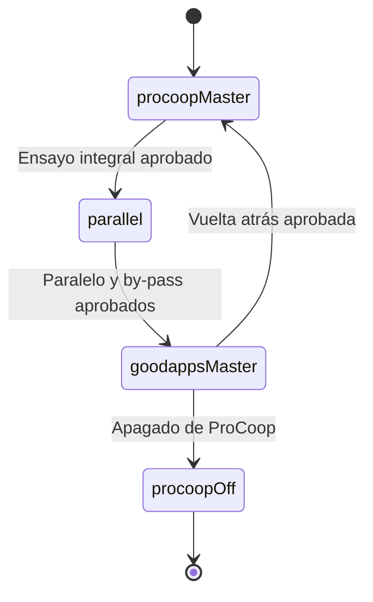
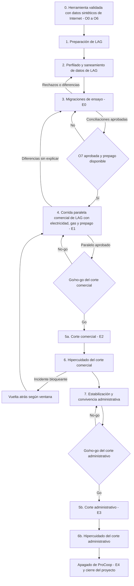

# GoodApps Cooperativas

## Plan de puesta en marcha, convivencia con ProCoop, capacitación y gestión del cambio

**Entregable de Análisis y Diseño Detallado — Artefactos 8.3 (Plan de puesta en marcha y convivencia) y 8.4 (Plan de capacitación y gestión del cambio)**

| Dato | Valor |
|---|---|
| Producto | GoodApps Cooperativas: plataforma de gestión en la nube (SaaS multi-tenant) para cooperativas de servicios públicos y sociales |
| Documento | Plan de puesta en marcha, convivencia, capacitación y gestión del cambio |
| Destinatarios | Consejo de administración y gerencia de la cooperativa piloto, Laguna Larga (`LAG`, DEC-088), responsables de área, equipo de implementación y migración de la plataforma |
| Carácter | Documento derivado de la especificación vigente; no la reemplaza. Ante cualquier diferencia prevalecen la especificación maestra (`00`), sus anexos (en particular T07) y el registro de decisiones (`01`) |
| Versión | 1.0 |
| Fecha | 05-11-2026 |

### Control de versiones

| Versión | Fecha | Descripción del cambio | Autor |
|---|---|---|---|
| 1.0 | 05-11-2026 | Versión inicial del plan de puesta en marcha (8.3) y del plan de capacitación y gestión del cambio (8.4). Actualizada el mismo día por DEC-088 (cooperativa piloto: Laguna Larga), que reemplaza a DEC-081: supuestos, fases, validaciones, checklist, capacitación y puntos a definir | |

### Aprobaciones

| Rol | Nombre | Firma | Fecha |
|---|---|---|---|
| Elaboró | | | |
| Revisó | | | |
| Aprobó | | | |

---

## Índice

1. Propósito, alcance y fuentes
2. Contexto y supuestos de la puesta en marcha
3. Estrategia de corte por etapas y convivencia con ProCoop
4. Fases de la puesta en marcha
5. Validaciones previas obligatorias
6. Checklist go/no-go
7. Plan de vuelta atrás
8. Comunicación a socios, entes y personal
9. Capacitación por rol
10. Gestión del cambio y soporte posterior al arranque
11. Matriz RACI resumida de la puesta en marcha
12. Indicadores de éxito del arranque
13. Puntos a definir y observaciones sobre las fuentes

---

## 1. Propósito, alcance y fuentes

Este documento describe cómo una cooperativa que hoy opera con ProCoop pasa a operar con GoodApps Cooperativas sin interrumpir su operación diaria y sin perder trazabilidad de saldos, documentos, equipos instalados ni datos históricos (T07 §1). Reúne en un plan de ejecución lo que la especificación define en T07 (estrategia, fases, conciliación, corte y vuelta atrás), en T08 (continuidad, soporte, seguridad y privacidad) y en el plan de olas `03` (criterio de salida de O11), y lo completa con la capacitación por rol y la gestión del cambio.

Las cifras, plazos y herramientas que no figuran en las fuentes se indican como **a definir**. No se fijan fechas: las olas no tienen fechas (DEC-006) y la especificación expresa los hitos como condiciones (RF-MIG-005).

Fuentes utilizadas:

| Fuente | Contenido que se toma |
|---|---|
| `anexos/T07-MIG-migracion-procoop.md` §4, §5.8, §5.9, §8, §9, §14, §15, §17 | Roles, fases F1–F13, etapas E0–E4 de convivencia, conciliación, runbook de corte, criterios go, plan de retorno, parámetros e informes |
| `anexos/T08-NFR-no-funcionales-seguridad.md` §8, §11.4, §15.8, §15.9, §19 | Disponibilidad, restauración, guardia, soporte, indicadores y tratamiento de credenciales y usuarios en la migración |
| `anexos/T01-PLA-plataforma-saas.md` §5.J, §7.10 | Ambiente `sandbox` por cooperativa, anillos de actualización y notas de versión |
| `00-ESPECIFICACION-MAESTRA.md` §1.4, §7.2, §14, §15 | Piloto, catálogo de roles, RNF resumidos y olas |
| `01-registro-decisiones.md` | DEC-005, DEC-006, DEC-050, DEC-063, DEC-068, DEC-069, DEC-070, DEC-072, DEC-087, DEC-088 (reemplaza a DEC-081) |
| `anexos/M07-COB-cuenta-corriente-cobranza.md` §17.6, CTR-COB-21, PA-COB-15, PA-COB-16; `anexos/M03-MED-medicion-consumos.md` §17; `anexos/M04-TAR-tarifas-motor-calculo.md` §17 | Prepago disponible al migrar LAG, rendición Red Link y rama SIRO de LAG, y escenarios de servicios medidos |
| `07-estrategia-pruebas.md` §15.2 | Casos de aceptación de la migración de LAG (AC-16 a AC-20) |
| `02-preguntas-abiertas.md` | PA asumidas o respondidas que condicionan la puesta en marcha |
| `05-registro-huecos.md` | Los 8 parámetros con valor por defecto que requieren validación legal |
| `03-plan-de-olas-y-prompts.md` §15 | Criterio de salida de O11 (ensayos de corte y vuelta atrás) |

---

## 2. Contexto y supuestos de la puesta en marcha

| N.º | Supuesto o condición | Fuente |
|---|---|---|
| S-01 | El primer flujo completo es el del servicio Internet; las olas O2 a O6 lo cierran y los servicios medidos llegan en O7 | DEC-005; maestra §1.4 |
| S-02 | La cooperativa piloto, comercial y de migración, es **Laguna Larga** (`LAG`). Su base relevada sigue siendo la referencia para el mapeo, las pruebas de paralelo y los `[VERIFICAR]`; de ella solo se toma configuración, nunca datos personales. Las preguntas dirigidas "a la cooperativa piloto" se dirigen a LAG | DEC-088 (reemplaza a DEC-081) |
| S-03 | La herramienta de migración se valida con datos sintéticos de Internet. LAG opera electricidad, gas y prepago, por lo que su primera migración real ocurre **después de O7** | PA-MIG-17 (opción A, asumida por DEC-072); DEC-088; CTR-MIG-07 |
| S-04 | La venta prepaga debe estar disponible al migrar LAG: M07 deja el punto de cobro genérico en O5 y M03 adelanta solo el subconjunto prepago | CTR-COB-21; PA-COB-15 (asumida, DEC-072); RF-COB-075 |
| S-05 | El paralelo y el corte real de LAG incluyen electricidad, gas y prepago; el corte comercial de esos servicios ocurre al cerrar O7, con los ciclos de paralelo aprobados y el ensayo de corte con vuelta atrás probada (`03` §11.2), y el corte administrativo con apagado de ProCoop en O11 (`03` §15.2) (DEC-089; antes "el corte avanza por etapas y por dominio hasta O11, cuyo criterio de salida exige los ensayos de corte comercial y administrativo con vuelta atrás probada", ver OBS-03) | DEC-088; DEC-068; DEC-089; T07 §9.1; `03` §11.2 y §15.2 |
| S-06 | El reemplazo de ProCoop es por etapas: primero el corte comercial (M01–M09) y luego el administrativo | DEC-068 |
| S-07 | La contabilidad oficial sigue en ProCoop hasta el corte administrativo; GoodApps contabiliza en un plan marcado no oficial, concilia contra ProCoop y se oficializa en el corte | DEC-069 |
| S-08 | La migración nunca escribe en la base de ProCoop (solo lectura en el origen) | RN-MIG-001; T07 §2.3 |
| S-09 | Cada cooperativa es un proyecto de migración independiente (un tenant); LAG es la primera y las siguientes reutilizan el conjunto de mapeo de plataforma | T07 §9.1 |

---

## 3. Estrategia de corte por etapas y convivencia con ProCoop

### 3.1 Principio rector

Durante toda la convivencia rige un **único sistema de registro por dominio**: está prohibido registrar el mismo hecho en ambos sistemas (por ejemplo, cobrar la misma factura en las dos cajas) (RN-MIG-031, RF-MIG-080). La unidad de migración, conciliación, paralelo y by-pass es el dominio (anexo dueño); un dominio se corta cuando su cargador, sus criterios de aceptación y los dominios de los que depende están aprobados (T07 §9.1).

### 3.2 Etapas de convivencia (T07 §9.7)

| Etapa | GoodApps es maestro de | ProCoop es maestro de | Sincronización |
|---|---|---|---|
| E0 Ensayos | Ninguno | Todos | Snapshots completos hacia un tenant de ensayo |
| E1 Paralelo comercial | Ninguno (GoodApps simula) | Todos | Delta diario ProCoop → GoodApps y comparación |
| E2 By-pass comercial (corte 1) | Personas, cuentas, contratos, catálogo, tarifas, medición, facturación, fiscal de ventas, cuenta corriente, cobranza, entes, mora, financiación, CRM, técnica, portal, comunicaciones | Compras, stock no serializado, tesorería, contabilidad oficial, sueldos, institucional y social (si no fueron cortados) | GoodApps → ProCoop: asientos resumidos diarios en formato importable, cobranzas para tesorería, retiros de materiales para stock, descuentos de empleados |
| E3 By-pass administrativo (corte 2) | Se agregan compras, stock, tesorería, contabilidad y retenciones | Sueldos, institucional y social, si no fueron cortados (ver OBS-01) | Los asientos de sueldos se importan en GoodApps desde ProCoop |
| E4 Apagado | Todos | Ninguno: ProCoop queda solo para consulta hasta el cierre del ejercicio y luego pasa a archivo | — |

El modo de sincronización adoptado es el delta unidireccional ProCoop → GoodApps mientras ProCoop es maestro y, luego, exportaciones GoodApps → ProCoop para los módulos que siguen en ProCoop (PA-MIG-03, asumida por DEC-072; RF-MIG-081, RF-MIG-082). El delta diario está parametrizado (PRM-MIG-043).

### 3.3 Estado de cada dominio durante la convivencia

Estados de T07 §8.5; el retroceso desde `goodappsMaster` solo ocurre por vuelta atrás aprobada.

### 3.4 Reglas de convivencia

1. Al cortar un dominio, ProCoop queda **solo lectura** para ese dominio; la cooperativa quita en ProCoop los permisos de alta y modificación (T07 §9.7; RF-MIG-006).
2. El portal CoopOnline se apaga en el corte comercial; los socios pasan al portal de GoodApps con sus usuarios migrados y sin contraseñas (T07 §9.7; RF-MIG-090; PA-MIG-07).
3. Los cobros que entran por entes con claves de ProCoop se resuelven con el resolutor de claves heredadas, que solo imputa a comprobantes impagos y ante ambigüedad genera un pago a cuenta con aviso (RF-MIG-083, RN-MIG-033). Los alias se mantienen hasta el vencimiento del último comprobante de ProCoop más 180 días (PRM-MIG-030; DEC-050; PA-MIG-16).
4. La caja de GoodApps lee los códigos de barras de ProCoop vigentes hasta que venzan esos comprobantes (RF-MIG-084); desde el corte, los comprobantes nuevos llevan un identificador de pago autocontenido (DEC-050; RF-MIG-085).
5. Las funciones de ProCoop atadas a la "cuenta Procoop" dependen de sus parámetros V2 518 y 519, que no deben modificarse durante la transición (T07 §9.7).
6. La forma de registrar las rendiciones bancarias (por caja o por fecha de acreditación) se acuerda con la contaduría antes del corte comercial (T07 §9.7).
7. LAG opera gas (DEC-088): el servicio de gas con sus exportaciones regulatorias debe estar en GoodApps antes del corte comercial (T07 §9.7).
8. La venta prepaga de LAG pasa a GoodApps junto con el corte comercial: el cobro lo hace M07 en caja y portal y la carga del crédito la hace M03 después de confirmado el cobro; si la carga falla, la recarga queda en bandeja sin generar un segundo token (RF-COB-075; CTR-COB-21; ESC-MED-22).
9. Las interfaces de LAG con entes recaudadores (rendición Red Link propia y rama SIRO) se configuran como perfiles de formato del conector y conviven con las claves heredadas de ProCoop según las reglas 3 y 4 (M07 §17.6; PA-COB-16).
10. Los números de cuenta de ProCoop se conservan como número visible (RN-MIG-050; PRM-MIG-002).

---

## 4. Fases de la puesta en marcha

### 4.1 Diagrama de fases

### 4.2 Descripción de las fases

La correspondencia con las fases F1 a F13 de T07 §9.2 y con los estados del proyecto de migración (T07 §8.1) se indica en cada fila. La duración de cada fase es **a definir** (DEC-006).

Las fases 1 a 3 pueden avanzar a medida que se construyen los cargadores de cada dominio (la herramienta existe desde O0/O1 y cada cargador llega en la ola de su módulo; CTR-MIG-06). El paralelo y el corte real de LAG empiezan **después de O7**, porque LAG opera electricidad, gas y prepago, e incluyen esos tres servicios (PA-MIG-17; DEC-088; CTR-COB-21).

| Fase | Objetivo | Actividades principales | Salida verificable | Fases y estados de T07 |
|---|---|---|---|---|
| 0. Validación de la herramienta | Probar la herramienta de migración antes de usar la base de LAG | Ensayos con datos sintéticos de Internet sobre TEN-001 (DEC-005; PA-MIG-17) | Herramienta aprobada para la primera migración real | Previa a F1 |
| 1. Preparación | Dejar listos el tenant de LAG, los accesos y las decisiones previas | Alta asistida del tenant y configuración publicada (hito de O1); creación del proyecto de migración (RF-MIG-001); inventario de fuentes con acceso de solo lectura (RF-MIG-002); sandbox de la cooperativa (RF-PLA-111); validaciones previas de la sección 5; plan de comunicación y de capacitación | Proyecto en `inventoried`; inventario de las 659 tablas con conteos | F1; `draft` → `inventoried` |
| 2. Perfilado y saneamiento de datos | Conocer y corregir la calidad de los datos heredados | Perfilado por tabla y columna (RF-MIG-020); validación de CUIT/DNI, duplicados y domicilios (T07 §9.5); mapeo de valores y publicación del conjunto de mapeo; cola de saneamiento con corrección en origen o en staging (RF-MIG-027, RF-MIG-028); resolución de los `[VERIFICAR]` de datos heredados; relevamiento del volumen de LAG por servicio (electricidad, gas y prepago) | Informe de perfilado con el volumen de LAG; conjunto de mapeo publicado; % de saneamiento por tipo | F2–F4; `mapping` |
| 3. Migraciones de ensayo | Probar la migración completa de forma repetible | Ensayos completos en tenant de ensayo (CU-MIG-02); reprocesos idempotentes; conciliaciones por dominio con muestreo (T07 §17.2); purga y repetición con nuevo snapshot hasta 0 rechazos bloqueantes; ensayo de corte cronometrado y de vuelta atrás (`03` §15.2); casos AC-16 a AC-19 de `07` §15.2 sobre la copia seudonimizada (PA-MIG-15) | Migración repetida dos veces con el mismo resultado; conciliaciones de personas, suministros, medición, tarifas y deuda aprobadas | F5–F9; `rehearsing` |
| 4. Corrida paralela | Demostrar que GoodApps factura igual que ProCoop o explica cada diferencia, en electricidad, gas y prepago | Empieza después de O7; simulación del ciclo sin efectos fiscales ni externos (RN-MIG-030); importación de lo emitido por ProCoop; comparación factura por factura y de mora, cobranzas y asientos (RF-MIG-072, RF-MIG-074); clasificación y explicación de diferencias; caso AC-20 de `07` §15.2 (ESC-COB-L05) | Paralelo aprobado por servicio: 2 ciclos consecutivos, 0 diferencias sin explicar, emparejamiento ≥ 99,9 % (T07 §17.4) | F10; `parallel` |
| 5a. Corte comercial | Pasar a GoodApps los dominios comerciales de LAG, incluidos electricidad, gas y la venta prepaga | Runbook de corte (sección 4.3); go/no-go con doble aprobación; acta de aceptación del alcance | Dominios comerciales en `goodappsMaster`; acta firmada (RF-MIG-087) | F11–F12; `bypassing` → `cutover` → `live` |
| 6. Hipercuidado | Acompañar los primeros ciclos reales con monitoreo reforzado | Monitoreo reforzado y soporte de arranque (T07 §9.9 paso 14; AGR §7 etapa F); seguimiento diario de alias, conciliaciones e invariantes; atención prioritaria de incidentes; decisión de vuelta atrás dentro de la ventana | Primer ciclo real de facturación y cobranza cerrado sin diferencias no explicadas (criterio de salida **a definir**) | Ventana `rollbackDeadline` (PRM-MIG-052) |
| 7. Estabilización | Consolidar la operación y preparar el corte administrativo | Exportaciones diarias a ProCoop de asientos y cobranzas (RF-MIG-082); contabilidad no oficial conciliada contra ProCoop (DEC-069); preparación del corte administrativo con su propio go/no-go | Balance conciliado en el ensayo de corte administrativo (`03` §15.2) | Convivencia E2 → E3 |
| 5b y 6b. Corte administrativo e hipercuidado | Pasar compras, stock, tesorería, contabilidad y retenciones a GoodApps | Mismo runbook adaptado al alcance; oficialización del plan de cuentas (DEC-069); conciliación contable con diferencia 0 por cuenta (RF-MIG-057) | Acta del alcance administrativo | F11–F12 |
| Apagado y cierre | Dejar ProCoop como archivo | ProCoop solo consulta hasta el cierre del ejercicio y luego archivo (E4); verificación del archivo; alias vencidos o programados | Proyecto en `closed`; snapshot archivado 10 años (DEC-070; PRM-MIG-015) | `live` → `closed` |

### 4.3 Runbook mínimo del corte (T07 §9.9)

1. Comunicación a socios y entes.
2. Verificar 0 comprobantes pendientes de CAE en ProCoop (RN-MIG-029).
3. Cierre de cajas en ProCoop.
4. Congelamiento del alcance (RF-MIG-006).
5. Snapshot `final`.
6. Delta final y carga.
7. Conciliaciones finales aprobadas.
8. Último número autorizado en ARCA por punto de venta (RN-MIG-028).
9. Go/no-go con doble aprobación (sección 6).
10. Activar emisión fiscal, publicación de deuda a entes, débitos, pasarelas y notificaciones.
11. Activar resolutor y alias de claves heredadas.
12. Habilitar el portal y enviar las invitaciones.
13. Acta de aceptación.
14. Monitoreo reforzado y soporte de arranque.

La ventana horaria del corte es **a definir**; debe evitar los días críticos que la cooperativa declare (facturación masiva, primeros vencimientos, cierre de caja de fin de mes), según el calendario de congelamiento de RNF-NFR-034 (PA-NFR-12, asumida por DEC-072).

### 4.4 Tratamiento del histórico tras el arranque

| Categoría | Dónde queda | Fuente |
|---|---|---|
| Datos vivos necesarios para operar el día siguiente al corte | Colección del módulo dueño, con `legacy` | RN-MIG-004; T07 §9.4 |
| Histórico tipado de solo lectura: ejercicio en curso más 24 meses | Colección del módulo dueño, con marca "Migrado de ProCoop" | DEC-070; RF-MIG-060 |
| Histórico genérico consultable desde las fichas | `legacyRecords` | DEC-070; RF-MIG-061 |
| Detalle accesorio de cobranzas de más de 36 meses | Archivo con consulta diferida; recibos, obligaciones, imputaciones y saldos nunca se archivan | DEC-087; T07 §9.4 |
| Copia completa del origen (659 tablas y adjuntos) | Archivo cifrado con acceso auditado durante 10 años | DEC-070; RF-MIG-062 |

---

## 5. Validaciones previas obligatorias

### 5.1 Parámetros con valor por defecto que requieren validación legal

`05-registro-huecos.md` resolvió 8 huecos con un parámetro cuyo valor por defecto debe validar el área legal antes de producción. Cada uno debe estar validado antes de activar en producción el servicio o la función a la que aplica:

| Hueco | Tema | Parámetros | Anexo | Ola | Validación indicada en la fuente | Aplica a la migración de LAG |
|---|---|---|---|---|---|---|
| HUECO-CAP-04 | Tratamiento fiscal del renglón de aporte de capital en la factura | PRM-FIS-122 (default `untaxedInInvoice`) | M06 | O4 | Encuadre fiscal con el contador | Sí, si LAG factura aportes de capital (a confirmar en el perfilado) |
| HUE-INT-03 | Plazos de respuesta de reclamos TIC por motivo (Res. 733/2017) | PRM-CRM-132, PRM-CRM-135 | M09 | O2 | Plazos ENACOM | Al servicio Internet validado con datos sintéticos; en LAG, solo si opera servicios TIC |
| HUE-GAS-05 | Protocolo de emergencias de gas: guardias y tiempos | PRM-TEC-152, PRM-TEC-153, PRM-TEC-154, PRM-CRM-133 | M10, M09 | O7 | Tiempos con la distribuidora y el regulador | **Sí**: LAG opera gas (debe estar antes del corte comercial, sección 3.4) |
| HUE-AG-02 | Restricción de caudal como modo de mora en agua | PRM-MOR-201 (caudal mínimo vital) | M08 | O7 | Caudal mínimo vital | Solo si LAG opera agua (DEC-088 no lo menciona) |
| HUE-ELE-05 | Ventanas de corte por jurisdicción (ERSeP) | PRM-MOR-206 (plantilla `toValidate`) | M08 | O7 | Días, horarios y umbrales climáticos | **Sí**: LAG opera electricidad |
| HUECO-SEP-01 | Suspensión de cobertura social por cuotas impagas y carencia de rehabilitación | PRM-MOR-204, PRM-SOC-052 | M08, M18 | O10 | Meses impagos y carencia según el reglamento | Solo si LAG opera servicios sociales |
| HUE-TEL-04 | Mora de telefonía con llamadas de emergencia siempre habilitadas | PRM-MOR-199 | M08 | O10 | Régimen de emergencias | Solo si LAG opera telefonía |
| HUE-TV-03 | Mora de TV: corte total o grilla reducida | PRM-MOR-200 | M08 | O10 | Grilla mínima | Solo si LAG opera TV |

Los servicios de LAG distintos de electricidad, gas y prepago no figuran en DEC-088; se confirman en el perfilado (fase 2).

Además, T08 cita normas marcadas `[VERIFICAR]` que deben revisarse con el área legal antes del arranque en lo que aplique a la cooperativa: artículos de la Ley 25.326 (RF-NFR-002, RF-NFR-006, RF-NFR-013), Ley 26.951 para comunicaciones promocionales (RF-NFR-005, PA-NFR-20), Ley 26.653 de accesibilidad web (RNF-NFR-180) y Ley 25.506 de firma digital (RNF-NFR-230).

### 5.2 Verificaciones `[VERIFICAR]` de datos heredados

Con DEC-088, la base relevada de Laguna Larga es a la vez la referencia del mapeo y la base de la cooperativa piloto; de ella solo se toma configuración, nunca datos personales. Los valores relevados deben confirmarse contra la base vigente de LAG durante el perfilado (fase 2):

| Regla | Qué se verifica | Fuente |
|---|---|---|
| RN-MIG-002 | Si la cooperativa tiene varias razones sociales en ProCoop, que se convierten en `legalEntities` del mismo tenant | T07 §6 |
| RN-MIG-008 | Reparto por servicio de pagos parciales históricos cuando ProCoop no lo discrimina (PRM-MIG-011) | T07 §6 |
| RN-MIG-034 | Facturas de una migración anterior a ProCoop (`FACTURAS.USUARIO`) y su criterio de exclusión regulatorio | T07 §6; RF-MIG-007 |
| RN-MIG-048 | Traducción de las fórmulas embebidas de ProCoop, con revisión humana y prueba en paralelo | T07 §6 |
| RN-MIG-051 | Valores de `IMPUESTO.ORIGEN` presentes en el tenant para clasificar tasas y tributos | T07 §6 (HUECO-TAS-03) |
| Perfilado F2 | Facturas ≥ ARS 100.000 para códigos SIRO, uso de `FACTURAS.USUARIO` y rango de `COD_SUM` | T07 §9.2 |
| Parámetros V2 | Mapeo de cada parámetro V2 al catálogo PRM; los que no tengan equivalente se registran para decisión | RN-MIG-049 |
| Interfaces de cobranza de LAG | Estructura de la rendición Red Link propia, rama SIRO y tope del código de barras SIRO por vencimiento | M07 §17.6 (ESC-COB-L01, ESC-COB-L04); PA-COB-16 |

### 5.3 Validación de PA-TES-17 con el contador

PA-TES-17 (diferencia de arqueo en una rendición de caja con varias entidades jurídicas) está asumida con la opción recomendada: imputar a la entidad que indique el receptor, por defecto la de mayor importe rendido, con asiento entre entidades si corresponde (DEC-072). La propia fuente indica validarla con el contador de la cooperativa piloto, que con DEC-088 es el contador de LAG (M14 §21). Como la caja pasa a GoodApps en el corte comercial (E2), la validación debe completarse antes de ese go/no-go.

### 5.4 Otras decisiones asumidas a confirmar con la cooperativa

Son PA asumidas con la opción recomendada (DEC-072) que impactan directamente el arranque y conviene confirmar con LAG antes del go/no-go:

| PA | Opción asumida |
|---|---|
| PA-MIG-17 | Herramienta validada con datos sintéticos de Internet; primera migración real de LAG después de O7 |
| PA-COB-15 | M07 deja el cobro genérico en O5 y M03 adelanta solo el subconjunto prepago |
| PA-COB-16 | Código de barras SIRO para importes ≥ ARS 100.000: formato extendido a acordar con el banco; mientras tanto, código electrónico y QR |
| PA-MIG-02 | Paralelo de 2 ciclos consecutivos por servicio con 0 diferencias sin explicar |
| PA-MIG-05 | Saldo de apertura de deuda documento por documento |
| PA-MIG-06 | Intereses devengados al corte recalculados y conciliados contra ProCoop |
| PA-MIG-08 | Mismos puntos de venta; continuar con el último número consultado a ARCA |
| PA-MIG-16 | Alias de códigos ProCoop hasta el último vencimiento más 180 días |
| PA-NFR-12 | Ventana de mantenimiento y congelamiento en días críticos |
| PA-NFR-17 | Prueba de penetración externa antes del go-live del piloto |

PA-COB-15 figura como asumida en `02-preguntas-abiertas.md`, mientras que RF-COB-075 (punto de cobro de la venta prepaga) sigue "A validar (PA-COB-15)" en M07; su confirmación es condición del criterio GO-25.

---

## 6. Checklist go/no-go

Se completa para cada corte (comercial y administrativo). Un solo criterio en rojo impide el corte (RF-MIG-086). La decisión exige doble aprobación y 2FA reciente (RN-MIG-041).

| N.º | Criterio | Evidencia | Fuente | Cumple (Sí/No) |
|---|---|---|---|---|
| GO-01 | Conciliaciones aprobadas de todos los dominios del alcance, por alguien distinto del ejecutor | Informes de conciliación firmados en el expediente | T07 §9.9; RF-MIG-053, RF-MIG-058 | |
| GO-02 | Paralelo aprobado por servicio | Tablero de paralelo exportado | T07 §17.4; RF-MIG-075, RF-MIG-076 | |
| GO-03 | Ensayo de corte cronometrado dentro de la ventana y vuelta atrás probada | Acta del ensayo | `03` §15.2 | |
| GO-04 | Usuarios y permisos cargados; MFA obligatorio para administradores; contraseñas de ProCoop no migradas | Revisión de la matriz de roles por la cooperativa | T07 §9.9; T08 §19 | |
| GO-05 | Credenciales de integraciones nuevas cargadas en la bóveda y probadas; las anteriores revocadas ante el proveedor | Checklist de credenciales rotadas por conector | T07 §9.9; T08 §19; RN-MIG-013 | |
| GO-06 | Clientes de API externos avisados y con tokens nuevos | Inventario de clientes externos | T08 §19; RNF-NFR-233 | |
| GO-07 | Congelamiento del alcance confirmado por la cooperativa | Registro de congelamiento | RF-MIG-006 | |
| GO-08 | 0 comprobantes de ProCoop pendientes de CAE | Consulta en ProCoop | RN-MIG-029 | |
| GO-09 | Cajas de ProCoop cerradas y autorizaciones pendientes cerradas o recreadas | Arqueos; cero pendientes al corte | T07 §9.9; T08 §19 | |
| GO-10 | Último número autorizado consultado a ARCA por punto de venta y tipo | Resultado de la consulta | RN-MIG-028 | |
| GO-11 | Validaciones legales aplicables al alcance completadas (sección 5.1) | Constancia del área legal | `05-registro-huecos.md` | |
| GO-12 | `[VERIFICAR]` de datos heredados resueltos (sección 5.2) | Informe de perfilado | T07 §6, §9.2 | |
| GO-13 | PA-TES-17 validada con el contador (corte comercial) | Constancia del contador | M14 §21 | |
| GO-14 | Prueba de penetración sin hallazgos críticos ni altos abiertos | Informe y plan de remediación | RNF-NFR-095 | |
| GO-15 | Simulacro de restauración del tenant de LAG vigente | Registro en `restoreTests` | RNF-NFR-037, RNF-NFR-043 | |
| GO-16 | Evidencia de liberación completa de la versión en producción | `qualityEvidence` aprobada | RF-NFR-022, RNF-NFR-165 | |
| GO-17 | Plan de vuelta atrás revisado y responsables designados | Plan aprobado | T07 §9.9, §9.11 | |
| GO-18 | Soporte de arranque disponible y guardia organizada | Calendario de guardia | T07 §9.9; RNF-NFR-134 | |
| GO-19 | Comunicación a socios y entes emitida (sección 8) | Registro de envíos y coordinación con entes | T07 §9.9; RF-MIG-085 | |
| GO-20 | Capacitación por rol completada (sección 9) | Registro de asistencia y práctica (criterio **a definir**) | AGR §7 etapa F | |
| GO-21 | Registración bancaria de rendiciones acordada con la contaduría | Acuerdo documentado | T07 §9.7 | |
| GO-22 | Gas de LAG: servicio, categorías y exportaciones regulatorias en GoodApps | Prueba en `sandbox`; caso AC-17 de `07` aprobado | T07 §9.7; ESC-TAR-38 | |
| GO-23 | Ventana del corte fuera de los días críticos declarados | Calendario de congelamiento | RNF-NFR-034 | |
| GO-24 | Corte administrativo: contabilidad no oficial conciliada y balance conciliado en el ensayo | Balance de sumas y saldos con diferencia 0 | DEC-069; RF-MIG-057; `03` §15.2 | |
| GO-25 | Prepago operativo: venta prepaga en caja y portal, carga del crédito en M03 después del cobro y bandeja de recargas fallidas sin segundo token; PA-COB-15 confirmada | Caso AC-16 de `07` aprobado (ESC-MED-22) | CTR-COB-21; PA-COB-15; RF-COB-075 | |
| GO-26 | Servicios medidos de O7 aprobados: criterio de salida de O7 cumplido y paralelo de electricidad, gas y prepago aprobado | Acta de cierre de O7; tablero de paralelo por servicio; caso AC-20 de `07` aprobado (ESC-COB-L05) | `03` §11.2; T07 §17.4; DEC-088 | |
| GO-27 | Interfaces de cobranza de LAG probadas: rendición Red Link y rama SIRO, incluido el caso de importe ≥ ARS 100.000 | Casos AC-18 y AC-19 de `07` aprobados (ESC-COB-L01, ESC-COB-L04) | M07 §17.6; PA-COB-16 | |

---

## 7. Plan de vuelta atrás

El plan de retorno de la migración es distinto de la restauración de backups (T01) y del rollback de un despliegue (RNF-NFR-167). Su principio es que los hechos registrados en GoodApps después del corte no desaparecen si hay que volver a ProCoop (AGR-018; RF-MIG-088).

| Momento | Tratamiento | Fuente |
|---|---|---|
| Antes del corte | No hay vuelta atrás: un dominio en paralelo simplemente no se corta | T07 §9.11 |
| Entre el corte y `rollbackDeadline` (antes de la primera emisión fiscal real o del primer cobro por entes en GoodApps; PRM-MIG-052) | Se reabre ProCoop para el alcance, se exporta el diario `rollbackJournal` (altas, modificaciones, cobros en caja, lecturas) en formatos importables, se reprocesa en ProCoop y el dominio vuelve a `procoopMaster` | T07 §9.11; RF-MIG-088; CU-MIG-11 |
| Después de `rollbackDeadline` | Solo vuelta atrás "hacia adelante": se corrige en GoodApps; si se decide volver, los comprobantes autorizados y cobros confirmados se exportan a ProCoop como comprobantes de terceros o recibos manuales; nunca se restaura una copia que deshaga hechos fiscales o cobros externos. La interfaz bloquea la vuelta atrás por restauración | T07 §9.11; RF-MIG-089; AGR-019; ESC-MIG-09 |

Reglas:

- Toda decisión de vuelta atrás requiere doble aprobación, 2FA y queda en el expediente (T07 §9.11; RN-MIG-041).
- La aprueba el responsable de la cooperativa (`mig.rollback.aprobar`) y la ejecuta el líder de migración (`mig.rollback.ejecutar`) (T07 §4).
- Los criterios concretos que disparan la evaluación de una vuelta atrás (tipo y gravedad del incidente bloqueante) son **a definir**; se propone usar como referencia la severidad SEV1 de RNF-NFR-134.
- La vuelta atrás se ensaya en O11 como parte del criterio de salida de la ola (`03` §15.2).

---

## 8. Comunicación a socios, entes y personal

### 8.1 Mensajes por destinatario

| Destinatario | Qué se comunica | Canal según fuentes | Fuente |
|---|---|---|---|
| Socios | Habilitación del nuevo portal e invitación de activación sin necesidad de registrarse de nuevo; apagado de CoopOnline | Correo o SMS de invitación; landing y muro editorial; motor de comunicaciones de T09 | RF-MIG-090; PA-MIG-07; T07 §9.7; DEC-008 |
| Socios | Se conserva el número de cuenta | Mismos canales | RN-MIG-050 |
| Socios | Las facturas de ProCoop impagas se siguen pudiendo pagar en caja y por entes; los comprobantes nuevos traen un identificador de pago nuevo | Mismos canales y mensaje en caja | RF-MIG-083, RF-MIG-084, RF-MIG-085; DEC-050 |
| Socios | Las facturas y pagos históricos quedan visibles en el portal | Portal | RF-MIG-063 |
| Socios | Solicitud de consentimientos en el primer acceso para las finalidades que lo requieran | Portal | T08 §19 |
| Socios de LAG con medidor prepago | Dónde y cómo comprar crédito en GoodApps (caja y portal) desde el corte comercial | Mismos canales y mensaje en caja | RF-COB-075; CTR-COB-21 |
| Entes recaudadores (Red Link, SIRO y otros) | Nuevo identificador autocontenido y convivencia con el padrón anterior hasta el vencimiento de lo emitido por ProCoop | Coordinación directa | RF-MIG-085 |
| Pasarelas y proveedores de integración | Rotación de credenciales y alta de las nuevas en la bóveda | Coordinación directa | T08 §19 |
| Clientes de API externos | Emisión de tokens nuevos y revocación de los anteriores al by-pass | Aviso a cada cliente | T08 §19 |
| Personal de la cooperativa | Calendario de corte, congelamiento de ProCoop por dominio, cambios de procedimiento, capacitación y canal de soporte | Avisos internos solo para empleados; novedades del proveedor en el admin | M19 CU-NOT-01; RF-PLA-108 |
| Todos | Mantenimientos programados e incidentes | Página de estado y aviso en el admin | RF-NFR-019 (A validar, PA-NFR-15); RF-PLA-151 |

### 8.2 Reglas

- Las comunicaciones tienen estados verificables; un mensaje regulado no se da por cumplido con "aceptado por el proveedor" (RNF-NFR-253).
- Para cambios visibles de las versiones del producto rige el aviso de RNF-NFR-172 (≥ 7 días para cambios visibles relevantes y ≥ 30 días para cambios de cálculo o de API externa).
- La anticipación de las comunicaciones del corte, el cronograma de envíos y los textos son **a definir** con LAG.

---

## 9. Capacitación por rol

### 9.1 Recursos que la especificación ya prevé

| Recurso | Uso en la capacitación | Fuente |
|---|---|---|
| Ambiente `sandbox` con tenant gemelo de la cooperativa e integraciones solo en homologación | Práctica guiada sin riesgo sobre la configuración propia | RF-PLA-111; PA-PLA-06 |
| Copia anonimizada para ensayo y capacitación, con seudonimización irreversible | Práctica con datos realistas sin datos personales reales | PA-MIG-15; RF-MIG-095 |
| Ayuda contextual `ScreenHelp` en cada pantalla (qué, quién, cuándo, dónde, por qué, cómo y caso de uso), editable por la cooperativa | Material de consulta en el puesto de trabajo | RF-UXD-049; PAN-UXD-06 |
| Casos de uso y escenarios de la sección 16 y 17 de cada anexo | Guiones de práctica por rol | Anexos M01–M19, T07 |
| Diccionario de términos por tenant | Vocabulario propio de la cooperativa en la interfaz y en los materiales | Maestra §1.3 P3; T03 |
| Notas de versión y novedades del proveedor | Actualización continua posterior al arranque | RF-PLA-108 |
| Avisos internos y eventos de tipo "capacitación" en la comunidad | Convocatorias | M19 CU-NOT-01; RF-COM-100 |

### 9.2 Plan por rol

Los destinatarios son el personal de LAG (DEC-088) y sus socios. La modalidad indicada es una **propuesta** de este documento basada en los recursos anteriores; la cantidad de personas por rol se conoce en la preparación (fase 1), y la carga horaria, los grupos, el calendario y el criterio de aprobación son **a definir**. Para los servicios medidos y el prepago, la capacitación se hace después de O7, antes del paralelo (fase 4).

| Destinatarios en LAG (roles de la maestra §7.2) | Contenidos clave | Modalidad propuesta | Materiales |
|---|---|---|---|
| Administración: Administrador de la cooperativa (T-ADM) y Administrador de usuarios (T-USR) | Usuarios, roles, alcance y 2FA; configuración versionada con aprobación y reversión; diccionario y marca; prueba en sandbox y promoción a producción; tablero de salud del tenant; bandeja de solicitudes de derechos | Práctica guiada en `sandbox` | `ScreenHelp`; casos de T01, T02, T03, T04 y T08 (RF-NFR-006, RF-NFR-017) |
| Caja: Cajero (T-CAJ), Cobrador (T-CBR) y Tesorero (T-TES) | Apertura y cierre de caja; cobro y arqueo; lectura de códigos de barras de ProCoop y pago a cuenta ante ambigüedad; diferencia de arqueo con varias entidades (PA-TES-17); venta prepaga y tratamiento de una recarga que queda en bandeja; rendiciones Red Link y SIRO de LAG; los cobros no se registran sin conexión | Práctica guiada en `sandbox` con lector en el puesto | `ScreenHelp`; CU-MIG-08, CU-MIG-09; escenarios de M07 §17 (ESC-COB-L01 a ESC-COB-L05); ESC-MED-22 |
| Atención: Comercial / Atención al socio (T-ATE) y Supervisor de atención (T-SAT) | Ficha del socio y de la cuenta; solicitudes y reclamos, incluido el protocolo de emergencias de gas (HUE-GAS-05); baja sin cargo ni condicionamiento; consulta del histórico de ProCoop desde la ficha; acompañamiento al socio en la activación del portal; la IA solo propone | Práctica guiada en `sandbox` | `ScreenHelp`; ESC-CRM-04; RF-MIG-061; casos de M01, M09 y M19 |
| Técnicos de campo: Técnico (T-TEC), Lecturista (T-LEC) y Supervisor técnico (T-STE) | PWA de campo sin conexión; sincronización y resolución de conflictos; comodato, firma y fotos; actualización de la app sin perder la cola; rutas de lectura de electricidad y gas, lectura menor que la anterior y medidor inaccesible | Práctica en dispositivo con red simulada o desconectada, sobre una ruta de lectura ficticia | `ScreenHelp`; ESC-TEC-08, ESC-TEC-09; ESC-MED-05, ESC-MED-06; RF-PLA-150; `03` §11.2 |
| Contabilidad: Contador (T-CON) y Tesorero (T-TES) | Plan de cuentas no oficial durante la convivencia y oficialización en el corte administrativo; aprobación de conciliaciones y saldos iniciales; justificación de diferencias del paralelo; exportación de asientos a ProCoop | Taller con los informes reales de conciliación del ensayo | DEC-069; RF-MIG-054 a 057, RF-MIG-082; informes de T07 §15 |
| Socios en el portal: Socio titular (C-SOC) y Representante (C-REP) | Activación de la cuenta por invitación; cuentas vinculadas; facturas, historial y pago; consumos y compra de crédito prepago; reclamos; "Mis datos y privacidad" | Autoayuda en la PWA y apoyo de atención en el mostrador | `ScreenHelp`; guía breve para socios (**a definir**); RF-NFR-012 |

Otros roles (por ejemplo Facturación T-FAC, Compras T-CMP, Depósito T-DEP, RRHH T-RRHH) se capacitan con el mismo esquema antes del corte en que su dominio pasa a GoodApps; su detalle es **a definir**.

### 9.3 Capacitación del equipo de migración de la cooperativa

El analista de datos, los responsables funcionales de dominio y el contador operan la herramienta de migración desde la vista del tenant (T07 §4, §10): cola de saneamiento, informes de rechazos y conciliaciones, justificación de diferencias del paralelo y aprobaciones. Se capacitan durante las fases 2 y 3, sobre los propios ensayos.

---

## 10. Gestión del cambio y soporte posterior al arranque

### 10.1 Gestión del cambio

| Línea de acción | Contenido | Fuente |
|---|---|---|
| Patrocinio | El responsable de la cooperativa (gerencia o consejo) aprueba paralelo, by-pass, corte y vuelta atrás y firma el acta | T07 §4 |
| Vocabulario propio | Cada cooperativa adapta sus términos (socio, usuario, asociado) desde el inicio | Maestra §1.3 P3 |
| Simplicidad para el socio | Una tarea principal por pantalla y autogestión en el celular | Maestra §1.3 P7 |
| Continuidad para el socio | Mismo número de cuenta, usuarios del portal sin nuevo registro, facturas viejas pagables | RN-MIG-050; RF-MIG-090; RF-MIG-084 |
| Adopción gradual | Funcionalidades habilitadas primero para la cooperativa piloto (LAG) mediante anillos y feature flags | RF-PLA-149; RNF-NFR-169 |
| Práctica sin riesgo | Sandbox de la cooperativa antes de publicar configuración | RF-PLA-111 |
| Riesgo identificado | Resistencia al cambio del personal y baja adopción digital de los socios (R-05) | `01-resumen-ejecutivo-vision.md` |
| Referentes o usuarios clave por área | Designación y rol en la adopción | **A definir** |
| Medición de la adopción | Utilidad de las ayudas (IND-UXD-05) y otros indicadores de la sección 12 | T03 §15 |

### 10.2 Soporte posterior al arranque

| Elemento | Definición | Fuente |
|---|---|---|
| Horario de soporte | Lunes a viernes 8 a 18, con atención 24×7 para P1 | DEC-063 |
| Primera respuesta por severidad del ticket | Crítica ≤ 1 h 24×7; Alta ≤ 4 h hábiles; Media ≤ 1 día hábil; Baja ≤ 3 días hábiles | RNF-NFR-252 |
| Guardia de incidentes | SEV1 reconocimiento ≤ 15 min 24×7; SEV2 ≤ 30 min 24×7; SEV3 ≤ 4 h hábiles; SEV4 ≤ 2 días hábiles; post-mortem para SEV1 y SEV2 | RNF-NFR-134 |
| Diagnóstico | Por `correlationId`, sin acceder a datos personales salvo acceso temporal consentido y auditado | RNF-NFR-252, RNF-NFR-257; AGR-034 |
| Monitoreo reforzado del arranque | Tablero de salud del tenant (lotes, emisión fiscal, cobranzas e inciertos, conectores), bandeja de operaciones detenidas, informe de uso de alias, verificación diaria de invariantes | T07 §9.9 paso 14; RF-NFR-017; RNF-NFR-222; T07 §15; RNF-NFR-229 |
| Primera línea de soporte dentro de la cooperativa | Quién atiende primero las consultas internas y de socios | **A definir** |
| Duración del hipercuidado y criterio de salida | — | **A definir** |

---

## 11. Matriz RACI resumida de la puesta en marcha

R = realiza; A = aprueba y rinde cuentas; C = consultado; I = informado. Derivada de los roles y capabilities de T07 §4 y del responsable de cada fase de T07 §9.2; las celdas sin respaldo directo en las fuentes son una propuesta de este documento. La RACI general del proyecto corresponde al artefacto 1.4 (`09-riesgos-y-raci.md`).

| Actividad | Líder de migración (plataforma) | Implementador (plataforma) | Analista de datos (cooperativa) | Responsable funcional de dominio | Contador de la cooperativa | Responsable de la cooperativa | Administrador de la cooperativa (T-ADM) | Soporte y operaciones de plataforma | Área legal |
|---|---|---|---|---|---|---|---|---|---|
| Inventario y perfilado (F1–F2) | A | R | R | C | I | I | I | — | — |
| Mapeo y saneamiento (F3–F4) | A | R | R | C | C | I | I | — | — |
| Ensayos de migración (F5–F9) | A | R | C | C | C | I | I | C | — |
| Aprobación de conciliaciones por dominio | I | C | C | A/R | A/R (COB, CON, FIS, TES, SUE) | I | — | — | — |
| Corrida paralela y justificación de diferencias (F10) | R | R | C | R | C | A | — | — | — |
| Validación de parámetros legales | I | C | — | C | C | A | I | — | R |
| Validación de PA-TES-17 | I | C | — | C | R | A | — | — | — |
| Usuarios, roles y permisos | C | C | — | C | — | I | R | — | — |
| Go/no-go del corte | R | C | C | C | C | A | C | C | C |
| Ejecución del corte (runbook) | R/A | R | C | C | C | I | C | R | — |
| Vuelta atrás | R | R | C | C | C | A | C | R | — |
| Comunicación a socios y entes | C | C | — | C | — | A | R | — | C |
| Capacitación por rol | C | R | — | C | C | A | R | — | — |
| Hipercuidado y soporte | R | R | C | C | C | I | C | R | — |
| Apagado de ProCoop y cierre del proyecto | R | C | — | C | C | A | I | C | — |

---

## 12. Indicadores de éxito del arranque

| Indicador | Fórmula o fuente | Meta | Origen de la meta |
|---|---|---|---|
| Disponibilidad mensual | IND-NFR-01 | 99,5 % | DEC-063 |
| Latencia p95 de pantallas interactivas | IND-NFR-02 | ≤ 800 ms | DEC-063 |
| Diferencias de invariantes por tenant | IND-NFR-12 (JOB-NFR-06) | 0 no explicadas | RNF-NFR-229 |
| Conciliaciones finales aprobadas | Dominios del alcance con conciliación aprobada ÷ dominios del alcance | 100 % | RF-MIG-053 |
| Paralelo aprobado | Informe "Paralelo factura por factura" y "Tendencia de paralelo" | 0 diferencias sin explicar; emparejamiento ≥ 99,9 % | T07 §17.4; PRM-MIG-042 |
| Primera respuesta de soporte en plazo | IND-NFR-17 | ≥ 95 % | RNF-NFR-252 |
| Alertas reconocidas en plazo | IND-NFR-05 | ≥ 95 % | RNF-NFR-134 |
| Tasa de éxito de autorización ARCA | IND-NFR-06 | **A definir** | — |
| Pagos con clave heredada resueltos, ambiguos y no resueltos | Informe "Uso de alias" | **A definir** | T07 §15 (indicador sin meta) |
| Rendimiento web percibido | IND-NFR-15 | LCP ≤ 2,5 s; INP ≤ 200 ms; CLS ≤ 0,1 | RNF-NFR-008 |
| Socios que activaron el portal sobre socios invitados | — | **A definir** | No está en las fuentes |
| Utilidad de las ayudas contextuales | IND-UXD-05 | **A definir** | T03 §15 (indicador sin meta) |
| Primer ciclo real de facturación y cobranza cerrado en GoodApps | — | **A definir** | No está en las fuentes |
| Volumen de tickets por área durante el hipercuidado | — | **A definir** | No está en las fuentes |

---

## 13. Puntos a definir y observaciones sobre las fuentes

### 13.1 Puntos a definir

| N.º | Punto | Situación en las fuentes |
|---|---|---|
| AD-01 | Duración de cada fase y calendario general | Sin fechas (DEC-006); hitos expresados como condiciones |
| AD-02 | Volumen de LAG (por servicio y por dominio) | A relevar en el perfilado (fase 2); las fuentes no dan cifras |
| AD-03 | Ventana horaria de cada corte | Debe respetar el calendario de congelamiento (RNF-NFR-034); horario no definido |
| AD-04 | Duración del hipercuidado y criterio de salida | El runbook prevé monitoreo reforzado y soporte de arranque (T07 §9.9) sin duración |
| AD-05 | Criterios concretos que disparan la evaluación de una vuelta atrás | La fuente habla de "incidente bloqueante" (T07 §9.2 F13) |
| AD-06 | Anticipación, cronograma y textos de la comunicación del corte | El runbook incluye la comunicación (T07 §9.9) sin plazos |
| AD-07 | Carga horaria, grupos, calendario y criterio de aprobación de la capacitación | No definidos |
| AD-08 | Guía breve para socios y materiales específicos por rol | Solo están previstos `ScreenHelp`, sandbox y casos de uso |
| AD-09 | Referentes por área y primera línea de soporte en la cooperativa | No definidos |
| AD-10 | Metas de los indicadores marcados "a definir" en la sección 12 | No definidas |
| AD-11 | Asignación nominal de personas a los roles de la RACI, del lado de LAG y de la plataforma | No definida |
| AD-12 | Momento del corte comercial de LAG entre el cierre de O7 y O11 | DEC-088 indica que el corte avanza por etapas hasta O11; no fija cuándo ocurre el corte comercial (ver OBS-03). **Resuelto (DEC-089):** electricidad, gas y prepago se cortan tras el cierre de O7 con 2 ciclos de paralelo aprobados; otros servicios, al cierre de la ola de su vertical; corte administrativo en O11 |
| AD-13 | Servicios de LAG además de electricidad, gas y prepago | DEC-088 menciona solo esos tres; se confirman en el perfilado y definen qué validaciones de la sección 5.1 aplican. **Resuelto (DEC-089):** confirmados electricidad (con prepago) y gas por redes; el resto sale del catálogo de servicios de `PR_LAG_DEMO` en el perfilado y ya está cubierto por T12 |

### 13.2 Observaciones sobre las fuentes (para validar; no se modificaron)

| N.º | Observación | Fuentes |
|---|---|---|
| OBS-01 | DEC-068 indica que sueldos sigue en ProCoop hasta el corte administrativo, mientras que la tabla de etapas de T07 §9.7 deja sueldos en ProCoop también después de E3 "si no fueron cortados". Por la regla R7 del plan `03`, prevalece la DEC; conviene alinear T07 | DEC-068; T07 §9.7 |
| OBS-02 | T07 §9.6 punto 9 remite a "§17.6" para la aprobación del paralelo; el criterio está en T07 §17.4 | T07 §9.6, §17.4 |
| OBS-03 | DEC-088 ubica la primera migración real de LAG después de O7 y el corte por etapas hasta O11, mientras que CTR-MIG-06 sitúa "paralelo, by-pass y corte final en O11". No queda explícito si el corte comercial de LAG puede ocurrir antes de O11. **Resuelta:** sí, por servicio, tras el cierre de O7 (CTR-MIG-06 corregido; DEC-089) | DEC-088; T07 CTR-MIG-06; `03` §15.2 |
| OBS-04 | ESC-COB-L05 compara un ciclo completo de LAG, mientras que la aprobación del paralelo exige 2 ciclos consecutivos (T07 §17.4; PRM-MIG-041). Este plan aplica el criterio de 2 ciclos. **Resuelta:** ESC-COB-L05 corregido a los ciclos de PRM-MIG-041 | M07 §17.6; T07 §17.4 |
