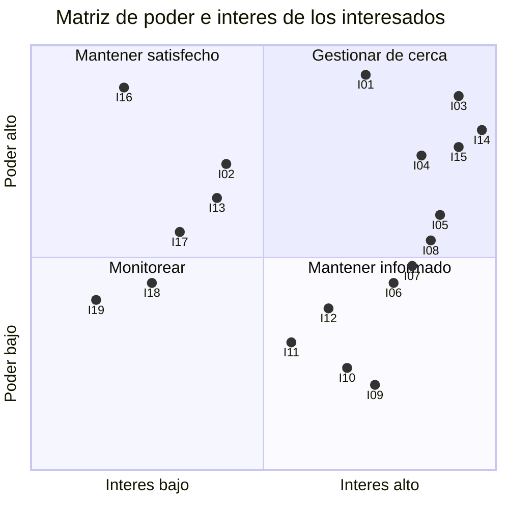

# Mapa de interesados, matriz RACI y registro de riesgos — GoodApps Cooperativas

| Campo | Valor |
|---|---|
| Proyecto | GoodApps Cooperativas — plataforma SaaS multitenant que reemplaza a ProCoop |
| Documento | `09-riesgos-y-raci.md` |
| Artefactos del índice | 1.4 Mapa de interesados y matriz RACI; 1.5 Registro de riesgos (`00-INDICE.md`) |
| Versión | 1.0 |
| Fecha | 05-11-2026 |
| Estado | Borrador para revisión |
| Fuentes | `docs/especificacion/00-ESPECIFICACION-MAESTRA.md` (§1, §7, §12, §15, §18); `01-registro-decisiones.md` (incluida DEC-088); `02-preguntas-abiertas.md`; `03-plan-de-olas-y-prompts.md`; `05-registro-huecos.md`; anexos T02, T06, T07 y T08 |
| Prevalencia | Este documento deriva de la especificación y no la reemplaza. Ante cualquier diferencia prevalecen la especificación maestra, sus anexos y el registro de decisiones. |

## Control de versiones

| Versión | Fecha | Descripción del cambio | Elaborado por (rol) |
|---|---|---|---|
| 1.0 | 05-11-2026 | Versión inicial: mapa de interesados, matriz RACI, registro de 29 riesgos, supuestos y dependencias, y gobierno de riesgos. | Equipo de producto y desarrollo |
| 1.1 | 05-11-2026 | DEC-088 (reemplaza DEC-081): la cooperativa piloto comercial y de migración es Laguna Larga (`LAG`). RSK-012 pasa de "piloto no definida" (Crítico) a "piloto con servicios medidos y prepago" (Alto); se ajustan RSK-004, RSK-007, RSK-008, RSK-010, RSK-014, RSK-015 y RSK-027, la actividad 2 de la RACI, los interesados I07, I08 e I12, las Partes D y E, el resumen por nivel, el mapa de calor, el ranking y la correspondencia con el artefacto 1.3. | Equipo de producto y desarrollo |

## Aprobaciones

| Rol | Alcance de la aprobación | Estado |
|---|---|---|
| Gerencia de la cooperativa piloto (Laguna Larga, DEC-088) | Mapa de interesados, RACI y registro de riesgos | Pendiente (antes: "la cooperativa piloto no está definida, DEC-081") |
| Equipo de producto y desarrollo | Contenido completo | Pendiente |
| Operador de plataforma | Riesgos de migración, integración, seguridad y proveedor | Pendiente |

> **Convenciones.** Los interesados se identifican por **rol genérico**, nunca por nombre de persona. Los códigos de rol (`T-GER`, `P-SUP`, etc.) son los del catálogo de la maestra §7.2 (T02 §4.1). Cuando un valor no figura en la especificación se indica "a definir". Las cifras citadas provienen de la maestra o de recuentos por búsqueda textual sobre la especificación al 05-11-2026, y en ese caso se indica.

## Índice

- Parte A — Mapa de interesados
- Parte B — Matriz RACI
- Parte C — Registro de riesgos
- Parte D — Supuestos y dependencias clave
- Parte E — Gobierno de riesgos

---

## Parte A — Mapa de interesados

### A.1 Registro de interesados

Escala de interés e influencia: **Alta**, **Media**, **Baja**. La estrategia sigue la matriz poder/interés de A.2: *gestionar de cerca* (poder alto, interés alto), *mantener satisfecho* (poder alto, interés bajo o medio), *mantener informado* (poder bajo, interés alto) y *monitorear* (poder bajo, interés bajo).

| Cód. | Interesado (rol genérico) | Roles del sistema relacionados | Interés en el proyecto | Influencia | Expectativas principales | Estrategia de gestión |
|---|---|---|---|---|---|---|
| I01 | Consejo de administración | T-CJO | Alta | Alta | Reemplazo de ProCoop sin interrupción del servicio; información confiable y trazable; cumplimiento normativo; control del costo y del riesgo. Aprueba el alcance y el corte (T07 §4: `mig.corte.aprobar`). | Gestionar de cerca: presentación por hito de ola; participación en el go/no-go del corte; informe de riesgos críticos y altos. |
| I02 | Sindicatura / auditoría | T-SIN | Media | Alta | Auditoría inmutable, separación de funciones y reporte de excepciones (PA-IAM-04, PA-IAM-17). | Mantener satisfecho: acceso de lectura y auditoría; informe de controles al cierre de O5, O8 y O11. |
| I03 | Gerencia | T-GER | Alta | Alta | Tableros por rol, adaptación por configuración, niveles de servicio comprometidos (DEC-063), corte por etapas (DEC-068). | Gestionar de cerca: patrocinador del lado de la cooperativa; integra el comité de proyecto (Parte E). |
| I04 | Contador | T-CON | Alta | Alta | Cero diferencias entre comprobante, cuenta corriente y contabilidad (maestra §14); contabilidad no oficial conciliada durante la convivencia (DEC-069); tratamiento correcto por entidad jurídica (DEC-064, DEC-087). | Gestionar de cerca: valida reglas contables y fiscales; aprueba conciliaciones contables (T07 F9). |
| I05 | Responsable de sistemas de la cooperativa | T-ADM, T-USR | Alta | Media | Sin servidores propios que administrar; usuarios, roles y configuración bajo control; credenciales en bóveda (DEC-074). | Gestionar de cerca: punto de contacto técnico; dueño de la configuración del tenant y de los accesos a ProCoop para la extracción (T07 F1). |
| I06 | Jefe de atención | T-SAT | Alta | Media | Expediente único, plazos de respuesta (HUE-INT-03), canales digitales (DEC-055) e IA bajo control humano (DEC-056). | Mantener informado y comprometido: usuario clave en pruebas de aceptación de O2, O6 y O10; multiplicador de la capacitación. |
| I07 | Jefe técnico | T-STE | Alta | Media | Agenda y órdenes en el celular sin conexión; aprovisionamiento automático (DEC-041, DEC-042). | Mantener informado y comprometido: usuario clave en O3 (Internet, validado con datos sintéticos) y en O7 (servicios medidos de Laguna Larga, DEC-088). |
| I08 | Responsables de facturación y tesorería | T-FAC, T-TES | Alta | Media | Facturación masiva con controles y simulación; conciliación de pasarelas, entes y bancos (DEC-015, DEC-059); venta de energía prepaga en la piloto (PA-COB-15). | Mantener informado y comprometido: usuarios clave de O4, O5, O7 y de la corrida paralela (T07 F10). |
| I09 | Cajeros y cobradores | T-CAJ, T-CBR | Alta | Baja | Cobro ágil en mostrador y en campo; continuidad ante caídas de terceros (RNF-NFR-047). | Mantener informado: capacitación práctica previa al corte; canal de soporte de arranque. |
| I10 | Técnicos de campo y lecturistas | T-TEC, T-LEC | Alta | Baja | PWA de campo usable sin conexión; menos papel. | Mantener informado: capacitación en campo; relevamiento del parque de dispositivos (PA-NFR-13). |
| I11 | Personal administrativo, compras, depósito y RRHH | T-CMP, T-DEP, T-RRHH, T-SEC | Media | Baja | Integración del ERP administrativo (O8–O10) y continuidad en ProCoop hasta el corte administrativo (DEC-068). | Mantener informado: comunicación del cronograma de etapas; participación en O8–O10. |
| I12 | Socios y usuarios del portal | C-SOC, C-REP, C-ADH | Alta | Baja (individual) / Media (colectiva, vía asamblea) | Autogestión desde el celular; consulta y pago sin barreras; nunca quedar bloqueados en consulta, pago, reclamo o baja (PA-POR-15). En la piloto, según lo relevado en LAG, cerca del 70 % de las solicitudes online son recargas de energía prepaga (RN-MIG-022). | Mantener informado: comunicación previa al corte (runbook T07 §9.9, paso 1); invitaciones de activación (PA-MIG-07). |
| I13 | Asesor legal de la cooperativa | — (asesor externo o interno) | Media | Alta | Validar los parámetros normativos antes de producción (`05-registro-huecos.md`), la prescripción (DEC-052), la conservación de datos (PA-NFR-06) y el contrato de encargo (DEC-076). | Mantener satisfecho: agenda de validaciones por ola con anticipación; dictamen documentado por parámetro. |
| I14 | Equipo de producto y desarrollo (solicitante) | — | Alta | Alta | Construir por olas con la especificación como fuente única (maestra §16); decisiones registradas (DEC); trazabilidad RF por prompt (plan R18). | Gestionar de cerca: dueño del plan de olas y del registro de riesgos. |
| I15 | Operador de plataforma | P-SUP, P-ADM, P-SOP1, P-SOP2, P-SEC, P-OPS; líder de migración (T07 §4) | Alta | Alta | Alta asistida de tenants, migración repetible, soporte auditado (AGR-034), aislamiento verificable (DEC-002). | Gestionar de cerca: responsable de la migración, del corte técnico y del soporte post-arranque. |
| I16 | Entes reguladores y de control | ARCA, ENACOM, ERSeP, ENARGAS, INAES, AAIP (externos) | Baja | Alta | Cumplimiento de la normativa fiscal, regulatoria, institucional y de protección de datos personales. | Mantener satisfecho: cumplimiento por diseño (tablas normativas versionadas, PA-FIS-12); homologaciones; informes regulatorios (PA-FIS-13, PA-FIS-14). |
| I17 | Proveedores de integración | Pasarelas, entes recaudadores, bancos, mensajería, equipos de red, firma (T06) | Baja | Media | Integración por conectores con credenciales propias del tenant (PA-INT-01) y ambientes de homologación (PA-INT-16). | Mantener satisfecho: contacto técnico por conector; seguimiento de cambios de API y de vencimientos de credenciales (RF-INT-019). |
| I18 | Proveedor del sistema actual (ProCoop) | — | Baja | Media | Continuidad de la operación durante la convivencia (DEC-068) y acceso de solo lectura para la extracción (T07 F1). | Monitorear: acuerdos de acceso y de soporte durante la convivencia gestionados por la cooperativa. |
| I19 | Proveedor de infraestructura en la nube | AWS, región sa-east-1 (DEC-062) | Baja | Media | Contrato de servicio y cláusulas de transferencia internacional (DEC-062). | Monitorear: seguimiento de disponibilidad y de cambios contractuales; diseño agnóstico de nube (DEC-004). |

Total: **19 interesados**.

Los interesados I01 a I13 se refieren, para el piloto, a los roles de la cooperativa piloto **Laguna Larga** (`LAG`, DEC-088), que opera electricidad, gas y prepago. Se siguen identificando por rol, sin nombres de personas.

### A.2 Matriz poder/interés

El eje horizontal representa el **interés** (involucramiento) y el vertical el **poder** (influencia). Los puntos usan los códigos de A.1.

| Cuadrante | Interesados | Tratamiento |
|---|---|---|
| Gestionar de cerca | I01, I03, I04, I05, I08, I14, I15 | Integran el comité de proyecto o participan en sus decisiones; reciben el registro de riesgos completo. |
| Mantener satisfecho | I02, I13, I16, I17 | Consulta anticipada en sus temas (controles, validación legal, normativa, integraciones); sin carga de reuniones operativas. |
| Mantener informado | I06, I07, I09, I10, I11, I12 | Comunicación por hito, capacitación y participación en pruebas de aceptación (usuarios clave). |
| Monitorear | I18, I19 | Seguimiento contractual y de disponibilidad. |

---

## Parte B — Matriz RACI

### B.1 Leyenda

| Letra | Significado |
|---|---|
| **R** | Responsable: ejecuta la actividad. Puede haber varios. |
| **A** | Aprobador (*accountable*): rinde cuentas y aprueba el resultado. **Hay exactamente un A por fila.** |
| **C** | Consultado: aporta información o criterio antes de la decisión (comunicación de ida y vuelta). |
| **I** | Informado: recibe el resultado (comunicación de una vía). |
| **R/A** | El mismo rol ejecuta y aprueba; cuenta como el único A de la fila. |

Columnas (roles):

| Sigla | Rol | Interesados de A.1 |
|---|---|---|
| CA | Consejo de administración | I01 |
| GER | Gerencia | I03 |
| CON | Contador | I04 |
| SIS | Responsable de sistemas de la cooperativa | I05 |
| JAT | Jefe de atención | I06 |
| JTE | Jefe técnico | I07 |
| USR | Usuarios clave (facturación, tesorería, cajeros, técnicos) | I08, I09, I10 |
| LEG | Asesor legal | I13 |
| EPD | Equipo de producto y desarrollo | I14 |
| OPL | Operador de plataforma (incluye al líder de migración) | I15 |

### B.2 Matriz

| N.º | Actividad del proyecto | Referencia | CA | GER | CON | SIS | JAT | JTE | USR | LEG | EPD | OPL |
|---|---|---|---|---|---|---|---|---|---|---|---|---|
| 1 | Aprobación del alcance y del plan de olas | DEC-006, DEC-007; maestra §15 | A | R | C | C | I | I | I | C | R | C |
| 2 | Formalización con Laguna Larga como cooperativa piloto (alcance, accesos solo a configuración, calendario de validaciones). *Antes: "Designación de la cooperativa piloto" (DEC-081).* | DEC-088; PA-MIG-17; CTR-MIG-07 | C | C | I | C | I | I | I | C | A | R |
| 3 | Decisiones de producto y revisión de preguntas asumidas | DEC-047, DEC-072 | I | C | C | C | C | C | I | C | R/A | C |
| 4 | Validación legal de parámetros normativos | `05-registro-huecos.md` (8 huecos); DEC-052; PA-NFR-06 | I | A | C | I | C | C | I | R | C | I |
| 5 | Validación contable y fiscal | DEC-064, DEC-069, DEC-087; HUECO-CAP-04; PA-TES-17 | I | C | R/A | I | I | I | C | C | C | I |
| 6 | Configuración de tarifas, conceptos y servicios | DEC-021; M04 | C | A | C | C | I | I | R | C | C | I |
| 7 | Perfilado y migración de datos (inventario a validación) | T07 §9.2, fases F1 a F8 | I | I | C | R | C | C | C | I | C | R/A |
| 8 | Conciliación por dominio | T07 §9.2 F9, §9.8 | I | A | R | C | R | R | R | I | C | R |
| 9 | Corrida paralela y su aprobación | T07 F10; PA-MIG-02; RF-MIG-076 | I | A | C | C | I | I | R | I | C | R |
| 10 | Pruebas de aceptación por ola | Maestra §15 (hitos de salida); plan de olas | I | A | C | R | R | R | R | I | C | C |
| 11 | Capacitación y gestión del cambio | Artefacto 8.4 del índice | I | A | C | R | R | R | C | I | C | R |
| 12 | Decisión go/no-go del corte | RF-MIG-086; RN-MIG-029; DEC-068 | A | R | C | C | C | C | I | I | C | R |
| 13 | Soporte post-arranque | DEC-063; T07 §9.9 (paso 14) | I | I | I | R | C | C | C | I | R | A |
| 14 | Seguridad de la plataforma y aislamiento entre tenants | DEC-002, DEC-074; RNF-NFR-148 | I | I | I | C | I | I | I | I | R | A |
| 15 | Protección de datos personales en la cooperativa | DEC-076; PA-NFR-08; RNF-NFR-109 | I | A | I | R | C | C | I | R | C | C |
| 16 | Integraciones externas: convenios, credenciales y homologación | T06; DEC-015, DEC-053; PA-INT-01 | I | A | C | R | I | C | C | I | C | R |
| 17 | Gestión del registro de riesgos | Parte E de este documento | I | C | C | C | I | I | I | C | R/A | R |

Total: **17 actividades**, cada una con un único A.

Notas:

- En la actividad 9, la aprobación del paralelo corresponde al "responsable de la cooperativa (gerencia/consejo)" de T07 §4; se asigna a la Gerencia y el Consejo aprueba el corte en la actividad 12.
- En la actividad 15, la cooperativa es responsable del tratamiento y GoodApps actúa como prestador de servicios de tratamiento por cuenta de ella (DEC-076); la seguridad de la plataforma (actividad 14) es responsabilidad del operador.

---

## Parte C — Registro de riesgos

### C.1 Escalas y cálculo del nivel

| Valor | Probabilidad | Impacto |
|---|---|---|
| Alta (3) | Es esperable que ocurra si no se actúa. | Afecta un hito de ola, el corte, la exactitud económica o el cumplimiento legal. |
| Media (2) | Puede ocurrir; hay antecedentes o señales. | Obliga a retrabajo o demora acotada sin comprometer el hito. |
| Baja (1) | Poco probable con los controles previstos. | Efecto local, corregible dentro de la ola. |

**Nivel** = probabilidad × impacto: **Crítico** (9), **Alto** (6), **Medio** (3 o 4), **Bajo** (1 o 2).

Categorías: alcance, datos/migración, legal/regulatorio, técnico, integración, organizacional/adopción, seguridad, proveedor.

### C.2 Registro

| ID | Categoría | Descripción (causa – evento – consecuencia) | Prob. | Imp. | Nivel | Disparador / señal | Mitigación | Contingencia | Dueño (rol) | Ola afectada | Fuente |
|---|---|---|---|---|---|---|---|---|---|---|---|
| RSK-001 | Alcance | **Causa:** el alcance es todo lo que hace ProCoop, mejorado (DEC-007): 4.203 RF y 292 RNF repartidos en 172 prompts y 12 olas. **Evento:** desvíos de esfuerzo o acumulación de requisitos parciales entre olas. **Consecuencia:** demora del piloto Internet (hito de O6) y del reemplazo de ProCoop. | Media | Alta | Alto | Ola que cierra con RF en estado `Parcial (Ox)`; hito de salida no cumplido; crecimiento de PA nuevas. | Hitos de salida verificables por ola (maestra §15); un PR por prompt con RF trazados (plan R18); prioridades Núcleo/Estándar/Extensión; piloto Internet primero (DEC-005). | Reubicar Extensiones en olas tardías sin mover el hito; congelar el alcance de la ola en curso. | Equipo de producto y desarrollo | O0–O11 | DEC-005, DEC-007; maestra §15 |
| RSK-002 | Alcance | **Causa:** la planificación es por olas sin fechas (DEC-006). **Evento:** la cooperativa no puede comprometer ventanas de capacitación, paralelo y corte ni presupuestar. **Consecuencia:** conflicto de expectativas con el consejo y postergación del corte. | Media | Media | Medio | Pedido de fecha comprometida por el consejo; superposición del corte con cierres o vencimientos. | Hitos por condición y no por fecha (RF-MIG-005); estimación de esfuerzo por ola (artefacto 10.1); congelamiento en días de lote (PA-NFR-12). | Fijar ventanas candidatas de corte condicionadas a los criterios go (RF-MIG-086). | Equipo de producto y desarrollo | O0–O11 | DEC-006; RF-MIG-005 |
| RSK-003 | Alcance | **Causa:** 423 preguntas se asumieron con la opción recomendada sin consulta (maestra §18). **Evento:** la cooperativa rechaza una opción asumida después de construida. **Consecuencia:** retrabajo de requisitos, datos o configuración. | Alta | Media | Alto | PA asumida objetada en la revisión; cambio de PA posterior al prompt que la implementó. | Opción recomendada detrás de un parámetro cambiable (maestra §16, punto 5); revisión priorizada de las PA de cada ola antes de iniciarla; PA asumidas declaradas en cada PR (plan R18). | Registrar nueva DEC y ajustar en la ola siguiente; si afecta datos económicos, corrección por anulación o reversión (principio P5). | Equipo de producto y desarrollo | O0–O11 | DEC-047, DEC-072, DEC-087; `02-preguntas-abiertas.md` |
| RSK-004 | Legal/regulatorio | **Causa:** 8 huecos se resolvieron con parámetros cuyo valor por defecto requiere validación legal: HUECO-CAP-04 (PRM-FIS-122), HUE-GAS-05 (PRM-CRM-133), HUECO-SEP-01 (PRM-MOR-204, PRM-SOC-052), HUE-TEL-04 (PRM-MOR-199), HUE-TV-03 (PRM-MOR-200), HUE-INT-03 (PRM-CRM-135), HUE-AG-02 (PRM-MOR-201) y HUE-ELE-05 (PRM-MOR-206). **Evento:** se aplican en producción sin validar. **Consecuencia:** incumplimiento normativo, reclamos de socios, sanciones o cortes indebidos. | Media | Alta | Alto | Habilitación de un servicio con el parámetro sin validar: Internet (O2), capital social (O4), agua, energía y gas (O7), telefonía, TV y sepelio (O10). | Agenda de validación legal por ola, empezando por los que necesita Laguna Larga para su primera migración: ventanas de corte de energía (HUE-ELE-05) y emergencias de gas (HUE-GAS-05), ambos de O7 (DEC-088); checklist de habilitación por capacidad del ciclo de vida del tenant (maestra §6, AGR-004); dictamen documentado por parámetro. | Deshabilitar la funcionalidad dependiente (por ejemplo, corte automático) y operar con aprobación manual. | Asesor legal | O2, O4, O7, O10 | `05-registro-huecos.md` (los 8 huecos citados) |
| RSK-005 | Legal/regulatorio | **Causa:** los plazos de prescripción por tipo de obligación (24 y 60 meses) requieren validación legal antes de la primera corrida productiva (DEC-052). **Evento:** se ejecuta la prescripción con plazos no validados. **Consecuencia:** deudas dadas por prescriptas o reclamadas indebidamente. | Baja | Alta | Medio | Primera corrida de prescripción programada; estado de validación pendiente. | El estado de validación de la regla impide la corrida productiva (DEC-052); validación por el asesor legal antes de O6. | Suspender la corrida y revertir sus efectos por movimientos compensatorios. | Asesor legal | O6 | DEC-052; PA-CFG-P3-01 |
| RSK-006 | Legal/regulatorio | **Causa:** los datos se alojan fuera del país (DEC-062) y los plazos de conservación por categoría son valores por defecto (PA-NFR-06). **Evento:** observación de la autoridad de protección de datos o de un socio; retención menor al mínimo legal o mayor que la finalidad. **Consecuencia:** sanción, obligación de modificar contratos o pérdida de información exigible. | Baja | Alta | Medio | Firma del contrato de encargo; primera ejecución real de purga o anonimización; requerimiento de la autoridad. | Cláusulas contractuales de transferencia (DEC-062); contrato tipo de encargo y registro de subencargados (DEC-076); validación del asesor antes de la primera ejecución (PA-NFR-06). | Suspender los jobs de purga; ajustar la tabla de conservación por tenant. | Asesor legal | O1 en adelante | DEC-062, DEC-076; PA-NFR-05, PA-NFR-06 |
| RSK-007 | Datos/migración | **Causa:** reglas, mapeos y valores se derivaron de la base relevada de referencia (`LAG`) y quedaron 471 marcas `[VERIFICAR]` en los anexos (recuento por búsqueda textual del 05-11-2026; 18 en T07). Con DEC-088 esas marcas se resuelven con Laguna Larga, que es a la vez piloto y base de referencia; la base relevada aporta solo configuración, nunca datos personales. **Evento:** las marcas que dependen de datos reales (por ejemplo, "[VERIFICAR] con datos") no se resuelven solo con la configuración antes de la primera migración. **Consecuencia:** cargadores o reglas a rehacer y diferencias en la corrida paralela. *Antes: "la cooperativa piloto se comporta distinto" de la base relevada (DEC-081).* | Alta | Media | Alto | Inventario y perfilado (T07 F1, F2) que contradicen lo relevado; marcas sin resolver al iniciar el paralelo. | Resolver con LAG las marcas de configuración en las fases F1 a F4 (T07 §9.2), priorizando las de O7 y del prepago; las que exigen datos reales se resuelven en el ambiente aislado de migración autorizado por la cooperativa (PA-NFR-19); registrar cada resolución en el anexo dueño. | Documentar las diferencias intencionales como regla; corregir el mapeo en la siguiente corrida idempotente. | Operador de plataforma (líder de migración) | O1–O11 | DEC-088 (antes DEC-081); PA-NFR-19; T07 (RN-MIG-002, RN-MIG-048, CTR-MIG-03) |
| RSK-008 | Datos/migración | **Causa:** la tabla `DEUDARED`/`DEUDARED_TIPO` admite dos lecturas: deuda publicada a la red o saldo de redondeo con arrastre. **Evento:** se migra al destino equivocado. **Consecuencia:** saldos de redondeo perdidos o duplicados y deuda publicada a Red Link inconsistente. | Media | Media | Medio | Perfilado de LAG (DEC-088) que encuentra filas de redondeo en `DEUDARED_TIPO`; diferencias de centavos en el paralelo. | Ruteo por `DEUDARED_TIPO` hacia `roundingCarryEntries` si existen arrastres (T07 §19.7); control de suma de saldos contra ProCoop (M04); índice único de deuda publicada (RF-COB-102). | Revisar CTR-DAT-42 y cargar el saldo inicial como movimiento de apertura por cuenta (M07 §7). | Operador de plataforma (líder de migración) | O5, O11 | CTR-DAT-42, CTR-COB-24; RF-COB-102 |
| RSK-009 | Datos/migración | **Causa:** datos heredados con personas duplicadas, CUIT/DNI inválidos, domicilios sin normalizar y pagos parciales sin servicio discriminado. **Evento:** rechazos masivos o carga de datos erróneos. **Consecuencia:** facturas y deudas incorrectas, pérdida de confianza del socio y demora del corte. | Alta | Alta | Crítico | Tasa de rechazos del perfilado (T07 F2); cola de saneamiento que no baja (F4); diferencias en la conciliación de saldos (F9). | Perfilado temprano con datos de la piloto; deduplicación asistida (PA-MIG-10); documentos marcados "a revisar" (PA-MIG-11); normalización de domicilios (PA-MIG-12); prorrateo explícito de pagos parciales (RN-MIG-008); corridas repetibles. | Postergar el by-pass del dominio afectado manteniendo un único sistema de registro (RF-MIG-080); sanear en ProCoop antes del delta final. | Operador de plataforma (líder de migración) | O1–O11 (cargadores por ola; ensayo integral en O11) | PA-MIG-10, PA-MIG-11, PA-MIG-12; RN-MIG-008 |
| RSK-010 | Datos/migración | **Causa:** las fórmulas embebidas de ProCoop se traducen con revisión humana (RN-MIG-048), los intereses al corte se recalculan (RN-MIG-023) y el paralelo exige 2 ciclos consecutivos con 0 diferencias sin explicar (PA-MIG-02). **Evento:** el paralelo no se aprueba en los ciclos previstos; en Laguna Larga abarca electricidad, gas y prepago (DEC-088), con calendarios distintos por servicio. **Consecuencia:** corte comercial demorado y convivencia extendida. | Media | Alta | Alto | Tablero de paralelo (RF-MIG-075) con diferencias fuera de tolerancia sin explicar después del primer ciclo. | Ensayos de cada cargador en la ola de su módulo con datos anonimizados (T07 §9.1); comparador por cuenta y concepto con explicación obligatoria (plan O11); conciliación de intereses (PA-MIG-06). | Extender los ciclos de paralelo; by-pass por servicio (T07 §9.6, punto 10). | Operador de plataforma (líder de migración) | O4, O6, O7, O11 | DEC-088; PA-MIG-02, PA-MIG-06; RN-MIG-023, RN-MIG-048; RF-MIG-076 |
| RSK-011 | Datos/migración | **Causa:** el corte tiene un runbook de varios pasos con dependencias externas (T07 §9.9): comprobantes pendientes de CAE (RN-MIG-029) y numeración por punto de venta (RN-MIG-028). **Evento:** el corte excede la ventana o un criterio go se detecta en rojo tarde. **Consecuencia:** interrupción de facturación y cobranza; tras la primera emisión fiscal el rollback solo puede ser hacia adelante (RF-MIG-089). | Baja | Alta | Medio | Ensayo cronometrado que excede la ventana; criterio go en rojo. | Runbook con criterios go/no-go y doble aprobación (RF-MIG-086); ensayos cronometrados y rollback probado (plan O11); diario de rollback (RF-MIG-088). | Decisión no-go y reprogramación; rollback hacia adelante por reexportación. | Operador de plataforma (líder de migración) | O11 | RF-MIG-086, RF-MIG-088, RF-MIG-089; RN-MIG-028, RN-MIG-029 |
| RSK-012 | Alcance | **Piloto con servicios medidos y prepago.** **Causa:** la cooperativa piloto es Laguna Larga (DEC-088), que opera electricidad, gas y prepago, mientras que el primer servicio construido es Internet (DEC-005), validado solo con datos sintéticos (CTR-MIG-07). **Evento:** la primera migración real no puede ocurrir antes de O7 y exige que el prepago esté disponible (PA-MIG-17, CTR-COB-21, PA-COB-15, RN-MIG-022). **Consecuencia:** el circuito Internet de O2 a O6 llega al hito de O6 sin validación con una cooperativa real; la validación real se concentra en O7 y en el prepago, de modo que cualquier demora en servicios medidos o en el subconjunto prepago adelantado demora la primera migración. Según lo relevado en LAG, cerca del 70 % de las solicitudes online son recargas prepagas, por lo que el portal sin prepago tiene poco valor para sus socios. *Antes (v1.0): "Cooperativa piloto no definida" (DEC-081), Alta × Alta = Crítico.* | Media | Alta | Alto | Hito de O6 cerrado solo con datos sintéticos; desvíos en O7 o en el adelanto del prepago (PA-COB-15); recargas prepagas sin circuito de cobro al planificar la migración. | Validación de O2 a O6 con datos sintéticos de Internet (PA-MIG-17); adelantar en M03 el subconjunto prepago y dejar el cobro genérico en O5 (CTR-COB-21, PA-COB-15); priorizar en O7 los servicios que opera LAG; usar la configuración de LAG para el mapeo desde O1. | Mantener el corte por etapas (DEC-068) y diferir el by-pass del servicio afectado; si el prepago no está listo, no se migra LAG (criterio go, RF-MIG-086). | Equipo de producto y desarrollo | O5, O7, O11 | DEC-088 (reemplaza DEC-081), DEC-005, DEC-068; PA-MIG-17, PA-COB-15; CTR-COB-21, CTR-MIG-07; RN-MIG-022 |
| RSK-013 | Organizacional/adopción | **Causa:** el reemplazo es por etapas (DEC-068) y la contabilidad oficial sigue en ProCoop hasta el corte administrativo (DEC-069). **Evento:** doble carga o inconsistencias entre sistemas. **Consecuencia:** diferencias contables y reprocesos. | Media | Media | Medio | Diferencias en la conciliación entre la contabilidad no oficial y ProCoop; fallas en los deltas de sincronización. | Un único sistema de registro por dominio (RF-MIG-080); deltas registrados (RF-MIG-081, PA-MIG-03); conciliación contra ProCoop (DEC-069). | Congelar el dominio en ProCoop hasta resolver la diferencia. | Contador | O5, O8, O11 | DEC-068, DEC-069; PA-MIG-03 |
| RSK-014 | Técnico | **Causa:** un tenant puede tener varias personas jurídicas (DEC-064), con cuenta corriente y recibo por entidad (DEC-087) y `legalEntityId` obligatorio en documentos económicos (RF-CFG-136). **Evento:** documentos sin entidad o con entidad mal asignada; en la migración, un documento sin entidad resoluble es rechazo bloqueante (RN-MIG-002). **Consecuencia:** errores en emisión fiscal, contabilidad y recibos; rechazos de migración. | Media | Alta | Alto | Varias razones sociales en la configuración de LAG (RN-MIG-002 marcada `[VERIFICAR]`, a resolver con LAG, DEC-088); rechazos por entidad no resoluble. | Entidad jurídica desde O0 (maestra §15); pruebas con dos entidades por tenant; mapa de entidades en el mapeo (T07 F3). | Sanear en origen y recargar; correcciones por anulación y reemisión (principio P5). | Contador | O0, O4, O5, O8, O11 | DEC-064, DEC-087; RF-CFG-136; RN-MIG-002 |
| RSK-015 | Datos/migración | **Causa:** PA-TES-17 se asumió: la diferencia de arqueo de una rendición con varias entidades se imputa a la que indique el receptor (por defecto, la de mayor importe rendido). **Evento:** el criterio difiere del que exige el contador. **Consecuencia:** asientos entre entidades a corregir. | Media | Media | Medio | Primera rendición multientidad en el ensayo de O5. | Validar con el contador de la cooperativa piloto, como indica M14 §21; con DEC-088, el contador de Laguna Larga. | Ajuste contable auditado mientras se registra la nueva decisión. | Contador | O5 | PA-TES-17; DEC-064, DEC-087, DEC-088 |
| RSK-016 | Integración | **Causa:** la autorización fiscal depende de ARCA (CAE, padrón, certificados; DEC-053). **Evento:** indisponibilidad, latencia, cambio normativo o vencimiento de certificado. **Consecuencia:** comprobantes sin autorizar, mostrador sin factura fiscal y lote masivo demorado. | Media | Alta | Alto | Latencia de ARCA mayor a 5 s p95 durante 15 min (RNF-NFR-011); alerta de vencimiento de certificado (RNF-NFR-071). | Cola con reintentos y contingencia CAEA (DEC-018, DEC-038); operación degradada sin bloquear pantallas (RNF-NFR-047); alertas de vencimiento a 30, 15 y 7 días. | Comprobante pendiente no entregable como fiscal (DEC-018); CAEA si el tenant lo habilita (PA-FIS-01). | Operador de plataforma | O4 | DEC-018, DEC-038, DEC-053; RNF-NFR-011, RNF-NFR-047, RNF-NFR-071 |
| RSK-017 | Integración | **Causa:** en O5 entran Pagos360, Mercado Pago, SIRO y Red Link (DEC-015), con webhooks y archivos de formatos heterogéneos. **Evento:** aviso falso o duplicado, rendición no conciliable o cambio de API del proveedor. **Consecuencia:** doble imputación, pagos sin imputar y reconexión no disparada (DEC-014). | Media | Alta | Alto | Partidas sin conciliar en la conciliación diaria; errores de lectura de archivos de entes. | Reconsulta obligatoria de webhooks (PA-INT-10); idempotencia y conciliación diaria (plan O5); layouts declarativos versionados (PA-INT-12); cuentas de homologación (PA-INT-16). | Cadena de respaldo de pasarela (RF-INT-010); imputación manual auditada. | Operador de plataforma | O5 | DEC-014, DEC-015; PA-INT-10, PA-INT-12, PA-INT-16; RF-INT-010 |
| RSK-018 | Integración | **Causa:** el aprovisionamiento del piloto es automático y asíncrono (DEC-041) sobre MikroTik, Radius y SmartOLT (DEC-042). **Evento:** fallas de conector o versiones de equipos distintas de las previstas. **Consecuencia:** servicio no activado, suspensión o reconexión fallida y reclamos. | Media | Media | Medio | Órdenes de activación con aprovisionamiento pendiente; reconexiones fuera de plazo. | Adaptadores simulados en modo test (plan O3); respaldo manual (DEC-041); alerta de reconexión tardía (plan O6). | Aprovisionamiento manual por el técnico con registro en la orden. | Jefe técnico | O3, O6 | DEC-014, DEC-041, DEC-042 |
| RSK-019 | Proveedor | **Causa:** el proveedor de firma debe elegirse antes de O3 (DEC-078). **Evento:** no se contrata a tiempo. **Consecuencia:** demora de la firma digital de recibos y actas; la conformidad de instalación usa firma electrónica con OTP propia. | Baja | Media | Bajo | Inicio de O3 sin proveedor elegido. | Interfaz de firma propia y firma electrónica con OTP por defecto (DEC-078); evaluación de alternativas (PA-INT-22). | Mantener la firma electrónica con OTP hasta contratar el proveedor licenciado (O8/O9). | Equipo de producto y desarrollo | O3, O8, O9 | DEC-078; PA-INT-22 |
| RSK-020 | Proveedor | **Causa:** la plataforma depende de AWS sa-east-1 y de su KMS para la clave maestra (DEC-004, DEC-062, DEC-074). **Evento:** incidente regional o pérdida de acceso a la clave maestra. **Consecuencia:** indisponibilidad por encima del RTO comprometido (DEC-063) y secretos o campos cifrados inaccesibles. | Baja | Alta | Medio | Alertas de las sondas de disponibilidad (RNF-NFR-031); errores de KMS. | Despliegue agnóstico de nube (DEC-004); interfaz agnóstica de la bóveda (DEC-074); simulacros de restauración y de rotación (RNF-NFR-069). | Restauración con conciliación de terceros antes de reanudar jobs (RNF-NFR-044). | Operador de plataforma | O0–O11 | DEC-004, DEC-062, DEC-063, DEC-074; RNF-NFR-044 |
| RSK-021 | Proveedor | **Causa:** las notificaciones dependen de WhatsApp (DEC-055), SMS (PA-INT-06) y correo (PA-INT-07), con dos modelos de contratación (DEC-077). **Evento:** rechazo de plantillas, bloqueo de cuenta o baja entregabilidad. **Consecuencia:** socios no avisados de vencimientos, mora o corte; constancias de notificación insuficientes para cortar. | Media | Media | Medio | Rebotes o mensajes no entregados por encima de lo habitual; plantillas rechazadas. | Dominio verificado con SPF/DKIM/DMARC (PA-INT-07); constancias con hash, fecha y canal (plan O6); varios canales por socio. | Canal alternativo; postergar el corte si falta la constancia. | Jefe de atención | O2, O6 | DEC-055, DEC-077; PA-INT-06, PA-INT-07 |
| RSK-022 | Seguridad | **Causa:** todos los tenants comparten una única base de datos (DEC-002). **Evento:** consulta, caché o cola sin filtro de tenant. **Consecuencia:** exposición de datos de una cooperativa a otra, incidente de datos personales y pérdida de confianza. | Baja | Alta | Medio | Falla de la suite de aislamiento; consultas sin `tenantId` en el profiler de staging (RNF-NFR-238). | Plugin de tenancy obligatorio (RF-PLA-020); suite de aislamiento que bloquea el merge (RNF-NFR-148); cifrado por tenant (RNF-NFR-056); pruebas de penetración antes del go-live (RNF-NFR-095). | Procedimiento de incidente con aviso a la cooperativa en 24 h o menos (PA-NFR-08). | Operador de plataforma | O0–O11 | DEC-002; RF-PLA-020; RNF-NFR-148, RNF-NFR-238 |
| RSK-023 | Seguridad | **Causa:** se tratan datos de salud (M18), electrodependencia, legajos y datos bancarios. **Evento:** acceso indebido, exposición en BI, APIs o notificaciones, o migración de datos clínicos que el alcance excluye (DEC-024, PA-SOC-01, PA-SOC-03). **Consecuencia:** infracción de la Ley 25.326 sobre datos sensibles y daño a los socios. | Baja | Alta | Medio | Lecturas de fichas sensibles sin motivo en la revisión mensual (RNF-NFR-101); campos de salud en colecciones comerciales (RNF-NFR-100). | Cifrado a nivel de campo (RNF-NFR-055, PA-MIG-19); exclusión de BI, APIs e IA (RNF-NFR-102); evaluación de impacto antes de la ola (RNF-NFR-109). | Revocar accesos y notificar el incidente (PA-NFR-08). | Responsable de sistemas de la cooperativa | O2, O7, O9, O10 | DEC-024; PA-MIG-19, PA-SOC-01, PA-SOC-03; RNF-NFR-055, RNF-NFR-100, RNF-NFR-101, RNF-NFR-102 |
| RSK-024 | Seguridad | **Causa:** los ensayos de migración pueden usar una copia real en un ambiente aislado (PA-NFR-19) y el sandbox admite copias anonimizadas (PA-PLA-07). **Evento:** una copia real llega a un ambiente no autorizado. **Consecuencia:** fuga de datos personales. | Baja | Alta | Medio | Snapshot sin marca de anonimizado con destino no permitido. | Perfiles de anonimización (RF-MIG-095, RF-MIG-097); bloqueo de destinos no permitidos (RF-MIG-096); separación de ambientes (RNF-NFR-099). | Purga del ambiente y gestión del incidente. | Operador de plataforma | O1, O11 | PA-NFR-19, PA-PLA-07; RF-MIG-095, RF-MIG-096, RF-MIG-097; RNF-NFR-099 |
| RSK-025 | Seguridad | **Causa:** la IA clasifica, resume y sugiere en atención (DEC-056) y modera la comunidad (DEC-008). **Evento:** inyección de instrucciones o envío de datos personales al proveedor. **Consecuencia:** filtración o sugerencias inadecuadas. | Baja | Media | Bajo | Fallas en la batería de pruebas adversariales (RNF-NFR-098). | La IA solo propone (ARQ-08); apagada hasta la aceptación del tenant (DEC-056); redacción de identificadores (PA-NFR-09). | Desactivar la IA por tenant; el flujo continúa sin ella (RNF-NFR-098). | Equipo de producto y desarrollo | O6, O10 | DEC-008, DEC-056; PA-NFR-09; RNF-NFR-098 |
| RSK-026 | Organizacional/adopción | **Causa:** el personal pasa de un sistema de escritorio con 1.536 parámetros numéricos a una plataforma web con parámetros semánticos, circuitos de aprobación, separación de funciones (PA-IAM-04) y segundo factor. **Evento:** resistencia al cambio o errores operativos en caja, facturación y campo al arrancar. **Consecuencia:** colas en mostrador, errores y retorno a planillas paralelas. | Alta | Media | Alto | Volumen de consultas de soporte en el arranque; exceso de autorizaciones de supervisor; bajo uso de la PWA de campo. | Ayuda contextual en cada pantalla (maestra §10); vocabulario propio por diccionario (principio P3); ambiente de prueba por cooperativa (PA-PLA-06); capacitación y gestión del cambio (artefacto 8.4). | Soporte reforzado de arranque (T07 §9.9, paso 14). | Gerencia | O2–O11 | Maestra §1.1, §10; PA-IAM-04, PA-PLA-06 |
| RSK-027 | Organizacional/adopción | **Causa:** baja adopción digital de los socios; los usuarios del portal anterior se migran sin contraseñas (PA-POR-03, PA-MIG-07) y la vinculación de cuentas tiene intentos limitados (DEC-043). En la piloto, cerca del 70 % de las solicitudes online relevadas son recargas de energía prepaga (RN-MIG-022). **Evento:** los socios no activan su acceso o lo abandonan, en particular si la recarga prepaga no está disponible en el portal al migrar. **Consecuencia:** beneficios no alcanzados y carga sostenida en mostrador. | Media | Media | Medio | Invitaciones de activación sin aceptar; vinculaciones fallidas; recargas prepagas derivadas al mostrador. Umbrales: a definir. | Activación por OTP (DEC-066); consulta y pago sin login (PA-POR-02); redirección de enlaces del portal anterior por 12 meses (PA-INT-17); nunca bloquear al socio moroso (PA-POR-15). | Asistencia presencial para vincular (DEC-043); campañas de comunicación (T09). | Jefe de atención | O2, O5, O7, O11 | DEC-043, DEC-066, DEC-088; RN-MIG-022; PA-COB-15, PA-MIG-07, PA-POR-02, PA-POR-03, PA-POR-15, PA-INT-17 |
| RSK-028 | Técnico | **Causa:** las metas de facturación masiva (PA-NFR-04) y el perfil de capacidad (DEC-075) son supuestos sin medición real. **Evento:** los lotes superan los tiempos previstos. **Consecuencia:** emisión y distribución fuera de cronograma en cooperativas grandes. | Media | Media | Medio | Prueba de carga por encima de la meta; extrapolación de la prueba de homologación (RNF-NFR-011). | Pruebas de carga con datos sintéticos (PA-NFR-19); procesos masivos en jobs reanudables (ARQ-03); recalibración con la piloto. | Escalar workers y dividir lotes por ciclo. | Equipo de producto y desarrollo | O4, O7 | DEC-075; PA-NFR-04; RNF-NFR-011 |
| RSK-029 | Técnico | **Causa:** la PWA de campo trabaja sin conexión con cola local (maestra §5.1) y con requisitos mínimos de dispositivo (PA-NFR-13) y de protección offline (PA-NFR-14). **Evento:** conflictos de sincronización o dispositivos fuera de soporte. **Consecuencia:** órdenes o lecturas perdidas o duplicadas y demoras de activación. | Media | Media | Medio | Conflictos en la cola de sincronización; dispositivos del personal fuera de soporte. | Idempotencia por operación y resolución explícita de conflictos (plan O3); relevamiento del parque de dispositivos. | Carga de la orden desde el admin con registro del motivo. | Jefe técnico | O3, O5, O7 | PA-NFR-13, PA-NFR-14 |

Total: **29 riesgos**.

### C.3 Resumen por nivel

| Nivel | Cantidad | Riesgos |
|---|---|---|
| Crítico | 1 | RSK-009 |
| Alto | 10 | RSK-001, RSK-003, RSK-004, RSK-007, RSK-010, RSK-012, RSK-014, RSK-016, RSK-017, RSK-026 |
| Medio | 16 | RSK-002, RSK-005, RSK-006, RSK-008, RSK-011, RSK-013, RSK-015, RSK-018, RSK-020, RSK-021, RSK-022, RSK-023, RSK-024, RSK-027, RSK-028, RSK-029 |
| Bajo | 2 | RSK-019, RSK-025 |

*Antes (v1.0): Crítico 2 (RSK-009, RSK-012) y Alto 9. El cambio se debe al reemplazo de RSK-012 por DEC-088.*

### C.4 Mapa de calor (probabilidad × impacto)

| Probabilidad \ Impacto | Baja | Media | Alta |
|---|---|---|---|
| **Alta** | — | RSK-003, RSK-007, RSK-026 | **RSK-009** |
| **Media** | — | RSK-002, RSK-008, RSK-013, RSK-015, RSK-018, RSK-021, RSK-027, RSK-028, RSK-029 | RSK-001, RSK-004, RSK-010, RSK-012, RSK-014, RSK-016, RSK-017 |
| **Baja** | — | RSK-019, RSK-025 | RSK-005, RSK-006, RSK-011, RSK-020, RSK-022, RSK-023, RSK-024 |

### C.5 Riesgos prioritarios

Orden: nivel; a igual nivel, prevalecen los riesgos de impacto alto que afectan la primera migración real de Laguna Larga (después de O7, DEC-088), el circuito Internet (O2 a O6) o el modelo de datos desde O0.

| Prioridad | Riesgo | Motivo |
|---|---|---|
| 1 | RSK-009 Calidad de los datos heredados | Crítico; condiciona la conciliación, el paralelo y el corte. |
| 2 | RSK-012 Piloto con servicios medidos y prepago | Alto; la primera migración real depende de O7 y del prepago, y el servicio construido primero (Internet) no se valida con la piloto. *Antes: "Cooperativa piloto no definida", Crítico.* |
| 3 | RSK-004 Parámetros normativos sin validación legal | Alto con impacto legal; el primero se habilita en O2 (Internet) y la piloto necesita en O7 los de energía y gas (HUE-ELE-05, HUE-GAS-05). |
| 4 | RSK-014 Varias personas jurídicas por tenant | Alto; afecta el modelo económico desde O0 y la migración. |
| 5 | RSK-016 Dependencia de ARCA | Alto; bloquea el hito de O4 (primera factura con CAE). |

### C.6 Correspondencia con los riesgos del resumen ejecutivo (artefacto 1.3)

| Riesgo de `01-resumen-ejecutivo-vision.md` §11 | Riesgos de este registro |
|---|---|
| R-01 Migración de datos | RSK-009, RSK-010, RSK-011 |
| R-02 Validaciones legales pendientes | RSK-004, RSK-005, RSK-006 |
| R-03 Datos heredados marcados `[VERIFICAR]` | RSK-007, RSK-008 |
| R-04 Dependencia de servicios externos | RSK-016, RSK-017, RSK-018, RSK-021 |
| R-05 Adopción de usuarios | RSK-026, RSK-027 |
| R-06 Alcance amplio | RSK-001 |
| R-07 Piloto con servicios medidos (antes: "Cooperativa piloto no definida") | RSK-012 |
| R-08 Decisiones asumidas | RSK-003, RSK-015 |
| R-09 Convivencia de dos sistemas | RSK-013 |
| R-10 Privacidad y alojamiento fuera del país | RSK-006, RSK-023 |
| R-11 Metas de rendimiento asumidas | RSK-028 |

---

## Parte D — Supuestos y dependencias clave

| ID | Tipo | Descripción | Fuente | Riesgo asociado | Responsable de validar o gestionar | Momento de validación |
|---|---|---|---|---|---|---|
| SUP-01 | Supuesto | Las preguntas no consultadas rigen con su opción recomendada hasta que se revisen. | DEC-047, DEC-072 | RSK-003 | Equipo de producto y desarrollo | Antes de iniciar cada ola |
| SUP-02 | Supuesto | La configuración de Laguna Larga, que es piloto y base relevada (solo configuración, nunca datos personales), alcanza para resolver los `[VERIFICAR]` de mapeo; los que dependen de datos se resuelven en el ambiente aislado de migración. *Antes: "la base relevada `LAG` es representativa" (DEC-081).* | DEC-088; PA-NFR-19 | RSK-007 | Operador de plataforma (líder de migración) | Fases F1 y F2 de LAG |
| SUP-12 | Supuesto | Internet se construye primero (DEC-005) y se valida con datos sintéticos, sin migración real, hasta O6. | DEC-005; PA-MIG-17; CTR-MIG-07 | RSK-012 | Equipo de producto y desarrollo | Hito de O6 |
| SUP-03 | Supuesto | Los valores por defecto de los 8 parámetros normativos son aceptables hasta su validación. | `05-registro-huecos.md` | RSK-004 | Asesor legal | Antes de habilitar el servicio afectado |
| SUP-04 | Supuesto | Plazos de prescripción de 24 y 60 meses según el tipo de obligación. | DEC-052 | RSK-005 | Asesor legal | Antes de la primera corrida productiva (O6) |
| SUP-05 | Supuesto | Perfil de capacidad: tenant estándar de 25.000 suministros y grande de 150.000; diseño para 100 tenants y hasta 300 sin rediseño. | DEC-075 | RSK-028 | Equipo de producto y desarrollo | Pruebas de carga de O4 y recalibración con la piloto |
| SUP-06 | Supuesto | Meta de facturación masiva: 50.000 suministros en 60 minutos o menos. | PA-NFR-04 | RSK-028 | Equipo de producto y desarrollo | O4 |
| SUP-07 | Supuesto | Corrida paralela de 2 ciclos consecutivos por servicio con 0 diferencias sin explicar. | PA-MIG-02 | RSK-010 | Gerencia | Antes de O11 |
| SUP-08 | Supuesto | Sincronización unidireccional ProCoop → GoodApps mientras ProCoop es maestro. | PA-MIG-03 | RSK-013 | Operador de plataforma | Antes del paralelo |
| SUP-09 | Supuesto | Imputación de la diferencia de arqueo multientidad a la entidad indicada por el receptor. | PA-TES-17 | RSK-015 | Contador | O5 |
| SUP-10 | Supuesto | Alojamiento en AWS sa-east-1 con cláusulas contractuales de transferencia y rol de prestador de servicios de tratamiento. | DEC-062, DEC-076 | RSK-006, RSK-020 | Asesor legal | Firma del contrato con la cooperativa |
| SUP-11 | Supuesto | Niveles de servicio: 99,5 % mensual, RPO ≤ 15 min, RTO ≤ 4 h por tenant y ≤ 8 h plataforma. | DEC-063 | RSK-020 | Operador de plataforma | Simulacros previos al go-live |
| DEP-01 | Dependencia | Formalización con Laguna Larga como cooperativa piloto comercial y de migración (alcance, accesos y calendario de validaciones). *Antes: "Designación de la cooperativa piloto" (DEC-081).* | DEC-088 | RSK-012 | Equipo de producto y desarrollo | Antes de O3 (propuesto) |
| DEP-02 | Dependencia | Acceso de solo lectura a la base de ProCoop y al portal anterior de Laguna Larga: configuración para el mapeo; datos personales solo en el ambiente aislado de migración. | T07 §1, F1; DEC-088; PA-NFR-19 | RSK-009 | Responsable de sistemas de la cooperativa | Inicio de la fase F1 |
| DEP-03 | Dependencia | Servicios de ARCA (autorización, padrón) y certificado de la cooperativa. | DEC-053; PA-FIS-10 | RSK-016 | Contador | O4 |
| DEP-04 | Dependencia | Convenios y credenciales con Pagos360, Mercado Pago, SIRO y Red Link. | DEC-015; PA-INT-01 | RSK-017 | Gerencia | O5 |
| DEP-05 | Dependencia | Equipos de red del piloto: MikroTik, Radius y SmartOLT. | DEC-042 | RSK-018 | Jefe técnico | O3 |
| DEP-06 | Dependencia | Proveedor de firma digital licenciado (la firma electrónica con OTP es propia). | DEC-078; PA-INT-22 | RSK-019 | Equipo de producto y desarrollo | Antes de O3 (elección); O8/O9 (uso) |
| DEP-07 | Dependencia | Proveedores de mensajería: WhatsApp (Meta Cloud API), SMS y correo transaccional. | DEC-055, DEC-077; PA-INT-06, PA-INT-07 | RSK-021 | Operador de plataforma | O2 |
| DEP-08 | Dependencia | Georef y Google Maps para normalización, geocodificación y mapas. | DEC-046 | — | Operador de plataforma | O2 |
| DEP-09 | Dependencia | CiDi Córdoba como proveedor federado habilitable por tenant. | DEC-067 | RSK-027 | Responsable de sistemas de la cooperativa | O2 |
| DEP-10 | Dependencia | Dictamen del asesor legal sobre parámetros normativos, prescripción y conservación de datos. | `05-registro-huecos.md`; DEC-052; PA-NFR-06 | RSK-004, RSK-005, RSK-006 | Gerencia | Por ola, antes de cada habilitación |
| DEP-11 | Dependencia | Servicios medidos (O7) y venta prepaga disponibles antes de la primera migración real de Laguna Larga; migración del saldo prepago vigente por medidor. | DEC-088; PA-MIG-17, PA-COB-15; CTR-COB-21; RN-MIG-022 | RSK-012, RSK-027 | Equipo de producto y desarrollo | Cierre de O7 |

---

## Parte E — Gobierno de riesgos

Esta parte es una **propuesta** de este entregable: la especificación no define un procedimiento de gobierno de riesgos. Se valida con la cooperativa piloto, Laguna Larga (DEC-088), en el plan de validación (artefacto 1.7).

### E.1 Instancias y frecuencia

| Instancia | Integrantes (rol) | Frecuencia | Alcance |
|---|---|---|---|
| Revisión operativa | Equipo de producto y desarrollo; operador de plataforma | Por prompt (sección "riesgos pendientes" de cada PR, plan R18) y al cierre de cada ola | Altas, cambios de nivel y cierre de riesgos de la ola en curso. |
| Comité de proyecto | Gerencia; contador; responsable de sistemas; equipo de producto y desarrollo; operador de plataforma | Al inicio y al cierre de cada ola; frecuencia intermedia a definir con la piloto | Registro completo; riesgos críticos y altos; supuestos y dependencias de la ola siguiente. |
| Consejo de administración | Consejo; gerencia como informante | En cada hito de salida de O6 y O11 y ante cualquier riesgo crítico | Riesgos críticos, decisión go/no-go del corte (actividad 12 de la RACI). |
| Validación legal | Asesor legal; gerencia | Antes de cada ola que habilita un servicio con parámetros normativos | RSK-004, RSK-005, RSK-006. |

### E.2 Escalamiento

| Nivel | Tratamiento | Escala a | Plazo de tratamiento |
|---|---|---|---|
| Crítico | Plan de mitigación con dueño y fecha; seguimiento en cada revisión operativa. | Comité de proyecto y Consejo de administración | A definir con Laguna Larga |
| Alto | Plan de mitigación con dueño; revisión en cada comité. | Comité de proyecto | A definir con Laguna Larga |
| Medio | Mitigación dentro de la ola afectada. | Dueño del riesgo; se informa al comité | Dentro de la ola afectada |
| Bajo | Aceptado con monitoreo. | Dueño del riesgo | — |

Reglas de escalamiento:

1. Un riesgo **se materializa** cuando se cumple su disparador; el dueño abre la contingencia y lo informa en la siguiente revisión operativa. Si es crítico o alto, lo informa de inmediato al comité.
2. Un riesgo que **bloquea un hito de salida** de ola (maestra §15) se trata como crítico mientras dure el bloqueo.
3. Un criterio go en rojo en el corte (RF-MIG-086) impide el corte sin excepción; la decisión no-go no requiere escalamiento adicional.
4. Los incidentes de seguridad o de datos personales siguen los plazos de notificación de PA-NFR-08 y además se registran aquí como riesgo materializado.
5. Toda decisión que modifique una PA asumida o un supuesto de la Parte D se registra como DEC en `01-registro-decisiones.md` y actualiza el riesgo asociado.

### E.3 Mantenimiento del registro

- Los IDs `RSK-NNN` son correlativos y no se reutilizan; un riesgo cerrado conserva su ID con estado "Cerrado" y el motivo.
- Cada cambio de nivel, dueño o estado se registra en el control de versiones de este documento.
- Los riesgos nuevos que surjan de los PR (plan R18) o de nuevas PA (DEC-047) se agregan al final del registro con su fuente.
- Con la piloto ya definida (DEC-088, que reemplaza DEC-081), al formalizar el acuerdo con Laguna Larga se revisan todos los riesgos y la Parte D, y se asignan personas concretas a cada rol fuera de este documento.
