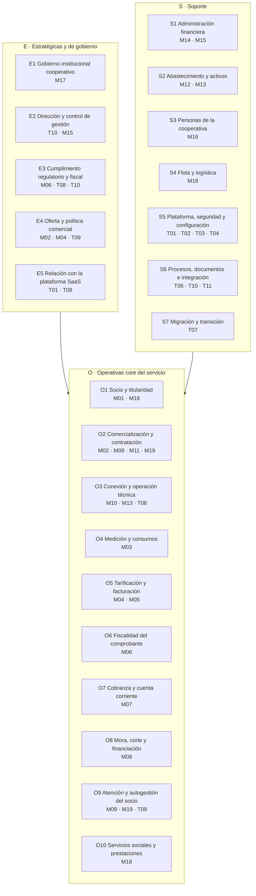
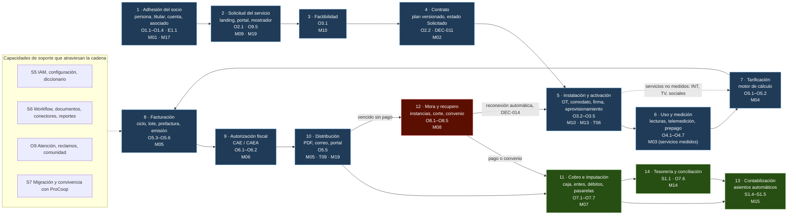

# GoodApps Cooperativas

## Mapa de capacidades de negocio de la cooperativa (artefacto 2.2)

| Campo | Valor |
|---|---|
| Artefacto | 2.2 Mapa de capacidades por módulo (índice de entregables `00-INDICE.md`) |
| Versión | 1.0 |
| Fecha | 05-11-2026 |
| Estado | Borrador para revisión funcional |
| Deriva de | `00-ESPECIFICACION-MAESTRA.md` §4, §7, §12 y §15 · `03-plan-de-olas-y-prompts.md` v1.1 (prompts PRO-Ox-nn) · `04-matriz-trazabilidad.md` v1.1 §3 y §4 · `05-registro-huecos.md` · anexos T12 partes 1 y 2 (fichas verticales), M01–M19 y T01–T11 |
| Prevalencia | Ante cualquier diferencia prevalece la especificación (maestra, anexos y `01-registro-decisiones.md`). Este documento no crea requisitos. |

### Control de versiones

| Versión | Fecha | Cambio |
|---|---|---|
| 1.0 | 05-11-2026 | Versión inicial: 3 niveles de capacidades, cadena de valor, heatmap por ola y matriz por servicio vertical |

### Aprobaciones

| Rol | Nombre | Fecha | Firma |
|---|---|---|---|
| Responsable funcional de la cooperativa piloto | A definir | — | — |
| Líder de análisis GoodApps | A definir | — | — |

---

## Índice

1. Propósito, alcance y convenciones
2. Vista general del mapa (nivel 1 y nivel 2)
3. Cadena de valor: de la adhesión del socio al cobro y la contabilización
4. Catálogo de capacidades (niveles 2 y 3)
5. Heatmap de habilitación: capacidad × ola
6. Matriz capacidad × servicio vertical
7. Resumen cuantitativo
8. Hallazgos: capacidades parciales y no cubiertas
9. Relación con otros entregables
10. Fuentes consultadas

---

## 1. Propósito, alcance y convenciones

### 1.1 Propósito

El mapa de capacidades describe **qué tiene que saber hacer la cooperativa** como organización, sin importar quién lo haga ni con qué pantalla. Sirve para:

- explicar el alcance de GoodApps a la conducción de la cooperativa en términos de negocio y no de módulos de software;
- mostrar qué módulo es dueño de cada capacidad (maestra §12, regla ARQ-01);
- ver en qué ola se habilita cada capacidad (maestra §15; plan `03`);
- identificar qué capacidades quedan cubiertas a medias o no cubiertas, como insumo de la validación con el cliente.

### 1.2 Niveles

| Nivel | Qué representa | Código |
|---|---|---|
| L1 | Grupo de capacidades: **E** estratégicas y de gobierno, **O** operativas core del servicio, **S** de soporte | `E`, `O`, `S` |
| L2 | Dominio de capacidad (equivale aproximadamente a un módulo o a un grupo de módulos con un mismo propósito de negocio) | `E1`, `O3`, `S5`… |
| L3 | Capacidad concreta, con dueño, servicios, ola y nivel de cobertura | `E1.1`, `O3.4`… |

### 1.3 Columnas del catálogo

- **Dueño(s)**: anexo dueño del dato o del proceso según maestra §12 y T05. El primero es el dueño principal; los siguientes participan.
- **Servicios**: dominios verticales de M02 §6.C y T12 (`INT`, `TEL`, `TV`, `ELE`, `AG`, `CLO`, `GAS`, `ALU`, `OBR`, `SEP`, `CEM`, `SAN`, `SAL`, `VIV`, `TAS`, `CAP`, `OTR`). "Todos" indica que la capacidad es transversal a los servicios; "Transversal" indica que no depende de un servicio.
- **Ola**: primera ola en que la capacidad queda operativa y, si corresponde, la ola en que se completa, con el prompt del plan que la construye.
- **Cobertura**:
  - **Completo**: la capacidad tiene requisitos (RF/RN) en su anexo dueño, ola y prompt asignados, y ningún hueco ni brecha de fuente abierta que condicione su operación.
  - **Parcial**: la capacidad está especificada, pero su operación productiva depende de algo pendiente: una brecha de fuente con contenido sin verificar (`04` §4.1), un valor por defecto que requiere validación legal (`05`), una pregunta asumida que queda `A validar` (DEC-072) o la elección de un proveedor externo.
  - **No cubierto**: la cooperativa ejerce o podría ejercer la capacidad, pero la especificación la deja expresamente fuera del sistema o no tiene ningún requisito para ella.

---

## 2. Vista general del mapa (nivel 1 y nivel 2)

---

## 3. Cadena de valor: de la adhesión del socio al cobro y la contabilización

La cadena muestra el recorrido de valor de un servicio, tal como lo cierra el piloto Internet en las olas O2 a O6 (DEC-005, maestra §1.4) y como lo extienden los servicios medidos en O7. Cada etapa indica la capacidad L3 de la sección 4 y el módulo dueño. Los procesos detallados, en BPMN, están en [`04-procesos-bpmn.md`](04-procesos-bpmn.md) (artefacto 2.1); aquí no se repiten.

Lectura de la cadena:

- En los servicios no medidos (Internet, TV, telefonía en su abono, servicios sociales), la etapa 6 no existe: el abono se calcula desde la activación efectiva (DEC-033; T12 parte 1 §1.1).
- Los servicios sociales entran por la etapa 8 mediante entradas a facturar (`billing-inputs`) de M18 (DEC-071).
- La contabilización es temprana: el núcleo contable existe desde O5, en un plan no oficial durante la convivencia con ProCoop (DEC-009, DEC-069).

---

## 4. Catálogo de capacidades (niveles 2 y 3)

### 4.1 E · Capacidades estratégicas y de gobierno

#### E1 Gobierno institucional cooperativo

| ID | Capacidad L3 | Descripción breve | Dueño(s) | Servicios | Ola | Cobertura |
|---|---|---|---|---|---|---|
| E1.1 | Registro de asociados y Libro de Registro | Alta, baja y estado de los asociados; Libro de Registro e información para INAES | M17 INS · M01 PER | Transversal | O2 básico (PRO-O2-08); O10 completo (PRO-O10-01) | Completo |
| E1.2 | Capital social | Rubros, suscripción, integración, cuota en factura con auxiliar separado, estado de cuenta, rescate | M17 INS · M05 FAC · M07 COB · M15 CON | CAP; todo servicio con concepto capitalizable | O5 mínimo (DEC-019, PRO-O5-12); O10 completo (PRO-O10-02) | Parcial: la exposición fiscal del renglón de capital tiene un valor por defecto que requiere validación legal (HUECO-CAP-04) |
| E1.3 | Excedentes y retornos | Cálculo y distribución de excedentes y retornos a asociados | M17 INS · M15 CON | Transversal | O10 (PRO-O10-02) | Completo |
| E1.4 | Órganos sociales, asambleas y actas | Consejo, asambleas, votaciones, actas con firma digital y honorarios | M17 INS · T11 WFL | Transversal | O10 (PRO-O10-03) | Parcial: el proveedor licenciado de firma digital para actas aún no está elegido (DEC-078) |

#### E2 Dirección y control de gestión

| ID | Capacidad L3 | Descripción breve | Dueño(s) | Servicios | Ola | Cobertura |
|---|---|---|---|---|---|---|
| E2.1 | Tableros por rol e indicadores | Tableros e indicadores (KPI) por rol, con umbrales y alertas | T10 BIA | Todos | O1 base (PRO-O1-17); O11 avanzados (PRO-O11-03) | Completo |
| E2.2 | Inteligencia de negocio (BI) | Almacén analítico, modelo dimensional, generador de reportes y salas BI | T10 BIA | Todos | O11 (PRO-O11-01, PRO-O11-02) | Completo |
| E2.3 | Presupuesto y estados contables para el consejo | Presupuestos, estados contables, ajuste por inflación y libros | M15 CON | Transversal | O8 (PRO-O8-11) | Completo |

#### E3 Cumplimiento regulatorio y fiscal

| ID | Capacidad L3 | Descripción breve | Dueño(s) | Servicios | Ola | Cobertura |
|---|---|---|---|---|---|---|
| E3.1 | Informes a reguladores de servicios | Informes ERSeP, ENACOM, ENReGE (SARI, FCU-DS), Secretaría de Energía y CESP/LQSP | M06 FIS · T10 BIA (REP-BIA-015..024) | ELE, AG, CLO, GAS, ALU, INT, TEL, TV, TAS | O7 (PRO-O7-07); TIC en O10 | Completo |
| E3.2 | Regímenes informativos y libros fiscales digitales | Libros IVA digitales, regímenes de información, agentes de retención y percepción | M06 FIS · M15 CON | Transversal | O4 básico (PRO-O4-04); O8 completo (PRO-O8-04) | Completo |
| E3.3 | Protección de datos personales | Consentimientos, finalidad, derechos de acceso, rectificación y supresión, retención y anonimización (Ley 25.326, DEC-076) | T08 NFR · T02 IAM · T09 COM | Transversal | O1 (PRO-O1-18) | Completo |
| E3.4 | Presentación de declaraciones juradas ante organismos | Presentación y firma de las DDJJ fiscales y previsionales en nombre de la cooperativa | Fuera del sistema: cooperativa y su profesional contable | Transversal | — | No cubierto: el sistema calcula, prepara, valida y concilia, pero la presentación es responsabilidad de la cooperativa ([`01-resumen-ejecutivo-vision.md`](01-resumen-ejecutivo-vision.md) §6) |

#### E4 Oferta y política comercial

| ID | Capacidad L3 | Descripción breve | Dueño(s) | Servicios | Ola | Cobertura |
|---|---|---|---|---|---|---|
| E4.1 | Diseño y publicación de la oferta | Catálogo servicio → producto → plan versionado → conceptos, publicación con aprobación de otro usuario | M02 CAT · T01 PLA | Todos | O2 (PRO-O2-09, PRO-O2-10) | Completo (DEC-012, DEC-021, DEC-022) |
| E4.2 | Política tarifaria y cuadros tarifarios | Cuadros versionados con vigencias, precios, beneficios y tarifa social | M04 TAR | Todos excepto SAN | O4 (PRO-O4-05); medidos en O7 (PRO-O7-06) | Parcial: las fórmulas de cargo que ProCoop guarda en funciones y procedimientos almacenados de cada base no se extrajeron por completo (brecha B-14) |
| E4.3 | Campañas y comunicación institucional | Boletines, encuestas, eventos, beneficios, audiencias y campañas multicanal | T09 COM | Todos | O2 (PRO-O2-14, PRO-O2-15) | Completo |

#### E5 Relación con la plataforma SaaS

| ID | Capacidad L3 | Descripción breve | Dueño(s) | Servicios | Ola | Cobertura |
|---|---|---|---|---|---|---|
| E5.1 | Licenciamiento y contrato SaaS | Packs por tamaño, complementos, licencias por módulo, medición de uso y facturación del servicio | T01 PLA · M05 FAC | Transversal | O1 (PRO-O1-02, PRO-O1-03); O5 facturación (PRO-O5-13) | Completo (DEC-065) |
| E5.2 | Ambientes de prueba y simulación separada de producción | Ambiente de prueba por cooperativa con datos anonimizados y simulaciones que no afectan producción | T01 PLA · T07 MIG | Transversal | O1 (PRO-O1-04) | Parcial: la "simulación separada de producción" pedida por la base funcional no tiene un requisito explícito propio (brecha B-01) |
| E5.3 | Continuidad y niveles de servicio | Disponibilidad 99,5 %, RPO ≤ 15 min, RTO ≤ 4 h por cooperativa, respaldo y restauración por cooperativa | T01 PLA · T08 NFR | Transversal | O0 (PRO-O0-05); O1 (PRO-O1-07) | Completo (DEC-063) |

### 4.2 O · Capacidades operativas core del servicio

#### O1 Socio y titularidad

| ID | Capacidad L3 | Descripción breve | Dueño(s) | Servicios | Ola | Cobertura |
|---|---|---|---|---|---|---|
| O1.1 | Personas e identificación fiscal | Persona física o jurídica única por cooperativa, con CUIT/DNI validados y padrón | M01 PER · M06 FIS | Todos | O2 (PRO-O2-03) | Completo (DEC-044) |
| O1.2 | Titulares, cuentas y contactos | Titular, cuenta de facturación, contactos y consentimientos; numeración única por cooperativa | M01 PER | Todos | O2 (PRO-O2-04) | Completo (DEC-017) |
| O1.3 | Inmuebles, domicilios y puntos de prestación | Domicilios normalizados y geocodificados, inmuebles, unidades funcionales y puntos de prestación | M01 PER · T04 CFG | INT, TEL, TV, ELE, AG, CLO, GAS, ALU, OBR, VIV, TAS | O2 (PRO-O2-05) | Completo (DEC-046) |
| O1.4 | Relaciones, representantes y cambio de titularidad | Representantes y autorizados, transferencias, bloqueos y documentación de la persona | M01 PER | Todos | O2 (PRO-O2-06, PRO-O2-07) | Completo (DEC-045) |
| O1.5 | Adherentes y grupo familiar | Adherentes y beneficiarios de servicios sociales con dueño único en M18 | M18 SOC · M01 PER (consulta) | SEP, SAL, SAN, OTR | O4 mínimo (DEC-071, PRO-O4-14); O10 completo (PRO-O10-04) | Completo (DEC-086) |

#### O2 Comercialización y contratación

| ID | Capacidad L3 | Descripción breve | Dueño(s) | Servicios | Ola | Cobertura |
|---|---|---|---|---|---|---|
| O2.1 | Solicitud de servicio por cualquier canal | Solicitud comercial desde landing, portal o mostrador, con expediente y seguimiento | M09 CRM · M19 POR | Todos excepto ALU y TAS | O2 (PRO-O2-12, PRO-O2-16) | Completo (DEC-011) |
| O2.2 | Contrato de servicio y su ciclo de vida | Contrato con estados canónicos, cambio de plan, suspensión voluntaria, baja y provisorio | M02 CAT | Todos | O2 (PRO-O2-10); baja y suspensión en O6 (PRO-O6-05) | Completo (DEC-027, DEC-028, DEC-031, DEC-032) |
| O2.3 | Presupuestos, venta de productos y punto de venta | Presupuestos, ventas de mostrador, financiación comercial y POS | M11 VEN | OTR, GAS (envasado), INT (instalación) | O4 cargos por operación (PRO-O4-13); O8 completo (PRO-O8-12, PRO-O8-13) | Completo (DEC-016, DEC-082) |
| O2.4 | Botón de baja y bajas reguladas | Baja digital con código en 24 h, habilitada en TIC y configurable en el resto | M09 CRM · M19 POR | INT, TEL, TV; configurable en los demás | O2 (PRO-O2-12); O6 cierre (PRO-O6-05) | Completo (DEC-057) |

#### O3 Conexión y operación técnica

| ID | Capacidad L3 | Descripción breve | Dueño(s) | Servicios | Ola | Cobertura |
|---|---|---|---|---|---|---|
| O3.1 | Factibilidad técnica | Evaluación de factibilidad y estimación técnica, obligatoria por defecto en servicios con red | M10 TEC | INT, TEL, TV, ELE, AG, CLO, GAS | O3 (PRO-O3-04) | Completo (DEC-040) |
| O3.2 | Agenda, cuadrillas y órdenes de trabajo | Cuadrillas, tipos de trabajo, agenda de visitas, OT con materiales y cierre en dos pasos | M10 TEC | Todos los servicios con red; OBR | O3 (PRO-O3-01, PRO-O3-05, PRO-O3-06) | Parcial: parte de las reglas adicionales de OT de ProCoop (vales por OT, sincronización por diferencia, catastro, consumo anterior) no se revisó (brecha B-25) |
| O3.3 | Instalación, firma del socio y activación | Instalación integral con evidencias, firma electrónica con OTP y activación del contrato | M10 TEC · M02 CAT · T11 WFL | INT, TEL, TV, ELE, AG, CLO, GAS | O3 (PRO-O3-07) | Completo (DEC-033, DEC-039, DEC-078) |
| O3.4 | Aprovisionamiento de red | Alta, suspensión y reconexión automáticas en MikroTik, Radius, SmartOLT y sistemas de acceso condicional | M10 TEC · T06 INT | INT, TEL, TV, OTR (correo y SMS) | O3 (PRO-O3-09); TV y telefonía en O10 (PRO-O10-09) | Completo (DEC-041, DEC-042, DEC-084) |
| O3.5 | Equipos en comodato y stock serializado | Equipos serializados, reservas, custodia de cuadrilla y comodato valorizado | M13 STK · M10 TEC | INT, TV, TEL, ELE, AG, GAS | O3 (PRO-O3-03) | Completo (DEC-013) |
| O3.6 | Trabajo de campo sin conexión | App de campo offline-first con cola idempotente, fotos, firma y stock en vehículo | M10 TEC · T03 UXD | Todos los servicios con red | O3 (PRO-O3-08) | Completo |
| O3.7 | Redes e infraestructura (GIS) | Red georreferenciada, mantenimiento, inspecciones y costeo de OT | M10 TEC | ELE, AG, CLO, GAS, ALU; INT, TEL, TV y OBR en forma parcial | O3 geolocalización (PRO-O3-10); O7 red completa (PRO-O7-08) | Completo |
| O3.8 | Obras y contribución por mejoras | Obra con padrón de beneficiarios, prorrateo, contratos y planes de cuotas | M10 TEC · M02 CAT · M04 TAR | OBR; CLO, AG, ALU, VIV como variantes | O7 (PRO-O7-08) | Completo |
| O3.9 | Telefonía: numeración, CDR y tasación | Plan de numeración, importación de CDR, tasación y liquidación a operadores; portabilidad opcional | M10 TEC · M04 TAR | TEL | O4 abono; O10 CDR y tasación (PRO-O10-09) | Parcial: solo el 30 % de los métodos de telefonía de ProCoop se extrajo del código (brecha B-13); la portabilidad queda `A validar` (PA-TEC-19) |
| O3.10 | Guardias y emergencias técnicas | Turnos de guardia, prioridad de reclamos de seguridad y plazos de respuesta | M10 TEC · M09 CRM · T09 COM | GAS; ELE y AG en forma parcial | O7 | Parcial: los tiempos de respuesta tienen valores por defecto que requieren validación legal (HUE-GAS-05) |
| O3.11 | Control de calidad del agua | Puntos de muestreo, muestras, laboratorio con protocolo y acciones correctivas | M10 TEC · M06 FIS · T10 BIA | AG | O7 | Parcial: definida por pregunta asumida (PA-TEC-20, DEC-072), habilitable por concesión y `A validar` |

#### O4 Medición y consumos

| ID | Capacidad L3 | Descripción breve | Dueño(s) | Servicios | Ola | Cobertura |
|---|---|---|---|---|---|---|
| O4.1 | Medidores y puntos de medición | Parque de medidores, instalaciones y puntos de medición, uno por punto de suministro | M03 MED · M13 STK | ELE, AG, GAS | O7 (PRO-O7-01) | Completo (DEC-028) |
| O4.2 | Rutas y captura de lecturas | Rutas, lotes de lectura y app de lecturista sin conexión | M03 MED | ELE, AG, GAS | O7 (PRO-O7-02) | Completo |
| O4.3 | Validación de consumos | Cálculo y validación de consumos, estimaciones, prorrateos, demanda y corrección por supervisor | M03 MED | ELE, AG, GAS; CLO por derivación de AG; OTR (dispenser) | O7 (PRO-O7-03) | Completo (DEC-085) |
| O4.4 | Telemedición | Integración con sistemas AMI/MDM y lecturas remotas | M03 MED · T06 INT | ELE; AG y GAS en forma parcial | O7 (PRO-O7-04) | Parcial: las reglas de telemedición de ProCoop quedaron en la segunda pasada inconclusa de extracción (brecha B-14) |
| O4.5 | Energía prepaga | Recargas, saldo y consumo prepago, con venta por portal | M03 MED · M07 COB · M19 POR | ELE | O7 (PRO-O7-04) | Completo (DEC-088) |
| O4.6 | Generación distribuida | Inyección, medición bidireccional y compensación monetaria por defecto | M03 MED · M04 TAR · M05 FAC | ELE | O7 (PRO-O7-04) | Completo (DEC-060) |
| O4.7 | Autolectura y facturación in situ | Autolectura del socio desde el portal y emisión en el domicilio | M03 MED · M19 POR | ELE, AG, GAS | O7 (PRO-O7-05) | Completo |

#### O5 Tarificación y facturación

| ID | Capacidad L3 | Descripción breve | Dueño(s) | Servicios | Ola | Cobertura |
|---|---|---|---|---|---|---|
| O5.1 | Motor de cálculo | Reglas, fórmulas, beneficios y perfil tarifario del contrato | M04 TAR | Todos excepto SAN y CAP | O4 (PRO-O4-06); medidos en O7 (PRO-O7-06) | Parcial: fórmulas de cargo en procedimientos almacenados de ProCoop sin tarea de extracción (brecha B-14) |
| O5.2 | Simulación, explicabilidad y retroactivos | Simulación de facturación, detalle explicable del cálculo y ajustes retroactivos | M04 TAR | Todos excepto SAN | O4 (PRO-O4-07) | Completo |
| O5.3 | Ciclos, lotes y prefacturación | Ciclos, universos, lote congelado, prefacturación con excepciones y aprobación | M05 FAC | Todos excepto SAN | O4 (PRO-O4-08, PRO-O4-09) | Completo |
| O5.4 | Emisión multiservicio y separada | Emisión con numeración, factura separada por servicio por defecto y agrupada opcional | M05 FAC | Todos excepto SAN | O4 (PRO-O4-10) | Completo (DEC-034, DEC-036, DEC-037) |
| O5.5 | Comprobante, medios de pago y distribución | PDF, QR, talones con código de barras, distribución digital e impresa y cierre de ciclo | M05 FAC · T11 WFL · T09 COM | Todos excepto SAN | O4 (PRO-O4-12) | Parcial: el tope por vencimiento del código de barras SIRO confirmado en la base relevada no está trazado (brecha B-26) |
| O5.6 | Notas, recategorización y factura manual | NC/ND, vencimientos, bloqueos, recategorización e ítems manuales | M05 FAC | Todos excepto SAN | O4 (PRO-O4-11) | Completo (DEC-036) |
| O5.7 | Facturación de conceptos de terceros | Tasas y conceptos por cuenta de terceros, colgados de un contrato propio del socio | M05 FAC · M06 FIS · M02 CAT | TAS, ALU; OBR por cuenta de municipio | O4 (PRO-O4-04); O10 restantes (PRO-O10-13) | Completo (DEC-083) |
| O5.8 | Facturación de servicios sociales | Entradas a facturar (`billing-inputs`) de M18 hacia el ciclo de M05 | M18 SOC · M05 FAC | SEP, CEM, SAL, VIV, OTR | O4 (DEC-071, PRO-O4-14); O10 | Completo |

#### O6 Fiscalidad del comprobante

| ID | Capacidad L3 | Descripción breve | Dueño(s) | Servicios | Ola | Cobertura |
|---|---|---|---|---|---|---|
| O6.1 | Autorización electrónica ARCA | Certificados en bóveda, WSAA, cola CAE, CAEA y contingencia en mostrador y en masiva | M06 FIS · T06 INT | Todos excepto SAN | O4 (PRO-O4-02, PRO-O4-03) | Parcial: el 50 % de los métodos ARCA de ProCoop se extrajo del código y nueve dudas de RN-03 no pasaron a preguntas (brechas B-13 y B-16) |
| O6.2 | IVA, IIBB, percepciones y padrones | Perfil fiscal, tablas normativas, padrones, IIBB Córdoba primero y resto por configuración | M06 FIS | Todos excepto SAN | O4 (PRO-O4-01, PRO-O4-04); O8 (PRO-O8-04) | Completo (DEC-054) |
| O6.3 | Convenios y rendición a terceros | Convenio con el organismo, pasivo hasta la rendición, imputación de pagos parciales | M06 FIS · M15 CON | TAS, ALU; OBR | O4 convenio; O5 pasivo y rendición (PRO-O5-07); O8 FECESCOR | Completo |
| O6.4 | Retenciones como agente | Retenciones y percepciones practicadas a proveedores y terceros | M06 FIS · M12 CMP | Transversal | O8 (PRO-O8-03, PRO-O8-04) | Completo |

#### O7 Cobranza y cuenta corriente

| ID | Capacidad L3 | Descripción breve | Dueño(s) | Servicios | Ola | Cobertura |
|---|---|---|---|---|---|---|
| O7.1 | Cuenta corriente del titular | Auxiliar comercial por titular y entidad jurídica, saldos y resumen de cuenta | M07 COB | Todos excepto SAN | O5 (PRO-O5-02) | Completo (DEC-087) |
| O7.2 | Imputación y saldos a favor | Imputación por antigüedad, créditos entre servicios con elección, cobros no identificados | M07 COB | Todos excepto SAN | O5 (PRO-O5-03) | Parcial: el riesgo de imputación por importes repetidos señalado en RN-05 no figura en ningún anexo (brecha B-24) |
| O7.3 | Caja y recibos | Apertura y cierre de caja, recibos, bloqueos de cobro y arqueo | M07 COB | Todos excepto SAN | O5 (PRO-O5-04) | Completo |
| O7.4 | Cobradores y entes recaudadores | Cobranza domiciliaria, entes, archivos de rendición y perfiles de formato | M07 COB · T06 INT | Todos excepto SAN | O5 (PRO-O5-05); cobranza en campo de medidos en O7 (PRO-O7-09) | Parcial: los formatos de rendición Red Link y SIRO de la cooperativa piloto están en los anexos sin trazar a su fuente (brechas B-20 y B-22) |
| O7.5 | Débito automático, pagos online y pasarelas | Débitos, botón de pago, Pagos360, Mercado Pago, SIRO y Red Link en O5; el resto en O11 | M07 COB · T06 INT · M19 POR | Todos excepto SAN | O5 (PRO-O5-06, PRO-O5-13); O11 restantes (PRO-O11-04) | Completo (DEC-015, DEC-051) |
| O7.6 | Conciliación de cobros | Cupones, devoluciones, conciliación de pasarelas, entes y bancos | M07 COB · M14 TES | Todos excepto SAN | O5 (PRO-O5-07) | Completo |
| O7.7 | Cobro con códigos de pago de ProCoop | Reconocimiento de los identificadores impresos en facturas de ProCoop hasta su vencimiento | M07 COB · T07 MIG | Todos los migrados | O5; O11 (PRO-O11-08) | Completo (DEC-050) |

#### O8 Mora, corte y financiación

| ID | Capacidad L3 | Descripción breve | Dueño(s) | Servicios | Ola | Cobertura |
|---|---|---|---|---|---|---|
| O8.1 | Política de mora y notificaciones | Instancias, candidatos, notificaciones con constancia, protecciones (por ejemplo, electrodependientes) | M08 MOR · T09 COM | Todos excepto ALU y OTR | O6 (PRO-O6-02, PRO-O6-03) | Completo |
| O8.2 | Intereses y recargos | Motor común de interés, recargos al cobrar, intereses masivos | M08 MOR · M07 COB | Todos excepto SAN | O5 (PRO-O5-01); O6 (PRO-O6-01) | Completo (DEC-051) |
| O8.3 | Suspensión, corte y reconexión | Modos por servicio (restringido, interrumpido), ventanas de corte y reconexión automática | M08 MOR · M10 TEC · T06 INT | INT, TEL, TV, ELE, AG, GAS; CLO sin corte físico | O6 (PRO-O6-04); medidos en O7 (PRO-O7-09); TEL y TV en O10 | Parcial: los modos de TEL, TV y AG y la ventana de corte ERSeP tienen valores por defecto que requieren validación legal (HUE-TEL-04, HUE-TV-03, HUE-AG-02, HUE-ELE-05) |
| O8.4 | Convenios y planes de pago | Planes de pago, convenios, planes de cuotas y garantías | M08 MOR | Todos excepto ALU, SAN y OTR | O6 (PRO-O6-06, PRO-O6-07) | Completo |
| O8.5 | Incobrables y prescripción | Pase a incobrable y prescripción por tipo de obligación (24 y 60 meses) | M08 MOR · M07 COB | Todos excepto SAN | O6 (PRO-O6-07) | Parcial: los plazos requieren validación legal antes de la primera corrida productiva (DEC-052) |
| O8.6 | Suspensión de cobertura social | Suspensión de cobertura por cuotas impagas y carencia de rehabilitación | M08 MOR · M18 SOC | SEP, SAL | O10 | Parcial: valores por defecto (tres meses impagos, 30 días de carencia) a validar legalmente (HUECO-SEP-01) |

#### O9 Atención y autogestión del socio

| ID | Capacidad L3 | Descripción breve | Dueño(s) | Servicios | Ola | Cobertura |
|---|---|---|---|---|---|---|
| O9.1 | Expediente, bandejas y tickets | Expediente único con número de seguimiento, bandejas, asignación y derivación | M09 CRM | Todos | O2 (PRO-O2-11) | Completo |
| O9.2 | Reclamos con plazos regulatorios | Reclamos e incidentes con SLA por motivo (ENACOM, seguridad de gas) | M09 CRM | Todos excepto TAS | O3 (PRO-O3-11) | Parcial: los plazos ENACOM por motivo tienen valores por defecto que requieren validación legal (HUE-INT-03) |
| O9.3 | Omnicanal y asistencia con IA | WhatsApp, correo, SMS y bot; IA que clasifica, resume y sugiere, apagada hasta que la cooperativa la acepta | M09 CRM · T09 COM · T06 INT | Todos | O6 (PRO-O6-09); adjuntos y canales restantes en O10 (PRO-O10-12) | Completo (DEC-055, DEC-056) |
| O9.4 | Mesa de entradas, turnero y tótem | Ingreso y pase de expedientes, turnero, turnos desde el portal, tótem y agente local de periféricos | M09 CRM · T06 INT | Transversal | O10 (PRO-O10-11) | Completo |
| O9.5 | Portal y app del socio | Cuentas, facturas, pagos, consumos, gestiones y perfil, con vinculación verificada de cuentas | M19 POR | Todos | O2 (PRO-O2-17); pagos en O5 (PRO-O5-13) | Completo (DEC-043, DEC-066, DEC-067) |
| O9.6 | Sitio público con marca de la cooperativa | Landing con servicios habilitados, noticias, registro, consulta y pago sin login | M19 POR · T03 UXD | Todos | O2 (PRO-O2-16) | Completo |
| O9.7 | Comunidad editorial | Muro editorial con reacciones y comentarios moderados, encuestas y beneficios | T09 COM | Transversal | O2 (PRO-O2-13, PRO-O2-14) | Completo (DEC-008) |

#### O10 Servicios sociales y prestaciones

| ID | Capacidad L3 | Descripción breve | Dueño(s) | Servicios | Ola | Cobertura |
|---|---|---|---|---|---|---|
| O10.1 | Planes de cobertura y prestadores | Planes con topes y carencias, prestadores, solicitudes de prestación | M18 SOC | SEP, SAL, SAN | O10 (PRO-O10-04) | Completo |
| O10.2 | Sepelio y subsidio por fallecimiento | Caso de sepelio, expediente de subsidio, independiente del cementerio | M18 SOC | SEP | O10 (PRO-O10-05) | Completo |
| O10.3 | Cementerio parque | Unidades, derechos de sepultura, titulares, autorizados, ocupaciones y actos | M18 SOC · M04 TAR | CEM | O2 catálogo; O10 operación (PRO-O10-05) | Parcial: el tratamiento contable y fiscal de la venta del derecho es una pregunta asumida a validar con el contador (PA-CON-17) |
| O10.4 | Banco de sangre por convenio | Adhesión y solicitud administrativa de cobertura, sin datos clínicos | M18 SOC | SAN | O10 (PRO-O10-06) | Completo (DEC-024) |
| O10.5 | Ambulancias y traslados | Viajes con tramos, autorizaciones administrativas y cargo por traslado | M18 SOC · M04 TAR | SAL | O10 (PRO-O10-06) | Completo |
| O10.6 | Planes de vivienda | Inscripción, adjudicación, aportes porcentuales, construcción por etapas y entrega | M18 SOC · M04 TAR | VIV | O10 (PRO-O10-07) | Completo |
| O10.7 | Otras prestaciones | Préstamos ortopédicos, dispenser, registro de vehículos eléctricos, seguros por cuenta de terceros | M18 SOC | OTR | O10 (PRO-O10-07) | Completo |
| O10.8 | Despacho de emergencias médicas | Recepción y despacho de móviles ante emergencias | Fuera del sistema: prestador habilitado | SAL | — | No cubierto: el sistema no despacha emergencias, las deriva al prestador (T12 parte 2, ficha SAL; RF-SOC-082) |
| O10.9 | Gestión clínica | Historia clínica, decisiones clínicas y datos clínicos de donantes o pacientes | Fuera del sistema | SAL, SAN | — | No cubierto: solo se gestionan aspectos administrativos (DEC-024; [`01-resumen-ejecutivo-vision.md`](01-resumen-ejecutivo-vision.md) §6) |

### 4.3 S · Capacidades de soporte

#### S1 Administración financiera

| ID | Capacidad L3 | Descripción breve | Dueño(s) | Servicios | Ola | Cobertura |
|---|---|---|---|---|---|---|
| S1.1 | Tesorería operativa | Cuentas propias, movimientos, rendición, depósitos, extractos y conciliación bancaria | M14 TES | Transversal | O5 (PRO-O5-08, PRO-O5-09) | Completo (DEC-059) |
| S1.2 | Valores, cheques e Interbanking | Valores de terceros, cheques propios, eCheq, cupones de tarjeta, retenciones recibidas, Interbanking | M14 TES · T06 INT | Transversal | O8 (PRO-O8-07, PRO-O8-08) | Completo |
| S1.3 | Pagos a proveedores y flujo de fondos | Órdenes de pago, cotizaciones, compromisos y flujo de fondos | M14 TES · M12 CMP | Transversal | O8 (PRO-O8-09) | Completo |
| S1.4 | Núcleo contable y asientos automáticos | Plan de cuentas, ejercicios, centros de costo, asientos automáticos desde eventos económicos | M15 CON | Todos | O5 (PRO-O5-10, PRO-O5-11) | Completo (DEC-009, DEC-069) |
| S1.5 | Contabilidad completa y cierre | Múltiples planes, cierre mensual y anual, libros, ajuste por inflación | M15 CON | Transversal | O8 (PRO-O8-10, PRO-O8-11) | Completo |

#### S2 Abastecimiento y activos

| ID | Capacidad L3 | Descripción breve | Dueño(s) | Servicios | Ola | Cobertura |
|---|---|---|---|---|---|---|
| S2.1 | Compras | Proveedores, solicitudes, cotizaciones, órdenes de compra, recepción y control de tres vías | M12 CMP | Transversal | O8 (PRO-O8-01, PRO-O8-02) | Completo |
| S2.2 | Compra mayorista de energía, gas y señales | Factura del mayorista de energía y gas y liquidación de derechos de señales | M12 CMP | ELE, GAS, TV | O8 | Completo |
| S2.3 | Stock e inventario | Artículos, depósitos, movimientos, inventario, mínimos y valorización | M13 STK | Transversal | O3 base (PRO-O3-02); O8 completo (PRO-O8-05) | Completo |
| S2.4 | Bienes de uso y RMA | Bienes de uso, devoluciones a proveedor (RMA) y stock por unidad de gasto | M13 STK | Transversal | O8 (PRO-O8-06) | Completo |
| S2.5 | Fabricación | Órdenes de producción (postes, bloques u otros) | M13 STK | Transversal | O10 (PRO-O10-10) | Completo |
| S2.6 | Portal de proveedores | Órdenes de compra, carga de facturas y remitos, estado de pagos y retenciones, por invitación | M12 CMP · M19 POR | Transversal | O8 (PRO-O8-03) | Completo |

#### S3 Personas de la cooperativa

| ID | Capacidad L3 | Descripción breve | Dueño(s) | Servicios | Ola | Cobertura |
|---|---|---|---|---|---|---|
| S3.1 | Legajos y estructura laboral | Legajo mínimo para técnicos y legajo completo multiempleador | M16 SUE | Transversal | O3 mínimo (PRO-O3-01); O9 completo (PRO-O9-01) | Completo |
| S3.2 | Liquidación de sueldos | Importación de liquidador externo en O8; liquidación propia con Ganancias, F.931 y Libro de Sueldos Digital en O9 | M16 SUE · M15 CON · M14 TES | Transversal | O8 importación (PRO-O8-14); O9 (PRO-O9-03..05) | Completo (DEC-058) |
| S3.3 | Recibos digitales y portal del empleado | Recibos con firma digital, novedades de RRHH y portal del empleado | M16 SUE · T11 WFL | Transversal | O9 (PRO-O9-06) | Parcial: el proveedor licenciado de firma digital para recibos aún no está elegido (DEC-078) |

#### S4 Flota y logística

| ID | Capacidad L3 | Descripción breve | Dueño(s) | Servicios | Ola | Cobertura |
|---|---|---|---|---|---|---|
| S4.1 | Flota, combustibles y viajes | Vehículos, choferes, combustibles, viajes, rendiciones y GPS | M18 SOC | SAL; transversal para la flota técnica | O8 vehículos; O10 completo (PRO-O10-08) | Completo |

#### S5 Plataforma, seguridad y configuración

| ID | Capacidad L3 | Descripción breve | Dueño(s) | Servicios | Ola | Cobertura |
|---|---|---|---|---|---|---|
| S5.1 | Ciclo de vida de la cooperativa en la plataforma | Alta asistida, estados del tenant, checklist de habilitación por capacidad | T01 PLA | Transversal | O1 (PRO-O1-01, PRO-O1-04) | Completo |
| S5.2 | Identidad, roles y auditoría | Identidad única, 2FA, roles plantilla, alcance de datos, separación de funciones, auditoría inmutable | T02 IAM | Transversal | O0 (PRO-O0-11, PRO-O0-12); O1 (PRO-O1-08, PRO-O1-09) | Completo |
| S5.3 | Parametrización tipada y versionada | Parámetros con nombre, tipo, vigencia e historial; tablas maestras; geografía y calendarios | T04 CFG · T04b | Transversal | O0 (PRO-O0-13); O1 (PRO-O1-10..12) | Parcial: solo el 17 % de los formularios de configuración de ProCoop se extrajo del código y la segunda pasada sobre parámetros quedó inconclusa (brechas B-13 y B-14) |
| S5.4 | Varias entidades jurídicas por cooperativa | Emisión, contabilidad y sueldos por entidad jurídica, con `legalEntityId` en todo documento económico | T04 CFG | Transversal | O0 (PRO-O0-13) | Completo (DEC-064) |
| S5.5 | Marca, diccionario y experiencia | Marca en tiempo de ejecución, vocabulario propio de la cooperativa, accesibilidad WCAG 2.2 AA | T03 UXD | Transversal | O0 (PRO-O0-14..17); O1 (PRO-O1-13) | Completo |
| S5.6 | Soporte de plataforma auditado | Acceso temporal, consentido y auditado del soporte | T01 PLA · T02 IAM | Transversal | O1 (PRO-O1-05) | Completo |

#### S6 Procesos, documentos e integración

| ID | Capacidad L3 | Descripción breve | Dueño(s) | Servicios | Ola | Cobertura |
|---|---|---|---|---|---|---|
| S6.1 | Workflow, aprobaciones y bandeja de tareas | Máquinas de estado, aprobaciones, delegaciones y bandeja del empleado | T11 WFL | Transversal | O1 (PRO-O1-15, PRO-O1-16) | Completo |
| S6.2 | Trámites configurables | Plantillas de trámite ajustables y solicitudes genéricas que terminan en tarea o caso | T11 WFL | Todos | O2 (PRO-O2-01) | Completo (DEC-079) |
| S6.3 | Documentos, plantillas y PDF | Expediente documental, plantillas, numeración de documentos y PDF/A | T11 WFL · T03 UXD | Transversal | O0 (PRO-O0-18); O1 (PRO-O1-16) | Completo (DEC-080) |
| S6.4 | Conectores e integraciones | Conectores con credenciales en bóveda, certificados y monitoreo | T06 INT | Transversal | O0 (PRO-O0-10); O1 (PRO-O1-14) | Completo (DEC-074) |
| S6.5 | API para terceros y webhooks | API pública con scopes, medición de uso y webhooks | T10 BIA · T06 INT | Transversal | O11 (PRO-O11-03) | Completo |
| S6.6 | Reportes y exportaciones | Motor de reportes, reportes programados y exportaciones | T10 BIA | Todos | O1 (PRO-O1-17); O2 programados (PRO-O2-18); O11 generador (PRO-O11-02) | Completo |

#### S7 Migración y transición

| ID | Capacidad L3 | Descripción breve | Dueño(s) | Servicios | Ola | Cobertura |
|---|---|---|---|---|---|---|
| S7.1 | Migración repetible por dominio | Extracción, perfilado, mapeo, carga idempotente, conciliación e histórico consultable | T07 MIG | Todos excepto SAN | O1 herramienta (PRO-O1-19); cargadores en la ola de cada módulo; O11 (PRO-O11-06) | Parcial: falta la tarea de extracción de funciones y procedimientos almacenados de la base de la cooperativa piloto (brecha B-14) |
| S7.2 | Corrida paralela y facturación comparada | Comparación documento por documento con tolerancia y diferencias explicadas | T07 MIG | Todos los facturados | O11 (PRO-O11-07) | Completo |
| S7.3 | By-pass, convivencia y corte por etapas | Corte comercial (M01–M09) y luego administrativo, con plan de retorno | T07 MIG | Todos | O11 (PRO-O11-08..10) | Completo (DEC-068, DEC-069) |
| S7.4 | Anonimización para ambientes de prueba | Copias anonimizadas para ensayos y capacitación | T07 MIG · T08 NFR | Transversal | O1 (PRO-O1-04); O11 | Completo |

---

## 5. Heatmap de habilitación: capacidad × ola

Leyenda: **●** ola en que se habilita el núcleo de la capacidad L2 · **◐** ola en que se habilita una parte o se amplía · **·** sin cambios en esa ola. Fuente: columna "Ola" de la sección 4, maestra §15 y plan `03` (prompts PRO-Ox-nn).

| L2 | O0 | O1 | O2 | O3 | O4 | O5 | O6 | O7 | O8 | O9 | O10 | O11 |
|---|---|---|---|---|---|---|---|---|---|---|---|---|
| E1 Gobierno institucional | · | · | ◐ | · | · | ◐ | · | · | · | · | ● | · |
| E2 Dirección y control | · | ◐ | · | · | · | · | · | · | ◐ | · | · | ● |
| E3 Cumplimiento regulatorio y fiscal | · | ◐ | · | · | ◐ | · | · | ● | ● | · | ◐ | · |
| E4 Oferta y política comercial | · | · | ● | · | ● | · | · | ◐ | · | · | · | · |
| E5 Relación con la plataforma SaaS | ◐ | ● | · | · | · | ◐ | · | · | · | · | · | · |
| O1 Socio y titularidad | · | · | ● | · | ◐ | · | · | · | · | · | ◐ | · |
| O2 Comercialización y contratación | · | · | ● | · | ◐ | · | ◐ | · | ◐ | · | · | · |
| O3 Conexión y operación técnica | · | · | · | ● | ◐ | · | · | ● | · | · | ◐ | · |
| O4 Medición y consumos | · | · | · | · | · | · | · | ● | · | · | · | · |
| O5 Tarificación y facturación | · | · | · | · | ● | · | · | ◐ | · | · | ◐ | · |
| O6 Fiscalidad del comprobante | · | · | · | · | ● | ◐ | · | ◐ | ◐ | · | · | ◐ |
| O7 Cobranza y cuenta corriente | · | · | · | · | · | ● | · | ◐ | · | · | · | ◐ |
| O8 Mora, corte y financiación | · | · | · | · | · | ◐ | ● | ◐ | · | · | ◐ | · |
| O9 Atención y autogestión | · | · | ● | ◐ | · | ◐ | ◐ | · | · | · | ◐ | · |
| O10 Servicios sociales | · | · | ◐ | · | ◐ | · | · | · | · | · | ● | · |
| S1 Administración financiera | · | · | · | · | · | ● | · | · | ● | · | · | · |
| S2 Abastecimiento y activos | · | · | · | ◐ | · | · | · | · | ● | · | ◐ | · |
| S3 Personas de la cooperativa | · | · | · | ◐ | · | · | · | · | ◐ | ● | · | · |
| S4 Flota y logística | · | · | · | · | · | · | · | · | ◐ | · | ● | · |
| S5 Plataforma, seguridad y configuración | ● | ● | · | · | · | · | · | · | · | · | · | · |
| S6 Procesos, documentos e integración | ◐ | ● | ◐ | · | · | · | · | · | · | · | · | ◐ |
| S7 Migración y transición | ◐ | ◐ | · | · | · | · | · | · | · | · | · | ● |

**Capacidades L3 que se habilitan por primera vez en cada ola** (primera ola de la columna "Ola"; las 3 no cubiertas no tienen ola):

| O0 | O1 | O2 | O3 | O4 | O5 | O6 | O7 | O8 | O9 | O10 | O11 |
|---|---|---|---|---|---|---|---|---|---|---|---|
| 7 | 10 | 16 | 10 | 16 | 11 | 5 | 11 | 11 | 1 | 11 | 4 |

Lectura del heatmap:

- **O2 a O6 concentran el piloto Internet**: en esas olas se habilitan 58 de las 113 capacidades con ola, y con ellas toda la cadena de valor de la sección 3 para un servicio no medido.
- **O7 es la ola de los servicios medidos**: habilita todo el dominio de medición y amplía técnica, facturación, fiscal, cobranza y mora. La cooperativa piloto, que opera electricidad, gas y prepago, recién puede migrar después de esta ola (DEC-088, PA-MIG-17).
- **O8 y O9 completan el soporte administrativo** (compras, stock, tesorería, contabilidad, sueldos), que durante la convivencia sigue en ProCoop hasta el corte administrativo (DEC-068).
- **O10 y O11 cierran el gobierno institucional, los servicios sociales, la BI y la transición**. Por eso el corte total de ProCoop en la cooperativa piloto avanza por etapas hasta O11.

---

## 6. Matriz capacidad × servicio vertical

Leyenda: **●** capacidad central para el servicio · **◐** aplica con variante, de forma accesoria o configurable por la cooperativa · **—** no aplica (T12 "No aplica" o el anexo no interviene). Fuente: T12 parte 1 §0.3 y fichas 1 a 8; T12 parte 2 "Matriz dominio × anexo" y fichas OBR a OTR.

| Capacidad | INT | TEL | TV | ELE | AG | CLO | GAS | ALU | OBR | SEP | CEM | SAN | SAL | VIV | TAS | CAP | OTR |
|---|---|---|---|---|---|---|---|---|---|---|---|---|---|---|---|---|---|
| E1.2 Capital social | ◐ | ◐ | ◐ | ◐ | ◐ | ◐ | ◐ | ◐ | ◐ | ◐ | ◐ | — | ◐ | ◐ | — | ● | ◐ |
| E3.1 Informes a reguladores | ● | ● | ● | ● | ● | ◐ | ● | ◐ | — | — | — | — | — | — | ◐ | — | — |
| E4.1 Oferta y catálogo | ● | ● | ● | ● | ● | ● | ● | ● | ● | ● | ● | ● | ● | ● | ● | ● | ● |
| O1.2 Titular y cuenta | ● | ● | ● | ● | ● | ● | ● | ● | ● | ● | ● | ● | ● | ● | ◐ | ◐ | ● |
| O1.3 Inmueble y punto de prestación | ● | ● | ● | ● | ● | ● | ● | ● | ● | — | — | — | — | ● | ◐ | — | — |
| O1.5 Adherentes y grupo familiar | — | — | — | — | — | — | — | — | — | ● | — | ● | ● | — | — | — | ◐ |
| O2.1 Solicitud por canal | ● | ● | ● | ● | ● | ● | ● | — | ◐ | ● | ● | ● | ● | ● | — | ◐ | ● |
| O2.4 Botón de baja | ● | ● | ● | ◐ | ◐ | ◐ | ◐ | — | — | ◐ | ◐ | ◐ | ◐ | ◐ | — | — | ◐ |
| O3.1 Factibilidad técnica | ● | ◐ | ◐ | ● | ● | ● | ● | — | — | — | — | — | — | — | — | — | — |
| O3.3 Instalación y activación con OT | ● | ● | ● | ● | ● | ● | ● | ◐ | ● | — | — | — | — | — | — | — | — |
| O3.4 Aprovisionamiento de red | ● | ● | ● | — | — | — | — | — | — | — | — | — | — | — | — | — | ◐ |
| O3.5 Equipos y medidores serializados | ● | ◐ | ● | ◐ | ◐ | — | ◐ | — | — | — | — | — | — | — | — | — | — |
| O3.7 Redes e infraestructura (GIS) | ◐ | ◐ | ◐ | ● | ● | ● | ● | ● | ◐ | — | — | — | — | — | — | — | — |
| O3.8 Obras y contribución por mejoras | — | — | — | — | ◐ | ◐ | — | ◐ | ● | — | — | — | — | ◐ | — | — | — |
| O3.9 Telefonía: CDR y tasación | — | ● | — | — | — | — | — | — | — | — | — | — | — | — | — | — | — |
| O3.10 Guardias y emergencias técnicas | — | — | — | ◐ | ◐ | — | ● | — | — | — | — | — | — | — | — | — | — |
| O3.11 Calidad del agua | — | — | — | — | ● | — | — | — | — | — | — | — | — | — | — | — | — |
| O4.1–O4.3 Medición y consumos | — | — | — | ● | ● | ◐ | ● | — | — | — | — | — | — | — | — | — | ◐ |
| O4.4 Telemedición | — | — | — | ● | ◐ | — | ◐ | — | — | — | — | — | — | — | — | — | — |
| O4.5 Energía prepaga | — | — | — | ● | — | — | — | — | — | — | — | — | — | — | — | — | — |
| O4.6 Generación distribuida | — | — | — | ● | — | — | — | — | — | — | — | — | — | — | — | — | — |
| O5.1 Motor de cálculo | ● | ● | ● | ● | ● | ● | ● | ● | ● | ● | ● | — | ● | ● | ◐ | — | ● |
| O5.4 Emisión del comprobante | ● | ● | ● | ● | ● | ● | ● | ◐ | ● | ● | ● | — | ● | ● | ◐ | ◐ | ● |
| O5.7 Conceptos de terceros | — | — | — | — | — | — | — | ● | ◐ | — | — | — | — | — | ● | — | — |
| O5.8 Facturación de servicios sociales | — | — | — | — | — | — | — | — | — | ● | ● | — | ● | ● | — | — | ● |
| O6.1 Autorización ARCA | ● | ● | ● | ● | ● | ● | ● | ● | ● | ● | ● | — | ● | ● | ◐ | ◐ | ● |
| O6.3 Rendición a terceros | — | — | — | — | — | — | — | ● | ◐ | — | — | — | — | — | ● | — | — |
| O7.1–O7.6 Cobranza y cuenta corriente | ● | ● | ● | ● | ● | ● | ● | ● | ● | ● | ● | — | ● | ● | ◐ | ● | ● |
| O8.3 Suspensión, corte y reconexión | ● | ● | ● | ● | ● | ◐ | ● | — | ◐ | ◐ | ◐ | ◐ | ◐ | ◐ | ◐ | ◐ | — |
| O8.4 Convenios y planes de pago | ● | ● | ● | ● | ● | ● | ● | — | ● | ● | ● | — | ● | ● | ◐ | ◐ | — |
| O9.2 Reclamos con plazos regulatorios | ● | ● | ● | ● | ● | ◐ | ● | ◐ | ◐ | ◐ | ◐ | ◐ | ◐ | ◐ | — | ◐ | ◐ |
| O9.5 Portal y app del socio | ● | ● | ● | ● | ● | ● | ● | ● | ● | ● | ● | ● | ● | ● | ◐ | ◐ | ● |
| O10 Servicios sociales (M18) | — | — | — | — | — | — | — | — | — | ● | ● | ● | ● | ● | — | — | ● |
| S2.2 Compra mayorista | — | — | ◐ | ● | — | — | ● | — | — | — | — | — | — | — | — | — | — |
| S4.1 Flota y traslados | — | — | — | — | — | — | — | — | — | — | — | — | ● | — | — | — | — |
| S7.1 Migración desde ProCoop | ● | ● | ● | ● | ● | ● | ● | ● | ● | ● | ◐ | — | ● | ● | ● | ● | ◐ |

Notas de la matriz:

- **INT** es el servicio piloto de construcción (DEC-005) y el único que recorre toda la cadena entre O2 y O6.
- **SAN** no tiene precio ni comprobante: es una gestión administrativa por convenio, sin datos clínicos (DEC-024).
- **TAS** y **CAP** no son servicios con prestación propia: los conceptos de terceros cuelgan de un contrato propio del socio (DEC-083) y el capital va en renglón propio de la factura del servicio (DEC-061).
- **CEM** y parte de **OTR** no tienen tablas ProCoop relevadas; se cargan con plantillas de importación (T07 §19.33).
- **CLO** usa el consumo de AG y no admite corte físico: solo gestión de deuda, intereses y planes (T12 parte 1, ficha CLO).
- **ALU** se factura como tasa en el bloque de terceros o como contrato accesorio del suministro eléctrico, nunca de las dos formas a la vez (T12 parte 1, ficha ALU).

---

## 7. Resumen cuantitativo

| Grupo L1 | Capacidades L2 | Capacidades L3 | Completo | Parcial | No cubierto |
|---|---:|---:|---:|---:|---:|
| E · Estratégicas y de gobierno | 5 | 17 | 12 | 4 | 1 |
| O · Operativas core del servicio | 10 | 68 | 51 | 15 | 2 |
| S · Soporte | 7 | 31 | 28 | 3 | 0 |
| **Total** | **22** | **116** | **91** | **22** | **3** |

En porcentaje: 78,4 % completo, 19,0 % parcial y 2,6 % no cubierto. Ninguna capacidad parcial carece de requisitos: todas tienen RF, ola y prompt, y lo que falta es validar un valor, elegir un proveedor o terminar de trazar una fuente.

Motivos de las 22 capacidades parciales (cada capacidad se cuenta una vez, por su motivo principal):

| Motivo principal | Capacidades | Cantidad |
|---|---|---:|
| Valor por defecto que requiere validación legal (`05-registro-huecos.md`, DEC-052) | E1.2, O3.10, O8.3, O8.5, O8.6, O9.2 | 6 |
| Brecha de fuente: extracción del código de ProCoop incompleta (B-13, B-14) | E4.2, O3.9, O4.4, O5.1, O6.1, S5.3, S7.1 | 7 |
| Brecha de fuente: contenido de la base relevada sin trazar o sin verificar (B-01, B-20, B-22, B-24, B-25, B-26) | E5.2, O3.2, O5.5, O7.2, O7.4 | 5 |
| Pregunta asumida que queda `A validar` (DEC-072) | O3.11, O10.3 | 2 |
| Proveedor externo pendiente de elección (firma digital, DEC-078) | E1.4, S3.3 | 2 |
| **Total** | | **22** |

Dos capacidades tienen además un motivo secundario: O3.9 (pregunta asumida PA-TEC-19 sobre portabilidad) y O6.1 (dudas de RN-03 sin pasar a preguntas, brecha B-16).

---

## 8. Hallazgos: capacidades parciales y no cubiertas

### 8.1 Capacidades no cubiertas (3)

| ID | Capacidad | Motivo | Recomendación |
|---|---|---|---|
| E3.4 | Presentación de declaraciones juradas ante organismos | Límite de responsabilidad: el sistema prepara, valida y concilia; la presentación es de la cooperativa y su profesional contable | Ratificarlo en el contrato de servicio y en el plan de capacitación del contador (artefacto 8.4) |
| O10.8 | Despacho de emergencias médicas | Exclusión de diseño: se deriva al prestador habilitado (RF-SOC-082) | Confirmar con la cooperativa que su servicio de ambulancias opera con un prestador que despacha, y documentar la interfaz de derivación |
| O10.9 | Gestión clínica (historia clínica, datos clínicos) | Exclusión de diseño (DEC-024): solo gestión administrativa | Confirmar que ningún prestador espera recibir datos clínicos desde GoodApps |

Las tres son exclusiones deliberadas y documentadas, no omisiones. Ninguna capacidad de ProCoop quedó sin destino en la especificación (DEC-007; maestra §4.3).

### 8.2 Capacidades parciales que conviene resolver antes de la ola que las habilita

| Prioridad | Capacidad | Qué falta | Antes de | Responsable sugerido |
|---|---|---|---|---|
| Alta | O5.1 y E4.2 Motor de cálculo y política tarifaria | Extraer las funciones `FORMULA_CARGO*` y los procedimientos almacenados de la base de la cooperativa piloto (B-14) | O4 (INT) y O7 (medidos) | Equipo de migración con M04 |
| Alta | O6.1 Autorización ARCA | Convertir las nueve dudas de RN-03 en preguntas o en reglas "no replicar" (B-16) y cerrar la cobertura del 50 % de métodos (B-13) | O4 | Dueño de M06 |
| Alta | O7.2 y O7.4 Imputación y entes | Incorporar el control de imputación por importes repetidos (B-24) y trazar los formatos Red Link y SIRO de la cooperativa piloto (B-20, B-22) | O5 | Dueño de M07 y T06 |
| Alta | O5.5 Comprobante con código de barras | Citar en M05 y M07 el tope por vencimiento del código de barras SIRO y la política de pagos parciales por ente (B-26) | O5 | Dueño de M05 y M07 |
| Media | O8.3, O8.5, O9.2, O3.10, O8.6, E1.2 | Validación legal de los valores por defecto (modos de corte, prescripción, plazos ENACOM, emergencias de gas, cobertura social, exposición fiscal del capital) | Primera corrida productiva de cada servicio | Asesoría legal y contador de la cooperativa |
| Media | O3.2 Órdenes de trabajo | Revisar las reglas adicionales de OT de ProCoop y citarlas (B-25) | O3 | Dueño de M10 |
| Media | S5.3 y S7.1 Parametrización y migración | Tercera pasada de extracción sobre formularios de configuración y `ProcoopNet`, o validación con la cooperativa (B-13, B-14) | O1 y primer ensayo de migración | Equipo de migración |
| Media | E1.4 y S3.3 Firma digital | Elegir el proveedor licenciado de firma digital (DEC-078) | O8 y O9 | Plataforma |
| Baja | O3.9, O3.11, O10.3, O4.4, E5.2 | Confirmar las preguntas asumidas (portabilidad, calidad del agua, tratamiento del derecho de sepultura), revisar reglas de telemedición y dar requisito explícito a la simulación separada | Ola de cada capacidad | Dueños de M10, M03, M15 y T01 |

El análisis de brechas ProCoop → GoodApps, con el detalle de las 26 brechas de fuente, está en [`15-analisis-brechas-procoop.md`](15-analisis-brechas-procoop.md).

---

## 9. Relación con otros entregables

| Entregable | Relación |
|---|---|
| [`01-resumen-ejecutivo-vision.md`](01-resumen-ejecutivo-vision.md) (1.3) | Alcance, límites de responsabilidad y hoja de ruta que este mapa detalla por capacidad |
| [`04-procesos-bpmn.md`](04-procesos-bpmn.md) (2.1) | Procesos que ejecutan las capacidades de la cadena de valor |
| [`15-analisis-brechas-procoop.md`](15-analisis-brechas-procoop.md) (2.3) | Qué cambia para la cooperativa en cada capacidad respecto de ProCoop |
| [`02-arquitectura-c4.md`](02-arquitectura-c4.md) (5.1) | Módulos y componentes que materializan cada capacidad |
| [`07-estrategia-pruebas.md`](07-estrategia-pruebas.md) (9.1) | Criterios de salida por ola que verifican la habilitación de cada capacidad |
| [`09-riesgos-y-raci.md`](09-riesgos-y-raci.md) (1.4, 1.5) | Responsables y riesgos asociados a las capacidades parciales |

---

## 10. Fuentes consultadas

| Fuente | Uso en este documento |
|---|---|
| `docs/especificacion/00-ESPECIFICACION-MAESTRA.md` §1.4, §4, §7, §12, §15 | Alcance, servicios, correspondencia con los módulos de ProCoop, dueños de datos y olas |
| `docs/especificacion/01-registro-decisiones.md` | DEC citadas en la columna Cobertura |
| `docs/especificacion/03-plan-de-olas-y-prompts.md` v1.1 | Prompts PRO-Ox-nn que construyen cada capacidad |
| `docs/especificacion/04-matriz-trazabilidad.md` v1.1 §3 y §4.1 | Brechas de fuente B-01 a B-26 |
| `docs/especificacion/05-registro-huecos.md` | Huecos resueltos con valor por defecto a validar y huecos de decisión |
| `docs/especificacion/02-preguntas-abiertas.md` | PA-TEC-19, PA-TEC-20, PA-CON-17 asumidas (DEC-072) |
| `docs/especificacion/anexos/T12-SRV-fichas-verticales-servicios-parte1.md` y `-parte2.md` | Matrices servicio × anexo, olas e hitos por servicio, reglas por servicio |
| `docs/especificacion/anexos/M10-TEC-tecnica-campo-redes.md` §5.20 | Calidad del agua y portabilidad numérica |
| `docs/especificacion/anexos/T07-MIG-migracion-procoop.md` §19.33 | Servicios sin tablas ProCoop (cementerio, ortopedia, dispenser) |
| `docs/entregables-analisis-diseno/01-resumen-ejecutivo-vision.md` §6 | Límites de responsabilidad del sistema |

Este documento no contiene datos personales, credenciales ni código de ProCoop. Los nombres de tablas y de funciones de ProCoop se citan solo como identificadores de trazabilidad.
