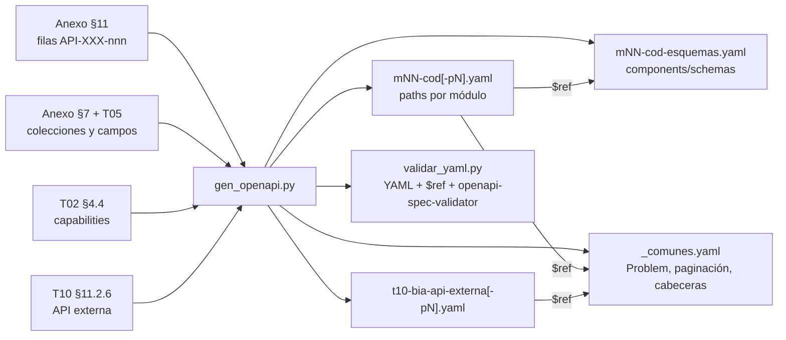

# Contratos de API (OpenAPI 3.1)

Artefacto 7.1 del índice de entregables. Este documento es el índice de los contratos OpenAPI derivados de las tablas `API-XXX-nnn` de la sección 11 de cada anexo (M01 a M19, T01 a T11). Los contratos están en [`18-openapi/`](18-openapi/): un documento OpenAPI 3.1 por módulo (partido en partes cuando supera el límite de líneas), un archivo de esquemas por módulo, la API externa de T10 en archivo propio y los componentes comunes.

> **Rol frente a GoodApps (D-06, DEC-118):** estos YAML y el catálogo son **contrato de diseño y trazabilidad RF→operación** en GACAC. GoodApps implementa en ASP.NET Core; los esquemas «colección» en OpenAPI se leen como **entidades lógicas** alineadas a tablas en `07-catalogo-tablas-sql.md` / `07-ddl`. No implican stack Node ni Mongo en el producto entregado.

| Dato | Valor |
|---|---|
| Filas API en los anexos (universo) | 2.223 |
| Filas documentadas como operaciones HTTP (incluye las que comparten operación) | 2.199 |
| Filas documentadas como contratos internos (sin HTTP) | 10 |
| Filas de referencia a la API dueña (sin operación propia) | 2 |
| Filas reemplazadas con ruta (sin operación propia) | 12 |
| Operaciones HTTP (método + ruta) | 4.193 |
| Documentos OpenAPI | 170 (máximo 1.412 líneas por archivo) |
| Esquemas de colección y subdocumento | 1.069 (1.066 con campos del §7) |

Fuentes: §11 de cada anexo (operaciones), §7 de cada anexo y T05 (esquemas), T02 §4.4 (capabilities), T10 §11.2.6 (API externa), M01 §11 y T10 (formato de errores). Generación: `_trabajo/gen_openapi.py` (usa `_trabajo/contratos_lib.py` y `_trabajo/emisor_yaml.py`); validación: `_trabajo/validar_yaml.py`. Los YAML no se editan a mano: se regeneran.

## Para qué sirve cada API y cada endpoint

Los YAML son el contrato técnico. Para entender la API hay dos vistas derivadas de ellos, con el mismo texto:

| Vista | Para qué | Dónde |
|---|---|---|
| Catálogo de endpoints | Leer en lenguaje de negocio para qué sirve cada API (objetivo del anexo) y, por cada uno de los 4.193 endpoints, qué hace, para qué sirve (requisito), quién lo usa, qué recibe, qué devuelve y qué pantallas lo usan | [`18-catalogo-endpoints.md`](18-catalogo-endpoints.md) y `18-catalogo-endpoints/` (un archivo por API) |
| Visor Swagger | Navegar los contratos con Swagger UI: parámetros, cuerpos, respuestas con esquema y ejemplo, y la misma ficha en cada operación. Se abre con doble clic, sin servidor ni internet; "Try it out" está deshabilitado porque no hay backend | [`18-swagger/index.html`](18-swagger/index.html); un documento consolidado por módulo en `18-swagger/specs/` (JSON importable en Postman o Insomnia) y uno completo (`goodapps-api-completa.json`) |

Orden de regeneración: `gen_openapi.py`, luego `gen_swagger.py` (consolida y valida los documentos, unos 4 minutos) y `gen_18_catalogo_endpoints.py`. Los textos de las fichas salen de `_trabajo/endpoints_lib.py`. Los componentes renombrados al consolidar quedan en `18-swagger/specs/_renombres.txt`; hoy solo son las respuestas de error propias de la API externa de T10.

## Estructura de los contratos

## Convenciones

### Identificación y rutas

- `operationId` es el API-ID del anexo. Cuando una fila define varias operaciones (rutas alternativas, `[/:id]`, `{a,b}`, `CRUD`, segmentos relativos `· /:id/accion`), la primera conserva el ID y las demás llevan sufijo `-b`, `-c`...; todas repiten el ID en `x-api-id` y la celda original en `x-ruta-origen`.
- Las rutas se normalizan a la sintaxis de OpenAPI (`:id` y `<id>` pasan a `{id}`; se quita la query de ejemplo). `CRUD` se expande a `GET`/`POST` de colección y `GET`/`PATCH`/`DELETE` de ítem.
- Las etiquetas (`tags`) son las subsecciones de la sección 11 del anexo (Backoffice, Portal, Plataforma...).
- Las anotaciones de valor anterior de las celdas de método, ruta y capability ("antes `x`", "antes: ...", texto tachado) no generan rutas ni capabilities; la "Ruta anterior" de la descripción queda en `x-ruta-anterior`.
- Una fila marcada **Referencia a API-X** no define operación: su ruta es la de la API dueña, que lista la fila en `x-api-ids-referencia`. Una fila **Reemplazado por** no se expone; si dice "queda solo GET", conserva solo esas operaciones.

### Extensiones por operación

| Extensión | Contenido |
|---|---|
| `x-api-id` | API-ID de origen (trazabilidad). |
| `x-capability` | Capability de la fila; si la celda trae varias, la de lectura para `GET` y la de escritura para el resto. Si la celda trae un rol o texto, se copia tal cual. |
| `x-capability-en-T02` | `true` si la capability figura como canónica en T02 §4.4 o §4.4.2 (1.986 canónicas). Las filas públicas sin capability llevan `x-capability: public: true` (RF-IAM-061). |
| `x-capabilities-fila` | Todas las capabilities de la celda cuando son más de una. |
| `x-ola` / `x-ola-origen` | Ola de construcción. Origen, en orden de prioridad: `tabla` (columna Ola de T10), `rf` (RF citado en la fila o por co-referencia), `coleccion` (ola de la colección en T05), `rf-inferido`, `modulo` (ola más frecuente de los RF del anexo). |
| `x-rf` / `x-rf-origen` | Requisitos vinculados. `fila`: el RF está escrito en la fila API; `co-referencia`: el RF y la API aparecen en el mismo bloque de §9, §10, §16 o §17; `inferido`: coincidencia léxica entre la descripción de la API y el texto del RF dentro del mismo anexo (a confirmar). |
| `x-coleccion` | Colección de T05 del recurso, por coincidencia del nombre de la ruta con la colección o con el título del §7. |
| `x-fuente` | Anexo, subsección y línea de la fila API. |
| `x-api-ids-adicionales` | Otras filas que declaran la misma operación (ver inconsistencias). |
| `x-api-ids-referencia` | Filas de otros anexos marcadas "Referencia a" esta API (aportan al payload, no definen operación). |
| `x-capability-canonica` | Canónica de T02 cuando la fila usa un alias (§4.4.1) o un nombre no registrado (§4.4.3). |
| `x-ruta-anterior` | Ruta previa a la convención de rutas en inglés (maestra §13), tomada de "Ruta anterior" de la fila. |
| `x-estado` / `x-reemplazo` | `reemplazado-parcial` cuando la fila conserva solo algunos métodos ("queda solo GET"). |
| `x-protocolo` | `sse` o `websocket` cuando la fila lo indica. |
| `x-proveedor` / `x-incremental` | Solo API externa: módulo que provee el dato y si admite sincronización incremental. |

### Cuerpos, respuestas y errores

- **Errores:** todas las respuestas de error son `application/problem+json` (RFC 9457) con el esquema `Problem` de `_comunes.yaml`: `type` (URI `https://goodapps.ar/errors/<mod>/<codigo>`), `title`, `status`, `detail`, `instance`, `code`, `requestId` y `errors[]` por campo. Cada operación declara 400, 401, 403, 429 y 500; 404 si la ruta tiene parámetros; 409 y 422 en escrituras; 412 si exige `If-Match`. Las rutas públicas omiten 401 y 403.
- **Idempotencia:** toda escritura (`POST`, `PUT`, `PATCH`, `DELETE`) acepta `Idempotency-Key`; es obligatoria cuando la columna Idempotente del anexo lo exige.
- **Bloqueo optimista:** `PATCH` (y `PUT` sobre un ítem) exige `If-Match` con la `version` de T05; las lecturas de ítem devuelven `ETag`.
- **Paginación:** los listados reciben `page`, `size`, `sort` y `q` y devuelven `{items, total, page, size}` (`Pagina`). La API externa devuelve además `asOf` y `source` y admite `updatedSince` y `cursor` cuando es incremental.
- **Cuerpos:** el alta (`POST` a una colección) recibe y devuelve el esquema de la colección (201 con `Location`); las acciones (`POST .../aprobar`) reciben `SolicitudAccion`; `PATCH` usa `application/merge-patch+json`; las operaciones que el anexo describe como asíncronas responden 202 con `OperacionAceptada`; las descargas declaran el tipo de archivo.
- **Esquemas:** cada colección del módulo tiene un esquema con sus campos del §7 (tipo, obligatoriedad, descripción, `x-pii`), más `RegistroBase` (`id` y auditoría de T05). Las colecciones de T05 sin tabla de campos en el §7 quedan con `additionalProperties: true` y la referencia a su COL-ID. `tenantId` nunca aparece en los cuerpos: sale del token (T05).
- **Seguridad:** sesión `bearerAuth` emitida por T02; las rutas `/api/public`, `/l/` y de salud no exigen sesión; la API externa usa OAuth 2.0 client credentials (token en `/api/v1/ext/oauth/token`, API-IAM-48) o clave de API, con scopes de T10.

## Archivos por módulo

| Anexo | Módulo | Filas API | Operaciones | Contratos | Esquemas (con campos) |
|---|---|---|---|---|---|
| M01 | Personas, titulares, asociados, cuentas, inmuebles y domicilios | 76 | 108 | [m01-per-p1](18-openapi/m01-per-p1.yaml), [m01-per-p2](18-openapi/m01-per-p2.yaml), [m01-per-p3](18-openapi/m01-per-p3.yaml) | [m01-per-esquemas](18-openapi/m01-per-esquemas.yaml): 21 (21) |
| M02 | Catálogo de servicios, productos, planes, categorías, estados, contrato de servicio, habilitación por tenant, copia entre tenants y particularidades por servicio | 56 | 87 | [m02-cat-p1](18-openapi/m02-cat-p1.yaml), [m02-cat-p2](18-openapi/m02-cat-p2.yaml), [m02-cat-p3](18-openapi/m02-cat-p3.yaml) | [m02-cat-esquemas](18-openapi/m02-cat-esquemas.yaml): 26 (26) |
| M03 | Medidores, lecturas, consumos, telemedición y prepago | 78 | 109 | [m03-med-p1](18-openapi/m03-med-p1.yaml), [m03-med-p2](18-openapi/m03-med-p2.yaml), [m03-med-p3](18-openapi/m03-med-p3.yaml) | [m03-med-esquemas-p1](18-openapi/m03-med-esquemas-p1.yaml), [m03-med-esquemas-p2](18-openapi/m03-med-esquemas-p2.yaml): 36 (36) |
| M04 | Tarifas y motor de cálculo | 67 | 111 | [m04-tar-p1](18-openapi/m04-tar-p1.yaml), [m04-tar-p2](18-openapi/m04-tar-p2.yaml), [m04-tar-p3](18-openapi/m04-tar-p3.yaml), [m04-tar-p4](18-openapi/m04-tar-p4.yaml) | [m04-tar-esquemas](18-openapi/m04-tar-esquemas.yaml): 35 (35) |
| M05 | Facturación: ciclos, lotes y comprobantes | 129 | 190 | [m05-fac-p1](18-openapi/m05-fac-p1.yaml), [m05-fac-p2](18-openapi/m05-fac-p2.yaml), [m05-fac-p3](18-openapi/m05-fac-p3.yaml), [m05-fac-p4](18-openapi/m05-fac-p4.yaml), [m05-fac-p5](18-openapi/m05-fac-p5.yaml), [m05-fac-p6](18-openapi/m05-fac-p6.yaml) | [m05-fac-esquemas-p1](18-openapi/m05-fac-esquemas-p1.yaml), [m05-fac-esquemas-p2](18-openapi/m05-fac-esquemas-p2.yaml): 38 (38) |
| M06 | Fiscal e impuestos (ARCA, IVA, percepciones, retenciones, regímenes, terceros, reguladores) | 81 | 122 | [m06-fis-p1](18-openapi/m06-fis-p1.yaml), [m06-fis-p2](18-openapi/m06-fis-p2.yaml), [m06-fis-p3](18-openapi/m06-fis-p3.yaml), [m06-fis-p4](18-openapi/m06-fis-p4.yaml) | [m06-fis-esquemas-p1](18-openapi/m06-fis-esquemas-p1.yaml), [m06-fis-esquemas-p2](18-openapi/m06-fis-esquemas-p2.yaml): 47 (47) |
| M07 | Cuenta corriente, cobranza, cajas, entes, débitos, pasarelas y conciliación | 91 | 114 | [m07-cob-p1](18-openapi/m07-cob-p1.yaml), [m07-cob-p2](18-openapi/m07-cob-p2.yaml), [m07-cob-p3](18-openapi/m07-cob-p3.yaml), [m07-cob-p4](18-openapi/m07-cob-p4.yaml) | [m07-cob-esquemas-p1](18-openapi/m07-cob-esquemas-p1.yaml), [m07-cob-esquemas-p2](18-openapi/m07-cob-esquemas-p2.yaml): 45 (45) |
| M08 | Mora, intereses, suspensión, corte, reconexión, financiación y convenios, garantías, incobrables, gestión judicial y prescripción | 98 | 184 | [m08-mor-p1](18-openapi/m08-mor-p1.yaml), [m08-mor-p2](18-openapi/m08-mor-p2.yaml), [m08-mor-p3](18-openapi/m08-mor-p3.yaml), [m08-mor-p4](18-openapi/m08-mor-p4.yaml), [m08-mor-p5](18-openapi/m08-mor-p5.yaml) | [m08-mor-esquemas-p1](18-openapi/m08-mor-esquemas-p1.yaml), [m08-mor-esquemas-p2](18-openapi/m08-mor-esquemas-p2.yaml): 39 (39) |
| M09 | CRM y atención (solicitudes, reclamos, tickets, mesa de entradas, turnero, canales, bot, IA, actividades internas) | 80 | 248 | [m09-crm-p1](18-openapi/m09-crm-p1.yaml), [m09-crm-p2](18-openapi/m09-crm-p2.yaml), [m09-crm-p3](18-openapi/m09-crm-p3.yaml), [m09-crm-p4](18-openapi/m09-crm-p4.yaml), [m09-crm-p5](18-openapi/m09-crm-p5.yaml), [m09-crm-p6](18-openapi/m09-crm-p6.yaml), [m09-crm-p7](18-openapi/m09-crm-p7.yaml) | [m09-crm-esquemas-p1](18-openapi/m09-crm-esquemas-p1.yaml), [m09-crm-esquemas-p2](18-openapi/m09-crm-esquemas-p2.yaml): 42 (42) |
| M10 | Técnica, campo, agenda, instalación, GIS/redes, obras, aprovisionamiento TIC y telefonía | 56 | 382 | [m10-tec-p1](18-openapi/m10-tec-p1.yaml), [m10-tec-p2](18-openapi/m10-tec-p2.yaml), [m10-tec-p3](18-openapi/m10-tec-p3.yaml), [m10-tec-p4](18-openapi/m10-tec-p4.yaml), [m10-tec-p5](18-openapi/m10-tec-p5.yaml), [m10-tec-p6](18-openapi/m10-tec-p6.yaml), [m10-tec-p7](18-openapi/m10-tec-p7.yaml), [m10-tec-p8](18-openapi/m10-tec-p8.yaml), [m10-tec-p9](18-openapi/m10-tec-p9.yaml), [m10-tec-p10](18-openapi/m10-tec-p10.yaml), [m10-tec-p11](18-openapi/m10-tec-p11.yaml) | [m10-tec-esquemas-p1](18-openapi/m10-tec-esquemas-p1.yaml), [m10-tec-esquemas-p2](18-openapi/m10-tec-esquemas-p2.yaml), [m10-tec-esquemas-p3](18-openapi/m10-tec-esquemas-p3.yaml): 76 (76) |
| M11 | Ventas, presupuestos y punto de venta | 63 | 70 | [m11-ven-p1](18-openapi/m11-ven-p1.yaml), [m11-ven-p2](18-openapi/m11-ven-p2.yaml) | [m11-ven-esquemas](18-openapi/m11-ven-esquemas.yaml): 14 (14) |
| M12 | Compras y proveedores | 72 | 100 | [m12-cmp-p1](18-openapi/m12-cmp-p1.yaml), [m12-cmp-p2](18-openapi/m12-cmp-p2.yaml), [m12-cmp-p3](18-openapi/m12-cmp-p3.yaml) | [m12-cmp-esquemas](18-openapi/m12-cmp-esquemas.yaml): 23 (23) |
| M13 | Stock, equipos serializados, bienes de uso, RMA y fabricación | 72 | 143 | [m13-stk-p1](18-openapi/m13-stk-p1.yaml), [m13-stk-p2](18-openapi/m13-stk-p2.yaml), [m13-stk-p3](18-openapi/m13-stk-p3.yaml), [m13-stk-p4](18-openapi/m13-stk-p4.yaml) | [m13-stk-esquemas-p1](18-openapi/m13-stk-esquemas-p1.yaml), [m13-stk-esquemas-p2](18-openapi/m13-stk-esquemas-p2.yaml): 40 (40) |
| M14 | Tesorería y bancos | 87 | 166 | [m14-tes-p1](18-openapi/m14-tes-p1.yaml), [m14-tes-p2](18-openapi/m14-tes-p2.yaml), [m14-tes-p3](18-openapi/m14-tes-p3.yaml), [m14-tes-p4](18-openapi/m14-tes-p4.yaml), [m14-tes-p5](18-openapi/m14-tes-p5.yaml) | [m14-tes-esquemas-p1](18-openapi/m14-tes-esquemas-p1.yaml), [m14-tes-esquemas-p2](18-openapi/m14-tes-esquemas-p2.yaml): 42 (42) |
| M15 | Contabilidad, centros de costo, múltiples planes de cuentas, escenarios simulados y presupuestos | 89 | 135 | [m15-con-p1](18-openapi/m15-con-p1.yaml), [m15-con-p2](18-openapi/m15-con-p2.yaml), [m15-con-p3](18-openapi/m15-con-p3.yaml), [m15-con-p4](18-openapi/m15-con-p4.yaml) | [m15-con-esquemas-p1](18-openapi/m15-con-esquemas-p1.yaml), [m15-con-esquemas-p2](18-openapi/m15-con-esquemas-p2.yaml): 36 (36) |
| M16 | Personal y sueldos | 87 | 271 | [m16-sue-p1](18-openapi/m16-sue-p1.yaml), [m16-sue-p2](18-openapi/m16-sue-p2.yaml), [m16-sue-p3](18-openapi/m16-sue-p3.yaml), [m16-sue-p4](18-openapi/m16-sue-p4.yaml), [m16-sue-p5](18-openapi/m16-sue-p5.yaml), [m16-sue-p6](18-openapi/m16-sue-p6.yaml), [m16-sue-p7](18-openapi/m16-sue-p7.yaml), [m16-sue-p8](18-openapi/m16-sue-p8.yaml) | [m16-sue-esquemas-p1](18-openapi/m16-sue-esquemas-p1.yaml), [m16-sue-esquemas-p2](18-openapi/m16-sue-esquemas-p2.yaml): 60 (60) |
| M17 | Gestión institucional (asociados, capital, asambleas, consejo, INAES) | 70 | 110 | [m17-ins-p1](18-openapi/m17-ins-p1.yaml), [m17-ins-p2](18-openapi/m17-ins-p2.yaml), [m17-ins-p3](18-openapi/m17-ins-p3.yaml) | [m17-ins-esquemas](18-openapi/m17-ins-esquemas.yaml): 35 (35) |
| M18 | Servicios sociales, otros servicios y flota | 62 | 116 | [m18-soc-p1](18-openapi/m18-soc-p1.yaml), [m18-soc-p2](18-openapi/m18-soc-p2.yaml), [m18-soc-p3](18-openapi/m18-soc-p3.yaml), [m18-soc-p4](18-openapi/m18-soc-p4.yaml) | [m18-soc-esquemas-p1](18-openapi/m18-soc-esquemas-p1.yaml), [m18-soc-esquemas-p2](18-openapi/m18-soc-esquemas-p2.yaml): 53 (53) |
| M19 | Landing, portal y app del socio (autogestión) | 127 | 192 | [m19-por-p1](18-openapi/m19-por-p1.yaml), [m19-por-p2](18-openapi/m19-por-p2.yaml), [m19-por-p3](18-openapi/m19-por-p3.yaml), [m19-por-p4](18-openapi/m19-por-p4.yaml), [m19-por-p5](18-openapi/m19-por-p5.yaml) | [m19-por-esquemas](18-openapi/m19-por-esquemas.yaml): 14 (14) |
| T01 | Plataforma SaaS: arquitectura de referencia, stack, multitenancy, tenants, licencias, soporte, ambientes y backups | 67 | 106 | [t01-pla-p1](18-openapi/t01-pla-p1.yaml), [t01-pla-p2](18-openapi/t01-pla-p2.yaml), [t01-pla-p3](18-openapi/t01-pla-p3.yaml) | [t01-pla-esquemas](18-openapi/t01-pla-esquemas.yaml): 32 (32) |
| T02 | Identidad, autenticación, roles, perfiles, alcance y auditoría | 68 | 128 | [t02-iam-p1](18-openapi/t02-iam-p1.yaml), [t02-iam-p2](18-openapi/t02-iam-p2.yaml), [t02-iam-p3](18-openapi/t02-iam-p3.yaml), [t02-iam-p4](18-openapi/t02-iam-p4.yaml) | [t02-iam-esquemas](18-openapi/t02-iam-esquemas.yaml): 30 (30) |
| T03 | Experiencia, design system, marca por tenant, diccionario de términos y etiquetas, layouts y mapa del sitio | 37 | 56 | [t03-uxd-p1](18-openapi/t03-uxd-p1.yaml), [t03-uxd-p2](18-openapi/t03-uxd-p2.yaml) | [t03-uxd-esquemas](18-openapi/t03-uxd-esquemas.yaml): 11 (11) |
| T04 | Configuración versionada, parámetros, tablas maestras y geografía | 58 | 106 | [t04-cfg-p1](18-openapi/t04-cfg-p1.yaml), [t04-cfg-p2](18-openapi/t04-cfg-p2.yaml), [t04-cfg-p3](18-openapi/t04-cfg-p3.yaml) | [t04-cfg-esquemas](18-openapi/t04-cfg-esquemas.yaml): 45 (45) |
| T06 | Integraciones externas: marco común de conectores y fichas | 50 | 74 | [t06-int-p1](18-openapi/t06-int-p1.yaml), [t06-int-p2](18-openapi/t06-int-p2.yaml) | [t06-int-esquemas](18-openapi/t06-int-esquemas.yaml): 18 (18) |
| T07 | Migración desde ProCoop, convivencia, corrida paralela y by-pass | 38 | 54 | [t07-mig-p1](18-openapi/t07-mig-p1.yaml), [t07-mig-p2](18-openapi/t07-mig-p2.yaml) | [t07-mig-esquemas](18-openapi/t07-mig-esquemas.yaml): 20 (18) |
| T08 | Requisitos no funcionales, seguridad, privacidad, observabilidad y calidad | 44 | 63 | [t08-nfr-p1](18-openapi/t08-nfr-p1.yaml), [t08-nfr-p2](18-openapi/t08-nfr-p2.yaml) | [t08-nfr-esquemas](18-openapi/t08-nfr-esquemas.yaml): 17 (17) |
| T09 | Comunidad y comunicaciones (muro, novedades, encuestas, eventos, beneficios, audiencias, notificaciones y campañas) | 100 | 326 | [t09-com-p1](18-openapi/t09-com-p1.yaml), [t09-com-p2](18-openapi/t09-com-p2.yaml), [t09-com-p3](18-openapi/t09-com-p3.yaml), [t09-com-p4](18-openapi/t09-com-p4.yaml), [t09-com-p5](18-openapi/t09-com-p5.yaml), [t09-com-p6](18-openapi/t09-com-p6.yaml), [t09-com-p7](18-openapi/t09-com-p7.yaml), [t09-com-p8](18-openapi/t09-com-p8.yaml), [t09-com-p9](18-openapi/t09-com-p9.yaml) | [t09-com-esquemas-p1](18-openapi/t09-com-esquemas-p1.yaml), [t09-com-esquemas-p2](18-openapi/t09-com-esquemas-p2.yaml): 56 (56) |
| T10 | Reportes, BI, tableros, exportaciones y APIs para terceros | 129 | 202 | [t10-bia-p1](18-openapi/t10-bia-p1.yaml), [t10-bia-p2](18-openapi/t10-bia-p2.yaml), [t10-bia-p3](18-openapi/t10-bia-p3.yaml), [t10-bia-p4](18-openapi/t10-bia-p4.yaml); externa: [t10-bia-api-externa-p1](18-openapi/t10-bia-api-externa-p1.yaml), [t10-bia-api-externa-p2](18-openapi/t10-bia-api-externa-p2.yaml) | [t10-bia-esquemas-p1](18-openapi/t10-bia-esquemas-p1.yaml), [t10-bia-esquemas-p2](18-openapi/t10-bia-esquemas-p2.yaml): 67 (66) |
| T11 | Workflow, eventos, tareas, aprobaciones y documentos | 91 | 120 | [t11-wfl-p1](18-openapi/t11-wfl-p1.yaml), [t11-wfl-p2](18-openapi/t11-wfl-p2.yaml), [t11-wfl-p3](18-openapi/t11-wfl-p3.yaml) | [t11-wfl-esquemas-p1](18-openapi/t11-wfl-esquemas-p1.yaml), [t11-wfl-esquemas-p2](18-openapi/t11-wfl-esquemas-p2.yaml): 51 (51) |
| Común | Componentes compartidos | — | — | [_comunes](18-openapi/_comunes.yaml) | — |

## API externa de T10

Las 64 filas de T10 §11.2.6 (API-BIA-70 a API-BIA-133) forman un contrato propio, [`t10-bia-api-externa`](18-openapi/), con rutas absolutas bajo `/api/v1/ext`, seguridad OAuth 2.0 (client credentials) o clave de API, errores `https://developers.goodapps.coop/problems/<tipo>`, cabeceras `RateLimit-*` en 429 y listados con `asOf` y `source`. Cada operación lleva el scope de la fila en `security`, el módulo proveedor en `x-proveedor` y la ola de la tabla en `x-ola`. Las rutas `/api/v1/ext/...` declaradas en otros anexos (por ejemplo, API-VEN-092, API-CMP-120, API-TES-87, API-CFG-53, API-INT-47) quedan en el contrato de su módulo.

## Filas API de referencia o reemplazadas

Estas filas siguen en el universo y conservan su API-ID, pero **no generan operaciones propias** para no duplicar la operación del dueño: las de referencia quedan en `x-api-ids-referencia` de la operación dueña; las reemplazadas no se exponen (su destino es otra API, una colección de otro módulo o un servicio interno). Las reemplazadas sin ruta (servicio interno) figuran además en la sección siguiente.

| API-ID | Anexo (línea) | Estado | Reemplazada por o referencia a | Operaciones del destino | Rutas que declaraba la celda |
|---|---|---|---|---|---|
| API-PER-38 | M01 (1519) | Reemplazada | API-SOC-001, API-SOC-002, API-SOC-005 | 5 | `GET /api/admin/per/adherents`; `POST /api/admin/per/adherents`; `GET /api/admin/per/adherents/{adherentId}` (+1) |
| API-PER-39 | M01 (1520) | Reemplazada | API-SOC-003 | 1 | `POST /api/admin/per/adherents/{adherentId}/close` |
| API-PER-40 | M01 (1521) | Reemplazada | API-SOC-004 | 1 | `POST /api/admin/per/adherents/condition/simulate`; `POST /api/admin/per/adherents/condition/execute` |
| API-CAT-40 | M02 (1499) | Reemplazada | API-SOC-001, API-SOC-002, API-SOC-003, API-SOC-004, API-SOC-005 | 7 | `GET /api/admin/cat/contracts/{id}/members`; `POST /api/admin/cat/contracts/{id}/members`; `PATCH /api/admin/cat/contracts/{id}/members` |
| API-MED-66 | M03 (1633) | Reemplazada | API-TAR-030 | 3 | `GET /api/admin/med/gas-factors`; `POST /api/admin/med/gas-factors`; `GET /api/admin/med/gas-factors/{id}` (+1) |
| API-FAC-023 | M05 (1776) | Reemplazada | API-MOR-25 | 4 | `GET /api/admin/fac/hold-reasons`; `POST /api/admin/fac/hold-reasons`; `GET /api/admin/fac/hold-reasons/{id}` (+1) |
| API-VEN-006 | M11 (976) | Reemplazada | API-FAC-105 | 4 | `GET /api/admin/ven/billing-items` |
| API-VEN-007 | M11 (977) | Reemplazada | API-FAC-044 | 1 | `POST /api/admin/ven/billing-items/lock` |
| API-SUE-01 | M16 (2083) | Reemplazada | API-CFG-55 | 7 | `GET /api/admin/sue/employers` |
| API-SUE-02 | M16 (2084) | Reemplazada | API-CFG-55 | 7 | `POST /api/admin/sue/employers`; `PATCH /api/admin/sue/employers/{id}` |
| API-PLA-64 | T01 (1940) | Referencia | API-POR-01 | 1 | `GET /api/public/{tenantSlug}/bootstrap` |
| API-UXD-01 | T03 (2845) | Referencia | API-POR-01 | 1 | `GET /api/public/{tenantSlug}/bootstrap` |
| API-CFG-54 | T04 (1579) | Reemplazada | API-WFL-71, API-WFL-72, API-WFL-73 | 4 | `GET /api/admin/cfg/sequences`; `POST /api/admin/cfg/sequences` |
| API-CFG-58 | T04 (1583) | Reemplazada | legalEntities.resolve({ branchId, serviceId, at }) | — | `GET /api/internal/cfg/legal-entities/resolve` |
| API-TAR-062 | M04 (1871) | Reemplazada por servicio interno | `tar.calculate` | — | — |
| API-TAR-063 | M04 (1872) | Reemplazada por servicio interno | `tar.rateCalls` | — | — |
| API-TAR-064 | M04 (1873) | Reemplazada por servicio interno | `tar.quote` | — | — |
| API-TAR-067 | M04 (1876) | Reemplazada por servicio interno | `tar.getRatedCalls` | — | — |
| API-FIS-44 | M06 (1871) | Reemplazada por servicio interno | `fis.service.resolveDocumentClass` | — | — |
| API-FIS-47 | M06 (1874) | Reemplazada por servicio interno | `fis.service.checkRegistryCoverage` | — | — |
| API-FIS-53 | M06 (1880) | Reemplazada por servicio interno | `fis.service.confirmWithholdings` | — | — |
| API-FIS-54 | M06 (1881) | Reemplazada por servicio interno | `fis.service.cancelWithholdings` | — | — |
| API-CRM-80 | M09 (1938) | Reemplazada por servicio interno | `crm.openCase`, `crm.getIncidentSummaryForWorkOrder`, `crm.getCaseLinks` | — | — |
| API-TEC-56 | M10 (2770) | Reemplazada por servicio interno | `tec.getQuotaUsage` | — | — |

Reemplazo parcial ("queda solo GET de lectura"): API-FAC-011 y API-FAC-015 conservan solo sus operaciones `GET` (marcadas `x-estado: reemplazado-parcial`); las escrituras pasan a M01 (`blocks`) y M06 (puntos de venta).

## Contratos internos (no HTTP)

Los servicios de aplicación que un módulo expone a otros dentro del monolito no son HTTP; se documentan aquí como contratos internos con su firma y la línea donde los define el anexo dueño (tablas de servicios internos de la sección 11, por ejemplo M04 §11.1 y M06 §11.1). Las filas API sin ruta HTTP también se listan aquí.

| ID o servicio | Dueño | Firma o descripción | Definido en | Consumidores o menciones | Fila API anterior |
|---|---|---|---|---|---|
| API-TAR-062 | M04 | Reemplazado por servicio interno tar.calculate (§11.1; la fila de servicio interno no es un endpoint HTTP). | M04:1871 (§11) | — | — |
| API-TAR-063 | M04 | Reemplazado por servicio interno tar.rateCalls (§11.1; la fila de servicio interno no es un endpoint HTTP). | M04:1872 (§11) | — | — |
| API-TAR-064 | M04 | Reemplazado por servicio interno tar.quote (§11.1; la fila de servicio interno no es un endpoint HTTP). | M04:1873 (§11) | — | — |
| API-TAR-067 | M04 | Reemplazado por servicio interno tar.getRatedCalls (§11.1; la fila de servicio interno no es un endpoint HTTP). | M04:1876 (§11) | — | — |
| API-FIS-44 | M06 | Reemplazado por servicio interno fis.service.resolveDocumentClass (§11.1). | M06:1871 (§11) | — | — |
| API-FIS-47 | M06 | Reemplazado por servicio interno fis.service.checkRegistryCoverage (§11.1). | M06:1874 (§11) | — | — |
| API-FIS-53 | M06 | Reemplazado por servicio interno fis.service.confirmWithholdings (§11.1). | M06:1880 (§11) | — | — |
| API-FIS-54 | M06 | Reemplazado por servicio interno fis.service.cancelWithholdings (§11.1). | M06:1881 (§11) | — | — |
| API-CRM-80 | M09 | Reemplazado por servicios internos crm.openCase (antes crmService.createCase), crm.getIncidentSummaryForWorkOrder (antes crmService.getIncid | M09:1938 (§11) | — | — |
| API-TEC-56 | M10 | Reemplazado por servicio interno tec.getQuotaUsage (ver §11.1): no es una ruta HTTP. Descripción original: "Consumo del período de correo o  | M10:2770 (§11) | — | — |
| `per.checkAuthorization` | M01 | `per.checkAuthorization(personId, action, target)` | M01:1582 (§11.5) | M07, M09, M19, T02 | — |
| `per.checkBlocks` | M01 | `per.checkBlocks(target, effect)` | M01:1581 (§11.5) | M02, M05, M07, M08, M19 | — |
| `per.getHolderSnapshot` | M01 | `per.getHolderSnapshot(holderId, asOf)` | M01:1580 (§11.5) | M02, M05, M06, M07, M09 | — |
| `per.getNotificationTarget` | M01 | `per.getNotificationTarget(accountId, purpose, channel)` | M01:1585 (§11.5) | T09 | — |
| `per.matchIdentifiers` | M01 | `per.matchIdentifiers(list)` | M01:1584 (§11.5) | M06, M17, T09 | — |
| `per.resolveServicePoint` | M01 | `per.resolveServicePoint(addressId, premiseId)` | M01:1583 (§11.5) | M02 | — |
| `tar.calculate` | M04 | `tar.calculate(request)` | M04:1884 (§11.1) | M05, M09, M19 | API-TAR-062 |
| `tar.getRatedCalls` | M04 | `tar.getRatedCalls({ contractId, period })` | M04:1887 (§11.1) | M09, M19 | API-TAR-067 |
| `tar.quote` | M04 | `tar.quote(request)` | M04:1886 (§11.1) | M09, M11, M13, M19 | API-TAR-064 |
| `tar.rateCalls` | M04 | `tar.rateCalls(batch)` | M04:1885 (§11.1) | M10 | API-TAR-063 |
| `fac.service.cancelBillableItem` | M05 | `fac.service.cancelBillableItem(sourceModule, sourceRef)` | M05:1911 | M10, M11, T11 | — |
| `fac.service.getInvoiceForPayment` | M05 | `fac.service.getInvoiceForPayment(code/id)` | M05:1911 | — | — |
| `fac.service.isPeriodBilled` | M05 | `fac.service.isPeriodBilled(contractId, serviceId, period)` | M05:1911 | M10 | — |
| `fac.service.issueInvoice` | M05 | `fac.service.issueInvoice(draft)` | M05:1911 | — | — |
| `fac.service.nextNumber` | M05 | `fac.service.nextNumber({ legalEntityId, voucherTypeId, pointOfSaleId, idempotencyKey })` | M05:338 | M07 | — |
| `fac.service.reserveNumberRange` | M05 | `fac.service.reserveNumberRange(posId, voucherTypeId, size)` | M05:1911 | — | — |
| `fac.service.resolveVoucher` | M05 | `fac.service.resolveVoucher(accountId, serviceId, sign)` | M05:1911 | — | — |
| `fac.service.upsertBillableItem` | M05 | `fac.service.upsertBillableItem(item)` | M05:874 | M04, M10, M11, M13, M18, T11 | — |
| `fis.service.calculateTaxes` | M06 | `fis.service.calculateTaxes(document)` | M06:1922 (§11.1) | M04, M05, M11, T02 | API-FIS-42 |
| `fis.service.calculateWithholdings` | M06 | `fis.service.calculateWithholdings(paymentOrder)` | M06:1923 (§11.1) | M12, M14, T02 | API-FIS-52 |
| `fis.service.cancelWithholdings` | M06 | `fis.service.cancelWithholdings(withholdingId)` | M06:1921 (§11.1) | M12, M14, T02 | API-FIS-54 |
| `fis.service.checkRegistryCoverage` | M06 | `fis.service.checkRegistryCoverage({ serviceIds, date })` | M06:1919 (§11.1) | M05, T02 | API-FIS-47 |
| `fis.service.confirmWithholdings` | M06 | `fis.service.confirmWithholdings(paymentOrder)` | M06:1920 (§11.1) | M12, M14, T02 | API-FIS-53 |
| `fis.service.resolveDocumentClass` | M06 | `fis.service.resolveDocumentClass(request)` | M06:1918 (§11.1) | M05, M11, T02 | API-FIS-44 |
| `mor.service.applyHold` | M08 | `mor.service.applyHold(...)` | M08:825 | M05 | — |
| `mor.service.computeDueDateSurcharge` | M08 | `mor.service.computeDueDateSurcharge(...)` | M08:779 | M05 | — |
| `mor.service.releaseHold` | M08 | `mor.service.releaseHold(...)` | M08:825 | M05 | — |
| `crm.getCaseLinks` | M09 | `crm.getCaseLinks({ caseId })` | M09:1948 (§11.5) | M03, M05, M08, M10, M19 | — |
| `crm.getIncidentSummaryForWorkOrder` | M09 | `crm.getIncidentSummaryForWorkOrder({ workOrderId })` | M09:1947 (§11.5) | M10 | — |
| `crm.openCase` | M09 | `crm.openCase({ caseTypeCode, caseSubtypeCode?, kind?, subject, description, origin: { module, sourceRef, channelKind?, intakeRouteCode?, conversationI` | M09:1946 (§11.5) | M03, M05, M08, M10, M19 | — |
| `tec.getQuotaUsage` | M10 | `tec.getQuotaUsage({ contractId, period })` | M10:2780 (§11.1) | M04 | API-TEC-56 |
| `tes.registerReceivedInstrument` | M14 | `tes.registerReceivedInstrument({ kind: check/cardVoucher/withholding/transfer, ... })` | M14:1912 | — | — |
| `addBusinessDays` | T04 | `addBusinessDays(...)` | T04:1590 (§11) | — | — |
| `businessDaysBetween` | T04 | `businessDaysBetween(...)` | T04:1590 (§11) | — | — |
| `economicIndexes.valueAt` | T04 | `economicIndexes.valueAt({ seriesId, at })` | T04:1591 (§11) | — | — |
| `isBusinessDay` | T04 | `isBusinessDay(...)` | T04:1590 (§11) | — | — |
| `legalEntities.resolve` | T04 | `legalEntities.resolve({ branchId, serviceId, at })` | T04:1589 (§11) | — | API-CFG-58 |
| `nextBusinessDay` | T04 | `nextBusinessDay(...)` | T04:1590 (§11) | — | — |
| `com.notify` | T09 | `com.notify()` | T09:2510 | T11 | — |

## Tabla de cobertura

**Universo:** 2.223 filas `API-XXX-nnn` únicas. Se contaron recorriendo la sección 11 de los 29 anexos con tabla API (M01 a M19, T01 a T04, T06 a T11): toda fila de tabla cuya primera celda es un API-ID. No hay IDs repetidos. Cada tabla se leyó con su propio encabezado (T10 §11.2.6 usa el de la API externa, con scope, proveedor y ola). Se excluyen los respaldos de `docs/especificacion/_trabajo/` (solo se leen los anexos de `docs/especificacion/anexos/`).

| Concepto | Universo | Incluidos | Excluidos | Cobertura | Observación |
|---|---|---|---|---|---|
| Filas API | 2.223 | 2.223 | 0 | 100 % | 2.199 como operación HTTP (2 con reemplazo parcial, solo `GET`), 10 como contrato interno, 2 como referencia a la API dueña y 12 reemplazadas (sin operación propia, listadas arriba), 0 solo como `x-api-ids-adicionales`. |
| Operaciones con `operationId`, método, ruta, resumen y respuestas | 4.193 | 4.193 | 0 | 100 % | Validadas con `openapi-spec-validator`; ninguna combinación método + ruta se repite. |
| Operaciones con `x-capability` | 4.193 | 4.193 | 0 | 100 % | 4.042 con capability canónica de T02; 90 públicas (`public: true`); 61 con alias o nombre no registrado (llevan `x-capability-canonica`); 0 con rol o texto de la celda. |
| Operaciones con `x-ruta-anterior` | 4.193 | 412 | — | — | Filas con "Ruta anterior" (renombre a inglés de M01–M06): 271. |
| Operaciones con `x-ola` | 4.193 | 4.193 | 0 | 100 % | Origen: tabla 66, RF 115, colección 3.073, RF inferido 829, módulo 110. |
| Operaciones con `x-rf` | 4.193 | 3.768 | 425 | 89.9 % | En la fila 61, por co-referencia 86, inferido 3.621. Sin RF: los anexos no vinculan API con RF y no hubo coincidencia suficiente. |
| Operaciones con esquema de colección (`x-coleccion`) | 4.193 | 3.173 | 1.020 | 75.7 % | El resto usa `ResultadoGenerico` o `SolicitudAccion` (rutas de acción, tableros, simulaciones). |
| Escrituras con `Idempotency-Key` | 2.609 | 2.609 | 0 | 100 % | Excepto WebSocket y SSE. |
| Errores RFC 9457 | 4.193 | 4.193 | 0 | 100 % | Todas las operaciones referencian respuestas `application/problem+json`. |
| Servicios internos declarados (tablas de §11) o mencionados (`<mod>.<servicio>(...)`, `<mod>.service.*`) | 39 | 39 | 0 | 100 % | 0 sin definición en el anexo dueño. |

Distribución por método: GET 1.584, POST 1.923, PATCH 406, PUT 111, DELETE 169.

## Inconsistencias detectadas en la especificación

La especificación no se modificó. El detalle fila por fila está en [`18-openapi/_inconsistencias.md`](18-openapi/_inconsistencias.md).

1. **No hay vínculo explícito API–RF.** Las filas API no citan RF y los RF no citan API (solo 61 operaciones tienen RF en la fila y 86 por co-referencia). `x-rf` es en su mayoría inferido y debe confirmarse; `x-ola` prioriza la ola de la colección de T05 sobre la del RF inferido.
2. **Capabilities fuera del catálogo canónico.** Tras el renombre a las canónicas de T02 (1.986 canónicas en §4.4 y §4.4.2), quedan 0 nombres sin registrar en ninguna tabla de T02 (—) en 0 filas; 1 nombres de §4.4.3 (no registrados, con canónica propuesta) siguen en 1 filas (`fis.*.ver`) y 0 alias de §4.4.1 en uso.
3. **Celdas de capability sin capability.** 0 filas indican un rol, una regla de acceso (`sesión`, `token`, `step-up`), `Pública` o `(cualquiera)` en lugar de una capability `<mod>.<recurso>.<accion>` o de `public: true` (que usan 77 filas).
4. **Operaciones declaradas dos veces.** No quedan: la ruta `/api/public/:tenantSlug/bootstrap` que declaraban T01, T03 y M19 queda solo en API-POR-01 (API-PLA-64 y API-UXD-01 son referencias).
5. **Parámetros de ruta con distinto nombre para la misma plantilla** (0 casos); `:slug` del tenant ya es `:tenantSlug` en todas las rutas.
6. **Celdas de método y ruta con agrupaciones.** Varias filas agrupan rutas con `·`, `y`, `(+ ...)`, `[...]`, `{a,b}` o `(a|b)`, lo que exige interpretar segmentos relativos (se conserva la celda en `x-ruta-origen`). En M10 la celda de método trae grupos por `·` alineados con las rutas; 0 filas (—) tienen menos grupos que rutas y las sobrantes toman el último grupo. Encabezados de tabla API: "API-ID | Método | Ruta | Capability | Descripción | Idempotente" (27 anexos); "ID | Método | Ruta | Capability | Descripción | Idempotente" (M11, M12); "API-ID | Método | Ruta (/api/v1/ext +) | Scope | Prov. | Contenido principal | Inc. | Ola | Idempotente" (T10).
7. **Filas API sin HTTP y reemplazadas.** 10 filas sin ruta HTTP quedan como "Reemplazado por servicio interno" (API-TAR-062, API-TAR-063, API-TAR-064, API-TAR-067, API-FIS-44, API-FIS-47, API-FIS-53, API-FIS-54, API-CRM-80, API-TEC-56) y sus servicios están en las tablas de servicios internos de la sección 11; 12 filas con ruta están reemplazadas y 2 son referencia (tabla "Filas API de referencia o reemplazadas"). Las reemplazadas API-CFG-58 no citan una API destino sino una colección, un servicio interno o la API de otro módulo sin ID, por lo que el reemplazo no es verificable por ID.
8. **Rutas en dos idiomas.** Resuelto: ninguna ruta vigente de M01 a M06 conserva segmentos en español (verificado por script); 271 filas documentan la ruta previa en "Ruta anterior", que se conserva en `x-ruta-anterior`.
9. **§7 heterogéneo.** Algunos anexos titulan las colecciones con encabezados `### 7.x` y otros con negritas; 3 de 1.069 colecciones del catálogo no tienen tabla de campos en el §7 de su dueño (quedan como esquema abierto con su COL-ID).
10. **Servicios internos sin definición o sin nombre.** Servicios mencionados en otros anexos que el anexo dueño no define: 0 (ninguno). Filas de tablas de servicios internos sin nombre técnico: 0 (ninguna).
11. **Consumidores de servicios internos por verificar.** M06 §11.1 marca [VERIFICAR] los consumidores de `resolveDocumentClass`, `checkRegistryCoverage` y `calculateTaxes`, porque la fila original decía solo "Interno".

## Lo no cubierto

- Los ejemplos (`examples`) de request y response no se generaron: los anexos no los traen y deben ser ficticios; quedan para la etapa de diseño detallado. El visor de `18-swagger/` muestra los ejemplos que Swagger UI arma con los tipos del esquema (`"string"`, `0`).
- Las reglas de validación de negocio (RN) se reflejan solo como respuestas 409/422; el detalle está en el §6 de cada anexo.
- Los esquemas de las colecciones sin tabla de campos en el §7 quedan abiertos (`additionalProperties: true`).
- El vínculo API–RF inferido y el mapeo ruta–colección son heurísticos: deben revisarse con cada anexo en la ola correspondiente.
- Los contratos internos no tienen esquema formal: se documenta su firma tal como la escribe el anexo.
