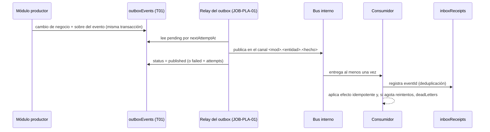

# Catálogo de eventos (AsyncAPI 3.0)

Artefacto 7.2 del índice de entregables. Este documento es el índice del catálogo de eventos de dominio derivado de T11 §12 (`anexos/T11-WFL-workflow-eventos-documentos.md`). Los contratos están en [`19-asyncapi/`](19-asyncapi/): un documento AsyncAPI 3.0 por módulo productor (partido en partes cuando supera el límite de líneas) y el sobre común del outbox.

| Dato | Valor |
|---|---|
| IDs EVT en T11 (universo) | 668 |
| Tipos de evento (canales canónicos) | 968 |
| Canales de alias deprecados | 279 |
| IDs JOB listados con su cola | 506 |
| Documentos AsyncAPI | 49 (máximo 1.419 líneas por archivo) |

Generación: `_trabajo/gen_asyncapi.py` (usa `_trabajo/contratos_lib.py` y `_trabajo/emisor_yaml.py`); validación: `_trabajo/validar_yaml.py`. Listados de apoyo: [canales por EVT](19-asyncapi/_eventos.md) y [jobs por módulo](19-asyncapi/_jobs.md).

## Flujo de publicación

## Convenciones

- **Canal:** uno por tipo de evento. La dirección (`address`) es el nombre canónico `<mod>.<entidad>.<hecho>` de T11; el identificador del canal reemplaza los puntos por guiones (`per-person-created`). Cuando un EVT-ID agrupa varios hechos (`per.person.merged` / `.mergeReverted`), cada hecho es un canal que comparte el EVT-ID y el esquema de payload.
- **Operación:** `publicar-<canal>` con `action: send`; `x-productor` es el anexo del bloque de T11 §12.3 (o T11 para §12.2) y `x-consumidores` los módulos de la columna Consumidores (BI equivale a T10; bandeja, agenda y expediente son T11; `todos` cuando la fila dice "Todos").
- **Mensaje:** `payload` = `allOf` del sobre `SobreOutbox` de [`_comunes.yaml`](19-asyncapi/_comunes.yaml) más `type`, `schemaVersion` (1) y `sourceModule` fijos, y `payload` con el esquema `EvtXxxNnPayload` del payload mínimo de T11. `x-evt-id` y `x-schemaVersion` dan la trazabilidad y la versión.
- **Payload:** los campos salen de la columna Payload mínimo. Tipos inferidos por convención de nombre (`*Id` cadena, `*At` fecha-hora, `*Date` fecha, importes cadena decimal de T05, `*[]` y `*Ids` arreglos); los valores enumerados entre paréntesis pasan a `enum`; "ídem EVT-x" copia los campos (`x-idem`); los renombres de campos de §12.4 van en `x-alias-campos`.
- **Deprecados:** los eventos marcados "Reemplazado por" o "Retirado" llevan `deprecated: true` en el esquema del payload y `x-deprecated` en canal, mensaje y operación. Los alias de §12.4 y los nombres conciliados de §12.4.1 se publican como canales deprecados **sin operación**, con `x-alias-de` hacia el canónico, en el archivo del productor del canónico.

### Sobre común (T11 §12.1 y T01 §7.11.23)

| Campo | Tipo | Regla |
|---|---|---|
| `eventId` | UUIDv7 | Único global; orden temporal. |
| `type` | cadena | `<mod>.<entidad>.<hecho>` del catálogo. |
| `schemaVersion` | entero | Versión del payload (1 en este catálogo). |
| `tenantId` | ObjectId | Siempre; `PLATFORM` en eventos de plataforma. |
| `occurredAt` / `recordedAt` | fecha-hora UTC | Fecha efectiva y de registro. |
| `aggregateType` / `aggregateId` / `aggregateVersion` | cadena / cadena / entero | Orden por agregado. |
| `correlationId` / `causationId` | cadena | Traza. |
| `actor` | objeto | `{type: user, member, system, integration, support; id}`. |
| `sourceModule` | cadena | Código de tres letras. |
| `requestId`, `idempotencyKey` | cadena | Si el origen fue HTTP. |
| `piiLevel`, `visibility` | enum | RN-WFL-005. |
| `payload` | objeto | Payload mínimo del evento. |
| `status`, `attempts`, `nextAttemptAt`, `publishedAt`, `lastError` | — | Solo en la fila de `outboxEvents` (`RegistroOutbox`), no viajan al consumidor. |

## Archivos por módulo productor

| Productor | Módulo | EVT-ID | Canales | Alias deprecados | Archivos |
|---|---|---|---|---|---|
| T11 | Workflow, eventos, tareas, aprobaciones y documentos | 48 | 85 | 0 | [t11-wfl-p1](19-asyncapi/t11-wfl-p1.yaml), [t11-wfl-p2](19-asyncapi/t11-wfl-p2.yaml), [t11-wfl-p3](19-asyncapi/t11-wfl-p3.yaml) |
| M01 | Personas, titulares, asociados, cuentas, inmuebles y domicilios | 26 | 42 | 12 | [m01-per-p1](19-asyncapi/m01-per-p1.yaml), [m01-per-p2](19-asyncapi/m01-per-p2.yaml) |
| M02 | Catálogo de servicios, productos, planes, categorías, estados, contrato de servicio, habilitación por tenant, copia entre tenants y particularidades por servicio | 28 | 33 | 13 | [m02-cat-p1](19-asyncapi/m02-cat-p1.yaml), [m02-cat-p2](19-asyncapi/m02-cat-p2.yaml) |
| M03 | Medidores, lecturas, consumos, telemedición y prepago | 30 | 31 | 7 | [m03-med-p1](19-asyncapi/m03-med-p1.yaml), [m03-med-p2](19-asyncapi/m03-med-p2.yaml) |
| M04 | Tarifas y motor de cálculo | 21 | 21 | 4 | [m04-tar](19-asyncapi/m04-tar.yaml) |
| M05 | Facturación: ciclos, lotes y comprobantes | 21 | 25 | 10 | [m05-fac](19-asyncapi/m05-fac.yaml) |
| M06 | Fiscal e impuestos (ARCA, IVA, percepciones, retenciones, regímenes, terceros, reguladores) | 25 | 36 | 9 | [m06-fis-p1](19-asyncapi/m06-fis-p1.yaml), [m06-fis-p2](19-asyncapi/m06-fis-p2.yaml) |
| M07 | Cuenta corriente, cobranza, cajas, entes, débitos, pasarelas y conciliación | 30 | 31 | 20 | [m07-cob-p1](19-asyncapi/m07-cob-p1.yaml), [m07-cob-p2](19-asyncapi/m07-cob-p2.yaml) |
| M08 | Mora, intereses, suspensión, corte, reconexión, financiación y convenios, garantías, incobrables, gestión judicial y prescripción | 21 | 51 | 22 | [m08-mor-p1](19-asyncapi/m08-mor-p1.yaml), [m08-mor-p2](19-asyncapi/m08-mor-p2.yaml) |
| M09 | CRM y atención (solicitudes, reclamos, tickets, mesa de entradas, turnero, canales, bot, IA, actividades internas) | 25 | 37 | 14 | [m09-crm-p1](19-asyncapi/m09-crm-p1.yaml), [m09-crm-p2](19-asyncapi/m09-crm-p2.yaml) |
| M10 | Técnica, campo, agenda, instalación, GIS/redes, obras, aprovisionamiento TIC y telefonía | 38 | 46 | 25 | [m10-tec-p1](19-asyncapi/m10-tec-p1.yaml), [m10-tec-p2](19-asyncapi/m10-tec-p2.yaml) |
| M11 | Ventas, presupuestos y punto de venta | 15 | 18 | 7 | [m11-ven](19-asyncapi/m11-ven.yaml) |
| M12 | Compras y proveedores | 17 | 24 | 7 | [m12-cmp](19-asyncapi/m12-cmp.yaml) |
| M13 | Stock, equipos serializados, bienes de uso, RMA y fabricación | 24 | 33 | 13 | [m13-stk-p1](19-asyncapi/m13-stk-p1.yaml), [m13-stk-p2](19-asyncapi/m13-stk-p2.yaml) |
| M14 | Tesorería y bancos | 25 | 47 | 14 | [m14-tes-p1](19-asyncapi/m14-tes-p1.yaml), [m14-tes-p2](19-asyncapi/m14-tes-p2.yaml) |
| M15 | Contabilidad, centros de costo, múltiples planes de cuentas, escenarios simulados y presupuestos | 18 | 24 | 3 | [m15-con](19-asyncapi/m15-con.yaml) |
| M16 | Personal y sueldos | 28 | 31 | 6 | [m16-sue-p1](19-asyncapi/m16-sue-p1.yaml), [m16-sue-p2](19-asyncapi/m16-sue-p2.yaml) |
| M17 | Gestión institucional (asociados, capital, asambleas, consejo, INAES) | 21 | 24 | 10 | [m17-ins](19-asyncapi/m17-ins.yaml) |
| M18 | Servicios sociales, otros servicios y flota | 17 | 28 | 3 | [m18-soc](19-asyncapi/m18-soc.yaml) |
| M19 | Landing, portal y app del socio (autogestión) | 16 | 20 | 3 | [m19-por](19-asyncapi/m19-por.yaml) |
| T01 | Plataforma SaaS: arquitectura de referencia, stack, multitenancy, tenants, licencias, soporte, ambientes y backups | 22 | 32 | 9 | [t01-pla-p1](19-asyncapi/t01-pla-p1.yaml), [t01-pla-p2](19-asyncapi/t01-pla-p2.yaml) |
| T02 | Identidad, autenticación, roles, perfiles, alcance y auditoría | 16 | 38 | 15 | [t02-iam-p1](19-asyncapi/t02-iam-p1.yaml), [t02-iam-p2](19-asyncapi/t02-iam-p2.yaml) |
| T04 | Configuración versionada, parámetros, tablas maestras y geografía | 20 | 31 | 7 | [t04-cfg-p1](19-asyncapi/t04-cfg-p1.yaml), [t04-cfg-p2](19-asyncapi/t04-cfg-p2.yaml) |
| T06 | Integraciones externas: marco común de conectores y fichas | 24 | 62 | 37 | [t06-int-p1](19-asyncapi/t06-int-p1.yaml), [t06-int-p2](19-asyncapi/t06-int-p2.yaml), [t06-int-p3](19-asyncapi/t06-int-p3.yaml) |
| T07 | Migración desde ProCoop, convivencia, corrida paralela y by-pass | 9 | 14 | 1 | [t07-mig](19-asyncapi/t07-mig.yaml) |
| T03 | Experiencia, design system, marca por tenant, diccionario de términos y etiquetas, layouts y mapa del sitio | 8 | 8 | 0 | [t03-uxd](19-asyncapi/t03-uxd.yaml) |
| T08 | Requisitos no funcionales, seguridad, privacidad, observabilidad y calidad | 17 | 20 | 0 | [t08-nfr](19-asyncapi/t08-nfr.yaml) |
| T09 | Comunidad y comunicaciones (muro, novedades, encuestas, eventos, beneficios, audiencias, notificaciones y campañas) | 40 | 54 | 8 | [t09-com-p1](19-asyncapi/t09-com-p1.yaml), [t09-com-p2](19-asyncapi/t09-com-p2.yaml) |
| T10 | Reportes, BI, tableros, exportaciones y APIs para terceros | 18 | 22 | 0 | [t10-bia](19-asyncapi/t10-bia.yaml) |
| Común | Sobre del outbox | — | — | — | [_comunes](19-asyncapi/_comunes.yaml) |

## Jobs

Los jobs no son mensajes del bus: se encolan en las clases de cola de T01. Se listan con su cola en [`19-asyncapi/_jobs.md`](19-asyncapi/_jobs.md) (ID, nombre, módulo, cola, disparo, estado y línea de T11). Los disparados por evento se suscriben al canal del evento (T11 §12.6).

| Cola (clase T01) | Jobs |
|---|---|
| `batch` | 167 |
| `maintenance` | 139 |
| `integration` | 79 |
| `notifications` | 39 |
| `events` | 38 |
| `export` | 26 |
| `interactive` | 11 |
| `ai` | 5 |
| sin cola (no encola) | 1 |
| Proceso dedicado | 1 |

| Anexo | Jobs |
|---|---|
| Todos | T11: 32; M01: 12; M02: 13; M03: 22; M04: 14; M05: 18; M06: 20; M07: 22; M08: 18; M09: 18; M10: 17; M11: 7; M12: 10; M13: 12; M14: 14; M15: 22; M16: 23; M17: 12; M18: 11; M19: 12; T01: 22; T02: 12; T03: 7; T04: 14; T06: 28; T07: 16; T08: 24; T09: 32; T10: 22 |

## Tabla de cobertura

**Universo de eventos:** 668 IDs EVT únicos. Se contaron las filas de tabla cuya primera celda es un EVT-ID en T11 §12.2 (productor T11) y §12.3 (un bloque por productor): 446 de M01–M19, 174 de T01–T10 y 48 de T11. T11 §12.10 declara 446, 174 y 48 (total 668): coincide.

**Universo de jobs:** 506 IDs JOB de T11 §12.7 y §12.8 (T11 §12.10: 506).

| Concepto | Universo | Incluidos | Excluidos | Cobertura | Observación |
|---|---|---|---|---|---|
| EVT-ID con canal, operación, mensaje y payload | 668 | 668 | 0 | 100 % | 968 tipos de evento; 665 vigentes, 3 reemplazados, 0 retirados (marcados `deprecated`). |
| EVT-ID con productor y consumidores | 668 | 668 | 0 | 100 % | 0 sin consumidor modular identificable en la columna (ver inconsistencias). |
| EVT-ID con sobre común del outbox | 668 | 668 | 0 | 100 % | `SobreOutbox` de `_comunes.yaml`. |
| Filas de alias de §12.4 | 214 | 214 | 0 | 100 % | Canales deprecados con `x-alias-de`; 13 nombres omitidos porque ya son canónicos (brecha resuelta). |
| Filas de conciliación de §12.4.1 | 130 | 73 | 57 | 56.2 % | Incluidas: Conciliado (66) y Brecha resuelta (7). Excluidas con motivo: Retirado (34, ningún anexo las usa) y Descartado (23, no son eventos). |
| Alias de campos de payload | 9 | 9 | 0 | 100 % | En `x-alias-campos` del payload de cada evento citado. |
| JOB-ID con cola | 506 | 506 | 0 | 100 % | 494 vigentes, 2 reemplazados, 10 retirados. |

## Inconsistencias detectadas en la especificación

La especificación no se modificó.

1. **Colas fuera de las clases de T01.** JOB-PLA-01 declara "Proceso dedicado", JOB-POR-08 no encola (TTL de MongoDB) y M15 usa colas propias (`con-*`) que T11 mapea a clases; JOB-NFR-12 (retirado) usaba `critical` de T08.

## Lo no cubierto

- Los consumidores se documentan como extensión `x-consumidores`; no se generaron operaciones `receive` por consumidor porque T11 no declara el canal de suscripción ni el grupo de consumo de cada módulo.
- Los tipos de los campos de payload se infieren del nombre; T11 no declara tipos. Deben confirmarse con el §7 del productor al implementar.
- Los alias retirados y descartados de §12.4.1 no generan canal (motivo en la tabla de cobertura).
- Los eventos consumidos por T11 (§12.5) y la programación de jobs (cron, concurrencia, reintentos) se citan en `_jobs.md` y en T11; no forman parte del contrato AsyncAPI.
