# 21. Casos de uso por módulo

Entregable del artefacto 3.3 (diagramas de casos de uso). Agrupa los 4204 RF de los 31 anexos funcionales y técnicos en 399 casos de uso agrupadores (CUG), cada uno con sus actores (roles de T02), una ficha breve y los CU de la especificación que lo detallan. Ante cualquier diferencia prevalece la especificación (`docs/especificacion/`): nombres de T05, atributos de §7 de la maestra, eventos de T11 y decisiones de `01-registro-decisiones.md`. El tenant piloto es Laguna Larga (LAG, DEC-088).

Las partes por anexo están en la carpeta [21-casos-de-uso/](21-casos-de-uso/) y se generan con `_trabajo/gen_21_casos_uso.py` (lector común `_trabajo/lib_espec.py`); luego se revisan a mano. Volver a ejecutar el script regenera este índice y las 31 partes.

## 1. Método

1. **Universo de RF.** Filas de las tablas de la sección 5 de cada anexo con ID `RF-<COD>-NNN` (M01–M19, T01–T12; T04b no define RF). Total contado: 4204, igual al total del plan de olas.
2. **Casos de uso agrupadores.** Un CUG por subsección de la sección 5 del anexo: cada subsección expresa un objetivo del actor y cada RF pertenece a una sola subsección, por lo que cada RF queda en exactamente un CUG. T10 no tiene subsecciones y se agrupa por tramos de numeración declarados en el script (`TRAMOS_BIA`). T05 no define RF y tiene un CUG que agrupa sus CU de datos. T12 no define RF y tiene un CUG por ficha vertical de servicio (17), con los CU que cada ficha cita.
3. **Actores.** Roles del catálogo de T02 (maestra §7.2). Para cada CUG se puntúa cada rol según las capabilities del módulo (T02 §4.4 y la tabla de la sección 4 del anexo, con el nombre de rol llevado a su código de T02) cuyo recurso aparece en el título del CUG (peso 3) o en el texto de sus RF (peso 0,5 por mención, máximo 3), ponderado por el tipo de acción. El rol de mayor puntaje es el actor principal (dos si el segundo alcanza el 85 %%); hasta tres secundarios con al menos el 35 %%. Se agregan actores de sistema cuando los RF lo indican: S-SYS (jobs, procesos automáticos o por lotes), S-API (API externa), S-BOT (asistente o IA), S-KSK (tótem, kiosco o turnero) y S-AGT (agente local). Sin puntaje se usa la matriz rol × módulo de T02 §4.3 (niveles T y O). Un rol del catálogo que no queda en ningún CUG se agrega como secundario en los tres CUG donde más puntúa (sección 5).
4. **CU de la especificación.** Los CU con ficha en la sección 16 de un anexo se asignan al CUG con más RF citados en común; si no citan RF, al CUG de mayor similitud léxica. Los CU citados sin ficha propia en ninguna sección 16 se asignan en el anexo que los cita. La mención genérica "caso de uso CU-MIG asociado" de T07 (ayuda contextual) no es un ID y no se cuenta.
5. **Ficha breve.** Actor principal y secundarios; objetivo (título del CUG y primer RF Núcleo); precondición (la del primer CU con precondición o, si no hay, la regla de acceso de T02 por espacio del actor); flujo principal (el del primer CU con flujo, los pasos de la ficha en T12 o, si no hay CU, hasta seis RF priorizando Núcleo); alternativos (los del CU o los RF con rechazos, errores, anulaciones o contingencias, más la denegación por defecto de T02); CU asociados; RF compactados; prioridad y olas; origen.

## 2. Convenciones

- `CUG-<COD>-NN` es un ID propio de este entregable (caso de uso agrupador), único en todo el conjunto. No reemplaza a los `CU-*` de la especificación.
- En los diagramas de actores, la línea continua une al actor principal y la punteada a los secundarios. Los diagramas se parten en bloques de hasta unos 38 nodos.
- En los diagramas CU → CUG, el rectángulo indica un CU con ficha en la sección 16 del anexo y el paralelogramo un CU citado (ficha en otro anexo o sin ficha).
- Los rangos de RF se escriben compactados: `RF-FAC-001 a 008, 013` equivale a RF-FAC-001 a RF-FAC-008 y RF-FAC-013.

## 3. Vista general: espacios de actores por anexo

Une cada espacio de roles con los anexos en que algún rol de ese espacio es actor principal de al menos un CUG.

```mermaid
flowchart LR
    E_P["Plataforma (P-*)"]
    E_T["Tenant (T-*)"]
    E_C["Comunidad (C-*)"]
    E_S["Sistema (S-*)"]
    N_PER(["M01 PER"])
    N_CAT(["M02 CAT"])
    N_MED(["M03 MED"])
    N_TAR(["M04 TAR"])
    N_FAC(["M05 FAC"])
    N_FIS(["M06 FIS"])
    N_COB(["M07 COB"])
    N_MOR(["M08 MOR"])
    N_CRM(["M09 CRM"])
    N_TEC(["M10 TEC"])
    N_VEN(["M11 VEN"])
    N_CMP(["M12 CMP"])
    N_STK(["M13 STK"])
    N_TES(["M14 TES"])
    N_CON(["M15 CON"])
    N_SUE(["M16 SUE"])
    N_INS(["M17 INS"])
    N_SOC(["M18 SOC"])
    N_POR(["M19 POR"])
    N_PLA(["T01 PLA"])
    N_IAM(["T02 IAM"])
    N_UXD(["T03 UXD"])
    N_CFG(["T04 CFG"])
    N_DAT(["T05 DAT"])
    N_INT(["T06 INT"])
    N_MIG(["T07 MIG"])
    N_NFR(["T08 NFR"])
    N_COM(["T09 COM"])
    N_BIA(["T10 BIA"])
    N_WFL(["T11 WFL"])
    N_SRV(["T12 SRV"])
    E_T --> N_PER
    E_T --> N_CAT
    E_T --> N_MED
    E_T --> N_TAR
    E_T --> N_FAC
    E_P --> N_FIS
    E_T --> N_FIS
    E_T --> N_COB
    E_T --> N_MOR
    E_T --> N_CRM
    E_C --> N_CRM
    E_T --> N_TEC
    E_T --> N_VEN
    E_T --> N_CMP
    E_T --> N_STK
    E_T --> N_TES
    E_T --> N_CON
    E_T --> N_SUE
    E_C --> N_SUE
    E_T --> N_INS
    E_T --> N_SOC
    E_T --> N_POR
    E_C --> N_POR
    E_P --> N_PLA
    E_T --> N_PLA
    E_T --> N_IAM
    E_P --> N_UXD
    E_T --> N_UXD
    E_P --> N_CFG
    E_T --> N_CFG
    E_P --> N_DAT
    E_T --> N_INT
    E_P --> N_MIG
    E_T --> N_MIG
    E_T --> N_NFR
    E_T --> N_COM
    E_S --> N_COM
    E_T --> N_BIA
    E_T --> N_WFL
    E_T --> N_SRV
    E_C --> N_SRV
    classDef actor fill:#1f2937,stroke:#60a5fa,color:#f9fafb;
    classDef mod fill:#0f172a,stroke:#34d399,color:#f9fafb;
    class E_P,E_T,E_C,E_S actor;
    class N_PER,N_CAT,N_MED,N_TAR,N_FAC,N_FIS,N_COB,N_MOR,N_CRM,N_TEC,N_VEN,N_CMP,N_STK,N_TES,N_CON,N_SUE,N_INS,N_SOC,N_POR,N_PLA,N_IAM,N_UXD,N_CFG,N_DAT,N_INT,N_MIG,N_NFR,N_COM,N_BIA,N_WFL,N_SRV mod;
```

## 4. Índice por anexo

| Anexo | Código | Parte | CUG | RF | CU con ficha | CU citados sin ficha aquí |
|---|---|---|---|---|---|---|
| M01 | PER | [M01 PER — Personas, titulares, asociados, cuentas, inmuebles y domicilios](21-casos-de-uso/21-M01-PER.md) | 16 | 173 | 18 | 0 |
| M02 | CAT | [M02 CAT — Catálogo de servicios, productos, planes, categorías, estados, contrato de servicio, habilitación por tenant, copia entre tenants y particularidades por servicio](21-casos-de-uso/21-M02-CAT.md) | 9 | 116 | 23 | 0 |
| M03 | MED | [M03 MED — Medidores, lecturas, consumos, telemedición y prepago](21-casos-de-uso/21-M03-MED.md) | 13 | 129 | 21 | 0 |
| M04 | TAR | [M04 TAR — Tarifas y motor de cálculo](21-casos-de-uso/21-M04-TAR.md) | 5 | 122 | 15 | 0 |
| M05 | FAC | [M05 FAC — Facturación: ciclos, lotes y comprobantes](21-casos-de-uso/21-M05-FAC.md) | 20 | 179 | 22 | 0 |
| M06 | FIS | [M06 FIS — Fiscal e impuestos (ARCA, IVA, percepciones, retenciones, regímenes, terceros, reguladores)](21-casos-de-uso/21-M06-FIS.md) | 18 | 168 | 20 | 0 |
| M07 | COB | [M07 COB — Cuenta corriente, cobranza, cajas, entes, débitos, pasarelas y conciliación](21-casos-de-uso/21-M07-COB.md) | 17 | 194 | 22 | 0 |
| M08 | MOR | [M08 MOR — Mora, intereses, suspensión, corte, reconexión, financiación y convenios, garantías, incobrables, gestión judicial y prescripción](21-casos-de-uso/21-M08-MOR.md) | 21 | 224 | 13 | 0 |
| M09 | CRM | [M09 CRM — CRM y atención (solicitudes, reclamos, tickets, mesa de entradas, turnero, canales, bot, IA, actividades internas)](21-casos-de-uso/21-M09-CRM.md) | 9 | 193 | 25 | 0 |
| M10 | TEC | [M10 TEC — Técnica, campo, agenda, instalación, GIS/redes, obras, aprovisionamiento TIC y telefonía](21-casos-de-uso/21-M10-TEC.md) | 20 | 239 | 18 | 0 |
| M11 | VEN | [M11 VEN — Ventas, presupuestos y punto de venta](21-casos-de-uso/21-M11-VEN.md) | 6 | 94 | 8 | 0 |
| M12 | CMP | [M12 CMP — Compras y proveedores](21-casos-de-uso/21-M12-CMP.md) | 12 | 115 | 9 | 0 |
| M13 | STK | [M13 STK — Stock, equipos serializados, bienes de uso, RMA y fabricación](21-casos-de-uso/21-M13-STK.md) | 14 | 139 | 24 | 0 |
| M14 | TES | [M14 TES — Tesorería y bancos](21-casos-de-uso/21-M14-TES.md) | 19 | 188 | 22 | 0 |
| M15 | CON | [M15 CON — Contabilidad, centros de costo, múltiples planes de cuentas, escenarios simulados y presupuestos](21-casos-de-uso/21-M15-CON.md) | 16 | 162 | 21 | 0 |
| M16 | SUE | [M16 SUE — Personal y sueldos](21-casos-de-uso/21-M16-SUE.md) | 17 | 146 | 16 | 0 |
| M17 | INS | [M17 INS — Gestión institucional (asociados, capital, asambleas, consejo, INAES)](21-casos-de-uso/21-M17-INS.md) | 9 | 108 | 15 | 0 |
| M18 | SOC | [M18 SOC — Servicios sociales, otros servicios y flota](21-casos-de-uso/21-M18-SOC.md) | 11 | 149 | 18 | 0 |
| M19 | POR | [M19 POR — Landing, portal y app del socio (autogestión)](21-casos-de-uso/21-M19-POR.md) | 17 | 180 | 29 | 0 |
| T01 | PLA | [T01 PLA — Plataforma SaaS: arquitectura de referencia, stack, multitenancy, tenants, licencias, soporte, ambientes y backups](21-casos-de-uso/21-T01-PLA.md) | 17 | 165 | 19 | 0 |
| T02 | IAM | [T02 IAM — Identidad, autenticación, roles, perfiles, alcance y auditoría](21-casos-de-uso/21-T02-IAM.md) | 7 | 93 | 16 | 0 |
| T03 | UXD | [T03 UXD — Experiencia, design system, marca por tenant, diccionario de términos y etiquetas, layouts y mapa del sitio](21-casos-de-uso/21-T03-UXD.md) | 12 | 179 | 14 | 0 |
| T04 | CFG | [T04 CFG — Configuración versionada, parámetros, tablas maestras y geografía](21-casos-de-uso/21-T04-CFG.md) | 17 | 143 | 15 | 0 |
| T05 | DAT | [T05 DAT — Modelo de datos canónico consolidado](21-casos-de-uso/21-T05-DAT.md) | 1 | 0 | 5 | 0 |
| T06 | INT | [T06 INT — Integraciones externas: marco común de conectores y fichas](21-casos-de-uso/21-T06-INT.md) | 10 | 86 | 15 | 0 |
| T07 | MIG | [T07 MIG — Migración desde ProCoop, convivencia, corrida paralela y by-pass](21-casos-de-uso/21-T07-MIG.md) | 10 | 78 | 15 | 0 |
| T08 | NFR | [T08 NFR — Requisitos no funcionales, seguridad, privacidad, observabilidad y calidad](21-casos-de-uso/21-T08-NFR.md) | 1 | 25 | 17 | 0 |
| T09 | COM | [T09 COM — Comunidad y comunicaciones (muro, novedades, encuestas, eventos, beneficios, audiencias, notificaciones y campañas)](21-casos-de-uso/21-T09-COM.md) | 13 | 157 | 24 | 0 |
| T10 | BIA | [T10 BIA — Reportes, BI, tableros, exportaciones y APIs para terceros](21-casos-de-uso/21-T10-BIA.md) | 9 | 103 | 16 | 0 |
| T11 | WFL | [T11 WFL — Workflow, eventos, tareas, aprobaciones y documentos](21-casos-de-uso/21-T11-WFL.md) | 16 | 157 | 18 | 0 |
| T12 | SRV | [T12 SRV — Fichas verticales por servicio (partes 1 y 2)](21-casos-de-uso/21-T12-SRV.md) | 17 | 0 | 0 | 0 |
| **Total** | | | **399** | **4204** | **533** | |

## 5. Actores y participación

Cantidad de CUG en que participa cada rol (principal o secundario), sobre los 399 CUG.

| Rol | Espacio | Nombre | CUG como principal | CUG en total |
|---|---|---|---|---|
| P-SUP | Plataforma | Superadministrador de plataforma | 22 | 36 |
| P-ADM | Plataforma | Administrador de operaciones de tenants | 19 | 40 |
| P-COM | Plataforma | Comercial de plataforma | 0 | 3 |
| P-SOP1 | Plataforma | Soporte plataforma nivel 1 | 0 | 2 |
| P-SOP2 | Plataforma | Soporte plataforma nivel 2 / ingeniería | 2 | 9 |
| P-SEC | Plataforma | Seguridad y auditoría de plataforma | 0 | 2 |
| P-OPS | Plataforma | Operaciones técnicas (SRE) | 1 | 6 |
| T-ADM | Tenant | Administrador de la cooperativa | 68 | 110 |
| T-USR | Tenant | Administrador de usuarios y seguridad (opcional) | 2 | 8 |
| T-GER | Tenant | Gerente | 2 | 30 |
| T-FAC | Tenant | Facturación | 51 | 102 |
| T-CAJ | Tenant | Cajero | 22 | 82 |
| T-CBR | Tenant | Cobrador (campo) | 4 | 55 |
| T-TES | Tenant | Tesorero / Financiero (MT-006) | 45 | 55 |
| T-CON | Tenant | Contador / Contable (MT-006) | 39 | 71 |
| T-CMP | Tenant | Compras | 13 | 26 |
| T-DEP | Tenant | Depósito | 14 | 25 |
| T-TEC | Tenant | Técnico (campo) | 27 | 84 |
| T-LEC | Tenant | Lecturista (campo) | 9 | 56 |
| T-STE | Tenant | Supervisor técnico | 15 | 96 |
| T-SCM | Tenant | Supervisor de consumos (BASE §39.6) | 7 | 35 |
| T-ATE | Tenant | Comercial / Atención al socio | 79 | 133 |
| T-SAT | Tenant | Supervisor de atención | 9 | 46 |
| T-RRHH | Tenant | RRHH / Liquidador | 16 | 18 |
| T-SEC | Tenant | Secretaría institucional | 12 | 14 |
| T-COM | Tenant | Editor de comunidad / Moderador (USR-NOT-A) | 16 | 28 |
| T-SOC | Tenant | Operador de servicios sociales y salud | 11 | 30 |
| T-CJO | Tenant | Consejero | 0 | 3 |
| T-SIN | Tenant | Síndico / Auditor (solo lectura) | 0 | 2 |
| C-SOC | Comunidad | Socio titular | 25 | 37 |
| C-REP | Comunidad | Representante / autorizado | 10 | 18 |
| C-ADH | Comunidad | Adherente / grupo familiar | 0 | 6 |
| C-VIS | Comunidad | Visitante registrado | 0 | 3 |
| C-EMP | Comunidad | Empleado en portal | 3 | 5 |
| C-PRV | Comunidad | Proveedor (portal de proveedores) | 0 | 3 |
| S-SYS | Técnico | Sistema / worker | 1 | 120 |
| S-API | Técnico | Cliente API (integración externa) | 0 | 7 |
| S-BOT | Técnico | Bot / asistente IA | 0 | 20 |
| S-KSK | Técnico | Dispositivo kiosco/tótem/turnero | 0 | 5 |
| S-AGT | Técnico | Agente de hardware local | 0 | 6 |

Roles que el puntaje no ubicó en ningún CUG y se agregaron como secundarios en los CUG donde más puntúan (o, sin puntaje, en los módulos donde la matriz de T02 §4.3 les da acceso): P-COM en CUG-PLA-06, CUG-PLA-07, CUG-PLA-05; T-CJO en CUG-INS-06, CUG-WFL-12, CUG-WFL-13; C-VIS en CUG-PER-10, CUG-PER-07, CUG-PER-11; C-PRV en CUG-MOR-17, CUG-CMP-10, CUG-CMP-11.

## 6. Inconsistencias detectadas en la especificación

La especificación no se modificó. Estas observaciones quedan para el coordinador.

CU con ficha en más de un anexo: 39. En 33 la especificación declara el anexo dueño (corrección del 05-11-2026: "dueño Txx", "definición dueña", "el caso es de", "original") y los demás anexos detallan solo su parte; no se consideran inconsistencias. Otros 6 no declaran dueño pero describen el mismo objeto. Los que no declaran dueño y describen objetos distintos, o declaran dueños contradictorios, figuran en la tabla de inconsistencias.

| CU | Anexo dueño declarado | Anexos que detallan su parte |
|---|---|---|
| CU-07 | M03 | M13 |
| CU-10 | M05 | M06 |
| CU-103 | M05 | M07 |
| CU-104 | M16 | M15 |
| CU-26 | T09 | T11 |
| CU-27 | M17 | T11 |
| CU-29 | T02 | T08, T11 |
| CU-31 | T07 | T06 |
| CU-API-01 | T10 | T02, T06, T08 |
| CU-ARQ-01 | T11 | T08 |
| CU-AUT-01 | M19 | M10 |
| CU-CIC-01 | M08 | M02, M09, M19 |
| CU-CON-01 | M15 | M14 |
| CU-COP-01 | M02 | T04 |
| CU-CTA-01 | M07 | M08 |
| CU-ERP-01 | M15 | T10 |
| CU-ESP-AG | M02 | M03, M04 |
| CU-ESP-CEM | M18 | M02 |
| CU-ESP-ELE | M02 | M03, M04 |
| CU-ESP-GAS | M02 | M03, M04 |
| CU-ESP-SAN | M18 | M02 |
| CU-FAC-01 | M05 | M07 |
| CU-FIS-01 | M06 | M12, M14, M15 |
| CU-GEO-01 | T04 | M01, M10 |
| CU-GOB-01 | T11 | T01, T02, T08, T10 |
| CU-INS-01 | M10 | M11, M13, T09 |
| CU-LOT-01 | M05 | M06, T11 |
| CU-MAR-01 | T03 | M19 |
| CU-MER-01 | M03 | M04, M06 |
| CU-OPE-01 | M12 | M10, M13, M14, M15 |
| CU-PRO-01 | M02 | M04, M11 |
| CU-REG-01 | M19 | M01 |
| CU-SOL-01 | M09 | M02 |

| # | Tipo | Detalle | Tratamiento en este entregable |
|---|---|---|---|
| 1 | Universo | El pedido habla de "31 anexos con RF", pero T05 DAT y T12 SRV no definen RF propios (29 anexos con RF). | Se incluyen igual: sus CU y fichas se agrupan en CUG propios. |

## 7. Límites del método

- La asignación de actores y de CU a CUG es heurística (capabilities y similitud léxica). Se revisó a mano una muestra por anexo; los casos dudosos prevalecen según el anexo y la matriz de T02.
- Las fichas son breves por diseño: el detalle normativo de cada paso está en los RF y RN citados del anexo.
- Las fichas de T12 combinan pasos de varios anexos dueños; los actores de cada servicio se fijaron según el tipo de servicio (medido, conectividad, social, tasa o cargo).

## 8. Tabla de cobertura

| Universo | Cómo se contó | En la especificación | Incluidos | Excluidos (motivo) |
|---|---|---|---|---|
| Anexos funcionales y técnicos | M01–M19 y T01–T12 (T04b dentro de T04; T12 en dos partes) | 31 | 31 | 0 |
| RF | Filas `RF-<COD>-NNN` de las tablas de la sección 5 de los 31 anexos, sin duplicados | 4204 | 4204 | 0 |
| CU con ficha | Fichas en la sección 16 (encabezado, fila o párrafo con el ID), contadas por par anexo y CU | 533 | 533 | 0 |
| CU distintos citados | IDs `CU-*` distintos en cualquier parte de los 31 anexos (sin la mención genérica CU-MIG) | 472 | 472 | 0 |
| CU citados sin ficha en ninguna sección 16 | Subconjunto de la fila anterior | 0 | 0 | 0 |
| Roles de T02 | Catálogo de la maestra §7.2 | 40 | 40 con participación (4 agregados como secundarios, sección 5) | 0 |
