# Casos de uso de M01 PER — Personas, titulares, asociados, cuentas, inmuebles y domicilios

Parte del entregable [21 Casos de uso por módulo](../21-casos-de-uso.md) (artefacto 3.3). Generado con `_trabajo/gen_21_casos_uso.py` desde `docs/especificacion/anexos/M01-PER-personas-titulares-cuentas.md` y revisado a mano. Ante cualquier diferencia prevalece el anexo.

| Dato | Valor |
|---|---|
| Casos de uso agrupadores (CUG) | 16 |
| RF del anexo | 173 (todos asignados a un CUG) |
| CU con ficha en la sección 16 | 18 |
| CU citados sin ficha en este anexo | 0 |

## 1. Diagramas

### 1.1 Actores y casos de uso agrupadores

```mermaid
flowchart LR
    subgraph ACT["Actores (roles T02)"]
        direction TB
        A_T_ATE["T-ATE<br/>Comercial / Atención al socio"]
        A_T_ADM["T-ADM<br/>Administrador de la cooperativa"]
        A_T_FAC["T-FAC<br/>Facturación"]
        A_T_SAT["T-SAT<br/>Supervisor de atención"]
        A_T_LEC["T-LEC<br/>Lecturista (campo)"]
        A_T_CBR["T-CBR<br/>Cobrador (campo)"]
        A_S_SYS["S-SYS<br/>Sistema / worker"]
        A_C_VIS["C-VIS<br/>Visitante registrado"]
        A_S_BOT["S-BOT<br/>Bot / asistente IA"]
    end
    subgraph SIS["M01 PER"]
        direction TB
        CUG_PER_01(["CUG-PER-01<br/>Personas"])
        CUG_PER_02(["CUG-PER-02<br/>Identificación y verificación fiscal"])
        CUG_PER_03(["CUG-PER-03<br/>Contactos, preferencias y consentimientos"])
        CUG_PER_04(["CUG-PER-04<br/>Titulares"])
        CUG_PER_05(["CUG-PER-05<br/>Cuentas"])
        CUG_PER_06(["CUG-PER-06<br/>Domicilios y geolocalización"])
        CUG_PER_07(["CUG-PER-07<br/>Inmuebles y puntos de prestación"])
        CUG_PER_08(["CUG-PER-08<br/>Relaciones, representaciones y garantías"])
        CUG_PER_09(["CUG-PER-09<br/>Adherentes y beneficiarios"])
        CUG_PER_10(["CUG-PER-10<br/>Notas, bloqueos, documentación y adjuntos"])
        CUG_PER_11(["CUG-PER-11<br/>Transferencias, cambio de titularidad y mudanzas"])
        CUG_PER_12(["CUG-PER-12<br/>Ficha 360, búsqueda y padrón"])
        CUG_PER_13(["CUG-PER-13<br/>Historia, auditoría y datos extra"])
        CUG_PER_14(["CUG-PER-14<br/>Duplicados y fusión"])
        CUG_PER_15(["CUG-PER-15<br/>Privacidad y vínculo usuario–persona"])
        CUG_PER_16(["CUG-PER-16<br/>Importación, operaciones especiales y configuración"])
    end
    A_T_ATE --> CUG_PER_01
    A_T_ADM --> CUG_PER_01
    A_T_FAC -.-> CUG_PER_01
    A_T_SAT -.-> CUG_PER_01
    A_T_LEC -.-> CUG_PER_01
    A_T_ATE --> CUG_PER_02
    A_T_ADM --> CUG_PER_02
    A_T_FAC -.-> CUG_PER_02
    A_T_SAT -.-> CUG_PER_02
    A_T_LEC -.-> CUG_PER_02
    A_T_ATE --> CUG_PER_03
    A_T_FAC --> CUG_PER_03
    A_T_ADM -.-> CUG_PER_03
    A_T_SAT -.-> CUG_PER_03
    A_T_LEC -.-> CUG_PER_03
    A_T_ATE --> CUG_PER_04
    A_T_FAC --> CUG_PER_04
    A_T_ADM -.-> CUG_PER_04
    A_T_LEC -.-> CUG_PER_04
    A_T_CBR -.-> CUG_PER_04
    A_T_FAC --> CUG_PER_05
    A_T_ATE --> CUG_PER_05
    A_T_SAT -.-> CUG_PER_05
    A_T_ADM -.-> CUG_PER_05
    A_T_CBR -.-> CUG_PER_05
    A_S_SYS -.-> CUG_PER_05
    A_T_ATE --> CUG_PER_06
    A_T_ADM --> CUG_PER_06
    A_T_FAC -.-> CUG_PER_06
    A_T_LEC -.-> CUG_PER_06
    A_T_CBR -.-> CUG_PER_06
    A_T_ATE --> CUG_PER_07
    A_T_ADM -.-> CUG_PER_07
    A_T_FAC -.-> CUG_PER_07
    A_T_LEC -.-> CUG_PER_07
    A_C_VIS -.-> CUG_PER_07
    A_T_ATE --> CUG_PER_08
    A_T_FAC --> CUG_PER_08
    A_T_ADM -.-> CUG_PER_08
    A_T_SAT -.-> CUG_PER_08
    A_T_LEC -.-> CUG_PER_08
    A_T_ATE --> CUG_PER_09
    A_T_ADM --> CUG_PER_09
    A_T_FAC -.-> CUG_PER_09
    A_T_LEC -.-> CUG_PER_09
    A_T_CBR -.-> CUG_PER_09
    A_T_ATE --> CUG_PER_10
    A_T_FAC --> CUG_PER_10
    A_T_ADM -.-> CUG_PER_10
    A_T_LEC -.-> CUG_PER_10
    A_T_CBR -.-> CUG_PER_10
    A_C_VIS -.-> CUG_PER_10
    A_T_ATE --> CUG_PER_11
    A_T_ADM --> CUG_PER_11
    A_T_FAC -.-> CUG_PER_11
    A_T_CBR -.-> CUG_PER_11
    A_T_LEC -.-> CUG_PER_11
    A_S_SYS -.-> CUG_PER_11
    A_C_VIS -.-> CUG_PER_11
    A_T_ATE --> CUG_PER_12
    A_T_FAC --> CUG_PER_12
    A_T_ADM -.-> CUG_PER_12
    A_T_SAT -.-> CUG_PER_12
    A_T_LEC -.-> CUG_PER_12
    A_T_ATE --> CUG_PER_13
    A_T_FAC -.-> CUG_PER_13
    A_T_ADM -.-> CUG_PER_13
    A_T_LEC -.-> CUG_PER_13
    A_T_ADM --> CUG_PER_14
    A_T_ATE --> CUG_PER_14
    A_T_FAC -.-> CUG_PER_14
    A_T_SAT -.-> CUG_PER_14
    A_T_LEC -.-> CUG_PER_14
    A_T_ATE --> CUG_PER_15
    A_T_ADM --> CUG_PER_15
    A_T_FAC -.-> CUG_PER_15
    A_T_LEC -.-> CUG_PER_15
    A_T_CBR -.-> CUG_PER_15
    A_S_BOT -.-> CUG_PER_15
    A_T_ATE --> CUG_PER_16
    A_T_FAC --> CUG_PER_16
    A_T_ADM -.-> CUG_PER_16
    A_T_LEC -.-> CUG_PER_16
    A_T_CBR -.-> CUG_PER_16
    classDef actor fill:#1f2937,stroke:#60a5fa,color:#f9fafb;
    classDef cug fill:#0f172a,stroke:#34d399,color:#f9fafb;
    class A_T_ATE,A_T_ADM,A_T_FAC,A_T_SAT,A_T_LEC,A_T_CBR,A_S_SYS,A_C_VIS,A_S_BOT actor;
    class CUG_PER_01,CUG_PER_02,CUG_PER_03,CUG_PER_04,CUG_PER_05,CUG_PER_06,CUG_PER_07,CUG_PER_08,CUG_PER_09,CUG_PER_10,CUG_PER_11,CUG_PER_12,CUG_PER_13,CUG_PER_14,CUG_PER_15,CUG_PER_16 cug;
```

Línea continua: actor principal. Línea punteada: actor secundario o participante.

### 1.2 Casos de uso de la especificación por agrupador

```mermaid
flowchart LR
    CUG_PER_01(["CUG-PER-01<br/>Personas"])
    X_CU_03_CUG_PER_01["CU-03<br/>Alta de persona y asociada sin duplicar..."]
    X_CU_03_CUG_PER_01 -.->|escenario de| CUG_PER_01
    X_CU_PER_03_CUG_PER_01["CU-PER-03<br/>Fallecimiento del titular"]
    X_CU_PER_03_CUG_PER_01 -.->|escenario de| CUG_PER_01
    CUG_PER_02(["CUG-PER-02<br/>Identificación y verificación fiscal"])
    X_CU_PER_09_CUG_PER_02["CU-PER-09<br/>CUIT con discrepancia en ARCA"]
    X_CU_PER_09_CUG_PER_02 -.->|escenario de| CUG_PER_02
    CUG_PER_04(["CUG-PER-04<br/>Titulares"])
    X_CU_PER_12_CUG_PER_04["CU-PER-12<br/>Baja de titular"]
    X_CU_PER_12_CUG_PER_04 -.->|escenario de| CUG_PER_04
    CUG_PER_06(["CUG-PER-06<br/>Domicilios y geolocalización"])
    X_CU_GEO_01_CUG_PER_06["CU-GEO-01<br/>Domicilio de prestación georreferenciado..."]
    X_CU_GEO_01_CUG_PER_06 -.->|escenario de| CUG_PER_06
    CUG_PER_07(["CUG-PER-07<br/>Inmuebles y puntos de prestación"])
    X_CU_04_CUG_PER_07["CU-04<br/>Contrato sobre un inmueble (BASE §4)"]
    X_CU_04_CUG_PER_07 -.->|escenario de| CUG_PER_07
    X_CU_TIT_01_CUG_PER_07["CU-TIT-01<br/>Dos hermanos en el mismo domicilio (BASE §83)"]
    X_CU_TIT_01_CUG_PER_07 -.->|escenario de| CUG_PER_07
    X_CU_PER_02_CUG_PER_07["CU-PER-02<br/>Mudanza del titular"]
    X_CU_PER_02_CUG_PER_07 -.->|escenario de| CUG_PER_07
    X_CU_PER_10_CUG_PER_07["CU-PER-10<br/>Inmueble en propiedad horizontal"]
    X_CU_PER_10_CUG_PER_07 -.->|escenario de| CUG_PER_07
    CUG_PER_08(["CUG-PER-08<br/>Relaciones, representaciones y garantías"])
    X_CU_PER_04_CUG_PER_08["CU-PER-04<br/>Representante de persona jurídica..."]
    X_CU_PER_04_CUG_PER_08 -.->|escenario de| CUG_PER_08
    X_CU_PER_05_CUG_PER_08["CU-PER-05<br/>Autorizado que paga por el titular"]
    X_CU_PER_05_CUG_PER_08 -.->|escenario de| CUG_PER_08
    CUG_PER_10(["CUG-PER-10<br/>Notas, bloqueos, documentación y adjuntos"])
    X_CU_PER_07_CUG_PER_10["CU-PER-07<br/>Bloqueo de cobro en caja"]
    X_CU_PER_07_CUG_PER_10 -.->|escenario de| CUG_PER_10
    CUG_PER_11(["CUG-PER-11<br/>Transferencias, cambio de titularidad y mudanzas"])
    X_CU_PER_01_CUG_PER_11["CU-PER-01<br/>Cambio de titularidad por venta del inmueble"]
    X_CU_PER_01_CUG_PER_11 -.->|escenario de| CUG_PER_11
    X_CU_PER_11_CUG_PER_11["CU-PER-11<br/>Transferencia de cuenta completa"]
    X_CU_PER_11_CUG_PER_11 -.->|escenario de| CUG_PER_11
    CUG_PER_14(["CUG-PER-14<br/>Duplicados y fusión"])
    X_CU_PER_06_CUG_PER_14["CU-PER-06<br/>Duplicado detectado y fusión"]
    X_CU_PER_06_CUG_PER_14 -.->|escenario de| CUG_PER_14
    X_CU_PER_08_CUG_PER_14["CU-PER-08<br/>La misma persona en dos cooperativas"]
    X_CU_PER_08_CUG_PER_14 -.->|escenario de| CUG_PER_14
    CUG_PER_15(["CUG-PER-15<br/>Privacidad y vínculo usuario–persona"])
    X_CU_REG_01_CUG_PER_15["CU-REG-01<br/>Registro sin suministro (BASE §67)"]
    X_CU_REG_01_CUG_PER_15 -.->|escenario de| CUG_PER_15
    X_CU_PER_13_CUG_PER_15["CU-PER-13<br/>Solicitud de acceso a datos personales"]
    X_CU_PER_13_CUG_PER_15 -.->|escenario de| CUG_PER_15
```

Rectángulo: CU con ficha en la sección 16 del anexo. Paralelogramo: CU citado (ficha en otro anexo o sin ficha).

## 2. Fichas de los casos de uso agrupadores

### CUG-PER-01 — Personas

| Campo | Contenido |
|---|---|
| Actor principal | T-ATE Comercial / Atención al socio; T-ADM Administrador de la cooperativa |
| Actores secundarios | T-FAC Facturación; T-SAT Supervisor de atención; T-LEC Lecturista (campo) |
| Objetivo | Personas: Registrar personas físicas y jurídicas con datos identificatorios, fiscales y de contacto. |
| Precondición | persona que solicita asociarse y contratar agua, con datos mínimos. |
| Flujo principal | Según CU-03: 1) busca coincidencias (API-PER-03); 2) registra a Ana Pérez (PER-001) con contacto y domicilio, adjunta documentación (API-PER-02, T11); 3) crea titular en estado applicant (API-PER-14) y M17 registra la relación de asociada ASO-001; queda habilitada para iniciar una solicitud comercial en M09. - Requisitos: RF-PER-001..003, RF-PER-040, RF-PER-044, RN-PER-001, RN-PER-004, RN-PER-113. |
| Alternativos | Según CU-03: si aparece una persona coincidente, se revisa y se usa el registro existente; no se fusiona automáticamente. Sin la capability o fuera del alcance de datos: denegación por defecto y auditoría (T02). |
| CU asociados | CU-03; CU-PER-03 |
| RF (17) | RF-PER-001 a 017 |
| Prioridad y olas | Núcleo 11, Estándar 5, Extensión 1; olas O2, O3 |
| Origen | M01 §5.1 |

### CUG-PER-02 — Identificación y verificación fiscal

| Campo | Contenido |
|---|---|
| Actor principal | T-ATE Comercial / Atención al socio; T-ADM Administrador de la cooperativa |
| Actores secundarios | T-FAC Facturación; T-SAT Supervisor de atención; T-LEC Lecturista (campo) |
| Objetivo | Identificación y verificación fiscal: Varias identificaciones por persona (DNI, CUIT, CUIL, CDI, LE, LC, pasaporte, cédula extranjera, otro), una principal, según catálogo de tipos con códigos ARCA, INAES... |
| Precondición | Usuario del tenant autenticado con el rol indicado y capabilities `per.identificaciones.verificar`, `per.personas.ver`, `per.personas.crear`; módulo PER licenciado y activo (T01, T02 §4.3). |
| Flujo principal | Según CU-PER-09: se carga una CUIT con dígito válido; JOB-PER-01 obtiene una constancia con otra denominación. - Requisitos: RF-PER-019..021, RN-PER-009. |
| Alternativos | Unicidad de identificación (tipo + número) por tenant, con excepciones por política registradas y aprobadas (RF-PER-025). Excepción de identificación (persona sin DNI ni CUIT en supuestos definidos) con documento alternativo... (RF-PER-026). Sin la capability o fuera del alcance de datos: la acción se deniega por defecto y se audita (T02). |
| CU asociados | CU-PER-09 |
| RF (12) | RF-PER-018 a 029 |
| Prioridad y olas | Núcleo 5, Estándar 6, Extensión 1; olas O2, O4 |
| Origen | M01 §5.2 |

### CUG-PER-03 — Contactos, preferencias y consentimientos

| Campo | Contenido |
|---|---|
| Actor principal | T-ATE Comercial / Atención al socio; T-FAC Facturación |
| Actores secundarios | T-ADM Administrador de la cooperativa; T-SAT Supervisor de atención; T-LEC Lecturista (campo) |
| Objetivo | Contactos, preferencias y consentimientos: Varios contactos tipados por persona (correo, celular, fijo, WhatsApp, fax), con principal, etiqueta, fuente (backoffice, portal, importación, legado web) y estado de... |
| Precondición | Usuario del tenant autenticado con el rol indicado y capabilities `per.personas.ver`, `per.personas.crear`, `per.personas.editar`; módulo PER licenciado y activo (T01, T02 §4.3). |
| Flujo principal | 1. Varios contactos tipados por persona (correo, celular, fijo, WhatsApp, fax), con principal, etiqueta, fuente... (RF-PER-030). 2. Verificar correo y celular por código de un solo uso cuando lo exija la política o la vía de ingreso (RF-PER-031). 3. Política de contactos con niveles no controlar / advertir / exigir, en el alta o siempre, para celular y correo, en... (RF-PER-032). 4. Contactos propios de la cuenta (correo y celular para facturas y avisos de esa cuenta), distintos de los de la persona (RF-PER-035). 5. Preferencias de comunicación por canal y finalidad (factura electrónica, avisos de deuda y corte, novedades, encuestas... (RF-PER-037). 6. Registrar consentimientos con finalidad, base de tratamiento, versión del texto aceptado, canal, fecha y revocación (RF-PER-039). |
| Alternativos | Sin la capability o fuera del alcance de datos: la acción se deniega por defecto y se audita (T02). |
| CU asociados | — (sin CU en la especificación; el flujo sale de los RF) |
| RF (10) | RF-PER-030 a 039 |
| Prioridad y olas | Núcleo 5, Estándar 5, Extensión 0; olas O2 |
| Origen | M01 §5.3 |

### CUG-PER-04 — Titulares

| Campo | Contenido |
|---|---|
| Actor principal | T-ATE Comercial / Atención al socio; T-FAC Facturación |
| Actores secundarios | T-ADM Administrador de la cooperativa; T-LEC Lecturista (campo); T-CBR Cobrador (campo) |
| Objetivo | Titulares: Alta de titular sobre una persona existente o nueva, con número de titular secuencial único sin colisiones concurrentes. |
| Precondición | Usuario del tenant autenticado con el rol indicado y capabilities `per.titularidad.cambiar`, `per.titulares.baja`, `per.titulares.crear`; módulo PER licenciado y activo (T01, T02 §4.3). |
| Flujo principal | Según CU-PER-12: se pide la baja; API-PER-17 informa contratos activos, capital, relaciones en otras cuentas; resueltos los impedimentos, se da de baja con causa y se imprime la constancia. - Requisitos: RF-PER-045, RN-PER-031..035. |
| Alternativos | Política que permite o impide contratos en titulares que no son asociados (RF-PER-048). Impresiones desde la ficha: ficha del titular, ficha de cuenta, ficha de adherentes, contrato, fianza de... (RF-PER-054). Sin la capability o fuera del alcance de datos: la acción se deniega por defecto y se audita (T02). |
| CU asociados | CU-PER-12 |
| RF (15) | RF-PER-040 a 054 |
| Prioridad y olas | Núcleo 4, Estándar 10, Extensión 1; olas O2, O4, O6, O10 |
| Origen | M01 §5.4 |

### CUG-PER-05 — Cuentas

| Campo | Contenido |
|---|---|
| Actor principal | T-FAC Facturación; T-ATE Comercial / Atención al socio |
| Actores secundarios | T-SAT Supervisor de atención; T-ADM Administrador de la cooperativa; T-CBR Cobrador (campo); S-SYS Sistema / worker |
| Objetivo | Cuentas: Alta de cuenta para un titular con número único, fecha de alta, domicilio postal, condición IVA, contactos y entrega de factura. |
| Precondición | Usuario del tenant autenticado con el rol indicado y capabilities `per.cuentas.ver`, `per.cuentas.crear`, `per.cuentas.editar`; módulo PER licenciado y activo (T01, T02 §4.3). |
| Flujo principal | 1. Alta de cuenta para un titular con número único, fecha de alta, domicilio postal, condición IVA, contactos y entrega de... (RF-PER-055). 2. Exactamente una cuenta principal por titular con cuentas (RF-PER-056). 3. Cerrar una cuenta sin contratos vigentes, con motivo (RF-PER-057). 4. Condición IVA por cuenta (catálogo de M06) con valor propuesto desde el perfil fiscal del titular y advertencia si... (RF-PER-058). 5. Domicilio postal de la cuenta, empresa postal de reparto y zona/sector/recorrido de reparto de facturas (RF-PER-060). 6. Entrega de factura de la cuenta: factura electrónica (correo, WhatsApp), no enviar papel, marca automática según... (RF-PER-064). |
| Alternativos | Cerrar una cuenta sin contratos vigentes, con motivo (RF-PER-057). Sin la capability o fuera del alcance de datos: la acción se deniega por defecto y se audita (T02). |
| CU asociados | — (sin CU en la especificación; el flujo sale de los RF) |
| RF (18) | RF-PER-055 a 072 |
| Prioridad y olas | Núcleo 9, Estándar 6, Extensión 3; olas O2, O4, O5, O6 |
| Origen | M01 §5.5 |

### CUG-PER-06 — Domicilios y geolocalización

| Campo | Contenido |
|---|---|
| Actor principal | T-ATE Comercial / Atención al socio; T-ADM Administrador de la cooperativa |
| Actores secundarios | T-FAC Facturación; T-LEC Lecturista (campo); T-CBR Cobrador (campo) |
| Objetivo | Domicilios y geolocalización: Domicilio normalizado con el catálogo geográfico (país, provincia, departamento/municipio, localidad, código postal, calle, barrio) más altura o "sin número", piso... |
| Precondición | Usuario del tenant autenticado con el rol indicado y capabilities `per.domicilios.confirmarUbicacion`, `per.domicilios.editar`, `per.domicilios.proponerUbicacion`; módulo PER licenciado y activo (T01, T02 §4.3). |
| Flujo principal | Según CU-GEO-01: - Definición: el CU-GEO-01 se define en T04 §16; T04 lo marca "BASE §77, original" (anexo dueño); aquí se detalla solo la parte de PER (domicilio normalizado y georreferenciado) y se cita esa definición. selecciona Córdoba y localidad, busca la calle, completa altura y unidad; el sistema muestra la dirección normalizada y un candidato en el mapa; Ana u operador autorizado confirma; el contrato y la visita usan esa... |
| Alternativos | Según CU-GEO-01: calle inexistente en el catálogo (loteo nuevo): se conserva el texto y las referencias, se marca el punto para revisión; no se usa una calle homónima ni coordenadas inventadas. Sin la capability o fuera del alcance de datos: denegación por defecto y auditoría (T02). |
| CU asociados | CU-GEO-01 |
| RF (13) | RF-PER-073 a 085 |
| Prioridad y olas | Núcleo 10, Estándar 3, Extensión 0; olas O2 |
| Origen | M01 §5.6 |

### CUG-PER-07 — Inmuebles y puntos de prestación

| Campo | Contenido |
|---|---|
| Actor principal | T-ATE Comercial / Atención al socio |
| Actores secundarios | T-ADM Administrador de la cooperativa; T-FAC Facturación; T-LEC Lecturista (campo); C-VIS Visitante registrado |
| Objetivo | Inmuebles y puntos de prestación: Registrar inmuebles con domicilio, nomenclatura catastral de seis partes configurable (numérica o alfanumérica), partida, chacra, quinta, fracción, parcela y subparcela... |
| Precondición | Ana registrada; solicitud de agua con aprobación técnica. |
| Flujo principal | Según CU-04: 1) selecciona INM-001 (API-PER-31); 2) PER resuelve el punto de prestación (per.resolveServicePoint) y M02 crea SUM-AG-001 con Ana como titular en su cuenta principal y plan AG-RES; 3) M02 registra la activación efectiva al confirmarse la instalación. - Requisitos: RF-PER-086, RF-PER-093, RN-PER-074, RN-PER-100. |
| Alternativos | Según CU-04: sin aprobación de instalación el contrato queda pendiente (M02). Sin la capability o fuera del alcance de datos: denegación por defecto y auditoría (T02). |
| CU asociados | CU-04; CU-TIT-01; CU-PER-02; CU-PER-10 |
| RF (13) | RF-PER-086 a 098 |
| Prioridad y olas | Núcleo 8, Estándar 4, Extensión 1; olas O2, O3, O7 |
| Origen | M01 §5.7 |

### CUG-PER-08 — Relaciones, representaciones y garantías

| Campo | Contenido |
|---|---|
| Actor principal | T-ATE Comercial / Atención al socio; T-FAC Facturación |
| Actores secundarios | T-ADM Administrador de la cooperativa; T-SAT Supervisor de atención; T-LEC Lecturista (campo) |
| Objetivo | Relaciones, representaciones y garantías: Relaciones persona–persona tipadas (cónyuge, hijo, padre/madre, hermano, conviviente, grupo familiar, discapacitado a cargo, representante legal, apoderado... |
| Precondición | Usuario del tenant autenticado con el rol indicado y capabilities `per.relaciones.gestionar`, `per.relaciones.crear`, `per.relaciones.revocar`; módulo PER licenciado y activo (T01, T02 §4.3). |
| Flujo principal | Según CU-PER-04: la Municipalidad Demo (persona jurídica) tiene varias cuentas; se carga la relación legalRepresentative del intendente y attorney de un empleado con alcance view, requestServices; supervisor verifica la evidencia (decreto, poder). - Requisitos: RF-PER-005, RF-PER-100, RF-PER-102, RF-PER-106, RN-PER-078, RN-PER-080. |
| Alternativos | Sin la capability o fuera del alcance de datos: la acción se deniega por defecto y se audita (T02). |
| CU asociados | CU-PER-04; CU-PER-05 |
| RF (10) | RF-PER-099 a 108 |
| Prioridad y olas | Núcleo 8, Estándar 2, Extensión 0; olas O2, O5 |
| Origen | M01 §5.8 |

### CUG-PER-09 — Adherentes y beneficiarios

| Campo | Contenido |
|---|---|
| Actor principal | T-ATE Comercial / Atención al socio; T-ADM Administrador de la cooperativa |
| Actores secundarios | T-FAC Facturación; T-LEC Lecturista (campo); T-CBR Cobrador (campo) |
| Objetivo | Adherentes y beneficiarios: Reemplazado por RF-SOC-011, RF-SOC-014 y RF-SOC-024 (M18, dueño único. |
| Precondición | Usuario del tenant autenticado con el rol indicado y capabilities `per.adherentes.crear`, `per.adherentes.baja`, `per.adherentes.editar`; módulo PER licenciado y activo (T01, T02 §4.3). |
| Flujo principal | 1. Reemplazado por RF-SOC-011, RF-SOC-014 y RF-SOC-024 (M18, dueño único (RF-PER-109). 2. Reemplazado por RF-SOC-013 (M18, dueño único (RF-PER-110). 3. Reemplazado por RF-SOC-015 y RF-SOC-016 (M18, dueño único (RF-PER-111). 4. Reemplazado por RF-SOC-017 (M18, dueño único (RF-PER-112). 5. Reemplazado por RF-SOC-019 (M18, dueño único (RF-PER-113). 6. Reemplazado por RF-SOC-149 (M18, dueño único (RF-PER-114). |
| Alternativos | Sin la capability o fuera del alcance de datos: la acción se deniega por defecto y se audita (T02). |
| CU asociados | — (sin CU en la especificación; el flujo sale de los RF) |
| RF (9) | RF-PER-109 a 117 |
| Prioridad y olas | Núcleo 2, Estándar 4, Extensión 3; olas O10 |
| Origen | M01 §5.9 |

### CUG-PER-10 — Notas, bloqueos, documentación y adjuntos

| Campo | Contenido |
|---|---|
| Actor principal | T-ATE Comercial / Atención al socio; T-FAC Facturación |
| Actores secundarios | T-ADM Administrador de la cooperativa; T-LEC Lecturista (campo); T-CBR Cobrador (campo); C-VIS Visitante registrado |
| Objetivo | Notas, bloqueos, documentación y adjuntos: Notas con fecha, título, texto, autor, destino (persona, titular, cuenta, contrato), categoría y visibilidad (interna, caja, portal). |
| Precondición | Usuario del tenant autenticado con el rol indicado y capabilities `per.bloqueos.aplicar`, `per.bloqueos.levantar`, `per.bloqueos.ver`; módulo PER licenciado y activo (T01, T02 §4.3). |
| Flujo principal | Según CU-PER-07: el supervisor aplica a una cuenta un bloqueo cashPayment causa "cheque rechazado" con mensaje para caja; el cajero intenta cobrar. - Requisitos: RF-PER-123, RF-PER-124, RN-PER-095, RN-PER-096. |
| Alternativos | Bloqueos tipados sobre persona, titular, cuenta o contrato, con efectos explícitos (cobro en caja, pago web... (RF-PER-123). Servicio de consulta de bloqueos vigentes por destino y efecto, que consumen M05, M07, M08, M02 y M19 antes... (RF-PER-124). Historial de bloqueos (aplicación, levantamiento, vencimiento, autor, motivo) (RF-PER-125). Sin la capability o fuera del alcance de datos: la acción se deniega por defecto y se audita (T02). |
| CU asociados | CU-PER-07 |
| RF (14) | RF-PER-118 a 131 |
| Prioridad y olas | Núcleo 8, Estándar 5, Extensión 1; olas O2, O4, O5 |
| Origen | M01 §5.10 |

### CUG-PER-11 — Transferencias, cambio de titularidad y mudanzas

| Campo | Contenido |
|---|---|
| Actor principal | T-ATE Comercial / Atención al socio; T-ADM Administrador de la cooperativa |
| Actores secundarios | T-FAC Facturación; T-CBR Cobrador (campo); T-LEC Lecturista (campo); S-SYS Sistema / worker; C-VIS Visitante registrado |
| Objetivo | Transferencias, cambio de titularidad y mudanzas: Transferir una cuenta completa a otro titular (existente o nuevo) con validaciones (deuda, titular destino de baja, bloqueos) y efectos (contratos, grupos, débitos... |
| Precondición | Usuario del tenant autenticado con el rol indicado y capabilities `per.titularidad.cambiar`, `per.titulares.baja`, `per.titulares.crear`; módulo PER licenciado y activo (T01, T02 §4.3). |
| Flujo principal | Según CU-PER-01: el comprador (persona nueva o existente) solicita el servicio; atención abre PAN-PER-14 tipo ownershipChange desde el contrato del vendedor; adjunta escritura o boleto; simula (deuda informativa del vendedor, cargos de transferencia, IIBB); supervisor aprueba; se ejecuta: contrato del vendedor notInForce, contrato nuevo del comprador con fecha efectiva; relación owner del inmueble actualizada. - Requisitos... |
| Alternativos | Según CU-PER-01: bloqueo transfer activo → rechazo con causa; si el comprador asume la deuda, se deriva a convenio en M08. Sin la capability o fuera del alcance de datos: denegación por defecto y auditoría (T02). |
| CU asociados | CU-PER-01; CU-PER-11 |
| RF (10) | RF-PER-132 a 141 |
| Prioridad y olas | Núcleo 4, Estándar 6, Extensión 0; olas O2, O4, O5, O10 |
| Origen | M01 §5.11 |

### CUG-PER-12 — Ficha 360, búsqueda y padrón

| Campo | Contenido |
|---|---|
| Actor principal | T-ATE Comercial / Atención al socio; T-FAC Facturación |
| Actores secundarios | T-ADM Administrador de la cooperativa; T-SAT Supervisor de atención; T-LEC Lecturista (campo) |
| Objetivo | Ficha 360, búsqueda y padrón: Búsqueda multicriterio de titulares por persona, calle, documento, CUIT, número de titular, rango "entre/y", cuenta, domicilio de servicios, solo cuentas con servicios... |
| Precondición | Usuario del tenant autenticado con el rol indicado y capabilities `per.padron.exportar`, `per.padron.ver`, `per.cuentas.ver`; módulo PER licenciado y activo (T01, T02 §4.3). |
| Flujo principal | 1. Búsqueda multicriterio de titulares por persona, calle, documento, CUIT, número de titular, rango "entre/y", cuenta... (RF-PER-142). 2. Grilla de resultados con N° de titular, nombre, documento, NIP (número de asociado), activo, más columnas configurables... (RF-PER-143). 3. Acciones sobre el resultado: Agregar, Modificar, Baja, Consultar, Imprimir y Operación (RF-PER-144). 4. Ficha 360 con pestañas Persona, Titular, Cuentas y servicios (árbol), Saldo y movimientos, Facturas, Pagos, Gestiones y... (RF-PER-145). 5. Vista simple de la ficha para operadores (RF-PER-146). 6. Exportaciones con permiso, minimización de campos y registro de quién exportó qué (RF-PER-150). |
| Alternativos | Ficha 360 con pestañas Persona, Titular, Cuentas y servicios (árbol), Saldo y movimientos, Facturas, Pagos... (RF-PER-145). Sin la capability o fuera del alcance de datos: la acción se deniega por defecto y se audita (T02). |
| CU asociados | — (sin CU en la especificación; el flujo sale de los RF) |
| RF (9) | RF-PER-142 a 150 |
| Prioridad y olas | Núcleo 5, Estándar 3, Extensión 1; olas O2 |
| Origen | M01 §5.12 |

### CUG-PER-13 — Historia, auditoría y datos extra

| Campo | Contenido |
|---|---|
| Actor principal | T-ATE Comercial / Atención al socio |
| Actores secundarios | T-FAC Facturación; T-ADM Administrador de la cooperativa; T-LEC Lecturista (campo) |
| Objetivo | Historia, auditoría y datos extra: Historia con fecha efectiva y fecha de registro de persona, titular, cuenta, domicilio, inmueble, punto de prestación y relaciones, que reemplaza SUMSOC_HST/SERSOC_HST. |
| Precondición | Usuario del tenant autenticado con el rol indicado y capabilities `per.historial.ver`, `per.cuentas.ver`, `per.cuentas.crear`; módulo PER licenciado y activo (T01, T02 §4.3). |
| Flujo principal | 1. Historia con fecha efectiva y fecha de registro de persona, titular, cuenta, domicilio, inmueble, punto de prestación y... (RF-PER-151). 2. Consulta "a una fecha" por fecha efectiva o por fecha de registro, declarando cuál interpreta (RF-PER-152). 3. Auditoría de cada cambio con actor, origen (pantalla, API, job, importación), tenant y motivo (T02) (RF-PER-153). 4. Historial integrado en la ficha (cuenta, contrato, factibilidad, OT, presupuesto) con detalle de cambios (RF-PER-154). |
| Alternativos | Sin la capability o fuera del alcance de datos: la acción se deniega por defecto y se audita (T02). |
| CU asociados | — (sin CU en la especificación; el flujo sale de los RF) |
| RF (4) | RF-PER-151 a 154 |
| Prioridad y olas | Núcleo 3, Estándar 1, Extensión 0; olas O2 |
| Origen | M01 §5.13 |

### CUG-PER-14 — Duplicados y fusión

| Campo | Contenido |
|---|---|
| Actor principal | T-ADM Administrador de la cooperativa; T-ATE Comercial / Atención al socio |
| Actores secundarios | T-FAC Facturación; T-SAT Supervisor de atención; T-LEC Lecturista (campo) |
| Objetivo | Duplicados y fusión: Detectar posibles duplicados al alta y en un proceso periódico, con puntaje por documento, CUIT/CUIL (incluido DNI extraído del CUIL), nombre fonético, fecha de... |
| Precondición | Usuario del tenant autenticado con el rol indicado y capabilities `per.duplicados.resolver`, `per.duplicados.ver`, `per.personas.ver`; módulo PER licenciado y activo (T01, T02 §4.3). |
| Flujo principal | Según CU-PER-06: JOB-PER-03 detecta dos personas con el mismo DNI (una migrada con CUIL y otra cargada con DNI); el operador confirma "misma persona", elige valores y solicita fusión; otro usuario aprueba; los módulos reasignan referencias. - Requisitos: RF-PER-155..158, RN-PER-113, RN-PER-114. |
| Alternativos | Sin la capability o fuera del alcance de datos: la acción se deniega por defecto y se audita (T02). |
| CU asociados | CU-PER-06; CU-PER-08 |
| RF (4) | RF-PER-155 a 158 |
| Prioridad y olas | Núcleo 4, Estándar 0, Extensión 0; olas O2 |
| Origen | M01 §5.14 |

### CUG-PER-15 — Privacidad y vínculo usuario–persona

| Campo | Contenido |
|---|---|
| Actor principal | T-ATE Comercial / Atención al socio; T-ADM Administrador de la cooperativa |
| Actores secundarios | T-FAC Facturación; T-LEC Lecturista (campo); T-CBR Cobrador (campo); S-BOT Bot / asistente IA |
| Objetivo | Privacidad y vínculo usuario–persona: Vincular un usuario de acceso (T02) con la persona del tenant mediante verificación, sin conceder acceso por coincidencia de nombre, documento o correo. |
| Precondición | Usuario del tenant autenticado con el rol indicado y capabilities `per.vinculosUsuario.editar`, `per.vinculosUsuario.ver`, `per.personas.ver`; módulo PER licenciado y activo (T01, T02 §4.3). |
| Flujo principal | Según CU-REG-01: - Definición: el CU-REG-01 se define en M19 §16.1; M19 lo lista entre sus casos de uso originales (anexo dueño); aquí se detalla solo la parte de PER (alta de la persona y del titular applicant) y se cita esa definición. se registra (T02, USR-NUEVO-B, nuevo-b@example.com); elige Gas e inicia la solicitud (M09); PER crea la persona con los datos mínimos (PA-PER-11) y titular applicant cuando la solicitud lo requiere... |
| Alternativos | Sin la capability o fuera del alcance de datos: la acción se deniega por defecto y se audita (T02). |
| CU asociados | CU-REG-01; CU-PER-13 |
| RF (9) | RF-PER-159 a 167 |
| Prioridad y olas | Núcleo 7, Estándar 2, Extensión 0; olas O2 |
| Origen | M01 §5.15 |

### CUG-PER-16 — Importación, operaciones especiales y configuración

| Campo | Contenido |
|---|---|
| Actor principal | T-ATE Comercial / Atención al socio; T-FAC Facturación |
| Actores secundarios | T-ADM Administrador de la cooperativa; T-LEC Lecturista (campo); T-CBR Cobrador (campo) |
| Objetivo | Importación, operaciones especiales y configuración: Configuración del módulo: políticas (tres niveles), numeración, catálogos, conjuntos de campos extra, formatos de domicilio y nomenclatura, plantillas de impresión. |
| Precondición | Usuario del tenant autenticado con el rol indicado y capabilities `per.operacionesEspeciales.ejecutar`, `per.configuracion.configurar`, `per.importaciones.crear`; módulo PER licenciado y activo (T01, T02 §4.3). |
| Flujo principal | 1. Importación masiva de personas, titulares, cuentas, inmuebles y relaciones con ExcelImportWizard (subir, vista previa... (RF-PER-168). 2. Operaciones especiales de corrección: cambiar el número visible del titular o de la cuenta, corregir fecha de alta del... (RF-PER-169). 3. Configuración del módulo: políticas (tres niveles), numeración, catálogos, conjuntos de campos extra, formatos de... (RF-PER-170). 4. Catálogos del módulo administrables por el tenant: tipos de vínculo, causas de baja, causas de bloqueo, tipos de nota... (RF-PER-171). 5. Publicar eventos de dominio de todas sus entidades para que los consuman los demás módulos (sección 12) (RF-PER-172). 6. Enviar el código de vinculación al contacto verificado del titular (DEC-043, método otpToRegisteredContact) a pedido de... (RF-PER-173). |
| Alternativos | Importación masiva de personas, titulares, cuentas, inmuebles y relaciones con ExcelImportWizard (subir... (RF-PER-168). Catálogos del módulo administrables por el tenant: tipos de vínculo, causas de baja, causas de bloqueo, tipos... (RF-PER-171). Sin la capability o fuera del alcance de datos: la acción se deniega por defecto y se audita (T02). |
| CU asociados | — (sin CU en la especificación; el flujo sale de los RF) |
| RF (6) | RF-PER-168 a 173 |
| Prioridad y olas | Núcleo 4, Estándar 2, Extensión 0; olas O2 |
| Origen | M01 §5.16 |

## 3. Casos de uso de la especificación (CU)

| CU | Nombre | Actor según el anexo | Agrupador | Criterio de asignación |
|---|---|---|---|---|
| CU-03 | Alta de persona y asociada sin duplicar (BASE §3) | administrativo de atención | CUG-PER-01 | RF citados |
| CU-04 | Contrato sobre un inmueble (BASE §4) | administrativo comercial | CUG-PER-07 | RF citados |
| CU-REG-01 | Registro sin suministro (BASE §67) | persona nueva en la landing del tenant TEN-002 | CUG-PER-15 | RF citados |
| CU-TIT-01 | Dos hermanos en el mismo domicilio (BASE §83) | atención | CUG-PER-07 | RF citados |
| CU-GEO-01 | Domicilio de prestación georreferenciado (BASE §77) | Ana (portal) u operador | CUG-PER-06 | RF citados |
| CU-PER-01 | Cambio de titularidad por venta del inmueble | atención y supervisor | CUG-PER-11 | RF citados |
| CU-PER-02 | Mudanza del titular | — | CUG-PER-07 | RF citados |
| CU-PER-03 | Fallecimiento del titular | — | CUG-PER-01 | RF citados |
| CU-PER-04 | Representante de persona jurídica (municipalidad) | — | CUG-PER-08 | RF citados |
| CU-PER-05 | Autorizado que paga por el titular | — | CUG-PER-08 | RF citados |
| CU-PER-06 | Duplicado detectado y fusión | — | CUG-PER-14 | RF citados |
| CU-PER-07 | Bloqueo de cobro en caja | — | CUG-PER-10 | RF citados |
| CU-PER-08 | La misma persona en dos cooperativas | — | CUG-PER-14 | RF citados |
| CU-PER-09 | CUIT con discrepancia en ARCA | — | CUG-PER-02 | RF citados |
| CU-PER-10 | Inmueble en propiedad horizontal | — | CUG-PER-07 | RF citados |
| CU-PER-11 | Transferencia de cuenta completa | — | CUG-PER-11 | RF citados |
| CU-PER-12 | Baja de titular | — | CUG-PER-04 | RF citados |
| CU-PER-13 | Solicitud de acceso a datos personales | — | CUG-PER-15 | RF citados |

## 4. Cobertura del anexo

| Universo | En la especificación | Incluidos | Excluidos |
|---|---|---|---|
| RF | 173 | 173 | 0 |
| CU con ficha (sección 16) | 18 | 18 | 0 |
| CU citados sin ficha en este anexo | 0 | 0 | 0 |
