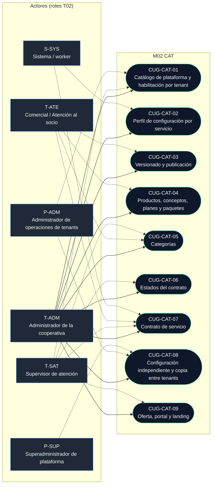

# Casos de uso de M02 CAT — Catálogo de servicios, productos, planes, categorías, estados, contrato de servicio, habilitación por tenant, copia entre tenants y particularidades por servicio

Parte del entregable [21 Casos de uso por módulo](../21-casos-de-uso.md) (artefacto 3.3). Generado con `_trabajo/gen_21_casos_uso.py` desde `docs/especificacion/anexos/M02-CAT-catalogo-servicios.md` y revisado a mano. Ante cualquier diferencia prevalece el anexo.

| Dato | Valor |
|---|---|
| Casos de uso agrupadores (CUG) | 9 |
| RF del anexo | 116 (todos asignados a un CUG) |
| CU con ficha en la sección 16 | 23 |
| CU citados sin ficha en este anexo | 0 |

## 1. Diagramas

### 1.1 Actores y casos de uso agrupadores

Línea continua: actor principal. Línea punteada: actor secundario o participante.

### 1.2 Casos de uso de la especificación por agrupador

```mermaid
flowchart LR
    CUG_CAT_01(["CUG-CAT-01<br/>Catálogo de plataforma y habilitación por tenant"])
    X_CU_CAT_01_CUG_CAT_01["CU-CAT-01<br/>Habilitar capacidades a un tenant"]
    X_CU_CAT_01_CUG_CAT_01 -.->|escenario de| CUG_CAT_01
    CUG_CAT_02(["CUG-CAT-02<br/>Perfil de configuración por servicio"])
    X_CU_05_CUG_CAT_02["CU-05<br/>Configurar y publicar un servicio"]
    X_CU_05_CUG_CAT_02 -.->|escenario de| CUG_CAT_02
    X_CU_ESP_ELE_CUG_CAT_02["CU-ESP-ELE<br/>Alta de suministro eléctrico con medidor y GD"]
    X_CU_ESP_ELE_CUG_CAT_02 -.->|escenario de| CUG_CAT_02
    CUG_CAT_03(["CUG-CAT-03<br/>Versionado y publicación"])
    X_CU_CAT_04_CUG_CAT_03["CU-CAT-04<br/>Cambiar de plan"]
    X_CU_CAT_04_CUG_CAT_03 -.->|escenario de| CUG_CAT_03
    CUG_CAT_05(["CUG-CAT-05<br/>Categorías"])
    X_CU_CAT_05_CUG_CAT_05["CU-CAT-05<br/>Recategorización masiva"]
    X_CU_CAT_05_CUG_CAT_05 -.->|escenario de| CUG_CAT_05
    CUG_CAT_06(["CUG-CAT-06<br/>Estados del contrato"])
    X_CU_PRO_01_CUG_CAT_06["CU-PRO-01<br/>Contratar Internet (piloto)"]
    X_CU_PRO_01_CUG_CAT_06 -.->|escenario de| CUG_CAT_06
    X_CU_ESP_SAN_CUG_CAT_06["CU-ESP-SAN<br/>Adhesión a banco de sangre (definición en..."]
    X_CU_ESP_SAN_CUG_CAT_06 -.->|escenario de| CUG_CAT_06
    X_CU_CAT_03_CUG_CAT_06["CU-CAT-03<br/>Suspender y reactivar por mora"]
    X_CU_CAT_03_CUG_CAT_06 -.->|escenario de| CUG_CAT_06
    X_CU_CAT_10_CUG_CAT_06["CU-CAT-10<br/>Marcar contrato como No facturar"]
    X_CU_CAT_10_CUG_CAT_06 -.->|escenario de| CUG_CAT_06
    CUG_CAT_07(["CUG-CAT-07<br/>Contrato de servicio"])
    X_CU_COP_01_CUG_CAT_07["CU-COP-01<br/>Copiar un servicio de A a B"]
    X_CU_COP_01_CUG_CAT_07 -.->|escenario de| CUG_CAT_07
    X_CU_CIC_01_CUG_CAT_07["CU-CIC-01<br/>Ciclo de vida del contrato (definición en..."]
    X_CU_CIC_01_CUG_CAT_07 -.->|escenario de| CUG_CAT_07
    X_CU_CAT_13_CUG_CAT_07["CU-CAT-13<br/>Ofrecer servicio a un mercado nuevo (no..."]
    X_CU_CAT_13_CUG_CAT_07 -.->|escenario de| CUG_CAT_07
    X_CU_ESP_AG_CUG_CAT_07["CU-ESP-AG<br/>Alta de agua con conexión"]
    X_CU_ESP_AG_CUG_CAT_07 -.->|escenario de| CUG_CAT_07
    X_CU_ESP_GAS_CUG_CAT_07["CU-ESP-GAS<br/>Alta de gas con DDJJ de artefactos"]
    X_CU_ESP_GAS_CUG_CAT_07 -.->|escenario de| CUG_CAT_07
    X_CU_ESP_CEM_CUG_CAT_07["CU-ESP-CEM<br/>Contratar parcela de cementerio parque..."]
    X_CU_ESP_CEM_CUG_CAT_07 -.->|escenario de| CUG_CAT_07
    X_CU_CAT_02_CUG_CAT_07["CU-CAT-02<br/>Dar de baja un contrato"]
    X_CU_CAT_02_CUG_CAT_07 -.->|escenario de| CUG_CAT_07
    X_CU_CAT_06_CUG_CAT_07["CU-CAT-06<br/>Transferir un servicio"]
    X_CU_CAT_06_CUG_CAT_07 -.->|escenario de| CUG_CAT_07
    X_CU_CAT_07_CUG_CAT_07["CU-CAT-07<br/>Registrar y devolver equipo en comodato"]
    X_CU_CAT_07_CUG_CAT_07 -.->|escenario de| CUG_CAT_07
    X_CU_CAT_08_CUG_CAT_07["CU-CAT-08<br/>Administrar adherentes (Reemplazado por M18..."]
    X_CU_CAT_08_CUG_CAT_07 -.->|escenario de| CUG_CAT_07
    X_CU_CAT_11_CUG_CAT_07["CU-CAT-11<br/>Consultar mis servicios"]
    X_CU_CAT_11_CUG_CAT_07 -.->|escenario de| CUG_CAT_07
    X_CU_CAT_12_CUG_CAT_07["CU-CAT-12<br/>Retirar un servicio de la oferta"]
    X_CU_CAT_12_CUG_CAT_07 -.->|escenario de| CUG_CAT_07
    CUG_CAT_08(["CUG-CAT-08<br/>Configuración independiente y copia entre tenants"])
    X_CU_CAT_09_CUG_CAT_08["CU-CAT-09<br/>Configurar alta automática"]
    X_CU_CAT_09_CUG_CAT_08 -.->|escenario de| CUG_CAT_08
    CUG_CAT_09(["CUG-CAT-09<br/>Oferta, portal y landing"])
    X_CU_SOL_01_CUG_CAT_09["CU-SOL-01<br/>Solicitud de alta por portal (definición en..."]
    X_CU_SOL_01_CUG_CAT_09 -.->|escenario de| CUG_CAT_09
```

Rectángulo: CU con ficha en la sección 16 del anexo. Paralelogramo: CU citado (ficha en otro anexo o sin ficha).

## 2. Fichas de los casos de uso agrupadores

### CUG-CAT-01 — Catálogo de plataforma y habilitación por tenant

| Campo | Contenido |
|---|---|
| Actor principal | T-ADM Administrador de la cooperativa |
| Actores secundarios | T-SAT Supervisor de atención; P-ADM Administrador de operaciones de tenants |
| Objetivo | Catálogo de plataforma y habilitación por tenant: Mantener un catálogo global de capacidades de servicio con código, nombre (dict), dominio, descripción, estado (draft, available, deprecated), madurez (confirmed... |
| Precondición | Usuario del tenant autenticado con el rol indicado y capabilities `cat.habilitacion.configurar`, `cat.habilitacion.ver`, `cat.plataforma.copiaServicios.ejecutar`; módulo CAT licenciado y activo (T01, T02 §4.3). |
| Flujo principal | Según CU-CAT-01: PAN-CAT-02: elige tenant, capacidad, fecha; valida licencia; confirma |
| Alternativos | Sin la capability o fuera del alcance de datos: la acción se deniega por defecto y se audita (T02). |
| CU asociados | CU-CAT-01 |
| RF (12) | RF-CAT-001 a 012 |
| Prioridad y olas | Núcleo 7, Estándar 4, Extensión 1; olas O2 |
| Origen | M02 §5.1 |

### CUG-CAT-02 — Perfil de configuración por servicio

| Campo | Contenido |
|---|---|
| Actor principal | T-ADM Administrador de la cooperativa |
| Actores secundarios | S-SYS Sistema / worker |
| Objetivo | Perfil de configuración por servicio: Mantener por tenant y servicio un perfil de configuración en las 13 dimensiones: prestador y jurisdicción, titularidad, unidad de prestación, oferta, cantidad... |
| Precondición | Usuario del tenant autenticado con el rol indicado y capabilities `cat.servicios.ver`, `cat.servicios.editar`, `cat.servicios.publicar`; módulo CAT licenciado y activo (T01, T02 §4.3). |
| Flujo principal | Según CU-05: 9.1 |
| Alternativos | Mantener por tenant y servicio un perfil de configuración en las 13 dimensiones: prestador y jurisdicción... (RF-CAT-013). Sin la capability o fuera del alcance de datos: la acción se deniega por defecto y se audita (T02). |
| CU asociados | CU-05; CU-ESP-ELE |
| RF (18) | RF-CAT-013 a 030 |
| Prioridad y olas | Núcleo 14, Estándar 4, Extensión 0; olas O2, O7, O10 |
| Origen | M02 §5.2 |

### CUG-CAT-03 — Versionado y publicación

| Campo | Contenido |
|---|---|
| Actor principal | T-ADM Administrador de la cooperativa |
| Actores secundarios | T-ATE Comercial / Atención al socio |
| Objetivo | Versionado y publicación: Agrupar los cambios de un servicio en una versión de configuración con dependencias, validaciones, simulación, revisión, aprobación y fecha efectiva. |
| Precondición | Usuario del tenant autenticado con el rol indicado y capabilities `cat.versiones.aprobar`, `cat.versiones.crear`, `cat.servicios.ver`; módulo CAT licenciado y activo (T01, T02 §4.3). |
| Flujo principal | Según CU-CAT-04: 9.4 |
| Alternativos | Sin la capability o fuera del alcance de datos: la acción se deniega por defecto y se audita (T02). |
| CU asociados | CU-CAT-04 |
| RF (5) | RF-CAT-031 a 035 |
| Prioridad y olas | Núcleo 3, Estándar 2, Extensión 0; olas O2 |
| Origen | M02 §5.3 |

### CUG-CAT-04 — Productos, conceptos, planes y paquetes

| Campo | Contenido |
|---|---|
| Actor principal | T-ADM Administrador de la cooperativa |
| Actores secundarios | T-ATE Comercial / Atención al socio |
| Objetivo | Productos, conceptos, planes y paquetes: Definir productos y subservicios dentro de cada servicio del tenant. |
| Precondición | Usuario del tenant autenticado con el rol indicado y capabilities `cat.conceptos.configurarFiscal`, `cat.conceptos.crear`, `cat.conceptos.editar`; módulo CAT licenciado y activo (T01, T02 §4.3). |
| Flujo principal | 1. Definir productos y subservicios dentro de cada servicio del tenant (RF-CAT-036). 2. Definir conceptos facturables individualizables por servicio, tipificados: una sola vez, recurrente, por cantidad, por... (RF-CAT-037). 3. Establecer el disparador de cada concepto: aprobación, instalación efectiva, activación, inicio de período, evento... (RF-CAT-038). 4. Referenciar en cada concepto su clase fiscal (FIS), cuenta/rubro contable (CON), centro de costo y unidad de medida (RF-CAT-039). 5. Distinguir costo interno de prestación y precio al socio (RF-CAT-040). 6. Registrar planes comerciales con atributos del dominio (tecnología, velocidad bajada/subida, unidad, periodicidad... (RF-CAT-041). |
| Alternativos | Declarar compatibilidad y orden entre promociones, subsidios, bonificaciones y otras excepciones del plan (RF-CAT-048). Sin la capability o fuera del alcance de datos: la acción se deniega por defecto y se audita (T02). |
| CU asociados | — (sin CU en la especificación; el flujo sale de los RF) |
| RF (19) | RF-CAT-036 a 054 |
| Prioridad y olas | Núcleo 12, Estándar 7, Extensión 0; olas O2, O3, O4 |
| Origen | M02 §5.4 |

### CUG-CAT-05 — Categorías

| Campo | Contenido |
|---|---|
| Actor principal | T-ADM Administrador de la cooperativa |
| Actores secundarios | T-ATE Comercial / Atención al socio; T-SAT Supervisor de atención |
| Objetivo | Categorías: Mantener categorías por servicio con atributos estructurales: social, prepaga, residencial, generador, categoría con subsidio asociada, categoría SEF asociada, código de... |
| Precondición | Usuario del tenant autenticado con el rol indicado y capabilities `cat.categorias.crear`, `cat.categorias.editar`, `cat.categorias.ver`; módulo CAT licenciado y activo (T01, T02 §4.3). |
| Flujo principal | Según CU-CAT-05: 9.8 |
| Alternativos | Restablecer en bloque categorías subsidiadas a su categoría base (por niveles o por régimen), excluyendo... (RF-CAT-060). Sin la capability o fuera del alcance de datos: la acción se deniega por defecto y se audita (T02). |
| CU asociados | CU-CAT-05 |
| RF (6) | RF-CAT-055 a 060 |
| Prioridad y olas | Núcleo 2, Estándar 4, Extensión 0; olas O2, O7, O10 |
| Origen | M02 §5.5 |

### CUG-CAT-06 — Estados del contrato

| Campo | Contenido |
|---|---|
| Actor principal | T-ADM Administrador de la cooperativa |
| Actores secundarios | T-SAT Supervisor de atención |
| Objetivo | Estados del contrato: Mantener una máquina de estados canónica explícita del contrato (sección 8) con transiciones, actores, precondiciones, efectos y reversión. |
| Precondición | Usuario del tenant autenticado con el rol indicado y capabilities `cat.estados.configurar`, `cat.contratos.cambiarRegimenMedicion`, `cat.contratos.activar`; módulo CAT licenciado y activo (T01, T02 §4.3). |
| Flujo principal | Según CU-PRO-01: 9.2 |
| Alternativos | Sin la capability o fuera del alcance de datos: la acción se deniega por defecto y se audita (T02). |
| CU asociados | CU-PRO-01; CU-ESP-SAN; CU-CAT-03; CU-CAT-10 |
| RF (6) | RF-CAT-061 a 066 |
| Prioridad y olas | Núcleo 6, Estándar 0, Extensión 0; olas O2, O6 |
| Origen | M02 §5.6 |

### CUG-CAT-07 — Contrato de servicio

| Campo | Contenido |
|---|---|
| Actor principal | T-ADM Administrador de la cooperativa |
| Actores secundarios | T-SAT Supervisor de atención; T-ATE Comercial / Atención al socio; S-SYS Sistema / worker |
| Objetivo | Contrato de servicio: Vincular cada contrato con un titular identificado por DNI o CUIT y una cuenta. |
| Precondición | Usuario del tenant autenticado con el rol indicado y capabilities `cat.servicios.ver`, `cat.servicios.editar`, `cat.servicios.publicar`; módulo CAT licenciado y activo (T01, T02 §4.3). |
| Flujo principal | Según CU-COP-01: 9.6 |
| Alternativos | Ejecutar las validaciones de alta configuradas (sección 6, RN-CAT-020..031) devolviendo todos los errores y... (RF-CAT-073). Advertir (o exigir autorización) si existen deudas, vencidas o totales, en otras cuentas con el mismo... (RF-CAT-076). Anular un contrato antes de su activación (desistimiento, factibilidad negativa, OT de alta eliminada) sin... (RF-CAT-091). Sin la capability o fuera del alcance de datos: la acción se deniega por defecto y se audita (T02). |
| CU asociados | CU-COP-01; CU-CIC-01; CU-CAT-13; CU-ESP-AG; CU-ESP-GAS; CU-ESP-CEM; CU-CAT-02; CU-CAT-06; CU-CAT-07; CU-CAT-08; CU-CAT-11; CU-CAT-12 |
| RF (40) | RF-CAT-067 a 103, 114 a 116 |
| Prioridad y olas | Núcleo 11, Estándar 23, Extensión 6; olas O2, O3, O4, O6, O7, O10 |
| Origen | M02 §5.7 |

### CUG-CAT-08 — Configuración independiente y copia entre tenants

| Campo | Contenido |
|---|---|
| Actor principal | T-ADM Administrador de la cooperativa |
| Actores secundarios | P-ADM Administrador de operaciones de tenants; P-SUP Superadministrador de plataforma |
| Objetivo | Configuración independiente y copia entre tenants: Cada servicio de cada tenant tiene configuración propia e independiente sobre la misma capacidad de plataforma. |
| Precondición | Usuario del tenant autenticado con el rol indicado y capabilities `cat.copias.autorizarOrigen`, `cat.copias.ejecutar`, `cat.copias.leerOrigen`; módulo CAT licenciado y activo (T01, T02 §4.3). |
| Flujo principal | Según CU-CAT-09: PAN-CAT-11 con simulación |
| Alternativos | Registrar identidad de la copia, procedencia, versión, componentes elegidos, actor, fecha, resultado... (RF-CAT-107). Sin la capability o fuera del alcance de datos: la acción se deniega por defecto y se audita (T02). |
| CU asociados | CU-CAT-09 |
| RF (6) | RF-CAT-104 a 109 |
| Prioridad y olas | Núcleo 5, Estándar 1, Extensión 0; olas O2 |
| Origen | M02 §5.8 |

### CUG-CAT-09 — Oferta, portal y landing

| Campo | Contenido |
|---|---|
| Actor principal | T-ADM Administrador de la cooperativa |
| Actores secundarios | T-SAT Supervisor de atención |
| Objetivo | Oferta, portal y landing: Publicar en la landing del tenant los servicios y planes con oferta abierta, sus requisitos y canales para solicitar, sin login. |
| Precondición | Usuario del tenant autenticado con el rol indicado y capabilities `cat.oferta.ver`, `cat.servicios.ver`, `cat.servicios.editar`; módulo CAT licenciado y activo (T01, T02 §4.3). |
| Flujo principal | Según CU-SOL-01: PAN-CAT-21 (embebido en PAN-POR-31) → CRM → T01 |
| Alternativos | Sin la capability o fuera del alcance de datos: la acción se deniega por defecto y se audita (T02). |
| CU asociados | CU-SOL-01 |
| RF (4) | RF-CAT-110 a 113 |
| Prioridad y olas | Núcleo 3, Estándar 1, Extensión 0; olas O2 |
| Origen | M02 §5.9 |

## 3. Casos de uso de la especificación (CU)

| CU | Nombre | Actor según el anexo | Agrupador | Criterio de asignación |
|---|---|---|---|---|
| CU-05 | Configurar y publicar un servicio | Administrador del tenant | CUG-CAT-02 | similitud |
| CU-CAT-01 | Habilitar capacidades a un tenant | Operador de plataforma | CUG-CAT-01 | similitud |
| CU-COP-01 | Copiar un servicio de A a B | Operador + admin B | CUG-CAT-07 | similitud |
| CU-PRO-01 | Contratar Internet (piloto) | Ana (socia), comercial, técnico | CUG-CAT-06 | similitud |
| CU-SOL-01 | Solicitud de alta por portal (definición en M09 §16, anexo dueño | Socio | CUG-CAT-09 | similitud |
| CU-CIC-01 | Ciclo de vida del contrato (definición en M08 §16, anexo dueño según PA-MOR-21 y PA-CAT-20 | Varios | CUG-CAT-07 | similitud |
| CU-CAT-13 | Ofrecer servicio a un mercado nuevo (no socio) | Comercial | CUG-CAT-07 | similitud |
| CU-ESP-ELE | Alta de suministro eléctrico con medidor y GD | Comercial, técnico | CUG-CAT-02 | similitud |
| CU-ESP-AG | Alta de agua con conexión | Comercial, técnico | CUG-CAT-07 | similitud |
| CU-ESP-GAS | Alta de gas con DDJJ de artefactos | Comercial, gasista matriculado, técnico | CUG-CAT-07 | similitud |
| CU-ESP-CEM | Contratar parcela de cementerio parque (definición en M18 §16, anexo dueño según PA-CAT-20 | Comercial | CUG-CAT-07 | similitud |
| CU-ESP-SAN | Adhesión a banco de sangre (definición en M18 §16, anexo dueño según PA-CAT-20 | Comercial | CUG-CAT-06 | similitud |
| CU-CAT-02 | Dar de baja un contrato | Socio / comercial / técnico | CUG-CAT-07 | similitud |
| CU-CAT-03 | Suspender y reactivar por mora | MOR, técnico | CUG-CAT-06 | similitud |
| CU-CAT-04 | Cambiar de plan | Socio / comercial | CUG-CAT-03 | similitud |
| CU-CAT-05 | Recategorización masiva | Responsable comercial | CUG-CAT-05 | similitud |
| CU-CAT-06 | Transferir un servicio | Supervisor | CUG-CAT-07 | similitud |
| CU-CAT-07 | Registrar y devolver equipo en comodato | Técnico / comercial | CUG-CAT-07 | similitud |
| CU-CAT-08 | Administrar adherentes (Reemplazado por M18, PAN-SOC-01 | Comercial | CUG-CAT-07 | similitud |
| CU-CAT-09 | Configurar alta automática | Administrador | CUG-CAT-08 | similitud |
| CU-CAT-10 | Marcar contrato como No facturar | Supervisor | CUG-CAT-06 | similitud |
| CU-CAT-11 | Consultar mis servicios | Socio | CUG-CAT-07 | similitud |
| CU-CAT-12 | Retirar un servicio de la oferta | Administrador | CUG-CAT-07 | similitud |

## 4. Cobertura del anexo

| Universo | En la especificación | Incluidos | Excluidos |
|---|---|---|---|
| RF | 116 | 116 | 0 |
| CU con ficha (sección 16) | 23 | 23 | 0 |
| CU citados sin ficha en este anexo | 0 | 0 | 0 |
