# Casos de uso de M03 MED — Medidores, lecturas, consumos, telemedición y prepago

Parte del entregable [21 Casos de uso por módulo](../21-casos-de-uso.md) (artefacto 3.3). Generado con `_trabajo/gen_21_casos_uso.py` desde `docs/especificacion/anexos/M03-MED-medicion-consumos.md` y revisado a mano. Ante cualquier diferencia prevalece el anexo.

| Dato | Valor |
|---|---|
| Casos de uso agrupadores (CUG) | 13 |
| RF del anexo | 129 (todos asignados a un CUG) |
| CU con ficha en la sección 16 | 21 |
| CU citados sin ficha en este anexo | 0 |

## 1. Diagramas

### 1.1 Actores y casos de uso agrupadores

```mermaid
flowchart LR
    subgraph ACT["Actores (roles T02)"]
        direction TB
        A_T_TEC["T-TEC<br/>Técnico (campo)"]
        A_T_STE["T-STE<br/>Supervisor técnico"]
        A_T_CAJ["T-CAJ<br/>Cajero"]
        A_T_LEC["T-LEC<br/>Lecturista (campo)"]
        A_T_SCM["T-SCM<br/>Supervisor de consumos (BASE §39.6)"]
        A_S_SYS["S-SYS<br/>Sistema / worker"]
        A_T_ATE["T-ATE<br/>Comercial / Atención al socio"]
    end
    subgraph SIS["M03 MED"]
        direction TB
        CUG_MED_01(["CUG-MED-01<br/>Catálogos y medidores"])
        CUG_MED_02(["CUG-MED-02<br/>Puntos de medición, canales e instalaciones"])
        CUG_MED_03(["CUG-MED-03<br/>Rutas, cronogramas y lotes"])
        CUG_MED_04(["CUG-MED-04<br/>Captura de lecturas"])
        CUG_MED_05(["CUG-MED-05<br/>Cálculo, validación y aprobación de consumos"])
        CUG_MED_06(["CUG-MED-06<br/>Estimaciones y regularización"])
        CUG_MED_07(["CUG-MED-07<br/>División, prorrateo, distribución y testigos"])
        CUG_MED_08(["CUG-MED-08<br/>Demanda y transgresiones"])
        CUG_MED_09(["CUG-MED-09<br/>Energía inyectada y generación distribuida"])
        CUG_MED_10(["CUG-MED-10<br/>Medición propia, pérdidas y cambio de clase"])
        CUG_MED_11(["CUG-MED-11<br/>Telemedición AMI/MDM"])
        CUG_MED_12(["CUG-MED-12<br/>Prepago"])
        CUG_MED_13(["CUG-MED-13<br/>Portal del socio, facturación in situ e informes"])
    end
    A_T_TEC --> CUG_MED_01
    A_T_STE --> CUG_MED_01
    A_T_CAJ -.-> CUG_MED_01
    A_T_LEC -.-> CUG_MED_01
    A_T_SCM -.-> CUG_MED_01
    A_T_TEC --> CUG_MED_02
    A_T_STE --> CUG_MED_02
    A_T_CAJ -.-> CUG_MED_02
    A_T_LEC -.-> CUG_MED_02
    A_T_SCM -.-> CUG_MED_02
    A_T_SCM --> CUG_MED_03
    A_T_STE --> CUG_MED_03
    A_T_LEC -.-> CUG_MED_03
    A_T_TEC -.-> CUG_MED_03
    A_T_CAJ -.-> CUG_MED_03
    A_S_SYS -.-> CUG_MED_03
    A_T_TEC --> CUG_MED_04
    A_T_LEC --> CUG_MED_04
    A_T_STE -.-> CUG_MED_04
    A_T_SCM -.-> CUG_MED_04
    A_T_CAJ -.-> CUG_MED_04
    A_S_SYS -.-> CUG_MED_04
    A_T_SCM --> CUG_MED_05
    A_T_TEC -.-> CUG_MED_05
    A_T_STE -.-> CUG_MED_05
    A_T_LEC -.-> CUG_MED_05
    A_S_SYS -.-> CUG_MED_05
    A_T_TEC --> CUG_MED_06
    A_T_STE --> CUG_MED_06
    A_T_LEC -.-> CUG_MED_06
    A_T_SCM -.-> CUG_MED_06
    A_T_CAJ -.-> CUG_MED_06
    A_S_SYS -.-> CUG_MED_06
    A_T_SCM --> CUG_MED_07
    A_T_TEC --> CUG_MED_07
    A_T_STE -.-> CUG_MED_07
    A_T_LEC -.-> CUG_MED_07
    A_T_CAJ -.-> CUG_MED_07
    A_T_TEC --> CUG_MED_08
    A_T_STE --> CUG_MED_08
    A_T_LEC -.-> CUG_MED_08
    A_T_CAJ -.-> CUG_MED_08
    A_T_SCM -.-> CUG_MED_08
    A_T_TEC --> CUG_MED_09
    A_T_STE --> CUG_MED_09
    A_T_LEC -.-> CUG_MED_09
    A_T_CAJ -.-> CUG_MED_09
    A_T_SCM -.-> CUG_MED_09
    A_T_TEC --> CUG_MED_10
    A_T_STE --> CUG_MED_10
    A_T_LEC -.-> CUG_MED_10
    A_T_CAJ -.-> CUG_MED_10
    A_T_SCM -.-> CUG_MED_10
    A_T_STE --> CUG_MED_11
    A_T_TEC --> CUG_MED_11
    A_T_LEC -.-> CUG_MED_11
    A_T_CAJ -.-> CUG_MED_11
    A_T_ATE -.-> CUG_MED_11
    A_T_CAJ --> CUG_MED_12
    A_T_SCM -.-> CUG_MED_12
    A_T_TEC -.-> CUG_MED_12
    A_T_STE -.-> CUG_MED_12
    A_T_TEC --> CUG_MED_13
    A_T_STE --> CUG_MED_13
    A_T_CAJ -.-> CUG_MED_13
    A_T_LEC -.-> CUG_MED_13
    A_T_SCM -.-> CUG_MED_13
    A_S_SYS -.-> CUG_MED_13
    classDef actor fill:#1f2937,stroke:#60a5fa,color:#f9fafb;
    classDef cug fill:#0f172a,stroke:#34d399,color:#f9fafb;
    class A_T_TEC,A_T_STE,A_T_CAJ,A_T_LEC,A_T_SCM,A_S_SYS,A_T_ATE actor;
    class CUG_MED_01,CUG_MED_02,CUG_MED_03,CUG_MED_04,CUG_MED_05,CUG_MED_06,CUG_MED_07,CUG_MED_08,CUG_MED_09,CUG_MED_10,CUG_MED_11,CUG_MED_12,CUG_MED_13 cug;
```

Línea continua: actor principal. Línea punteada: actor secundario o participante.

### 1.2 Casos de uso de la especificación por agrupador

```mermaid
flowchart LR
    CUG_MED_01(["CUG-MED-01<br/>Catálogos y medidores"])
    X_CU_ESP_AG_CUG_MED_01["CU-ESP-AG<br/>Agua medida y no medida (BASE §88, parte de..."]
    X_CU_ESP_AG_CUG_MED_01 -.->|escenario de| CUG_MED_01
    X_CU_MED_03_CUG_MED_01["CU-MED-03<br/>Medidor inaccesible dos períodos seguidos"]
    X_CU_MED_03_CUG_MED_01 -.->|escenario de| CUG_MED_01
    X_CU_MED_05_CUG_MED_01["CU-MED-05<br/>Vuelta de medidor"]
    X_CU_MED_05_CUG_MED_01 -.->|escenario de| CUG_MED_01
    X_CU_MED_14_CUG_MED_01["CU-MED-14<br/>Cambio de medidor desde OT de M10 con..."]
    X_CU_MED_14_CUG_MED_01 -.->|escenario de| CUG_MED_01
    CUG_MED_02(["CUG-MED-02<br/>Puntos de medición, canales e instalaciones"])
    X_CU_07_CUG_MED_02["CU-07<br/>Reemplazo de medidor (BASE §7, original)"]
    X_CU_07_CUG_MED_02 -.->|escenario de| CUG_MED_02
    X_CU_ESP_ELE_CUG_MED_02["CU-ESP-ELE<br/>Suministro eléctrico (BASE §87, parte de..."]
    X_CU_ESP_ELE_CUG_MED_02 -.->|escenario de| CUG_MED_02
    CUG_MED_03(["CUG-MED-03<br/>Rutas, cronogramas y lotes"])
    X_CU_MED_11_CUG_MED_03["CU-MED-11<br/>Conflicto offline"]
    X_CU_MED_11_CUG_MED_03 -.->|escenario de| CUG_MED_03
    CUG_MED_04(["CUG-MED-04<br/>Captura de lecturas"])
    X_CU_08_CUG_MED_04["CU-08<br/>Lectura en campo sin conexión (BASE §8..."]
    X_CU_08_CUG_MED_04 -.->|escenario de| CUG_MED_04
    X_CU_MED_02_CUG_MED_04["CU-MED-02<br/>Importación desde colectora de terceros"]
    X_CU_MED_02_CUG_MED_04 -.->|escenario de| CUG_MED_04
    CUG_MED_05(["CUG-MED-05<br/>Cálculo, validación y aprobación de consumos"])
    X_CU_09_CUG_MED_05["CU-09<br/>Validación y aprobación de consumo (BASE §9..."]
    X_CU_09_CUG_MED_05 -.->|escenario de| CUG_MED_05
    X_CU_ESP_GAS_CUG_MED_05["CU-ESP-GAS<br/>Gas por red (BASE §89, parte de medición)"]
    X_CU_ESP_GAS_CUG_MED_05 -.->|escenario de| CUG_MED_05
    X_CU_MED_12_CUG_MED_05["CU-MED-12<br/>Corrección de gas"]
    X_CU_MED_12_CUG_MED_05 -.->|escenario de| CUG_MED_05
    CUG_MED_06(["CUG-MED-06<br/>Estimaciones y regularización"])
    X_CU_MED_04_CUG_MED_06["CU-MED-04<br/>Regularización de estimados"]
    X_CU_MED_04_CUG_MED_06 -.->|escenario de| CUG_MED_06
    CUG_MED_07(["CUG-MED-07<br/>División, prorrateo, distribución y testigos"])
    X_CU_MED_06_CUG_MED_07["CU-MED-06<br/>Distribución en consorcio"]
    X_CU_MED_06_CUG_MED_07 -.->|escenario de| CUG_MED_07
    CUG_MED_08(["CUG-MED-08<br/>Demanda y transgresiones"])
    X_CU_MED_07_CUG_MED_08["CU-MED-07<br/>Transgresión de demanda"]
    X_CU_MED_07_CUG_MED_08 -.->|escenario de| CUG_MED_08
    CUG_MED_09(["CUG-MED-09<br/>Energía inyectada y generación distribuida"])
    X_CU_MER_01_CUG_MED_09["CU-MER-01<br/>Usuario-generador (MER-001, original)"]
    X_CU_MER_01_CUG_MED_09 -.->|escenario de| CUG_MED_09
    X_CU_MED_01_CUG_MED_09["CU-MED-01<br/>Generar, asignar y confirmar una ruta"]
    X_CU_MED_01_CUG_MED_09 -.->|escenario de| CUG_MED_09
    CUG_MED_10(["CUG-MED-10<br/>Medición propia, pérdidas y cambio de clase"])
    X_CU_MED_13_CUG_MED_10["CU-MED-13<br/>Medición propia y pérdidas"]
    X_CU_MED_13_CUG_MED_10 -.->|escenario de| CUG_MED_10
    CUG_MED_11(["CUG-MED-11<br/>Telemedición AMI/MDM"])
    X_CU_MED_08_CUG_MED_11["CU-MED-08<br/>Toma de estado por telemedición y corte..."]
    X_CU_MED_08_CUG_MED_11 -.->|escenario de| CUG_MED_11
    CUG_MED_12(["CUG-MED-12<br/>Prepago"])
    X_CU_MED_09_CUG_MED_12["CU-MED-09<br/>Recarga prepaga con token"]
    X_CU_MED_09_CUG_MED_12 -.->|escenario de| CUG_MED_12
    CUG_MED_13(["CUG-MED-13<br/>Portal del socio, facturación in situ e informes"])
    X_CU_MED_10_CUG_MED_13["CU-MED-10<br/>Autolectura del socio"]
    X_CU_MED_10_CUG_MED_13 -.->|escenario de| CUG_MED_13
```

Rectángulo: CU con ficha en la sección 16 del anexo. Paralelogramo: CU citado (ficha en otro anexo o sin ficha).

## 2. Fichas de los casos de uso agrupadores

### CUG-MED-01 — Catálogos y medidores

| Campo | Contenido |
|---|---|
| Actor principal | T-TEC Técnico (campo); T-STE Supervisor técnico |
| Actores secundarios | T-CAJ Cajero; T-LEC Lecturista (campo); T-SCM Supervisor de consumos (BASE §39.6) |
| Objetivo | Catálogos y medidores: Administrar tipos/modelos de medidor con servicio, marca, fase (monofásico/trifásico), multitarifa, registros, dígitos por defecto, prepago, telemedido, sistema de... |
| Precondición | Usuario del tenant autenticado con el rol indicado y capabilities `med.medidores.ver`, `med.medidores.editar`, `med.medidores.anular`; módulo MED licenciado y activo (T01, T02 §4.3). |
| Flujo principal | Según CU-ESP-AG: - Definición: el CU-ESP-AG se define en M02 §16 (anexo dueño); aquí se detalla solo la parte de medición y se cita esa definición. |
| Alternativos | Registrar ensayos/contrastes del medidor con fecha, laboratorio o responsable, resultado (aprobado... (RF-MED-007). Sin la capability o fuera del alcance de datos: la acción se deniega por defecto y se audita (T02). |
| CU asociados | CU-ESP-AG; CU-MED-03; CU-MED-05; CU-MED-14 |
| RF (11) | RF-MED-001 a 011 |
| Prioridad y olas | Núcleo 5, Estándar 6, Extensión 0; olas O7 |
| Origen | M03 §5.1 |

### CUG-MED-02 — Puntos de medición, canales e instalaciones

| Campo | Contenido |
|---|---|
| Actor principal | T-TEC Técnico (campo); T-STE Supervisor técnico |
| Actores secundarios | T-CAJ Cajero; T-LEC Lecturista (campo); T-SCM Supervisor de consumos (BASE §39.6) |
| Objetivo | Puntos de medición, canales e instalaciones: Crear el punto de medición al habilitar un servicio contratado medido (M01/M02), con tipo de punto (cliente, testigo, compra/frontera, interno, padre de distribución)... |
| Precondición | Usuario del tenant autenticado con el rol indicado y capabilities `med.medicionPropia.crear`, `med.medicionPropia.editar`, `med.medicionPropia.ver`; módulo MED licenciado y activo (T01, T02 §4.3). |
| Flujo principal | Según CU-07: - Situación inicial: una orden autoriza reemplazar el medidor de SUM-AG-001; MED-002 está disponible. - Desarrollo: 1) registrar retiro de MED-001 con lectura final 1.270 m³; 2) instalar MED-002 con lectura inicial 0 m³ y fecha efectiva; 3) conservar ambas instalaciones y enviar los registros a control de consumos. - Requisitos: RF-MED-016 a 020; RN-MED-001, 015, 018, 094. |
| Alternativos | Según CU-07: si MED-002 ya está instalado en otro suministro, se rechaza la asignación (RN-MED-001) hasta resolver la inconsistencia. Sin la capability o fuera del alcance de datos: denegación por defecto y auditoría (T02). |
| CU asociados | CU-07; CU-ESP-ELE |
| RF (15) | RF-MED-012 a 024, 128 a 129 |
| Prioridad y olas | Núcleo 9, Estándar 6, Extensión 0; olas O7, O8 |
| Origen | M03 §5.2 |

### CUG-MED-03 — Rutas, cronogramas y lotes

| Campo | Contenido |
|---|---|
| Actor principal | T-SCM Supervisor de consumos (BASE §39.6); T-STE Supervisor técnico |
| Actores secundarios | T-LEC Lecturista (campo); T-TEC Técnico (campo); T-CAJ Cajero; S-SYS Sistema / worker |
| Objetivo | Rutas, cronogramas y lotes: Administrar rutas de lectura con uno o más servicios, criterio de selección (por zona/sector/recorrido, por calle y rangos de numeración con pares/impares, por rango de... |
| Precondición | Usuario del tenant autenticado con el rol indicado y capabilities `med.lotes.asignar`, `med.lotes.cancelar`, `med.lotes.cerrar`; módulo MED licenciado y activo (T01, T02 §4.3). |
| Flujo principal | Según CU-MED-11: Un lecturista captura sin red una tarea que el supervisor reasignó; al sincronizar, el servidor acepta la lectura, marca conflicto y lo muestra en PAN-MED-34 con ambas evidencias; el supervisor acepta la lectura del dispositivo y cancela la tarea del otro lecturista. |
| Alternativos | Bloquear que un punto esté en dos lotes abiertos del mismo período e informar el lote donde está (RF-MED-030). Revisar el lote con filtros: consumo mayor/menor que un valor, con observación, con foto, por lecturista, por... (RF-MED-035). Confirmar el lote: convertir las lecturas capturadas válidas en lecturas validadas y consumos calculados, con... (RF-MED-036). Sin la capability o fuera del alcance de datos: la acción se deniega por defecto y se audita (T02). |
| CU asociados | CU-MED-11 |
| RF (18) | RF-MED-025 a 042 |
| Prioridad y olas | Núcleo 9, Estándar 9, Extensión 0; olas O7 |
| Origen | M03 §5.3 |

### CUG-MED-04 — Captura de lecturas

| Campo | Contenido |
|---|---|
| Actor principal | T-TEC Técnico (campo); T-LEC Lecturista (campo) |
| Actores secundarios | T-STE Supervisor técnico; T-SCM Supervisor de consumos (BASE §39.6); T-CAJ Cajero; S-SYS Sistema / worker |
| Objetivo | Captura de lecturas: App de lecturas offline (pwa-campo): ver tareas en orden, verificar suministro y medidor, capturar estado por registro, observación codificada, resultado, foto(s), GPS y... |
| Precondición | Usuario del tenant autenticado con el rol indicado y capabilities `med.lecturas.capturar`, `med.lecturas.ver`, `med.lecturas.corregir`; módulo MED licenciado y activo (T01, T02 §4.3). |
| Flujo principal | Según CU-08: - Situación inicial: ruta R-01 descargada; MED-001 asociado a SUM-AG-001; lectura anterior 1.250 m³. - Desarrollo: 1) abrir la tarea y verificar suministro y equipo; 2) registrar 1.270 m³, fotografía y observación; guardar localmente sin conexión; 3) sincronizar y confirmar la recepción sin duplicar. - Requisitos: RF-MED-043 a 048; RN-MED-047 a 054, 125. |
| Alternativos | Según CU-08: si el medidor es inaccesible, se registra el motivo; nunca cero (RN-MED-052). Sin la capability o fuera del alcance de datos: denegación por defecto y auditoría (T02). |
| CU asociados | CU-08; CU-MED-02 |
| RF (18) | RF-MED-043 a 060 |
| Prioridad y olas | Núcleo 11, Estándar 6, Extensión 1; olas O7 |
| Origen | M03 §5.4 |

### CUG-MED-05 — Cálculo, validación y aprobación de consumos

| Campo | Contenido |
|---|---|
| Actor principal | T-SCM Supervisor de consumos (BASE §39.6) |
| Actores secundarios | T-TEC Técnico (campo); T-STE Supervisor técnico; T-LEC Lecturista (campo); S-SYS Sistema / worker |
| Objetivo | Cálculo, validación y aprobación de consumos: Calcular el consumo de cada canal entre dos lecturas validadas consecutivas del mismo medidor y registro, aplicando factor, indicado, lectura con factor y vuelta... |
| Precondición | Usuario del tenant autenticado con el rol indicado y capabilities `med.consumos.validar`, `med.consumos.estimar`, `med.consumos.anular`; módulo MED licenciado y activo (T01, T02 §4.3). |
| Flujo principal | Según CU-09: - Situación inicial: lecturas validadas 1.250 m³ y 1.270 m³ del mismo equipo y período. - Desarrollo: 1) calcular 20 m³; 2) revisar continuidad del equipo, fechas y alertas; 3) aprobar para el ciclo 2026-11. |
| Alternativos | Según CU-09: si aparece 12.700 m³ como estado capturado, la regla de rango crea excepción bloqueante y el caso queda en revisión (RN-MED-076, 078). Sin la capability o fuera del alcance de datos: denegación por defecto y auditoría (T02). |
| CU asociados | CU-09; CU-ESP-GAS; CU-MED-12 |
| RF (13) | RF-MED-061 a 073 |
| Prioridad y olas | Núcleo 12, Estándar 1, Extensión 0; olas O7 |
| Origen | M03 §5.5 |

### CUG-MED-06 — Estimaciones y regularización

| Campo | Contenido |
|---|---|
| Actor principal | T-TEC Técnico (campo); T-STE Supervisor técnico |
| Actores secundarios | T-LEC Lecturista (campo); T-SCM Supervisor de consumos (BASE §39.6); T-CAJ Cajero; S-SYS Sistema / worker |
| Objetivo | Estimaciones y regularización: Estimar consumos individual o masivamente con método configurable (promedio de los últimos N períodos válidos hasta 12, mismo período del año anterior, promedio de la... |
| Precondición | Usuario del tenant autenticado con el rol indicado y capabilities `med.lecturas.capturar`, `med.lecturas.ver`, `med.lecturas.corregir`; módulo MED licenciado y activo (T01, T02 §4.3). |
| Flujo principal | Según CU-MED-04: Dos períodos estimados de 15 m³ cada uno; la lectura real del tercer período muestra un acumulado que implica 10 m³/mes; el job propone compensar 10 m³ (2 × 15 − 2 × 10) en la próxima liquidación; el supervisor aprueba; M04 aplica "Compensación de 10 m³". |
| Alternativos | Sin la capability o fuera del alcance de datos: la acción se deniega por defecto y se audita (T02). |
| CU asociados | CU-MED-04 |
| RF (8) | RF-MED-074 a 081 |
| Prioridad y olas | Núcleo 4, Estándar 4, Extensión 0; olas O7 |
| Origen | M03 §5.6 |

### CUG-MED-07 — División, prorrateo, distribución y testigos

| Campo | Contenido |
|---|---|
| Actor principal | T-SCM Supervisor de consumos (BASE §39.6); T-TEC Técnico (campo) |
| Actores secundarios | T-STE Supervisor técnico; T-LEC Lecturista (campo); T-CAJ Cajero |
| Objetivo | División, prorrateo, distribución y testigos: Dividir un consumo que abarca más días que el período en dos o más tramos con los modos: mitades, por días máximos (primer tramo exacto marcado estimado), limitar... |
| Precondición | Usuario del tenant autenticado con el rol indicado y capabilities `med.testigos.ver`, `med.medidores.ver`, `med.medidores.editar`; módulo MED licenciado y activo (T01, T02 §4.3). |
| Flujo principal | Según CU-MED-06: Medidor general de un consorcio con 4 departamentos en modo "igualada": consumo del padre 101 m³; cada hijo recibe 25,25 m³ salvo el último que absorbe el redondeo; el padre recibe −101 m³ compensatorio; un error de configuración se revierte por runId antes de facturar. |
| Alternativos | Revertir una distribución ejecutada mientras sus consumos no estén facturados (RF-MED-086). Sin la capability o fuera del alcance de datos: la acción se deniega por defecto y se audita (T02). |
| CU asociados | CU-MED-06 |
| RF (7) | RF-MED-082 a 088 |
| Prioridad y olas | Núcleo 1, Estándar 6, Extensión 0; olas O7 |
| Origen | M03 §5.7 |

### CUG-MED-08 — Demanda y transgresiones

| Campo | Contenido |
|---|---|
| Actor principal | T-TEC Técnico (campo); T-STE Supervisor técnico |
| Actores secundarios | T-LEC Lecturista (campo); T-CAJ Cajero; T-SCM Supervisor de consumos (BASE §39.6) |
| Objetivo | Demanda y transgresiones: Registrar la demanda contratada por punto y canal de demanda (punta, fuera de punta, valle) con vigencia por período. |
| Precondición | Usuario del tenant autenticado con el rol indicado y capabilities `med.demanda.editar`, `med.demanda.resetear`, `med.demanda.ver`; módulo MED licenciado y activo (T01, T02 §4.3). |
| Flujo principal | Según CU-MED-07: Gran usuario con 50 kW contratados registra 62 kW en punta: % = 62 × 100 / 50 − 100 = 24 %; se registra primera transgresión y demanda declarada 62 kW; aviso a atención comercial para aumento de potencia; meses después, con aprobación, se resetea la declarada a 50 kW. |
| Alternativos | Sin la capability o fuera del alcance de datos: la acción se deniega por defecto y se audita (T02). |
| CU asociados | CU-MED-07 |
| RF (5) | RF-MED-089 a 093 |
| Prioridad y olas | Núcleo 3, Estándar 2, Extensión 0; olas O7 |
| Origen | M03 §5.8 |

### CUG-MED-09 — Energía inyectada y generación distribuida

| Campo | Contenido |
|---|---|
| Actor principal | T-TEC Técnico (campo); T-STE Supervisor técnico |
| Actores secundarios | T-LEC Lecturista (campo); T-CAJ Cajero; T-SCM Supervisor de consumos (BASE §39.6) |
| Objetivo | Energía inyectada y generación distribuida: Registrar el contrato técnico de generación distribuida: clasificación del usuario-generador, potencia instalada y autorizada, tecnología, equipo/inversor, fecha de... |
| Precondición | Usuario del tenant autenticado con el rol indicado y capabilities `med.demanda.editar`, `med.demanda.resetear`, `med.demanda.ver`; módulo MED licenciado y activo (T01, T02 §4.3). |
| Flujo principal | Según CU-MER-01: Un asociado con paneles solares demanda 300 kWh e inyecta 120 kWh en el mes. MED registra ambos canales del medidor bidireccional, calcula el balance (300 / 120 / neto 180) y lo entrega; M04 valoriza cada uno con su tarifa, M05 liquida en el mismo comprobante y M07 lleva el crédito si el valor inyectado supera lo que paga. Valores ficticios. |
| Alternativos | Sin la capability o fuera del alcance de datos: la acción se deniega por defecto y se audita (T02). |
| CU asociados | CU-MER-01; CU-MED-01 |
| RF (6) | RF-MED-094 a 099 |
| Prioridad y olas | Núcleo 3, Estándar 2, Extensión 1; olas O7 |
| Origen | M03 §5.9 |

### CUG-MED-10 — Medición propia, pérdidas y cambio de clase

| Campo | Contenido |
|---|---|
| Actor principal | T-TEC Técnico (campo); T-STE Supervisor técnico |
| Actores secundarios | T-LEC Lecturista (campo); T-CAJ Cajero; T-SCM Supervisor de consumos (BASE §39.6) |
| Objetivo | Medición propia, pérdidas y cambio de clase: Registrar puntos de medición propia (compra de energía, frontera, alimentadores, internos) con registros pico, resto, valle, punta, fuera de punta y reactiva, y sus... |
| Precondición | Usuario del tenant autenticado con el rol indicado y capabilities `med.medicionPropia.crear`, `med.medicionPropia.editar`, `med.medicionPropia.ver`; módulo MED licenciado y activo (T01, T02 §4.3). |
| Flujo principal | Según CU-MED-13: El responsable carga la lectura del medidor de compra: pico 40.000, resto 50.000, valle 30.000 kWh, reactiva 36.000 kVArh; compra activa 120.000 kWh; cos φ = cos(atan(0,3)) ≈ 0,958; facturado del período 104.400 kWh; pérdida 15.600 kWh = 13 %. |
| Alternativos | Sin la capability o fuera del alcance de datos: la acción se deniega por defecto y se audita (T02). |
| CU asociados | CU-MED-13 |
| RF (3) | RF-MED-100 a 102 |
| Prioridad y olas | Núcleo 0, Estándar 2, Extensión 1; olas O7 |
| Origen | M03 §5.10 |

### CUG-MED-11 — Telemedición AMI/MDM

| Campo | Contenido |
|---|---|
| Actor principal | T-STE Supervisor técnico; T-TEC Técnico (campo) |
| Actores secundarios | T-LEC Lecturista (campo); T-CAJ Cajero; T-ATE Comercial / Atención al socio |
| Objetivo | Telemedición AMI/MDM: Configurar por tenant los sistemas de telemedición/prepago (proveedor, tipo, URL, credenciales en bóveda, datos extra, servicio y tipos de medidor que atiende... |
| Precondición | Usuario del tenant autenticado con el rol indicado y capabilities `med.telemedicion.operar`, `med.telemedicion.comandoCorte`, `med.telemedicion.comandoReconexion`; módulo MED licenciado y activo (T01, T02 §4.3). |
| Flujo principal | Según CU-MED-08: El job de toma de estado consulta 300 medidores de un sistema AMI; 295 responden; 5 quedan con excepción y van a ruta de campo. Días después, M08 ordena un corte por mora: MED envía el comando con Idempotency-Key, el proveedor confirma, se emite med.remoteOperation.succeeded y M01 cambia el estado del servicio con la fecha confirmada. Un reintento por timeout no genera un segundo corte. |
| Alternativos | Contrato de comandos de corte y reconexión remota: solo a pedido de una orden vigente de M08/M10, con... (RF-MED-108). Consultar y operar comandos/operaciones de telemedición por servicio: historial, estado, reintento... (RF-MED-110). Mostrar el estado de cada conector por tenant (activo, degradado, caído, credencial vencida) con la cantidad... (RF-MED-112). Sin la capability o fuera del alcance de datos: la acción se deniega por defecto y se audita (T02). |
| CU asociados | CU-MED-08 |
| RF (10) | RF-MED-103 a 112 |
| Prioridad y olas | Núcleo 6, Estándar 3, Extensión 1; olas O7 |
| Origen | M03 §5.11 |

### CUG-MED-12 — Prepago

| Campo | Contenido |
|---|---|
| Actor principal | T-CAJ Cajero |
| Actores secundarios | T-SCM Supervisor de consumos (BASE §39.6); T-TEC Técnico (campo); T-STE Supervisor técnico |
| Objetivo | Prepago: Mantener la cuenta prepaga técnica del punto: sistema prepago, identificador del medidor en el proveedor, modalidad (token/código o carga remota en línea), saldo... |
| Precondición | Usuario del tenant autenticado con el rol indicado y capabilities `med.prepago.vender`, `med.prepago.autorizar`, `med.miPrepago.ver`; módulo MED licenciado y activo (T01, T02 §4.3). |
| Flujo principal | Según CU-MED-09: Un socio recarga ARS 10.000 en la app: preventa OK; M07 confirma el pago; MED solicita el token; el proveedor no responde (timeout); estado unknown, se consulta el estado y se obtiene el token emitido; se entrega por la app y por correo; la conciliación nocturna lo empareja. |
| Alternativos | Sin la capability o fuera del alcance de datos: la acción se deniega por defecto y se audita (T02). |
| CU asociados | CU-MED-09 |
| RF (7) | RF-MED-113 a 119 |
| Prioridad y olas | Núcleo 3, Estándar 4, Extensión 0; olas O7 |
| Origen | M03 §5.12 |

### CUG-MED-13 — Portal del socio, facturación in situ e informes

| Campo | Contenido |
|---|---|
| Actor principal | T-TEC Técnico (campo); T-STE Supervisor técnico |
| Actores secundarios | T-CAJ Cajero; T-LEC Lecturista (campo); T-SCM Supervisor de consumos (BASE §39.6); S-SYS Sistema / worker |
| Objetivo | Portal del socio, facturación in situ e informes: "Mis consumos" en la app del socio: historial por servicio y canal, gráfico, comparación interanual, estimados marcados, fotos de la lectura si el tenant lo habilita. |
| Precondición | Usuario del tenant autenticado con el rol indicado y capabilities `med.informes.exportar`, `med.informes.ver`, `med.lecturas.capturar`; módulo MED licenciado y activo (T01, T02 §4.3). |
| Flujo principal | Según CU-MED-10: Con ventana abierta, el socio envía estado y foto; la lectura queda en rango y se acepta; con política ifInRange, la tarea de ruta se marca "resuelta por autolectura" y el lecturista no la visita; al tercer período se exige lectura de campo (PRM-MED-055). |
| Alternativos | Tablero de lecturas y consumos: avance de lotes, % leído, % estimado, excepciones abiertas, productividad... (RF-MED-124). Sin la capability o fuera del alcance de datos: la acción se deniega por defecto y se audita (T02). |
| CU asociados | CU-MED-10 |
| RF (8) | RF-MED-120 a 127 |
| Prioridad y olas | Núcleo 0, Estándar 7, Extensión 1; olas O7 |
| Origen | M03 §5.13 |

## 3. Casos de uso de la especificación (CU)

| CU | Nombre | Actor según el anexo | Agrupador | Criterio de asignación |
|---|---|---|---|---|
| CU-07 | Reemplazo de medidor (BASE §7, original) | Encargado técnico (o cierre de OT de M10) | CUG-MED-02 | RF citados |
| CU-08 | Lectura en campo sin conexión (BASE §8, original) | Lecturista | CUG-MED-04 | RF citados |
| CU-09 | Validación y aprobación de consumo (BASE §9, original) | Supervisor de consumos | CUG-MED-05 | similitud |
| CU-ESP-ELE | Suministro eléctrico (BASE §87, parte de medición) | — | CUG-MED-02 | RF citados |
| CU-ESP-AG | Agua medida y no medida (BASE §88, parte de medición) | — | CUG-MED-01 | similitud |
| CU-ESP-GAS | Gas por red (BASE §89, parte de medición) | — | CUG-MED-05 | RF citados |
| CU-MER-01 | Usuario-generador (MER-001, original) | — | CUG-MED-09 | similitud |
| CU-MED-01 | Generar, asignar y confirmar una ruta | — | CUG-MED-09 | similitud |
| CU-MED-02 | Importación desde colectora de terceros | — | CUG-MED-04 | similitud |
| CU-MED-03 | Medidor inaccesible dos períodos seguidos | — | CUG-MED-01 | similitud |
| CU-MED-04 | Regularización de estimados | — | CUG-MED-06 | similitud |
| CU-MED-05 | Vuelta de medidor | — | CUG-MED-01 | similitud |
| CU-MED-06 | Distribución en consorcio | — | CUG-MED-07 | similitud |
| CU-MED-07 | Transgresión de demanda | — | CUG-MED-08 | similitud |
| CU-MED-08 | Toma de estado por telemedición y corte remoto | — | CUG-MED-11 | similitud |
| CU-MED-09 | Recarga prepaga con token | — | CUG-MED-12 | similitud |
| CU-MED-10 | Autolectura del socio | — | CUG-MED-13 | similitud |
| CU-MED-11 | Conflicto offline | — | CUG-MED-03 | similitud |
| CU-MED-12 | Corrección de gas | — | CUG-MED-05 | similitud |
| CU-MED-13 | Medición propia y pérdidas | — | CUG-MED-10 | similitud |
| CU-MED-14 | Cambio de medidor desde OT de M10 con medidor telemedido | — | CUG-MED-01 | similitud |

## 4. Cobertura del anexo

| Universo | En la especificación | Incluidos | Excluidos |
|---|---|---|---|
| RF | 129 | 129 | 0 |
| CU con ficha (sección 16) | 21 | 21 | 0 |
| CU citados sin ficha en este anexo | 0 | 0 | 0 |
