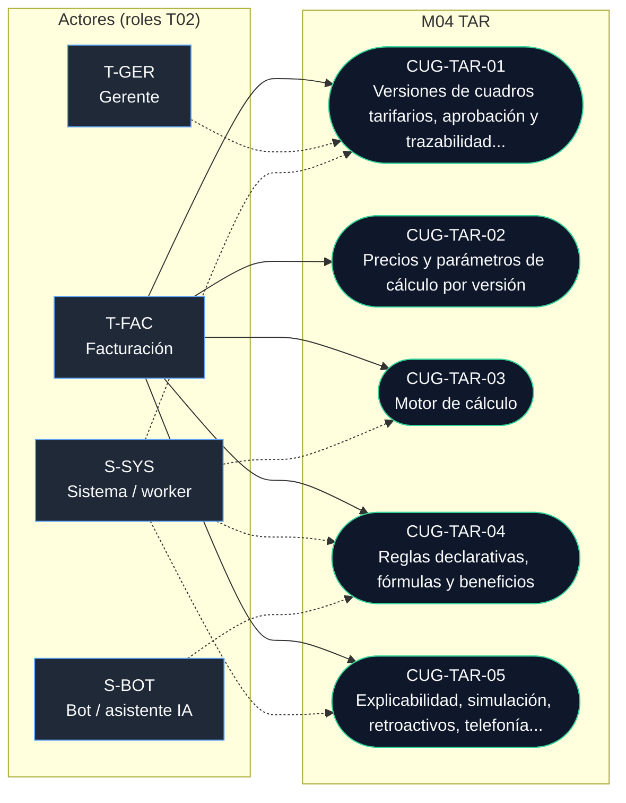
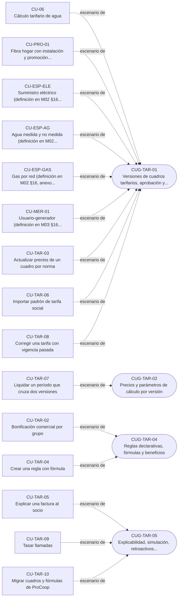

# Casos de uso de M04 TAR — Tarifas y motor de cálculo

Parte del entregable [21 Casos de uso por módulo](../21-casos-de-uso.md) (artefacto 3.3). Generado con `_trabajo/gen_21_casos_uso.py` desde `docs/especificacion/anexos/M04-TAR-tarifas-motor-calculo.md` y revisado a mano. Ante cualquier diferencia prevalece el anexo.

| Dato | Valor |
|---|---|
| Casos de uso agrupadores (CUG) | 5 |
| RF del anexo | 122 (todos asignados a un CUG) |
| CU con ficha en la sección 16 | 15 |
| CU citados sin ficha en este anexo | 0 |

## 1. Diagramas

### 1.1 Actores y casos de uso agrupadores

Línea continua: actor principal. Línea punteada: actor secundario o participante.

### 1.2 Casos de uso de la especificación por agrupador

Rectángulo: CU con ficha en la sección 16 del anexo. Paralelogramo: CU citado (ficha en otro anexo o sin ficha).

## 2. Fichas de los casos de uso agrupadores

### CUG-TAR-01 — Versiones de cuadros tarifarios, aprobación y trazabilidad normativa

| Campo | Contenido |
|---|---|
| Actor principal | T-FAC Facturación |
| Actores secundarios | T-GER Gerente; S-SYS Sistema / worker |
| Objetivo | Versiones de cuadros tarifarios, aprobación y trazabilidad normativa: Crear una versión tarifaria en borrador con código, nombre (por mes o por norma, ej. |
| Precondición | Usuario del tenant autenticado con el rol indicado y capabilities `tar.normas.adjuntar`, `tar.cuadros.ver`, `tar.cuadros.editar`; módulo TAR licenciado y activo (T01, T02 §4.3). |
| Flujo principal | Según CU-06: Selecciona TAR-AG-2026-11; cargo fijo ARS 3.000 + 20 m³ × ARS 500 ⇒ ARS 13.000 explicado y asociado a la versión, sin emisión ni cobro. |
| Alternativos | Según CU-TAR-03: Simulación faltante ⇒ no se puede enviar; aprobador = autor ⇒ rechazo; vigencia superpuesta ⇒ TAR-E-SCH-OVERLAP. Sin la capability o fuera del alcance de datos: denegación por defecto y auditoría (T02). |
| CU asociados | CU-06; CU-PRO-01; CU-ESP-ELE; CU-ESP-AG; CU-ESP-GAS; CU-MER-01; CU-TAR-03; CU-TAR-06; CU-TAR-08 |
| RF (19) | RF-TAR-001 a 019 |
| Prioridad y olas | Núcleo 12, Estándar 6, Extensión 1; olas O4, O7 |
| Origen | M04 §5.1 |

### CUG-TAR-02 — Precios y parámetros de cálculo por versión

| Campo | Contenido |
|---|---|
| Actor principal | T-FAC Facturación |
| Actores secundarios | — |
| Objetivo | Precios y parámetros de cálculo por versión: Definir por versión y servicio los parámetros de cálculo: tipo de cálculo (17 estrategias), concepto de cargo fijo por defecto, moneda, período en días, cargo fijo por... |
| Precondición | Usuario del tenant autenticado con el rol indicado y capabilities `tar.precios.actualizarMasivo`, `tar.precios.importar`, `tar.calculo.ejecutar`; módulo TAR licenciado y activo (T01, T02 §4.3). |
| Flujo principal | Según CU-TAR-07: Lecturas 01/10–31/10, versión nueva desde 16/10 ⇒ prorrateo por días con renglones por versión y fracción en la traza. |
| Alternativos | Según CU-TAR-07: Más de 3 versiones ⇒ TAR-E-PRORATION-TOO-MANY. Sin la capability o fuera del alcance de datos: denegación por defecto y auditoría (T02). |
| CU asociados | CU-TAR-07 |
| RF (12) | RF-TAR-020 a 031 |
| Prioridad y olas | Núcleo 5, Estándar 6, Extensión 1; olas O4, O7, O10 |
| Origen | M04 §5.2 |

### CUG-TAR-03 — Motor de cálculo

| Campo | Contenido |
|---|---|
| Actor principal | T-FAC Facturación |
| Actores secundarios | S-SYS Sistema / worker |
| Objetivo | Motor de cálculo: Motor declarativo por pipeline de pasos configurables (sección 9.2) con estrategias por tipo de cálculo, sin switch monolítico. |
| Precondición | Usuario del tenant autenticado con el rol indicado y capabilities `tar.calculo.ejecutar`, `tar.calculo.explicar`, `tar.precios.actualizarMasivo`; módulo TAR licenciado y activo (T01, T02 §4.3). |
| Flujo principal | 1. Motor declarativo por pipeline de pasos configurables (sección 9.2) con estrategias por tipo de cálculo, sin switch... (RF-TAR-032). 2. Facturar P × Q con precio unitario y cantidad, unidades y fuente identificables (RF-TAR-033). 3. Servicios de importe fijo (abonos), telefonía móvil y pack SMS con proporcional de alta/baja (RF-TAR-034). 4. Cargo fijo con condición del servicio, una vez por período, concepto, cantidad, moneda, por días, por tramo... (RF-TAR-036). 5. Tarifa medida por bloque (tipos 1, 4) y por tramos y escalones progresivos (tipos 2, 3) con factor por días, escalones... (RF-TAR-037). 6. Prorrateo entre versiones dentro del período (métodos consumo, consumo continuando la trama, precio unitario (RF-TAR-042). |
| Alternativos | Servicios por cantidad (tarifa por bloque o tramas sobre la cantidad contratada) (RF-TAR-035). Tarifa medida por bloque (tipos 1, 4) y por tramos y escalones progresivos (tipos 2, 3) con factor por días... (RF-TAR-037). Prorrateo por días por alta, baja, suspensión, reactivación y cambio de plan dentro del período, en mes... (RF-TAR-043). Sin la capability o fuera del alcance de datos: la acción se deniega por defecto y se audita (T02). |
| CU asociados | — (sin CU en la especificación; el flujo sale de los RF) |
| RF (32) | RF-TAR-032 a 063 |
| Prioridad y olas | Núcleo 15, Estándar 16, Extensión 1; olas O4, O7, O10 |
| Origen | M04 §5.3 |

### CUG-TAR-04 — Reglas declarativas, fórmulas y beneficios

| Campo | Contenido |
|---|---|
| Actor principal | T-FAC Facturación |
| Actores secundarios | S-SYS Sistema / worker; S-BOT Bot / asistente IA |
| Objetivo | Reglas declarativas, fórmulas y beneficios: Reglas con identidad, ámbito, jurisdicción y respaldo, vigencia, condiciones, base, operación, compatibilidad, efectos y evidencia. |
| Precondición | Usuario del tenant autenticado con el rol indicado y capabilities `tar.formulas.editar`, `tar.formulas.probar`, `tar.reglas.aprobar`; módulo TAR licenciado y activo (T01, T02 §4.3). |
| Flujo principal | Según CU-TAR-02: Crea grupo GR-BON-DEMO con vigencia; regla BON-VAR-30 (30 % sobre el variable, no sobre el fijo); simula socio incluido (ARS 10.000) y no incluido (ARS 13.000). |
| Alternativos | Según CU-TAR-04: Fórmula con función fuera de fase, referencia a regla posterior o ciclo ⇒ error de compilación; regla de comprobante con servicio ⇒ rechazo. Sin la capability o fuera del alcance de datos: denegación por defecto y auditoría (T02). |
| CU asociados | CU-TAR-02; CU-TAR-04 |
| RF (24) | RF-TAR-064 a 087 |
| Prioridad y olas | Núcleo 19, Estándar 4, Extensión 1; olas O4, O7 |
| Origen | M04 §5.4 |

### CUG-TAR-05 — Explicabilidad, simulación, retroactivos, telefonía, reportes y migración

| Campo | Contenido |
|---|---|
| Actor principal | T-FAC Facturación |
| Actores secundarios | S-SYS Sistema / worker |
| Objetivo | Explicabilidad, simulación, retroactivos, telefonía, reportes y migración: Cada renglón guarda: tipo, concepto, descripción, cantidad, unidad, precio unitario, importe, moneda/cotización, versión (id, revisión, hash), categoría-precio, fila de... |
| Precondición | Usuario del tenant autenticado con el rol indicado y capabilities `tar.simulacion.ejecutar`, `tar.simulador.ejecutar`, `tar.simulador.masivo`; módulo TAR licenciado y activo (T01, T02 §4.3). |
| Flujo principal | Según CU-TAR-05: Abre el detalle en PWA → ve cargo fijo, tramos, beneficios con origen, promoción ciclo X/N, tributos y norma. |
| Alternativos | Según CU-TAR-05: Comprobante anulado ⇒ se muestra con la anulación. Sin la capability o fuera del alcance de datos: denegación por defecto y auditoría (T02). |
| CU asociados | CU-TAR-05; CU-TAR-09; CU-TAR-10 |
| RF (35) | RF-TAR-088 a 122 |
| Prioridad y olas | Núcleo 18, Estándar 16, Extensión 1; olas O3, O4, O7, O10, O11 |
| Origen | M04 §5.5 |

## 3. Casos de uso de la especificación (CU)

| CU | Nombre | Actor según el anexo | Agrupador | Criterio de asignación |
|---|---|---|---|---|
| CU-06 | Cálculo tarifario de agua | Analista comercial autorizado | CUG-TAR-01 | RF citados |
| CU-TAR-02 | Bonificación comercial por grupo | Responsable de tarifas y aprobador | CUG-TAR-04 | similitud |
| CU-PRO-01 | Fibra hogar con instalación y promoción (definición en M02 §16, anexo dueño según... | Responsable comercial | CUG-TAR-01 | similitud |
| CU-ESP-ELE | Suministro eléctrico (definición en M02 §16, anexo dueño | Técnica / facturación | CUG-TAR-01 | similitud |
| CU-ESP-AG | Agua medida y no medida (definición en M02 §16, anexo dueño | Facturación | CUG-TAR-01 | similitud |
| CU-ESP-GAS | Gas por red (definición en M02 §16, anexo dueño | Técnica / facturación | CUG-TAR-01 | similitud |
| CU-MER-01 | Usuario-generador (definición en M03 §16, anexo dueño | Facturación | CUG-TAR-01 | similitud |
| CU-TAR-03 | Actualizar precios de un cuadro por norma | Responsable de tarifas, aprobadores | CUG-TAR-01 | similitud |
| CU-TAR-04 | Crear una regla con fórmula | Responsable de tarifas | CUG-TAR-04 | similitud |
| CU-TAR-05 | Explicar una factura al socio | Socio / atención | CUG-TAR-05 | similitud |
| CU-TAR-06 | Importar padrón de tarifa social | Responsable de beneficios | CUG-TAR-01 | similitud |
| CU-TAR-07 | Liquidar un período que cruza dos versiones | Motor / facturación | CUG-TAR-02 | similitud |
| CU-TAR-08 | Corregir una tarifa con vigencia pasada | Responsable de tarifas, aprobadores | CUG-TAR-01 | similitud |
| CU-TAR-09 | Tasar llamadas | Motor / técnica | CUG-TAR-05 | similitud |
| CU-TAR-10 | Migrar cuadros y fórmulas de ProCoop | Equipo de migración | CUG-TAR-05 | similitud |

## 4. Cobertura del anexo

| Universo | En la especificación | Incluidos | Excluidos |
|---|---|---|---|
| RF | 122 | 122 | 0 |
| CU con ficha (sección 16) | 15 | 15 | 0 |
| CU citados sin ficha en este anexo | 0 | 0 | 0 |
