# Casos de uso de M05 FAC — Facturación: ciclos, lotes y comprobantes

Parte del entregable [21 Casos de uso por módulo](../21-casos-de-uso.md) (artefacto 3.3). Generado con `_trabajo/gen_21_casos_uso.py` desde `docs/especificacion/anexos/M05-FAC-facturacion.md` y revisado a mano. Ante cualquier diferencia prevalece el anexo.

| Dato | Valor |
|---|---|
| Casos de uso agrupadores (CUG) | 20 |
| RF del anexo | 179 (todos asignados a un CUG) |
| CU con ficha en la sección 16 | 22 |
| CU citados sin ficha en este anexo | 0 |

## 1. Diagramas

### 1.1 Actores y casos de uso agrupadores

```mermaid
flowchart LR
    subgraph ACT["Actores (roles T02)"]
        direction TB
        A_T_FAC["T-FAC<br/>Facturación"]
        A_T_CAJ["T-CAJ<br/>Cajero"]
        A_S_SYS["S-SYS<br/>Sistema / worker"]
        A_T_ATE["T-ATE<br/>Comercial / Atención al socio"]
        A_T_ADM["T-ADM<br/>Administrador de la cooperativa"]
    end
    subgraph SIS["M05 FAC"]
        direction TB
        CUG_FAC_01(["CUG-FAC-01<br/>Ciclos, universos y plantillas"])
        CUG_FAC_02(["CUG-FAC-02<br/>Lote: preparar y congelar el universo"])
        CUG_FAC_03(["CUG-FAC-03<br/>Prefacturación, simulación y comparación"])
        CUG_FAC_04(["CUG-FAC-04<br/>Bandeja de excepciones"])
        CUG_FAC_05(["CUG-FAC-05<br/>Aprobación"])
        CUG_FAC_06(["CUG-FAC-06<br/>Emisión y numeración del lote"])
        CUG_FAC_07(["CUG-FAC-07<br/>Estado fiscal y autorización (dependencia de M06)"])
        CUG_FAC_08(["CUG-FAC-08<br/>Modalidad separada y agrupada; grupos de facturación"])
        CUG_FAC_09(["CUG-FAC-09<br/>Tipos de comprobante, letras, puntos de venta y numeración"])
        CUG_FAC_10(["CUG-FAC-10<br/>Vencimientos y tramas"])
        CUG_FAC_11(["CUG-FAC-11<br/>Bloqueo de comprobantes"])
        CUG_FAC_12(["CUG-FAC-12<br/>Anulación, notas de crédito y débito, reversión"])
        CUG_FAC_13(["CUG-FAC-13<br/>Recategorización, retroactivos y modificación masiva"])
        CUG_FAC_14(["CUG-FAC-14<br/>Facturación de cuotas y de terceros; ítems facturables"])
        CUG_FAC_15(["CUG-FAC-15<br/>Factura manual, replicar y refacturación puntual"])
        CUG_FAC_16(["CUG-FAC-16<br/>Impresión, diseño, gráficos y PDF"])
        CUG_FAC_17(["CUG-FAC-17<br/>Código de barras y QR"])
        CUG_FAC_18(["CUG-FAC-18<br/>Talones y documentos de pago"])
        CUG_FAC_19(["CUG-FAC-19<br/>Distribución: impresión y reparto, email, WhatsApp, portal"])
        CUG_FAC_20(["CUG-FAC-20<br/>Cierre de ciclo, cierre de módulo, socio y transversales"])
    end
    A_T_FAC --> CUG_FAC_01
    A_T_CAJ -.-> CUG_FAC_01
    A_S_SYS -.-> CUG_FAC_01
    A_T_FAC --> CUG_FAC_02
    A_T_CAJ -.-> CUG_FAC_02
    A_S_SYS -.-> CUG_FAC_02
    A_T_FAC --> CUG_FAC_03
    A_T_CAJ -.-> CUG_FAC_03
    A_T_FAC --> CUG_FAC_04
    A_T_CAJ -.-> CUG_FAC_04
    A_S_SYS -.-> CUG_FAC_04
    A_T_FAC --> CUG_FAC_05
    A_T_CAJ -.-> CUG_FAC_05
    A_T_FAC --> CUG_FAC_06
    A_T_CAJ -.-> CUG_FAC_06
    A_S_SYS -.-> CUG_FAC_06
    A_T_FAC --> CUG_FAC_07
    A_T_CAJ -.-> CUG_FAC_07
    A_S_SYS -.-> CUG_FAC_07
    A_T_FAC --> CUG_FAC_08
    A_T_CAJ -.-> CUG_FAC_08
    A_T_FAC --> CUG_FAC_09
    A_T_CAJ -.-> CUG_FAC_09
    A_T_FAC --> CUG_FAC_10
    A_T_CAJ -.-> CUG_FAC_10
    A_T_FAC --> CUG_FAC_11
    A_T_CAJ -.-> CUG_FAC_11
    A_S_SYS -.-> CUG_FAC_11
    A_T_FAC --> CUG_FAC_12
    A_T_ATE -.-> CUG_FAC_12
    A_T_FAC --> CUG_FAC_13
    A_T_CAJ -.-> CUG_FAC_13
    A_T_FAC --> CUG_FAC_14
    A_T_CAJ -.-> CUG_FAC_14
    A_S_SYS -.-> CUG_FAC_14
    A_T_FAC --> CUG_FAC_15
    A_T_CAJ -.-> CUG_FAC_15
    A_S_SYS -.-> CUG_FAC_15
    A_T_FAC --> CUG_FAC_16
    A_T_CAJ -.-> CUG_FAC_16
    A_T_FAC --> CUG_FAC_17
    A_T_CAJ -.-> CUG_FAC_17
    A_T_ADM -.-> CUG_FAC_17
    A_T_FAC --> CUG_FAC_18
    A_T_CAJ -.-> CUG_FAC_18
    A_T_FAC --> CUG_FAC_19
    A_T_CAJ -.-> CUG_FAC_19
    A_S_SYS -.-> CUG_FAC_19
    A_T_FAC --> CUG_FAC_20
    A_T_CAJ -.-> CUG_FAC_20
    A_S_SYS -.-> CUG_FAC_20
    classDef actor fill:#1f2937,stroke:#60a5fa,color:#f9fafb;
    classDef cug fill:#0f172a,stroke:#34d399,color:#f9fafb;
    class A_T_FAC,A_T_CAJ,A_S_SYS,A_T_ATE,A_T_ADM actor;
    class CUG_FAC_01,CUG_FAC_02,CUG_FAC_03,CUG_FAC_04,CUG_FAC_05,CUG_FAC_06,CUG_FAC_07,CUG_FAC_08,CUG_FAC_09,CUG_FAC_10,CUG_FAC_11,CUG_FAC_12,CUG_FAC_13,CUG_FAC_14,CUG_FAC_15,CUG_FAC_16,CUG_FAC_17,CUG_FAC_18,CUG_FAC_19,CUG_FAC_20 cug;
```

Línea continua: actor principal. Línea punteada: actor secundario o participante.

### 1.2 Casos de uso de la especificación por agrupador

```mermaid
flowchart LR
    CUG_FAC_01(["CUG-FAC-01<br/>Ciclos, universos y plantillas"])
    X_CU_FAC_02_CUG_FAC_01["CU-FAC-02<br/>Configurar ciclo, universo y plantilla"]
    X_CU_FAC_02_CUG_FAC_01 -.->|escenario de| CUG_FAC_01
    CUG_FAC_04(["CUG-FAC-04<br/>Bandeja de excepciones"])
    X_CU_LOT_01_CUG_FAC_04["CU-LOT-01<br/>Ejecutar lote con excepciones (BASE §69)"]
    X_CU_LOT_01_CUG_FAC_04 -.->|escenario de| CUG_FAC_04
    X_CU_FAC_03_CUG_FAC_04["CU-FAC-03<br/>Resolver excepción"]
    X_CU_FAC_03_CUG_FAC_04 -.->|escenario de| CUG_FAC_04
    CUG_FAC_06(["CUG-FAC-06<br/>Emisión y numeración del lote"])
    X_CU_FAC_01_CUG_FAC_06["CU-FAC-01<br/>Emitir lote de facturación (BASE §44)"]
    X_CU_FAC_01_CUG_FAC_06 -.->|escenario de| CUG_FAC_06
    CUG_FAC_08(["CUG-FAC-08<br/>Modalidad separada y agrupada; grupos de..."])
    X_CU_103_CUG_FAC_08["CU-103<br/>Facturar agrupado a un titular (BASE §103)"]
    X_CU_103_CUG_FAC_08 -.->|escenario de| CUG_FAC_08
    X_CU_FAC_09_CUG_FAC_08["CU-FAC-09<br/>Crear o desarmar grupo de facturación"]
    X_CU_FAC_09_CUG_FAC_08 -.->|escenario de| CUG_FAC_08
    CUG_FAC_11(["CUG-FAC-11<br/>Bloqueo de comprobantes"])
    X_CU_FAC_05_CUG_FAC_11["CU-FAC-05<br/>Refacturar un comprobante"]
    X_CU_FAC_05_CUG_FAC_11 -.->|escenario de| CUG_FAC_11
    X_CU_FAC_07_CUG_FAC_11["CU-FAC-07<br/>Distribuir comprobantes"]
    X_CU_FAC_07_CUG_FAC_11 -.->|escenario de| CUG_FAC_11
    X_CU_FAC_14_CUG_FAC_11["CU-FAC-14<br/>Bloquear o desbloquear comprobantes"]
    X_CU_FAC_14_CUG_FAC_11 -.->|escenario de| CUG_FAC_11
    CUG_FAC_12(["CUG-FAC-12<br/>Anulación, notas de crédito y débito, reversión"])
    X_CU_FAC_04_CUG_FAC_12["CU-FAC-04<br/>Anular o emitir NC/ND"]
    X_CU_FAC_04_CUG_FAC_12 -.->|escenario de| CUG_FAC_12
    CUG_FAC_13(["CUG-FAC-13<br/>Recategorización, retroactivos y modificación..."])
    X_CU_FAC_10_CUG_FAC_13["CU-FAC-10<br/>Recategorizar"]
    X_CU_FAC_10_CUG_FAC_13 -.->|escenario de| CUG_FAC_13
    X_CU_FAC_11_CUG_FAC_13["CU-FAC-11<br/>Aplicar retroactivos"]
    X_CU_FAC_11_CUG_FAC_13 -.->|escenario de| CUG_FAC_13
    X_CU_FAC_12_CUG_FAC_13["CU-FAC-12<br/>Modificación masiva"]
    X_CU_FAC_12_CUG_FAC_13 -.->|escenario de| CUG_FAC_13
    CUG_FAC_14(["CUG-FAC-14<br/>Facturación de cuotas y de terceros; ítems..."])
    X_CU_10_CUG_FAC_14["CU-10<br/>Liquidar y facturar un período (BASE §10)"]
    X_CU_10_CUG_FAC_14 -.->|escenario de| CUG_FAC_14
    X_CU_FAC_13_CUG_FAC_14["CU-FAC-13<br/>Importar cargos de terceros"]
    X_CU_FAC_13_CUG_FAC_14 -.->|escenario de| CUG_FAC_14
    X_CU_FAC_15_CUG_FAC_14["CU-FAC-15<br/>Consultar y descargar mi factura"]
    X_CU_FAC_15_CUG_FAC_14 -.->|escenario de| CUG_FAC_14
    CUG_FAC_15(["CUG-FAC-15<br/>Factura manual, replicar y refacturación puntual"])
    X_CU_FAC_06_CUG_FAC_15["CU-FAC-06<br/>Emitir factura manual o replicada"]
    X_CU_FAC_06_CUG_FAC_15 -.->|escenario de| CUG_FAC_15
    CUG_FAC_17(["CUG-FAC-17<br/>Código de barras y QR"])
    X_CU_FAC_17_CUG_FAC_17["CU-FAC-17<br/>Configurar formato de código de barras"]
    X_CU_FAC_17_CUG_FAC_17 -.->|escenario de| CUG_FAC_17
    CUG_FAC_18(["CUG-FAC-18<br/>Talones y documentos de pago"])
    X_CU_40_CUG_FAC_18["CU-40<br/>Ejemplo integrado (BASE §40)"]
    X_CU_40_CUG_FAC_18 -.->|escenario de| CUG_FAC_18
    X_CU_FAC_18_CUG_FAC_18["CU-FAC-18<br/>Generar talón sumado o de cuotas"]
    X_CU_FAC_18_CUG_FAC_18 -.->|escenario de| CUG_FAC_18
    CUG_FAC_19(["CUG-FAC-19<br/>Distribución: impresión y reparto, email..."])
    X_CU_FAC_16_CUG_FAC_19["CU-FAC-16<br/>Registrar entrega en reparto"]
    X_CU_FAC_16_CUG_FAC_19 -.->|escenario de| CUG_FAC_19
    CUG_FAC_20(["CUG-FAC-20<br/>Cierre de ciclo, cierre de módulo, socio y..."])
    X_CU_FAC_08_CUG_FAC_20["CU-FAC-08<br/>Cerrar ciclo con acta"]
    X_CU_FAC_08_CUG_FAC_20 -.->|escenario de| CUG_FAC_20
```

Rectángulo: CU con ficha en la sección 16 del anexo. Paralelogramo: CU citado (ficha en otro anexo o sin ficha).

## 2. Fichas de los casos de uso agrupadores

### CUG-FAC-01 — Ciclos, universos y plantillas

| Campo | Contenido |
|---|---|
| Actor principal | T-FAC Facturación |
| Actores secundarios | T-CAJ Cajero; S-SYS Sistema / worker |
| Objetivo | Ciclos, universos y plantillas: Crear ciclos de facturación por tenant, servicio y universo, con vigencia, periodicidad (mensual, bimestral, trimestral, anual, a demanda) y calendario con fechas... |
| Precondición | — |
| Flujo principal | Según CU-FAC-02: Crear universo, plantilla y ciclo; vista previa de calendario; publicar. |
| Alternativos | Según CU-FAC-02: Solapamiento de universos → error. Sin la capability o fuera del alcance de datos: denegación por defecto y auditoría (T02). |
| CU asociados | CU-FAC-02 |
| RF (12) | RF-FAC-001 a 012 |
| Prioridad y olas | Núcleo 9, Estándar 3, Extensión 0; olas O4 |
| Origen | M05 §5.1 |

### CUG-FAC-02 — Lote: preparar y congelar el universo

| Campo | Contenido |
|---|---|
| Actor principal | T-FAC Facturación |
| Actores secundarios | T-CAJ Cajero; S-SYS Sistema / worker |
| Objetivo | Lote: preparar y congelar el universo: Crear un lote desde un ciclo o ad hoc indicando: a quién (todas las cuentas del universo, una cuenta, varias cuentas, cuentas de control), servicios y período por... |
| Precondición | Usuario del tenant autenticado con el rol indicado y capabilities `fac.universos.crear`, `fac.universos.editar`, `fac.universos.ver`; módulo FAC licenciado y activo (T01, T02 §4.3). |
| Flujo principal | 1. Crear un lote desde un ciclo o ad hoc indicando: a quién (todas las cuentas del universo, una cuenta, varias cuentas... (RF-FAC-013). 2. Validar la configuración del lote antes de preparar con todas las reglas RN-FAC-008 a RN-FAC-016 (RF-FAC-015). 3. Validar datos y prerrequisitos: conceptos obligatorios configurados (PRM-FAC-060), matriz de comprobantes resoluble... (RF-FAC-016). 4. Verificar prerrequisitos fiscales y de estado consultando a M06 y M17: CESP vigente si algún servicio liquida como... (RF-FAC-017). 5. Garantizar exclusión mutua: un solo lote en preparación, prefacturación o emisión por (tenant, ciclo o plantilla... (RF-FAC-018). 6. Preparar congela el universo: guarda la foto de la selección (cuentas, contratos, servicios, grupos), las cantidades... (RF-FAC-019). |
| Alternativos | Importar la lista de cuentas de un lote "varias cuentas" desde Excel con el asistente genérico (subir... (RF-FAC-014). Verificar prerrequisitos fiscales y de estado consultando a M06 y M17: CESP vigente si algún servicio liquida... (RF-FAC-017). Ordenar la preparación y prefacturación por dependencias entre servicios relacionados: un servicio que toma... (RF-FAC-175). Sin la capability o fuera del alcance de datos: la acción se deniega por defecto y se audita (T02). |
| CU asociados | — (sin CU en la especificación; el flujo sale de los RF) |
| RF (13) | RF-FAC-013 a 024, 175 |
| Prioridad y olas | Núcleo 10, Estándar 3, Extensión 0; olas O4, O7 |
| Origen | M05 §5.2 |

### CUG-FAC-03 — Prefacturación, simulación y comparación

| Campo | Contenido |
|---|---|
| Actor principal | T-FAC Facturación |
| Actores secundarios | T-CAJ Cajero |
| Objetivo | Prefacturación, simulación y comparación: Prefacturar cada caso invocando el motor de M04 con las versiones congeladas. |
| Precondición | Usuario del tenant autenticado con el rol indicado y capabilities `fac.puntosVenta.configurar`, `fac.comprobantes.ver`, `fac.comprobantes.emitirManual`; módulo FAC licenciado y activo (T01, T02 §4.3). |
| Flujo principal | 1. Prefacturar cada caso invocando el motor de M04 con las versiones congeladas (RF-FAC-025). 2. Comparar el resultado contra el período anterior por caso, servicio, categoría y total (RF-FAC-027). 3. Armar comprobantes candidatos agrupando por (titular/cuenta, grupo de facturación) según la modalidad vigente (RF-FAC-028). 4. Aplicar el criterio de emisión: se emite si algún renglón tiene importe distinto de cero (RF-FAC-029). 5. Tratar el total negativo según la política del servicio: emitir nota de crédito o, para generación distribuida, agregar... (RF-FAC-030). 6. Ejecutar el pipeline de armado en el orden: cargos adicionales no finales (M04), agrupación, criterio de emisión... (RF-FAC-031). |
| Alternativos | Sin la capability o fuera del alcance de datos: la acción se deniega por defecto y se audita (T02). |
| CU asociados | — (sin CU en la especificación; el flujo sale de los RF) |
| RF (10) | RF-FAC-025 a 034 |
| Prioridad y olas | Núcleo 9, Estándar 1, Extensión 0; olas O4 |
| Origen | M05 §5.3 |

### CUG-FAC-04 — Bandeja de excepciones

| Campo | Contenido |
|---|---|
| Actor principal | T-FAC Facturación |
| Actores secundarios | T-CAJ Cajero; S-SYS Sistema / worker |
| Objetivo | Bandeja de excepciones: Ofrecer una bandeja de excepciones con caso, cliente, cuenta, servicio, contrato, período, problema o dato faltante, código de motivo, severidad, etapa, estado... |
| Precondición | Lote preparado |
| Flujo principal | Según CU-LOT-01: Prefacturar, trabajar la bandeja, reprocesar. |
| Alternativos | Según CU-LOT-01: Exclusión con causa; traslado al cierre. Sin la capability o fuera del alcance de datos: denegación por defecto y auditoría (T02). |
| CU asociados | CU-LOT-01; CU-FAC-03 |
| RF (8) | RF-FAC-035 a 042 |
| Prioridad y olas | Núcleo 8, Estándar 0, Extensión 0; olas O4 |
| Origen | M05 §5.4 |

### CUG-FAC-05 — Aprobación

| Campo | Contenido |
|---|---|
| Actor principal | T-FAC Facturación |
| Actores secundarios | T-CAJ Cajero |
| Objetivo | Aprobación: Aprobar la emisión según rol con un resumen obligatorio: universo, aptos, excepciones por motivo, totales por servicio y concepto, variaciones, muestra revisada y... |
| Precondición | Usuario del tenant autenticado con el rol indicado y capabilities `fac.revisionPrevia.ver`, `fac.revisionPrevia.aprobar`, `fac.excepcionesMotivos.configurar`; módulo FAC licenciado y activo (T01, T02 §4.3). |
| Flujo principal | 1. Aprobar la emisión según rol con un resumen obligatorio: universo, aptos, excepciones por motivo, totales por servicio... (RF-FAC-043). 2. Permitir la aprobación parcial: se aprueban los aptos y las excepciones siguen pendientes de corrección (RF-FAC-044). 3. Invalidar la aprobación de los casos afectados si cambia una versión congelada (por ejemplo, se corrige una lectura) y... (RF-FAC-045). 4. Exigir que la muestra de control haya sido marcada como revisada antes de aprobar lotes con más de PRM-FAC-034 casos (RF-FAC-046). 5. Cola de revisión previa antes de autorizar: los casos cuyas cuentas pertenecen a las categorías o condiciones... (RF-FAC-174). |
| Alternativos | Aprobar la emisión según rol con un resumen obligatorio: universo, aptos, excepciones por motivo, totales por... (RF-FAC-043). Permitir la aprobación parcial: se aprueban los aptos y las excepciones siguen pendientes de corrección (RF-FAC-044). Sin la capability o fuera del alcance de datos: la acción se deniega por defecto y se audita (T02). |
| CU asociados | — (sin CU en la especificación; el flujo sale de los RF) |
| RF (5) | RF-FAC-043 a 046, 174 |
| Prioridad y olas | Núcleo 3, Estándar 2, Extensión 0; olas O4, O7 |
| Origen | M05 §5.5 |

### CUG-FAC-06 — Emisión y numeración del lote

| Campo | Contenido |
|---|---|
| Actor principal | T-FAC Facturación |
| Actores secundarios | T-CAJ Cajero; S-SYS Sistema / worker |
| Objetivo | Emisión y numeración del lote: Emitir en un job de fondo por bloques de tamaño configurable (PRM-FAC-035), con progreso, métricas (casos por minuto, tiempo estimado, emitidos, errores) y acciones de... |
| Precondición | Lote prebilled |
| Flujo principal | Según CU-FAC-01: Revisar resumen, aprobar, emitir, seguir progreso. |
| Alternativos | Según CU-FAC-01: Separación de funciones impide auto-aprobación (403 FAC_SEGREGATION_OF_DUTIES). Sin la capability o fuera del alcance de datos: denegación por defecto y auditoría (T02). |
| CU asociados | CU-FAC-01 |
| RF (10) | RF-FAC-047 a 056 |
| Prioridad y olas | Núcleo 9, Estándar 1, Extensión 0; olas O4, O10 |
| Origen | M05 §5.6 |

### CUG-FAC-07 — Estado fiscal y autorización (dependencia de M06)

| Campo | Contenido |
|---|---|
| Actor principal | T-FAC Facturación |
| Actores secundarios | T-CAJ Cajero; S-SYS Sistema / worker |
| Objetivo | Estado fiscal y autorización (dependencia de M06): Mantener el estado fiscal de cada comprobante separado del bloqueo de cobro y del estado comercial. |
| Precondición | Usuario del tenant autenticado con el rol indicado y capabilities `fac.puntosVenta.configurar`, `fac.comprobantes.ver`, `fac.comprobantes.emitirManual`; módulo FAC licenciado y activo (T01, T02 §4.3). |
| Flujo principal | 1. Mantener el estado fiscal de cada comprobante separado del bloqueo de cobro y del estado comercial (RF-FAC-057). 2. Encolar la autorización en M06 y consumir su resultado (RF-FAC-058). 3. Ante respuesta incierta, pedir a M06 la consulta del comprobante o del último autorizado antes de reintentar (RF-FAC-059). 4. Pausar el lote ante un problema fiscal global informado por M06 (credencial vencida, servicio no disponible, punto de... (RF-FAC-060). 5. Reflejar rechazos y observaciones: un rechazo abre excepción "rechazo fiscal" con el código de ARCA (RF-FAC-061). 6. Distribuir y publicar al socio solo comprobantes autorizados o que no requieren autorización (RF-FAC-063). |
| Alternativos | Mantener el estado fiscal de cada comprobante separado del bloqueo de cobro y del estado comercial (RF-FAC-057). Ante respuesta incierta, pedir a M06 la consulta del comprobante o del último autorizado antes de reintentar (RF-FAC-059). Pausar el lote ante un problema fiscal global informado por M06 (credencial vencida, servicio no disponible... (RF-FAC-060). Sin la capability o fuera del alcance de datos: la acción se deniega por defecto y se audita (T02). |
| CU asociados | — (sin CU en la especificación; el flujo sale de los RF) |
| RF (7) | RF-FAC-057 a 063 |
| Prioridad y olas | Núcleo 6, Estándar 1, Extensión 0; olas O4 |
| Origen | M05 §5.7 |

### CUG-FAC-08 — Modalidad separada y agrupada; grupos de facturación

| Campo | Contenido |
|---|---|
| Actor principal | T-FAC Facturación |
| Actores secundarios | T-CAJ Cajero |
| Objetivo | Modalidad separada y agrupada; grupos de facturación: Configurar la modalidad por defecto del tenant (separada o agrupada) y excepciones por servicio, cuenta o titular, con vigencia desde un período. |
| Precondición | Grupo active con validación fiscal |
| Flujo principal | Según CU-103: El lote resuelve modalidad agrupada y emite un comprobante con bloques por servicio. |
| Alternativos | Según CU-103: Periodicidad distinta (PA-FAC-02); PV distintos → excepción MIXED_POS_IN_GROUP. Sin la capability o fuera del alcance de datos: denegación por defecto y auditoría (T02). |
| CU asociados | CU-103; CU-FAC-09 |
| RF (13) | RF-FAC-064 a 076 |
| Prioridad y olas | Núcleo 13, Estándar 0, Extensión 0; olas O4, O5 |
| Origen | M05 §5.8 |

### CUG-FAC-09 — Tipos de comprobante, letras, puntos de venta y numeración

| Campo | Contenido |
|---|---|
| Actor principal | T-FAC Facturación |
| Actores secundarios | T-CAJ Cajero |
| Objetivo | Tipos de comprobante, letras, puntos de venta y numeración: Catálogo de tipos de comprobante: código interno, código ARCA, descripción y abreviatura, letra como campo explícito (A, B, C, M, E, sin letra), clase (factura, ND, NC... |
| Precondición | Usuario del tenant autenticado con el rol indicado y capabilities `fac.puntosVenta.configurar`, `fac.tiposComprobante.configurar`, `fac.comprobantes.ver`; módulo FAC licenciado y activo (T01, T02 §4.3). |
| Flujo principal | 1. Catálogo de tipos de comprobante: código interno, código ARCA, descripción y abreviatura, letra como campo explícito... (RF-FAC-077). 2. Matriz de resolución por condición fiscal del receptor: comprobante por defecto de factura, ND y NC (RF-FAC-078). 3. Puntos de venta con código, descripción, tipo (electrónico CAE, CAEA, CAI/preimpreso, manual, controlador fiscal... (RF-FAC-080). 4. Numeradores por (tipo de numeración, punto de venta) con último número, tipo de autorización (CAE, CAEA, CAI) y datos... (RF-FAC-081). 5. Controlar correlatividad y huecos por numerador (RF-FAC-084). 6. Antes de habilitar un numerador electrónico o reanudar tras una incidencia, sincronizar con el último comprobante... (RF-FAC-085). |
| Alternativos | Sin la capability o fuera del alcance de datos: la acción se deniega por defecto y se audita (T02). |
| CU asociados | — (sin CU en la especificación; el flujo sale de los RF) |
| RF (9) | RF-FAC-077 a 085 |
| Prioridad y olas | Núcleo 6, Estándar 3, Extensión 0; olas O4 |
| Origen | M05 §5.9 |

### CUG-FAC-10 — Vencimientos y tramas

| Campo | Contenido |
|---|---|
| Actor principal | T-FAC Facturación |
| Actores secundarios | T-CAJ Cajero |
| Objetivo | Vencimientos y tramas: Soportar de 1 a 4 vencimientos por comprobante, cada uno con fecha, importe total y recargo, más el próximo vencimiento impreso. |
| Precondición | Usuario del tenant autenticado con el rol indicado y capabilities `fac.tramas.configurar`, `fac.comprobantes.ver`, `fac.comprobantes.emitirManual`; módulo FAC licenciado y activo (T01, T02 §4.3). |
| Flujo principal | 1. Soportar de 1 a 4 vencimientos por comprobante, cada uno con fecha, importe total y recargo, más el próximo vencimiento... (RF-FAC-086). 2. Configurar tramas por servicio, ciclo y tipo de factura: cantidad de vencimientos, separación entre fechas y recargo de... (RF-FAC-087). 3. Validar vencimientos con RN-FAC-012 a RN-FAC-015 y RN-FAC-058 (RF-FAC-088). 4. Aplicar la regla de consistencia: si el total de un vencimiento posterior resulta menor que el total del primero, se... (RF-FAC-089). 5. Exhibir el importe correspondiente a cada vencimiento en el comprobante, en la app y en los códigos de pago (RF-FAC-090). 6. No precargar tasas ni montos de recargo productivos (RF-FAC-091). |
| Alternativos | Sin la capability o fuera del alcance de datos: la acción se deniega por defecto y se audita (T02). |
| CU asociados | — (sin CU en la especificación; el flujo sale de los RF) |
| RF (7) | RF-FAC-086 a 092 |
| Prioridad y olas | Núcleo 6, Estándar 1, Extensión 0; olas O4 |
| Origen | M05 §5.10 |

### CUG-FAC-11 — Bloqueo de comprobantes

| Campo | Contenido |
|---|---|
| Actor principal | T-FAC Facturación |
| Actores secundarios | T-CAJ Cajero; S-SYS Sistema / worker |
| Objetivo | Bloqueo de comprobantes: Mantener el catálogo de causas de bloqueo de cobro. |
| Precondición | Comprobante revertible |
| Flujo principal | Según CU-FAC-05: §9.4. |
| Alternativos | Según CU-FAC-05: Sin reversión previa → bloqueo FAC_PERIOD_ALREADY_BILLED. Sin la capability o fuera del alcance de datos: denegación por defecto y auditoría (T02). |
| CU asociados | CU-FAC-05; CU-FAC-07; CU-FAC-14 |
| RF (5) | RF-FAC-093 a 097 |
| Prioridad y olas | Núcleo 3, Estándar 2, Extensión 0; olas O4, O5, O6 |
| Origen | M05 §5.11 |

### CUG-FAC-12 — Anulación, notas de crédito y débito, reversión

| Campo | Contenido |
|---|---|
| Actor principal | T-FAC Facturación |
| Actores secundarios | T-ATE Comercial / Atención al socio |
| Objetivo | Anulación, notas de crédito y débito, reversión: Anular un comprobante no autorizado fiscalmente y sin pagos ni financiaciones con baja lógica (commercialStatus = annulled), motivo, aprobación y copia de auditoría. |
| Precondición | Comprobante emitido |
| Flujo principal | Según CU-FAC-04: §9.3. |
| Alternativos | Según CU-FAC-04: No anulable → se propone NC; pagos → NC con imputación en M07. Sin la capability o fuera del alcance de datos: denegación por defecto y auditoría (T02). |
| CU asociados | CU-FAC-04 |
| RF (10) | RF-FAC-098 a 107 |
| Prioridad y olas | Núcleo 8, Estándar 2, Extensión 0; olas O4, O5, O8 |
| Origen | M05 §5.12 |

### CUG-FAC-13 — Recategorización, retroactivos y modificación masiva

| Campo | Contenido |
|---|---|
| Actor principal | T-FAC Facturación |
| Actores secundarios | T-CAJ Cajero |
| Objetivo | Recategorización, retroactivos y modificación masiva: Limitar la modificación masiva de comprobantes autorizados fiscalmente a datos no fiscales (vencimientos 2 a 4 e importes con recargo y próximo vencimiento). |
| Precondición | Consumos históricos |
| Flujo principal | Según CU-FAC-10: Simular, revisar, confirmar. |
| Alternativos | Según CU-FAC-10: Sin cuadros ENARGAS completos → error. Sin la capability o fuera del alcance de datos: denegación por defecto y auditoría (T02). |
| CU asociados | CU-FAC-10; CU-FAC-11; CU-FAC-12 |
| RF (8) | RF-FAC-108 a 115 |
| Prioridad y olas | Núcleo 1, Estándar 5, Extensión 2; olas O4, O7, O8 |
| Origen | M05 §5.13 |

### CUG-FAC-14 — Facturación de cuotas y de terceros; ítems facturables

| Campo | Contenido |
|---|---|
| Actor principal | T-FAC Facturación |
| Actores secundarios | T-CAJ Cajero; S-SYS Sistema / worker |
| Objetivo | Facturación de cuotas y de terceros; ítems facturables: Mantener la cola de ítems facturables (cargos manuales, retroactivos, importaciones de terceros, cuotas e intereses diferidos expuestos por M11/M08, cargos de técnica)... |
| Precondición | Consumos aprobados, cuadros vigentes |
| Flujo principal | Según CU-10: §9.1 pasos 1–12. |
| Alternativos | Según CU-10: Excepciones (§9.2), pausa (§9.6). Sin la capability o fuera del alcance de datos: denegación por defecto y auditoría (T02). |
| CU asociados | CU-10; CU-FAC-13; CU-FAC-15 |
| RF (14) | RF-FAC-116 a 125, 176 a 179 |
| Prioridad y olas | Núcleo 6, Estándar 5, Extensión 3; olas O4, O7, O10 |
| Origen | M05 §5.14 |

### CUG-FAC-15 — Factura manual, replicar y refacturación puntual

| Campo | Contenido |
|---|---|
| Actor principal | T-FAC Facturación |
| Actores secundarios | T-CAJ Cajero; S-SYS Sistema / worker |
| Objetivo | Factura manual, replicar y refacturación puntual: Editor de factura manual: cabecera (tipo de comprobante, punto de venta, número si es manual, letra, fecha, cuenta y domicilio, titular, vendedor, tipo de factura... |
| Precondición | Cuenta activa |
| Flujo principal | Según CU-FAC-06: §9.5. |
| Alternativos | Según CU-FAC-06: Validaciones RN-FAC-045. Sin la capability o fuera del alcance de datos: denegación por defecto y auditoría (T02). |
| CU asociados | CU-FAC-06 |
| RF (8) | RF-FAC-126 a 133 |
| Prioridad y olas | Núcleo 3, Estándar 4, Extensión 1; olas O4, O5, O8 |
| Origen | M05 §5.15 |

### CUG-FAC-16 — Impresión, diseño, gráficos y PDF

| Campo | Contenido |
|---|---|
| Actor principal | T-FAC Facturación |
| Actores secundarios | T-CAJ Cajero |
| Objetivo | Impresión, diseño, gráficos y PDF: Plantillas de representación por tenant y reglas explícitas de selección por prioridad: forzada por el usuario, CVLP, clasificación comercial, servicio, prepaga, tipo de... |
| Precondición | Usuario del tenant autenticado con el rol indicado y capabilities `fac.diseno.configurar`, `fac.plantillas.crear`, `fac.plantillas.editar`; módulo FAC licenciado y activo (T01, T02 §4.3). |
| Flujo principal | 1. Plantillas de representación por tenant y reglas explícitas de selección por prioridad: forzada por el usuario, CVLP... (RF-FAC-134). 2. Contenido de la representación: datos fiscales exigidos (definidos por M06), bloques por servicio con lecturas y... (RF-FAC-135). 3. Configurar el orden de impresión de los renglones (grupos con descripción, pie y orden) (RF-FAC-136). 4. Generar el PDF por job con el QR fiscal, guardarlo en almacenamiento privado con huella SHA-256 y versión de plantilla... (RF-FAC-137). 5. Reimprimir o generar duplicado con marca visible "duplicado" (RF-FAC-138). 6. Previsualizar plantillas en tamaño escritorio y celular con datos de demostración antes de publicarlas (RF-FAC-139). |
| Alternativos | Contenido de la representación: datos fiscales exigidos (definidos por M06), bloques por servicio con... (RF-FAC-135). Sin la capability o fuera del alcance de datos: la acción se deniega por defecto y se audita (T02). |
| CU asociados | — (sin CU en la especificación; el flujo sale de los RF) |
| RF (6) | RF-FAC-134 a 139 |
| Prioridad y olas | Núcleo 3, Estándar 3, Extensión 0; olas O4 |
| Origen | M05 §5.16 |

### CUG-FAC-17 — Código de barras y QR

| Campo | Contenido |
|---|---|
| Actor principal | T-FAC Facturación |
| Actores secundarios | T-CAJ Cajero; T-ADM Administrador de la cooperativa |
| Objetivo | Código de barras y QR: Motor declarativo de formatos: lista ordenada de segmentos (constante, convenio, código de empresa, prefijo de documento, identificador interno, tipo/punto de... |
| Precondición | — |
| Flujo principal | Según CU-FAC-17: Definir segmentos, DV, decodificador, vectores; publicar; asignar. |
| Alternativos | Según CU-FAC-17: Vector falla → no publica. Sin la capability o fuera del alcance de datos: denegación por defecto y auditoría (T02). |
| CU asociados | CU-FAC-17 |
| RF (9) | RF-FAC-140 a 148 |
| Prioridad y olas | Núcleo 8, Estándar 1, Extensión 0; olas O4, O5 |
| Origen | M05 §5.17 |

### CUG-FAC-18 — Talones y documentos de pago

| Campo | Contenido |
|---|---|
| Actor principal | T-FAC Facturación |
| Actores secundarios | T-CAJ Cajero |
| Objetivo | Talones y documentos de pago: Cupón de pago único para la modalidad separada: un documento de pago que cancela varias facturas del resumen con la regla de imputación de M07. |
| Precondición | Consumo aprobado |
| Flujo principal | Según CU-40: Emite la factura del ejemplo con sus vencimientos. |
| Alternativos | Según CU-40: — Sin la capability o fuera del alcance de datos: denegación por defecto y auditoría (T02). |
| CU asociados | CU-40; CU-FAC-18 |
| RF (5) | RF-FAC-149 a 153 |
| Prioridad y olas | Núcleo 1, Estándar 4, Extensión 0; olas O4, O5 |
| Origen | M05 §5.18 |

### CUG-FAC-19 — Distribución: impresión y reparto, email, WhatsApp, portal

| Campo | Contenido |
|---|---|
| Actor principal | T-FAC Facturación |
| Actores secundarios | T-CAJ Cajero; S-SYS Sistema / worker |
| Objetivo | Distribución: impresión y reparto, email, WhatsApp, portal: Registrar preferencias de entrega por titular, cuenta o grupo: papel, email, WhatsApp, app/portal (combinables), destinatarios, adhesión a factura digital con fecha y... |
| Precondición | Ruta asignada |
| Flujo principal | Según CU-FAC-16: Marcar entregado/devuelto (offline), sincronizar. |
| Alternativos | Según CU-FAC-16: Conflicto de sincronización → gana el primer registro, el segundo queda observado. Sin la capability o fuera del alcance de datos: denegación por defecto y auditoría (T02). |
| CU asociados | CU-FAC-16 |
| RF (10) | RF-FAC-154 a 163 |
| Prioridad y olas | Núcleo 6, Estándar 3, Extensión 1; olas O4 |
| Origen | M05 §5.19 |

### CUG-FAC-20 — Cierre de ciclo, cierre de módulo, socio y transversales

| Campo | Contenido |
|---|---|
| Actor principal | T-FAC Facturación |
| Actores secundarios | T-CAJ Cajero; S-SYS Sistema / worker |
| Objetivo | Cierre de ciclo, cierre de módulo, socio y transversales: Cerrar el ciclo con un acta: cuadre del universo (seleccionados = emitidos + emitidos con observación + pendientes + excluidos con causa + inciertos + rechazados)... |
| Precondición | Lotes emitidos |
| Flujo principal | Según CU-FAC-08: Proponer, revisar cuadre, aprobar, descargar acta. |
| Alternativos | Según CU-FAC-08: Cuadre no balancea → no se puede enviar; reapertura. Sin la capability o fuera del alcance de datos: denegación por defecto y auditoría (T02). |
| CU asociados | CU-FAC-08 |
| RF (10) | RF-FAC-164 a 173 |
| Prioridad y olas | Núcleo 6, Estándar 3, Extensión 1; olas O4, O7, O11 |
| Origen | M05 §5.20 |

## 3. Casos de uso de la especificación (CU)

| CU | Nombre | Actor según el anexo | Agrupador | Criterio de asignación |
|---|---|---|---|---|
| CU-10 | Liquidar y facturar un período (BASE §10) | Responsable de facturación | CUG-FAC-14 | similitud |
| CU-FAC-01 | Emitir lote de facturación (BASE §44) | Responsable, aprobador | CUG-FAC-06 | similitud |
| CU-LOT-01 | Ejecutar lote con excepciones (BASE §69) | Responsable, correctores | CUG-FAC-04 | similitud |
| CU-103 | Facturar agrupado a un titular (BASE §103) | Responsable | CUG-FAC-08 | similitud |
| CU-40 | Ejemplo integrado (BASE §40) | Sistema | CUG-FAC-18 | similitud |
| CU-FAC-02 | Configurar ciclo, universo y plantilla | Responsable | CUG-FAC-01 | similitud |
| CU-FAC-03 | Resolver excepción | Corrector | CUG-FAC-04 | similitud |
| CU-FAC-04 | Anular o emitir NC/ND | Operador de correcciones, contador | CUG-FAC-12 | similitud |
| CU-FAC-05 | Refacturar un comprobante | Facturación | CUG-FAC-11 | similitud |
| CU-FAC-06 | Emitir factura manual o replicada | Operador | CUG-FAC-15 | similitud |
| CU-FAC-07 | Distribuir comprobantes | Operador de distribución | CUG-FAC-11 | similitud |
| CU-FAC-08 | Cerrar ciclo con acta | Responsable, aprobador, contador | CUG-FAC-20 | similitud |
| CU-FAC-09 | Crear o desarmar grupo de facturación | Responsable, contador | CUG-FAC-08 | similitud |
| CU-FAC-10 | Recategorizar | Operador, aprobador | CUG-FAC-13 | similitud |
| CU-FAC-11 | Aplicar retroactivos | Operador, aprobador | CUG-FAC-13 | similitud |
| CU-FAC-12 | Modificación masiva | Operador, aprobador | CUG-FAC-13 | similitud |
| CU-FAC-13 | Importar cargos de terceros | Operador | CUG-FAC-14 | similitud |
| CU-FAC-14 | Bloquear o desbloquear comprobantes | Operador | CUG-FAC-11 | similitud |
| CU-FAC-15 | Consultar y descargar mi factura | Socio | CUG-FAC-14 | similitud |
| CU-FAC-16 | Registrar entrega en reparto | Repartidor | CUG-FAC-19 | similitud |
| CU-FAC-17 | Configurar formato de código de barras | Administrador | CUG-FAC-17 | similitud |
| CU-FAC-18 | Generar talón sumado o de cuotas | Operador de distribución | CUG-FAC-18 | similitud |

## 4. Cobertura del anexo

| Universo | En la especificación | Incluidos | Excluidos |
|---|---|---|---|
| RF | 179 | 179 | 0 |
| CU con ficha (sección 16) | 22 | 22 | 0 |
| CU citados sin ficha en este anexo | 0 | 0 | 0 |
