# Casos de uso de M06 FIS — Fiscal e impuestos (ARCA, IVA, percepciones, retenciones, regímenes, terceros, reguladores)

Parte del entregable [21 Casos de uso por módulo](../21-casos-de-uso.md) (artefacto 3.3). Generado con `_trabajo/gen_21_casos_uso.py` desde `docs/especificacion/anexos/M06-FIS-fiscal-impuestos.md` y revisado a mano. Ante cualquier diferencia prevalece el anexo.

| Dato | Valor |
|---|---|
| Casos de uso agrupadores (CUG) | 18 |
| RF del anexo | 168 (todos asignados a un CUG) |
| CU con ficha en la sección 16 | 20 |
| CU citados sin ficha en este anexo | 0 |

## 1. Diagramas

### 1.1 Actores y casos de uso agrupadores

```mermaid
flowchart LR
    subgraph ACT["Actores (roles T02)"]
        direction TB
        A_P_ADM["P-ADM<br/>Administrador de operaciones de tenants"]
        A_P_SUP["P-SUP<br/>Superadministrador de plataforma"]
        A_T_CON["T-CON<br/>Contador / Contable (MT-006)"]
        A_T_FAC["T-FAC<br/>Facturación"]
        A_T_ADM["T-ADM<br/>Administrador de la cooperativa"]
        A_S_SYS["S-SYS<br/>Sistema / worker"]
        A_T_GER["T-GER<br/>Gerente"]
        A_T_TES["T-TES<br/>Tesorero / Financiero (MT-006)"]
        A_S_API["S-API<br/>Cliente API (integración externa)"]
    end
    subgraph SIS["M06 FIS"]
        direction TB
        CUG_FIS_01(["CUG-FIS-01<br/>Tablas normativas, relevamiento fiscal y gobierno"])
        CUG_FIS_02(["CUG-FIS-02<br/>Perfil fiscal del tenant, condición de agente y padrón"])
        CUG_FIS_03(["CUG-FIS-03<br/>Credenciales ARCA y autenticación WSAA"])
        CUG_FIS_04(["CUG-FIS-04<br/>Puntos de venta y modalidades de autorización"])
        CUG_FIS_05(["CUG-FIS-05<br/>Cola de autorización CAE (WSFEv1)"])
        CUG_FIS_06(["CUG-FIS-06<br/>CAEA"])
        CUG_FIS_07(["CUG-FIS-07<br/>CESP, LQSP y RG 5746/2025"])
        CUG_FIS_08(["CUG-FIS-08<br/>Condición IVA, clase de comprobante y alícuotas de IVA"])
        CUG_FIS_09(["CUG-FIS-09<br/>Ingresos Brutos, padrones, CVP y jurisdicciones"])
        CUG_FIS_10(["CUG-FIS-10<br/>Percepciones nacionales y SICORE"])
        CUG_FIS_11(["CUG-FIS-11<br/>Retenciones como agente (motor invocado por M12/M14)"])
        CUG_FIS_12(["CUG-FIS-12<br/>Libros IVA, Libro IVA Digital y Mis Comprobantes"])
        CUG_FIS_13(["CUG-FIS-13<br/>Regímenes informativos y presentaciones"])
        CUG_FIS_14(["CUG-FIS-14<br/>Conceptos por cuenta y orden de terceros"])
        CUG_FIS_15(["CUG-FIS-15<br/>Informes a entes reguladores"])
        CUG_FIS_16(["CUG-FIS-16<br/>Comprobantes de administración pública"])
        CUG_FIS_17(["CUG-FIS-17<br/>Modo pasarela (autorización para sistemas externos)"])
        CUG_FIS_18(["CUG-FIS-18<br/>Contabilidad, BI y conservación"])
    end
    A_P_ADM --> CUG_FIS_01
    A_P_SUP -.-> CUG_FIS_01
    A_T_CON -.-> CUG_FIS_01
    A_T_FAC -.-> CUG_FIS_01
    A_T_CON --> CUG_FIS_02
    A_T_FAC -.-> CUG_FIS_02
    A_T_CON --> CUG_FIS_03
    A_T_FAC -.-> CUG_FIS_03
    A_T_ADM -.-> CUG_FIS_03
    A_T_CON --> CUG_FIS_04
    A_T_FAC -.-> CUG_FIS_04
    A_T_ADM -.-> CUG_FIS_04
    A_T_CON --> CUG_FIS_05
    A_T_FAC -.-> CUG_FIS_05
    A_T_ADM -.-> CUG_FIS_05
    A_S_SYS -.-> CUG_FIS_05
    A_T_CON --> CUG_FIS_06
    A_T_FAC -.-> CUG_FIS_06
    A_S_SYS -.-> CUG_FIS_06
    A_T_CON --> CUG_FIS_07
    A_T_FAC -.-> CUG_FIS_07
    A_T_ADM -.-> CUG_FIS_07
    A_T_CON --> CUG_FIS_08
    A_T_FAC -.-> CUG_FIS_08
    A_T_CON --> CUG_FIS_09
    A_T_FAC -.-> CUG_FIS_09
    A_T_CON --> CUG_FIS_10
    A_T_FAC -.-> CUG_FIS_10
    A_T_CON --> CUG_FIS_11
    A_T_FAC -.-> CUG_FIS_11
    A_S_SYS -.-> CUG_FIS_11
    A_T_CON --> CUG_FIS_12
    A_T_FAC -.-> CUG_FIS_12
    A_T_CON --> CUG_FIS_13
    A_T_FAC -.-> CUG_FIS_13
    A_S_SYS -.-> CUG_FIS_13
    A_T_CON --> CUG_FIS_14
    A_T_FAC -.-> CUG_FIS_14
    A_T_CON --> CUG_FIS_15
    A_T_FAC -.-> CUG_FIS_15
    A_T_CON --> CUG_FIS_16
    A_T_FAC --> CUG_FIS_16
    A_T_ADM -.-> CUG_FIS_16
    A_T_GER -.-> CUG_FIS_16
    A_T_TES -.-> CUG_FIS_16
    A_T_FAC --> CUG_FIS_17
    A_T_CON --> CUG_FIS_17
    A_S_API -.-> CUG_FIS_17
    A_T_ADM -.-> CUG_FIS_17
    A_T_GER -.-> CUG_FIS_17
    A_T_CON --> CUG_FIS_18
    A_T_FAC -.-> CUG_FIS_18
    classDef actor fill:#1f2937,stroke:#60a5fa,color:#f9fafb;
    classDef cug fill:#0f172a,stroke:#34d399,color:#f9fafb;
    class A_P_ADM,A_P_SUP,A_T_CON,A_T_FAC,A_T_ADM,A_S_SYS,A_T_GER,A_T_TES,A_S_API actor;
    class CUG_FIS_01,CUG_FIS_02,CUG_FIS_03,CUG_FIS_04,CUG_FIS_05,CUG_FIS_06,CUG_FIS_07,CUG_FIS_08,CUG_FIS_09,CUG_FIS_10,CUG_FIS_11,CUG_FIS_12,CUG_FIS_13,CUG_FIS_14,CUG_FIS_15,CUG_FIS_16,CUG_FIS_17,CUG_FIS_18 cug;
```

Línea continua: actor principal. Línea punteada: actor secundario o participante.

### 1.2 Casos de uso de la especificación por agrupador

```mermaid
flowchart LR
    CUG_FIS_01(["CUG-FIS-01<br/>Tablas normativas, relevamiento fiscal y gobierno"])
    X_CU_FIS_05_CUG_FIS_01["CU-FIS-05<br/>Adopción de una nueva versión de tabla..."]
    X_CU_FIS_05_CUG_FIS_01 -.->|escenario de| CUG_FIS_01
    CUG_FIS_02(["CUG-FIS-02<br/>Perfil fiscal del tenant, condición de agente y..."])
    X_CU_FIS_16_CUG_FIS_02["CU-FIS-16<br/>Revalidación periódica de padrón"]
    X_CU_FIS_16_CUG_FIS_02 -.->|escenario de| CUG_FIS_02
    CUG_FIS_03(["CUG-FIS-03<br/>Credenciales ARCA y autenticación WSAA"])
    X_CU_FIS_02_CUG_FIS_03["CU-FIS-02<br/>Habilitación fiscal de un tenant nuevo"]
    X_CU_FIS_02_CUG_FIS_03 -.->|escenario de| CUG_FIS_03
    CUG_FIS_04(["CUG-FIS-04<br/>Puntos de venta y modalidades de autorización"])
    X_CU_FIS_03_CUG_FIS_04["CU-FIS-03<br/>Respuesta incierta durante la autorización"]
    X_CU_FIS_03_CUG_FIS_04 -.->|escenario de| CUG_FIS_04
    X_CU_FIS_17_CUG_FIS_04["CU-FIS-17<br/>Recuperación tras restauración (ESC-04)"]
    X_CU_FIS_17_CUG_FIS_04 -.->|escenario de| CUG_FIS_04
    CUG_FIS_05(["CUG-FIS-05<br/>Cola de autorización CAE (WSFEv1)"])
    X_CU_LOT_01_CUG_FIS_05["CU-LOT-01<br/>Validación fiscal de la factura A en un lote..."]
    X_CU_LOT_01_CUG_FIS_05 -.->|escenario de| CUG_FIS_05
    X_CU_10_CUG_FIS_05["CU-10<br/>Emisión y autorización de una factura (BASE..."]
    X_CU_10_CUG_FIS_05 -.->|escenario de| CUG_FIS_05
    CUG_FIS_06(["CUG-FIS-06<br/>CAEA"])
    X_CU_FIS_04_CUG_FIS_06["CU-FIS-04<br/>Contingencia con CAEA"]
    X_CU_FIS_04_CUG_FIS_06 -.->|escenario de| CUG_FIS_06
    CUG_FIS_07(["CUG-FIS-07<br/>CESP, LQSP y RG 5746/2025"])
    X_CU_MER_01_CUG_FIS_07["CU-MER-01<br/>Usuario-generador con energía inyectada..."]
    X_CU_MER_01_CUG_FIS_07 -.->|escenario de| CUG_FIS_07
    CUG_FIS_08(["CUG-FIS-08<br/>Condición IVA, clase de comprobante y alícuotas..."])
    X_CU_FIS_07_CUG_FIS_08["CU-FIS-07<br/>Comprobante detenido por alícuota sin mapeo"]
    X_CU_FIS_07_CUG_FIS_08 -.->|escenario de| CUG_FIS_08
    CUG_FIS_09(["CUG-FIS-09<br/>Ingresos Brutos, padrones, CVP y jurisdicciones"])
    X_CU_FIS_06_CUG_FIS_09["CU-FIS-06<br/>Percepción de IIBB con padrón por CUIT"]
    X_CU_FIS_06_CUG_FIS_09 -.->|escenario de| CUG_FIS_09
    CUG_FIS_11(["CUG-FIS-11<br/>Retenciones como agente (motor invocado por..."])
    X_CU_FIS_01_CUG_FIS_11["CU-FIS-01<br/>Retención en un pago a proveedor (BASE §61..."]
    X_CU_FIS_01_CUG_FIS_11 -.->|escenario de| CUG_FIS_11
    CUG_FIS_12(["CUG-FIS-12<br/>Libros IVA, Libro IVA Digital y Mis Comprobantes"])
    X_CU_FIS_08_CUG_FIS_12["CU-FIS-08<br/>Libro IVA Ventas y Libro IVA Digital del..."]
    X_CU_FIS_08_CUG_FIS_12 -.->|escenario de| CUG_FIS_12
    X_CU_FIS_09_CUG_FIS_12["CU-FIS-09<br/>Conciliación con Mis Comprobantes"]
    X_CU_FIS_09_CUG_FIS_12 -.->|escenario de| CUG_FIS_12
    CUG_FIS_13(["CUG-FIS-13<br/>Regímenes informativos y presentaciones"])
    X_CU_FIS_10_CUG_FIS_13["CU-FIS-10<br/>Rectificación de una declaración rechazada..."]
    X_CU_FIS_10_CUG_FIS_13 -.->|escenario de| CUG_FIS_13
    X_CU_FIS_12_CUG_FIS_13["CU-FIS-12<br/>Informe ERSeP del período"]
    X_CU_FIS_12_CUG_FIS_13 -.->|escenario de| CUG_FIS_13
    CUG_FIS_14(["CUG-FIS-14<br/>Conceptos por cuenta y orden de terceros"])
    X_CU_FIS_11_CUG_FIS_14["CU-FIS-11<br/>Rendición de una tasa por cuenta de terceros"]
    X_CU_FIS_11_CUG_FIS_14 -.->|escenario de| CUG_FIS_14
    CUG_FIS_15(["CUG-FIS-15<br/>Informes a entes reguladores"])
    X_CU_FIS_13_CUG_FIS_15["CU-FIS-13<br/>Paquete ENARGAS FCU-DS"]
    X_CU_FIS_13_CUG_FIS_15 -.->|escenario de| CUG_FIS_15
    CUG_FIS_16(["CUG-FIS-16<br/>Comprobantes de administración pública"])
    X_CU_FIS_14_CUG_FIS_16["CU-FIS-14<br/>Comprobantes de administración pública"]
    X_CU_FIS_14_CUG_FIS_16 -.->|escenario de| CUG_FIS_16
    CUG_FIS_17(["CUG-FIS-17<br/>Modo pasarela (autorización para sistemas..."])
    X_CU_FIS_15_CUG_FIS_17["CU-FIS-15<br/>Autorización en modo pasarela"]
    X_CU_FIS_15_CUG_FIS_17 -.->|escenario de| CUG_FIS_17
```

Rectángulo: CU con ficha en la sección 16 del anexo. Paralelogramo: CU citado (ficha en otro anexo o sin ficha).

## 2. Fichas de los casos de uso agrupadores

### CUG-FIS-01 — Tablas normativas, relevamiento fiscal y gobierno

| Campo | Contenido |
|---|---|
| Actor principal | P-ADM Administrador de operaciones de tenants |
| Actores secundarios | P-SUP Superadministrador de plataforma; T-CON Contador / Contable (MT-006); T-FAC Facturación |
| Objetivo | Tablas normativas, relevamiento fiscal y gobierno: Catálogo de tablas normativas fiscales mantenido por la plataforma (tenant PLATFORM): cada versión con fuente (norma, organismo, URL, fecha de consulta), vigencia... |
| Precondición | Usuario de plataforma con MFA y capability de plataforma; acciones sobre datos de un tenant solo con acceso de soporte vigente (T02 RN-IAM-060). |
| Flujo principal | Según CU-FIS-05: La plataforma publica la versión 2 de la tabla de alícuotas de IVA con fuente y vigencia. TEN-001 recibe la notificación, revisa diferencias (PAN-FIS-02), el responsable fiscal la adopta con fecha efectiva 01/12/2026 y un segundo usuario la aprueba. Los comprobantes con fecha anterior siguen usando la versión 1; los posteriores, la 2; las cachés de M04, M05 y M12 se invalidan por fis.normativeAdoption.approved. |
| Alternativos | Relevamiento fiscal del tenant versionado (BASE §52.4): CUIT y condición del prestador, provincia, localidad... (RF-FIS-006). Reglas de contenido permitido en facturas por jurisdicción (ej (RF-FIS-012). Sin la capability o fuera del alcance de datos: la acción se deniega por defecto y se audita (T02). |
| CU asociados | CU-FIS-05 |
| RF (12) | RF-FIS-001 a 012 |
| Prioridad y olas | Núcleo 0, Estándar 12, Extensión 0; olas O4, O7, O8 |
| Origen | M06 §5.1 |

### CUG-FIS-02 — Perfil fiscal del tenant, condición de agente y padrón

| Campo | Contenido |
|---|---|
| Actor principal | T-CON Contador / Contable (MT-006) |
| Actores secundarios | T-FAC Facturación |
| Objetivo | Perfil fiscal del tenant, condición de agente y padrón: Perfil fiscal del tenant: razón social, CUIT, condición IVA, número y régimen de IIBB (local o Convenio Multilateral con jurisdicciones y coeficientes), inicio de... |
| Precondición | Usuario del tenant autenticado con el rol indicado y capabilities `fis.padron.consultar`, `fis.padrones.aprobar`, `fis.padrones.importar`; módulo FIS licenciado y activo (T01, T02 §4.3). |
| Flujo principal | Según CU-FIS-16: JOB-FIS-19 revalida 1.200 personas; detecta 4 cambios de condición IVA (2 a monotributo, 2 a responsable inscripto). Genera el informe de diferencias; el responsable aprueba 3 y rechaza 1 con motivo; M01/M12 actualizan; los comprobantes futuros usan la condición nueva; ningún comprobante emitido cambia. |
| Alternativos | Sin la capability o fuera del alcance de datos: la acción se deniega por defecto y se audita (T02). |
| CU asociados | CU-FIS-16 |
| RF (11) | RF-FIS-013 a 023 |
| Prioridad y olas | Núcleo 0, Estándar 11, Extensión 0; olas O4, O8 |
| Origen | M06 §5.2 |

### CUG-FIS-03 — Credenciales ARCA y autenticación WSAA

| Campo | Contenido |
|---|---|
| Actor principal | T-CON Contador / Contable (MT-006) |
| Actores secundarios | T-FAC Facturación; T-ADM Administrador de la cooperativa |
| Objetivo | Credenciales ARCA y autenticación WSAA: Certificados por tenant y ambiente (homologación/producción) en la bóveda de credenciales del tenant. |
| Precondición | Usuario del tenant autenticado con el rol indicado y capabilities `fis.arca.certificados.gestionar`, `fis.arca.configurar`, `fis.arca.ver`; módulo FIS licenciado y activo (T01, T02 §4.3). |
| Flujo principal | Según CU-FIS-02: 1. Completa el relevamiento fiscal (PAN-FIS-03, BASE §52.4) y el perfil del emisor (PAN-FIS-04). 2. Genera la clave y el CSR dentro de la plataforma (RF-FIS-025), obtiene el certificado en ARCA fuera del sistema, lo sube y asocia el servicio wsfe y el padrón. 3. Prueba en homologación con JOB-FIS-03 (FEDummy, TA, último autorizado) y adopta las tablas normativas iniciales (RF-FIS-002). 4. Sincroniza los puntos de... |
| Alternativos | Alertas de vencimiento de certificado a 30, 14, 7 y 3 días y vencido, a usuarios con capability (RF-FIS-026). WSAA: obtención del TA por (tenant, CUIT representado, servicio, ambiente) con caché compartido entre... (RF-FIS-027). Estado observable del conector por tenant (AGR-021): último éxito, último error, certificado, TA vigente... (RF-FIS-031). Sin la capability o fuera del alcance de datos: la acción se deniega por defecto y se audita (T02). |
| CU asociados | CU-FIS-02 |
| RF (9) | RF-FIS-024 a 032 |
| Prioridad y olas | Núcleo 0, Estándar 9, Extensión 0; olas O4 |
| Origen | M06 §5.3 |

### CUG-FIS-04 — Puntos de venta y modalidades de autorización

| Campo | Contenido |
|---|---|
| Actor principal | T-CON Contador / Contable (MT-006) |
| Actores secundarios | T-FAC Facturación; T-ADM Administrador de la cooperativa |
| Objetivo | Puntos de venta y modalidades de autorización: Puntos de venta fiscales: número, descripción, sistema de emisión ARCA (web service CAE, CAEA, CAI talonario), sucursal, servicio/canal, domicilio, estado (activo... |
| Precondición | Usuario del tenant autenticado con el rol indicado y capabilities `fis.puntosVenta.gestionar`, `fis.puntosVenta.configurar`, `fis.autorizaciones.consultar`; módulo FIS licenciado y activo (T01, T02 §4.3). |
| Flujo principal | Según CU-FIS-03: Durante el envío de 50 comprobantes de Factura B 0002 se corta la conexión tras el envío. La tanda queda uncertain; JOB-FIS-04 ejecuta FECompUltimoAutorizado y FECompConsultar por cada número; 50 resultan autorizados en ARCA y se registran con su CAE sin segundo FECAESolicitar. Si alguno no existe en ARCA y el último autorizado es menor, se reintenta con la misma numeración; nunca se renumera. |
| Alternativos | Puntos de venta fiscales: número, descripción, sistema de emisión ARCA (web service CAE, CAEA, CAI... (RF-FIS-033). CAI: registro del CAI vigente y su vencimiento por talonario/punto (RF-FIS-036). Sin la capability o fuera del alcance de datos: la acción se deniega por defecto y se audita (T02). |
| CU asociados | CU-FIS-03; CU-FIS-17 |
| RF (6) | RF-FIS-033 a 038 |
| Prioridad y olas | Núcleo 0, Estándar 6, Extensión 0; olas O4 |
| Origen | M06 §5.4 |

### CUG-FIS-05 — Cola de autorización CAE (WSFEv1)

| Campo | Contenido |
|---|---|
| Actor principal | T-CON Contador / Contable (MT-006) |
| Actores secundarios | T-FAC Facturación; T-ADM Administrador de la cooperativa; S-SYS Sistema / worker |
| Objetivo | Cola de autorización CAE (WSFEv1): Cola de autorización con estados explícitos (pendiente, validando, enviando, autorizado, autorizado con observaciones, rechazado, incierto, a conciliar, detenido) en... |
| Precondición | Usuario del tenant autenticado con el rol indicado y capabilities `fis.autorizaciones.consultar`, `fis.autorizaciones.enviar`, `fis.autorizaciones.previsualizar`; módulo FIS licenciado y activo (T01, T02 §4.3). |
| Flujo principal | Según CU-LOT-01: - Definición: el CU-LOT-01 se define en M05 §16 (anexo dueño); aquí se detalla solo la parte fiscal y se cita esa definición. 1. M05 prefactura LOTE-AG-DEMO-001 (100 casos) e invoca la prevalidación fiscal de FIS (RF-FIS-041/043) para cada caso. 2. FIS devuelve FISCAL_TAXID_MISSING para ITEM-099 (Factura A sin CUIT válido): no autoriza, no cambia la clase del comprobante y no fuerza consumidor final (CTR-FIS-04). 3.... |
| Alternativos | Cola de autorización con estados explícitos (pendiente, validando, enviando, autorizado, autorizado con... (RF-FIS-039). FCE MiPyME: FchVtoPago (salvo NC y 202) (RF-FIS-049). Tratamiento de errores ARCA: 10016 → consultar FECompConsultar antes de reintentar y tomar el CAE si importe... (RF-FIS-052). Sin la capability o fuera del alcance de datos: la acción se deniega por defecto y se audita (T02). |
| CU asociados | CU-LOT-01; CU-10 |
| RF (26) | RF-FIS-039 a 064 |
| Prioridad y olas | Núcleo 0, Estándar 26, Extensión 0; olas O4, O8 |
| Origen | M06 §5.5 |

### CUG-FIS-06 — CAEA

| Campo | Contenido |
|---|---|
| Actor principal | T-CON Contador / Contable (MT-006) |
| Actores secundarios | T-FAC Facturación; S-SYS Sistema / worker |
| Objetivo | CAEA: Solicitud y consulta de CAEA por período yyyyMM y quincena (FECAEASolicitar / FECAEAConsultar), anticipada por job dentro de la ventana de solicitud vigente. |
| Precondición | Usuario del tenant autenticado con el rol indicado y capabilities `fis.caea.informar`, `fis.caea.solicitar`, `fis.caea.solicitar/informar`; módulo FIS licenciado y activo (T01, T02 §4.3). |
| Flujo principal | Según CU-FIS-04: WSFE no responde durante más de PRM-FIS-026 minutos. FIS propone activar contingencia; el responsable la aprueba; M05 emite con el CAEA vigente de la quincena; al restablecerse, JOB-FIS-07 informa los comprobantes con FECAEARegInformativo y, para los puntos sin movimiento, FECAEASinMovimientoInformar; los rechazos del informe abren excepción y alerta. |
| Alternativos | Asignación de CAEA a comprobantes de puntos CAEA o en contingencia, vigencia por fechas desde/hasta y fecha... (RF-FIS-066). Informe CAEA (FECAEARegInformativo) en tandas, con CbteFchHsGen, estado informado/rechazado por comprobante y... (RF-FIS-067). Contingencia: activación manual o automática de CAEA ante caída prolongada de WSFE (umbral configurable), con... (RF-FIS-069). Sin la capability o fuera del alcance de datos: la acción se deniega por defecto y se audita (T02). |
| CU asociados | CU-FIS-04 |
| RF (6) | RF-FIS-065 a 070 |
| Prioridad y olas | Núcleo 0, Estándar 6, Extensión 0; olas O4 |
| Origen | M06 §5.6 |

### CUG-FIS-07 — CESP, LQSP y RG 5746/2025

| Campo | Contenido |
|---|---|
| Actor principal | T-CON Contador / Contable (MT-006) |
| Actores secundarios | T-FAC Facturación; T-ADM Administrador de la cooperativa |
| Objetivo | CESP, LQSP y RG 5746/2025: CESP por rango de fechas y punto de venta, separado de CAEA, con validación de superposición correcta (incluida la contención total) y vencimiento. |
| Precondición | Usuario del tenant autenticado con el rol indicado y capabilities `fis.cesp.configurar`, `fis.puntosVenta.gestionar`, `fis.puntosVenta.configurar`; módulo FIS licenciado y activo (T01, T02 §4.3). |
| Flujo principal | Según CU-MER-01: - Definición: el CU-MER-01 se define en M03 §16; M03 lo marca "MER-001, original" (anexo dueño); aquí se detalla solo la parte fiscal y se cita esa definición. |
| Alternativos | LQSP: validación de autorización vigente con el mismo criterio en emisión, facturación masiva y anulación... (RF-FIS-072). Sin la capability o fuera del alcance de datos: la acción se deniega por defecto y se audita (T02). |
| CU asociados | CU-MER-01 |
| RF (4) | RF-FIS-071 a 074 |
| Prioridad y olas | Núcleo 0, Estándar 4, Extensión 0; olas O7 |
| Origen | M06 §5.7 |

### CUG-FIS-08 — Condición IVA, clase de comprobante y alícuotas de IVA

| Campo | Contenido |
|---|---|
| Actor principal | T-CON Contador / Contable (MT-006) |
| Actores secundarios | T-FAC Facturación |
| Objetivo | Condición IVA, clase de comprobante y alícuotas de IVA: Catálogo de condiciones frente al IVA sincronizado con FEParamGetCondicionIvaReceptor (código ARCA oficial), más configuración del tenant por condición: percibido (libro... |
| Precondición | Usuario del tenant autenticado con el rol indicado y capabilities `fis.libroIva.cerrar`, `fis.libroIva.generar`, `fis.libroIva.reabrir`; módulo FIS licenciado y activo (T01, T02 §4.3). |
| Flujo principal | Según CU-FIS-07: Un producto con IVA 19 % (porcentaje no existente) llega a la cola. FIS no descarta la alícuota (CTR-FIS-07): detiene el comprobante con fis/prevalidation-failed, publica fis.taxCalculation.blocked y M05 lo muestra en su bandeja; corregido el producto, se emite NC/refacturación en M05 según su estado. |
| Alternativos | Validación de factura A: CUIT válido y consistente con padrón, condición del receptor compatible, emisor... (RF-FIS-077). Sin la capability o fuera del alcance de datos: la acción se deniega por defecto y se audita (T02). |
| CU asociados | CU-FIS-07 |
| RF (12) | RF-FIS-075 a 084, 161 a 162 |
| Prioridad y olas | Núcleo 0, Estándar 12, Extensión 0; olas O4, O5, O10 |
| Origen | M06 §5.8 |

### CUG-FIS-09 — Ingresos Brutos, padrones, CVP y jurisdicciones

| Campo | Contenido |
|---|---|
| Actor principal | T-CON Contador / Contable (MT-006) |
| Actores secundarios | T-FAC Facturación |
| Objetivo | Ingresos Brutos, padrones, CVP y jurisdicciones: Situaciones frente a IIBB (exento, base mínima), alícuotas IIBB (rendir en facturación, impuesto, grupo), matriz situación × alícuota y alícuota por comprobante (con... |
| Precondición | Usuario del tenant autenticado con el rol indicado y capabilities `fis.padron.consultar`, `fis.padrones.aprobar`, `fis.padrones.importar`; módulo FIS licenciado y activo (T01, T02 §4.3). |
| Flujo principal | Según CU-FIS-06: Se importa el padrón ficticio de noviembre de 2026 de Rentas Córdoba con 3 registros (formato validado, vigencia del mes). Una factura a un responsable inscripto incluido en el padrón con alícuota ficticia 2,5 % sobre neto ARS 40.000 percibe ARS 1.000; otra a un no incluido aplica la alícuota de no incluidos (PRM-FIS-032); un exento con certificado vigente no percibe. Cada cálculo deja traza con versión del padrón. |
| Alternativos | Sin la capability o fuera del alcance de datos: la acción se deniega por defecto y se audita (T02). |
| CU asociados | CU-FIS-06 |
| RF (8) | RF-FIS-085 a 092 |
| Prioridad y olas | Núcleo 0, Estándar 8, Extensión 0; olas O4, O5, O8 |
| Origen | M06 §5.9 |

### CUG-FIS-10 — Percepciones nacionales y SICORE

| Campo | Contenido |
|---|---|
| Actor principal | T-CON Contador / Contable (MT-006) |
| Actores secundarios | T-FAC Facturación |
| Objetivo | Percepciones nacionales y SICORE: Regímenes de percepción de IVA aplicables al tenant (según relevamiento) configurados como tributo con régimen y códigos SICORE. |
| Precondición | Usuario del tenant autenticado con el rol indicado y capabilities `fis.libroIva.cerrar`, `fis.libroIva.generar`, `fis.libroIva.reabrir`; módulo FIS licenciado y activo (T01, T02 §4.3). |
| Flujo principal | 1. Regímenes de percepción de IVA aplicables al tenant (según relevamiento) configurados como tributo con régimen y... (RF-FIS-093). 2. Exportación SICORE de percepciones de ventas, retenciones a proveedores (impuesto y régimen configurables, ej (RF-FIS-094). 3. Libro/informe de percepciones que incluye todas las percepciones (IVA, IIBB, municipales y otras) por cuenta, CUIT... (RF-FIS-095). 4. Opción "no incluir percepciones" en el comprobante CVLP (V2 141) como parámetro de exhibición (RF-FIS-096). |
| Alternativos | Sin la capability o fuera del alcance de datos: la acción se deniega por defecto y se audita (T02). |
| CU asociados | — (sin CU en la especificación; el flujo sale de los RF) |
| RF (4) | RF-FIS-093 a 096 |
| Prioridad y olas | Núcleo 0, Estándar 4, Extensión 0; olas O4, O8 |
| Origen | M06 §5.10 |

### CUG-FIS-11 — Retenciones como agente (motor invocado por M12/M14)

| Campo | Contenido |
|---|---|
| Actor principal | T-CON Contador / Contable (MT-006) |
| Actores secundarios | T-FAC Facturación; S-SYS Sistema / worker |
| Objetivo | Retenciones como agente (motor invocado por M12/M14): Tipos de retención configurables (IIBB, IVA, Ganancias, Seguridad Social) con régimen, mínimo imponible, mínimo de retención, valores fijos, banderas de suma/resta de... |
| Precondición | TEN-001 con condición de agente de retención registrada (taxAgentRegistrations) y el régimen REG-DEMO configurado como "pendiente de configuración real" (solo homologación/demo); proveedor PROV-DEMO-001 sin exclusión vigente. |
| Flujo principal | Según CU-FIS-01: 1. M12 registra la obligación con PROV-DEMO-001 y M14 prepara la OP por ARS 100.000. 2. M14 invoca fis.service.calculateWithholdings (antes fis.withholding.calculate; §9.8); FIS aplica la configuración validada y determina ARS 2.000 (RET-DEMO-001, estado calculated) con traza en taxCalculationTraces. 3. Al aprobarse la OP, FIS confirma la retención (confirmed), emite el certificado interno con numeración propia (sin... |
| Alternativos | Sin escala válida → error explícito (RF-FIS-101). Anulación de OP: retenciones anuladas (conservadas, importes en cero) y, si estaban declaradas, rectificativa (RF-FIS-105). Sin la capability o fuera del alcance de datos: la acción se deniega por defecto y se audita (T02). |
| CU asociados | CU-FIS-01 |
| RF (15) | RF-FIS-097 a 111 |
| Prioridad y olas | Núcleo 0, Estándar 15, Extensión 0; olas O5, O8, O9 |
| Origen | M06 §5.11 |

### CUG-FIS-12 — Libros IVA, Libro IVA Digital y Mis Comprobantes

| Campo | Contenido |
|---|---|
| Actor principal | T-CON Contador / Contable (MT-006) |
| Actores secundarios | T-FAC Facturación |
| Objetivo | Libros IVA, Libro IVA Digital y Mis Comprobantes: Libro IVA Ventas por período con criterios: facturado. |
| Precondición | Usuario del tenant autenticado con el rol indicado y capabilities `fis.libroIva.cerrar`, `fis.libroIva.generar`, `fis.libroIva.reabrir`; módulo FIS licenciado y activo (T01, T02 §4.3). |
| Flujo principal | Según CU-FIS-08: El contador genera el Libro IVA Ventas de octubre de 2026 (criterio facturado), revisa la carátula, genera los archivos LID, ejecuta el análisis por línea y correlatividad (RF-FIS-121) que informa el rango faltante B 0002 00001099–00001100, corrige (eran comprobantes uncertain ya conciliados), regenera, cierra el período con snapshot y presenta fuera del sistema; adjunta el acuse. |
| Alternativos | Libro IVA Ventas por período con criterios: facturado (RF-FIS-112). Sin la capability o fuera del alcance de datos: la acción se deniega por defecto y se audita (T02). |
| CU asociados | CU-FIS-08; CU-FIS-09 |
| RF (13) | RF-FIS-112 a 124 |
| Prioridad y olas | Núcleo 0, Estándar 13, Extensión 0; olas O4, O8 |
| Origen | M06 §5.12 |

### CUG-FIS-13 — Regímenes informativos y presentaciones

| Campo | Contenido |
|---|---|
| Actor principal | T-CON Contador / Contable (MT-006) |
| Actores secundarios | T-FAC Facturación; S-SYS Sistema / worker |
| Objetivo | Regímenes informativos y presentaciones: Catálogo de regímenes (tabla normativa con formato y versión): Libro IVA Digital RG 4597. |
| Precondición | Usuario del tenant autenticado con el rol indicado y capabilities `fis.regimenes.configurar`, `fis.regimenes.generar`, `fis.regimenes.presentar`; módulo FIS licenciado y activo (T01, T02 §4.3). |
| Flujo principal | Según CU-FIS-10: DDJJ RG 3571 de septiembre de 2026 queda rejected con el acuse adjunto. El responsable genera una rectificativa vinculada (versión 2), corrige los registros observados, la valida, aprueba con MFA y registra la presentación. La original se conserva rectified; ambas quedan en el expediente del período. |
| Alternativos | Registro de presentación: estados generado → validado → aprobado → presentado (con acuse adjunto y fecha) →... (RF-FIS-127). SIRCAR: percepciones y retenciones de IIBB por jurisdicción (Córdoba, Río Negro (RF-FIS-131). Alertas de vencimiento de cada declaración y de rechazos sin rectificar (RF-FIS-133). Sin la capability o fuera del alcance de datos: la acción se deniega por defecto y se audita (T02). |
| CU asociados | CU-FIS-10; CU-FIS-12 |
| RF (9) | RF-FIS-125 a 133 |
| Prioridad y olas | Núcleo 0, Estándar 9, Extensión 0; olas O7, O8 |
| Origen | M06 §5.13 |

### CUG-FIS-14 — Conceptos por cuenta y orden de terceros

| Campo | Contenido |
|---|---|
| Actor principal | T-CON Contador / Contable (MT-006) |
| Actores secundarios | T-FAC Facturación |
| Objetivo | Conceptos por cuenta y orden de terceros: Convenios con el organismo beneficiario: CUIT, fundamento normativo, vigencia, base, alícuota o importe, servicio y documento en que puede incluirse, forma de... |
| Precondición | Usuario del tenant autenticado con el rol indicado y capabilities `fis.terceros.aprobar`, `fis.terceros.configurar`, `fis.terceros.configurar/aprobar`; módulo FIS licenciado y activo (T01, T02 §4.3). |
| Flujo principal | Según CU-FIS-11: Convenio CONV-DEMO-001 con el municipio ficticio "Municipalidad Demo" por tasa de alumbrado (ARS 500 por factura) y comisión ficticia 3 %. En octubre se facturan 1.000 cargos (ARS 500.000) y se cobran 900 (ARS 450.000). La rendición calcula comisión ARS 13.500 y neto ARS 436.500; se aprueba, M14 genera la OP y, al pagarse, la rendición pasa a paid. Un pago parcial de una factura con tasa se imputa según la política... |
| Alternativos | Convenios con el organismo beneficiario: CUIT, fundamento normativo, vigencia, base, alícuota o importe... (RF-FIS-134). Sin la capability o fuera del alcance de datos: la acción se deniega por defecto y se audita (T02). |
| CU asociados | CU-FIS-11 |
| RF (15) | RF-FIS-134 a 142, 163 a 168 |
| Prioridad y olas | Núcleo 0, Estándar 15, Extensión 0; olas O4, O5, O6, O8, O10, O11 |
| Origen | M06 §5.14 |

### CUG-FIS-15 — Informes a entes reguladores

| Campo | Contenido |
|---|---|
| Actor principal | T-CON Contador / Contable (MT-006) |
| Actores secundarios | T-FAC Facturación |
| Objetivo | Informes a entes reguladores: Catálogo de informes regulatorios por organismo y servicio, con formato, versión, período, vencimiento y conceptos configurables por tenant. |
| Precondición | Usuario del tenant autenticado con el rol indicado y capabilities `fis.reguladores.informar`, `fis.reguladores.configurar`, `fis.reguladores.generar`; módulo FIS licenciado y activo (T01, T02 §4.3). |
| Flujo principal | Según CU-FIS-13: Para un tenant con gas, el responsable genera el paquete FCU-DS del mes: FIS usa las tablas maestras de la versión adoptada, mapea categorías con regulatoryConceptMaps, genera los archivos con los nombres del protocolo y el reporte de control (cantidad de usuarios, m³ y facturado) que debe coincidir con M05. |
| Alternativos | Sin la capability o fuera del alcance de datos: la acción se deniega por defecto y se audita (T02). |
| CU asociados | CU-FIS-13 |
| RF (8) | RF-FIS-143 a 150 |
| Prioridad y olas | Núcleo 0, Estándar 8, Extensión 0; olas O7 |
| Origen | M06 §5.15 |

### CUG-FIS-16 — Comprobantes de administración pública

| Campo | Contenido |
|---|---|
| Actor principal | T-CON Contador / Contable (MT-006); T-FAC Facturación |
| Actores secundarios | T-ADM Administrador de la cooperativa; T-GER Gerente; T-TES Tesorero / Financiero (MT-006) |
| Objetivo | Comprobantes de administración pública: Selección de facturas impagas de cuentas de organismos públicos (u otras liquidadas en bloque) por período o fecha de emisión, con filtros (empresa postal, cuenta... |
| Precondición | Usuario del tenant autenticado con el rol indicado y capabilities `fis.admPublica.editar`, `fis.admPublica.ver`, `fis.ultimoComprobante.consultar`; módulo FIS licenciado y activo (T01, T02 §4.3). |
| Flujo principal | Según CU-FIS-14: Se seleccionan las facturas impagas del período de las cuentas de un organismo público ficticio, se guarda la selección (reemplazando la anterior del mismo período sin duplicar) y M07 las cobra en bloque desde la vista para caja. |
| Alternativos | Selección de facturas impagas de cuentas de organismos públicos (u otras liquidadas en bloque) por período o... (RF-FIS-151). Sin la capability o fuera del alcance de datos: la acción se deniega por defecto y se audita (T02). |
| CU asociados | CU-FIS-14 |
| RF (3) | RF-FIS-151 a 153 |
| Prioridad y olas | Núcleo 0, Estándar 3, Extensión 0; olas O5 |
| Origen | M06 §5.16 |

### CUG-FIS-17 — Modo pasarela (autorización para sistemas externos)

| Campo | Contenido |
|---|---|
| Actor principal | T-FAC Facturación; T-CON Contador / Contable (MT-006) |
| Actores secundarios | S-API Cliente API (integración externa); T-ADM Administrador de la cooperativa; T-GER Gerente |
| Objetivo | Modo pasarela (autorización para sistemas externos): Modo pasarela: autorizar comprobantes generados por sistemas externos mediante API (/api/v1/ext/fis/...) e importación CSV (diseño de 46 columnas posicionales con... |
| Precondición | Usuario del tenant autenticado con el rol indicado y capabilities `fis.pasarela.consultar`, `fis.pasarela.enviar`, `fis.pasarela.enviar/consultar`; módulo FIS licenciado y activo (T01, T02 §4.3). |
| Flujo principal | Según CU-FIS-15: Un sistema externo del tenant envía por POST /api/v1/ext/fis/documents un comprobante con Idempotency-Key; FIS valida duplicados y datos fiscales con las mismas reglas del modo completo, lo autoriza y devuelve el CAE; el reenvío con la misma clave devuelve el mismo resultado sin nuevo CAE. |
| Alternativos | Validaciones del modo pasarela: duplicados, reemplazo de pendientes no procesados, comprobante relacionado de... (RF-FIS-155). Resultado del modo pasarela: por API o archivo de salida con tipo, punto, número, fecha, importe, CAE... (RF-FIS-156). Sin la capability o fuera del alcance de datos: la acción se deniega por defecto y se audita (T02). |
| CU asociados | CU-FIS-15 |
| RF (3) | RF-FIS-154 a 156 |
| Prioridad y olas | Núcleo 0, Estándar 3, Extensión 0; olas O11 |
| Origen | M06 §5.17 |

### CUG-FIS-18 — Contabilidad, BI y conservación

| Campo | Contenido |
|---|---|
| Actor principal | T-CON Contador / Contable (MT-006) |
| Actores secundarios | T-FAC Facturación |
| Objetivo | Contabilidad, BI y conservación: Eventos contables: IVA débito por alícuota, percepciones (productos, no categorizados), IIBB, retenciones practicadas y sufridas, pasivo con terceros, IVA crédito... |
| Precondición | Usuario del tenant autenticado con el rol indicado y capabilities `fis.certificadosRetencion.emitir`, `fis.certificadosRetencion.ver`, `fis.libroIva.cerrar`; módulo FIS licenciado y activo (T01, T02 §4.3). |
| Flujo principal | 1. Eventos contables: IVA débito por alícuota, percepciones (productos, no categorizados), IIBB, retenciones practicadas y... (RF-FIS-157). 2. Datasets fiscales para BI con contrato semántico (facturado fiscal, IVA débito, percepciones, retenciones, terceros)... (RF-FIS-158). 3. Expediente de cada presentación, convenio, certificado y conciliación (acuses, constancias, archivos) con conservación... (RF-FIS-159). 4. Aislamiento por tenant de credenciales, colas, padrones y declaraciones (RF-FIS-160). |
| Alternativos | Datasets fiscales para BI con contrato semántico (facturado fiscal, IVA débito, percepciones, retenciones... (RF-FIS-158). Sin la capability o fuera del alcance de datos: la acción se deniega por defecto y se audita (T02). |
| CU asociados | — (sin CU en la especificación; el flujo sale de los RF) |
| RF (4) | RF-FIS-157 a 160 |
| Prioridad y olas | Núcleo 0, Estándar 4, Extensión 0; olas O4, O5, O11 |
| Origen | M06 §5.18 |

## 3. Casos de uso de la especificación (CU)

| CU | Nombre | Actor según el anexo | Agrupador | Criterio de asignación |
|---|---|---|---|---|
| CU-FIS-01 | Retención en un pago a proveedor (BASE §61, original) | responsable de pagos (M14) y responsable fiscal del tenant | CUG-FIS-11 | similitud |
| CU-LOT-01 | Validación fiscal de la factura A en un lote (BASE §69, original | responsable de facturación (M05) y corrector de datos de... | CUG-FIS-05 | RF citados |
| CU-10 | Emisión y autorización de una factura (BASE §10, original | — | CUG-FIS-05 | similitud |
| CU-MER-01 | Usuario-generador con energía inyectada (BASE MER-001/MER-002, original | — | CUG-FIS-07 | RF citados |
| CU-FIS-02 | Habilitación fiscal de un tenant nuevo | responsable fiscal del tenant | CUG-FIS-03 | RF citados |
| CU-FIS-03 | Respuesta incierta durante la autorización | — | CUG-FIS-04 | similitud |
| CU-FIS-04 | Contingencia con CAEA | — | CUG-FIS-06 | similitud |
| CU-FIS-05 | Adopción de una nueva versión de tabla normativa | — | CUG-FIS-01 | similitud |
| CU-FIS-06 | Percepción de IIBB con padrón por CUIT | — | CUG-FIS-09 | similitud |
| CU-FIS-07 | Comprobante detenido por alícuota sin mapeo | — | CUG-FIS-08 | similitud |
| CU-FIS-08 | Libro IVA Ventas y Libro IVA Digital del período | — | CUG-FIS-12 | RF citados |
| CU-FIS-09 | Conciliación con Mis Comprobantes | — | CUG-FIS-12 | similitud |
| CU-FIS-10 | Rectificación de una declaración rechazada (RG 3571) | — | CUG-FIS-13 | similitud |
| CU-FIS-11 | Rendición de una tasa por cuenta de terceros | — | CUG-FIS-14 | similitud |
| CU-FIS-12 | Informe ERSeP del período | — | CUG-FIS-13 | similitud |
| CU-FIS-13 | Paquete ENARGAS FCU-DS | — | CUG-FIS-15 | similitud |
| CU-FIS-14 | Comprobantes de administración pública | — | CUG-FIS-16 | similitud |
| CU-FIS-15 | Autorización en modo pasarela | — | CUG-FIS-17 | similitud |
| CU-FIS-16 | Revalidación periódica de padrón | — | CUG-FIS-02 | similitud |
| CU-FIS-17 | Recuperación tras restauración (ESC-04) | — | CUG-FIS-04 | similitud |

## 4. Cobertura del anexo

| Universo | En la especificación | Incluidos | Excluidos |
|---|---|---|---|
| RF | 168 | 168 | 0 |
| CU con ficha (sección 16) | 20 | 20 | 0 |
| CU citados sin ficha en este anexo | 0 | 0 | 0 |
